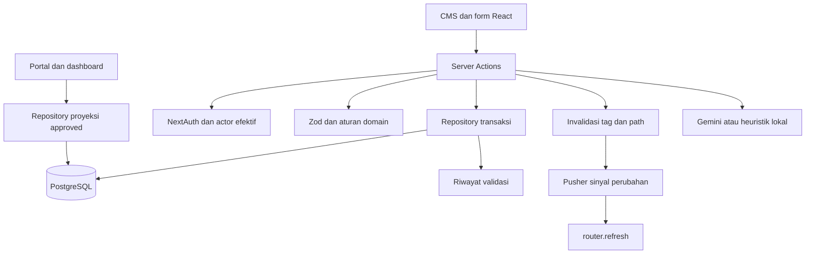
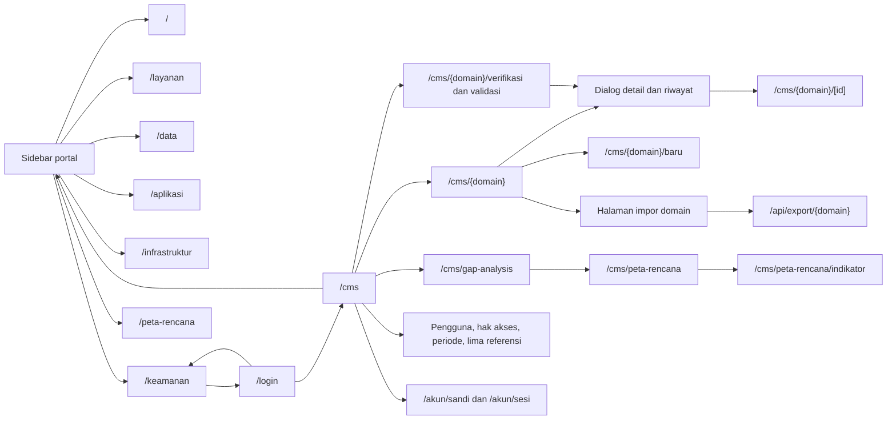
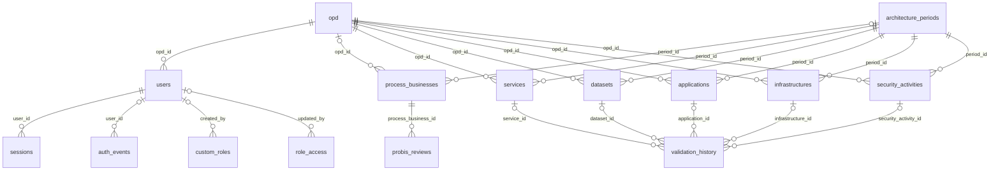
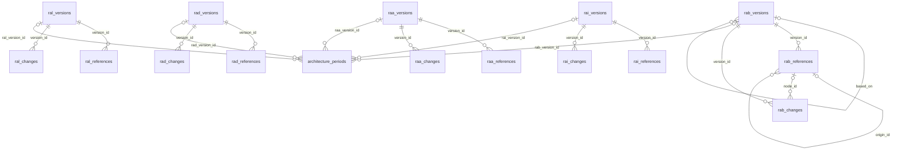
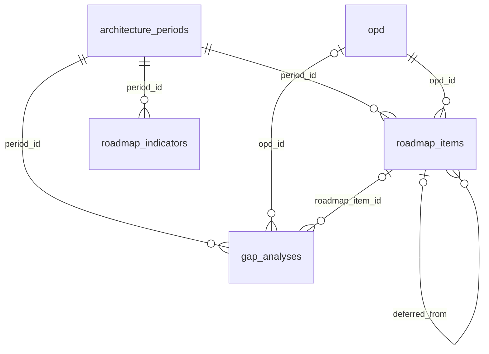
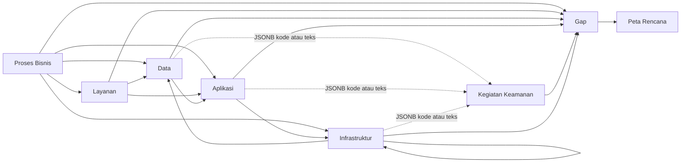
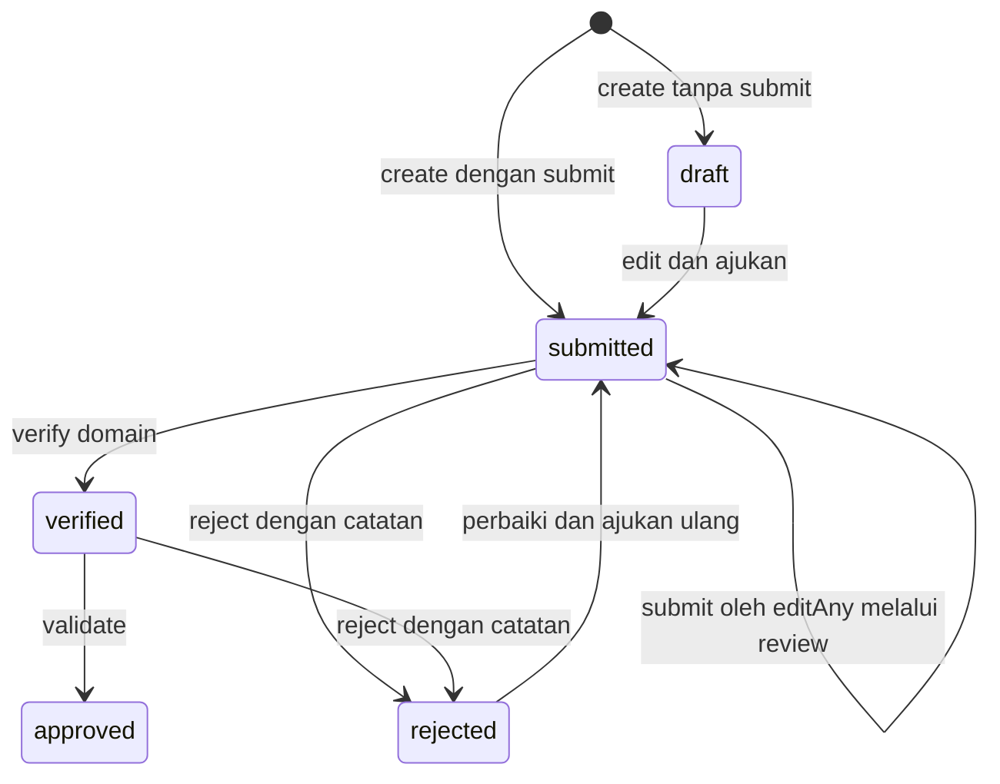
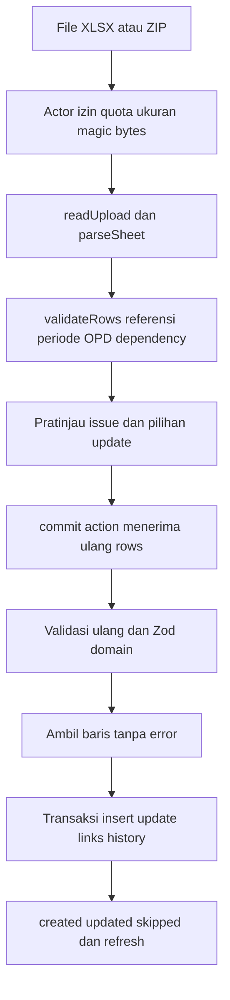
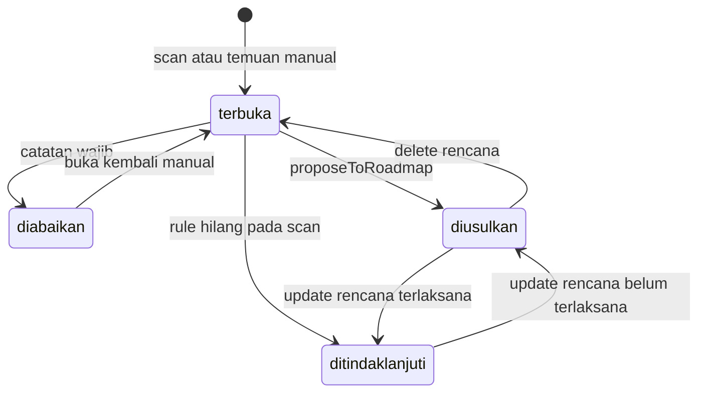

# Audit Arsitektur SPBE Diskominfo Gresik — AS-IS

Daftar isi:

- [1. Identitas Audit dan Sumber Pemeriksaan](#1-identitas-audit-dan-sumber-pemeriksaan)
- [2. Executive Summary](#2-executive-summary)
- [3. Gambaran Umum Sistem SPBE](#3-gambaran-umum-sistem-spbe)
- [4. Teknologi dan Dependency Project](#4-teknologi-dan-dependency-project)
- [5. Struktur Folder Project](#5-struktur-folder-project)
- [6. Inventaris Seluruh Halaman dan Route](#6-inventaris-seluruh-halaman-dan-route)
- [7. Peta Navigasi Antarahalaman](#7-peta-navigasi-antarahalaman)
- [8. Arsitektur Frontend dan Komponen](#8-arsitektur-frontend-dan-komponen)
- [9. Arsitektur Server Actions dan API](#9-arsitektur-server-actions-dan-api)
- [10. Peta Seluruh Library Backend](#10-peta-seluruh-library-backend)
- [11. Arsitektur Database dan Koneksi PostgreSQL](#11-arsitektur-database-dan-koneksi-postgresql)
- [12. Inventaris 45 Tabel](#12-inventaris-45-tabel)
- [13. ERD dan Hubungan Antar-Table](#13-erd-dan-hubungan-antar-table)
- [14. Proses Bisnis](#14-proses-bisnis)
- [15. Layanan](#15-layanan)
- [16. Data](#16-data)
- [17. Aplikasi](#17-aplikasi)
- [18. Infrastruktur](#18-infrastruktur)
- [19. Keamanan](#19-keamanan)
- [20. Integrasi dan Dependency Antardomain](#20-integrasi-dan-dependency-antardomain)
- [21. Autentikasi, Role dan Permission](#21-autentikasi-role-dan-permission)
- [22. Workflow dan Validation History](#22-workflow-dan-validation-history)
- [23. Import, Export, dan Template Excel](#23-import-export-dan-template-excel)
- [24. Dashboard, Peta Rencana dan Gap Analysis](#24-dashboard-peta-rencana-dan-gap-analysis)
- [25. Cache, Error Handling dan Performa](#25-cache-error-handling-dan-performa)
- [26. Temuan Audit dan Tingkat Risiko](#26-temuan-audit-dan-tingkat-risiko)
- [27. Fitur yang Sudah/Tampak Belum Terimplementasi](#27-fitur-yang-sudahtampak-belum-terimplementasi)
- [28. Rekomendasi Pengembangan Berdasarkan Bukti](#28-rekomendasi-pengembangan-berdasarkan-bukti)
- [29. Daftar Hal yang Belum Dapat Diverifikasi](#29-daftar-hal-yang-belum-dapat-diverifikasi)
- [30. Lampiran: Peta File, Fungsi, Route, dan Tabel Database](#30-lampiran-peta-file-fungsi-route-dan-tabel-database)

## 1. Identitas Audit dan Sumber Pemeriksaan

Audit statis pada 30 Oktober 2026 atas workspace aktif `C:/D/SPBE-Diskominfo/SPBE-DISKOMINFO`. Lokasi ini menjadi sumber kebenaran, meskipun prompt menyebut direktori bernama `SPBE-Diskominfo-Gresik`. Laporan menggambarkan source lokal, bukan jaminan konfigurasi atau perilaku deployment.

Metode: inventaris file, pembacaan implementasi route, komponen, action, repository, schema, SQL dan konfigurasi; penelusuran import dan pemanggilan hingga query; rekonstruksi DDL menurut urutan schema dan migration. Lampiran menyajikan indeks simbol, pemanggil langsung dan bukti bernomor baris. Indeks statis membantu cakupan, tetapi bukan bukti bahwa seluruh jalur sudah dieksekusi. Fakta ditandai melalui sumber; konsekuensi yang belum diuji dijelaskan sebagai inferensi. Rekomendasi bukan perubahan yang telah diterapkan.

Tidak menjalankan aplikasi, build, test, migration, seed, import, instalasi, koneksi database, atau akses layanan eksternal. Tidak membuka file environment. Nama variabel environment boleh disebut untuk menjelaskan konfigurasi, nilainya tidak dicatat. Pemeriksaan sebelumnya dalam percakapan tidak dijadikan hasil pengujian audit ini. Satu-satunya artefak audit adalah dokumen ini. Keadaan tabel, role koneksi, RLS, grant dan migration yang benar-benar terpasang: **Perlu Verifikasi Database Aktual**.

| Cakupan terverifikasi statis | Jumlah |
|---|---:|
| File sumber/config/dokumen yang dianalisis dan diindeks | 467 |
| Halaman page.tsx | 64 |
| Handler route.ts eksplisit | 10 |
| Total pola page + handler | 74 |
| Endpoint metadata/aset App Router terpisah | 8 |
| Fungsi Server Actions diekspor | 85 |
| API route di bawah app/api (auth + ekspor) | 9 |
| Tabel PostgreSQL (termasuk tracker runner) | 45 |
| Modul kode lib | 114 |

Hitungan file berarti cakupan inventaris/analisis statis source dan dependensi lokal; tidak mengklaim seluruh fungsi telah diuji runtime.

## 2. Executive Summary

Sistem adalah monolit Next.js App Router: portal menampilkan proyeksi data tervalidasi, CMS mengelola enam domain arsitektur dan perencanaan, Server Actions menjalankan mutasi, dan repository mengakses PostgreSQL dengan `pg`. Tidak ditemukan pemakaian Supabase Auth, PostgREST atau SDK Supabase untuk jalur bisnis utama. Supabase berfungsi sebagai hosting PostgreSQL menurut komentar koneksi dan migration keamanan; keadaan hosting aktual tidak diperiksa.

Enam domain mempunyai CRUD, impor, ekspor, antrian verifikasi/validasi, riwayat, filter dan dashboard. Proses Bisnis mempunyai pagination SQL; sebagian besar daftar lain mengirim seluruh hasil sesuai scope untuk diolah di browser. Referensi RAB/RAL/RAD/RAA/RAI berversi per periode. Infrastruktur menyimpan sepuluh jenis dalam satu tabel; Keamanan menyimpan tujuh kategori dalam satu tabel. `attributes` memuat field khusus, sedangkan `security` di Data/Aplikasi/Infrastruktur memuat array kode atau teks kegiatan keamanan, bukan FK.

Kontrol yang terbukti ada: validasi Zod server, argumen action diperiksa, permission efektif dimuat ulang dari DB, scope OPD pada daftar dan ekspor domain, token sesi berumur terbatas dan revocation server, rate limit, query parameter, transaksi, pengecekan status optimistis, serta pengamanan unggahan ZIP/XLSX. Ini bukan pernyataan bahwa semua endpoint aman: terdapat ketidakkonsistenan scope pada review peran kustom, pengubahan sandi yang tidak memeriksa kembali revocation sesi, risiko balapan impor/penghapusan, dan beberapa inkonsistensi data/perencanaan yang dirinci pada §26.

Tidak ada bukti yang cukup untuk menetapkan temuan Critical. Katalog `/katalog` masih memakai contoh dan tidak masuk menu; route placeholder `/cms/segera/[modul]` masih ada walaupun keenam domain sudah mempunyai implementasi. Semua kesimpulan kelengkapan adalah kelengkapan source, bukan penerimaan pengguna atau kesiapan produksi.

## 3. Gambaran Umum Sistem SPBE

Alur bisnis inti: OPD mengisi draft atau langsung submitted; verifikator domain menilai; validator akhir menyetujui approved; hanya proyeksi approved masuk portal. Gap Analysis memindai data approved dan menghasilkan usulan Peta Rencana. Peta Rencana tidak memakai workflow persetujuan enam domain: kegiatan tersimpan langsung masuk proyeksi publik dengan status pelaksanaan.

## 4. Teknologi dan Dependency Project

Sumber versi: `package.json`, `pnpm-lock.yaml`, `pnpm-workspace.yaml`; konfigurasi CI `.github/workflows/security-scan.yml` memakai pnpm 11 dan Node 24. `package.json` tidak menetapkan `packageManager`; versi pnpm mengikuti CI, bukan field manifest. Audit ini tidak menginstal atau memeriksa ulang runtime dependency.

| Kelompok | Dependency dan tanggung jawab |
|---|---|
| Runtime | Next.js 16.3.8, React/React DOM 19.2.8; App Router, Server Components dan Actions |
| Bahasa | TypeScript `^5`, strict, alias `@/*`, moduleResolution bundler (`tsconfig.json`) |
| Data dan auth | `pg ^8.23.0`, `next-auth 5.0.0-beta.32`, `bcryptjs ^3.0.3`, `zod ^4.5.4` |
| Dokumen | `xlsx` tarball versi 0.20.3, `fflate ^0.8.3`; Excel dan arsip dalam memori |
| UI | Tailwind CSS 4, shadcn, radix-ui, cmdk, sonner; `components/ui` dan `components/blocks` |
| Visual | GSAP/@gsap/react, animejs, AOS, Swiper, Lottie, Chart.js/react-chartjs-2, Hugeicons |
| Realtime | `pusher` server dan `pusher-js` browser; broadcast metadata perubahan |
| Tooling | ESLint 9, eslint-config-next 16.3.8, tsx; generator referensi/template/ilustrasi |

Manifest juga memuat `class-variance-authority`, `clsx`, `cn`, `tailwind-merge`, `tw-animate-css`, `next-themes`, paket type Node/React/pg/AOS. Kehadiran dependency tidak otomatis membuktikan pemakaian; lihat import setiap file pada lampiran. Workspace memberi override sharp/source-map-js/brace-expansion dan kebijakan build esbuild/unrs-resolver. Tidak ada peningkatan versi atau perubahan dependency selama audit.

## 5. Struktur Folder Project

| Lokasi | Fungsi dan batas |
|---|---|
| `app/layout.tsx` | Root HTML, font Google, tooltip, toast, realtime; metadata situs |
| `app/(public)` | Dashboard domain dan katalog; route group tidak menjadi segmen URL |
| `app/cms` | Shell internal, enam domain, review, impor, perencanaan dan pengaturan |
| `app/actions` | Login/logout, sandi dan sesi perangkat |
| `app/api` | Auth.js catch-all dan delapan ekspor Excel |
| `app/akun`, `app/login` | Akun pribadi, form login |
| `components/ui`, `components/blocks` | Primitif shadcn dan pola aplikasi reusable |
| `components/cms` | Form, daftar, dialog detail, import/review dan manager |
| `components/dashboards` | Agregasi/filter/grafik client per domain |
| `components/reference`, folder context domain | Indeks referensi sesuai periode, disediakan server ke client |
| `components/layout`, `motion`, `charts`, `illustrations`, `brand` | Shell/navigasi, gerak, grafik, Lottie dan logo |
| `hooks` | Query URL, reduced motion, viewport/visibility |
| `lib` | Domain/repository/schema/import/query, auth/permission, shared helpers dan integrasi |
| `database/schema.sql`, `database/migrations` | Skema dasar dan 22 migration bernomor 002–023; sebagian berisi data referensi/akun historis |
| `database/migrate.mjs` | Runner bertransaksi per migration; membuat tabel pelacak; tidak dijalankan |
| `scripts` | Generator referensi, template, ilustrasi; seed/admin; pengujian keamanan/Strix; tidak dijalankan |
| `public` | Aset statis termasuk template; hanya nama/path diperiksa, isi workbook/biner tidak dieksekusi atau diparsing |
| `docs` | Design system, dokumentasi keamanan dan aset brand; dokumen lama bukan bukti hasil audit saat ini |
| `auth.ts`, `proxy.ts`, `next.config.ts` | Auth.js, proteksi request/Origin, header dan batas unggahan |

Tidak ada folder backend terpisah atau ORM. `lib/probis/repo.ts` memuat bacaan CMS dan publik sekaligus, berbeda dari lima domain lain yang memisahkan `cms-repo.ts` dan `repo.ts`.

## 6. Inventaris Seluruh Halaman dan Route

Definisi hitungan: `page.tsx` = halaman; `route.ts` = handler eksplisit. Endpoint metadata seperti sitemap dan gambar sosial dihitung terpisah. Dynamic `[id]` adalah satu pola route, bukan jumlah instance record. Root layout selalu digunakan. Layout domain hanya ditambahkan bila file benar-benar ada; Keamanan CMS tidak mempunyai layout domain tersendiri.

Kode perilaku yang berlaku untuk tabel inventaris:

| Profil | Kontrak akses, data, interaksi, loading/error dan navigasi |
|---|---|
| PUB | Publik, baca repository approved → dashboard client; masuk dari sidebar portal, keluar ke domain lain/login/CMS. Filter periode/OPD/referensi dan dialog detail; skeleton/Suspense, contoh bila DB kosong/gagal. Data contoh diberi indikator sample. |
| LIST | CMS `currentActor` → `opdScope` → list repository; baca sesuai OPD atau `readAll`; tambah jika `create`, impor/ekspor menurut izin, detail dialog dan edit `[id]`. `loading.tsx` CMS dan empty state komponen; galat tak tertangani menuju root error boundary. |
| NEW | `create` + CMS actor; form record null, OPD terkunci bila scoped, pilihan periode. Masuk sidebar/daftar; simpan draft/submit melalui action; dialog sukses, galat field/toast; kembali daftar. |
| EDIT | UUID → `loadRecord` → `can.read`, lalu `can.edit`; tidak ada/OPD lain = 404, status tidak dapat diedit = NoAccess. Form memakai action save dengan id; kembali daftar/detail. |
| VERIFY | `verify.domain`, status submitted; daftar semua OPD tanpa opdScope. Masuk sidebar/badge/beranda; detail → verify/reject → refresh. Lihat F01 untuk peran kustom scoped. |
| VALIDATE | `validate`, status verified; daftar semua OPD tanpa opdScope; detail → approve/reject. Layout dan loading mengikuti CMS/domain. |
| IMPORT | `import` ATAU `export` pada halaman; preview/commit memerlukan import. ImportPanel, file → preview → pilih status/update → commit; template statis dan GET ekspor. Empty/error/toast di panel. |
| REF | `ref.kind`, RefPage/RefManager; pilihan versi query `versi`, pohon node, clone/publish/remap/history; action generik → makeVersionedRef → tiga tabel referensi dan periode/domain pemakai. |
| PLAN | Baca CMS rencana seluruh OPD; kelola memerlukan `rencana`; daftar/detail/tambah/impor/indikator. Publikasi langsung; §24 menjelaskan perbedaan edit guard. |

Setiap baris di bawah menggabungkan profil ini dengan komponen, akses khusus, backend, tabel dan navigasi spesifik. Bukti implementasi dan pemanggil langsung ada pada §30; jangan menafsirkan izin menu sebagai satu-satunya proteksi.

| URL / tipe | Source / layout | Profil / izin khusus | Komponen dan data | Action → backend → tabel | Masuk → keluar; catatan |
|---|---|---|---|---|---|
| / (page) | [app/(public)/page.tsx:1](../app/(public)/page.tsx#L1); [app/layout.tsx:1](../app/layout.tsx#L1) → [app/(public)/layout.tsx:1](../app/(public)/layout.tsx#L1) | PUB | DashboardPage, RabProvider, BusinessProcessDashboard; lib/pack, lib/probis/generate, lib/probis/periods, lib/probis/rab, lib/probis/sample-reference, lib/probis/repo, lib/portal/load | lib/probis/repo.ts → process_businesses | Sidebar portal → domain lain/login/CMS; detail dialog |
| /.well-known/security.txt (handler) | [app/.well-known/security.txt/route.ts:1](../app/.well-known/security.txt/route.ts#L1); handler HTTP tanpa layout React | GET; 404 bila contact tidak diatur | Response/form; lib/site | lib/site.ts; tanpa DB | Direct security.txt; tanpa navigasi UI |
| /akun/sandi (page) | [app/akun/sandi/page.tsx:1](../app/akun/sandi/page.tsx#L1); [app/layout.tsx:1](../app/layout.tsx#L1) | Sesi nyata; non-demo; sandi sementara hanya /akun/sandi | ChangePasswordForm;  | app/actions/akun.ts → lib/pengguna/repo.ts + lib/security/session.ts → users/sessions/auth_events/rate_limits | Menu akun / redirect password → login setelah ganti sandi atau CMS |
| /akun/sesi (page) | [app/akun/sesi/page.tsx:1](../app/akun/sesi/page.tsx#L1); [app/layout.tsx:1](../app/layout.tsx#L1) | Sesi nyata; non-demo; sandi sementara hanya /akun/sandi | SessionList; lib/security/session | app/actions/akun.ts → lib/pengguna/repo.ts + lib/security/session.ts → users/sessions/auth_events/rate_limits | Menu akun / redirect password → login setelah ganti sandi atau CMS |
| /api/auth/[...nextauth] (handler) | [app/api/auth/[...nextauth]/route.ts:1](../app/api/auth/[...nextauth]/route.ts#L1); handler HTTP tanpa layout React | GET/POST Auth.js | Response/form;  | auth.ts → users/sessions/rate_limits/auth_events | Login/logout/session Auth.js; bukan menu sidebar |
| /api/export/aplikasi (handler) | [app/api/export/aplikasi/route.ts:1](../app/api/export/aplikasi/route.ts#L1); handler HTTP tanpa layout React | GET; actor + export | Response/form; lib/export/xlsx-response, lib/keamanan/cms-repo, lib/keamanan/link, lib/aplikasi/cms-repo, lib/aplikasi/data-flow, lib/aplikasi/raa, lib/aplikasi/reference, lib/data/reference, lib/probis/reference, lib/reference/versioned | lib/aplikasi/cms-repo.ts → applications | Unduhan dari impor/daftar → XLSX; handler bukan item sidebar |
| /api/export/data (handler) | [app/api/export/data/route.ts:1](../app/api/export/data/route.ts#L1); handler HTTP tanpa layout React | GET; actor + export | Response/form; lib/export/xlsx-response, lib/keamanan/cms-repo, lib/keamanan/link, lib/data/cms-repo, lib/data/rad, lib/data/reference, lib/probis/reference, lib/reference/versioned | lib/data/cms-repo.ts → datasets | Unduhan dari impor/daftar → XLSX; handler bukan item sidebar |
| /api/export/gap (handler) | [app/api/export/gap/route.ts:1](../app/api/export/gap/route.ts#L1); handler HTTP tanpa layout React | GET; actor + export + view.gap | Response/form; lib/export/xlsx-response, lib/gap/cms-repo, lib/gap/columns | lib/gap/cms-repo.ts → gap_analyses | Unduhan dari impor/daftar → XLSX; handler bukan item sidebar |
| /api/export/infrastruktur (handler) | [app/api/export/infrastruktur/route.ts:1](../app/api/export/infrastruktur/route.ts#L1); handler HTTP tanpa layout React | GET; actor + export | Response/form; lib/export/xlsx-response, lib/keamanan/cms-repo, lib/keamanan/link, lib/infrastruktur/cms-repo, lib/infrastruktur/columns, lib/infrastruktur/jenis, lib/infrastruktur/rai, lib/reference/versioned | lib/infrastruktur/cms-repo.ts → infrastructures | Unduhan dari impor/daftar → XLSX; handler bukan item sidebar |
| /api/export/keamanan (handler) | [app/api/export/keamanan/route.ts:1](../app/api/export/keamanan/route.ts#L1); handler HTTP tanpa layout React | GET; actor + export; lintas OPD tambah view.keamanan | Response/form; lib/export/xlsx-response, lib/keamanan/cms-repo, lib/keamanan/columns, lib/keamanan/jenis | lib/keamanan/cms-repo.ts → security_activities | Unduhan dari impor/daftar → XLSX; handler bukan item sidebar |
| /api/export/layanan (handler) | [app/api/export/layanan/route.ts:1](../app/api/export/layanan/route.ts#L1); handler HTTP tanpa layout React | GET; actor + export | Response/form; lib/export/xlsx-response, lib/layanan/cms-repo, lib/layanan/ral, lib/layanan/reference, lib/probis/rab, lib/probis/reference, lib/reference/versioned | lib/layanan/cms-repo.ts → services | Unduhan dari impor/daftar → XLSX; handler bukan item sidebar |
| /api/export/peta-rencana (handler) | [app/api/export/peta-rencana/route.ts:1](../app/api/export/peta-rencana/route.ts#L1); handler HTTP tanpa layout React | GET; actor + export | Response/form; lib/export/xlsx-response, lib/peta-rencana/cms-repo, lib/peta-rencana/columns | lib/peta-rencana/cms-repo.ts → roadmap_items | Unduhan dari impor/daftar → XLSX; handler bukan item sidebar |
| /api/export/proses-bisnis (handler) | [app/api/export/proses-bisnis/route.ts:1](../app/api/export/proses-bisnis/route.ts#L1); handler HTTP tanpa layout React | GET; actor + export | Response/form; lib/export/xlsx-response, lib/probis/repo, lib/probis/rab, lib/probis/reference | lib/probis/repo.ts → process_businesses | Unduhan dari impor/daftar → XLSX; handler bukan item sidebar |
| /aplikasi (page) | [app/(public)/aplikasi/page.tsx:1](../app/(public)/aplikasi/page.tsx#L1); [app/layout.tsx:1](../app/layout.tsx#L1) → [app/(public)/layout.tsx:1](../app/(public)/layout.tsx#L1) | PUB | DashboardPage, AplikasiDashboard; lib/aplikasi/generate, lib/aplikasi/repo, lib/probis/periods, lib/portal/load | lib/aplikasi/repo.ts → applications | Sidebar portal → domain lain/login/CMS; detail dialog |
| /cms (page) | [app/cms/page.tsx:1](../app/cms/page.tsx#L1); [app/layout.tsx:1](../app/layout.tsx#L1) → [app/cms/layout.tsx:1](../app/cms/layout.tsx#L1) | Actor CMS | CmsHome; lib/aplikasi/cms-repo, lib/data/cms-repo, lib/infrastruktur/cms-repo, lib/keamanan/cms-repo, lib/layanan/cms-repo, lib/gap/cms-repo, lib/peta-rencana/cms-repo, lib/probis/repo | lib/*/summary + lib/probis/repo.ts → enam domain/history | Login/sidebar → daftar tugas/review/domain/portal |
| /cms/aplikasi (page) | [app/cms/aplikasi/page.tsx:1](../app/cms/aplikasi/page.tsx#L1); [app/layout.tsx:1](../app/layout.tsx#L1) → [app/cms/layout.tsx:1](../app/cms/layout.tsx#L1) → [app/cms/aplikasi/layout.tsx:1](../app/cms/aplikasi/layout.tsx#L1) | LIST | AplikasiList; lib/aplikasi/cms-repo, lib/probis/periods | app/cms/aplikasi/actions.ts → lib/aplikasi/cms-repo.ts → applications + validation_history | Sidebar /cms/aplikasi → detail/baru/[id]/review/impor; kembali ke daftar |
| /cms/aplikasi/[id] (page) | [app/cms/aplikasi/[id]/page.tsx:1](../app/cms/aplikasi/[id]/page.tsx#L1); [app/layout.tsx:1](../app/layout.tsx#L1) → [app/cms/layout.tsx:1](../app/cms/layout.tsx#L1) → [app/cms/aplikasi/layout.tsx:1](../app/cms/aplikasi/layout.tsx#L1) | EDIT | AplikasiForm; lib/cms/record-page, lib/aplikasi/cms-repo | app/cms/aplikasi/actions.ts → lib/aplikasi/cms-repo.ts → applications + validation_history | Sidebar /cms/aplikasi → detail/baru/[id]/review/impor; kembali ke daftar |
| /cms/aplikasi/baru (page) | [app/cms/aplikasi/baru/page.tsx:1](../app/cms/aplikasi/baru/page.tsx#L1); [app/layout.tsx:1](../app/layout.tsx#L1) → [app/cms/layout.tsx:1](../app/cms/layout.tsx#L1) → [app/cms/aplikasi/layout.tsx:1](../app/cms/aplikasi/layout.tsx#L1) | NEW | AplikasiForm; lib/probis/periods, lib/probis/repo | app/cms/aplikasi/actions.ts → lib/aplikasi/cms-repo.ts → applications + validation_history | Sidebar /cms/aplikasi → detail/baru/[id]/review/impor; kembali ke daftar |
| /cms/aplikasi/impor (page) | [app/cms/aplikasi/impor/page.tsx:1](../app/cms/aplikasi/impor/page.tsx#L1); [app/layout.tsx:1](../app/layout.tsx#L1) → [app/cms/layout.tsx:1](../app/cms/layout.tsx#L1) → [app/cms/aplikasi/layout.tsx:1](../app/cms/aplikasi/layout.tsx#L1) | IMPORT | AplikasiImport;  | app/cms/aplikasi/actions.ts → lib/aplikasi/cms-repo.ts → applications + validation_history | Sidebar /cms/aplikasi → detail/baru/[id]/review/impor; kembali ke daftar |
| /cms/aplikasi/validasi (page) | [app/cms/aplikasi/validasi/page.tsx:1](../app/cms/aplikasi/validasi/page.tsx#L1); [app/layout.tsx:1](../app/layout.tsx#L1) → [app/cms/layout.tsx:1](../app/cms/layout.tsx#L1) → [app/cms/aplikasi/layout.tsx:1](../app/cms/aplikasi/layout.tsx#L1) | VALIDATE validate | AplikasiReviewQueue; lib/aplikasi/cms-repo | app/cms/aplikasi/actions.ts → lib/aplikasi/cms-repo.ts → applications + validation_history | Sidebar /cms/aplikasi → detail/baru/[id]/review/impor; kembali ke daftar |
| /cms/aplikasi/verifikasi (page) | [app/cms/aplikasi/verifikasi/page.tsx:1](../app/cms/aplikasi/verifikasi/page.tsx#L1); [app/layout.tsx:1](../app/layout.tsx#L1) → [app/cms/layout.tsx:1](../app/cms/layout.tsx#L1) → [app/cms/aplikasi/layout.tsx:1](../app/cms/aplikasi/layout.tsx#L1) | VERIFY verify.aplikasi | AplikasiReviewQueue; lib/aplikasi/cms-repo | app/cms/aplikasi/actions.ts → lib/aplikasi/cms-repo.ts → applications + validation_history | Sidebar /cms/aplikasi → detail/baru/[id]/review/impor; kembali ke daftar |
| /cms/data (page) | [app/cms/data/page.tsx:1](../app/cms/data/page.tsx#L1); [app/layout.tsx:1](../app/layout.tsx#L1) → [app/cms/layout.tsx:1](../app/cms/layout.tsx#L1) → [app/cms/data/layout.tsx:1](../app/cms/data/layout.tsx#L1) | LIST | DataList; lib/data/cms-repo, lib/probis/periods | app/cms/data/actions.ts → lib/data/cms-repo.ts → datasets + validation_history | Sidebar /cms/data → detail/baru/[id]/review/impor; kembali ke daftar |
| /cms/data/[id] (page) | [app/cms/data/[id]/page.tsx:1](../app/cms/data/[id]/page.tsx#L1); [app/layout.tsx:1](../app/layout.tsx#L1) → [app/cms/layout.tsx:1](../app/cms/layout.tsx#L1) → [app/cms/data/layout.tsx:1](../app/cms/data/layout.tsx#L1) | EDIT | DataForm; lib/cms/record-page, lib/data/cms-repo | app/cms/data/actions.ts → lib/data/cms-repo.ts → datasets + validation_history | Sidebar /cms/data → detail/baru/[id]/review/impor; kembali ke daftar |
| /cms/data/baru (page) | [app/cms/data/baru/page.tsx:1](../app/cms/data/baru/page.tsx#L1); [app/layout.tsx:1](../app/layout.tsx#L1) → [app/cms/layout.tsx:1](../app/cms/layout.tsx#L1) → [app/cms/data/layout.tsx:1](../app/cms/data/layout.tsx#L1) | NEW | DataForm; lib/probis/periods, lib/probis/repo | app/cms/data/actions.ts → lib/data/cms-repo.ts → datasets + validation_history | Sidebar /cms/data → detail/baru/[id]/review/impor; kembali ke daftar |
| /cms/data/impor (page) | [app/cms/data/impor/page.tsx:1](../app/cms/data/impor/page.tsx#L1); [app/layout.tsx:1](../app/layout.tsx#L1) → [app/cms/layout.tsx:1](../app/cms/layout.tsx#L1) → [app/cms/data/layout.tsx:1](../app/cms/data/layout.tsx#L1) | IMPORT | DataImport;  | app/cms/data/actions.ts → lib/data/cms-repo.ts → datasets + validation_history | Sidebar /cms/data → detail/baru/[id]/review/impor; kembali ke daftar |
| /cms/data/validasi (page) | [app/cms/data/validasi/page.tsx:1](../app/cms/data/validasi/page.tsx#L1); [app/layout.tsx:1](../app/layout.tsx#L1) → [app/cms/layout.tsx:1](../app/cms/layout.tsx#L1) → [app/cms/data/layout.tsx:1](../app/cms/data/layout.tsx#L1) | VALIDATE validate | DataReviewQueue; lib/data/cms-repo | app/cms/data/actions.ts → lib/data/cms-repo.ts → datasets + validation_history | Sidebar /cms/data → detail/baru/[id]/review/impor; kembali ke daftar |
| /cms/data/verifikasi (page) | [app/cms/data/verifikasi/page.tsx:1](../app/cms/data/verifikasi/page.tsx#L1); [app/layout.tsx:1](../app/layout.tsx#L1) → [app/cms/layout.tsx:1](../app/cms/layout.tsx#L1) → [app/cms/data/layout.tsx:1](../app/cms/data/layout.tsx#L1) | VERIFY verify.data | DataReviewQueue; lib/data/cms-repo | app/cms/data/actions.ts → lib/data/cms-repo.ts → datasets + validation_history | Sidebar /cms/data → detail/baru/[id]/review/impor; kembali ke daftar |
| /cms/gap-analysis (page) | [app/cms/gap-analysis/page.tsx:1](../app/cms/gap-analysis/page.tsx#L1); [app/layout.tsx:1](../app/layout.tsx#L1) → [app/cms/layout.tsx:1](../app/cms/layout.tsx#L1) | view.gap; mutasi rencana | GapDashboard; lib/gap/cms-repo, lib/pack, lib/probis/periods | actions.ts → lib/gap/cms-repo.ts → gap_analyses, domain approved, roadmap_items | Sidebar/peringatan rencana → dialog/manual/proposal kegiatan |
| /cms/impor (page) | [app/cms/impor/page.tsx:1](../app/cms/impor/page.tsx#L1); [app/layout.tsx:1](../app/layout.tsx#L1) → [app/cms/layout.tsx:1](../app/cms/layout.tsx#L1) → [app/cms/impor/layout.tsx:1](../app/cms/impor/layout.tsx#L1) | IMPORT Proses Bisnis | ProbisImport;  | app/cms/actions.ts → lib/probis/import.ts/repo.ts → process_businesses/probis_reviews | Sidebar Probis → template/ekspor/daftar |
| /cms/infrastruktur (page) | [app/cms/infrastruktur/page.tsx:1](../app/cms/infrastruktur/page.tsx#L1); [app/layout.tsx:1](../app/layout.tsx#L1) → [app/cms/layout.tsx:1](../app/cms/layout.tsx#L1) → [app/cms/infrastruktur/layout.tsx:1](../app/cms/infrastruktur/layout.tsx#L1) | LIST | InfrastrukturList; lib/infrastruktur/cms-repo, lib/probis/periods | app/cms/infrastruktur/actions.ts → lib/infrastruktur/cms-repo.ts → infrastructures + validation_history | Sidebar /cms/infrastruktur → detail/baru/[id]/review/impor; kembali ke daftar |
| /cms/infrastruktur/[id] (page) | [app/cms/infrastruktur/[id]/page.tsx:1](../app/cms/infrastruktur/[id]/page.tsx#L1); [app/layout.tsx:1](../app/layout.tsx#L1) → [app/cms/layout.tsx:1](../app/cms/layout.tsx#L1) → [app/cms/infrastruktur/layout.tsx:1](../app/cms/infrastruktur/layout.tsx#L1) | EDIT | InfrastrukturForm; lib/cms/record-page, lib/infrastruktur/cms-repo | app/cms/infrastruktur/actions.ts → lib/infrastruktur/cms-repo.ts → infrastructures + validation_history | Sidebar /cms/infrastruktur → detail/baru/[id]/review/impor; kembali ke daftar |
| /cms/infrastruktur/baru (page) | [app/cms/infrastruktur/baru/page.tsx:1](../app/cms/infrastruktur/baru/page.tsx#L1); [app/layout.tsx:1](../app/layout.tsx#L1) → [app/cms/layout.tsx:1](../app/cms/layout.tsx#L1) → [app/cms/infrastruktur/layout.tsx:1](../app/cms/infrastruktur/layout.tsx#L1) | NEW | InfrastrukturForm; lib/infrastruktur/jenis, lib/probis/periods, lib/probis/repo | app/cms/infrastruktur/actions.ts → lib/infrastruktur/cms-repo.ts → infrastructures + validation_history | Sidebar /cms/infrastruktur → detail/baru/[id]/review/impor; kembali ke daftar |
| /cms/infrastruktur/impor (page) | [app/cms/infrastruktur/impor/page.tsx:1](../app/cms/infrastruktur/impor/page.tsx#L1); [app/layout.tsx:1](../app/layout.tsx#L1) → [app/cms/layout.tsx:1](../app/cms/layout.tsx#L1) → [app/cms/infrastruktur/layout.tsx:1](../app/cms/infrastruktur/layout.tsx#L1) | IMPORT | InfrastrukturImport;  | app/cms/infrastruktur/actions.ts → lib/infrastruktur/cms-repo.ts → infrastructures + validation_history | Sidebar /cms/infrastruktur → detail/baru/[id]/review/impor; kembali ke daftar |
| /cms/infrastruktur/validasi (page) | [app/cms/infrastruktur/validasi/page.tsx:1](../app/cms/infrastruktur/validasi/page.tsx#L1); [app/layout.tsx:1](../app/layout.tsx#L1) → [app/cms/layout.tsx:1](../app/cms/layout.tsx#L1) → [app/cms/infrastruktur/layout.tsx:1](../app/cms/infrastruktur/layout.tsx#L1) | VALIDATE validate | InfrastrukturReviewQueue; lib/infrastruktur/cms-repo | app/cms/infrastruktur/actions.ts → lib/infrastruktur/cms-repo.ts → infrastructures + validation_history | Sidebar /cms/infrastruktur → detail/baru/[id]/review/impor; kembali ke daftar |
| /cms/infrastruktur/verifikasi (page) | [app/cms/infrastruktur/verifikasi/page.tsx:1](../app/cms/infrastruktur/verifikasi/page.tsx#L1); [app/layout.tsx:1](../app/layout.tsx#L1) → [app/cms/layout.tsx:1](../app/cms/layout.tsx#L1) → [app/cms/infrastruktur/layout.tsx:1](../app/cms/infrastruktur/layout.tsx#L1) | VERIFY verify.infrastruktur | InfrastrukturReviewQueue; lib/infrastruktur/cms-repo | app/cms/infrastruktur/actions.ts → lib/infrastruktur/cms-repo.ts → infrastructures + validation_history | Sidebar /cms/infrastruktur → detail/baru/[id]/review/impor; kembali ke daftar |
| /cms/keamanan (page) | [app/cms/keamanan/page.tsx:1](../app/cms/keamanan/page.tsx#L1); [app/layout.tsx:1](../app/layout.tsx#L1) → [app/cms/layout.tsx:1](../app/cms/layout.tsx#L1) | LIST | KeamananList; lib/keamanan/cms-repo, lib/probis/periods | app/cms/keamanan/actions.ts → lib/keamanan/cms-repo.ts → security_activities + validation_history | Sidebar /cms/keamanan → detail/baru/[id]/review/impor; kembali ke daftar |
| /cms/keamanan/[id] (page) | [app/cms/keamanan/[id]/page.tsx:1](../app/cms/keamanan/[id]/page.tsx#L1); [app/layout.tsx:1](../app/layout.tsx#L1) → [app/cms/layout.tsx:1](../app/cms/layout.tsx#L1) | EDIT | KeamananForm; lib/cms/record-page, lib/keamanan/cms-repo | app/cms/keamanan/actions.ts → lib/keamanan/cms-repo.ts → security_activities + validation_history | Sidebar /cms/keamanan → detail/baru/[id]/review/impor; kembali ke daftar |
| /cms/keamanan/baru (page) | [app/cms/keamanan/baru/page.tsx:1](../app/cms/keamanan/baru/page.tsx#L1); [app/layout.tsx:1](../app/layout.tsx#L1) → [app/cms/layout.tsx:1](../app/cms/layout.tsx#L1) | NEW | KeamananForm; lib/keamanan/jenis, lib/probis/periods, lib/probis/repo | app/cms/keamanan/actions.ts → lib/keamanan/cms-repo.ts → security_activities + validation_history | Sidebar /cms/keamanan → detail/baru/[id]/review/impor; kembali ke daftar |
| /cms/keamanan/impor (page) | [app/cms/keamanan/impor/page.tsx:1](../app/cms/keamanan/impor/page.tsx#L1); [app/layout.tsx:1](../app/layout.tsx#L1) → [app/cms/layout.tsx:1](../app/cms/layout.tsx#L1) | IMPORT | KeamananImport;  | app/cms/keamanan/actions.ts → lib/keamanan/cms-repo.ts → security_activities + validation_history | Sidebar /cms/keamanan → detail/baru/[id]/review/impor; kembali ke daftar |
| /cms/keamanan/validasi (page) | [app/cms/keamanan/validasi/page.tsx:1](../app/cms/keamanan/validasi/page.tsx#L1); [app/layout.tsx:1](../app/layout.tsx#L1) → [app/cms/layout.tsx:1](../app/cms/layout.tsx#L1) | VALIDATE validate | KeamananReviewQueue; lib/keamanan/cms-repo | app/cms/keamanan/actions.ts → lib/keamanan/cms-repo.ts → security_activities + validation_history | Sidebar /cms/keamanan → detail/baru/[id]/review/impor; kembali ke daftar |
| /cms/keamanan/verifikasi (page) | [app/cms/keamanan/verifikasi/page.tsx:1](../app/cms/keamanan/verifikasi/page.tsx#L1); [app/layout.tsx:1](../app/layout.tsx#L1) → [app/cms/layout.tsx:1](../app/cms/layout.tsx#L1) | VERIFY verify.keamanan | KeamananReviewQueue; lib/keamanan/cms-repo | app/cms/keamanan/actions.ts → lib/keamanan/cms-repo.ts → security_activities + validation_history | Sidebar /cms/keamanan → detail/baru/[id]/review/impor; kembali ke daftar |
| /cms/layanan (page) | [app/cms/layanan/page.tsx:1](../app/cms/layanan/page.tsx#L1); [app/layout.tsx:1](../app/layout.tsx#L1) → [app/cms/layout.tsx:1](../app/cms/layout.tsx#L1) → [app/cms/layanan/layout.tsx:1](../app/cms/layanan/layout.tsx#L1) | LIST | LayananTable; lib/layanan/cms-repo, lib/probis/periods | app/cms/layanan/actions.ts → lib/layanan/cms-repo.ts → services + validation_history | Sidebar /cms/layanan → detail/baru/[id]/review/impor; kembali ke daftar |
| /cms/layanan/[id] (page) | [app/cms/layanan/[id]/page.tsx:1](../app/cms/layanan/[id]/page.tsx#L1); [app/layout.tsx:1](../app/layout.tsx#L1) → [app/cms/layout.tsx:1](../app/cms/layout.tsx#L1) → [app/cms/layanan/layout.tsx:1](../app/cms/layanan/layout.tsx#L1) | EDIT | LayananForm; lib/cms/record-page, lib/layanan/cms-repo | app/cms/layanan/actions.ts → lib/layanan/cms-repo.ts → services + validation_history | Sidebar /cms/layanan → detail/baru/[id]/review/impor; kembali ke daftar |
| /cms/layanan/baru (page) | [app/cms/layanan/baru/page.tsx:1](../app/cms/layanan/baru/page.tsx#L1); [app/layout.tsx:1](../app/layout.tsx#L1) → [app/cms/layout.tsx:1](../app/cms/layout.tsx#L1) → [app/cms/layanan/layout.tsx:1](../app/cms/layanan/layout.tsx#L1) | NEW | LayananForm; lib/probis/periods, lib/probis/repo | app/cms/layanan/actions.ts → lib/layanan/cms-repo.ts → services + validation_history | Sidebar /cms/layanan → detail/baru/[id]/review/impor; kembali ke daftar |
| /cms/layanan/impor (page) | [app/cms/layanan/impor/page.tsx:1](../app/cms/layanan/impor/page.tsx#L1); [app/layout.tsx:1](../app/layout.tsx#L1) → [app/cms/layout.tsx:1](../app/cms/layout.tsx#L1) → [app/cms/layanan/layout.tsx:1](../app/cms/layanan/layout.tsx#L1) | IMPORT | LayananImport;  | app/cms/layanan/actions.ts → lib/layanan/cms-repo.ts → services + validation_history | Sidebar /cms/layanan → detail/baru/[id]/review/impor; kembali ke daftar |
| /cms/layanan/validasi (page) | [app/cms/layanan/validasi/page.tsx:1](../app/cms/layanan/validasi/page.tsx#L1); [app/layout.tsx:1](../app/layout.tsx#L1) → [app/cms/layout.tsx:1](../app/cms/layout.tsx#L1) → [app/cms/layanan/layout.tsx:1](../app/cms/layanan/layout.tsx#L1) | VALIDATE validate | LayananReviewQueue; lib/layanan/cms-repo | app/cms/layanan/actions.ts → lib/layanan/cms-repo.ts → services + validation_history | Sidebar /cms/layanan → detail/baru/[id]/review/impor; kembali ke daftar |
| /cms/layanan/verifikasi (page) | [app/cms/layanan/verifikasi/page.tsx:1](../app/cms/layanan/verifikasi/page.tsx#L1); [app/layout.tsx:1](../app/layout.tsx#L1) → [app/cms/layout.tsx:1](../app/cms/layout.tsx#L1) → [app/cms/layanan/layout.tsx:1](../app/cms/layanan/layout.tsx#L1) | VERIFY verify.layanan | LayananReviewQueue; lib/layanan/cms-repo | app/cms/layanan/actions.ts → lib/layanan/cms-repo.ts → services + validation_history | Sidebar /cms/layanan → detail/baru/[id]/review/impor; kembali ke daftar |
| /cms/pengaturan/hak-akses (page) | [app/cms/pengaturan/hak-akses/page.tsx:1](../app/cms/pengaturan/hak-akses/page.tsx#L1); [app/layout.tsx:1](../app/layout.tsx#L1) → [app/cms/layout.tsx:1](../app/cms/layout.tsx#L1) | users (mutasi role khusus superadmin) | AccessMatrix; lib/db, lib/pengguna/grants, lib/pengguna/repo | app/cms/pengaturan/actions.ts → lib/pengguna/{repo,grants}.ts → users/opd/custom_roles/role_access | Sidebar pengaturan → pilihan versi/dialog/aksi; shell CMS tetap tersedia |
| /cms/pengaturan/pengguna (page) | [app/cms/pengaturan/pengguna/page.tsx:1](../app/cms/pengaturan/pengguna/page.tsx#L1); [app/layout.tsx:1](../app/layout.tsx#L1) → [app/cms/layout.tsx:1](../app/cms/layout.tsx#L1) | users (mutasi role khusus superadmin) | UserManager; lib/db, lib/pengguna/grants, lib/pengguna/repo | app/cms/pengaturan/actions.ts → lib/pengguna/{repo,grants}.ts → users/opd/custom_roles/role_access | Sidebar pengaturan → pilihan versi/dialog/aksi; shell CMS tetap tersedia |
| /cms/pengaturan/periode (page) | [app/cms/pengaturan/periode/page.tsx:1](../app/cms/pengaturan/periode/page.tsx#L1); [app/layout.tsx:1](../app/layout.tsx#L1) → [app/cms/layout.tsx:1](../app/cms/layout.tsx#L1) | periods | PeriodManager; lib/aplikasi/raa, lib/data/rad, lib/infrastruktur/rai, lib/layanan/ral, lib/probis/periods, lib/probis/rab, lib/reference/versioned | app/cms/actions.ts → lib/probis/periods.ts + versioned.ts → architecture_periods dan referensi | Sidebar pengaturan → pilihan versi/dialog/aksi; shell CMS tetap tersedia |
| /cms/pengaturan/referensi-raa (page) | [app/cms/pengaturan/referensi-raa/page.tsx:1](../app/cms/pengaturan/referensi-raa/page.tsx#L1); [app/layout.tsx:1](../app/layout.tsx#L1) → [app/cms/layout.tsx:1](../app/cms/layout.tsx#L1) | REF ref.-raa | RefPage; lib/aplikasi/raa | app/cms/actions.ts → lib/reference/versioned.ts → -raa_versions/_references/_changes + architecture_periods | Sidebar pengaturan → pilihan versi/dialog/aksi; shell CMS tetap tersedia |
| /cms/pengaturan/referensi-rab (page) | [app/cms/pengaturan/referensi-rab/page.tsx:1](../app/cms/pengaturan/referensi-rab/page.tsx#L1); [app/layout.tsx:1](../app/layout.tsx#L1) → [app/cms/layout.tsx:1](../app/cms/layout.tsx#L1) | REF ref.-rab | RefPage; lib/probis/rab | app/cms/actions.ts → lib/reference/versioned.ts → -rab_versions/_references/_changes + architecture_periods | Sidebar pengaturan → pilihan versi/dialog/aksi; shell CMS tetap tersedia |
| /cms/pengaturan/referensi-rad (page) | [app/cms/pengaturan/referensi-rad/page.tsx:1](../app/cms/pengaturan/referensi-rad/page.tsx#L1); [app/layout.tsx:1](../app/layout.tsx#L1) → [app/cms/layout.tsx:1](../app/cms/layout.tsx#L1) | REF ref.-rad | RefPage; lib/data/rad | app/cms/actions.ts → lib/reference/versioned.ts → -rad_versions/_references/_changes + architecture_periods | Sidebar pengaturan → pilihan versi/dialog/aksi; shell CMS tetap tersedia |
| /cms/pengaturan/referensi-rai (page) | [app/cms/pengaturan/referensi-rai/page.tsx:1](../app/cms/pengaturan/referensi-rai/page.tsx#L1); [app/layout.tsx:1](../app/layout.tsx#L1) → [app/cms/layout.tsx:1](../app/cms/layout.tsx#L1) | REF ref.-rai | RefPage; lib/infrastruktur/rai | app/cms/actions.ts → lib/reference/versioned.ts → -rai_versions/_references/_changes + architecture_periods | Sidebar pengaturan → pilihan versi/dialog/aksi; shell CMS tetap tersedia |
| /cms/pengaturan/referensi-ral (page) | [app/cms/pengaturan/referensi-ral/page.tsx:1](../app/cms/pengaturan/referensi-ral/page.tsx#L1); [app/layout.tsx:1](../app/layout.tsx#L1) → [app/cms/layout.tsx:1](../app/cms/layout.tsx#L1) | REF ref.-ral | RefPage; lib/layanan/ral | app/cms/actions.ts → lib/reference/versioned.ts → -ral_versions/_references/_changes + architecture_periods | Sidebar pengaturan → pilihan versi/dialog/aksi; shell CMS tetap tersedia |
| /cms/peta-rencana (page) | [app/cms/peta-rencana/page.tsx:1](../app/cms/peta-rencana/page.tsx#L1); [app/layout.tsx:1](../app/layout.tsx#L1) → [app/cms/layout.tsx:1](../app/cms/layout.tsx#L1) | PLAN; baca semua actor CMS | RencanaList; lib/gap/cms-repo, lib/peta-rencana/cms-repo, lib/probis/periods | app/cms/peta-rencana/actions.ts → lib/peta-rencana/cms-repo.ts → roadmap_items/roadmap_indicators/gap_analyses | Sidebar perencanaan/gap → daftar/baru/[id]/indikator/impor; F06/F08 |
| /cms/peta-rencana/[id] (page) | [app/cms/peta-rencana/[id]/page.tsx:1](../app/cms/peta-rencana/[id]/page.tsx#L1); [app/layout.tsx:1](../app/layout.tsx#L1) → [app/cms/layout.tsx:1](../app/cms/layout.tsx#L1) | PLAN; rencana | RencanaForm; lib/cms/record-page, lib/peta-rencana/cms-repo, lib/probis/periods | app/cms/peta-rencana/actions.ts → lib/peta-rencana/cms-repo.ts → roadmap_items/roadmap_indicators/gap_analyses | Sidebar perencanaan/gap → daftar/baru/[id]/indikator/impor; F06/F08 |
| /cms/peta-rencana/baru (page) | [app/cms/peta-rencana/baru/page.tsx:1](../app/cms/peta-rencana/baru/page.tsx#L1); [app/layout.tsx:1](../app/layout.tsx#L1) → [app/cms/layout.tsx:1](../app/cms/layout.tsx#L1) | PLAN; rencana | RencanaForm; lib/probis/periods | app/cms/peta-rencana/actions.ts → lib/peta-rencana/cms-repo.ts → roadmap_items/roadmap_indicators/gap_analyses | Sidebar perencanaan/gap → daftar/baru/[id]/indikator/impor; F06/F08 |
| /cms/peta-rencana/impor (page) | [app/cms/peta-rencana/impor/page.tsx:1](../app/cms/peta-rencana/impor/page.tsx#L1); [app/layout.tsx:1](../app/layout.tsx#L1) → [app/cms/layout.tsx:1](../app/cms/layout.tsx#L1) | PLAN; rencana | RencanaImport;  | app/cms/peta-rencana/actions.ts → lib/peta-rencana/cms-repo.ts → roadmap_items/roadmap_indicators/gap_analyses | Sidebar perencanaan/gap → daftar/baru/[id]/indikator/impor; F06/F08 |
| /cms/peta-rencana/indikator (page) | [app/cms/peta-rencana/indikator/page.tsx:1](../app/cms/peta-rencana/indikator/page.tsx#L1); [app/layout.tsx:1](../app/layout.tsx#L1) → [app/cms/layout.tsx:1](../app/cms/layout.tsx#L1) | PLAN; rencana | IndicatorEditor; lib/peta-rencana/cms-repo, lib/probis/periods | app/cms/peta-rencana/actions.ts → lib/peta-rencana/cms-repo.ts → roadmap_items/roadmap_indicators/gap_analyses | Sidebar perencanaan/gap → daftar/baru/[id]/indikator/impor; F06/F08 |
| /cms/proses-bisnis (page) | [app/cms/proses-bisnis/page.tsx:1](../app/cms/proses-bisnis/page.tsx#L1); [app/layout.tsx:1](../app/layout.tsx#L1) → [app/cms/layout.tsx:1](../app/cms/layout.tsx#L1) → [app/cms/proses-bisnis/layout.tsx:1](../app/cms/proses-bisnis/layout.tsx#L1) | LIST | ProbisTable; lib/probis/periods, lib/probis/repo, lib/probis/table-params | app/cms/actions.ts → lib/probis/repo.ts → process_businesses + probis_reviews | Sidebar /cms/proses-bisnis → detail/baru/[id]/review/impor; kembali ke daftar |
| /cms/proses-bisnis/[id] (page) | [app/cms/proses-bisnis/[id]/page.tsx:1](../app/cms/proses-bisnis/[id]/page.tsx#L1); [app/layout.tsx:1](../app/layout.tsx#L1) → [app/cms/layout.tsx:1](../app/cms/layout.tsx#L1) → [app/cms/proses-bisnis/layout.tsx:1](../app/cms/proses-bisnis/layout.tsx#L1) | EDIT | ProbisForm; lib/cms/record-page, lib/probis/repo | app/cms/actions.ts → lib/probis/repo.ts → process_businesses + probis_reviews | Sidebar /cms/proses-bisnis → detail/baru/[id]/review/impor; kembali ke daftar |
| /cms/proses-bisnis/baru (page) | [app/cms/proses-bisnis/baru/page.tsx:1](../app/cms/proses-bisnis/baru/page.tsx#L1); [app/layout.tsx:1](../app/layout.tsx#L1) → [app/cms/layout.tsx:1](../app/cms/layout.tsx#L1) → [app/cms/proses-bisnis/layout.tsx:1](../app/cms/proses-bisnis/layout.tsx#L1) | NEW | ProbisForm; lib/probis/periods, lib/probis/repo | app/cms/actions.ts → lib/probis/repo.ts → process_businesses + probis_reviews | Sidebar /cms/proses-bisnis → detail/baru/[id]/review/impor; kembali ke daftar |
| /cms/proses-bisnis/validasi (page) | [app/cms/proses-bisnis/validasi/page.tsx:1](../app/cms/proses-bisnis/validasi/page.tsx#L1); [app/layout.tsx:1](../app/layout.tsx#L1) → [app/cms/layout.tsx:1](../app/cms/layout.tsx#L1) → [app/cms/proses-bisnis/layout.tsx:1](../app/cms/proses-bisnis/layout.tsx#L1) | VALIDATE validate | ReviewQueue; lib/probis/repo | app/cms/actions.ts → lib/probis/repo.ts → process_businesses + probis_reviews | Sidebar /cms/proses-bisnis → detail/baru/[id]/review/impor; kembali ke daftar |
| /cms/proses-bisnis/verifikasi (page) | [app/cms/proses-bisnis/verifikasi/page.tsx:1](../app/cms/proses-bisnis/verifikasi/page.tsx#L1); [app/layout.tsx:1](../app/layout.tsx#L1) → [app/cms/layout.tsx:1](../app/cms/layout.tsx#L1) → [app/cms/proses-bisnis/layout.tsx:1](../app/cms/proses-bisnis/layout.tsx#L1) | VERIFY verify.probis | ReviewQueue; lib/probis/repo | app/cms/actions.ts → lib/probis/repo.ts → process_businesses + probis_reviews | Sidebar /cms/proses-bisnis → detail/baru/[id]/review/impor; kembali ke daftar |
| /cms/segera/[modul] (page) | [app/cms/segera/[modul]/page.tsx:1](../app/cms/segera/[modul]/page.tsx#L1); [app/layout.tsx:1](../app/layout.tsx#L1) → [app/cms/layout.tsx:1](../app/cms/layout.tsx#L1) | Actor CMS; placeholder | Response/form; lib/navigation | lib/navigation.ts; tanpa query bisnis | Tidak ditemukan menu soon aktif → /cms/proses-bisnis (F18) |
| /data (page) | [app/(public)/data/page.tsx:1](../app/(public)/data/page.tsx#L1); [app/layout.tsx:1](../app/layout.tsx#L1) → [app/(public)/layout.tsx:1](../app/(public)/layout.tsx#L1) | PUB | DashboardPage, RadProvider, DataDashboard; lib/data/generate, lib/data/rad, lib/data/sample-reference, lib/data/repo, lib/probis/periods, lib/portal/load | lib/data/repo.ts → datasets | Sidebar portal → domain lain/login/CMS; detail dialog |
| /design-system (page) | [app/design-system/page.tsx:1](../app/design-system/page.tsx#L1); [app/layout.tsx:1](../app/layout.tsx#L1) | Dev only; production 404 | DesignSystemShowcase;  | Showcase statis; tanpa DB | Direct /design-system; developer, bukan menu bisnis |
| /infrastruktur (page) | [app/(public)/infrastruktur/page.tsx:1](../app/(public)/infrastruktur/page.tsx#L1); [app/layout.tsx:1](../app/layout.tsx#L1) → [app/(public)/layout.tsx:1](../app/(public)/layout.tsx#L1) | PUB | DashboardPage, RaiProvider, InfrastrukturDashboard; lib/infrastruktur/generate, lib/infrastruktur/rai, lib/infrastruktur/reference, lib/infrastruktur/repo, lib/probis/periods, lib/portal/load | lib/infrastruktur/repo.ts → infrastructures | Sidebar portal → domain lain/login/CMS; detail dialog |
| /katalog (page) | [app/(public)/katalog/page.tsx:1](../app/(public)/katalog/page.tsx#L1); [app/layout.tsx:1](../app/layout.tsx#L1) → [app/(public)/layout.tsx:1](../app/(public)/layout.tsx#L1) | Publik; contoh/noindex; tanpa menu | ServiceCatalog;  | lib/demo-data.ts; tanpa DB | Sidebar portal → domain lain/login/CMS; detail dialog; orphan menu disengaja (F18) |
| /keamanan (page) | [app/(public)/keamanan/page.tsx:1](../app/(public)/keamanan/page.tsx#L1); [app/layout.tsx:1](../app/layout.tsx#L1) → [app/(public)/layout.tsx:1](../app/(public)/layout.tsx#L1) | Sesi nyata + view.keamanan; PUB terbatas | DashboardSkeleton, KeamananDashboard; lib/keamanan/generate, lib/keamanan/repo, lib/probis/periods, lib/portal/load | lib/keamanan/repo.ts → security_activities | Sidebar portal → domain lain/login/CMS; detail dialog |
| /layanan (page) | [app/(public)/layanan/page.tsx:1](../app/(public)/layanan/page.tsx#L1); [app/layout.tsx:1](../app/layout.tsx#L1) → [app/(public)/layout.tsx:1](../app/(public)/layout.tsx#L1) | PUB | DashboardPage, RabProvider, RalProvider, ServiceDashboard; lib/layanan/generate, lib/probis/rab, lib/probis/sample-reference, lib/layanan/ral, lib/layanan/sample-reference, lib/layanan/repo, lib/probis/periods, lib/portal/load | lib/layanan/repo.ts → services | Sidebar portal → domain lain/login/CMS; detail dialog |
| /login (page) | [app/login/page.tsx:1](../app/login/page.tsx#L1); [app/layout.tsx:1](../app/layout.tsx#L1) → [app/login/layout.tsx:1](../app/login/layout.tsx#L1) | Publik; client | Reveal, Logo, Illustration, Icon, CallbackField, FieldGroup, NoticeAlert, Alert, AlertDescription, Field, FieldLabel, Input, InputGroup, InputGroupInput, InputGroupAddon, InputGroupButton;  | app/actions/auth.ts → auth.ts → users/sessions | Portal/proxy → callback internal atau /cms |
| /peta-rencana (page) | [app/(public)/peta-rencana/page.tsx:1](../app/(public)/peta-rencana/page.tsx#L1); [app/layout.tsx:1](../app/layout.tsx#L1) → [app/(public)/layout.tsx:1](../app/(public)/layout.tsx#L1) | PUB | DashboardPage, PetaRencanaDashboard; lib/peta-rencana/generate, lib/peta-rencana/repo, lib/probis/periods, lib/portal/load | lib/peta-rencana/repo.ts → roadmap_items | Sidebar portal → domain lain/login/CMS; detail dialog |

### Route metadata dan aset App Router

| URL | File | Akses / fungsi / data |
|---|---|---|
| /sitemap.xml | [app/sitemap.ts:1](../app/sitemap.ts#L1) | Publik; metadata/branding, tidak CRUD database; sitemap/robots mengikuti lib/seo dan site |
| /robots.txt | [app/robots.ts:1](../app/robots.ts#L1) | Publik; metadata/branding, tidak CRUD database; sitemap/robots mengikuti lib/seo dan site |
| /manifest.webmanifest | [app/manifest.ts:1](../app/manifest.ts#L1) | Publik; metadata/branding, tidak CRUD database; sitemap/robots mengikuti lib/seo dan site |
| /opengraph-image | [app/opengraph-image.tsx:1](../app/opengraph-image.tsx#L1) | Publik; metadata/branding, tidak CRUD database; sitemap/robots mengikuti lib/seo dan site |
| /twitter-image | [app/twitter-image.tsx:1](../app/twitter-image.tsx#L1) | Publik; metadata/branding, tidak CRUD database; sitemap/robots mengikuti lib/seo dan site |
| /apple-icon | [app/apple-icon.tsx:1](../app/apple-icon.tsx#L1) | Publik; metadata/branding, tidak CRUD database; sitemap/robots mengikuti lib/seo dan site |
| /icon.svg | [app/icon.svg:1](../app/icon.svg#L1) | Publik; metadata/branding, tidak CRUD database; sitemap/robots mengikuti lib/seo dan site |
| /favicon.ico | [app/favicon.ico:1](../app/favicon.ico#L1) | Publik; metadata/branding, tidak CRUD database; sitemap/robots mengikuti lib/seo dan site |

`app/not-found.tsx` adalah fallback 404, bukan page route tambahan; `error.tsx`, `loading.tsx` dan `template.tsx` tidak menambah URL. Daftar ini mencakup semua pola page.tsx/route.ts yang ditemukan.

## 7. Peta Navigasi Antarahalaman

Sumber utama `lib/navigation.ts`: `publicNav`, `cmsNav`, `navFor`, `activeItem`; `components/layout/sidebar-nav.tsx`, `public-shell.tsx`, `cms-shell.tsx` merender dan memilih menu aktif dengan prefix terpanjang. `navFor` memakai OR untuk array permission. Header/shell menjadi konteks section; tab status merupakan filter daftar, bukan route baru. Detail mayoritas tampil di dialog, `[id]` adalah edit.

`/cms/impor` adalah impor Proses Bisnis, tidak ada `/cms/proses-bisnis/impor`. `/katalog` sengaja tidak masuk menu dan memakai contoh. `/cms/segera/[modul]` mencari menu soon yang saat ini tidak ada. `/design-system` halaman pengembang diblokir proxy di production. Akun/sesi ada di menu pengguna shell, bukan sidebar domain. Route handler dan metadata diakses melalui tautan unduhan/konvensi platform, sehingga ketidakhadiran di sidebar bukan bug. Tidak ditemukan halaman detail publik `[id]`; dialog adalah perilaku yang tersedia.

## 8. Arsitektur Frontend dan Komponen

Server page mengirim objek serializable ke client component. Tidak ditemukan global store pihak ketiga. State form/filter/detail memakai hook React. `ReferenceProviders` memuat indeks sesuai kebutuhan layout; `RefProvider`/context domain memilih versi berdasarkan periode. `SecurityProvider` menyediakan pilihan approved lintas periode, lalu komponen menyaring periode/jenis. Root menyediakan Tooltip/Toaster/Realtime; public shell memasang boundary URL dan animasi.

| Komponen/pola | Props/state dan event | Hubungan backend/pengguna |
|---|---|---|
| `ProbisForm`, `LayananForm`, `DataForm` | record, lockedOpd, periods; values/errors, savingMode, suggestion, done; set/submit/askAi/applyAll | baru/edit domain; schema server sebagai validasi utama; action save/suggest/list pilihan; sukses dialog, errors field/toast |
| `AplikasiForm` | §17; values seluruh atribut aplikasi dan dependency; options/loadingDeps, developerOther, suggestion | `saveAplikasi`, `listDependencyOptions`, `suggestAplikasi`; LinkPicker dan SecurityLinks |
| `InfrastrukturForm` | record, initialJenis, lockedOpd, periods; pickJenis membersihkan atribut/relasi tak relevan; setAttr | `saveInfrastruktur`, `listInfraOptions`, `suggestInfrastruktur`; konfigurasi jenis menentukan field |
| `KeamananForm` | record, initialJenis; values/atribut/tanggal; pickJenis, setAttr; score/date input | `saveKeamanan`, `suggestKeamanan`; tujuh kegiatan, tanpa referensi berversi |
| `ReviewActions` / `ReviewHistory` | record, actor, domain, callbacks; note/rejecting/confirmDelete/pending; history dimuat saat dialog dibuka | action review/delete/getReviews; tombol sesuai can.edit/can.review; histori dari probis_reviews atau validation_history |
| `ImportPanel` | canImport/canExport, copy, preview, commit, refColumn, statusChoice | semua wrapper import; preview/result/status/update/dragging; baca FormData, commit ulang rows; skeleton/loading, empty, banner dan toast |
| `LinkPicker`, `MultiSelect`, `RefPicker`, `RabPicker` | options/value/onChange dan pencarian/hierarki | dependency by code, referensi sesuai periode; server tetap memvalidasi id/kode |
| `DataTable` | rows, columns, search/filter/sort/pagination dan selection | shared lists/dashboard; Probis CMS mempunyai server page tersendiri, domain lain filter di client |
| `DetailDialog`, DetailSection, Banner, EmptyState | data/open/onOpenChange, tone/illustration | pola reusable detail/error/empty; tidak menyimpan database |
| `RefManager`, `PeriodManager` | versi/nodes/changes; periode dan opsi published | action generik referensi, remap dan periode |
| `UserManager`, `AccessMatrix` | users/opds/roles/selfId; grant matrix/counts | pengaturan akun dan role actions; sandi sementara hanya hasil operasi akun, tidak dicatat di audit |
| `GapDashboard`, `GapForm`, `GapDetail`, `GapFunnel` | data packed, periods, canManage/canExport; filter/detail/dialog/form | scan/manual/status/propose → gap repo |
| `RencanaForm`, `RencanaList`, `RencanaDetail`, `IndicatorEditor` | record/rows/periods, target tahunan; save/delete/defer/undo | rencana dan indikator; undo berupa action dengan id/previous dari client |
| Dashboard domain | data, sample, periods; filter multi-OPD, reference, search, tab, dialog | public repo → transform types → query helper; Chart.js, treemap, kartu statistik dan detail |
| `SecurityLinks` | security, period, onChange; pilihan per kategori + legacy | memakai refs approved, teks lama tetap tampil; bukan enforce FK |

Validasi server adalah desain eksplisit (`lib/security/schemas.ts` dan `noValidate` pada form). Karena itu tidak adanya Zod frontend bukan bug. Form menampilkan field error dari action dan menggulir ke field pertama. `useTransition` membatasi tombol saat operasi berlangsung. Pengambilan pilihan dengan useEffect belum membatalkan respons lama; lihat F12. ReviewHistory belum mempunyai catch lokal saat load gagal; lihat F17.

Reusable visual: `components/motion/gsap.ts` mengekspor `MOTION_OK`/useGSAP; AOS lazy memuat reveal; anime wrapper dan WordStagger menangani teks; StatRow memuat Swiper saat dibutuhkan. Lottie melalui Illustration, grafik memakai wrapper Chart.js dan token. `docs/design-system.md` menjelaskan kontrak visual; audit tidak mengubah UI.

Hook `use-url-params.tsx` sengaja membaca query sesudah hidrasi dan me-remount children agar HTML statis tetap berisi default; filter awal URL dapat menyebabkan tampilan default sesaat. Hook reduced-motion/is-phone/in-view menangani preferensi/perangkat/visibility. Lampiran memetakan seluruh komponen, props, state, handlers dan pemanggil langsung; kandidat tanpa import statis bukan otomatis kode mati karena entrypoint konvensi Next dan dynamic import.

## 9. Arsitektur Server Actions dan API

Seluruh action publik berada dalam modul `use server`. Repository bukan endpoint dan umumnya mengandalkan actor yang sudah diperiksa action; memanggil fungsi repo secara langsung dari caller baru harus tetap menjaga kontrak akses. Query DB sendiri tidak menerapkan role aplikasi.

| Modul action | Fungsi bisnis dan jalur |
|---|---|
| `app/actions/auth.ts` | login → signIn Credentials; callback internal; logout → signOut |
| `app/actions/akun.ts` | changePassword → passwordRecord → bcrypt/policy → setOwnPassword → revoke sessions; revoke sesi sendiri/lain |
| `app/cms/actions.ts` | Probis CRUD/review/AI/import; pengelolaan periode; hapus contoh; delapan operasi referensi generik |
| `app/cms/{layanan,data,aplikasi,infrastruktur,keamanan}/actions.ts` | save/delete/review/getReviews, suggest, preview/commit; pilihan dependency kecuali Keamanan |
| `app/cms/peta-rencana/actions.ts` | save/delete/defer/undo, preview/commit, save/delete indikator; manager memerlukan rencana |
| `app/cms/gap-analysis/actions.ts` | scan/save/status/delete/propose; manager memerlukan rencana, baca halaman memerlukan view.gap |
| `app/cms/pengaturan/actions.ts` | akun memerlukan users dan guard hierarki; role/grant hanya superadmin |

Urutan umum save: validasi options → schema domain sesuai referensi periode → currentActor/assertOpd → can.create atau can.edit(record) → transaksi create/update → refresh. Sejumlah schema/load referensi berada sebelum blok try/otorisasi sehingga input rusak atau DB gagal bisa menuju boundary framework, bukan ActionResult; bukan bukti akses tulis tanpa izin.

GET ekspor memanggil currentActor di handler, bukan mengandalkan proxy CMS; jika gagal atau tak punya export → 403. Delapan ekspor: proses-bisnis, layanan, data, aplikasi, infrastruktur, keamanan, peta-rencana, gap. Enam domain utama memakai opdScope; Keamanan menambah syarat view.keamanan untuk lintas OPD; gap menambah view.gap; peta rencana membaca seluruh kegiatan/indikator. XLSX disusun di memori dan diberi Content-Disposition. Auth.js mempunyai GET/POST catch-all; `/.well-known/security.txt` GET hanya aktif bila contact dikonfigurasi. Tidak ada REST CRUD terpisah untuk keenam domain.

Inventaris action di bawah menghitung fungsi async yang diekspor modul use server, termasuk fungsi baca/pilihan/preview; bukan 85 operasi tulis. Caller adalah pemakai modul, belum tentu semua fungsi modul dipanggil caller tersebut.

| Fungsi action | Source | Pemakai modul langsung | Modul backend yang diimpor action |
|---|---|---|---|
| changePassword | [app/actions/akun.ts:24](../app/actions/akun.ts#L24) | [components/akun/change-password-form.tsx:1](../components/akun/change-password-form.tsx#L1), [components/akun/session-list.tsx:1](../components/akun/session-list.tsx#L1) | lib/pengguna/repo, lib/security/audit, lib/security/password, lib/security/rate-limit, lib/security/session, lib/access |
| revokeSessionAction | [app/actions/akun.ts:80](../app/actions/akun.ts#L80) | [components/akun/change-password-form.tsx:1](../components/akun/change-password-form.tsx#L1), [components/akun/session-list.tsx:1](../components/akun/session-list.tsx#L1) | lib/pengguna/repo, lib/security/audit, lib/security/password, lib/security/rate-limit, lib/security/session, lib/access |
| revokeOtherSessionsAction | [app/actions/akun.ts:95](../app/actions/akun.ts#L95) | [components/akun/change-password-form.tsx:1](../components/akun/change-password-form.tsx#L1), [components/akun/session-list.tsx:1](../components/akun/session-list.tsx#L1) | lib/pengguna/repo, lib/security/audit, lib/security/password, lib/security/rate-limit, lib/security/session, lib/access |
| login | [app/actions/auth.ts:9](../app/actions/auth.ts#L9) | [app/login/page.tsx:1](../app/login/page.tsx#L1), [components/akun/change-password-form.tsx:1](../components/akun/change-password-form.tsx#L1), [components/layout/cms-shell.tsx:1](../components/layout/cms-shell.tsx#L1) |  |
| logout | [app/actions/auth.ts:35](../app/actions/auth.ts#L35) | [app/login/page.tsx:1](../app/login/page.tsx#L1), [components/akun/change-password-form.tsx:1](../components/akun/change-password-form.tsx#L1), [components/layout/cms-shell.tsx:1](../components/layout/cms-shell.tsx#L1) |  |
| saveProbis | [app/cms/actions.ts:44](../app/cms/actions.ts#L44) | [components/cms/period-manager.tsx:1](../components/cms/period-manager.tsx#L1), [components/cms/probis-detail.tsx:1](../components/cms/probis-detail.tsx#L1), [components/cms/probis-form.tsx:1](../components/cms/probis-form.tsx#L1), [components/cms/probis-import.tsx:1](../components/cms/probis-import.tsx#L1), [components/cms/ref-manager.tsx:1](../components/cms/ref-manager.tsx#L1), [components/cms/sample-banner.tsx:1](../components/cms/sample-banner.tsx#L1) | lib/security/upload, lib/security/schemas, lib/cms/result, lib/security/rate-limit, lib/ai/probis-suggest, lib/access, lib/probis/periods, lib/probis/import, lib/probis/repo, lib/aplikasi/cms-repo, lib/aplikasi/raa, lib/infrastruktur/cms-repo, lib/keamanan/cms-repo, lib/gap/cms-repo, lib/peta-rencana/cms-repo, lib/infrastruktur/rai, lib/data/cms-repo, lib/data/rad, lib/layanan/cms-repo, lib/probis/rab, lib/layanan/ral, lib/reference/versioned, lib/probis/rab-index, lib/probis/schema, lib/types, lib/cms/result |
| deleteProbis | [app/cms/actions.ts:70](../app/cms/actions.ts#L70) | [components/cms/period-manager.tsx:1](../components/cms/period-manager.tsx#L1), [components/cms/probis-detail.tsx:1](../components/cms/probis-detail.tsx#L1), [components/cms/probis-form.tsx:1](../components/cms/probis-form.tsx#L1), [components/cms/probis-import.tsx:1](../components/cms/probis-import.tsx#L1), [components/cms/ref-manager.tsx:1](../components/cms/ref-manager.tsx#L1), [components/cms/sample-banner.tsx:1](../components/cms/sample-banner.tsx#L1) | lib/security/upload, lib/security/schemas, lib/cms/result, lib/security/rate-limit, lib/ai/probis-suggest, lib/access, lib/probis/periods, lib/probis/import, lib/probis/repo, lib/aplikasi/cms-repo, lib/aplikasi/raa, lib/infrastruktur/cms-repo, lib/keamanan/cms-repo, lib/gap/cms-repo, lib/peta-rencana/cms-repo, lib/infrastruktur/rai, lib/data/cms-repo, lib/data/rad, lib/layanan/cms-repo, lib/probis/rab, lib/layanan/ral, lib/reference/versioned, lib/probis/rab-index, lib/probis/schema, lib/types, lib/cms/result |
| reviewProbis | [app/cms/actions.ts:89](../app/cms/actions.ts#L89) | [components/cms/period-manager.tsx:1](../components/cms/period-manager.tsx#L1), [components/cms/probis-detail.tsx:1](../components/cms/probis-detail.tsx#L1), [components/cms/probis-form.tsx:1](../components/cms/probis-form.tsx#L1), [components/cms/probis-import.tsx:1](../components/cms/probis-import.tsx#L1), [components/cms/ref-manager.tsx:1](../components/cms/ref-manager.tsx#L1), [components/cms/sample-banner.tsx:1](../components/cms/sample-banner.tsx#L1) | lib/security/upload, lib/security/schemas, lib/cms/result, lib/security/rate-limit, lib/ai/probis-suggest, lib/access, lib/probis/periods, lib/probis/import, lib/probis/repo, lib/aplikasi/cms-repo, lib/aplikasi/raa, lib/infrastruktur/cms-repo, lib/keamanan/cms-repo, lib/gap/cms-repo, lib/peta-rencana/cms-repo, lib/infrastruktur/rai, lib/data/cms-repo, lib/data/rad, lib/layanan/cms-repo, lib/probis/rab, lib/layanan/ral, lib/reference/versioned, lib/probis/rab-index, lib/probis/schema, lib/types, lib/cms/result |
| getProbisReviews | [app/cms/actions.ts:123](../app/cms/actions.ts#L123) | [components/cms/period-manager.tsx:1](../components/cms/period-manager.tsx#L1), [components/cms/probis-detail.tsx:1](../components/cms/probis-detail.tsx#L1), [components/cms/probis-form.tsx:1](../components/cms/probis-form.tsx#L1), [components/cms/probis-import.tsx:1](../components/cms/probis-import.tsx#L1), [components/cms/ref-manager.tsx:1](../components/cms/ref-manager.tsx#L1), [components/cms/sample-banner.tsx:1](../components/cms/sample-banner.tsx#L1) | lib/security/upload, lib/security/schemas, lib/cms/result, lib/security/rate-limit, lib/ai/probis-suggest, lib/access, lib/probis/periods, lib/probis/import, lib/probis/repo, lib/aplikasi/cms-repo, lib/aplikasi/raa, lib/infrastruktur/cms-repo, lib/keamanan/cms-repo, lib/gap/cms-repo, lib/peta-rencana/cms-repo, lib/infrastruktur/rai, lib/data/cms-repo, lib/data/rad, lib/layanan/cms-repo, lib/probis/rab, lib/layanan/ral, lib/reference/versioned, lib/probis/rab-index, lib/probis/schema, lib/types, lib/cms/result |
| suggestProbis | [app/cms/actions.ts:131](../app/cms/actions.ts#L131) | [components/cms/period-manager.tsx:1](../components/cms/period-manager.tsx#L1), [components/cms/probis-detail.tsx:1](../components/cms/probis-detail.tsx#L1), [components/cms/probis-form.tsx:1](../components/cms/probis-form.tsx#L1), [components/cms/probis-import.tsx:1](../components/cms/probis-import.tsx#L1), [components/cms/ref-manager.tsx:1](../components/cms/ref-manager.tsx#L1), [components/cms/sample-banner.tsx:1](../components/cms/sample-banner.tsx#L1) | lib/security/upload, lib/security/schemas, lib/cms/result, lib/security/rate-limit, lib/ai/probis-suggest, lib/access, lib/probis/periods, lib/probis/import, lib/probis/repo, lib/aplikasi/cms-repo, lib/aplikasi/raa, lib/infrastruktur/cms-repo, lib/keamanan/cms-repo, lib/gap/cms-repo, lib/peta-rencana/cms-repo, lib/infrastruktur/rai, lib/data/cms-repo, lib/data/rad, lib/layanan/cms-repo, lib/probis/rab, lib/layanan/ral, lib/reference/versioned, lib/probis/rab-index, lib/probis/schema, lib/types, lib/cms/result |
| previewImport | [app/cms/actions.ts:144](../app/cms/actions.ts#L144) | [components/cms/period-manager.tsx:1](../components/cms/period-manager.tsx#L1), [components/cms/probis-detail.tsx:1](../components/cms/probis-detail.tsx#L1), [components/cms/probis-form.tsx:1](../components/cms/probis-form.tsx#L1), [components/cms/probis-import.tsx:1](../components/cms/probis-import.tsx#L1), [components/cms/ref-manager.tsx:1](../components/cms/ref-manager.tsx#L1), [components/cms/sample-banner.tsx:1](../components/cms/sample-banner.tsx#L1) | lib/security/upload, lib/security/schemas, lib/cms/result, lib/security/rate-limit, lib/ai/probis-suggest, lib/access, lib/probis/periods, lib/probis/import, lib/probis/repo, lib/aplikasi/cms-repo, lib/aplikasi/raa, lib/infrastruktur/cms-repo, lib/keamanan/cms-repo, lib/gap/cms-repo, lib/peta-rencana/cms-repo, lib/infrastruktur/rai, lib/data/cms-repo, lib/data/rad, lib/layanan/cms-repo, lib/probis/rab, lib/layanan/ral, lib/reference/versioned, lib/probis/rab-index, lib/probis/schema, lib/types, lib/cms/result |
| commitImport | [app/cms/actions.ts:166](../app/cms/actions.ts#L166) | [components/cms/period-manager.tsx:1](../components/cms/period-manager.tsx#L1), [components/cms/probis-detail.tsx:1](../components/cms/probis-detail.tsx#L1), [components/cms/probis-form.tsx:1](../components/cms/probis-form.tsx#L1), [components/cms/probis-import.tsx:1](../components/cms/probis-import.tsx#L1), [components/cms/ref-manager.tsx:1](../components/cms/ref-manager.tsx#L1), [components/cms/sample-banner.tsx:1](../components/cms/sample-banner.tsx#L1) | lib/security/upload, lib/security/schemas, lib/cms/result, lib/security/rate-limit, lib/ai/probis-suggest, lib/access, lib/probis/periods, lib/probis/import, lib/probis/repo, lib/aplikasi/cms-repo, lib/aplikasi/raa, lib/infrastruktur/cms-repo, lib/keamanan/cms-repo, lib/gap/cms-repo, lib/peta-rencana/cms-repo, lib/infrastruktur/rai, lib/data/cms-repo, lib/data/rad, lib/layanan/cms-repo, lib/probis/rab, lib/layanan/ral, lib/reference/versioned, lib/probis/rab-index, lib/probis/schema, lib/types, lib/cms/result |
| createPeriod | [app/cms/actions.ts:214](../app/cms/actions.ts#L214) | [components/cms/period-manager.tsx:1](../components/cms/period-manager.tsx#L1), [components/cms/probis-detail.tsx:1](../components/cms/probis-detail.tsx#L1), [components/cms/probis-form.tsx:1](../components/cms/probis-form.tsx#L1), [components/cms/probis-import.tsx:1](../components/cms/probis-import.tsx#L1), [components/cms/ref-manager.tsx:1](../components/cms/ref-manager.tsx#L1), [components/cms/sample-banner.tsx:1](../components/cms/sample-banner.tsx#L1) | lib/security/upload, lib/security/schemas, lib/cms/result, lib/security/rate-limit, lib/ai/probis-suggest, lib/access, lib/probis/periods, lib/probis/import, lib/probis/repo, lib/aplikasi/cms-repo, lib/aplikasi/raa, lib/infrastruktur/cms-repo, lib/keamanan/cms-repo, lib/gap/cms-repo, lib/peta-rencana/cms-repo, lib/infrastruktur/rai, lib/data/cms-repo, lib/data/rad, lib/layanan/cms-repo, lib/probis/rab, lib/layanan/ral, lib/reference/versioned, lib/probis/rab-index, lib/probis/schema, lib/types, lib/cms/result |
| setActivePeriod | [app/cms/actions.ts:227](../app/cms/actions.ts#L227) | [components/cms/period-manager.tsx:1](../components/cms/period-manager.tsx#L1), [components/cms/probis-detail.tsx:1](../components/cms/probis-detail.tsx#L1), [components/cms/probis-form.tsx:1](../components/cms/probis-form.tsx#L1), [components/cms/probis-import.tsx:1](../components/cms/probis-import.tsx#L1), [components/cms/ref-manager.tsx:1](../components/cms/ref-manager.tsx#L1), [components/cms/sample-banner.tsx:1](../components/cms/sample-banner.tsx#L1) | lib/security/upload, lib/security/schemas, lib/cms/result, lib/security/rate-limit, lib/ai/probis-suggest, lib/access, lib/probis/periods, lib/probis/import, lib/probis/repo, lib/aplikasi/cms-repo, lib/aplikasi/raa, lib/infrastruktur/cms-repo, lib/keamanan/cms-repo, lib/gap/cms-repo, lib/peta-rencana/cms-repo, lib/infrastruktur/rai, lib/data/cms-repo, lib/data/rad, lib/layanan/cms-repo, lib/probis/rab, lib/layanan/ral, lib/reference/versioned, lib/probis/rab-index, lib/probis/schema, lib/types, lib/cms/result |
| deletePeriod | [app/cms/actions.ts:239](../app/cms/actions.ts#L239) | [components/cms/period-manager.tsx:1](../components/cms/period-manager.tsx#L1), [components/cms/probis-detail.tsx:1](../components/cms/probis-detail.tsx#L1), [components/cms/probis-form.tsx:1](../components/cms/probis-form.tsx#L1), [components/cms/probis-import.tsx:1](../components/cms/probis-import.tsx#L1), [components/cms/ref-manager.tsx:1](../components/cms/ref-manager.tsx#L1), [components/cms/sample-banner.tsx:1](../components/cms/sample-banner.tsx#L1) | lib/security/upload, lib/security/schemas, lib/cms/result, lib/security/rate-limit, lib/ai/probis-suggest, lib/access, lib/probis/periods, lib/probis/import, lib/probis/repo, lib/aplikasi/cms-repo, lib/aplikasi/raa, lib/infrastruktur/cms-repo, lib/keamanan/cms-repo, lib/gap/cms-repo, lib/peta-rencana/cms-repo, lib/infrastruktur/rai, lib/data/cms-repo, lib/data/rad, lib/layanan/cms-repo, lib/probis/rab, lib/layanan/ral, lib/reference/versioned, lib/probis/rab-index, lib/probis/schema, lib/types, lib/cms/result |
| clearSamples | [app/cms/actions.ts:252](../app/cms/actions.ts#L252) | [components/cms/period-manager.tsx:1](../components/cms/period-manager.tsx#L1), [components/cms/probis-detail.tsx:1](../components/cms/probis-detail.tsx#L1), [components/cms/probis-form.tsx:1](../components/cms/probis-form.tsx#L1), [components/cms/probis-import.tsx:1](../components/cms/probis-import.tsx#L1), [components/cms/ref-manager.tsx:1](../components/cms/ref-manager.tsx#L1), [components/cms/sample-banner.tsx:1](../components/cms/sample-banner.tsx#L1) | lib/security/upload, lib/security/schemas, lib/cms/result, lib/security/rate-limit, lib/ai/probis-suggest, lib/access, lib/probis/periods, lib/probis/import, lib/probis/repo, lib/aplikasi/cms-repo, lib/aplikasi/raa, lib/infrastruktur/cms-repo, lib/keamanan/cms-repo, lib/gap/cms-repo, lib/peta-rencana/cms-repo, lib/infrastruktur/rai, lib/data/cms-repo, lib/data/rad, lib/layanan/cms-repo, lib/probis/rab, lib/layanan/ral, lib/reference/versioned, lib/probis/rab-index, lib/probis/schema, lib/types, lib/cms/result |
| createRefVersion | [app/cms/actions.ts:290](../app/cms/actions.ts#L290) | [components/cms/period-manager.tsx:1](../components/cms/period-manager.tsx#L1), [components/cms/probis-detail.tsx:1](../components/cms/probis-detail.tsx#L1), [components/cms/probis-form.tsx:1](../components/cms/probis-form.tsx#L1), [components/cms/probis-import.tsx:1](../components/cms/probis-import.tsx#L1), [components/cms/ref-manager.tsx:1](../components/cms/ref-manager.tsx#L1), [components/cms/sample-banner.tsx:1](../components/cms/sample-banner.tsx#L1) | lib/security/upload, lib/security/schemas, lib/cms/result, lib/security/rate-limit, lib/ai/probis-suggest, lib/access, lib/probis/periods, lib/probis/import, lib/probis/repo, lib/aplikasi/cms-repo, lib/aplikasi/raa, lib/infrastruktur/cms-repo, lib/keamanan/cms-repo, lib/gap/cms-repo, lib/peta-rencana/cms-repo, lib/infrastruktur/rai, lib/data/cms-repo, lib/data/rad, lib/layanan/cms-repo, lib/probis/rab, lib/layanan/ral, lib/reference/versioned, lib/probis/rab-index, lib/probis/schema, lib/types, lib/cms/result |
| updateRefNode | [app/cms/actions.ts:294](../app/cms/actions.ts#L294) | [components/cms/period-manager.tsx:1](../components/cms/period-manager.tsx#L1), [components/cms/probis-detail.tsx:1](../components/cms/probis-detail.tsx#L1), [components/cms/probis-form.tsx:1](../components/cms/probis-form.tsx#L1), [components/cms/probis-import.tsx:1](../components/cms/probis-import.tsx#L1), [components/cms/ref-manager.tsx:1](../components/cms/ref-manager.tsx#L1), [components/cms/sample-banner.tsx:1](../components/cms/sample-banner.tsx#L1) | lib/security/upload, lib/security/schemas, lib/cms/result, lib/security/rate-limit, lib/ai/probis-suggest, lib/access, lib/probis/periods, lib/probis/import, lib/probis/repo, lib/aplikasi/cms-repo, lib/aplikasi/raa, lib/infrastruktur/cms-repo, lib/keamanan/cms-repo, lib/gap/cms-repo, lib/peta-rencana/cms-repo, lib/infrastruktur/rai, lib/data/cms-repo, lib/data/rad, lib/layanan/cms-repo, lib/probis/rab, lib/layanan/ral, lib/reference/versioned, lib/probis/rab-index, lib/probis/schema, lib/types, lib/cms/result |
| addRefNode | [app/cms/actions.ts:298](../app/cms/actions.ts#L298) | [components/cms/period-manager.tsx:1](../components/cms/period-manager.tsx#L1), [components/cms/probis-detail.tsx:1](../components/cms/probis-detail.tsx#L1), [components/cms/probis-form.tsx:1](../components/cms/probis-form.tsx#L1), [components/cms/probis-import.tsx:1](../components/cms/probis-import.tsx#L1), [components/cms/ref-manager.tsx:1](../components/cms/ref-manager.tsx#L1), [components/cms/sample-banner.tsx:1](../components/cms/sample-banner.tsx#L1) | lib/security/upload, lib/security/schemas, lib/cms/result, lib/security/rate-limit, lib/ai/probis-suggest, lib/access, lib/probis/periods, lib/probis/import, lib/probis/repo, lib/aplikasi/cms-repo, lib/aplikasi/raa, lib/infrastruktur/cms-repo, lib/keamanan/cms-repo, lib/gap/cms-repo, lib/peta-rencana/cms-repo, lib/infrastruktur/rai, lib/data/cms-repo, lib/data/rad, lib/layanan/cms-repo, lib/probis/rab, lib/layanan/ral, lib/reference/versioned, lib/probis/rab-index, lib/probis/schema, lib/types, lib/cms/result |
| deleteRefNode | [app/cms/actions.ts:302](../app/cms/actions.ts#L302) | [components/cms/period-manager.tsx:1](../components/cms/period-manager.tsx#L1), [components/cms/probis-detail.tsx:1](../components/cms/probis-detail.tsx#L1), [components/cms/probis-form.tsx:1](../components/cms/probis-form.tsx#L1), [components/cms/probis-import.tsx:1](../components/cms/probis-import.tsx#L1), [components/cms/ref-manager.tsx:1](../components/cms/ref-manager.tsx#L1), [components/cms/sample-banner.tsx:1](../components/cms/sample-banner.tsx#L1) | lib/security/upload, lib/security/schemas, lib/cms/result, lib/security/rate-limit, lib/ai/probis-suggest, lib/access, lib/probis/periods, lib/probis/import, lib/probis/repo, lib/aplikasi/cms-repo, lib/aplikasi/raa, lib/infrastruktur/cms-repo, lib/keamanan/cms-repo, lib/gap/cms-repo, lib/peta-rencana/cms-repo, lib/infrastruktur/rai, lib/data/cms-repo, lib/data/rad, lib/layanan/cms-repo, lib/probis/rab, lib/layanan/ral, lib/reference/versioned, lib/probis/rab-index, lib/probis/schema, lib/types, lib/cms/result |
| setRefNodeStatus | [app/cms/actions.ts:306](../app/cms/actions.ts#L306) | [components/cms/period-manager.tsx:1](../components/cms/period-manager.tsx#L1), [components/cms/probis-detail.tsx:1](../components/cms/probis-detail.tsx#L1), [components/cms/probis-form.tsx:1](../components/cms/probis-form.tsx#L1), [components/cms/probis-import.tsx:1](../components/cms/probis-import.tsx#L1), [components/cms/ref-manager.tsx:1](../components/cms/ref-manager.tsx#L1), [components/cms/sample-banner.tsx:1](../components/cms/sample-banner.tsx#L1) | lib/security/upload, lib/security/schemas, lib/cms/result, lib/security/rate-limit, lib/ai/probis-suggest, lib/access, lib/probis/periods, lib/probis/import, lib/probis/repo, lib/aplikasi/cms-repo, lib/aplikasi/raa, lib/infrastruktur/cms-repo, lib/keamanan/cms-repo, lib/gap/cms-repo, lib/peta-rencana/cms-repo, lib/infrastruktur/rai, lib/data/cms-repo, lib/data/rad, lib/layanan/cms-repo, lib/probis/rab, lib/layanan/ral, lib/reference/versioned, lib/probis/rab-index, lib/probis/schema, lib/types, lib/cms/result |
| publishRefVersion | [app/cms/actions.ts:313](../app/cms/actions.ts#L313) | [components/cms/period-manager.tsx:1](../components/cms/period-manager.tsx#L1), [components/cms/probis-detail.tsx:1](../components/cms/probis-detail.tsx#L1), [components/cms/probis-form.tsx:1](../components/cms/probis-form.tsx#L1), [components/cms/probis-import.tsx:1](../components/cms/probis-import.tsx#L1), [components/cms/ref-manager.tsx:1](../components/cms/ref-manager.tsx#L1), [components/cms/sample-banner.tsx:1](../components/cms/sample-banner.tsx#L1) | lib/security/upload, lib/security/schemas, lib/cms/result, lib/security/rate-limit, lib/ai/probis-suggest, lib/access, lib/probis/periods, lib/probis/import, lib/probis/repo, lib/aplikasi/cms-repo, lib/aplikasi/raa, lib/infrastruktur/cms-repo, lib/keamanan/cms-repo, lib/gap/cms-repo, lib/peta-rencana/cms-repo, lib/infrastruktur/rai, lib/data/cms-repo, lib/data/rad, lib/layanan/cms-repo, lib/probis/rab, lib/layanan/ral, lib/reference/versioned, lib/probis/rab-index, lib/probis/schema, lib/types, lib/cms/result |
| deleteRefVersion | [app/cms/actions.ts:317](../app/cms/actions.ts#L317) | [components/cms/period-manager.tsx:1](../components/cms/period-manager.tsx#L1), [components/cms/probis-detail.tsx:1](../components/cms/probis-detail.tsx#L1), [components/cms/probis-form.tsx:1](../components/cms/probis-form.tsx#L1), [components/cms/probis-import.tsx:1](../components/cms/probis-import.tsx#L1), [components/cms/ref-manager.tsx:1](../components/cms/ref-manager.tsx#L1), [components/cms/sample-banner.tsx:1](../components/cms/sample-banner.tsx#L1) | lib/security/upload, lib/security/schemas, lib/cms/result, lib/security/rate-limit, lib/ai/probis-suggest, lib/access, lib/probis/periods, lib/probis/import, lib/probis/repo, lib/aplikasi/cms-repo, lib/aplikasi/raa, lib/infrastruktur/cms-repo, lib/keamanan/cms-repo, lib/gap/cms-repo, lib/peta-rencana/cms-repo, lib/infrastruktur/rai, lib/data/cms-repo, lib/data/rad, lib/layanan/cms-repo, lib/probis/rab, lib/layanan/ral, lib/reference/versioned, lib/probis/rab-index, lib/probis/schema, lib/types, lib/cms/result |
| setPeriodRefVersion | [app/cms/actions.ts:322](../app/cms/actions.ts#L322) | [components/cms/period-manager.tsx:1](../components/cms/period-manager.tsx#L1), [components/cms/probis-detail.tsx:1](../components/cms/probis-detail.tsx#L1), [components/cms/probis-form.tsx:1](../components/cms/probis-form.tsx#L1), [components/cms/probis-import.tsx:1](../components/cms/probis-import.tsx#L1), [components/cms/ref-manager.tsx:1](../components/cms/ref-manager.tsx#L1), [components/cms/sample-banner.tsx:1](../components/cms/sample-banner.tsx#L1) | lib/security/upload, lib/security/schemas, lib/cms/result, lib/security/rate-limit, lib/ai/probis-suggest, lib/access, lib/probis/periods, lib/probis/import, lib/probis/repo, lib/aplikasi/cms-repo, lib/aplikasi/raa, lib/infrastruktur/cms-repo, lib/keamanan/cms-repo, lib/gap/cms-repo, lib/peta-rencana/cms-repo, lib/infrastruktur/rai, lib/data/cms-repo, lib/data/rad, lib/layanan/cms-repo, lib/probis/rab, lib/layanan/ral, lib/reference/versioned, lib/probis/rab-index, lib/probis/schema, lib/types, lib/cms/result |
| saveAplikasi | [app/cms/aplikasi/actions.ts:36](../app/cms/aplikasi/actions.ts#L36) | [components/cms/aplikasi/aplikasi-detail.tsx:1](../components/cms/aplikasi/aplikasi-detail.tsx#L1), [components/cms/aplikasi/aplikasi-form.tsx:1](../components/cms/aplikasi/aplikasi-form.tsx#L1), [components/cms/aplikasi/aplikasi-import.tsx:1](../components/cms/aplikasi/aplikasi-import.tsx#L1) | lib/security/upload, lib/security/schemas, lib/ai/aplikasi-suggest, lib/access, lib/aplikasi/cms-repo, lib/aplikasi/data-flow, lib/aplikasi/import, lib/aplikasi/raa, lib/aplikasi/schema, lib/cms/result, lib/security/rate-limit, lib/keamanan/cms-repo, lib/keamanan/link, lib/data/cms-repo, lib/data/import, lib/layanan/cms-repo, lib/probis/periods, lib/probis/repo, lib/reference/versioned, lib/types |
| deleteAplikasi | [app/cms/aplikasi/actions.ts:62](../app/cms/aplikasi/actions.ts#L62) | [components/cms/aplikasi/aplikasi-detail.tsx:1](../components/cms/aplikasi/aplikasi-detail.tsx#L1), [components/cms/aplikasi/aplikasi-form.tsx:1](../components/cms/aplikasi/aplikasi-form.tsx#L1), [components/cms/aplikasi/aplikasi-import.tsx:1](../components/cms/aplikasi/aplikasi-import.tsx#L1) | lib/security/upload, lib/security/schemas, lib/ai/aplikasi-suggest, lib/access, lib/aplikasi/cms-repo, lib/aplikasi/data-flow, lib/aplikasi/import, lib/aplikasi/raa, lib/aplikasi/schema, lib/cms/result, lib/security/rate-limit, lib/keamanan/cms-repo, lib/keamanan/link, lib/data/cms-repo, lib/data/import, lib/layanan/cms-repo, lib/probis/periods, lib/probis/repo, lib/reference/versioned, lib/types |
| reviewAplikasi | [app/cms/aplikasi/actions.ts:81](../app/cms/aplikasi/actions.ts#L81) | [components/cms/aplikasi/aplikasi-detail.tsx:1](../components/cms/aplikasi/aplikasi-detail.tsx#L1), [components/cms/aplikasi/aplikasi-form.tsx:1](../components/cms/aplikasi/aplikasi-form.tsx#L1), [components/cms/aplikasi/aplikasi-import.tsx:1](../components/cms/aplikasi/aplikasi-import.tsx#L1) | lib/security/upload, lib/security/schemas, lib/ai/aplikasi-suggest, lib/access, lib/aplikasi/cms-repo, lib/aplikasi/data-flow, lib/aplikasi/import, lib/aplikasi/raa, lib/aplikasi/schema, lib/cms/result, lib/security/rate-limit, lib/keamanan/cms-repo, lib/keamanan/link, lib/data/cms-repo, lib/data/import, lib/layanan/cms-repo, lib/probis/periods, lib/probis/repo, lib/reference/versioned, lib/types |
| getAplikasiReviews | [app/cms/aplikasi/actions.ts:116](../app/cms/aplikasi/actions.ts#L116) | [components/cms/aplikasi/aplikasi-detail.tsx:1](../components/cms/aplikasi/aplikasi-detail.tsx#L1), [components/cms/aplikasi/aplikasi-form.tsx:1](../components/cms/aplikasi/aplikasi-form.tsx#L1), [components/cms/aplikasi/aplikasi-import.tsx:1](../components/cms/aplikasi/aplikasi-import.tsx#L1) | lib/security/upload, lib/security/schemas, lib/ai/aplikasi-suggest, lib/access, lib/aplikasi/cms-repo, lib/aplikasi/data-flow, lib/aplikasi/import, lib/aplikasi/raa, lib/aplikasi/schema, lib/cms/result, lib/security/rate-limit, lib/keamanan/cms-repo, lib/keamanan/link, lib/data/cms-repo, lib/data/import, lib/layanan/cms-repo, lib/probis/periods, lib/probis/repo, lib/reference/versioned, lib/types |
| listDependencyOptions | [app/cms/aplikasi/actions.ts:125](../app/cms/aplikasi/actions.ts#L125) | [components/cms/aplikasi/aplikasi-detail.tsx:1](../components/cms/aplikasi/aplikasi-detail.tsx#L1), [components/cms/aplikasi/aplikasi-form.tsx:1](../components/cms/aplikasi/aplikasi-form.tsx#L1), [components/cms/aplikasi/aplikasi-import.tsx:1](../components/cms/aplikasi/aplikasi-import.tsx#L1) | lib/security/upload, lib/security/schemas, lib/ai/aplikasi-suggest, lib/access, lib/aplikasi/cms-repo, lib/aplikasi/data-flow, lib/aplikasi/import, lib/aplikasi/raa, lib/aplikasi/schema, lib/cms/result, lib/security/rate-limit, lib/keamanan/cms-repo, lib/keamanan/link, lib/data/cms-repo, lib/data/import, lib/layanan/cms-repo, lib/probis/periods, lib/probis/repo, lib/reference/versioned, lib/types |
| suggestAplikasi | [app/cms/aplikasi/actions.ts:139](../app/cms/aplikasi/actions.ts#L139) | [components/cms/aplikasi/aplikasi-detail.tsx:1](../components/cms/aplikasi/aplikasi-detail.tsx#L1), [components/cms/aplikasi/aplikasi-form.tsx:1](../components/cms/aplikasi/aplikasi-form.tsx#L1), [components/cms/aplikasi/aplikasi-import.tsx:1](../components/cms/aplikasi/aplikasi-import.tsx#L1) | lib/security/upload, lib/security/schemas, lib/ai/aplikasi-suggest, lib/access, lib/aplikasi/cms-repo, lib/aplikasi/data-flow, lib/aplikasi/import, lib/aplikasi/raa, lib/aplikasi/schema, lib/cms/result, lib/security/rate-limit, lib/keamanan/cms-repo, lib/keamanan/link, lib/data/cms-repo, lib/data/import, lib/layanan/cms-repo, lib/probis/periods, lib/probis/repo, lib/reference/versioned, lib/types |
| previewAplikasiImport | [app/cms/aplikasi/actions.ts:171](../app/cms/aplikasi/actions.ts#L171) | [components/cms/aplikasi/aplikasi-detail.tsx:1](../components/cms/aplikasi/aplikasi-detail.tsx#L1), [components/cms/aplikasi/aplikasi-form.tsx:1](../components/cms/aplikasi/aplikasi-form.tsx#L1), [components/cms/aplikasi/aplikasi-import.tsx:1](../components/cms/aplikasi/aplikasi-import.tsx#L1) | lib/security/upload, lib/security/schemas, lib/ai/aplikasi-suggest, lib/access, lib/aplikasi/cms-repo, lib/aplikasi/data-flow, lib/aplikasi/import, lib/aplikasi/raa, lib/aplikasi/schema, lib/cms/result, lib/security/rate-limit, lib/keamanan/cms-repo, lib/keamanan/link, lib/data/cms-repo, lib/data/import, lib/layanan/cms-repo, lib/probis/periods, lib/probis/repo, lib/reference/versioned, lib/types |
| commitAplikasiImport | [app/cms/aplikasi/actions.ts:188](../app/cms/aplikasi/actions.ts#L188) | [components/cms/aplikasi/aplikasi-detail.tsx:1](../components/cms/aplikasi/aplikasi-detail.tsx#L1), [components/cms/aplikasi/aplikasi-form.tsx:1](../components/cms/aplikasi/aplikasi-form.tsx#L1), [components/cms/aplikasi/aplikasi-import.tsx:1](../components/cms/aplikasi/aplikasi-import.tsx#L1) | lib/security/upload, lib/security/schemas, lib/ai/aplikasi-suggest, lib/access, lib/aplikasi/cms-repo, lib/aplikasi/data-flow, lib/aplikasi/import, lib/aplikasi/raa, lib/aplikasi/schema, lib/cms/result, lib/security/rate-limit, lib/keamanan/cms-repo, lib/keamanan/link, lib/data/cms-repo, lib/data/import, lib/layanan/cms-repo, lib/probis/periods, lib/probis/repo, lib/reference/versioned, lib/types |
| saveData | [app/cms/data/actions.ts:34](../app/cms/data/actions.ts#L34) | [components/cms/data/data-detail.tsx:1](../components/cms/data/data-detail.tsx#L1), [components/cms/data/data-form.tsx:1](../components/cms/data/data-form.tsx#L1), [components/cms/data/data-import.tsx:1](../components/cms/data/data-import.tsx#L1) | lib/security/upload, lib/security/schemas, lib/ai/data-suggest, lib/access, lib/cms/result, lib/security/rate-limit, lib/keamanan/cms-repo, lib/keamanan/link, lib/data/cms-repo, lib/data/import, lib/data/rad, lib/data/schema, lib/layanan/cms-repo, lib/probis/periods, lib/probis/rab, lib/probis/repo, lib/reference/versioned, lib/types |
| deleteData | [app/cms/data/actions.ts:60](../app/cms/data/actions.ts#L60) | [components/cms/data/data-detail.tsx:1](../components/cms/data/data-detail.tsx#L1), [components/cms/data/data-form.tsx:1](../components/cms/data/data-form.tsx#L1), [components/cms/data/data-import.tsx:1](../components/cms/data/data-import.tsx#L1) | lib/security/upload, lib/security/schemas, lib/ai/data-suggest, lib/access, lib/cms/result, lib/security/rate-limit, lib/keamanan/cms-repo, lib/keamanan/link, lib/data/cms-repo, lib/data/import, lib/data/rad, lib/data/schema, lib/layanan/cms-repo, lib/probis/periods, lib/probis/rab, lib/probis/repo, lib/reference/versioned, lib/types |
| reviewData | [app/cms/data/actions.ts:79](../app/cms/data/actions.ts#L79) | [components/cms/data/data-detail.tsx:1](../components/cms/data/data-detail.tsx#L1), [components/cms/data/data-form.tsx:1](../components/cms/data/data-form.tsx#L1), [components/cms/data/data-import.tsx:1](../components/cms/data/data-import.tsx#L1) | lib/security/upload, lib/security/schemas, lib/ai/data-suggest, lib/access, lib/cms/result, lib/security/rate-limit, lib/keamanan/cms-repo, lib/keamanan/link, lib/data/cms-repo, lib/data/import, lib/data/rad, lib/data/schema, lib/layanan/cms-repo, lib/probis/periods, lib/probis/rab, lib/probis/repo, lib/reference/versioned, lib/types |
| getDataReviews | [app/cms/data/actions.ts:114](../app/cms/data/actions.ts#L114) | [components/cms/data/data-detail.tsx:1](../components/cms/data/data-detail.tsx#L1), [components/cms/data/data-form.tsx:1](../components/cms/data/data-form.tsx#L1), [components/cms/data/data-import.tsx:1](../components/cms/data/data-import.tsx#L1) | lib/security/upload, lib/security/schemas, lib/ai/data-suggest, lib/access, lib/cms/result, lib/security/rate-limit, lib/keamanan/cms-repo, lib/keamanan/link, lib/data/cms-repo, lib/data/import, lib/data/rad, lib/data/schema, lib/layanan/cms-repo, lib/probis/periods, lib/probis/rab, lib/probis/repo, lib/reference/versioned, lib/types |
| listDependencyOptions | [app/cms/data/actions.ts:123](../app/cms/data/actions.ts#L123) | [components/cms/data/data-detail.tsx:1](../components/cms/data/data-detail.tsx#L1), [components/cms/data/data-form.tsx:1](../components/cms/data/data-form.tsx#L1), [components/cms/data/data-import.tsx:1](../components/cms/data/data-import.tsx#L1) | lib/security/upload, lib/security/schemas, lib/ai/data-suggest, lib/access, lib/cms/result, lib/security/rate-limit, lib/keamanan/cms-repo, lib/keamanan/link, lib/data/cms-repo, lib/data/import, lib/data/rad, lib/data/schema, lib/layanan/cms-repo, lib/probis/periods, lib/probis/rab, lib/probis/repo, lib/reference/versioned, lib/types |
| suggestData | [app/cms/data/actions.ts:137](../app/cms/data/actions.ts#L137) | [components/cms/data/data-detail.tsx:1](../components/cms/data/data-detail.tsx#L1), [components/cms/data/data-form.tsx:1](../components/cms/data/data-form.tsx#L1), [components/cms/data/data-import.tsx:1](../components/cms/data/data-import.tsx#L1) | lib/security/upload, lib/security/schemas, lib/ai/data-suggest, lib/access, lib/cms/result, lib/security/rate-limit, lib/keamanan/cms-repo, lib/keamanan/link, lib/data/cms-repo, lib/data/import, lib/data/rad, lib/data/schema, lib/layanan/cms-repo, lib/probis/periods, lib/probis/rab, lib/probis/repo, lib/reference/versioned, lib/types |
| previewDataImport | [app/cms/data/actions.ts:167](../app/cms/data/actions.ts#L167) | [components/cms/data/data-detail.tsx:1](../components/cms/data/data-detail.tsx#L1), [components/cms/data/data-form.tsx:1](../components/cms/data/data-form.tsx#L1), [components/cms/data/data-import.tsx:1](../components/cms/data/data-import.tsx#L1) | lib/security/upload, lib/security/schemas, lib/ai/data-suggest, lib/access, lib/cms/result, lib/security/rate-limit, lib/keamanan/cms-repo, lib/keamanan/link, lib/data/cms-repo, lib/data/import, lib/data/rad, lib/data/schema, lib/layanan/cms-repo, lib/probis/periods, lib/probis/rab, lib/probis/repo, lib/reference/versioned, lib/types |
| commitDataImport | [app/cms/data/actions.ts:184](../app/cms/data/actions.ts#L184) | [components/cms/data/data-detail.tsx:1](../components/cms/data/data-detail.tsx#L1), [components/cms/data/data-form.tsx:1](../components/cms/data/data-form.tsx#L1), [components/cms/data/data-import.tsx:1](../components/cms/data/data-import.tsx#L1) | lib/security/upload, lib/security/schemas, lib/ai/data-suggest, lib/access, lib/cms/result, lib/security/rate-limit, lib/keamanan/cms-repo, lib/keamanan/link, lib/data/cms-repo, lib/data/import, lib/data/rad, lib/data/schema, lib/layanan/cms-repo, lib/probis/periods, lib/probis/rab, lib/probis/repo, lib/reference/versioned, lib/types |
| scanGapAction | [app/cms/gap-analysis/actions.ts:22](../app/cms/gap-analysis/actions.ts#L22) | [components/cms/gap/gap-dashboard.tsx:1](../components/cms/gap/gap-dashboard.tsx#L1), [components/cms/gap/gap-detail.tsx:1](../components/cms/gap/gap-detail.tsx#L1), [components/cms/gap/gap-form.tsx:1](../components/cms/gap/gap-form.tsx#L1) | lib/security/schemas, lib/access, lib/cms/result, lib/gap/cms-repo, lib/gap/schema, lib/peta-rencana/schema |
| saveGapAction | [app/cms/gap-analysis/actions.ts:34](../app/cms/gap-analysis/actions.ts#L34) | [components/cms/gap/gap-dashboard.tsx:1](../components/cms/gap/gap-dashboard.tsx#L1), [components/cms/gap/gap-detail.tsx:1](../components/cms/gap/gap-detail.tsx#L1), [components/cms/gap/gap-form.tsx:1](../components/cms/gap/gap-form.tsx#L1) | lib/security/schemas, lib/access, lib/cms/result, lib/gap/cms-repo, lib/gap/schema, lib/peta-rencana/schema |
| setGapStatusAction | [app/cms/gap-analysis/actions.ts:49](../app/cms/gap-analysis/actions.ts#L49) | [components/cms/gap/gap-dashboard.tsx:1](../components/cms/gap/gap-dashboard.tsx#L1), [components/cms/gap/gap-detail.tsx:1](../components/cms/gap/gap-detail.tsx#L1), [components/cms/gap/gap-form.tsx:1](../components/cms/gap/gap-form.tsx#L1) | lib/security/schemas, lib/access, lib/cms/result, lib/gap/cms-repo, lib/gap/schema, lib/peta-rencana/schema |
| deleteGapAction | [app/cms/gap-analysis/actions.ts:63](../app/cms/gap-analysis/actions.ts#L63) | [components/cms/gap/gap-dashboard.tsx:1](../components/cms/gap/gap-dashboard.tsx#L1), [components/cms/gap/gap-detail.tsx:1](../components/cms/gap/gap-detail.tsx#L1), [components/cms/gap/gap-form.tsx:1](../components/cms/gap/gap-form.tsx#L1) | lib/security/schemas, lib/access, lib/cms/result, lib/gap/cms-repo, lib/gap/schema, lib/peta-rencana/schema |
| proposeGapAction | [app/cms/gap-analysis/actions.ts:76](../app/cms/gap-analysis/actions.ts#L76) | [components/cms/gap/gap-dashboard.tsx:1](../components/cms/gap/gap-dashboard.tsx#L1), [components/cms/gap/gap-detail.tsx:1](../components/cms/gap/gap-detail.tsx#L1), [components/cms/gap/gap-form.tsx:1](../components/cms/gap/gap-form.tsx#L1) | lib/security/schemas, lib/access, lib/cms/result, lib/gap/cms-repo, lib/gap/schema, lib/peta-rencana/schema |
| saveInfrastruktur | [app/cms/infrastruktur/actions.ts:36](../app/cms/infrastruktur/actions.ts#L36) | [components/cms/infrastruktur/infrastruktur-detail.tsx:1](../components/cms/infrastruktur/infrastruktur-detail.tsx#L1), [components/cms/infrastruktur/infrastruktur-form.tsx:1](../components/cms/infrastruktur/infrastruktur-form.tsx#L1), [components/cms/infrastruktur/infrastruktur-import.tsx:1](../components/cms/infrastruktur/infrastruktur-import.tsx#L1) | lib/security/upload, lib/security/schemas, lib/ai/infrastruktur-suggest, lib/access, lib/aplikasi/cms-repo, lib/cms/result, lib/security/rate-limit, lib/keamanan/cms-repo, lib/keamanan/link, lib/data/cms-repo, lib/data/import, lib/infrastruktur/cms-repo, lib/infrastruktur/import, lib/infrastruktur/jenis, lib/infrastruktur/rai, lib/infrastruktur/schema, lib/probis/periods, lib/probis/repo, lib/reference/versioned, lib/types |
| deleteInfrastruktur | [app/cms/infrastruktur/actions.ts:62](../app/cms/infrastruktur/actions.ts#L62) | [components/cms/infrastruktur/infrastruktur-detail.tsx:1](../components/cms/infrastruktur/infrastruktur-detail.tsx#L1), [components/cms/infrastruktur/infrastruktur-form.tsx:1](../components/cms/infrastruktur/infrastruktur-form.tsx#L1), [components/cms/infrastruktur/infrastruktur-import.tsx:1](../components/cms/infrastruktur/infrastruktur-import.tsx#L1) | lib/security/upload, lib/security/schemas, lib/ai/infrastruktur-suggest, lib/access, lib/aplikasi/cms-repo, lib/cms/result, lib/security/rate-limit, lib/keamanan/cms-repo, lib/keamanan/link, lib/data/cms-repo, lib/data/import, lib/infrastruktur/cms-repo, lib/infrastruktur/import, lib/infrastruktur/jenis, lib/infrastruktur/rai, lib/infrastruktur/schema, lib/probis/periods, lib/probis/repo, lib/reference/versioned, lib/types |
| reviewInfrastruktur | [app/cms/infrastruktur/actions.ts:81](../app/cms/infrastruktur/actions.ts#L81) | [components/cms/infrastruktur/infrastruktur-detail.tsx:1](../components/cms/infrastruktur/infrastruktur-detail.tsx#L1), [components/cms/infrastruktur/infrastruktur-form.tsx:1](../components/cms/infrastruktur/infrastruktur-form.tsx#L1), [components/cms/infrastruktur/infrastruktur-import.tsx:1](../components/cms/infrastruktur/infrastruktur-import.tsx#L1) | lib/security/upload, lib/security/schemas, lib/ai/infrastruktur-suggest, lib/access, lib/aplikasi/cms-repo, lib/cms/result, lib/security/rate-limit, lib/keamanan/cms-repo, lib/keamanan/link, lib/data/cms-repo, lib/data/import, lib/infrastruktur/cms-repo, lib/infrastruktur/import, lib/infrastruktur/jenis, lib/infrastruktur/rai, lib/infrastruktur/schema, lib/probis/periods, lib/probis/repo, lib/reference/versioned, lib/types |
| getInfrastrukturReviews | [app/cms/infrastruktur/actions.ts:116](../app/cms/infrastruktur/actions.ts#L116) | [components/cms/infrastruktur/infrastruktur-detail.tsx:1](../components/cms/infrastruktur/infrastruktur-detail.tsx#L1), [components/cms/infrastruktur/infrastruktur-form.tsx:1](../components/cms/infrastruktur/infrastruktur-form.tsx#L1), [components/cms/infrastruktur/infrastruktur-import.tsx:1](../components/cms/infrastruktur/infrastruktur-import.tsx#L1) | lib/security/upload, lib/security/schemas, lib/ai/infrastruktur-suggest, lib/access, lib/aplikasi/cms-repo, lib/cms/result, lib/security/rate-limit, lib/keamanan/cms-repo, lib/keamanan/link, lib/data/cms-repo, lib/data/import, lib/infrastruktur/cms-repo, lib/infrastruktur/import, lib/infrastruktur/jenis, lib/infrastruktur/rai, lib/infrastruktur/schema, lib/probis/periods, lib/probis/repo, lib/reference/versioned, lib/types |
| listInfraOptions | [app/cms/infrastruktur/actions.ts:125](../app/cms/infrastruktur/actions.ts#L125) | [components/cms/infrastruktur/infrastruktur-detail.tsx:1](../components/cms/infrastruktur/infrastruktur-detail.tsx#L1), [components/cms/infrastruktur/infrastruktur-form.tsx:1](../components/cms/infrastruktur/infrastruktur-form.tsx#L1), [components/cms/infrastruktur/infrastruktur-import.tsx:1](../components/cms/infrastruktur/infrastruktur-import.tsx#L1) | lib/security/upload, lib/security/schemas, lib/ai/infrastruktur-suggest, lib/access, lib/aplikasi/cms-repo, lib/cms/result, lib/security/rate-limit, lib/keamanan/cms-repo, lib/keamanan/link, lib/data/cms-repo, lib/data/import, lib/infrastruktur/cms-repo, lib/infrastruktur/import, lib/infrastruktur/jenis, lib/infrastruktur/rai, lib/infrastruktur/schema, lib/probis/periods, lib/probis/repo, lib/reference/versioned, lib/types |
| suggestInfrastruktur | [app/cms/infrastruktur/actions.ts:139](../app/cms/infrastruktur/actions.ts#L139) | [components/cms/infrastruktur/infrastruktur-detail.tsx:1](../components/cms/infrastruktur/infrastruktur-detail.tsx#L1), [components/cms/infrastruktur/infrastruktur-form.tsx:1](../components/cms/infrastruktur/infrastruktur-form.tsx#L1), [components/cms/infrastruktur/infrastruktur-import.tsx:1](../components/cms/infrastruktur/infrastruktur-import.tsx#L1) | lib/security/upload, lib/security/schemas, lib/ai/infrastruktur-suggest, lib/access, lib/aplikasi/cms-repo, lib/cms/result, lib/security/rate-limit, lib/keamanan/cms-repo, lib/keamanan/link, lib/data/cms-repo, lib/data/import, lib/infrastruktur/cms-repo, lib/infrastruktur/import, lib/infrastruktur/jenis, lib/infrastruktur/rai, lib/infrastruktur/schema, lib/probis/periods, lib/probis/repo, lib/reference/versioned, lib/types |
| previewInfrastrukturImport | [app/cms/infrastruktur/actions.ts:172](../app/cms/infrastruktur/actions.ts#L172) | [components/cms/infrastruktur/infrastruktur-detail.tsx:1](../components/cms/infrastruktur/infrastruktur-detail.tsx#L1), [components/cms/infrastruktur/infrastruktur-form.tsx:1](../components/cms/infrastruktur/infrastruktur-form.tsx#L1), [components/cms/infrastruktur/infrastruktur-import.tsx:1](../components/cms/infrastruktur/infrastruktur-import.tsx#L1) | lib/security/upload, lib/security/schemas, lib/ai/infrastruktur-suggest, lib/access, lib/aplikasi/cms-repo, lib/cms/result, lib/security/rate-limit, lib/keamanan/cms-repo, lib/keamanan/link, lib/data/cms-repo, lib/data/import, lib/infrastruktur/cms-repo, lib/infrastruktur/import, lib/infrastruktur/jenis, lib/infrastruktur/rai, lib/infrastruktur/schema, lib/probis/periods, lib/probis/repo, lib/reference/versioned, lib/types |
| commitInfrastrukturImport | [app/cms/infrastruktur/actions.ts:189](../app/cms/infrastruktur/actions.ts#L189) | [components/cms/infrastruktur/infrastruktur-detail.tsx:1](../components/cms/infrastruktur/infrastruktur-detail.tsx#L1), [components/cms/infrastruktur/infrastruktur-form.tsx:1](../components/cms/infrastruktur/infrastruktur-form.tsx#L1), [components/cms/infrastruktur/infrastruktur-import.tsx:1](../components/cms/infrastruktur/infrastruktur-import.tsx#L1) | lib/security/upload, lib/security/schemas, lib/ai/infrastruktur-suggest, lib/access, lib/aplikasi/cms-repo, lib/cms/result, lib/security/rate-limit, lib/keamanan/cms-repo, lib/keamanan/link, lib/data/cms-repo, lib/data/import, lib/infrastruktur/cms-repo, lib/infrastruktur/import, lib/infrastruktur/jenis, lib/infrastruktur/rai, lib/infrastruktur/schema, lib/probis/periods, lib/probis/repo, lib/reference/versioned, lib/types |
| saveKeamanan | [app/cms/keamanan/actions.ts:24](../app/cms/keamanan/actions.ts#L24) | [components/cms/keamanan/keamanan-detail.tsx:1](../components/cms/keamanan/keamanan-detail.tsx#L1), [components/cms/keamanan/keamanan-form.tsx:1](../components/cms/keamanan/keamanan-form.tsx#L1), [components/cms/keamanan/keamanan-import.tsx:1](../components/cms/keamanan/keamanan-import.tsx#L1) | lib/security/upload, lib/security/schemas, lib/ai/keamanan-suggest, lib/access, lib/cms/result, lib/security/rate-limit, lib/keamanan/cms-repo, lib/keamanan/import, lib/keamanan/jenis, lib/keamanan/schema, lib/probis/periods, lib/probis/repo, lib/types |
| deleteKeamanan | [app/cms/keamanan/actions.ts:50](../app/cms/keamanan/actions.ts#L50) | [components/cms/keamanan/keamanan-detail.tsx:1](../components/cms/keamanan/keamanan-detail.tsx#L1), [components/cms/keamanan/keamanan-form.tsx:1](../components/cms/keamanan/keamanan-form.tsx#L1), [components/cms/keamanan/keamanan-import.tsx:1](../components/cms/keamanan/keamanan-import.tsx#L1) | lib/security/upload, lib/security/schemas, lib/ai/keamanan-suggest, lib/access, lib/cms/result, lib/security/rate-limit, lib/keamanan/cms-repo, lib/keamanan/import, lib/keamanan/jenis, lib/keamanan/schema, lib/probis/periods, lib/probis/repo, lib/types |
| reviewKeamanan | [app/cms/keamanan/actions.ts:69](../app/cms/keamanan/actions.ts#L69) | [components/cms/keamanan/keamanan-detail.tsx:1](../components/cms/keamanan/keamanan-detail.tsx#L1), [components/cms/keamanan/keamanan-form.tsx:1](../components/cms/keamanan/keamanan-form.tsx#L1), [components/cms/keamanan/keamanan-import.tsx:1](../components/cms/keamanan/keamanan-import.tsx#L1) | lib/security/upload, lib/security/schemas, lib/ai/keamanan-suggest, lib/access, lib/cms/result, lib/security/rate-limit, lib/keamanan/cms-repo, lib/keamanan/import, lib/keamanan/jenis, lib/keamanan/schema, lib/probis/periods, lib/probis/repo, lib/types |
| getKeamananReviews | [app/cms/keamanan/actions.ts:104](../app/cms/keamanan/actions.ts#L104) | [components/cms/keamanan/keamanan-detail.tsx:1](../components/cms/keamanan/keamanan-detail.tsx#L1), [components/cms/keamanan/keamanan-form.tsx:1](../components/cms/keamanan/keamanan-form.tsx#L1), [components/cms/keamanan/keamanan-import.tsx:1](../components/cms/keamanan/keamanan-import.tsx#L1) | lib/security/upload, lib/security/schemas, lib/ai/keamanan-suggest, lib/access, lib/cms/result, lib/security/rate-limit, lib/keamanan/cms-repo, lib/keamanan/import, lib/keamanan/jenis, lib/keamanan/schema, lib/probis/periods, lib/probis/repo, lib/types |
| suggestKeamanan | [app/cms/keamanan/actions.ts:112](../app/cms/keamanan/actions.ts#L112) | [components/cms/keamanan/keamanan-detail.tsx:1](../components/cms/keamanan/keamanan-detail.tsx#L1), [components/cms/keamanan/keamanan-form.tsx:1](../components/cms/keamanan/keamanan-form.tsx#L1), [components/cms/keamanan/keamanan-import.tsx:1](../components/cms/keamanan/keamanan-import.tsx#L1) | lib/security/upload, lib/security/schemas, lib/ai/keamanan-suggest, lib/access, lib/cms/result, lib/security/rate-limit, lib/keamanan/cms-repo, lib/keamanan/import, lib/keamanan/jenis, lib/keamanan/schema, lib/probis/periods, lib/probis/repo, lib/types |
| previewKeamananImport | [app/cms/keamanan/actions.ts:132](../app/cms/keamanan/actions.ts#L132) | [components/cms/keamanan/keamanan-detail.tsx:1](../components/cms/keamanan/keamanan-detail.tsx#L1), [components/cms/keamanan/keamanan-form.tsx:1](../components/cms/keamanan/keamanan-form.tsx#L1), [components/cms/keamanan/keamanan-import.tsx:1](../components/cms/keamanan/keamanan-import.tsx#L1) | lib/security/upload, lib/security/schemas, lib/ai/keamanan-suggest, lib/access, lib/cms/result, lib/security/rate-limit, lib/keamanan/cms-repo, lib/keamanan/import, lib/keamanan/jenis, lib/keamanan/schema, lib/probis/periods, lib/probis/repo, lib/types |
| commitKeamananImport | [app/cms/keamanan/actions.ts:149](../app/cms/keamanan/actions.ts#L149) | [components/cms/keamanan/keamanan-detail.tsx:1](../components/cms/keamanan/keamanan-detail.tsx#L1), [components/cms/keamanan/keamanan-form.tsx:1](../components/cms/keamanan/keamanan-form.tsx#L1), [components/cms/keamanan/keamanan-import.tsx:1](../components/cms/keamanan/keamanan-import.tsx#L1) | lib/security/upload, lib/security/schemas, lib/ai/keamanan-suggest, lib/access, lib/cms/result, lib/security/rate-limit, lib/keamanan/cms-repo, lib/keamanan/import, lib/keamanan/jenis, lib/keamanan/schema, lib/probis/periods, lib/probis/repo, lib/types |
| saveLayanan | [app/cms/layanan/actions.ts:32](../app/cms/layanan/actions.ts#L32) | [components/cms/layanan/layanan-detail.tsx:1](../components/cms/layanan/layanan-detail.tsx#L1), [components/cms/layanan/layanan-form.tsx:1](../components/cms/layanan/layanan-form.tsx#L1), [components/cms/layanan/layanan-import.tsx:1](../components/cms/layanan/layanan-import.tsx#L1) | lib/security/upload, lib/security/schemas, lib/ai/layanan-suggest, lib/access, lib/cms/result, lib/security/rate-limit, lib/layanan/cms-repo, lib/layanan/import, lib/layanan/ral, lib/layanan/schema, lib/probis/periods, lib/probis/rab, lib/probis/repo, lib/reference/versioned, lib/types |
| deleteLayanan | [app/cms/layanan/actions.ts:59](../app/cms/layanan/actions.ts#L59) | [components/cms/layanan/layanan-detail.tsx:1](../components/cms/layanan/layanan-detail.tsx#L1), [components/cms/layanan/layanan-form.tsx:1](../components/cms/layanan/layanan-form.tsx#L1), [components/cms/layanan/layanan-import.tsx:1](../components/cms/layanan/layanan-import.tsx#L1) | lib/security/upload, lib/security/schemas, lib/ai/layanan-suggest, lib/access, lib/cms/result, lib/security/rate-limit, lib/layanan/cms-repo, lib/layanan/import, lib/layanan/ral, lib/layanan/schema, lib/probis/periods, lib/probis/rab, lib/probis/repo, lib/reference/versioned, lib/types |
| reviewLayanan | [app/cms/layanan/actions.ts:78](../app/cms/layanan/actions.ts#L78) | [components/cms/layanan/layanan-detail.tsx:1](../components/cms/layanan/layanan-detail.tsx#L1), [components/cms/layanan/layanan-form.tsx:1](../components/cms/layanan/layanan-form.tsx#L1), [components/cms/layanan/layanan-import.tsx:1](../components/cms/layanan/layanan-import.tsx#L1) | lib/security/upload, lib/security/schemas, lib/ai/layanan-suggest, lib/access, lib/cms/result, lib/security/rate-limit, lib/layanan/cms-repo, lib/layanan/import, lib/layanan/ral, lib/layanan/schema, lib/probis/periods, lib/probis/rab, lib/probis/repo, lib/reference/versioned, lib/types |
| getLayananReviews | [app/cms/layanan/actions.ts:112](../app/cms/layanan/actions.ts#L112) | [components/cms/layanan/layanan-detail.tsx:1](../components/cms/layanan/layanan-detail.tsx#L1), [components/cms/layanan/layanan-form.tsx:1](../components/cms/layanan/layanan-form.tsx#L1), [components/cms/layanan/layanan-import.tsx:1](../components/cms/layanan/layanan-import.tsx#L1) | lib/security/upload, lib/security/schemas, lib/ai/layanan-suggest, lib/access, lib/cms/result, lib/security/rate-limit, lib/layanan/cms-repo, lib/layanan/import, lib/layanan/ral, lib/layanan/schema, lib/probis/periods, lib/probis/rab, lib/probis/repo, lib/reference/versioned, lib/types |
| listProbisOptions | [app/cms/layanan/actions.ts:121](../app/cms/layanan/actions.ts#L121) | [components/cms/layanan/layanan-detail.tsx:1](../components/cms/layanan/layanan-detail.tsx#L1), [components/cms/layanan/layanan-form.tsx:1](../components/cms/layanan/layanan-form.tsx#L1), [components/cms/layanan/layanan-import.tsx:1](../components/cms/layanan/layanan-import.tsx#L1) | lib/security/upload, lib/security/schemas, lib/ai/layanan-suggest, lib/access, lib/cms/result, lib/security/rate-limit, lib/layanan/cms-repo, lib/layanan/import, lib/layanan/ral, lib/layanan/schema, lib/probis/periods, lib/probis/rab, lib/probis/repo, lib/reference/versioned, lib/types |
| suggestLayanan | [app/cms/layanan/actions.ts:136](../app/cms/layanan/actions.ts#L136) | [components/cms/layanan/layanan-detail.tsx:1](../components/cms/layanan/layanan-detail.tsx#L1), [components/cms/layanan/layanan-form.tsx:1](../components/cms/layanan/layanan-form.tsx#L1), [components/cms/layanan/layanan-import.tsx:1](../components/cms/layanan/layanan-import.tsx#L1) | lib/security/upload, lib/security/schemas, lib/ai/layanan-suggest, lib/access, lib/cms/result, lib/security/rate-limit, lib/layanan/cms-repo, lib/layanan/import, lib/layanan/ral, lib/layanan/schema, lib/probis/periods, lib/probis/rab, lib/probis/repo, lib/reference/versioned, lib/types |
| previewLayananImport | [app/cms/layanan/actions.ts:162](../app/cms/layanan/actions.ts#L162) | [components/cms/layanan/layanan-detail.tsx:1](../components/cms/layanan/layanan-detail.tsx#L1), [components/cms/layanan/layanan-form.tsx:1](../components/cms/layanan/layanan-form.tsx#L1), [components/cms/layanan/layanan-import.tsx:1](../components/cms/layanan/layanan-import.tsx#L1) | lib/security/upload, lib/security/schemas, lib/ai/layanan-suggest, lib/access, lib/cms/result, lib/security/rate-limit, lib/layanan/cms-repo, lib/layanan/import, lib/layanan/ral, lib/layanan/schema, lib/probis/periods, lib/probis/rab, lib/probis/repo, lib/reference/versioned, lib/types |
| commitLayananImport | [app/cms/layanan/actions.ts:179](../app/cms/layanan/actions.ts#L179) | [components/cms/layanan/layanan-detail.tsx:1](../components/cms/layanan/layanan-detail.tsx#L1), [components/cms/layanan/layanan-form.tsx:1](../components/cms/layanan/layanan-form.tsx#L1), [components/cms/layanan/layanan-import.tsx:1](../components/cms/layanan/layanan-import.tsx#L1) | lib/security/upload, lib/security/schemas, lib/ai/layanan-suggest, lib/access, lib/cms/result, lib/security/rate-limit, lib/layanan/cms-repo, lib/layanan/import, lib/layanan/ral, lib/layanan/schema, lib/probis/periods, lib/probis/rab, lib/probis/repo, lib/reference/versioned, lib/types |
| createAccount | [app/cms/pengaturan/actions.ts:68](../app/cms/pengaturan/actions.ts#L68) | [components/cms/pengguna/access-matrix.tsx:1](../components/cms/pengguna/access-matrix.tsx#L1), [components/cms/pengguna/user-manager.tsx:1](../components/cms/pengguna/user-manager.tsx#L1) | lib/access, lib/cms/result, lib/pengguna/grants, lib/pengguna/repo, lib/realtime/server, lib/security/audit, lib/security/rate-limit, lib/security/schemas, lib/types |
| updateAccount | [app/cms/pengaturan/actions.ts:82](../app/cms/pengaturan/actions.ts#L82) | [components/cms/pengguna/access-matrix.tsx:1](../components/cms/pengguna/access-matrix.tsx#L1), [components/cms/pengguna/user-manager.tsx:1](../components/cms/pengguna/user-manager.tsx#L1) | lib/access, lib/cms/result, lib/pengguna/grants, lib/pengguna/repo, lib/realtime/server, lib/security/audit, lib/security/rate-limit, lib/security/schemas, lib/types |
| setAccountActive | [app/cms/pengaturan/actions.ts:103](../app/cms/pengaturan/actions.ts#L103) | [components/cms/pengguna/access-matrix.tsx:1](../components/cms/pengguna/access-matrix.tsx#L1), [components/cms/pengguna/user-manager.tsx:1](../components/cms/pengguna/user-manager.tsx#L1) | lib/access, lib/cms/result, lib/pengguna/grants, lib/pengguna/repo, lib/realtime/server, lib/security/audit, lib/security/rate-limit, lib/security/schemas, lib/types |
| resetAccountPassword | [app/cms/pengaturan/actions.ts:123](../app/cms/pengaturan/actions.ts#L123) | [components/cms/pengguna/access-matrix.tsx:1](../components/cms/pengguna/access-matrix.tsx#L1), [components/cms/pengguna/user-manager.tsx:1](../components/cms/pengguna/user-manager.tsx#L1) | lib/access, lib/cms/result, lib/pengguna/grants, lib/pengguna/repo, lib/realtime/server, lib/security/audit, lib/security/rate-limit, lib/security/schemas, lib/types |
| saveRoleAccess | [app/cms/pengaturan/actions.ts:140](../app/cms/pengaturan/actions.ts#L140) | [components/cms/pengguna/access-matrix.tsx:1](../components/cms/pengguna/access-matrix.tsx#L1), [components/cms/pengguna/user-manager.tsx:1](../components/cms/pengguna/user-manager.tsx#L1) | lib/access, lib/cms/result, lib/pengguna/grants, lib/pengguna/repo, lib/realtime/server, lib/security/audit, lib/security/rate-limit, lib/security/schemas, lib/types |
| resetRoleAccess | [app/cms/pengaturan/actions.ts:153](../app/cms/pengaturan/actions.ts#L153) | [components/cms/pengguna/access-matrix.tsx:1](../components/cms/pengguna/access-matrix.tsx#L1), [components/cms/pengguna/user-manager.tsx:1](../components/cms/pengguna/user-manager.tsx#L1) | lib/access, lib/cms/result, lib/pengguna/grants, lib/pengguna/repo, lib/realtime/server, lib/security/audit, lib/security/rate-limit, lib/security/schemas, lib/types |
| createRole | [app/cms/pengaturan/actions.ts:179](../app/cms/pengaturan/actions.ts#L179) | [components/cms/pengguna/access-matrix.tsx:1](../components/cms/pengguna/access-matrix.tsx#L1), [components/cms/pengguna/user-manager.tsx:1](../components/cms/pengguna/user-manager.tsx#L1) | lib/access, lib/cms/result, lib/pengguna/grants, lib/pengguna/repo, lib/realtime/server, lib/security/audit, lib/security/rate-limit, lib/security/schemas, lib/types |
| updateRole | [app/cms/pengaturan/actions.ts:190](../app/cms/pengaturan/actions.ts#L190) | [components/cms/pengguna/access-matrix.tsx:1](../components/cms/pengguna/access-matrix.tsx#L1), [components/cms/pengguna/user-manager.tsx:1](../components/cms/pengguna/user-manager.tsx#L1) | lib/access, lib/cms/result, lib/pengguna/grants, lib/pengguna/repo, lib/realtime/server, lib/security/audit, lib/security/rate-limit, lib/security/schemas, lib/types |
| deleteRole | [app/cms/pengaturan/actions.ts:202](../app/cms/pengaturan/actions.ts#L202) | [components/cms/pengguna/access-matrix.tsx:1](../components/cms/pengguna/access-matrix.tsx#L1), [components/cms/pengguna/user-manager.tsx:1](../components/cms/pengguna/user-manager.tsx#L1) | lib/access, lib/cms/result, lib/pengguna/grants, lib/pengguna/repo, lib/realtime/server, lib/security/audit, lib/security/rate-limit, lib/security/schemas, lib/types |
| saveRencana | [app/cms/peta-rencana/actions.ts:25](../app/cms/peta-rencana/actions.ts#L25) | [components/cms/peta-rencana/indicator-editor.tsx:1](../components/cms/peta-rencana/indicator-editor.tsx#L1), [components/cms/peta-rencana/rencana-detail.tsx:1](../components/cms/peta-rencana/rencana-detail.tsx#L1), [components/cms/peta-rencana/rencana-form.tsx:1](../components/cms/peta-rencana/rencana-form.tsx#L1), [components/cms/peta-rencana/rencana-import.tsx:1](../components/cms/peta-rencana/rencana-import.tsx#L1) | lib/security/rate-limit, lib/security/upload, lib/security/schemas, lib/access, lib/cms/result, lib/peta-rencana/cms-repo, lib/peta-rencana/import, lib/peta-rencana/muatan, lib/peta-rencana/schema, lib/probis/periods |
| deleteRencana | [app/cms/peta-rencana/actions.ts:39](../app/cms/peta-rencana/actions.ts#L39) | [components/cms/peta-rencana/indicator-editor.tsx:1](../components/cms/peta-rencana/indicator-editor.tsx#L1), [components/cms/peta-rencana/rencana-detail.tsx:1](../components/cms/peta-rencana/rencana-detail.tsx#L1), [components/cms/peta-rencana/rencana-form.tsx:1](../components/cms/peta-rencana/rencana-form.tsx#L1), [components/cms/peta-rencana/rencana-import.tsx:1](../components/cms/peta-rencana/rencana-import.tsx#L1) | lib/security/rate-limit, lib/security/upload, lib/security/schemas, lib/access, lib/cms/result, lib/peta-rencana/cms-repo, lib/peta-rencana/import, lib/peta-rencana/muatan, lib/peta-rencana/schema, lib/probis/periods |
| deferRencana | [app/cms/peta-rencana/actions.ts:52](../app/cms/peta-rencana/actions.ts#L52) | [components/cms/peta-rencana/indicator-editor.tsx:1](../components/cms/peta-rencana/indicator-editor.tsx#L1), [components/cms/peta-rencana/rencana-detail.tsx:1](../components/cms/peta-rencana/rencana-detail.tsx#L1), [components/cms/peta-rencana/rencana-form.tsx:1](../components/cms/peta-rencana/rencana-form.tsx#L1), [components/cms/peta-rencana/rencana-import.tsx:1](../components/cms/peta-rencana/rencana-import.tsx#L1) | lib/security/rate-limit, lib/security/upload, lib/security/schemas, lib/access, lib/cms/result, lib/peta-rencana/cms-repo, lib/peta-rencana/import, lib/peta-rencana/muatan, lib/peta-rencana/schema, lib/probis/periods |
| undoDeferRencana | [app/cms/peta-rencana/actions.ts:64](../app/cms/peta-rencana/actions.ts#L64) | [components/cms/peta-rencana/indicator-editor.tsx:1](../components/cms/peta-rencana/indicator-editor.tsx#L1), [components/cms/peta-rencana/rencana-detail.tsx:1](../components/cms/peta-rencana/rencana-detail.tsx#L1), [components/cms/peta-rencana/rencana-form.tsx:1](../components/cms/peta-rencana/rencana-form.tsx#L1), [components/cms/peta-rencana/rencana-import.tsx:1](../components/cms/peta-rencana/rencana-import.tsx#L1) | lib/security/rate-limit, lib/security/upload, lib/security/schemas, lib/access, lib/cms/result, lib/peta-rencana/cms-repo, lib/peta-rencana/import, lib/peta-rencana/muatan, lib/peta-rencana/schema, lib/probis/periods |
| previewRencanaImport | [app/cms/peta-rencana/actions.ts:85](../app/cms/peta-rencana/actions.ts#L85) | [components/cms/peta-rencana/indicator-editor.tsx:1](../components/cms/peta-rencana/indicator-editor.tsx#L1), [components/cms/peta-rencana/rencana-detail.tsx:1](../components/cms/peta-rencana/rencana-detail.tsx#L1), [components/cms/peta-rencana/rencana-form.tsx:1](../components/cms/peta-rencana/rencana-form.tsx#L1), [components/cms/peta-rencana/rencana-import.tsx:1](../components/cms/peta-rencana/rencana-import.tsx#L1) | lib/security/rate-limit, lib/security/upload, lib/security/schemas, lib/access, lib/cms/result, lib/peta-rencana/cms-repo, lib/peta-rencana/import, lib/peta-rencana/muatan, lib/peta-rencana/schema, lib/probis/periods |
| commitRencanaImport | [app/cms/peta-rencana/actions.ts:100](../app/cms/peta-rencana/actions.ts#L100) | [components/cms/peta-rencana/indicator-editor.tsx:1](../components/cms/peta-rencana/indicator-editor.tsx#L1), [components/cms/peta-rencana/rencana-detail.tsx:1](../components/cms/peta-rencana/rencana-detail.tsx#L1), [components/cms/peta-rencana/rencana-form.tsx:1](../components/cms/peta-rencana/rencana-form.tsx#L1), [components/cms/peta-rencana/rencana-import.tsx:1](../components/cms/peta-rencana/rencana-import.tsx#L1) | lib/security/rate-limit, lib/security/upload, lib/security/schemas, lib/access, lib/cms/result, lib/peta-rencana/cms-repo, lib/peta-rencana/import, lib/peta-rencana/muatan, lib/peta-rencana/schema, lib/probis/periods |
| saveIndicator | [app/cms/peta-rencana/actions.ts:124](../app/cms/peta-rencana/actions.ts#L124) | [components/cms/peta-rencana/indicator-editor.tsx:1](../components/cms/peta-rencana/indicator-editor.tsx#L1), [components/cms/peta-rencana/rencana-detail.tsx:1](../components/cms/peta-rencana/rencana-detail.tsx#L1), [components/cms/peta-rencana/rencana-form.tsx:1](../components/cms/peta-rencana/rencana-form.tsx#L1), [components/cms/peta-rencana/rencana-import.tsx:1](../components/cms/peta-rencana/rencana-import.tsx#L1) | lib/security/rate-limit, lib/security/upload, lib/security/schemas, lib/access, lib/cms/result, lib/peta-rencana/cms-repo, lib/peta-rencana/import, lib/peta-rencana/muatan, lib/peta-rencana/schema, lib/probis/periods |
| deleteIndicator | [app/cms/peta-rencana/actions.ts:137](../app/cms/peta-rencana/actions.ts#L137) | [components/cms/peta-rencana/indicator-editor.tsx:1](../components/cms/peta-rencana/indicator-editor.tsx#L1), [components/cms/peta-rencana/rencana-detail.tsx:1](../components/cms/peta-rencana/rencana-detail.tsx#L1), [components/cms/peta-rencana/rencana-form.tsx:1](../components/cms/peta-rencana/rencana-form.tsx#L1), [components/cms/peta-rencana/rencana-import.tsx:1](../components/cms/peta-rencana/rencana-import.tsx#L1) | lib/security/rate-limit, lib/security/upload, lib/security/schemas, lib/access, lib/cms/result, lib/peta-rencana/cms-repo, lib/peta-rencana/import, lib/peta-rencana/muatan, lib/peta-rencana/schema, lib/probis/periods |

## 10. Peta Seluruh Library Backend

| Modul | Tanggung jawab, operasi dan kaitan |
|---|---|
| `lib/db.ts` | Singleton Pool, konfigurasi TLS dan timeout; semua repository bergantung padanya |
| `lib/access.ts`, `permissions.ts`, `roles.ts`, `auth-mode.ts` | sessionActor/currentActor, fresh actor, scope OPD, permission katalog dan role bawaan; tidak disatukan dengan SQL role |
| `lib/pengguna/repo.ts` | users/opd CRUD akun dan password; sessionAccess juga UPDATE heartbeat sessions; privilege diputuskan action |
| `lib/pengguna/grants.ts` | role_access/custom_roles; fallback bawaan; create role bertransaksi; save/reset grant; superadmin terkunci |
| `lib/security/*` | session lifecycle, rate limit, input schema, sandi, upload budget, audit event; tabel sessions/rate_limits/auth_events |
| `lib/cms/*` | ActionResult/fail/refresh, shared import guard/batch, record guard, badges; transaksi milik repository pemanggil |
| `lib/probis/*` | repo CMS+portal, schema/import, RAB index/config, periode, query filter/table-params, generator contoh |
| `lib/layanan/*` | cms-repo CRUD/links/history, public repo approved, RAL config/reference, schema/import/query/generator |
| `lib/data/*` | datasets dan dua tabel relasi, klasifikasi, securityFields, RAD, schema/import/matchRefs, public approved |
| `lib/aplikasi/*` | applications dan tiga tabel relasi; RAA/classification, data-flow kode/teks, public approved, schema/import/query/generator |
| `lib/infrastruktur/*` | infrastructures dan empat relasi; jenisConfig, metrics, RAI, dynamic columns, schema/import/query; public link matching |
| `lib/keamanan/*` | security_activities; kegiatanConfig, refs/link labels, coverage JSONB; schema/import/query/columns; tanpa versi referensi |
| `lib/reference/versioned.ts` | generic factory lima sistem referensi; clone/edit/hierarchy/status/publish/remap/history, transaksi; tabel dipilih konfigurasi internal |
| `lib/gap/*` | delapan aturan SQL, scan transactional, temuan manual dan proposal rencana, schema/columns; tidak ada impor Excel gap |
| `lib/peta-rencana/*` | kegiatan/indikator, status pelaksanaan, defer/undo, impor, public repo, sasaran/muatan/query/columns |
| `lib/portal/load.ts` | readApproved menangkap DB error dan memberi fallback; periode contoh |
| `lib/ai/*` | suggestions enam domain; heuristik dan Gemini JSON terstruktur, output Zod; tidak menulis DB sendiri |
| `lib/realtime/*` | server trigger setelah respons, browser singleton, channel/event/scope; tidak membawa row payload |
| `lib/export/xlsx-response.ts` | workbook → response download atau 403 |
| `lib/cache.ts` | cached/expire dan dua tag shared, TTL 60 detik |
| `lib/types.ts`, `constants.ts`, `format.ts`, `utils.ts`, `palette.ts`, `pack.ts` | kontrak DTO/status, UUID konstanta, format/CSS, warna token, kompresi kolom/kamus untuk payload |
| `lib/site.ts`, `seo.ts`, `navigation.ts`, `demo-data.ts` | metadata/sitemap/noindex, menu permission, contoh katalog; tidak CRUD |

Untuk setiap file, daftar export/caller/callee dan tabel statis tercantum pada §30. Nama tabel yang dibentuk dinamis dalam makeVersionedRef, batch dan badges perlu dibaca bersama konfigurasi; indeks statis bukan SQL evaluator. Operasi INSERT/UPDATE/DELETE yang tertulis di laporan menjelaskan kode, tidak pernah dieksekusi auditor.

## 11. Arsitektur Database dan Koneksi PostgreSQL

`lib/db.ts:1–16`: Pool dibuat lazy hanya bila DATABASE_URL tersedia; max default 10, idle timeout 30 detik, keepAlive, statement_timeout 30 detik. Production tanpa DATABASE_CA ditolak kecuali URL secara eksplisit menonaktifkan TLS; dev tanpa CA memakai TLS tanpa verifikasi identitas. Tidak ada pembacaan nilai koneksi selama audit. DATABASE_CA/sslmode aktual dan role pemilik/BYPASSRLS: **Perlu Verifikasi Database Aktual**.

Repository memakai query parameter untuk nilai. Identifier dinamis berasal dari konstanta/config internal, tidak langsung dari string pengguna; sort Probis memakai allowlist. `tx` mengambil client, BEGIN/COMMIT, ROLLBACK dan release. Simpan record utama, link dan history umumnya satu transaksi. Tidak ada batas transaction isolation eksplisit; default database belum diverifikasi. Hapus record umumnya satu DELETE setelah permission check di action, sehingga tidak mempunyai penguncian status atomik (F04).

Skema efektif harus direkonstruksi dari schema dasar lalu migration; `schema.sql` sendiri belum mencerminkan versi akhir. Migration 014 mengganti roadmap_items dan roadmap_status lama; 015 mengganti gap_analyses. Role enum awal menjadi text pada 017; verified ditambahkan 002. Unique code di Proses Bisnis/Layanan menjadi `(code, period_id)`; dataset/aplikasi/infra/security/rencana/gap juga memakai pasangan ini. `archived` tetap ada dalam enum submission_status tetapi tidak mempunyai aksi workflow utama yang ditemukan.

Migration 023 mencabut privilege anon/authenticated dan mengaktifkan RLS semua tabel public yang belum aktif. Tidak ada policy per OPD yang didefinisikan migration ini; aplikasi mengandalkan koneksi pemilik tabel yang menurut komentar melewati RLS. Ini tidak membuktikan privilege aktual, tidak membuktikan FORCE RLS, dan tidak menyamakan role aplikasi dengan Supabase authenticated. Runner memuat environment lokal dan seed untuk DB kosong; tidak dijalankan, karena akan menulis data dan melanggar batas audit.

## 12. Inventaris 45 Tabel

Berikut inventaris seluruh tabel terverifikasi. DDL awal, ALTER lanjutan, constraint dan index disajikan per tabel agar tipe/kolom penting tidak hilang. Definisi dengan nama sama pada 014/015 menggantikan definisi lama, bukan dua tabel tambahan. `schema_migrations` berasal dari runner JavaScript. DDL adalah bukti repository; keberadaan aktual tetap **Perlu Verifikasi Database Aktual**.

| No. | Tabel | Kelompok / tujuan | Definisi utama | Modul backend pemakai |
|---|---|---|---|---|
| 1 | architecture_periods | Periode arsitektur — Periode arsitektur dan versi referensi tiap domain | [database/schema.sql:5](../database/schema.sql#L5) | [lib/aplikasi/cms-repo.ts:1](../lib/aplikasi/cms-repo.ts#L1), [lib/aplikasi/repo.ts:1](../lib/aplikasi/repo.ts#L1), [lib/data/cms-repo.ts:1](../lib/data/cms-repo.ts#L1), [lib/data/repo.ts:1](../lib/data/repo.ts#L1), [lib/gap/cms-repo.ts:1](../lib/gap/cms-repo.ts#L1), [lib/infrastruktur/cms-repo.ts:1](../lib/infrastruktur/cms-repo.ts#L1), [lib/infrastruktur/repo.ts:1](../lib/infrastruktur/repo.ts#L1), [lib/keamanan/cms-repo.ts:1](../lib/keamanan/cms-repo.ts#L1), [lib/keamanan/repo.ts:1](../lib/keamanan/repo.ts#L1), [lib/layanan/cms-repo.ts:1](../lib/layanan/cms-repo.ts#L1), [lib/layanan/repo.ts:1](../lib/layanan/repo.ts#L1), [lib/peta-rencana/cms-repo.ts:1](../lib/peta-rencana/cms-repo.ts#L1), [lib/peta-rencana/repo.ts:1](../lib/peta-rencana/repo.ts#L1), [lib/probis/periods.ts:1](../lib/probis/periods.ts#L1), [lib/probis/reference.ts:1](../lib/probis/reference.ts#L1), [lib/probis/repo.ts:1](../lib/probis/repo.ts#L1), [lib/reference/versioned.ts:1](../lib/reference/versioned.ts#L1) |
| 2 | opd | OPD dan permission — Master perangkat daerah pemilik/pengelola | [database/schema.sql:6](../database/schema.sql#L6) | [lib/ai/aplikasi-suggest.ts:1](../lib/ai/aplikasi-suggest.ts#L1), [lib/ai/data-suggest.ts:1](../lib/ai/data-suggest.ts#L1), [lib/ai/infrastruktur-suggest.ts:1](../lib/ai/infrastruktur-suggest.ts#L1), [lib/ai/keamanan-suggest.ts:1](../lib/ai/keamanan-suggest.ts#L1), [lib/ai/layanan-suggest.ts:1](../lib/ai/layanan-suggest.ts#L1), [lib/ai/probis-suggest.ts:1](../lib/ai/probis-suggest.ts#L1), [lib/aplikasi/cms-repo.ts:1](../lib/aplikasi/cms-repo.ts#L1), [lib/aplikasi/data-flow.ts:1](../lib/aplikasi/data-flow.ts#L1), [lib/aplikasi/import.ts:1](../lib/aplikasi/import.ts#L1), [lib/aplikasi/repo.ts:1](../lib/aplikasi/repo.ts#L1), [lib/aplikasi/schema.ts:1](../lib/aplikasi/schema.ts#L1), [lib/data/cms-repo.ts:1](../lib/data/cms-repo.ts#L1), [lib/data/import.ts:1](../lib/data/import.ts#L1), [lib/data/repo.ts:1](../lib/data/repo.ts#L1), [lib/data/schema.ts:1](../lib/data/schema.ts#L1), [lib/demo-data.ts:1](../lib/demo-data.ts#L1), [lib/gap/cms-repo.ts:1](../lib/gap/cms-repo.ts#L1), [lib/gap/schema.ts:1](../lib/gap/schema.ts#L1), [lib/infrastruktur/cms-repo.ts:1](../lib/infrastruktur/cms-repo.ts#L1), [lib/infrastruktur/generate.ts:1](../lib/infrastruktur/generate.ts#L1), [lib/infrastruktur/import.ts:1](../lib/infrastruktur/import.ts#L1), [lib/infrastruktur/query.ts:1](../lib/infrastruktur/query.ts#L1), [lib/infrastruktur/repo.ts:1](../lib/infrastruktur/repo.ts#L1), [lib/infrastruktur/schema.ts:1](../lib/infrastruktur/schema.ts#L1), [lib/keamanan/cms-repo.ts:1](../lib/keamanan/cms-repo.ts#L1), [lib/keamanan/generate.ts:1](../lib/keamanan/generate.ts#L1), [lib/keamanan/import.ts:1](../lib/keamanan/import.ts#L1), [lib/keamanan/query.ts:1](../lib/keamanan/query.ts#L1), [lib/keamanan/repo.ts:1](../lib/keamanan/repo.ts#L1), [lib/keamanan/schema.ts:1](../lib/keamanan/schema.ts#L1), [lib/layanan/cms-repo.ts:1](../lib/layanan/cms-repo.ts#L1), [lib/layanan/import.ts:1](../lib/layanan/import.ts#L1), [lib/layanan/repo.ts:1](../lib/layanan/repo.ts#L1), [lib/layanan/schema.ts:1](../lib/layanan/schema.ts#L1), [lib/pengguna/repo.ts:1](../lib/pengguna/repo.ts#L1), [lib/peta-rencana/cms-repo.ts:1](../lib/peta-rencana/cms-repo.ts#L1), [lib/peta-rencana/generate.ts:1](../lib/peta-rencana/generate.ts#L1), [lib/peta-rencana/import.ts:1](../lib/peta-rencana/import.ts#L1), [lib/peta-rencana/query.ts:1](../lib/peta-rencana/query.ts#L1), [lib/peta-rencana/repo.ts:1](../lib/peta-rencana/repo.ts#L1), [lib/peta-rencana/schema.ts:1](../lib/peta-rencana/schema.ts#L1), [lib/probis/import.ts:1](../lib/probis/import.ts#L1), [lib/probis/repo.ts:1](../lib/probis/repo.ts#L1), [lib/probis/schema.ts:1](../lib/probis/schema.ts#L1), [lib/types.ts:1](../lib/types.ts#L1) |
| 3 | users | Autentikasi dan sistem keamanan — Akun CMS, role, OPD, lifecycle sandi | [database/schema.sql:7](../database/schema.sql#L7) | [auth.ts:1](../auth.ts#L1), [lib/navigation.ts:1](../lib/navigation.ts#L1), [lib/pengguna/grants.ts:1](../lib/pengguna/grants.ts#L1), [lib/pengguna/repo.ts:1](../lib/pengguna/repo.ts#L1), [lib/permissions.ts:1](../lib/permissions.ts#L1), [lib/peta-rencana/cms-repo.ts:1](../lib/peta-rencana/cms-repo.ts#L1) |
| 4 | ral_references | Referensi berversi — Pohon RAL per versi, status dan origin | [database/schema.sql:8](../database/schema.sql#L8) | [lib/layanan/cms-repo.ts:1](../lib/layanan/cms-repo.ts#L1), [lib/layanan/ral.ts:1](../lib/layanan/ral.ts#L1), [lib/layanan/repo.ts:1](../lib/layanan/repo.ts#L1) |
| 5 | rab_references | Referensi berversi — Pohon RAB per versi, status dan origin | [database/schema.sql:9](../database/schema.sql#L9) | [lib/layanan/cms-repo.ts:1](../lib/layanan/cms-repo.ts#L1), [lib/layanan/repo.ts:1](../lib/layanan/repo.ts#L1), [lib/probis/rab-index.ts:1](../lib/probis/rab-index.ts#L1), [lib/probis/rab.ts:1](../lib/probis/rab.ts#L1), [lib/probis/repo.ts:1](../lib/probis/repo.ts#L1) |
| 6 | process_businesses | Enam domain utama — Inventaris proses bisnis, sasaran/IKU dan workflow | [database/schema.sql:10](../database/schema.sql#L10) | [lib/aplikasi/cms-repo.ts:1](../lib/aplikasi/cms-repo.ts#L1), [lib/cms/badges.ts:1](../lib/cms/badges.ts#L1), [lib/data/cms-repo.ts:1](../lib/data/cms-repo.ts#L1), [lib/data/repo.ts:1](../lib/data/repo.ts#L1), [lib/gap/detect.ts:1](../lib/gap/detect.ts#L1), [lib/infrastruktur/cms-repo.ts:1](../lib/infrastruktur/cms-repo.ts#L1), [lib/infrastruktur/repo.ts:1](../lib/infrastruktur/repo.ts#L1), [lib/layanan/cms-repo.ts:1](../lib/layanan/cms-repo.ts#L1), [lib/layanan/repo.ts:1](../lib/layanan/repo.ts#L1), [lib/probis/periods.ts:1](../lib/probis/periods.ts#L1), [lib/probis/rab.ts:1](../lib/probis/rab.ts#L1), [lib/probis/repo.ts:1](../lib/probis/repo.ts#L1), [lib/types.ts:1](../lib/types.ts#L1) |
| 7 | services | Enam domain utama — Inventaris layanan dan klasifikasi RAL/urusan | [database/schema.sql:11](../database/schema.sql#L11) | [lib/aplikasi/cms-repo.ts:1](../lib/aplikasi/cms-repo.ts#L1), [lib/cms/badges.ts:1](../lib/cms/badges.ts#L1), [lib/data/cms-repo.ts:1](../lib/data/cms-repo.ts#L1), [lib/data/repo.ts:1](../lib/data/repo.ts#L1), [lib/demo-data.ts:1](../lib/demo-data.ts#L1), [lib/gap/detect.ts:1](../lib/gap/detect.ts#L1), [lib/layanan/cms-repo.ts:1](../lib/layanan/cms-repo.ts#L1), [lib/layanan/ral.ts:1](../lib/layanan/ral.ts#L1), [lib/layanan/repo.ts:1](../lib/layanan/repo.ts#L1), [lib/probis/periods.ts:1](../lib/probis/periods.ts#L1), [lib/types.ts:1](../lib/types.ts#L1) |
| 8 | service_process_businesses | Tabel penghubung antardomain — Junction M:N service process businesses; PK komposit dan FK kedua sisi | [database/schema.sql:12](../database/schema.sql#L12) | [lib/gap/detect.ts:1](../lib/gap/detect.ts#L1), [lib/layanan/cms-repo.ts:1](../lib/layanan/cms-repo.ts#L1), [lib/layanan/repo.ts:1](../lib/layanan/repo.ts#L1) |
| 9 | validation_history | Riwayat validasi — Riwayat status layanan/data/aplikasi/infrastruktur/keamanan | [database/schema.sql:13](../database/schema.sql#L13) | [lib/aplikasi/cms-repo.ts:1](../lib/aplikasi/cms-repo.ts#L1), [lib/data/cms-repo.ts:1](../lib/data/cms-repo.ts#L1), [lib/infrastruktur/cms-repo.ts:1](../lib/infrastruktur/cms-repo.ts#L1), [lib/keamanan/cms-repo.ts:1](../lib/keamanan/cms-repo.ts#L1), [lib/layanan/cms-repo.ts:1](../lib/layanan/cms-repo.ts#L1) |
| 10 | gap_analyses | Peta rencana dan gap — Temuan manual/aturan, kondisi target dan proposal kegiatan | [database/migrations/015_gap_analysis.sql:7](../database/migrations/015_gap_analysis.sql#L7) | [lib/cms/badges.ts:1](../lib/cms/badges.ts#L1), [lib/gap/cms-repo.ts:1](../lib/gap/cms-repo.ts#L1), [lib/peta-rencana/cms-repo.ts:1](../lib/peta-rencana/cms-repo.ts#L1), [lib/probis/periods.ts:1](../lib/probis/periods.ts#L1), [lib/types.ts:1](../lib/types.ts#L1) |
| 11 | roadmap_items | Peta rencana dan gap — Kegiatan rencana dan status pelaksanaan, asal/penundaan | [database/migrations/014_peta_rencana.sql:7](../database/migrations/014_peta_rencana.sql#L7) | [lib/cms/badges.ts:1](../lib/cms/badges.ts#L1), [lib/gap/cms-repo.ts:1](../lib/gap/cms-repo.ts#L1), [lib/peta-rencana/cms-repo.ts:1](../lib/peta-rencana/cms-repo.ts#L1), [lib/peta-rencana/repo.ts:1](../lib/peta-rencana/repo.ts#L1), [lib/probis/periods.ts:1](../lib/probis/periods.ts#L1), [lib/types.ts:1](../lib/types.ts#L1) |
| 12 | probis_reviews | Riwayat validasi — Riwayat status Proses Bisnis | [database/migrations/002_probis_cms.sql:25](../database/migrations/002_probis_cms.sql#L25) | [lib/probis/repo.ts:1](../lib/probis/repo.ts#L1) |
| 13 | rab_versions | Referensi berversi — Versi RAB draft/published dan asal clone | [database/migrations/007_rab_versions.sql:3](../database/migrations/007_rab_versions.sql#L3) | [lib/probis/periods.ts:1](../lib/probis/periods.ts#L1), [lib/probis/rab.ts:1](../lib/probis/rab.ts#L1) |
| 14 | rab_changes | Referensi berversi — Log perubahan RAB before/after JSONB | [database/migrations/007_rab_versions.sql:41](../database/migrations/007_rab_versions.sql#L41) | [lib/probis/rab.ts:1](../lib/probis/rab.ts#L1) |
| 15 | ral_versions | Referensi berversi — Versi RAL draft/published dan asal clone | [database/migrations/008_layanan_cms.sql:5](../database/migrations/008_layanan_cms.sql#L5) | [lib/layanan/ral.ts:1](../lib/layanan/ral.ts#L1), [lib/probis/periods.ts:1](../lib/probis/periods.ts#L1) |
| 16 | ral_changes | Referensi berversi — Log perubahan RAL before/after JSONB | [database/migrations/008_layanan_cms.sql:415](../database/migrations/008_layanan_cms.sql#L415) | [lib/layanan/ral.ts:1](../lib/layanan/ral.ts#L1) |
| 17 | rad_versions | Referensi berversi — Versi RAD draft/published dan asal clone | [database/migrations/009_data_cms.sql:5](../database/migrations/009_data_cms.sql#L5) | [lib/data/rad.ts:1](../lib/data/rad.ts#L1), [lib/probis/periods.ts:1](../lib/probis/periods.ts#L1) |
| 18 | rad_references | Referensi berversi — Pohon RAD per versi, status dan origin | [database/migrations/009_data_cms.sql:15](../database/migrations/009_data_cms.sql#L15) | [lib/data/cms-repo.ts:1](../lib/data/cms-repo.ts#L1), [lib/data/rad.ts:1](../lib/data/rad.ts#L1), [lib/data/repo.ts:1](../lib/data/repo.ts#L1) |
| 19 | rad_changes | Referensi berversi — Log perubahan RAD before/after JSONB | [database/migrations/009_data_cms.sql:419](../database/migrations/009_data_cms.sql#L419) | [lib/data/rad.ts:1](../lib/data/rad.ts#L1) |
| 20 | datasets | Enam domain utama — Metadata dataset, wali/produsen, klasifikasi dan keamanan | [database/migrations/009_data_cms.sql:434](../database/migrations/009_data_cms.sql#L434) | [lib/aplikasi/cms-repo.ts:1](../lib/aplikasi/cms-repo.ts#L1), [lib/cms/badges.ts:1](../lib/cms/badges.ts#L1), [lib/data/cms-repo.ts:1](../lib/data/cms-repo.ts#L1), [lib/data/rad.ts:1](../lib/data/rad.ts#L1), [lib/data/repo.ts:1](../lib/data/repo.ts#L1), [lib/gap/detect.ts:1](../lib/gap/detect.ts#L1), [lib/infrastruktur/cms-repo.ts:1](../lib/infrastruktur/cms-repo.ts#L1), [lib/infrastruktur/repo.ts:1](../lib/infrastruktur/repo.ts#L1), [lib/keamanan/repo.ts:1](../lib/keamanan/repo.ts#L1), [lib/probis/periods.ts:1](../lib/probis/periods.ts#L1), [lib/types.ts:1](../lib/types.ts#L1) |
| 21 | dataset_process_businesses | Tabel penghubung antardomain — Junction M:N dataset process businesses; PK komposit dan FK kedua sisi | [database/migrations/009_data_cms.sql:472](../database/migrations/009_data_cms.sql#L472) | [lib/data/cms-repo.ts:1](../lib/data/cms-repo.ts#L1), [lib/data/repo.ts:1](../lib/data/repo.ts#L1), [lib/gap/detect.ts:1](../lib/gap/detect.ts#L1) |
| 22 | dataset_services | Tabel penghubung antardomain — Junction M:N dataset services; PK komposit dan FK kedua sisi | [database/migrations/009_data_cms.sql:477](../database/migrations/009_data_cms.sql#L477) | [lib/data/cms-repo.ts:1](../lib/data/cms-repo.ts#L1), [lib/data/repo.ts:1](../lib/data/repo.ts#L1) |
| 23 | raa_versions | Referensi berversi — Versi RAA draft/published dan asal clone | [database/migrations/010_aplikasi_cms.sql:5](../database/migrations/010_aplikasi_cms.sql#L5) | [lib/aplikasi/raa.ts:1](../lib/aplikasi/raa.ts#L1), [lib/probis/periods.ts:1](../lib/probis/periods.ts#L1) |
| 24 | raa_references | Referensi berversi — Pohon RAA per versi, status dan origin | [database/migrations/010_aplikasi_cms.sql:15](../database/migrations/010_aplikasi_cms.sql#L15) | [lib/aplikasi/cms-repo.ts:1](../lib/aplikasi/cms-repo.ts#L1), [lib/aplikasi/raa.ts:1](../lib/aplikasi/raa.ts#L1) |
| 25 | raa_changes | Referensi berversi — Log perubahan RAA before/after JSONB | [database/migrations/010_aplikasi_cms.sql:55](../database/migrations/010_aplikasi_cms.sql#L55) | [lib/aplikasi/raa.ts:1](../lib/aplikasi/raa.ts#L1) |
| 26 | applications | Enam domain utama — Inventaris aplikasi, pengembang, teknologi dan dependensi teks | [database/migrations/010_aplikasi_cms.sql:73](../database/migrations/010_aplikasi_cms.sql#L73) | [lib/aplikasi/cms-repo.ts:1](../lib/aplikasi/cms-repo.ts#L1), [lib/aplikasi/raa.ts:1](../lib/aplikasi/raa.ts#L1), [lib/aplikasi/repo.ts:1](../lib/aplikasi/repo.ts#L1), [lib/cms/badges.ts:1](../lib/cms/badges.ts#L1), [lib/gap/detect.ts:1](../lib/gap/detect.ts#L1), [lib/infrastruktur/cms-repo.ts:1](../lib/infrastruktur/cms-repo.ts#L1), [lib/infrastruktur/repo.ts:1](../lib/infrastruktur/repo.ts#L1), [lib/keamanan/repo.ts:1](../lib/keamanan/repo.ts#L1), [lib/probis/periods.ts:1](../lib/probis/periods.ts#L1), [lib/types.ts:1](../lib/types.ts#L1) |
| 27 | application_process_businesses | Tabel penghubung antardomain — Junction M:N application process businesses; PK komposit dan FK kedua sisi | [database/migrations/010_aplikasi_cms.sql:121](../database/migrations/010_aplikasi_cms.sql#L121) | [lib/aplikasi/cms-repo.ts:1](../lib/aplikasi/cms-repo.ts#L1), [lib/gap/detect.ts:1](../lib/gap/detect.ts#L1) |
| 28 | application_services | Tabel penghubung antardomain — Junction M:N application services; PK komposit dan FK kedua sisi | [database/migrations/010_aplikasi_cms.sql:126](../database/migrations/010_aplikasi_cms.sql#L126) | [lib/aplikasi/cms-repo.ts:1](../lib/aplikasi/cms-repo.ts#L1), [lib/gap/detect.ts:1](../lib/gap/detect.ts#L1) |
| 29 | application_datasets | Tabel penghubung antardomain — Junction M:N application datasets; PK komposit dan FK kedua sisi | [database/migrations/010_aplikasi_cms.sql:131](../database/migrations/010_aplikasi_cms.sql#L131) | [lib/aplikasi/cms-repo.ts:1](../lib/aplikasi/cms-repo.ts#L1), [lib/gap/detect.ts:1](../lib/gap/detect.ts#L1) |
| 30 | rai_versions | Referensi berversi — Versi RAI draft/published dan asal clone | [database/migrations/011_infrastruktur_cms.sql:5](../database/migrations/011_infrastruktur_cms.sql#L5) | [lib/infrastruktur/rai.ts:1](../lib/infrastruktur/rai.ts#L1), [lib/probis/periods.ts:1](../lib/probis/periods.ts#L1) |
| 31 | rai_references | Referensi berversi — Pohon RAI per versi, status dan origin | [database/migrations/011_infrastruktur_cms.sql:15](../database/migrations/011_infrastruktur_cms.sql#L15) | [lib/infrastruktur/cms-repo.ts:1](../lib/infrastruktur/cms-repo.ts#L1), [lib/infrastruktur/rai.ts:1](../lib/infrastruktur/rai.ts#L1) |
| 32 | rai_changes | Referensi berversi — Log perubahan RAI before/after JSONB | [database/migrations/011_infrastruktur_cms.sql:59](../database/migrations/011_infrastruktur_cms.sql#L59) | [lib/infrastruktur/rai.ts:1](../lib/infrastruktur/rai.ts#L1) |
| 33 | infrastructures | Enam domain utama — Sepuluh jenis komponen infrastruktur; attributes/security | [database/migrations/011_infrastruktur_cms.sql:74](../database/migrations/011_infrastruktur_cms.sql#L74) | [lib/aplikasi/cms-repo.ts:1](../lib/aplikasi/cms-repo.ts#L1), [lib/cms/badges.ts:1](../lib/cms/badges.ts#L1), [lib/gap/detect.ts:1](../lib/gap/detect.ts#L1), [lib/infrastruktur/cms-repo.ts:1](../lib/infrastruktur/cms-repo.ts#L1), [lib/infrastruktur/rai.ts:1](../lib/infrastruktur/rai.ts#L1), [lib/infrastruktur/repo.ts:1](../lib/infrastruktur/repo.ts#L1), [lib/keamanan/repo.ts:1](../lib/keamanan/repo.ts#L1), [lib/probis/periods.ts:1](../lib/probis/periods.ts#L1), [lib/types.ts:1](../lib/types.ts#L1) |
| 34 | infrastructure_links | Tabel penghubung antardomain — Junction M:N infrastructure links; PK komposit dan FK kedua sisi | [database/migrations/011_infrastruktur_cms.sql:110](../database/migrations/011_infrastruktur_cms.sql#L110) | [lib/infrastruktur/cms-repo.ts:1](../lib/infrastruktur/cms-repo.ts#L1), [lib/infrastruktur/repo.ts:1](../lib/infrastruktur/repo.ts#L1) |
| 35 | infrastructure_applications | Tabel penghubung antardomain — Junction M:N infrastructure applications; PK komposit dan FK kedua sisi | [database/migrations/011_infrastruktur_cms.sql:117](../database/migrations/011_infrastruktur_cms.sql#L117) | [lib/gap/detect.ts:1](../lib/gap/detect.ts#L1), [lib/infrastruktur/cms-repo.ts:1](../lib/infrastruktur/cms-repo.ts#L1), [lib/infrastruktur/repo.ts:1](../lib/infrastruktur/repo.ts#L1) |
| 36 | infrastructure_datasets | Tabel penghubung antardomain — Junction M:N infrastructure datasets; PK komposit dan FK kedua sisi | [database/migrations/011_infrastruktur_cms.sql:122](../database/migrations/011_infrastruktur_cms.sql#L122) | [lib/infrastruktur/cms-repo.ts:1](../lib/infrastruktur/cms-repo.ts#L1), [lib/infrastruktur/repo.ts:1](../lib/infrastruktur/repo.ts#L1) |
| 37 | infrastructure_process_businesses | Tabel penghubung antardomain — Junction M:N infrastructure process businesses; PK komposit dan FK kedua sisi | [database/migrations/011_infrastruktur_cms.sql:127](../database/migrations/011_infrastruktur_cms.sql#L127) | [lib/infrastruktur/cms-repo.ts:1](../lib/infrastruktur/cms-repo.ts#L1), [lib/infrastruktur/repo.ts:1](../lib/infrastruktur/repo.ts#L1) |
| 38 | security_activities | Enam domain utama — Tujuh kategori kegiatan keamanan; attributes | [database/migrations/012_keamanan_cms.sql:5](../database/migrations/012_keamanan_cms.sql#L5) | [lib/cms/badges.ts:1](../lib/cms/badges.ts#L1), [lib/gap/detect.ts:1](../lib/gap/detect.ts#L1), [lib/keamanan/cms-repo.ts:1](../lib/keamanan/cms-repo.ts#L1), [lib/keamanan/repo.ts:1](../lib/keamanan/repo.ts#L1), [lib/probis/periods.ts:1](../lib/probis/periods.ts#L1), [lib/types.ts:1](../lib/types.ts#L1) |
| 39 | roadmap_indicators | Peta rencana dan gap — Indikator sasaran dan target teks per tahun | [database/migrations/014_peta_rencana.sql:40](../database/migrations/014_peta_rencana.sql#L40) | [lib/peta-rencana/cms-repo.ts:1](../lib/peta-rencana/cms-repo.ts#L1), [lib/peta-rencana/repo.ts:1](../lib/peta-rencana/repo.ts#L1) |
| 40 | role_access | OPD dan permission — Override permission per role aplikasi | [database/migrations/016_users_access.sql:3](../database/migrations/016_users_access.sql#L3) | [lib/pengguna/grants.ts:1](../lib/pengguna/grants.ts#L1), [lib/pengguna/repo.ts:1](../lib/pengguna/repo.ts#L1) |
| 41 | custom_roles | OPD dan permission — Definisi label/deskripsi role kustom | [database/migrations/017_custom_roles.sql:6](../database/migrations/017_custom_roles.sql#L6) | [lib/pengguna/grants.ts:1](../lib/pengguna/grants.ts#L1), [lib/pengguna/repo.ts:1](../lib/pengguna/repo.ts#L1) |
| 42 | rate_limits | Autentikasi dan sistem keamanan — Penghitung quota dan reset jendela | [database/migrations/019_security_hardening.sql:3](../database/migrations/019_security_hardening.sql#L3) | [lib/security/rate-limit.ts:1](../lib/security/rate-limit.ts#L1) |
| 43 | auth_events | Autentikasi dan sistem keamanan — Jejak peristiwa autentikasi dan sesi | [database/migrations/020_password_lifecycle.sql:6](../database/migrations/020_password_lifecycle.sql#L6) | [lib/security/audit.ts:1](../lib/security/audit.ts#L1) |
| 44 | sessions | Autentikasi dan sistem keamanan — Sesi server ber-id hash, expire/revoke/heartbeat | [database/migrations/022_sessions.sql:4](../database/migrations/022_sessions.sql#L4) | [auth.ts:1](../auth.ts#L1), [lib/access.ts:1](../lib/access.ts#L1), [lib/pengguna/repo.ts:1](../lib/pengguna/repo.ts#L1), [lib/security/session.ts:1](../lib/security/session.ts#L1) |
| 45 | schema_migrations | Tabel sistem — Pelacak nama migration yang diterapkan | [database/migrate.mjs:32](../database/migrate.mjs#L32) | Runner / konfigurasi referensi dinamis |

### Tabel architecture_periods

Tujuan: Periode arsitektur dan versi referensi tiap domain. Kelompok: Periode arsitektur. Sumber: [database/schema.sql:5](../database/schema.sql#L5).

Kolom efektif setelah CREATE terakhir dan ADD/ALTER COLUMN yang ditemukan (constraint terpisah tetap mengikuti evolusi di bawah):

| Kolom / constraint | Tipe, default, nullability, PK/FK/check/unique tertulis |
|---|---|
| id | uuid PRIMARY KEY DEFAULT gen_random_uuid() |
| name | text NOT NULL UNIQUE |
| start_year | int NOT NULL |
| end_year | int NOT NULL |
| is_active | boolean DEFAULT false |
| created_at | timestamptz DEFAULT now() |
| rab_version_id | uuid REFERENCES rab_versions(id) |
| ral_version_id | uuid REFERENCES ral_versions(id) |
| rad_version_id | uuid REFERENCES rad_versions(id) |
| raa_version_id | uuid REFERENCES raa_versions(id) |
| rai_version_id | uuid REFERENCES rai_versions(id) |

Perubahan lanjutan (urut migration; DROP/ALTER mengubah definisi awal di atas):

- [database/migrations/005_periods_samples.sql:8](../database/migrations/005_periods_samples.sql#L8): `ALTER TABLE architecture_periods ADD CONSTRAINT architecture_periods_span CHECK (end_year >= start_year);`
- [database/migrations/007_rab_versions.sql:35](../database/migrations/007_rab_versions.sql#L35): `ALTER TABLE architecture_periods ADD COLUMN IF NOT EXISTS rab_version_id uuid REFERENCES rab_versions(id);`
- [database/migrations/008_layanan_cms.sql:412](../database/migrations/008_layanan_cms.sql#L412): `ALTER TABLE architecture_periods ADD COLUMN IF NOT EXISTS ral_version_id uuid REFERENCES ral_versions(id);`
- [database/migrations/009_data_cms.sql:416](../database/migrations/009_data_cms.sql#L416): `ALTER TABLE architecture_periods ADD COLUMN IF NOT EXISTS rad_version_id uuid REFERENCES rad_versions(id);`
- [database/migrations/010_aplikasi_cms.sql:52](../database/migrations/010_aplikasi_cms.sql#L52): `ALTER TABLE architecture_periods ADD COLUMN IF NOT EXISTS raa_version_id uuid REFERENCES raa_versions(id);`
- [database/migrations/011_infrastruktur_cms.sql:56](../database/migrations/011_infrastruktur_cms.sql#L56): `ALTER TABLE architecture_periods ADD COLUMN IF NOT EXISTS rai_version_id uuid REFERENCES rai_versions(id);`

Index eksplisit: tidak ditemukan CREATE INDEX terpisah pada definisi ini; PK/UNIQUE tetap membuat index implisit PostgreSQL.

Pemakai/operasi SQL yang tertulis langsung: [lib/aplikasi/cms-repo.ts:73](../lib/aplikasi/cms-repo.ts#L73) (SELECT); [lib/aplikasi/repo.ts:22](../lib/aplikasi/repo.ts#L22) (SELECT); [lib/data/cms-repo.ts:51](../lib/data/cms-repo.ts#L51) (SELECT); [lib/data/repo.ts:24](../lib/data/repo.ts#L24) (SELECT); [lib/gap/cms-repo.ts:41](../lib/gap/cms-repo.ts#L41) (SELECT); [lib/infrastruktur/cms-repo.ts:70](../lib/infrastruktur/cms-repo.ts#L70) (SELECT); [lib/infrastruktur/repo.ts:39](../lib/infrastruktur/repo.ts#L39) (SELECT); [lib/keamanan/cms-repo.ts:41](../lib/keamanan/cms-repo.ts#L41) (SELECT); [lib/keamanan/repo.ts:30](../lib/keamanan/repo.ts#L30) (SELECT); [lib/layanan/cms-repo.ts:43](../lib/layanan/cms-repo.ts#L43) (SELECT); [lib/layanan/repo.ts:32](../lib/layanan/repo.ts#L32) (SELECT); [lib/peta-rencana/cms-repo.ts:42](../lib/peta-rencana/cms-repo.ts#L42) (SELECT); [lib/peta-rencana/repo.ts:21](../lib/peta-rencana/repo.ts#L21) (SELECT); [lib/probis/periods.ts:55](../lib/probis/periods.ts#L55) (SELECT/INSERT/UPDATE/DELETE); [lib/probis/repo.ts:27](../lib/probis/repo.ts#L27) (SELECT); [lib/reference/versioned.ts:93](../lib/reference/versioned.ts#L93) (SELECT/UPDATE)

Halaman/fitur terkait: Pengaturan /cms/pengaturan/periode, semua picker/form/filter dan dashboard.

Hubungan fitur/workflow: Bukan entitas workflow submission. FK dan ON DELETE tercantum pada kolom/ALTER. Relasi berupa kode dalam JSONB/teks tidak menjadi FK. Keadaan deployed: **Perlu Verifikasi Database Aktual**.

### Tabel opd

Tujuan: Master perangkat daerah pemilik/pengelola. Kelompok: OPD dan permission. Sumber: [database/schema.sql:6](../database/schema.sql#L6).

Kolom efektif setelah CREATE terakhir dan ADD/ALTER COLUMN yang ditemukan (constraint terpisah tetap mengikuti evolusi di bawah):

| Kolom / constraint | Tipe, default, nullability, PK/FK/check/unique tertulis |
|---|---|
| id | uuid PRIMARY KEY DEFAULT gen_random_uuid() |
| code | text UNIQUE NOT NULL |
| name | text UNIQUE NOT NULL |
| active | boolean DEFAULT true |

Index eksplisit: tidak ditemukan CREATE INDEX terpisah pada definisi ini; PK/UNIQUE tetap membuat index implisit PostgreSQL.

Pemakai/operasi SQL yang tertulis langsung: [lib/aplikasi/cms-repo.ts:71](../lib/aplikasi/cms-repo.ts#L71) (SELECT); [lib/aplikasi/repo.ts:20](../lib/aplikasi/repo.ts#L20) (SELECT); [lib/data/cms-repo.ts:49](../lib/data/cms-repo.ts#L49) (SELECT); [lib/data/repo.ts:22](../lib/data/repo.ts#L22) (SELECT); [lib/gap/cms-repo.ts:42](../lib/gap/cms-repo.ts#L42) (SELECT); [lib/infrastruktur/cms-repo.ts:69](../lib/infrastruktur/cms-repo.ts#L69) (SELECT); [lib/infrastruktur/repo.ts:38](../lib/infrastruktur/repo.ts#L38) (SELECT); [lib/keamanan/cms-repo.ts:40](../lib/keamanan/cms-repo.ts#L40) (SELECT); [lib/keamanan/repo.ts:29](../lib/keamanan/repo.ts#L29) (SELECT); [lib/layanan/cms-repo.ts:42](../lib/layanan/cms-repo.ts#L42) (SELECT); [lib/layanan/repo.ts:31](../lib/layanan/repo.ts#L31) (SELECT); [lib/pengguna/repo.ts:41](../lib/pengguna/repo.ts#L41) (SELECT); [lib/peta-rencana/cms-repo.ts:41](../lib/peta-rencana/cms-repo.ts#L41) (SELECT); [lib/peta-rencana/repo.ts:20](../lib/peta-rencana/repo.ts#L20) (SELECT); [lib/probis/repo.ts:26](../lib/probis/repo.ts#L26) (SELECT)

Halaman/fitur terkait: Seluruh form/daftar/filter OPD dan /cms/pengaturan/pengguna.

Hubungan fitur/workflow: Bukan entitas workflow submission. FK dan ON DELETE tercantum pada kolom/ALTER. Relasi berupa kode dalam JSONB/teks tidak menjadi FK. Keadaan deployed: **Perlu Verifikasi Database Aktual**.

### Tabel users

Tujuan: Akun CMS, role, OPD, lifecycle sandi. Kelompok: Autentikasi dan sistem keamanan. Sumber: [database/schema.sql:7](../database/schema.sql#L7).

Kolom efektif setelah CREATE terakhir dan ADD/ALTER COLUMN yang ditemukan (constraint terpisah tetap mengikuti evolusi di bawah):

| Kolom / constraint | Tipe, default, nullability, PK/FK/check/unique tertulis |
|---|---|
| id | uuid PRIMARY KEY DEFAULT gen_random_uuid() |
| email | text UNIQUE NOT NULL |
| password_hash | text NOT NULL |
| name | text NOT NULL |
| role | text NOT NULL |
| opd_id | uuid REFERENCES opd(id) |
| active | boolean DEFAULT true |
| created_at | timestamptz DEFAULT now() |
| updated_at | timestamptz DEFAULT now() |
| last_login_at | timestamptz |
| must_change_password | boolean not null default false |
| password_changed_at | timestamptz |

Perubahan lanjutan (urut migration; DROP/ALTER mengubah definisi awal di atas):

- [database/migrations/016_users_access.sql:10](../database/migrations/016_users_access.sql#L10): `ALTER TABLE users ADD COLUMN IF NOT EXISTS updated_at timestamptz DEFAULT now();`
- [database/migrations/016_users_access.sql:11](../database/migrations/016_users_access.sql#L11): `ALTER TABLE users ADD COLUMN IF NOT EXISTS last_login_at timestamptz;`
- [database/migrations/017_custom_roles.sql:3](../database/migrations/017_custom_roles.sql#L3): `ALTER TABLE users ALTER COLUMN role TYPE text USING role::text;`
- [database/migrations/020_password_lifecycle.sql:3](../database/migrations/020_password_lifecycle.sql#L3): `alter table users add column if not exists must_change_password boolean not null default false;`
- [database/migrations/020_password_lifecycle.sql:4](../database/migrations/020_password_lifecycle.sql#L4): `alter table users add column if not exists password_changed_at timestamptz;`

Index eksplisit: tidak ditemukan CREATE INDEX terpisah pada definisi ini; PK/UNIQUE tetap membuat index implisit PostgreSQL.

Pemakai/operasi SQL yang tertulis langsung: [lib/pengguna/grants.ts:143](../lib/pengguna/grants.ts#L143) (SELECT); [lib/pengguna/repo.ts:41](../lib/pengguna/repo.ts#L41) (SELECT/INSERT/UPDATE); [lib/peta-rencana/cms-repo.ts:90](../lib/peta-rencana/cms-repo.ts#L90) (SELECT); [auth.ts:72](../auth.ts#L72) (SELECT/UPDATE)

Halaman/fitur terkait: /login, /akun/sandi, /cms/pengaturan/pengguna serta actor semua halaman CMS.

Hubungan fitur/workflow: Bukan entitas workflow submission. FK dan ON DELETE tercantum pada kolom/ALTER. Relasi berupa kode dalam JSONB/teks tidak menjadi FK. Keadaan deployed: **Perlu Verifikasi Database Aktual**.

### Tabel ral_references

Tujuan: Pohon RAL per versi, status dan origin. Kelompok: Referensi berversi. Sumber: [database/schema.sql:8](../database/schema.sql#L8).

Kolom efektif setelah CREATE terakhir dan ADD/ALTER COLUMN yang ditemukan (constraint terpisah tetap mengikuti evolusi di bawah):

| Kolom / constraint | Tipe, default, nullability, PK/FK/check/unique tertulis |
|---|---|
| id | uuid PRIMARY KEY DEFAULT gen_random_uuid() |
| code | text NOT NULL; UNIQUE global lama dicabut, gunakan constraint komposit pada evolusi di bawah |
| name | text NOT NULL |
| level | int NOT NULL |
| parent_id | uuid REFERENCES ral_references(id) |
| version_id | uuid REFERENCES ral_versions(id) ON DELETE CASCADE NOT NULL |
| status | text NOT NULL DEFAULT 'berlaku' |
| origin_id | uuid REFERENCES ral_references(id) ON DELETE SET NULL |

Perubahan lanjutan (urut migration; DROP/ALTER mengubah definisi awal di atas):

- [database/migrations/008_layanan_cms.sql:15](../database/migrations/008_layanan_cms.sql#L15): `ALTER TABLE ral_references ADD COLUMN IF NOT EXISTS version_id uuid REFERENCES ral_versions(id) ON DELETE CASCADE, ADD COLUMN IF NOT EXISTS status text NOT NULL DEFAULT 'berlaku', ADD COLUMN IF NOT EXISTS origin_id uuid REFERENCES ral_references(id) ON DELETE SET NULL;`
- [database/migrations/008_layanan_cms.sql:20](../database/migrations/008_layanan_cms.sql#L20): `ALTER TABLE ral_references ADD CONSTRAINT ral_references_status_check CHECK (status IN ('berlaku', 'tidak_berlaku'));`
- [database/migrations/008_layanan_cms.sql:404](../database/migrations/008_layanan_cms.sql#L404): `ALTER TABLE ral_references ALTER COLUMN version_id SET NOT NULL;`
- [database/migrations/008_layanan_cms.sql:405](../database/migrations/008_layanan_cms.sql#L405): `ALTER TABLE ral_references DROP CONSTRAINT IF EXISTS ral_references_code_key;`
- [database/migrations/008_layanan_cms.sql:407](../database/migrations/008_layanan_cms.sql#L407): `ALTER TABLE ral_references ADD CONSTRAINT ral_references_version_code_key UNIQUE (version_id, code);`

Index eksplisit: [database/migrations/008_layanan_cms.sql:409](../database/migrations/008_layanan_cms.sql#L409) `CREATE INDEX IF NOT EXISTS ral_references_origin_idx ON ral_references (origin_id);`; [database/migrations/008_layanan_cms.sql:410](../database/migrations/008_layanan_cms.sql#L410) `CREATE INDEX IF NOT EXISTS ral_references_parent_idx ON ral_references (parent_id);`

Pemakai/operasi SQL yang tertulis langsung: [lib/layanan/cms-repo.ts:44](../lib/layanan/cms-repo.ts#L44) (SELECT); [lib/layanan/ral.ts:8](../lib/layanan/ral.ts#L8) (konfigurasi factory; SELECT/INSERT/UPDATE/DELETE sesuai metode); [lib/layanan/repo.ts:33](../lib/layanan/repo.ts#L33) (SELECT)

Halaman/fitur terkait: /cms/pengaturan/referensi-ral; pemakai domain/periode melalui factory pada ?10/?14?18.

Hubungan fitur/workflow: Draft/published dan berlaku/tidak_berlaku adalah lifecycle referensi, bukan approval isian. FK dan ON DELETE tercantum pada kolom/ALTER. Relasi berupa kode dalam JSONB/teks tidak menjadi FK. Keadaan deployed: **Perlu Verifikasi Database Aktual**.

### Tabel rab_references

Tujuan: Pohon RAB per versi, status dan origin. Kelompok: Referensi berversi. Sumber: [database/schema.sql:9](../database/schema.sql#L9).

Kolom efektif setelah CREATE terakhir dan ADD/ALTER COLUMN yang ditemukan (constraint terpisah tetap mengikuti evolusi di bawah):

| Kolom / constraint | Tipe, default, nullability, PK/FK/check/unique tertulis |
|---|---|
| id | uuid PRIMARY KEY DEFAULT gen_random_uuid() |
| code | text NOT NULL; UNIQUE global lama dicabut, gunakan constraint komposit pada evolusi di bawah |
| name | text NOT NULL |
| level | int NOT NULL |
| parent_id | uuid REFERENCES rab_references(id) |
| version_id | uuid REFERENCES rab_versions(id) ON DELETE CASCADE NOT NULL |
| status | text NOT NULL DEFAULT 'berlaku' |
| origin_id | uuid REFERENCES rab_references(id) ON DELETE SET NULL |

Perubahan lanjutan (urut migration; DROP/ALTER mengubah definisi awal di atas):

- [database/migrations/007_rab_versions.sql:13](../database/migrations/007_rab_versions.sql#L13): `ALTER TABLE rab_references ADD COLUMN IF NOT EXISTS version_id uuid REFERENCES rab_versions(id) ON DELETE CASCADE, ADD COLUMN IF NOT EXISTS status text NOT NULL DEFAULT 'berlaku', ADD COLUMN IF NOT EXISTS origin_id uuid REFERENCES rab_references(id) ON DELETE SET NULL;`
- [database/migrations/007_rab_versions.sql:18](../database/migrations/007_rab_versions.sql#L18): `ALTER TABLE rab_references ADD CONSTRAINT rab_references_status_check CHECK (status IN ('berlaku', 'tidak_berlaku'));`
- [database/migrations/007_rab_versions.sql:26](../database/migrations/007_rab_versions.sql#L26): `ALTER TABLE rab_references ALTER COLUMN version_id SET NOT NULL;`
- [database/migrations/007_rab_versions.sql:28](../database/migrations/007_rab_versions.sql#L28): `ALTER TABLE rab_references DROP CONSTRAINT IF EXISTS rab_references_code_key;`
- [database/migrations/007_rab_versions.sql:30](../database/migrations/007_rab_versions.sql#L30): `ALTER TABLE rab_references ADD CONSTRAINT rab_references_version_code_key UNIQUE (version_id, code);`

Index eksplisit: [database/migrations/007_rab_versions.sql:32](../database/migrations/007_rab_versions.sql#L32) `CREATE INDEX IF NOT EXISTS rab_references_origin_idx ON rab_references (origin_id);`; [database/migrations/007_rab_versions.sql:33](../database/migrations/007_rab_versions.sql#L33) `CREATE INDEX IF NOT EXISTS rab_references_parent_idx ON rab_references (parent_id);`

Pemakai/operasi SQL yang tertulis langsung: [lib/layanan/cms-repo.ts:47](../lib/layanan/cms-repo.ts#L47) (SELECT); [lib/layanan/repo.ts:36](../lib/layanan/repo.ts#L36) (SELECT); [lib/probis/rab.ts:8](../lib/probis/rab.ts#L8) (konfigurasi factory; SELECT/INSERT/UPDATE/DELETE sesuai metode); [lib/probis/repo.ts:28](../lib/probis/repo.ts#L28) (SELECT)

Halaman/fitur terkait: /cms/pengaturan/referensi-rab; pemakai domain/periode melalui factory pada ?10/?14?18.

Hubungan fitur/workflow: Draft/published dan berlaku/tidak_berlaku adalah lifecycle referensi, bukan approval isian. FK dan ON DELETE tercantum pada kolom/ALTER. Relasi berupa kode dalam JSONB/teks tidak menjadi FK. Keadaan deployed: **Perlu Verifikasi Database Aktual**.

### Tabel process_businesses

Tujuan: Inventaris proses bisnis, sasaran/IKU dan workflow. Kelompok: Enam domain utama. Sumber: [database/schema.sql:10](../database/schema.sql#L10).

Kolom efektif setelah CREATE terakhir dan ADD/ALTER COLUMN yang ditemukan (constraint terpisah tetap mengikuti evolusi di bawah):

| Kolom / constraint | Tipe, default, nullability, PK/FK/check/unique tertulis |
|---|---|
| id | uuid PRIMARY KEY DEFAULT gen_random_uuid() |
| code | text NOT NULL; UNIQUE global lama dicabut, gunakan constraint komposit pada evolusi di bawah |
| name | text NOT NULL |
| opd_id | uuid REFERENCES opd(id) |
| period_id | uuid REFERENCES architecture_periods(id) |
| status | submission_status DEFAULT 'draft' |
| description | text |
| rab_id | uuid REFERENCES rab_references(id) |
| rab_l4 | text |
| rab_l5 | text |
| strategic_goal | text |
| iku | text |
| iku_target | text |
| iku_realization | text |
| probis_status | probis_status NOT NULL DEFAULT 'as_is' |
| created_by | uuid REFERENCES users(id) |
| submitted_by | uuid REFERENCES users(id) |
| verified_by | uuid REFERENCES users(id) |
| approved_by | uuid REFERENCES users(id) |
| created_at | timestamptz NOT NULL DEFAULT now() |
| updated_at | timestamptz NOT NULL DEFAULT now() |
| is_sample | boolean NOT NULL DEFAULT false |
| rab4_id | uuid REFERENCES rab_references(id) |
| rab5_id | uuid REFERENCES rab_references(id) |
| rab_review | boolean NOT NULL DEFAULT false |

Perubahan lanjutan (urut migration; DROP/ALTER mengubah definisi awal di atas):

- [database/migrations/002_probis_cms.sql:5](../database/migrations/002_probis_cms.sql#L5): `ALTER TABLE process_businesses ADD COLUMN IF NOT EXISTS description text, ADD COLUMN IF NOT EXISTS rab_id uuid REFERENCES rab_references(id), ADD COLUMN IF NOT EXISTS rab_l4 text, ADD COLUMN IF NOT EXISTS rab_l5 text, ADD COLUMN IF NOT EXISTS strategic_goal text, ADD COLUMN IF NOT EXISTS iku text, ADD COLUMN IF NOT EXISTS iku_target text, ADD COLUMN IF NOT EXISTS iku_realization text, ADD COLUMN IF NOT EXISTS probis_status probis_status NOT NULL DEFAULT 'as_is', ADD COLUMN IF NOT EXISTS created_by uuid REFERENCES users(id), ADD COLUMN IF NOT EXISTS submitted_by uuid REFERENCES users(id), ADD COLUMN IF NOT EXISTS verified_by uuid REFERENCES users(id), ADD COLUMN IF NOT EXISTS approved_by uuid REFERENCES users(id), ADD COLUMN IF NOT EXISTS created_at timestamptz NOT NULL DEFAULT now(), ADD COLUMN IF NOT EXISTS updated_at timestamptz NOT NULL DEFAULT now();`
- [database/migrations/002_probis_cms.sql:21](../database/migrations/002_probis_cms.sql#L21): `ALTER TABLE process_businesses ALTER COLUMN status SET DEFAULT 'draft';`
- [database/migrations/005_periods_samples.sql:2](../database/migrations/005_periods_samples.sql#L2): `ALTER TABLE process_businesses ADD COLUMN IF NOT EXISTS is_sample boolean NOT NULL DEFAULT false;`
- [database/migrations/005_periods_samples.sql:3](../database/migrations/005_periods_samples.sql#L3): `ALTER TABLE process_businesses DROP CONSTRAINT IF EXISTS process_businesses_code_key;`
- [database/migrations/005_periods_samples.sql:5](../database/migrations/005_periods_samples.sql#L5): `ALTER TABLE process_businesses ADD CONSTRAINT process_businesses_code_period_key UNIQUE (code, period_id);`
- [database/migrations/006_rab_level_4_5.sql:3](../database/migrations/006_rab_level_4_5.sql#L3): `ALTER TABLE process_businesses ADD COLUMN IF NOT EXISTS rab4_id uuid REFERENCES rab_references(id), ADD COLUMN IF NOT EXISTS rab5_id uuid REFERENCES rab_references(id);`
- [database/migrations/007_rab_versions.sql:39](../database/migrations/007_rab_versions.sql#L39): `ALTER TABLE process_businesses ADD COLUMN IF NOT EXISTS rab_review boolean NOT NULL DEFAULT false;`

Index eksplisit: [database/migrations/002_probis_cms.sql:22](../database/migrations/002_probis_cms.sql#L22) `CREATE INDEX IF NOT EXISTS process_businesses_status_idx ON process_businesses (status);`; [database/migrations/002_probis_cms.sql:23](../database/migrations/002_probis_cms.sql#L23) `CREATE INDEX IF NOT EXISTS process_businesses_opd_idx ON process_businesses (opd_id);`; [database/migrations/005_periods_samples.sql:10](../database/migrations/005_periods_samples.sql#L10) `CREATE INDEX IF NOT EXISTS process_businesses_sample_idx ON process_businesses (is_sample) WHERE is_sample;`; [database/migrations/018_perf_indexes.sql:2](../database/migrations/018_perf_indexes.sql#L2) `CREATE INDEX IF NOT EXISTS process_businesses_period_idx ON process_businesses (period_id);`; [database/migrations/018_perf_indexes.sql:3](../database/migrations/018_perf_indexes.sql#L3) `CREATE INDEX IF NOT EXISTS process_businesses_updated_idx ON process_businesses (updated_at DESC);`

Pemakai/operasi SQL yang tertulis langsung: [lib/aplikasi/cms-repo.ts:40](../lib/aplikasi/cms-repo.ts#L40) (SELECT); [lib/data/cms-repo.ts:43](../lib/data/cms-repo.ts#L43) (SELECT); [lib/data/repo.ts:18](../lib/data/repo.ts#L18) (SELECT); [lib/gap/detect.ts:9](../lib/gap/detect.ts#L9) (SELECT); [lib/infrastruktur/cms-repo.ts:49](../lib/infrastruktur/cms-repo.ts#L49) (SELECT); [lib/infrastruktur/repo.ts:25](../lib/infrastruktur/repo.ts#L25) (SELECT); [lib/layanan/cms-repo.ts:39](../lib/layanan/cms-repo.ts#L39) (SELECT); [lib/layanan/repo.ts:38](../lib/layanan/repo.ts#L38) (SELECT); [lib/probis/periods.ts:48](../lib/probis/periods.ts#L48) (SELECT); [lib/probis/rab.ts:13](../lib/probis/rab.ts#L13) (konfigurasi factory; SELECT/INSERT/UPDATE/DELETE sesuai metode); [lib/probis/repo.ts:25](../lib/probis/repo.ts#L25) (SELECT/UPDATE/INSERT/DELETE)

Halaman/fitur terkait: /cms/proses-bisnis dan /.

Hubungan fitur/workflow: Status submission mengikuti action/repository; lihat ?14?22. FK dan ON DELETE tercantum pada kolom/ALTER. Relasi berupa kode dalam JSONB/teks tidak menjadi FK. Keadaan deployed: **Perlu Verifikasi Database Aktual**.

### Tabel services

Tujuan: Inventaris layanan dan klasifikasi RAL/urusan. Kelompok: Enam domain utama. Sumber: [database/schema.sql:11](../database/schema.sql#L11).

Kolom efektif setelah CREATE terakhir dan ADD/ALTER COLUMN yang ditemukan (constraint terpisah tetap mengikuti evolusi di bawah):

| Kolom / constraint | Tipe, default, nullability, PK/FK/check/unique tertulis |
|---|---|
| id | uuid PRIMARY KEY DEFAULT gen_random_uuid() |
| code | text NOT NULL; UNIQUE global lama dicabut, gunakan constraint komposit pada evolusi di bawah |
| name | text NOT NULL |
| purpose | text |
| function_name | text |
| opd_id | uuid NOT NULL REFERENCES opd(id) |
| period_id | uuid NOT NULL REFERENCES architecture_periods(id) |
| ral_id | uuid REFERENCES ral_references(id) |
| rab_id | uuid REFERENCES rab_references(id) |
| method | text |
| target | text |
| benefit | text |
| economic_potential | text |
| risk | text |
| mitigation | text |
| status | submission_status DEFAULT 'draft' |
| submitted_by | uuid REFERENCES users(id) |
| approved_by | uuid REFERENCES users(id) |
| approved_at | timestamptz |
| created_at | timestamptz DEFAULT now() |
| updated_at | timestamptz DEFAULT now() |
| unit | text |
| kl | text |
| ral4_id | uuid REFERENCES ral_references(id) |
| ral5_id | uuid REFERENCES ral_references(id) |
| ral_l4 | text |
| ral_l5 | text |
| created_by | uuid REFERENCES users(id) |
| verified_by | uuid REFERENCES users(id) |
| is_sample | boolean NOT NULL DEFAULT false |
| ral_review | boolean NOT NULL DEFAULT false |

Perubahan lanjutan (urut migration; DROP/ALTER mengubah definisi awal di atas):

- [database/migrations/008_layanan_cms.sql:429](../database/migrations/008_layanan_cms.sql#L429): `ALTER TABLE services ADD COLUMN IF NOT EXISTS unit text, ADD COLUMN IF NOT EXISTS kl text, ADD COLUMN IF NOT EXISTS ral4_id uuid REFERENCES ral_references(id), ADD COLUMN IF NOT EXISTS ral5_id uuid REFERENCES ral_references(id), ADD COLUMN IF NOT EXISTS ral_l4 text, ADD COLUMN IF NOT EXISTS ral_l5 text, ADD COLUMN IF NOT EXISTS created_by uuid REFERENCES users(id), ADD COLUMN IF NOT EXISTS verified_by uuid REFERENCES users(id), ADD COLUMN IF NOT EXISTS is_sample boolean NOT NULL DEFAULT false, ADD COLUMN IF NOT EXISTS ral_review boolean NOT NULL DEFAULT false;`
- [database/migrations/008_layanan_cms.sql:440](../database/migrations/008_layanan_cms.sql#L440): `ALTER TABLE services DROP CONSTRAINT IF EXISTS services_code_key;`
- [database/migrations/008_layanan_cms.sql:442](../database/migrations/008_layanan_cms.sql#L442): `ALTER TABLE services ADD CONSTRAINT services_code_period_key UNIQUE (code, period_id);`
- [database/migrations/008_layanan_cms.sql:445](../database/migrations/008_layanan_cms.sql#L445): `ALTER TABLE services ADD CONSTRAINT services_target_check CHECK (target IS NULL OR target IN ('masyarakat', 'usaha', 'asn', 'pemerintah'));`
- [database/migrations/008_layanan_cms.sql:446](../database/migrations/008_layanan_cms.sql#L446): `ALTER TABLE services ADD CONSTRAINT services_method_check CHECK (method IS NULL OR method IN ('elektronik', 'hybrid', 'tatap_muka'));`

Index eksplisit: [database/migrations/008_layanan_cms.sql:448](../database/migrations/008_layanan_cms.sql#L448) `CREATE INDEX IF NOT EXISTS services_status_idx ON services (status);`; [database/migrations/008_layanan_cms.sql:449](../database/migrations/008_layanan_cms.sql#L449) `CREATE INDEX IF NOT EXISTS services_opd_idx ON services (opd_id);`; [database/migrations/008_layanan_cms.sql:450](../database/migrations/008_layanan_cms.sql#L450) `CREATE INDEX IF NOT EXISTS services_period_idx ON services (period_id);`

Pemakai/operasi SQL yang tertulis langsung: [lib/aplikasi/cms-repo.ts:43](../lib/aplikasi/cms-repo.ts#L43) (SELECT); [lib/data/cms-repo.ts:46](../lib/data/cms-repo.ts#L46) (SELECT); [lib/data/repo.ts:20](../lib/data/repo.ts#L20) (SELECT); [lib/gap/detect.ts:32](../lib/gap/detect.ts#L32) (SELECT); [lib/layanan/cms-repo.ts:41](../lib/layanan/cms-repo.ts#L41) (SELECT/UPDATE/INSERT/DELETE); [lib/layanan/ral.ts:13](../lib/layanan/ral.ts#L13) (konfigurasi factory; SELECT/INSERT/UPDATE/DELETE sesuai metode); [lib/layanan/repo.ts:30](../lib/layanan/repo.ts#L30) (SELECT); [lib/probis/periods.ts:49](../lib/probis/periods.ts#L49) (SELECT)

Halaman/fitur terkait: /cms/layanan dan /layanan.

Hubungan fitur/workflow: Status submission mengikuti action/repository; lihat ?14?22. FK dan ON DELETE tercantum pada kolom/ALTER. Relasi berupa kode dalam JSONB/teks tidak menjadi FK. Keadaan deployed: **Perlu Verifikasi Database Aktual**.

### Tabel service_process_businesses

Tujuan: Junction M:N service process businesses; PK komposit dan FK kedua sisi. Kelompok: Tabel penghubung antardomain. Sumber: [database/schema.sql:12](../database/schema.sql#L12).

Kolom efektif setelah CREATE terakhir dan ADD/ALTER COLUMN yang ditemukan (constraint terpisah tetap mengikuti evolusi di bawah):

| Kolom / constraint | Tipe, default, nullability, PK/FK/check/unique tertulis |
|---|---|
| service_id | uuid REFERENCES services(id) ON DELETE CASCADE |
| process_business_id | uuid REFERENCES process_businesses(id) ON DELETE CASCADE setelah migration 008 |
| PRIMARY | KEY(service_id,process_business_id) |

Perubahan lanjutan (urut migration; DROP/ALTER mengubah definisi awal di atas):

- [database/migrations/008_layanan_cms.sql:457](../database/migrations/008_layanan_cms.sql#L457): `ALTER TABLE service_process_businesses DROP CONSTRAINT IF EXISTS service_process_businesses_process_business_id_fkey;`
- [database/migrations/008_layanan_cms.sql:458](../database/migrations/008_layanan_cms.sql#L458): `ALTER TABLE service_process_businesses ADD CONSTRAINT service_process_businesses_process_business_id_fkey FOREIGN KEY (process_business_id) REFERENCES process_businesses(id) ON DELETE CASCADE;`

Index eksplisit: tidak ditemukan CREATE INDEX terpisah pada definisi ini; PK/UNIQUE tetap membuat index implisit PostgreSQL.

Pemakai/operasi SQL yang tertulis langsung: [lib/gap/detect.ts:32](../lib/gap/detect.ts#L32) (SELECT); [lib/layanan/cms-repo.ts:39](../lib/layanan/cms-repo.ts#L39) (SELECT/DELETE/INSERT); [lib/layanan/repo.ts:37](../lib/layanan/repo.ts#L37) (SELECT)

Halaman/fitur terkait: /cms/layanan (form/detail) dan proyeksi /layanan.

Hubungan fitur/workflow: Bukan entitas workflow submission. FK dan ON DELETE tercantum pada kolom/ALTER. Relasi berupa kode dalam JSONB/teks tidak menjadi FK. Keadaan deployed: **Perlu Verifikasi Database Aktual**.

### Tabel validation_history

Tujuan: Riwayat status layanan/data/aplikasi/infrastruktur/keamanan. Kelompok: Riwayat validasi. Sumber: [database/schema.sql:13](../database/schema.sql#L13).

Kolom efektif setelah CREATE terakhir dan ADD/ALTER COLUMN yang ditemukan (constraint terpisah tetap mengikuti evolusi di bawah):

| Kolom / constraint | Tipe, default, nullability, PK/FK/check/unique tertulis |
|---|---|
| id | uuid PRIMARY KEY DEFAULT gen_random_uuid() |
| service_id | uuid REFERENCES services(id) ON DELETE CASCADE |
| actor_id | uuid REFERENCES users(id) |
| from_status | submission_status |
| to_status | submission_status NOT NULL |
| note | text |
| created_at | timestamptz DEFAULT now() |
| actor_name | text |
| dataset_id | uuid REFERENCES datasets(id) ON DELETE CASCADE |
| application_id | uuid REFERENCES applications(id) ON DELETE CASCADE |
| infrastructure_id | uuid REFERENCES infrastructures(id) ON DELETE CASCADE |
| security_activity_id | uuid REFERENCES security_activities(id) ON DELETE CASCADE |

Perubahan lanjutan (urut migration; DROP/ALTER mengubah definisi awal di atas):

- [database/migrations/008_layanan_cms.sql:453](../database/migrations/008_layanan_cms.sql#L453): `ALTER TABLE validation_history ADD COLUMN IF NOT EXISTS actor_name text;`
- [database/migrations/009_data_cms.sql:484](../database/migrations/009_data_cms.sql#L484): `ALTER TABLE validation_history ADD COLUMN IF NOT EXISTS dataset_id uuid REFERENCES datasets(id) ON DELETE CASCADE;`
- [database/migrations/010_aplikasi_cms.sql:138](../database/migrations/010_aplikasi_cms.sql#L138): `ALTER TABLE validation_history ADD COLUMN IF NOT EXISTS application_id uuid REFERENCES applications(id) ON DELETE CASCADE;`
- [database/migrations/011_infrastruktur_cms.sql:134](../database/migrations/011_infrastruktur_cms.sql#L134): `ALTER TABLE validation_history ADD COLUMN IF NOT EXISTS infrastructure_id uuid REFERENCES infrastructures(id) ON DELETE CASCADE;`
- [database/migrations/012_keamanan_cms.sql:31](../database/migrations/012_keamanan_cms.sql#L31): `ALTER TABLE validation_history ADD COLUMN IF NOT EXISTS security_activity_id uuid REFERENCES security_activities(id) ON DELETE CASCADE;`

Index eksplisit: [database/migrations/008_layanan_cms.sql:454](../database/migrations/008_layanan_cms.sql#L454) `CREATE INDEX IF NOT EXISTS validation_history_service_idx ON validation_history (service_id, created_at DESC);`; [database/migrations/009_data_cms.sql:485](../database/migrations/009_data_cms.sql#L485) `CREATE INDEX IF NOT EXISTS validation_history_dataset_idx ON validation_history (dataset_id, created_at DESC);`; [database/migrations/010_aplikasi_cms.sql:139](../database/migrations/010_aplikasi_cms.sql#L139) `CREATE INDEX IF NOT EXISTS validation_history_application_idx ON validation_history (application_id, created_at DESC);`; [database/migrations/011_infrastruktur_cms.sql:135](../database/migrations/011_infrastruktur_cms.sql#L135) `CREATE INDEX IF NOT EXISTS validation_history_infrastructure_idx ON validation_history (infrastructure_id, created_at DESC);`; [database/migrations/012_keamanan_cms.sql:32](../database/migrations/012_keamanan_cms.sql#L32) `CREATE INDEX IF NOT EXISTS validation_history_security_idx ON validation_history (security_activity_id, created_at DESC);`; [database/migrations/018_perf_indexes.sql:5](../database/migrations/018_perf_indexes.sql#L5) `CREATE INDEX IF NOT EXISTS validation_history_created_idx ON validation_history (created_at DESC);`

Pemakai/operasi SQL yang tertulis langsung: [lib/aplikasi/cms-repo.ts:147](../lib/aplikasi/cms-repo.ts#L147) (SELECT/INSERT); [lib/data/cms-repo.ts:115](../lib/data/cms-repo.ts#L115) (SELECT/INSERT); [lib/infrastruktur/cms-repo.ts:134](../lib/infrastruktur/cms-repo.ts#L134) (SELECT/INSERT); [lib/keamanan/cms-repo.ts:79](../lib/keamanan/cms-repo.ts#L79) (SELECT/INSERT); [lib/layanan/cms-repo.ts:99](../lib/layanan/cms-repo.ts#L99) (SELECT/INSERT)

Halaman/fitur terkait: Dialog detail/review lima domain CMS; tidak dikirim portal.

Hubungan fitur/workflow: Mencatat from_status/to_status/actor/note, bukan snapshot seluruh field. FK dan ON DELETE tercantum pada kolom/ALTER. Relasi berupa kode dalam JSONB/teks tidak menjadi FK. Keadaan deployed: **Perlu Verifikasi Database Aktual**.

### Tabel gap_analyses

Tujuan: Temuan manual/aturan, kondisi target dan proposal kegiatan. Kelompok: Peta rencana dan gap. Sumber: [database/migrations/015_gap_analysis.sql:7](../database/migrations/015_gap_analysis.sql#L7).

Kolom efektif setelah CREATE terakhir dan ADD/ALTER COLUMN yang ditemukan (constraint terpisah tetap mengikuti evolusi di bawah):

| Kolom / constraint | Tipe, default, nullability, PK/FK/check/unique tertulis |
|---|---|
| id | uuid PRIMARY KEY DEFAULT gen_random_uuid() |
| code | text NOT NULL |
| period_id | uuid NOT NULL REFERENCES architecture_periods(id) |
| opd_id | uuid REFERENCES opd(id) |
| domain | text NOT NULL CHECK (domain IN ('aplikasi', 'layanan', 'data', 'infrastruktur', 'keamanan', 'tata_kelola', 'manajemen', 'audit')) |
| rule | text |
| subject_code | text |
| subject_name | text NOT NULL |
| sasaran | text |
| as_is | text NOT NULL |
| target | text NOT NULL |
| rekomendasi | text NOT NULL |
| priority | text NOT NULL CHECK (priority IN ('tinggi', 'sedang', 'rendah')) |
| status | text NOT NULL DEFAULT 'terbuka' CHECK (status IN ('terbuka', 'diusulkan', 'ditindaklanjuti', 'diabaikan')) |
| note | text |
| roadmap_item_id | uuid REFERENCES roadmap_items(id) ON DELETE SET NULL |
| is_sample | boolean NOT NULL DEFAULT false |
| created_by | uuid REFERENCES users(id) |
| updated_by | uuid REFERENCES users(id) |
| created_at | timestamptz NOT NULL DEFAULT now() |
| updated_at | timestamptz NOT NULL DEFAULT now() |
| UNIQUE | (code, period_id) |

Definisi terdahulu diganti: [database/schema.sql:14](../database/schema.sql#L14). Gunakan definisi terakhir, jangan menggabungkan field legacy yang sudah di-DROP.

Index eksplisit: [database/migrations/015_gap_analysis.sql:33](../database/migrations/015_gap_analysis.sql#L33) `CREATE UNIQUE INDEX IF NOT EXISTS gap_analyses_rule_subject_idx ON gap_analyses (period_id, rule, subject_code) WHERE rule IS NOT NULL;`; [database/migrations/015_gap_analysis.sql:34](../database/migrations/015_gap_analysis.sql#L34) `CREATE INDEX IF NOT EXISTS gap_analyses_status_idx ON gap_analyses (period_id, status);`; [database/migrations/015_gap_analysis.sql:35](../database/migrations/015_gap_analysis.sql#L35) `CREATE INDEX IF NOT EXISTS gap_analyses_roadmap_idx ON gap_analyses (roadmap_item_id);`

Pemakai/operasi SQL yang tertulis langsung: [lib/cms/badges.ts:28](../lib/cms/badges.ts#L28) (SELECT); [lib/gap/cms-repo.ts:40](../lib/gap/cms-repo.ts#L40) (SELECT/INSERT/UPDATE/DELETE); [lib/peta-rencana/cms-repo.ts:160](../lib/peta-rencana/cms-repo.ts#L160) (UPDATE); [lib/probis/periods.ts:154](../lib/probis/periods.ts#L154) (SELECT)

Halaman/fitur terkait: /cms/gap-analysis, proposal/detail perencanaan; ekspor /api/export/gap.

Hubungan fitur/workflow: Status perencanaan/gap terpisah dari submission; lihat ?24. FK dan ON DELETE tercantum pada kolom/ALTER. Relasi berupa kode dalam JSONB/teks tidak menjadi FK. Keadaan deployed: **Perlu Verifikasi Database Aktual**.

### Tabel roadmap_items

Tujuan: Kegiatan rencana dan status pelaksanaan, asal/penundaan. Kelompok: Peta rencana dan gap. Sumber: [database/migrations/014_peta_rencana.sql:7](../database/migrations/014_peta_rencana.sql#L7).

Kolom efektif setelah CREATE terakhir dan ADD/ALTER COLUMN yang ditemukan (constraint terpisah tetap mengikuti evolusi di bawah):

| Kolom / constraint | Tipe, default, nullability, PK/FK/check/unique tertulis |
|---|---|
| id | uuid PRIMARY KEY DEFAULT gen_random_uuid() |
| code | text NOT NULL |
| period_id | uuid NOT NULL REFERENCES architecture_periods(id) |
| opd_id | uuid NOT NULL REFERENCES opd(id) |
| sasaran | text NOT NULL |
| inisiatif | text |
| muatan | text NOT NULL CHECK (muatan IN ('aplikasi', 'layanan', 'data', 'infrastruktur', 'keamanan', 'tata_kelola', 'manajemen', 'audit')) |
| program | text |
| name | text NOT NULL |
| year | int NOT NULL |
| target | text |
| jumlah | numeric NOT NULL DEFAULT 1 |
| satuan | text NOT NULL DEFAULT 'Kegiatan' |
| status | text NOT NULL DEFAULT 'direncanakan' CHECK (status IN ('direncanakan', 'berjalan', 'terlaksana', 'ditunda', 'batal')) |
| realisasi | text |
| evaluation_note | text |
| source | text NOT NULL DEFAULT 'manual' CHECK (source IN ('manual', 'gap', 'usulan_tertunda')) |
| source_ref | text |
| deferred_from | uuid REFERENCES roadmap_items(id) ON DELETE SET NULL |
| is_sample | boolean NOT NULL DEFAULT false |
| created_by | uuid REFERENCES users(id) |
| updated_by | uuid REFERENCES users(id) |
| created_at | timestamptz NOT NULL DEFAULT now() |
| updated_at | timestamptz NOT NULL DEFAULT now() |
| UNIQUE | (code, period_id) |

Definisi terdahulu diganti: [database/schema.sql:15](../database/schema.sql#L15). Gunakan definisi terakhir, jangan menggabungkan field legacy yang sudah di-DROP.

Index eksplisit: [database/migrations/014_peta_rencana.sql:35](../database/migrations/014_peta_rencana.sql#L35) `CREATE INDEX IF NOT EXISTS roadmap_items_period_idx ON roadmap_items (period_id, year);`; [database/migrations/014_peta_rencana.sql:36](../database/migrations/014_peta_rencana.sql#L36) `CREATE INDEX IF NOT EXISTS roadmap_items_opd_idx ON roadmap_items (opd_id);`; [database/migrations/014_peta_rencana.sql:37](../database/migrations/014_peta_rencana.sql#L37) `CREATE INDEX IF NOT EXISTS roadmap_items_status_idx ON roadmap_items (status);`

Pemakai/operasi SQL yang tertulis langsung: [lib/cms/badges.ts:27](../lib/cms/badges.ts#L27) (SELECT); [lib/gap/cms-repo.ts:43](../lib/gap/cms-repo.ts#L43) (SELECT); [lib/peta-rencana/cms-repo.ts:40](../lib/peta-rencana/cms-repo.ts#L40) (SELECT/INSERT/UPDATE/DELETE); [lib/peta-rencana/repo.ts:19](../lib/peta-rencana/repo.ts#L19) (SELECT); [lib/probis/periods.ts:153](../lib/probis/periods.ts#L153) (SELECT)

Halaman/fitur terkait: /cms/peta-rencana, /peta-rencana, proposal /cms/gap-analysis.

Hubungan fitur/workflow: Status perencanaan/gap terpisah dari submission; lihat ?24. FK dan ON DELETE tercantum pada kolom/ALTER. Relasi berupa kode dalam JSONB/teks tidak menjadi FK. Keadaan deployed: **Perlu Verifikasi Database Aktual**.

### Tabel probis_reviews

Tujuan: Riwayat status Proses Bisnis. Kelompok: Riwayat validasi. Sumber: [database/migrations/002_probis_cms.sql:25](../database/migrations/002_probis_cms.sql#L25).

Kolom efektif setelah CREATE terakhir dan ADD/ALTER COLUMN yang ditemukan (constraint terpisah tetap mengikuti evolusi di bawah):

| Kolom / constraint | Tipe, default, nullability, PK/FK/check/unique tertulis |
|---|---|
| id | uuid PRIMARY KEY DEFAULT gen_random_uuid() |
| process_business_id | uuid NOT NULL REFERENCES process_businesses(id) ON DELETE CASCADE |
| actor_id | uuid REFERENCES users(id) |
| actor_name | text |
| from_status | submission_status |
| to_status | submission_status NOT NULL |
| note | text |
| created_at | timestamptz NOT NULL DEFAULT now() |

Index eksplisit: [database/migrations/002_probis_cms.sql:35](../database/migrations/002_probis_cms.sql#L35) `CREATE INDEX IF NOT EXISTS probis_reviews_pb_idx ON probis_reviews (process_business_id);`; [database/migrations/018_perf_indexes.sql:4](../database/migrations/018_perf_indexes.sql#L4) `CREATE INDEX IF NOT EXISTS probis_reviews_created_idx ON probis_reviews (created_at DESC);`

Pemakai/operasi SQL yang tertulis langsung: [lib/probis/repo.ts:78](../lib/probis/repo.ts#L78) (SELECT/INSERT)

Halaman/fitur terkait: Dialog detail/review /cms/proses-bisnis; tidak dikirim portal.

Hubungan fitur/workflow: Mencatat from_status/to_status/actor/note, bukan snapshot seluruh field. FK dan ON DELETE tercantum pada kolom/ALTER. Relasi berupa kode dalam JSONB/teks tidak menjadi FK. Keadaan deployed: **Perlu Verifikasi Database Aktual**.

### Tabel rab_versions

Tujuan: Versi RAB draft/published dan asal clone. Kelompok: Referensi berversi. Sumber: [database/migrations/007_rab_versions.sql:3](../database/migrations/007_rab_versions.sql#L3).

Kolom efektif setelah CREATE terakhir dan ADD/ALTER COLUMN yang ditemukan (constraint terpisah tetap mengikuti evolusi di bawah):

| Kolom / constraint | Tipe, default, nullability, PK/FK/check/unique tertulis |
|---|---|
| id | uuid PRIMARY KEY DEFAULT gen_random_uuid() |
| name | text NOT NULL UNIQUE |
| note | text |
| status | text NOT NULL DEFAULT 'draft' CHECK (status IN ('draft', 'published')) |
| based_on | uuid REFERENCES rab_versions(id) ON DELETE SET NULL |
| created_at | timestamptz NOT NULL DEFAULT now() |
| published_at | timestamptz |

Index eksplisit: tidak ditemukan CREATE INDEX terpisah pada definisi ini; PK/UNIQUE tetap membuat index implisit PostgreSQL.

Pemakai/operasi SQL yang tertulis langsung: [lib/probis/periods.ts:56](../lib/probis/periods.ts#L56) (SELECT); [lib/probis/rab.ts:9](../lib/probis/rab.ts#L9) (konfigurasi factory; SELECT/INSERT/UPDATE/DELETE sesuai metode)

Halaman/fitur terkait: /cms/pengaturan/referensi-rab; pemakai domain/periode melalui factory pada ?10/?14?18.

Hubungan fitur/workflow: Draft/published dan berlaku/tidak_berlaku adalah lifecycle referensi, bukan approval isian. FK dan ON DELETE tercantum pada kolom/ALTER. Relasi berupa kode dalam JSONB/teks tidak menjadi FK. Keadaan deployed: **Perlu Verifikasi Database Aktual**.

### Tabel rab_changes

Tujuan: Log perubahan RAB before/after JSONB. Kelompok: Referensi berversi. Sumber: [database/migrations/007_rab_versions.sql:41](../database/migrations/007_rab_versions.sql#L41).

Kolom efektif setelah CREATE terakhir dan ADD/ALTER COLUMN yang ditemukan (constraint terpisah tetap mengikuti evolusi di bawah):

| Kolom / constraint | Tipe, default, nullability, PK/FK/check/unique tertulis |
|---|---|
| id | uuid PRIMARY KEY DEFAULT gen_random_uuid() |
| version_id | uuid NOT NULL REFERENCES rab_versions(id) ON DELETE CASCADE |
| node_id | uuid REFERENCES rab_references(id) ON DELETE SET NULL |
| action | text NOT NULL |
| before | jsonb |
| after | jsonb |
| actor_name | text |
| created_at | timestamptz NOT NULL DEFAULT now() |

Index eksplisit: [database/migrations/007_rab_versions.sql:51](../database/migrations/007_rab_versions.sql#L51) `CREATE INDEX IF NOT EXISTS rab_changes_version_idx ON rab_changes (version_id, created_at DESC);`

Pemakai/operasi SQL yang tertulis langsung: [lib/probis/rab.ts:10](../lib/probis/rab.ts#L10) (konfigurasi factory; SELECT/INSERT/UPDATE/DELETE sesuai metode)

Halaman/fitur terkait: /cms/pengaturan/referensi-rab; pemakai domain/periode melalui factory pada ?10/?14?18.

Hubungan fitur/workflow: Draft/published dan berlaku/tidak_berlaku adalah lifecycle referensi, bukan approval isian. FK dan ON DELETE tercantum pada kolom/ALTER. Relasi berupa kode dalam JSONB/teks tidak menjadi FK. Keadaan deployed: **Perlu Verifikasi Database Aktual**.

### Tabel ral_versions

Tujuan: Versi RAL draft/published dan asal clone. Kelompok: Referensi berversi. Sumber: [database/migrations/008_layanan_cms.sql:5](../database/migrations/008_layanan_cms.sql#L5).

Kolom efektif setelah CREATE terakhir dan ADD/ALTER COLUMN yang ditemukan (constraint terpisah tetap mengikuti evolusi di bawah):

| Kolom / constraint | Tipe, default, nullability, PK/FK/check/unique tertulis |
|---|---|
| id | uuid PRIMARY KEY DEFAULT gen_random_uuid() |
| name | text NOT NULL UNIQUE |
| note | text |
| status | text NOT NULL DEFAULT 'draft' CHECK (status IN ('draft', 'published')) |
| based_on | uuid REFERENCES ral_versions(id) ON DELETE SET NULL |
| created_at | timestamptz NOT NULL DEFAULT now() |
| published_at | timestamptz |

Index eksplisit: tidak ditemukan CREATE INDEX terpisah pada definisi ini; PK/UNIQUE tetap membuat index implisit PostgreSQL.

Pemakai/operasi SQL yang tertulis langsung: [lib/layanan/ral.ts:9](../lib/layanan/ral.ts#L9) (konfigurasi factory; SELECT/INSERT/UPDATE/DELETE sesuai metode); [lib/probis/periods.ts:57](../lib/probis/periods.ts#L57) (SELECT)

Halaman/fitur terkait: /cms/pengaturan/referensi-ral; pemakai domain/periode melalui factory pada ?10/?14?18.

Hubungan fitur/workflow: Draft/published dan berlaku/tidak_berlaku adalah lifecycle referensi, bukan approval isian. FK dan ON DELETE tercantum pada kolom/ALTER. Relasi berupa kode dalam JSONB/teks tidak menjadi FK. Keadaan deployed: **Perlu Verifikasi Database Aktual**.

### Tabel ral_changes

Tujuan: Log perubahan RAL before/after JSONB. Kelompok: Referensi berversi. Sumber: [database/migrations/008_layanan_cms.sql:415](../database/migrations/008_layanan_cms.sql#L415).

Kolom efektif setelah CREATE terakhir dan ADD/ALTER COLUMN yang ditemukan (constraint terpisah tetap mengikuti evolusi di bawah):

| Kolom / constraint | Tipe, default, nullability, PK/FK/check/unique tertulis |
|---|---|
| id | uuid PRIMARY KEY DEFAULT gen_random_uuid() |
| version_id | uuid NOT NULL REFERENCES ral_versions(id) ON DELETE CASCADE |
| node_id | uuid REFERENCES ral_references(id) ON DELETE SET NULL |
| action | text NOT NULL |
| before | jsonb |
| after | jsonb |
| actor_name | text |
| created_at | timestamptz NOT NULL DEFAULT now() |

Index eksplisit: [database/migrations/008_layanan_cms.sql:425](../database/migrations/008_layanan_cms.sql#L425) `CREATE INDEX IF NOT EXISTS ral_changes_version_idx ON ral_changes (version_id, created_at DESC);`

Pemakai/operasi SQL yang tertulis langsung: [lib/layanan/ral.ts:10](../lib/layanan/ral.ts#L10) (konfigurasi factory; SELECT/INSERT/UPDATE/DELETE sesuai metode)

Halaman/fitur terkait: /cms/pengaturan/referensi-ral; pemakai domain/periode melalui factory pada ?10/?14?18.

Hubungan fitur/workflow: Draft/published dan berlaku/tidak_berlaku adalah lifecycle referensi, bukan approval isian. FK dan ON DELETE tercantum pada kolom/ALTER. Relasi berupa kode dalam JSONB/teks tidak menjadi FK. Keadaan deployed: **Perlu Verifikasi Database Aktual**.

### Tabel rad_versions

Tujuan: Versi RAD draft/published dan asal clone. Kelompok: Referensi berversi. Sumber: [database/migrations/009_data_cms.sql:5](../database/migrations/009_data_cms.sql#L5).

Kolom efektif setelah CREATE terakhir dan ADD/ALTER COLUMN yang ditemukan (constraint terpisah tetap mengikuti evolusi di bawah):

| Kolom / constraint | Tipe, default, nullability, PK/FK/check/unique tertulis |
|---|---|
| id | uuid PRIMARY KEY DEFAULT gen_random_uuid() |
| name | text NOT NULL UNIQUE |
| note | text |
| status | text NOT NULL DEFAULT 'draft' CHECK (status IN ('draft', 'published')) |
| based_on | uuid REFERENCES rad_versions(id) ON DELETE SET NULL |
| created_at | timestamptz NOT NULL DEFAULT now() |
| published_at | timestamptz |

Index eksplisit: tidak ditemukan CREATE INDEX terpisah pada definisi ini; PK/UNIQUE tetap membuat index implisit PostgreSQL.

Pemakai/operasi SQL yang tertulis langsung: [lib/data/rad.ts:9](../lib/data/rad.ts#L9) (konfigurasi factory; SELECT/INSERT/UPDATE/DELETE sesuai metode); [lib/probis/periods.ts:58](../lib/probis/periods.ts#L58) (SELECT)

Halaman/fitur terkait: /cms/pengaturan/referensi-rad; pemakai domain/periode melalui factory pada ?10/?14?18.

Hubungan fitur/workflow: Draft/published dan berlaku/tidak_berlaku adalah lifecycle referensi, bukan approval isian. FK dan ON DELETE tercantum pada kolom/ALTER. Relasi berupa kode dalam JSONB/teks tidak menjadi FK. Keadaan deployed: **Perlu Verifikasi Database Aktual**.

### Tabel rad_references

Tujuan: Pohon RAD per versi, status dan origin. Kelompok: Referensi berversi. Sumber: [database/migrations/009_data_cms.sql:15](../database/migrations/009_data_cms.sql#L15).

Kolom efektif setelah CREATE terakhir dan ADD/ALTER COLUMN yang ditemukan (constraint terpisah tetap mengikuti evolusi di bawah):

| Kolom / constraint | Tipe, default, nullability, PK/FK/check/unique tertulis |
|---|---|
| id | uuid PRIMARY KEY DEFAULT gen_random_uuid() |
| code | text NOT NULL |
| name | text NOT NULL |
| level | int NOT NULL |
| parent_id | uuid REFERENCES rad_references(id) |
| version_id | uuid NOT NULL REFERENCES rad_versions(id) ON DELETE CASCADE |
| status | text NOT NULL DEFAULT 'berlaku' CHECK (status IN ('berlaku', 'tidak_berlaku')) |
| origin_id | uuid REFERENCES rad_references(id) ON DELETE SET NULL |
| UNIQUE | (version_id, code) |

Index eksplisit: [database/migrations/009_data_cms.sql:26](../database/migrations/009_data_cms.sql#L26) `CREATE INDEX IF NOT EXISTS rad_references_origin_idx ON rad_references (origin_id);`; [database/migrations/009_data_cms.sql:27](../database/migrations/009_data_cms.sql#L27) `CREATE INDEX IF NOT EXISTS rad_references_parent_idx ON rad_references (parent_id);`

Pemakai/operasi SQL yang tertulis langsung: [lib/data/cms-repo.ts:52](../lib/data/cms-repo.ts#L52) (SELECT); [lib/data/rad.ts:8](../lib/data/rad.ts#L8) (konfigurasi factory; SELECT/INSERT/UPDATE/DELETE sesuai metode); [lib/data/repo.ts:25](../lib/data/repo.ts#L25) (SELECT)

Halaman/fitur terkait: /cms/pengaturan/referensi-rad; pemakai domain/periode melalui factory pada ?10/?14?18.

Hubungan fitur/workflow: Draft/published dan berlaku/tidak_berlaku adalah lifecycle referensi, bukan approval isian. FK dan ON DELETE tercantum pada kolom/ALTER. Relasi berupa kode dalam JSONB/teks tidak menjadi FK. Keadaan deployed: **Perlu Verifikasi Database Aktual**.

### Tabel rad_changes

Tujuan: Log perubahan RAD before/after JSONB. Kelompok: Referensi berversi. Sumber: [database/migrations/009_data_cms.sql:419](../database/migrations/009_data_cms.sql#L419).

Kolom efektif setelah CREATE terakhir dan ADD/ALTER COLUMN yang ditemukan (constraint terpisah tetap mengikuti evolusi di bawah):

| Kolom / constraint | Tipe, default, nullability, PK/FK/check/unique tertulis |
|---|---|
| id | uuid PRIMARY KEY DEFAULT gen_random_uuid() |
| version_id | uuid NOT NULL REFERENCES rad_versions(id) ON DELETE CASCADE |
| node_id | uuid REFERENCES rad_references(id) ON DELETE SET NULL |
| action | text NOT NULL |
| before | jsonb |
| after | jsonb |
| actor_name | text |
| created_at | timestamptz NOT NULL DEFAULT now() |

Index eksplisit: [database/migrations/009_data_cms.sql:429](../database/migrations/009_data_cms.sql#L429) `CREATE INDEX IF NOT EXISTS rad_changes_version_idx ON rad_changes (version_id, created_at DESC);`

Pemakai/operasi SQL yang tertulis langsung: [lib/data/rad.ts:10](../lib/data/rad.ts#L10) (konfigurasi factory; SELECT/INSERT/UPDATE/DELETE sesuai metode)

Halaman/fitur terkait: /cms/pengaturan/referensi-rad; pemakai domain/periode melalui factory pada ?10/?14?18.

Hubungan fitur/workflow: Draft/published dan berlaku/tidak_berlaku adalah lifecycle referensi, bukan approval isian. FK dan ON DELETE tercantum pada kolom/ALTER. Relasi berupa kode dalam JSONB/teks tidak menjadi FK. Keadaan deployed: **Perlu Verifikasi Database Aktual**.

### Tabel datasets

Tujuan: Metadata dataset, wali/produsen, klasifikasi dan keamanan. Kelompok: Enam domain utama. Sumber: [database/migrations/009_data_cms.sql:434](../database/migrations/009_data_cms.sql#L434).

Kolom efektif setelah CREATE terakhir dan ADD/ALTER COLUMN yang ditemukan (constraint terpisah tetap mengikuti evolusi di bawah):

| Kolom / constraint | Tipe, default, nullability, PK/FK/check/unique tertulis |
|---|---|
| id | uuid PRIMARY KEY DEFAULT gen_random_uuid() |
| code | text NOT NULL |
| name | text NOT NULL |
| description | text |
| purpose | text |
| opd_id | uuid NOT NULL REFERENCES opd(id) |
| producer_opd_id | uuid REFERENCES opd(id) |
| producer | text |
| output_info | text |
| input_info | text |
| sifat | text NOT NULL CHECK (sifat IN ('terbuka', 'terbatas', 'tertutup')) |
| jenis | text NOT NULL CHECK (jenis IN ('statistik', 'geopasial', 'keuangan', 'lainnya')) |
| validitas | text NOT NULL |
| interoperable | boolean NOT NULL DEFAULT false |
| period_id | uuid NOT NULL REFERENCES architecture_periods(id) |
| rad_id | uuid REFERENCES rad_references(id) |
| rad4_id | uuid REFERENCES rad_references(id) |
| rad5_id | uuid REFERENCES rad_references(id) |
| rad_l4 | text |
| rad_l5 | text |
| rad_review | boolean NOT NULL DEFAULT false |
| security | jsonb NOT NULL DEFAULT '{}' |
| status | submission_status NOT NULL DEFAULT 'draft' |
| created_by | uuid REFERENCES users(id) |
| submitted_by | uuid REFERENCES users(id) |
| verified_by | uuid REFERENCES users(id) |
| approved_by | uuid REFERENCES users(id) |
| approved_at | timestamptz |
| is_sample | boolean NOT NULL DEFAULT false |
| created_at | timestamptz NOT NULL DEFAULT now() |
| updated_at | timestamptz NOT NULL DEFAULT now() |
| UNIQUE | (code, period_id) |

Index eksplisit: [database/migrations/009_data_cms.sql:468](../database/migrations/009_data_cms.sql#L468) `CREATE INDEX IF NOT EXISTS datasets_status_idx ON datasets (status);`; [database/migrations/009_data_cms.sql:469](../database/migrations/009_data_cms.sql#L469) `CREATE INDEX IF NOT EXISTS datasets_opd_idx ON datasets (opd_id);`; [database/migrations/009_data_cms.sql:470](../database/migrations/009_data_cms.sql#L470) `CREATE INDEX IF NOT EXISTS datasets_period_idx ON datasets (period_id);`

Pemakai/operasi SQL yang tertulis langsung: [lib/aplikasi/cms-repo.ts:46](../lib/aplikasi/cms-repo.ts#L46) (SELECT); [lib/data/cms-repo.ts:48](../lib/data/cms-repo.ts#L48) (SELECT/UPDATE/INSERT/DELETE); [lib/data/rad.ts:13](../lib/data/rad.ts#L13) (konfigurasi factory; SELECT/INSERT/UPDATE/DELETE sesuai metode); [lib/data/repo.ts:21](../lib/data/repo.ts#L21) (SELECT); [lib/gap/detect.ts:57](../lib/gap/detect.ts#L57) (SELECT); [lib/infrastruktur/cms-repo.ts:46](../lib/infrastruktur/cms-repo.ts#L46) (SELECT); [lib/infrastruktur/repo.ts:22](../lib/infrastruktur/repo.ts#L22) (SELECT); [lib/probis/periods.ts:50](../lib/probis/periods.ts#L50) (SELECT)

Halaman/fitur terkait: /cms/data dan /data.

Hubungan fitur/workflow: Status submission mengikuti action/repository; lihat ?14?22. FK dan ON DELETE tercantum pada kolom/ALTER. Relasi berupa kode dalam JSONB/teks tidak menjadi FK. Keadaan deployed: **Perlu Verifikasi Database Aktual**.

### Tabel dataset_process_businesses

Tujuan: Junction M:N dataset process businesses; PK komposit dan FK kedua sisi. Kelompok: Tabel penghubung antardomain. Sumber: [database/migrations/009_data_cms.sql:472](../database/migrations/009_data_cms.sql#L472).

Kolom efektif setelah CREATE terakhir dan ADD/ALTER COLUMN yang ditemukan (constraint terpisah tetap mengikuti evolusi di bawah):

| Kolom / constraint | Tipe, default, nullability, PK/FK/check/unique tertulis |
|---|---|
| dataset_id | uuid NOT NULL REFERENCES datasets(id) ON DELETE CASCADE |
| process_business_id | uuid NOT NULL REFERENCES process_businesses(id) ON DELETE CASCADE |
| PRIMARY | KEY (dataset_id, process_business_id) |

Index eksplisit: tidak ditemukan CREATE INDEX terpisah pada definisi ini; PK/UNIQUE tetap membuat index implisit PostgreSQL.

Pemakai/operasi SQL yang tertulis langsung: [lib/data/cms-repo.ts:43](../lib/data/cms-repo.ts#L43) (SELECT/DELETE/INSERT); [lib/data/repo.ts:18](../lib/data/repo.ts#L18) (SELECT)

Halaman/fitur terkait: /cms/data (form/detail) dan /data.

Hubungan fitur/workflow: Bukan entitas workflow submission. FK dan ON DELETE tercantum pada kolom/ALTER. Relasi berupa kode dalam JSONB/teks tidak menjadi FK. Keadaan deployed: **Perlu Verifikasi Database Aktual**.

### Tabel dataset_services

Tujuan: Junction M:N dataset services; PK komposit dan FK kedua sisi. Kelompok: Tabel penghubung antardomain. Sumber: [database/migrations/009_data_cms.sql:477](../database/migrations/009_data_cms.sql#L477).

Kolom efektif setelah CREATE terakhir dan ADD/ALTER COLUMN yang ditemukan (constraint terpisah tetap mengikuti evolusi di bawah):

| Kolom / constraint | Tipe, default, nullability, PK/FK/check/unique tertulis |
|---|---|
| dataset_id | uuid NOT NULL REFERENCES datasets(id) ON DELETE CASCADE |
| service_id | uuid NOT NULL REFERENCES services(id) ON DELETE CASCADE |
| PRIMARY | KEY (dataset_id, service_id) |

Index eksplisit: tidak ditemukan CREATE INDEX terpisah pada definisi ini; PK/UNIQUE tetap membuat index implisit PostgreSQL.

Pemakai/operasi SQL yang tertulis langsung: [lib/data/cms-repo.ts:46](../lib/data/cms-repo.ts#L46) (SELECT/DELETE/INSERT); [lib/data/repo.ts:20](../lib/data/repo.ts#L20) (SELECT)

Halaman/fitur terkait: /cms/data (form/detail) dan /data.

Hubungan fitur/workflow: Bukan entitas workflow submission. FK dan ON DELETE tercantum pada kolom/ALTER. Relasi berupa kode dalam JSONB/teks tidak menjadi FK. Keadaan deployed: **Perlu Verifikasi Database Aktual**.

### Tabel raa_versions

Tujuan: Versi RAA draft/published dan asal clone. Kelompok: Referensi berversi. Sumber: [database/migrations/010_aplikasi_cms.sql:5](../database/migrations/010_aplikasi_cms.sql#L5).

Kolom efektif setelah CREATE terakhir dan ADD/ALTER COLUMN yang ditemukan (constraint terpisah tetap mengikuti evolusi di bawah):

| Kolom / constraint | Tipe, default, nullability, PK/FK/check/unique tertulis |
|---|---|
| id | uuid PRIMARY KEY DEFAULT gen_random_uuid() |
| name | text NOT NULL UNIQUE |
| note | text |
| status | text NOT NULL DEFAULT 'draft' CHECK (status IN ('draft', 'published')) |
| based_on | uuid REFERENCES raa_versions(id) ON DELETE SET NULL |
| created_at | timestamptz NOT NULL DEFAULT now() |
| published_at | timestamptz |

Index eksplisit: tidak ditemukan CREATE INDEX terpisah pada definisi ini; PK/UNIQUE tetap membuat index implisit PostgreSQL.

Pemakai/operasi SQL yang tertulis langsung: [lib/aplikasi/raa.ts:9](../lib/aplikasi/raa.ts#L9) (konfigurasi factory; SELECT/INSERT/UPDATE/DELETE sesuai metode); [lib/probis/periods.ts:59](../lib/probis/periods.ts#L59) (SELECT)

Halaman/fitur terkait: /cms/pengaturan/referensi-raa; pemakai domain/periode melalui factory pada ?10/?14?18.

Hubungan fitur/workflow: Draft/published dan berlaku/tidak_berlaku adalah lifecycle referensi, bukan approval isian. FK dan ON DELETE tercantum pada kolom/ALTER. Relasi berupa kode dalam JSONB/teks tidak menjadi FK. Keadaan deployed: **Perlu Verifikasi Database Aktual**.

### Tabel raa_references

Tujuan: Pohon RAA per versi, status dan origin. Kelompok: Referensi berversi. Sumber: [database/migrations/010_aplikasi_cms.sql:15](../database/migrations/010_aplikasi_cms.sql#L15).

Kolom efektif setelah CREATE terakhir dan ADD/ALTER COLUMN yang ditemukan (constraint terpisah tetap mengikuti evolusi di bawah):

| Kolom / constraint | Tipe, default, nullability, PK/FK/check/unique tertulis |
|---|---|
| id | uuid PRIMARY KEY DEFAULT gen_random_uuid() |
| code | text NOT NULL |
| name | text NOT NULL |
| level | int NOT NULL |
| parent_id | uuid REFERENCES raa_references(id) |
| version_id | uuid NOT NULL REFERENCES raa_versions(id) ON DELETE CASCADE |
| status | text NOT NULL DEFAULT 'berlaku' CHECK (status IN ('berlaku', 'tidak_berlaku')) |
| origin_id | uuid REFERENCES raa_references(id) ON DELETE SET NULL |
| UNIQUE | (version_id, code) |

Index eksplisit: [database/migrations/010_aplikasi_cms.sql:26](../database/migrations/010_aplikasi_cms.sql#L26) `CREATE INDEX IF NOT EXISTS raa_references_origin_idx ON raa_references (origin_id);`; [database/migrations/010_aplikasi_cms.sql:27](../database/migrations/010_aplikasi_cms.sql#L27) `CREATE INDEX IF NOT EXISTS raa_references_parent_idx ON raa_references (parent_id);`

Pemakai/operasi SQL yang tertulis langsung: [lib/aplikasi/cms-repo.ts:59](../lib/aplikasi/cms-repo.ts#L59) (SELECT); [lib/aplikasi/raa.ts:8](../lib/aplikasi/raa.ts#L8) (konfigurasi factory; SELECT/INSERT/UPDATE/DELETE sesuai metode)

Halaman/fitur terkait: /cms/pengaturan/referensi-raa; pemakai domain/periode melalui factory pada ?10/?14?18.

Hubungan fitur/workflow: Draft/published dan berlaku/tidak_berlaku adalah lifecycle referensi, bukan approval isian. FK dan ON DELETE tercantum pada kolom/ALTER. Relasi berupa kode dalam JSONB/teks tidak menjadi FK. Keadaan deployed: **Perlu Verifikasi Database Aktual**.

### Tabel raa_changes

Tujuan: Log perubahan RAA before/after JSONB. Kelompok: Referensi berversi. Sumber: [database/migrations/010_aplikasi_cms.sql:55](../database/migrations/010_aplikasi_cms.sql#L55).

Kolom efektif setelah CREATE terakhir dan ADD/ALTER COLUMN yang ditemukan (constraint terpisah tetap mengikuti evolusi di bawah):

| Kolom / constraint | Tipe, default, nullability, PK/FK/check/unique tertulis |
|---|---|
| id | uuid PRIMARY KEY DEFAULT gen_random_uuid() |
| version_id | uuid NOT NULL REFERENCES raa_versions(id) ON DELETE CASCADE |
| node_id | uuid REFERENCES raa_references(id) ON DELETE SET NULL |
| action | text NOT NULL |
| before | jsonb |
| after | jsonb |
| actor_name | text |
| created_at | timestamptz NOT NULL DEFAULT now() |

Index eksplisit: [database/migrations/010_aplikasi_cms.sql:65](../database/migrations/010_aplikasi_cms.sql#L65) `CREATE INDEX IF NOT EXISTS raa_changes_version_idx ON raa_changes (version_id, created_at DESC);`

Pemakai/operasi SQL yang tertulis langsung: [lib/aplikasi/raa.ts:10](../lib/aplikasi/raa.ts#L10) (konfigurasi factory; SELECT/INSERT/UPDATE/DELETE sesuai metode)

Halaman/fitur terkait: /cms/pengaturan/referensi-raa; pemakai domain/periode melalui factory pada ?10/?14?18.

Hubungan fitur/workflow: Draft/published dan berlaku/tidak_berlaku adalah lifecycle referensi, bukan approval isian. FK dan ON DELETE tercantum pada kolom/ALTER. Relasi berupa kode dalam JSONB/teks tidak menjadi FK. Keadaan deployed: **Perlu Verifikasi Database Aktual**.

### Tabel applications

Tujuan: Inventaris aplikasi, pengembang, teknologi dan dependensi teks. Kelompok: Enam domain utama. Sumber: [database/migrations/010_aplikasi_cms.sql:73](../database/migrations/010_aplikasi_cms.sql#L73).

Kolom efektif setelah CREATE terakhir dan ADD/ALTER COLUMN yang ditemukan (constraint terpisah tetap mengikuti evolusi di bawah):

| Kolom / constraint | Tipe, default, nullability, PK/FK/check/unique tertulis |
|---|---|
| id | uuid PRIMARY KEY DEFAULT gen_random_uuid() |
| code | text NOT NULL |
| name | text NOT NULL |
| description | text NOT NULL |
| function_desc | text NOT NULL |
| output | text NOT NULL |
| db_engine | text |
| basis | text NOT NULL CHECK (basis IN ('web', 'desktop', 'mobile', 'cloud')) |
| license | text NOT NULL CHECK (license IN ('open_source', 'proprietary')) |
| language | text NOT NULL |
| framework | text |
| opd_id | uuid NOT NULL REFERENCES opd(id) |
| developer_opd_id | uuid REFERENCES opd(id) |
| developer | text |
| input_data | text |
| output_data | text |
| supplier | text |
| customer | text |
| cloud | text |
| server | text |
| splp | text |
| jip | text |
| period_id | uuid NOT NULL REFERENCES architecture_periods(id) |
| raa_id | uuid REFERENCES raa_references(id) |
| raa4_id | uuid REFERENCES raa_references(id) |
| raa5_id | uuid REFERENCES raa_references(id) |
| raa_l4 | text |
| raa_l5 | text |
| raa_review | boolean NOT NULL DEFAULT false |
| security | jsonb NOT NULL DEFAULT '{}' |
| status | submission_status NOT NULL DEFAULT 'draft' |
| created_by | uuid REFERENCES users(id) |
| submitted_by | uuid REFERENCES users(id) |
| verified_by | uuid REFERENCES users(id) |
| approved_by | uuid REFERENCES users(id) |
| approved_at | timestamptz |
| is_sample | boolean NOT NULL DEFAULT false |
| created_at | timestamptz NOT NULL DEFAULT now() |
| updated_at | timestamptz NOT NULL DEFAULT now() |
| UNIQUE | (code, period_id) |
| CHECK | (developer_opd_id IS NOT NULL OR developer IS NOT NULL) |

Index eksplisit: [database/migrations/010_aplikasi_cms.sql:116](../database/migrations/010_aplikasi_cms.sql#L116) `CREATE INDEX IF NOT EXISTS applications_status_idx ON applications (status);`; [database/migrations/010_aplikasi_cms.sql:117](../database/migrations/010_aplikasi_cms.sql#L117) `CREATE INDEX IF NOT EXISTS applications_opd_idx ON applications (opd_id);`; [database/migrations/010_aplikasi_cms.sql:118](../database/migrations/010_aplikasi_cms.sql#L118) `CREATE INDEX IF NOT EXISTS applications_period_idx ON applications (period_id);`

Pemakai/operasi SQL yang tertulis langsung: [lib/aplikasi/cms-repo.ts:70](../lib/aplikasi/cms-repo.ts#L70) (SELECT/UPDATE/INSERT/DELETE); [lib/aplikasi/raa.ts:13](../lib/aplikasi/raa.ts#L13) (konfigurasi factory; SELECT/INSERT/UPDATE/DELETE sesuai metode); [lib/aplikasi/repo.ts:19](../lib/aplikasi/repo.ts#L19) (SELECT); [lib/gap/detect.ts:25](../lib/gap/detect.ts#L25) (SELECT); [lib/infrastruktur/cms-repo.ts:43](../lib/infrastruktur/cms-repo.ts#L43) (SELECT); [lib/infrastruktur/repo.ts:17](../lib/infrastruktur/repo.ts#L17) (SELECT); [lib/probis/periods.ts:51](../lib/probis/periods.ts#L51) (SELECT)

Halaman/fitur terkait: /cms/aplikasi dan /aplikasi.

Hubungan fitur/workflow: Status submission mengikuti action/repository; lihat ?14?22. FK dan ON DELETE tercantum pada kolom/ALTER. Relasi berupa kode dalam JSONB/teks tidak menjadi FK. Keadaan deployed: **Perlu Verifikasi Database Aktual**.

### Tabel application_process_businesses

Tujuan: Junction M:N application process businesses; PK komposit dan FK kedua sisi. Kelompok: Tabel penghubung antardomain. Sumber: [database/migrations/010_aplikasi_cms.sql:121](../database/migrations/010_aplikasi_cms.sql#L121).

Kolom efektif setelah CREATE terakhir dan ADD/ALTER COLUMN yang ditemukan (constraint terpisah tetap mengikuti evolusi di bawah):

| Kolom / constraint | Tipe, default, nullability, PK/FK/check/unique tertulis |
|---|---|
| application_id | uuid NOT NULL REFERENCES applications(id) ON DELETE CASCADE |
| process_business_id | uuid NOT NULL REFERENCES process_businesses(id) ON DELETE CASCADE |
| PRIMARY | KEY (application_id, process_business_id) |

Index eksplisit: tidak ditemukan CREATE INDEX terpisah pada definisi ini; PK/UNIQUE tetap membuat index implisit PostgreSQL.

Pemakai/operasi SQL yang tertulis langsung: [lib/aplikasi/cms-repo.ts:40](../lib/aplikasi/cms-repo.ts#L40) (SELECT); [lib/gap/detect.ts:25](../lib/gap/detect.ts#L25) (SELECT)

Halaman/fitur terkait: /cms/aplikasi (form/detail) dan /aplikasi; analisis gap.

Hubungan fitur/workflow: Bukan entitas workflow submission. FK dan ON DELETE tercantum pada kolom/ALTER. Relasi berupa kode dalam JSONB/teks tidak menjadi FK. Keadaan deployed: **Perlu Verifikasi Database Aktual**.

### Tabel application_services

Tujuan: Junction M:N application services; PK komposit dan FK kedua sisi. Kelompok: Tabel penghubung antardomain. Sumber: [database/migrations/010_aplikasi_cms.sql:126](../database/migrations/010_aplikasi_cms.sql#L126).

Kolom efektif setelah CREATE terakhir dan ADD/ALTER COLUMN yang ditemukan (constraint terpisah tetap mengikuti evolusi di bawah):

| Kolom / constraint | Tipe, default, nullability, PK/FK/check/unique tertulis |
|---|---|
| application_id | uuid NOT NULL REFERENCES applications(id) ON DELETE CASCADE |
| service_id | uuid NOT NULL REFERENCES services(id) ON DELETE CASCADE |
| PRIMARY | KEY (application_id, service_id) |

Index eksplisit: tidak ditemukan CREATE INDEX terpisah pada definisi ini; PK/UNIQUE tetap membuat index implisit PostgreSQL.

Pemakai/operasi SQL yang tertulis langsung: [lib/aplikasi/cms-repo.ts:43](../lib/aplikasi/cms-repo.ts#L43) (SELECT); [lib/gap/detect.ts:51](../lib/gap/detect.ts#L51) (SELECT)

Halaman/fitur terkait: /cms/aplikasi (form/detail) dan /aplikasi; analisis gap.

Hubungan fitur/workflow: Bukan entitas workflow submission. FK dan ON DELETE tercantum pada kolom/ALTER. Relasi berupa kode dalam JSONB/teks tidak menjadi FK. Keadaan deployed: **Perlu Verifikasi Database Aktual**.

### Tabel application_datasets

Tujuan: Junction M:N application datasets; PK komposit dan FK kedua sisi. Kelompok: Tabel penghubung antardomain. Sumber: [database/migrations/010_aplikasi_cms.sql:131](../database/migrations/010_aplikasi_cms.sql#L131).

Kolom efektif setelah CREATE terakhir dan ADD/ALTER COLUMN yang ditemukan (constraint terpisah tetap mengikuti evolusi di bawah):

| Kolom / constraint | Tipe, default, nullability, PK/FK/check/unique tertulis |
|---|---|
| application_id | uuid NOT NULL REFERENCES applications(id) ON DELETE CASCADE |
| dataset_id | uuid NOT NULL REFERENCES datasets(id) ON DELETE CASCADE |
| PRIMARY | KEY (application_id, dataset_id) |

Index eksplisit: tidak ditemukan CREATE INDEX terpisah pada definisi ini; PK/UNIQUE tetap membuat index implisit PostgreSQL.

Pemakai/operasi SQL yang tertulis langsung: [lib/aplikasi/cms-repo.ts:46](../lib/aplikasi/cms-repo.ts#L46) (SELECT); [lib/gap/detect.ts:64](../lib/gap/detect.ts#L64) (SELECT)

Halaman/fitur terkait: /cms/aplikasi (form/detail) dan /aplikasi; analisis gap.

Hubungan fitur/workflow: Bukan entitas workflow submission. FK dan ON DELETE tercantum pada kolom/ALTER. Relasi berupa kode dalam JSONB/teks tidak menjadi FK. Keadaan deployed: **Perlu Verifikasi Database Aktual**.

### Tabel rai_versions

Tujuan: Versi RAI draft/published dan asal clone. Kelompok: Referensi berversi. Sumber: [database/migrations/011_infrastruktur_cms.sql:5](../database/migrations/011_infrastruktur_cms.sql#L5).

Kolom efektif setelah CREATE terakhir dan ADD/ALTER COLUMN yang ditemukan (constraint terpisah tetap mengikuti evolusi di bawah):

| Kolom / constraint | Tipe, default, nullability, PK/FK/check/unique tertulis |
|---|---|
| id | uuid PRIMARY KEY DEFAULT gen_random_uuid() |
| name | text NOT NULL UNIQUE |
| note | text |
| status | text NOT NULL DEFAULT 'draft' CHECK (status IN ('draft', 'published')) |
| based_on | uuid REFERENCES rai_versions(id) ON DELETE SET NULL |
| created_at | timestamptz NOT NULL DEFAULT now() |
| published_at | timestamptz |

Index eksplisit: tidak ditemukan CREATE INDEX terpisah pada definisi ini; PK/UNIQUE tetap membuat index implisit PostgreSQL.

Pemakai/operasi SQL yang tertulis langsung: [lib/infrastruktur/rai.ts:9](../lib/infrastruktur/rai.ts#L9) (konfigurasi factory; SELECT/INSERT/UPDATE/DELETE sesuai metode); [lib/probis/periods.ts:60](../lib/probis/periods.ts#L60) (SELECT)

Halaman/fitur terkait: /cms/pengaturan/referensi-rai; pemakai domain/periode melalui factory pada ?10/?14?18.

Hubungan fitur/workflow: Draft/published dan berlaku/tidak_berlaku adalah lifecycle referensi, bukan approval isian. FK dan ON DELETE tercantum pada kolom/ALTER. Relasi berupa kode dalam JSONB/teks tidak menjadi FK. Keadaan deployed: **Perlu Verifikasi Database Aktual**.

### Tabel rai_references

Tujuan: Pohon RAI per versi, status dan origin. Kelompok: Referensi berversi. Sumber: [database/migrations/011_infrastruktur_cms.sql:15](../database/migrations/011_infrastruktur_cms.sql#L15).

Kolom efektif setelah CREATE terakhir dan ADD/ALTER COLUMN yang ditemukan (constraint terpisah tetap mengikuti evolusi di bawah):

| Kolom / constraint | Tipe, default, nullability, PK/FK/check/unique tertulis |
|---|---|
| id | uuid PRIMARY KEY DEFAULT gen_random_uuid() |
| code | text NOT NULL |
| name | text NOT NULL |
| level | int NOT NULL |
| parent_id | uuid REFERENCES rai_references(id) |
| version_id | uuid NOT NULL REFERENCES rai_versions(id) ON DELETE CASCADE |
| status | text NOT NULL DEFAULT 'berlaku' CHECK (status IN ('berlaku', 'tidak_berlaku')) |
| origin_id | uuid REFERENCES rai_references(id) ON DELETE SET NULL |
| UNIQUE | (version_id, code) |

Index eksplisit: [database/migrations/011_infrastruktur_cms.sql:26](../database/migrations/011_infrastruktur_cms.sql#L26) `CREATE INDEX IF NOT EXISTS rai_references_origin_idx ON rai_references (origin_id);`; [database/migrations/011_infrastruktur_cms.sql:27](../database/migrations/011_infrastruktur_cms.sql#L27) `CREATE INDEX IF NOT EXISTS rai_references_parent_idx ON rai_references (parent_id);`

Pemakai/operasi SQL yang tertulis langsung: [lib/infrastruktur/cms-repo.ts:58](../lib/infrastruktur/cms-repo.ts#L58) (SELECT); [lib/infrastruktur/rai.ts:8](../lib/infrastruktur/rai.ts#L8) (konfigurasi factory; SELECT/INSERT/UPDATE/DELETE sesuai metode)

Halaman/fitur terkait: /cms/pengaturan/referensi-rai; pemakai domain/periode melalui factory pada ?10/?14?18.

Hubungan fitur/workflow: Draft/published dan berlaku/tidak_berlaku adalah lifecycle referensi, bukan approval isian. FK dan ON DELETE tercantum pada kolom/ALTER. Relasi berupa kode dalam JSONB/teks tidak menjadi FK. Keadaan deployed: **Perlu Verifikasi Database Aktual**.

### Tabel rai_changes

Tujuan: Log perubahan RAI before/after JSONB. Kelompok: Referensi berversi. Sumber: [database/migrations/011_infrastruktur_cms.sql:59](../database/migrations/011_infrastruktur_cms.sql#L59).

Kolom efektif setelah CREATE terakhir dan ADD/ALTER COLUMN yang ditemukan (constraint terpisah tetap mengikuti evolusi di bawah):

| Kolom / constraint | Tipe, default, nullability, PK/FK/check/unique tertulis |
|---|---|
| id | uuid PRIMARY KEY DEFAULT gen_random_uuid() |
| version_id | uuid NOT NULL REFERENCES rai_versions(id) ON DELETE CASCADE |
| node_id | uuid REFERENCES rai_references(id) ON DELETE SET NULL |
| action | text NOT NULL |
| before | jsonb |
| after | jsonb |
| actor_name | text |
| created_at | timestamptz NOT NULL DEFAULT now() |

Index eksplisit: [database/migrations/011_infrastruktur_cms.sql:69](../database/migrations/011_infrastruktur_cms.sql#L69) `CREATE INDEX IF NOT EXISTS rai_changes_version_idx ON rai_changes (version_id, created_at DESC);`

Pemakai/operasi SQL yang tertulis langsung: [lib/infrastruktur/rai.ts:10](../lib/infrastruktur/rai.ts#L10) (konfigurasi factory; SELECT/INSERT/UPDATE/DELETE sesuai metode)

Halaman/fitur terkait: /cms/pengaturan/referensi-rai; pemakai domain/periode melalui factory pada ?10/?14?18.

Hubungan fitur/workflow: Draft/published dan berlaku/tidak_berlaku adalah lifecycle referensi, bukan approval isian. FK dan ON DELETE tercantum pada kolom/ALTER. Relasi berupa kode dalam JSONB/teks tidak menjadi FK. Keadaan deployed: **Perlu Verifikasi Database Aktual**.

### Tabel infrastructures

Tujuan: Sepuluh jenis komponen infrastruktur; attributes/security. Kelompok: Enam domain utama. Sumber: [database/migrations/011_infrastruktur_cms.sql:74](../database/migrations/011_infrastruktur_cms.sql#L74).

Kolom efektif setelah CREATE terakhir dan ADD/ALTER COLUMN yang ditemukan (constraint terpisah tetap mengikuti evolusi di bawah):

| Kolom / constraint | Tipe, default, nullability, PK/FK/check/unique tertulis |
|---|---|
| id | uuid PRIMARY KEY DEFAULT gen_random_uuid() |
| code | text NOT NULL |
| kind | text NOT NULL CHECK (kind IN ('fasilitas', 'cloud', 'server', 'jaringan', 'perangkat_keamanan', 'penyimpanan', 'periferal', 'platform', 'jip', 'splp')) |
| name | text NOT NULL |
| description | text |
| owner_name | text |
| ownership | text CHECK (ownership IN ('milik_sendiri', 'sewa', 'instansi_lain', 'pihak_ketiga')) |
| manager | text |
| attributes | jsonb NOT NULL DEFAULT '{}' |
| opd_id | uuid NOT NULL REFERENCES opd(id) |
| period_id | uuid NOT NULL REFERENCES architecture_periods(id) |
| rai_id | uuid REFERENCES rai_references(id) |
| rai4_id | uuid REFERENCES rai_references(id) |
| rai5_id | uuid REFERENCES rai_references(id) |
| rai_l4 | text |
| rai_l5 | text |
| rai_review | boolean NOT NULL DEFAULT false |
| security | jsonb NOT NULL DEFAULT '{}' |
| status | submission_status NOT NULL DEFAULT 'draft' |
| created_by | uuid REFERENCES users(id) |
| submitted_by | uuid REFERENCES users(id) |
| verified_by | uuid REFERENCES users(id) |
| approved_by | uuid REFERENCES users(id) |
| approved_at | timestamptz |
| is_sample | boolean NOT NULL DEFAULT false |
| created_at | timestamptz NOT NULL DEFAULT now() |
| updated_at | timestamptz NOT NULL DEFAULT now() |
| UNIQUE | (code, period_id) |

Index eksplisit: [database/migrations/011_infrastruktur_cms.sql:104](../database/migrations/011_infrastruktur_cms.sql#L104) `CREATE INDEX IF NOT EXISTS infrastructures_status_idx ON infrastructures (status);`; [database/migrations/011_infrastruktur_cms.sql:105](../database/migrations/011_infrastruktur_cms.sql#L105) `CREATE INDEX IF NOT EXISTS infrastructures_opd_idx ON infrastructures (opd_id);`; [database/migrations/011_infrastruktur_cms.sql:106](../database/migrations/011_infrastruktur_cms.sql#L106) `CREATE INDEX IF NOT EXISTS infrastructures_period_idx ON infrastructures (period_id);`; [database/migrations/011_infrastruktur_cms.sql:107](../database/migrations/011_infrastruktur_cms.sql#L107) `CREATE INDEX IF NOT EXISTS infrastructures_kind_idx ON infrastructures (kind);`

Pemakai/operasi SQL yang tertulis langsung: [lib/aplikasi/cms-repo.ts:199](../lib/aplikasi/cms-repo.ts#L199) (SELECT); [lib/gap/detect.ts:44](../lib/gap/detect.ts#L44) (SELECT); [lib/infrastruktur/cms-repo.ts:37](../lib/infrastruktur/cms-repo.ts#L37) (SELECT/INSERT/UPDATE/DELETE); [lib/infrastruktur/rai.ts:13](../lib/infrastruktur/rai.ts#L13) (konfigurasi factory; SELECT/INSERT/UPDATE/DELETE sesuai metode); [lib/infrastruktur/repo.ts:11](../lib/infrastruktur/repo.ts#L11) (SELECT); [lib/probis/periods.ts:52](../lib/probis/periods.ts#L52) (SELECT)

Halaman/fitur terkait: /cms/infrastruktur dan /infrastruktur.

Hubungan fitur/workflow: Status submission mengikuti action/repository; lihat ?14?22. FK dan ON DELETE tercantum pada kolom/ALTER. Relasi berupa kode dalam JSONB/teks tidak menjadi FK. Keadaan deployed: **Perlu Verifikasi Database Aktual**.

### Tabel infrastructure_links

Tujuan: Junction M:N infrastructure links; PK komposit dan FK kedua sisi. Kelompok: Tabel penghubung antardomain. Sumber: [database/migrations/011_infrastruktur_cms.sql:110](../database/migrations/011_infrastruktur_cms.sql#L110).

Kolom efektif setelah CREATE terakhir dan ADD/ALTER COLUMN yang ditemukan (constraint terpisah tetap mengikuti evolusi di bawah):

| Kolom / constraint | Tipe, default, nullability, PK/FK/check/unique tertulis |
|---|---|
| infrastructure_id | uuid NOT NULL REFERENCES infrastructures(id) ON DELETE CASCADE |
| target_id | uuid NOT NULL REFERENCES infrastructures(id) ON DELETE CASCADE |
| PRIMARY | KEY (infrastructure_id, target_id) |
| CHECK | (infrastructure_id <> target_id) |

Index eksplisit: [database/migrations/011_infrastruktur_cms.sql:116](../database/migrations/011_infrastruktur_cms.sql#L116) `CREATE INDEX IF NOT EXISTS infrastructure_links_target_idx ON infrastructure_links (target_id);`

Pemakai/operasi SQL yang tertulis langsung: [lib/infrastruktur/cms-repo.ts:37](../lib/infrastruktur/cms-repo.ts#L37) (SELECT/DELETE/INSERT); [lib/infrastruktur/repo.ts:11](../lib/infrastruktur/repo.ts#L11) (SELECT)

Halaman/fitur terkait: /cms/infrastruktur (form/detail) dan /infrastruktur; analisis gap.

Hubungan fitur/workflow: Bukan entitas workflow submission. FK dan ON DELETE tercantum pada kolom/ALTER. Relasi berupa kode dalam JSONB/teks tidak menjadi FK. Keadaan deployed: **Perlu Verifikasi Database Aktual**.

### Tabel infrastructure_applications

Tujuan: Junction M:N infrastructure applications; PK komposit dan FK kedua sisi. Kelompok: Tabel penghubung antardomain. Sumber: [database/migrations/011_infrastruktur_cms.sql:117](../database/migrations/011_infrastruktur_cms.sql#L117).

Kolom efektif setelah CREATE terakhir dan ADD/ALTER COLUMN yang ditemukan (constraint terpisah tetap mengikuti evolusi di bawah):

| Kolom / constraint | Tipe, default, nullability, PK/FK/check/unique tertulis |
|---|---|
| infrastructure_id | uuid NOT NULL REFERENCES infrastructures(id) ON DELETE CASCADE |
| application_id | uuid NOT NULL REFERENCES applications(id) ON DELETE CASCADE |
| PRIMARY | KEY (infrastructure_id, application_id) |

Index eksplisit: [database/migrations/018_perf_indexes.sql:6](../database/migrations/018_perf_indexes.sql#L6) `CREATE INDEX IF NOT EXISTS infrastructure_applications_app_idx ON infrastructure_applications (application_id);`

Pemakai/operasi SQL yang tertulis langsung: [lib/gap/detect.ts:44](../lib/gap/detect.ts#L44) (SELECT); [lib/infrastruktur/cms-repo.ts:43](../lib/infrastruktur/cms-repo.ts#L43) (SELECT); [lib/infrastruktur/repo.ts:19](../lib/infrastruktur/repo.ts#L19) (SELECT)

Halaman/fitur terkait: /cms/infrastruktur (form/detail) dan /infrastruktur; analisis gap.

Hubungan fitur/workflow: Bukan entitas workflow submission. FK dan ON DELETE tercantum pada kolom/ALTER. Relasi berupa kode dalam JSONB/teks tidak menjadi FK. Keadaan deployed: **Perlu Verifikasi Database Aktual**.

### Tabel infrastructure_datasets

Tujuan: Junction M:N infrastructure datasets; PK komposit dan FK kedua sisi. Kelompok: Tabel penghubung antardomain. Sumber: [database/migrations/011_infrastruktur_cms.sql:122](../database/migrations/011_infrastruktur_cms.sql#L122).

Kolom efektif setelah CREATE terakhir dan ADD/ALTER COLUMN yang ditemukan (constraint terpisah tetap mengikuti evolusi di bawah):

| Kolom / constraint | Tipe, default, nullability, PK/FK/check/unique tertulis |
|---|---|
| infrastructure_id | uuid NOT NULL REFERENCES infrastructures(id) ON DELETE CASCADE |
| dataset_id | uuid NOT NULL REFERENCES datasets(id) ON DELETE CASCADE |
| PRIMARY | KEY (infrastructure_id, dataset_id) |

Index eksplisit: [database/migrations/018_perf_indexes.sql:7](../database/migrations/018_perf_indexes.sql#L7) `CREATE INDEX IF NOT EXISTS infrastructure_datasets_dataset_idx ON infrastructure_datasets (dataset_id);`

Pemakai/operasi SQL yang tertulis langsung: [lib/infrastruktur/cms-repo.ts:46](../lib/infrastruktur/cms-repo.ts#L46) (SELECT); [lib/infrastruktur/repo.ts:22](../lib/infrastruktur/repo.ts#L22) (SELECT)

Halaman/fitur terkait: /cms/infrastruktur (form/detail) dan /infrastruktur; analisis gap.

Hubungan fitur/workflow: Bukan entitas workflow submission. FK dan ON DELETE tercantum pada kolom/ALTER. Relasi berupa kode dalam JSONB/teks tidak menjadi FK. Keadaan deployed: **Perlu Verifikasi Database Aktual**.

### Tabel infrastructure_process_businesses

Tujuan: Junction M:N infrastructure process businesses; PK komposit dan FK kedua sisi. Kelompok: Tabel penghubung antardomain. Sumber: [database/migrations/011_infrastruktur_cms.sql:127](../database/migrations/011_infrastruktur_cms.sql#L127).

Kolom efektif setelah CREATE terakhir dan ADD/ALTER COLUMN yang ditemukan (constraint terpisah tetap mengikuti evolusi di bawah):

| Kolom / constraint | Tipe, default, nullability, PK/FK/check/unique tertulis |
|---|---|
| infrastructure_id | uuid NOT NULL REFERENCES infrastructures(id) ON DELETE CASCADE |
| process_business_id | uuid NOT NULL REFERENCES process_businesses(id) ON DELETE CASCADE |
| PRIMARY | KEY (infrastructure_id, process_business_id) |

Index eksplisit: [database/migrations/018_perf_indexes.sql:8](../database/migrations/018_perf_indexes.sql#L8) `CREATE INDEX IF NOT EXISTS infrastructure_process_businesses_pb_idx ON infrastructure_process_businesses (process_business_id);`

Pemakai/operasi SQL yang tertulis langsung: [lib/infrastruktur/cms-repo.ts:49](../lib/infrastruktur/cms-repo.ts#L49) (SELECT); [lib/infrastruktur/repo.ts:25](../lib/infrastruktur/repo.ts#L25) (SELECT)

Halaman/fitur terkait: /cms/infrastruktur (form/detail) dan /infrastruktur; analisis gap.

Hubungan fitur/workflow: Bukan entitas workflow submission. FK dan ON DELETE tercantum pada kolom/ALTER. Relasi berupa kode dalam JSONB/teks tidak menjadi FK. Keadaan deployed: **Perlu Verifikasi Database Aktual**.

### Tabel security_activities

Tujuan: Tujuh kategori kegiatan keamanan; attributes. Kelompok: Enam domain utama. Sumber: [database/migrations/012_keamanan_cms.sql:5](../database/migrations/012_keamanan_cms.sql#L5).

Kolom efektif setelah CREATE terakhir dan ADD/ALTER COLUMN yang ditemukan (constraint terpisah tetap mengikuti evolusi di bawah):

| Kolom / constraint | Tipe, default, nullability, PK/FK/check/unique tertulis |
|---|---|
| id | uuid PRIMARY KEY DEFAULT gen_random_uuid() |
| code | text NOT NULL |
| kind | text NOT NULL CHECK (kind IN ('standar', 'edukasi', 'kerentanan', 'peningkatan', 'insiden', 'audit', 'kelaikan')) |
| name | text NOT NULL |
| description | text |
| activity_date | date |
| attributes | jsonb NOT NULL DEFAULT '{}' |
| opd_id | uuid NOT NULL REFERENCES opd(id) |
| period_id | uuid NOT NULL REFERENCES architecture_periods(id) |
| status | submission_status NOT NULL DEFAULT 'draft' |
| created_by | uuid REFERENCES users(id) |
| submitted_by | uuid REFERENCES users(id) |
| verified_by | uuid REFERENCES users(id) |
| approved_by | uuid REFERENCES users(id) |
| approved_at | timestamptz |
| is_sample | boolean NOT NULL DEFAULT false |
| created_at | timestamptz NOT NULL DEFAULT now() |
| updated_at | timestamptz NOT NULL DEFAULT now() |
| UNIQUE | (code, period_id) |

Index eksplisit: [database/migrations/012_keamanan_cms.sql:26](../database/migrations/012_keamanan_cms.sql#L26) `CREATE INDEX IF NOT EXISTS security_activities_status_idx ON security_activities (status);`; [database/migrations/012_keamanan_cms.sql:27](../database/migrations/012_keamanan_cms.sql#L27) `CREATE INDEX IF NOT EXISTS security_activities_opd_idx ON security_activities (opd_id);`; [database/migrations/012_keamanan_cms.sql:28](../database/migrations/012_keamanan_cms.sql#L28) `CREATE INDEX IF NOT EXISTS security_activities_period_idx ON security_activities (period_id);`

Pemakai/operasi SQL yang tertulis langsung: [lib/gap/detect.ts:68](../lib/gap/detect.ts#L68) (SELECT); [lib/keamanan/cms-repo.ts:39](../lib/keamanan/cms-repo.ts#L39) (SELECT/INSERT/UPDATE/DELETE); [lib/keamanan/repo.ts:28](../lib/keamanan/repo.ts#L28) (SELECT); [lib/probis/periods.ts:152](../lib/probis/periods.ts#L152) (SELECT)

Halaman/fitur terkait: /cms/keamanan dan /keamanan (dashboard berizin).

Hubungan fitur/workflow: Status submission mengikuti action/repository; lihat ?14?22. FK dan ON DELETE tercantum pada kolom/ALTER. Relasi berupa kode dalam JSONB/teks tidak menjadi FK. Keadaan deployed: **Perlu Verifikasi Database Aktual**.

### Tabel roadmap_indicators

Tujuan: Indikator sasaran dan target teks per tahun. Kelompok: Peta rencana dan gap. Sumber: [database/migrations/014_peta_rencana.sql:40](../database/migrations/014_peta_rencana.sql#L40).

Kolom efektif setelah CREATE terakhir dan ADD/ALTER COLUMN yang ditemukan (constraint terpisah tetap mengikuti evolusi di bawah):

| Kolom / constraint | Tipe, default, nullability, PK/FK/check/unique tertulis |
|---|---|
| id | uuid PRIMARY KEY DEFAULT gen_random_uuid() |
| period_id | uuid NOT NULL REFERENCES architecture_periods(id) ON DELETE CASCADE |
| sasaran | text NOT NULL |
| inisiatif | text |
| indikator | text NOT NULL |
| targets | jsonb NOT NULL DEFAULT '{}' |
| is_sample | boolean NOT NULL DEFAULT false |
| updated_at | timestamptz NOT NULL DEFAULT now() |
| UNIQUE | (period_id, sasaran, indikator) |

Index eksplisit: tidak ditemukan CREATE INDEX terpisah pada definisi ini; PK/UNIQUE tetap membuat index implisit PostgreSQL.

Pemakai/operasi SQL yang tertulis langsung: [lib/peta-rencana/cms-repo.ts:261](../lib/peta-rencana/cms-repo.ts#L261) (DELETE/SELECT/UPDATE/INSERT); [lib/peta-rencana/repo.ts:24](../lib/peta-rencana/repo.ts#L24) (SELECT)

Halaman/fitur terkait: /cms/peta-rencana/indikator dan /peta-rencana.

Hubungan fitur/workflow: Status perencanaan/gap terpisah dari submission; lihat ?24. FK dan ON DELETE tercantum pada kolom/ALTER. Relasi berupa kode dalam JSONB/teks tidak menjadi FK. Keadaan deployed: **Perlu Verifikasi Database Aktual**.

### Tabel role_access

Tujuan: Override permission per role aplikasi. Kelompok: OPD dan permission. Sumber: [database/migrations/016_users_access.sql:3](../database/migrations/016_users_access.sql#L3).

Kolom efektif setelah CREATE terakhir dan ADD/ALTER COLUMN yang ditemukan (constraint terpisah tetap mengikuti evolusi di bawah):

| Kolom / constraint | Tipe, default, nullability, PK/FK/check/unique tertulis |
|---|---|
| role | text PRIMARY KEY |
| permissions | text[] NOT NULL DEFAULT '{}' |
| updated_by | uuid REFERENCES users(id) ON DELETE SET NULL |
| updated_at | timestamptz NOT NULL DEFAULT now() |

Perubahan lanjutan (urut migration; DROP/ALTER mengubah definisi awal di atas):

- [database/migrations/017_custom_roles.sql:4](../database/migrations/017_custom_roles.sql#L4): `ALTER TABLE role_access ALTER COLUMN role TYPE text USING role::text;`

Index eksplisit: tidak ditemukan CREATE INDEX terpisah pada definisi ini; PK/UNIQUE tetap membuat index implisit PostgreSQL.

Pemakai/operasi SQL yang tertulis langsung: [lib/pengguna/grants.ts:46](../lib/pengguna/grants.ts#L46) (SELECT/INSERT/DELETE); [lib/pengguna/repo.ts:97](../lib/pengguna/repo.ts#L97) (SELECT)

Halaman/fitur terkait: /cms/pengaturan/hak-akses, actor/menu CMS.

Hubungan fitur/workflow: Bukan entitas workflow submission. FK dan ON DELETE tercantum pada kolom/ALTER. Relasi berupa kode dalam JSONB/teks tidak menjadi FK. Keadaan deployed: **Perlu Verifikasi Database Aktual**.

### Tabel custom_roles

Tujuan: Definisi label/deskripsi role kustom. Kelompok: OPD dan permission. Sumber: [database/migrations/017_custom_roles.sql:6](../database/migrations/017_custom_roles.sql#L6).

Kolom efektif setelah CREATE terakhir dan ADD/ALTER COLUMN yang ditemukan (constraint terpisah tetap mengikuti evolusi di bawah):

| Kolom / constraint | Tipe, default, nullability, PK/FK/check/unique tertulis |
|---|---|
| key | text PRIMARY KEY |
| label | text NOT NULL UNIQUE |
| description | text |
| created_by | uuid REFERENCES users(id) ON DELETE SET NULL |
| created_at | timestamptz NOT NULL DEFAULT now() |

Index eksplisit: tidak ditemukan CREATE INDEX terpisah pada definisi ini; PK/UNIQUE tetap membuat index implisit PostgreSQL.

Pemakai/operasi SQL yang tertulis langsung: [lib/pengguna/grants.ts:24](../lib/pengguna/grants.ts#L24) (SELECT/INSERT/UPDATE/DELETE); [lib/pengguna/repo.ts:97](../lib/pengguna/repo.ts#L97) (SELECT)

Halaman/fitur terkait: /cms/pengaturan/hak-akses dan pilihan peran /cms/pengaturan/pengguna.

Hubungan fitur/workflow: Bukan entitas workflow submission. FK dan ON DELETE tercantum pada kolom/ALTER. Relasi berupa kode dalam JSONB/teks tidak menjadi FK. Keadaan deployed: **Perlu Verifikasi Database Aktual**.

### Tabel rate_limits

Tujuan: Penghitung quota dan reset jendela. Kelompok: Autentikasi dan sistem keamanan. Sumber: [database/migrations/019_security_hardening.sql:3](../database/migrations/019_security_hardening.sql#L3).

Kolom efektif setelah CREATE terakhir dan ADD/ALTER COLUMN yang ditemukan (constraint terpisah tetap mengikuti evolusi di bawah):

| Kolom / constraint | Tipe, default, nullability, PK/FK/check/unique tertulis |
|---|---|
| key | text primary key |
| hits | integer not null default 0 |
| reset_at | timestamptz not null |

Index eksplisit: [database/migrations/019_security_hardening.sql:8](../database/migrations/019_security_hardening.sql#L8) `create index if not exists rate_limits_reset_at_idx on rate_limits (reset_at);`

Pemakai/operasi SQL yang tertulis langsung: [lib/security/rate-limit.ts:26](../lib/security/rate-limit.ts#L26) (INSERT/DELETE)

Halaman/fitur terkait: Login dan quota AI/import/admin/ganti sandi; tidak ada halaman CRUD publik.

Hubungan fitur/workflow: Bukan entitas workflow submission. FK dan ON DELETE tercantum pada kolom/ALTER. Relasi berupa kode dalam JSONB/teks tidak menjadi FK. Keadaan deployed: **Perlu Verifikasi Database Aktual**.

### Tabel auth_events

Tujuan: Jejak peristiwa autentikasi dan sesi. Kelompok: Autentikasi dan sistem keamanan. Sumber: [database/migrations/020_password_lifecycle.sql:6](../database/migrations/020_password_lifecycle.sql#L6).

Kolom efektif setelah CREATE terakhir dan ADD/ALTER COLUMN yang ditemukan (constraint terpisah tetap mengikuti evolusi di bawah):

| Kolom / constraint | Tipe, default, nullability, PK/FK/check/unique tertulis |
|---|---|
| id | bigserial primary key |
| user_id | uuid references users(id) on delete set null |
| email | text |
| event | text not null |
| ip | text |
| created_at | timestamptz not null default now() |

Index eksplisit: [database/migrations/020_password_lifecycle.sql:14](../database/migrations/020_password_lifecycle.sql#L14) `create index if not exists auth_events_created_at_idx on auth_events (created_at desc);`; [database/migrations/020_password_lifecycle.sql:15](../database/migrations/020_password_lifecycle.sql#L15) `create index if not exists auth_events_user_idx on auth_events (user_id, created_at desc);`

Pemakai/operasi SQL yang tertulis langsung: [lib/security/audit.ts:9](../lib/security/audit.ts#L9) (INSERT)

Halaman/fitur terkait: Login/logout/reset/ganti sandi/revoke; tidak ditemukan halaman audit event khusus.

Hubungan fitur/workflow: Bukan entitas workflow submission. FK dan ON DELETE tercantum pada kolom/ALTER. Relasi berupa kode dalam JSONB/teks tidak menjadi FK. Keadaan deployed: **Perlu Verifikasi Database Aktual**.

### Tabel sessions

Tujuan: Sesi server ber-id hash, expire/revoke/heartbeat. Kelompok: Autentikasi dan sistem keamanan. Sumber: [database/migrations/022_sessions.sql:4](../database/migrations/022_sessions.sql#L4).

Kolom efektif setelah CREATE terakhir dan ADD/ALTER COLUMN yang ditemukan (constraint terpisah tetap mengikuti evolusi di bawah):

| Kolom / constraint | Tipe, default, nullability, PK/FK/check/unique tertulis |
|---|---|
| id | text primary key |
| user_id | uuid not null references users(id) on delete cascade |
| created_at | timestamptz not null default now() |
| last_seen_at | timestamptz not null default now() |
| expires_at | timestamptz not null |
| revoked_at | timestamptz |
| ip | text |
| user_agent | text |

Index eksplisit: [database/migrations/022_sessions.sql:14](../database/migrations/022_sessions.sql#L14) `create index if not exists sessions_user_active_idx on sessions (user_id) where revoked_at is null;`; [database/migrations/022_sessions.sql:15](../database/migrations/022_sessions.sql#L15) `create index if not exists sessions_expires_idx on sessions (expires_at);`

Pemakai/operasi SQL yang tertulis langsung: [lib/pengguna/repo.ts:90](../lib/pengguna/repo.ts#L90) (SELECT/UPDATE); [lib/security/session.ts:21](../lib/security/session.ts#L21) (INSERT/DELETE/UPDATE/SELECT)

Halaman/fitur terkait: /login, /akun/sesi, logout, sesi actor CMS.

Hubungan fitur/workflow: Bukan entitas workflow submission. FK dan ON DELETE tercantum pada kolom/ALTER. Relasi berupa kode dalam JSONB/teks tidak menjadi FK. Keadaan deployed: **Perlu Verifikasi Database Aktual**.

### Tabel schema_migrations

Tujuan: Pelacak nama migration yang diterapkan. Kelompok: Tabel sistem. Sumber: [database/migrate.mjs:32](../database/migrate.mjs#L32).

Kolom/constraint pada definisi terakhir:

| Kolom / constraint | Tipe, default, nullability, PK/FK/check/unique tertulis |
|---|---|
| name | text primary key |
| applied_at | timestamptz not null default now() |

Index eksplisit: tidak ditemukan CREATE INDEX terpisah pada definisi ini; PK/UNIQUE tetap membuat index implisit PostgreSQL.

Pemakai/operasi yang tertulis langsung: database/migrate.mjs SELECT/CREATE/INSERT untuk tracking; tidak dipakai halaman aplikasi.

Halaman/fitur terkait: Runner migration saja; tidak ada halaman aplikasi.

Hubungan fitur/workflow: Bukan entitas workflow submission. FK dan ON DELETE tercantum pada kolom/ALTER. Relasi berupa kode dalam JSONB/teks tidak menjadi FK. Keadaan deployed: **Perlu Verifikasi Database Aktual**.

## 13. ERD dan Hubungan Antar-Table

Diagram berikut hanya memakai FK yang ditulis SQL; relasi kode/JSONB dipisahkan pada §20. FK aktor users pada domain/history tidak digambar berulang agar diagram terbaca; inventaris §12 memuat semuanya.

```mermaid
erDiagram
  services ||--o{ service_process_businesses : service_id
  process_businesses ||--o{ service_process_businesses : process_business_id
  datasets ||--o{ dataset_process_businesses : dataset_id
  process_businesses ||--o{ dataset_process_businesses : process_business_id
  datasets ||--o{ dataset_services : dataset_id
  services ||--o{ dataset_services : service_id
  applications ||--o{ application_process_businesses : application_id
  process_businesses ||--o{ application_process_businesses : process_business_id
  applications ||--o{ application_services : application_id
  services ||--o{ application_services : service_id
  applications ||--o{ application_datasets : application_id
  datasets ||--o{ application_datasets : dataset_id
  infrastructures ||--o{ infrastructure_links : infrastructure_id
  infrastructures ||--o{ infrastructure_links : target_id
  infrastructures ||--o{ infrastructure_applications : infrastructure_id
  applications ||--o{ infrastructure_applications : application_id
  infrastructures ||--o{ infrastructure_datasets : infrastructure_id
  datasets ||--o{ infrastructure_datasets : dataset_id
  infrastructures ||--o{ infrastructure_process_businesses : infrastructure_id
  process_businesses ||--o{ infrastructure_process_businesses : process_business_id
```

Pola parent_id/origin_id/based_on/node_id juga berlaku untuk RAL/RAD/RAA/RAI sesuai DDL. Kolom `rab_id/rab4_id/rab5_id`, analog RAL/RAD/RAA/RAI, menunjuk referensi masing-masing; services.rab_id khusus RAB urusan opsional. Foreign key tidak memaksa kesesuaian level atau periode; backend memeriksanya.

Tidak ada FK users.role → custom_roles.key maupun role_access.role → custom_roles.key setelah tipe text; bawaan tidak disimpan sebagai custom_roles. Tidak ada FK gap.subject_code → domain; tidak ada FK roadmap.source_ref → gap atau kegiatan asal. `deferred_from` dan `gap.roadmap_item_id` adalah FK nyata.

## 14. Proses Bisnis

Call chain create/edit: `app/cms/proses-bisnis/{baru,[id]}/page.tsx` → `components/cms/probis-form.tsx` → `app/cms/actions.ts::saveProbis` → `makeProbisInput` → `assertOpd`/can → `lib/probis/repo.ts::{createProbis,updateProbis}` → `process_businesses` + `probis_reviews` → `refresh`. Input OPD, periode, name, description, probisStatus new/upgrade/as_is, RAB L3, L4/L5, sasaran strategis, IKU/target/realisasi. Uraian/sasaran/IKU opsional; RAB L3 aktif wajib.

`ids` mencocokkan OPD, periode dan versi RAB periode; nextCode menghasilkan GSK-DAB dengan prefix RAB L3. L4/L5 dapat berupa teks bebas ketika belum ada daftar anak; bila berupa kode dikenal harus mengikuti parent. linkDeep mengisi rab4_id/rab5_id tanpa menghilangkan teks. Saat referensi dipetakan ulang, rab_review menandai kegagalan pemetaan; flag ini bukan status workflow.

`probisPage` menghitung filter/tab/count/sort dan pagination di SQL, allowlist kolom sort, tie-break id. `table-params.ts` menormalisasi query; halaman di luar jangkauan dikoreksi ke halaman terakhir. Publik `/` memakai listApproved → pack → BusinessProcessDashboard → query helper; hanya status approved dan RAB L3 tersedia, sehingga draft dan referensi kosong tidak ditayangkan. Public bukan landing page terpisah: root adalah dashboard proses bisnis.

Review melalui reviewProbis → transition; history tersendiri probis_reviews. Hubungan ke domain lain dimiliki tabel junction domain pemakai, bukan array dalam process_businesses. Hapus parent melepaskan junction cascade setelah migration 008, tetapi tidak menjamin aplikasi yang tersisa tetap mempunyai probis (F10). Impor memakai idsMany/insertMany/codeSequence untuk batch dan satu transaksi; ekspor `/api/export/proses-bisnis` memakai scope dan versi RAB masing-masing periode.

## 15. Layanan

Call chain: `app/cms/layanan/{baru,[id]}/page.tsx` → LayananForm → `actions.ts::saveLayanan` → makeLayananInput(RAL,RAB) → assertOpd/can → cms-repo create/update → services + service_process_businesses + validation_history → refresh. Input nama/tujuan wajib, fungsi/unit opsional, target masyarakat/usaha/asn/pemerintah, metode elektronik/hybrid/tatap_muka, RAL L3 aktif, L4/L5, RAB L2 urusan opsional, manfaat/ekonomi/risiko/mitigasi/KL dan probis opsional maksimum 30. Risiko terisi mewajibkan mitigasi.

`probisOptions` hanya menampilkan OPD yang dipilih dan periode sama, tanpa syarat approved. `ids` memvalidasi keberadaan/periode probis tetapi tidak OPD target; import resolver dapat memilih lintas OPD. Ini perbedaan picker dan backend, bukan kewajiban approved yang tersembunyi. `linkProbis` mengganti seluruh junction dalam transaksi. Unit internal disimpan services.unit; ekspor menyajikan opdName pada kolom unit pelaksana (F07).

Review diverifikasi Organisasi lalu validator akhir. Public `listApprovedServices` menggabungkan RAL L1–L3 dan hanya probis approved; metode/target teks lama dinormalisasi. Impor membaca template/ZIP, header berdasarkan pola dan warning normalisasi; ekspor menyertakan periode/status. `ral_review` mengikuti remap referensi. Form detail, list, antrean dan import terdaftar seluruhnya pada §6.

## 16. Data

Call chain: page baru/edit → DataForm → saveData → makeDataInput(RAD) → permission/OPD → createData/updateData → datasets + dataset_process_businesses + dataset_services + validation_history → refresh. Wali data adalah opd_id; produsen kode OPD menjadi producer_opd_id, produsen luar menjadi producer teks. Field uraian/tujuan wajib; output/input info opsional; sifat terbuka/terbatas/tertutup, jenis statistik/**geopasial**/keuangan/lainnya (ejaan literal kode), validitas dari reference, interoperabel boolean, RAD leaf aktif.

Probis minimal satu pada schema; picker menampilkan OPD wali data, backend ids hanya memeriksa periode/existence dan tidak mensyaratkan approved. Layanan opsional lintas OPD periode sama. Relasi aplikasi dibentuk dari domain aplikasi, bukan field aplikasi pada DataForm. `security` tujuh kategori opsional memuat list maksimum 30 per kategori. Import memakai matchRefs (kode atau nama, prioritas kecocokan OPD) lalu resolveSecurity; tidak cocok tetap teks pada security.

Public `listApprovedData` hanya dataset approved, dependency probis/layanan approved; tidak menyeleksi sifat=terbuka. Yang dipublikasikan adalah metadata dataset, bukan berkas isi dataset. Pemilik produk perlu menetapkan metadata apa yang boleh terlihat untuk terbatas/tertutup; audit tidak menyatakan terjadi kebocoran isi data. Proyeksi publik Data tidak mengirim security; Infrastruktur berbeda (F02). Review diverifikasi validator_data, kemudian validate. Ekspor tidak memuat radL5 meski form/schema mendukungnya (F07).

## 17. Aplikasi

Call chain lengkap: `app/cms/aplikasi/baru/page.tsx` atau `[id]/page.tsx` → `components/cms/aplikasi/aplikasi-form.tsx::AplikasiForm` → `app/cms/aplikasi/actions.ts::saveAplikasi` → `makeAplikasiInput(refResolver(await raa.loadSet())(input.period))` → assertOpd → can.create/can.edit → createAplikasi/updateAplikasi → ids → applications → linkDeep → linkDependencies → validation_history → commit → refresh. Baca daftar: page → listAplikasi(opdScope) → SELECT dengan RAA_JOIN/linksSql → AplikasiRecord → AplikasiList → detail/review. Public page → listApprovedAplikasi → linksSql(true) → AplikasiDashboard.

| Field form/DTO | Kolom atau sumber | Aturan |
|---|---|---|
| name, uraian, fungsi, luaran | name, description, function_desc, output | panjang minimum 2/10/10/3, maksimum 200/2000 |
| mesin, basis, lisensi, bahasa, kerangka | db_engine, basis, license, language, framework | basis web/desktop/mobile/cloud; license open_source/proprietary; bahasa wajib, mesin/framework opsional |
| opd, period | opd_id, period_id | unit operasional pemilik, versi referensi mengikuti periode |
| pengembang | developer_opd_id atau developer | PD → FK; instansi pusat/penyedia → teks; salah satunya wajib DB |
| kepemilikan | hasil kepemilikanOf(pengembang) | turunan untuk tampilan, bukan kolom tersendiri; klasifikasi RAA umum/khusus tetap pilihan referensi |
| raa, raaL4, raaL5 | raa_id, raa_l4/l5 dan raa4_id/raa5_id | L3 atau L2 tanpa anak, aktif; deep reference mengikuti parent |
| probis | application_process_businesses | minimal satu, maksimal 50; **semua pilihan yang disimpan harus approved** dan periode sama |
| layanan, data | application_services, application_datasets | opsional maksimal 50, keberadaan/periode; tidak disyaratkan approved |
| inputData, outputData | input_data, output_data teks multiline | kode dataset atau legacy teks; bukan FK/junction terarah input-output |
| supplier, customer | supplier, customer | teks; picker nama instansi tidak mengubahnya menjadi FK OPD |
| cloud, server, splp, jip | empat kolom teks | UI memilih nama infra tersedia; backend tidak memberi FK/kind/existence constraint |
| security | JSONB kategori → string[] | kode kegiatan approved dari picker atau teks legacy, tidak ada FK |

AplikasiForm memuat pilihan setiap opd/periode berubah: probis approved lintas OPD, layanan/data semua status, infra jenis cloud/server/fasilitas/splp/jip kecuali rejected. UI menyimpan nama infra ke kolom teks. Input/output memakai flowLines, pilihan dataset dan label dataNames; import resolveFlow menyimpan kode jika cocok, selain itu teks. Tidak ada trigger yang otomatis membuat application_datasets dari input/output: kedua representasi dapat berbeda. Public mapper menghitung data_names lewat linksSql tetapi tidak meneruskan input_data/output_data sebagai field publik.

Transisi menuju submitted/verified/approved mengecek setidaknya satu probis approved yang masih tertaut. Pemeriksaan create/update lebih kuat terhadap semua probis yang dikirim; transition hanya EXISTS satu, dan relasi bisa terlepas akibat cascade. Backend save tidak mengonversi `security` ke FK atau memeriksa status tiap kode; resolveSecurity khusus impor mencoba pencocokan, tidak menolak legacy.

Review history shared validation_history.application_id; update manual mengunci status dengan FOR UPDATE, transition memakai kondisi status asal dan rowCount. Code GSK-APL berprefix RAA dan tiga digit; generator membaca nilai maksimum tanpa lock urutan global (F05). Delete memakai can.edit di action lalu DELETE di repo (F04). Import satu transaksi, existing berdasarkan code+period, flag update menentukan timpa/lewati; status pilihan hanya untuk record baru. L4/L5 aplikasi dan field referensi baru belum sepenuhnya terwakili ekspor template (F07).

## 18. Infrastruktur

Call chain: route baru/edit → InfrastrukturForm → saveInfrastruktur → makeInfrastrukturInput(RAI periode) → assertOpd/can → createInfrastruktur/updateInfrastruktur → ids + infrastructures.attributes/security → linkDependencies empat junction → validation_history.infrastructure_id → refresh. Semua jenis berada pada satu tabel, bukan sepuluh tabel. Identitas bersama: kind/name/description/owner_name/ownership/manager/opd_id/period_id/rai_id; ownership enum milik_sendiri/sewa/instansi_lain/pihak_ketiga. Deskripsi/pemilik/pengelola/kepemilikan opsional sesuai template.

| Jenis | Default RAI | Kunci attributes (teks kecuali diterangkan) | Target relasi yang ditawarkan konfigurasi |
|---|---|---|---|
| fasilitas | RAI.01.02 | bandwidthIntranet, bandwidthInternet, lokasi, tier, pengamanan | splp, jip |
| cloud | RAI.03.02 | tipe, biaya, pengembang, operasional, jangkaWaktu | aplikasi, data, splp, fasilitas, jip |
| server | RAI.03.01 | penggunaan, prosesor, memori, penyimpanan, teknik, lokasi | platform, probis, fasilitas |
| jaringan | RAI.03.01 | tipe | fasilitas, platform, server, penyimpanan |
| perangkat_keamanan | RAI.03.01 | tipe | fasilitas, jaringan; fungsi: cloud, penyimpanan, server, platform |
| penyimpanan | RAI.03.01 | kapasitas, akses, lokasi | data, platform, server, fasilitas |
| periferal | RAI.03.01 | tipe, lokasi | fasilitas, penyimpanan, server, platform |
| platform | RAI.03.01 | tipe, jenisOs, jenisDb, jenisUtilitas, lisensi, pemilikLisensi, validitas | cloud, fasilitas |
| jip | RAI.02.01 | jenis, bandwidth, media, mediaLain | splp, data |
| splp | RAI.02.02 | jenis | jip, aplikasi, data |

Sumber field/kondisi/options: `lib/infrastruktur/jenis.ts::jenisConfig`. Platform menampilkan jenisOs/Db/Utilitas sesuai tipe. Schema membatasi atribut string maksimal 500 dan menyaring kunci yang bukan milik jenis; **tidak** mengunci semua nilai select ke enum karena pilihan boleh diisi lain. Numeric kapasitas/bandwidth tetap teks; parseMetric menafsirkan GB/TB/Mbps/Gbps untuk agregasi dashboard, bukan constraint database.

RAI diwajibkan leaf aktif L2/L3 sesuai indeks periode. Default kind→RAI membantu UI; schema tidak memaksa kind harus selalu memakai default RAI tertentu. Kolom rai4_id/rai5_id/rai_l4/rai_l5 ada di DB untuk pola referensi generik, tetapi form/schema Infrastruktur saat ini tidak mengekspos L4/L5. `rai_review` ditampilkan bila remap gagal.

`ids` memvalidasi periode, existence, kind target via infraTargets, dan menghapus tautan diri; DB juga CHECK infrastructure_id<>target_id. Relasi antarinfra berarah, UI/proyeksi menampilkan juga arah balik terhubung. aplikasi/data/probis opsional dan hanya boleh jika jenisConfig mengizinkan domain tersebut. Picker probis hanya approved; query ids probis tidak memeriksa approved—catat perbedaan ini, jangan menyatakan semua relasi wajib approved.

Impor menunda relasi antarinfra sampai seluruh baris tersimpan agar workbook yang sama dapat saling menunjuk. Resolusi tahap kedua dapat memakai kode atau nama, dibatasi periode/kind; yang tidak cocok dilewati, bukan FK palsu. Foreign key junction cascade saat salah satu target dihapus. Public repo membatasi parent dan target approved, tetapi juga mencocokkan aplikasi melalui nama teks cloud/server/splp/jip. Nama berubah/duplikat dapat mengubah relasi inferensi tanpa mengubah FK.

Integrasi keamanan menggunakan security JSONB tujuh kategori. Perangkat_keamanan adalah aset infrastruktur, bukan security_activities; keduanya tidak disatukan dalam satu tabel. Public Infrastruktur membawa attributes dan security ke client tanpa login (F02).

## 19. Keamanan

Call chain CMS: route baru/edit → KeamananForm → saveKeamanan → keamananInput → assertOpd/can → createKeamanan/updateKeamanan → security_activities + validation_history.security_activity_id → refresh. Input bersama OPD pelaksana, periode, jenis, nama minimal 3, deskripsi opsional, activity_date dan attributes. Tanggal utama berupa date PostgreSQL; tanggal dalam JSONB adalah string.

| Kategori | Prefix kode | Attributes | Aturan khusus |
|---|---|---|---|
| standar | STD | jenis, akhir | date akhir YYYY-MM-DD; tidak boleh sebelum tanggal awal bila keduanya diisi |
| edukasi | EDU | tidak ada | field umum |
| kerentanan | KRT | tidak ada | field umum; bukan scanner kerentanan teknis |
| peningkatan | PNK | tidak ada | field umum |
| insiden | INS | kematangan | angka 0–5, koma dinormalisasi titik; tetap disimpan string |
| audit | AUD | jenis, hasil, tindakLanjut | hasil/tindak lanjut textarea, bukan tabel temuan audit tersendiri |
| kelaikan | KLK | tidak ada | field umum |

`kegiatanConfig` menjadi sumber form/kolom/import/export/dashboard; tidak ada RAK versions/references. Schema menyaring kunci atribut menurut jenis; tanggal hanya regex sehingga tanggal kalender tidak sah dalam JSONB berpotensi lolos (F13). `masihBerlaku` menggunakan akhir/today; rule gap meng-cast akhir ke date.

Dashboard `/keamanan` berada dalam group public untuk shell, tetapi tetap wajib sesi nyata dan `view.keamanan`; auth actor direfresh, sandi sementara dialihkan. Data dashboard hanya approved plus coverage dataset/aplikasi/infra approved; jika data kosong/gagal memakai contoh. CMS Keamanan sendiri mengikuti scope umum dan bukan otomatis membutuhkan view.keamanan: enam domain mempunyai izin CRUD generik. Ekspor lintas OPD mempunyai guard tambahan. Perbedaan ini dicatat sebagai kebijakan akses yang harus dinilai pemilik produk, bukan langsung diasumsikan salah.

`security_activities` adalah katalog kegiatan faktual beridentitas kode+periode. Data/Aplikasi/Infrastruktur menyimpan `security: {standar: [...], audit: [...], ...}`. `securityRefs` memilih hanya kegiatan approved, `SecurityLinks` menyaring periode/jenis, `resolveSecurity` mencoba kode/nama dan menyimpan kode; teks lama yang tak cocok tetap disimpan. Menghapus kegiatan tidak cascade/menghapus JSONB dan tidak membatalkan domain pemakai. Coverage menghitung array terisi, tidak membuktikan isi array adalah kegiatan valid/masih berlaku. Tidak ada FK atau tabel junction keamanan domain lain.

## 20. Integrasi dan Dependency Antardomain

| Relasi dan kardinalitas | Penyimpanan dan pengelola | Pilihan, validasi dan konsekuensi |
|---|---|---|
| Probis ↔ Layanan M:N | service_process_businesses; linkProbis/ids layanan | opsional; picker OPD sama; backend periode sama, semua status; target dihapus → cascade junction |
| Probis ↔ Data M:N | dataset_process_businesses; linkDependencies/ids data | minimal 1 schema; picker wali OPD, backend periode saja; tidak wajib approved; hapus probis dapat menghilangkan syarat minimum sesudah save |
| Probis ↔ Aplikasi M:N | application_process_businesses | minimal 1 approved di schema/ids; periode sama/lintas OPD; transition EXISTS approved; hapus/cabut status tidak otomatis memperbarui status aplikasi |
| Probis ↔ Infrastruktur M:N | infrastructure_process_businesses | hanya jenis yang diizinkan, opsional; picker approved, ids existence/periode; tanpa pemeriksaan status target |
| Layanan ↔ Data M:N | dataset_services | opsional, lintas OPD, periode sama, semua status; public menyaring approved |
| Layanan ↔ Aplikasi M:N | application_services | opsional, lintas OPD, periode sama, semua status; public approved |
| Data ↔ Aplikasi M:N | application_datasets | opsional, periode sama semua status; input_data/output_data terpisah kode/teks, bukan otomatis dua arah |
| Aplikasi ↔ Infrastruktur M:N | infrastructure_applications | ditulis dari infrastruktur sesuai kind; semua status/periode sama; tambahan matching **nama teks** pada aplikasi di public/gap |
| Infrastruktur → Infrastruktur M:N berarah | infrastructure_links | infraTargets(kind), periode sama, bukan diri sendiri; reverse view bukan duplikasi record; cascade kedua sisi |
| Infrastruktur ↔ Data M:N | infrastructure_datasets | hanya kind yang mendukung; opsional, periode sama semua status; cascade |
| Data/Aplikasi/Infrastruktur → Keamanan | security JSONB, SecurityLinks/resolveSecurity | kode atau legacy teks; picker approved+periode+jenis; schema bentuk list, bukan referential validation; tidak cascade saat kegiatan dihapus |
| Domain → Gap | subject_code/subject_name/rule/period/opd | relasi logis snapshot; detectGaps hanya parent approved; tidak FK ke enam domain |
| Gap → Rencana | gap.roadmap_item_id FK; roadmap.source/source_ref teks | proposeToRoadmap transaksi/kunci gap; tidak wajib seluruh rencana berasal gap; manual diperbolehkan |

Semua junction di atas memakai PK komposit, bukan kolom id UUID. Periode sama diperiksa repository, bukan composite FK database; query langsung yang melewati aplikasi dapat melanggar kesesuaian periode meskipun FK valid. Pemilihan dependency lintas OPD sebagian merupakan desain keterhubungan arsitektur; pisahkan dari hak mengubah record milik OPD lain.

Panah diagram adalah arah analisis/data flow, bukan semua FK atau semua dependency wajib; tabel di atas adalah aturan penyimpanannya.

## 21. Autentikasi, Role dan Permission

Login page client → `app/actions/auth.ts::login` → auth.ts Credentials authorize → schema email/password → rate-limit → users aktif → bcrypt.compare → createSession → JWT cookie. Cookie production Secure/HttpOnly/SameSite Lax, prefix __Host; ALLOW_HTTP khusus konfigurasi lokal dapat mengubah Secure. URL callback diperiksa menjadi path internal. Tidak ditemukan self-registration atau email reset mandiri; reset dilakukan admin.

JWT max 8 jam memuat id/role/opdId/sid; pemeriksaan otorisasi memakai actorFor → sessionAccess, bukan mempercayai role JWT. Sid acak 32 byte, DB menyimpan SHA-256; sesi dicek revoked/expires/idle 30 menit/password_changed_at. Heartbeat diperbarui paling sering sekali per menit. Logout mencabut sid; reset/ganti sandi/nonaktif mencabut seluruh sesi. Halaman sessions menampilkan perangkat dan revoke hanya milik user yang sama. changePassword berbeda karena belum memakai ownSession/sessionActor (F03).

Sandi baru bcrypt cost 12, hash lama dinaikkan saat login, panjang minimum 12 karakter dan maksimum 72 byte; aturan huruf+angka, hindari identitas dan kata umum. Sandi sementara dibuat random crypto dan must_change_password memblokir currentActor hingga diganti. Nilai sandi/hash tidak disalin ke laporan.

Role aplikasi bawaan: operator_opd, organisasi, validator_data, validator_aplikasi, validator_infrastruktur, validator_keamanan, operator_diskominfo, admin, pimpinan, superadmin. Custom role key text dengan custom_roles + role_access. Tanpa record grant gunakan defaultsFor; custom mulai kosong atau salin. Superadmin selalu seluruh izin. UI users dapat diberikan ke peran lain, tetapi guardSuperadmin menolak pengelolaan akun yang lebih kuat dan semua role/grant mutation memerlukan superadmin. Role koneksi PostgreSQL dan anon/authenticated Supabase adalah konsep berbeda.

Matriks **default kode**, bukan isi role_access aktual. `Ya` = diberikan; `-` = tidak. Override DB dapat mengubah selain superadmin. Scope/read per record tetap berlaku.

| Permission | operator_opd | organisasi | validator_data | validator_aplikasi | validator_infrastruktur | validator_keamanan | operator_diskominfo | admin | pimpinan | superadmin |
|---|---|---|---|---|---|---|---|---|---|---|
| readAll | - | Ya | Ya | Ya | Ya | Ya | Ya | Ya | Ya | Ya |
| create | Ya | - | - | - | - | - | - | Ya | - | Ya |
| edit | Ya | - | - | - | - | - | - | Ya | - | Ya |
| editAny | - | - | - | - | - | - | - | - | - | Ya |
| import | Ya | - | - | - | - | - | - | Ya | - | Ya |
| export | Ya | Ya | Ya | Ya | Ya | Ya | Ya | Ya | - | Ya |
| verify.probis | - | Ya | - | - | - | - | - | - | - | Ya |
| verify.layanan | - | Ya | - | - | - | - | - | - | - | Ya |
| verify.data | - | - | Ya | - | - | - | - | - | - | Ya |
| verify.aplikasi | - | - | - | Ya | - | - | - | - | - | Ya |
| verify.infrastruktur | - | - | - | - | Ya | - | - | - | - | Ya |
| verify.keamanan | - | - | - | - | - | Ya | - | - | - | Ya |
| validate | - | - | - | - | - | - | - | Ya | - | Ya |
| ref.rab | - | - | Ya | - | - | - | - | Ya | - | Ya |
| ref.ral | - | - | Ya | - | - | - | - | Ya | - | Ya |
| ref.rad | - | - | Ya | - | - | - | - | Ya | - | Ya |
| ref.raa | - | - | Ya | Ya | - | - | - | Ya | - | Ya |
| ref.rai | - | - | Ya | - | Ya | - | - | Ya | - | Ya |
| rencana | - | - | - | - | - | - | Ya | Ya | - | Ya |
| view.gap | - | - | Ya | Ya | Ya | Ya | Ya | Ya | Ya | Ya |
| view.keamanan | - | - | Ya | Ya | Ya | Ya | Ya | Ya | Ya | Ya |
| periods | - | - | - | - | - | - | - | Ya | - | Ya |
| users | - | - | - | - | - | - | - | - | - | Ya |

Peran kustom: nol izin atau salinan role pada createRole; permission efektif disaring ke katalog. Izin role/grant aktual **Perlu Verifikasi Database Aktual**.

`can.read` memerlukan readAll atau OPD cocok; `opdScope` tanpa OPD memberi NIL_UUID supaya daftar kosong. `can.edit` membolehkan editAny semua status/OPD atau edit pada draft/rejected dalam scope. `can.review` hanya memeriksa permission tahap/domain; tidak memeriksa readAll atau OPD. `can.lockedOpd` mengembalikan null baik untuk readAll maupun actor scoped tanpa OPD—penting untuk F09. Permission create/import/edit bersifat global enam domain, bukan per-domain; verify yang spesifik domain. `view.gap`, `view.keamanan` terpisah dari hak baca record CMS.

Rate limit login 5/email-IP per 15 menit, 20/IP per 15 menit jika IP tepercaya, 50/email per jam. AI 30/user/jam; import 10/user/5 menit; admin 30/user/10 menit. Storage rate_limits shared DB, fallback memori instance bila gagal. Unknown IP melewati batas IP global tetapi email tetap dibatasi. TRUST_PROXY/Vercel menentukan header dipercaya; konfigurasi aktual tidak diperiksa.

Proxy memeriksa Origin untuk metode mutasi pada CMS/akun/login/keamanan; menolak cross-site, missing Origin atau host tidak cocok. NextAuth route memiliki mekanisme framework tersendiri, tidak dicakup matcher ini. next.config mengirim CSP, HSTS, frame ancestors, nosniff dan header lain. CSP script unsafe-inline diperlukan desain RSC; audit tidak mengklaim nonce tersedia. Migration 019–023 menambah hardening/password/session/Data API; penerapan aktual belum diketahui.

## 22. Workflow dan Validation History

Alur utama sama untuk enam domain; Aplikasi menambah pemeriksaan dependency approved. Draft dapat langsung dibuat sebagai submitted. Operator create memerlukan create; mengajukan ulang record melalui review submit memerlukan can.edit. Reviewer domain verify dari submitted; validator validate dari verified. Penolakan kedua tahap wajib note, diberi awalan tim. Rejected dapat diperbaiki dan diajukan kembali. Menyimpan tanpa submit pada rejected mempertahankan rejected, tidak otomatis menjadi draft.

Pengecualian editAny: superadmin dapat menyunting status apa pun dan mengajukan lagi approved/verified/submitted. Repository transition tidak memaksakan graph sendiri; graph normal diputuskan action. Karena submit memakai can.edit, submitted→submitted dapat terjadi pada editAny dan dicatat history; update form hanya menulis history bila status berubah, sedangkan import update selalu menulis status lama→status sama dengan note. Ini bukan otomatis duplikasi review yang salah: asal aksinya berbeda. Belum ada alasan khusus submit ulang untuk editAny; keputusan produk perlu dikonfirmasi.

Probis memakai probis_reviews; lima domain lain memakai validation_history dengan kolom nullable per domain dan actor_name snapshot. Tidak ditemukan CHECK tepat satu domain id terisi pada history. approved_by/approved_at diset domain selain Probis; Probis tidak memiliki approved_at pada DDL. verified_by/submitted_by tetap metadata tahap terakhir, tidak otomatis dihapus pada reject/resubmit. History bukan audit perubahan seluruh field: update manual tanpa transisi tidak membuat snapshot field sebelum/sesudah.

Concurrency: transition UPDATE bersyarat status lama + rowCount di transaksi memberi satu pemenang untuk status asal yang sama. Manual update FOR UPDATE mengecek ulang status, tetapi belum membandingkan updated_at/revision; dua edit field terakhir dapat menimpa. Import existing dicek dari hasil SELECT awal tanpa FOR UPDATE, lalu UPDATE by id saja (F04). Tidak ada validasi DB universal graph workflow. `archived` belum mempunyai jalur UI/action khusus yang ditemukan.

## 23. Import, Export, dan Template Excel

| Domain | Parser/template dan perilaku khusus | Ekspor |
|---|---|---|
| Probis | readUpload xlsx/zip, findInZip mengambil workbook sesuai nama; header normalize/pola; RAB L3/L4/L5, matchPd; idsMany + bulk insert | template kolom bisnis, sasaran/IKU, RAB1–5, status probis/periode/review |
| Layanan | workbook layanan, konversi target/metode, risiko→mitigasi; probis kode/nama; missing optional dependency warning | kolom template, RAL1–5/RAB2, OPD dan dependency |
| Data | workbook data, sifat/jenis/validitas/interoperabel, leaf RAD, probis minimal satu; matchRefs/resolveSecurity | metadata, RAD1–4, layanan/probis/security, periode/status |
| Aplikasi | 32 kolom template dasar, bahasa kosong→Tidak diketahui; probis approved minimal satu, developer resolution, resolveFlow/security | template + periode/status; kehilangan field manual tambahan lihat F07 |
| Infrastruktur | seluruh workbook/sheet yang cocok dari ZIP; jenis ditentukan nama/header, fieldOf pakai jenisConfig; pending link antarbaris satu upload | sepuluh sheet via columnsFor/jenisConfig, periode/status |
| Keamanan | seluruh workbook/sheet tujuh kategori; tanggal Excel/teks, skor norm; validateRows dapat mengosongkan nilai tidak terbaca dengan warning | tujuh sheet via columnsFor/kegiatanConfig |
| Peta Rencana | **hanya xlsx**, multi-sheet kolom Kegiatan; periode diturunkan tahun jika kosong; tidak memakai pilihan status submission | sheet kegiatan dan indikator/target tahunan |
| Gap | tidak ditemukan import/template commit gap; temuan manual atau scan | GET gap sesuai gapColumns |

Header bukan checksum template: normalisasi membuang panah dan merapikan whitespace, regex mengenali kolom. Kolom nama utama diwajibkan parser domain, field lain diperiksa per baris. Referensi mencoba kode+label dan menurunkan level induk. ID kosong diberi kode otomatis; duplikasi dalam file berdasarkan code+period menjadi error; ID existing warning lalu update atau skip. Dependency yang tidak cocok sering warning dan dibuang bila opsional, bukan selalu menggagalkan semua file. Kesesuaian exact form/export tidak penuh (F07).

Preview tidak menyimpan DB bisnis tetapi action quota dapat menulis rate_limits saat aplikasi dijalankan; auditor tidak menjalankannya. Commit tidak mempercayai issues dari browser, validateRows dijalankan ulang dan Zod parse. Namun outer importRows schema hanya array record unknown; nested shape yang rusak dapat menghasilkan error sistem alih-alih galat field (batas error handling, bukan bypass izin yang dibuktikan).

Commit memilih hanya baris tanpa error. Maka satu upload bisa menghasilkan sebagian baris disimpan; transaksi memberi all-or-nothing **untuk subset valid yang dikirim ke repo**, bukan seluruh isi file awal. Error DB pada subset itu rollback seluruh subset. Existing update mempertahankan status existing; pilihan draft/submitted berlaku untuk baru, bukan semua baris. History mencatat pembaruan impor status sama→sama. Batch memo lookup dan flush history mengurangi roundtrip; domain selain Probis tetap INSERT/UPDATE/links per record.

Pengamanan upload: maksimum 12 MB, ZIP magic bytes, 1000 entry, 100 MB total ekstraksi, kedalaman 3 dan 50 workbook; fflate di memori, XLSX cellFormula/cellHTML false. Infra/Keamanan membawa budget lintas traversal; findInZip dan pembacaan workbook domain tunggal merupakan tahap terpisah, sehingga batas tersebut perlu dibaca sesuai jalur, tidak diasumsikan satu objek budget untuk semua parser. Tidak ada ekstraksi ke path filesystem pada parser utama.

Template dilink wrapper `components/cms/*import.tsx` ke aset public. Generator `scripts/build-infra-template.mts`, `build-keamanan-template.mts`, `build-peta-rencana-template.mts`; extractor reference menghasilkan JSON dan opsi SQL, tidak dijalankan. Kesesuaian isi biner template dengan generator/schema adalah verifikasi terpisah; path/link statis dimasukkan lampiran.

## 24. Dashboard, Peta Rencana dan Gap Analysis

Dashboard CMS `app/cms/page.tsx`: enam summary scoped dimuat paralel; rencana/gap summary hanya jika manageRencana. Aktivitas terbaru enam domain digabung/sort lalu diambil delapan. CmsBadges menggabungkan hitungan via UNION ALL, cache scoped; banner contoh meliputi domain, rencana dan gap. ClearSamples memerlukan periods tetapi menghapus lintas modul, berurutan tanpa satu transaksi global (F16).

Dashboard publik memakai readApproved dan fallback generator `all*`; hasil DB kosong sama-sama menyebabkan contoh tampil. `sample` juga true jika sebagian baris DB is_sample. Placeholder data tidak boleh ditafsirkan inventaris riil (F14). Grafik/filter memakai query helper masing-masing: reference/OPD/status klasifikasi/periode, statistik distribusi, tabel/dialog detail, link map infra, coverage keamanan dan target/realisasi rencana.

Gap: page → GapDashboard → scanGapAction → scanGaps(tx) → detectGaps → delapan query approved: probis baru/upgrade tanpa aplikasi; probis tanpa layanan; layanan belum digital; aplikasi tanpa infra; aplikasi tanpa standar/audit; data tidak interoperabel; data tanpa aplikasi; standar kedaluwarsa. Rule adalah rancangan aplikasi yang disebut demikian dalam komentar, bukan pembuktian kepatuhan formal SPBE. scan menambah temuan baru, memperbarui yang terbuka, menutup terbuka yang hilang; diusulkan/diabaikan/ditindaklanjuti tidak otomatis dibuka kembali (F15). subject_code relasi snapshot tanpa FK.

Manual gap → gapInput → saveGap, delete hanya rule null; abaikan wajib note; proposal mengunci gap harus terbuka, insertRencana dalam transaksi sama, gap.status=diusulkan dan roadmap_item_id terisi. Prioritas tinggi/sedang/rendah bukan tingkat risiko temuan audit ini.

Catatan akses rencana: daftar dan action manager bersifat global untuk pemegang `rencana`, tetapi halaman edit `[id]` terlebih dahulu memakai `loadRecord`/`can.read`. Peran kustom yang mempunyai rencana tanpa readAll dapat melihat daftar global namun tidak membuka edit OPD lain, sementara action save tidak mengulang pembatasan OPD itu. Default pengelola rencana mempunyai readAll; kebijakan untuk grant kustom perlu ditetapkan agar halaman dan action konsisten.

Rencana: delapan muatan aplikasi/layanan/data/infrastruktur/keamanan/tata_kelola/manajemen/audit. Tidak ada muatan proses bisnis eksplisit; gap probis diklasifikasikan tujuan aplikasi atau layanan. Schema tahun di periode, jumlah positif, terlaksana wajib realisasi. `roadmap_indicators.targets` JSONB map tahun→teks target; bukan angka seragam. Semua kegiatan langsung public, status direncanakan/berjalan/terlaksana/ditunda/batal, tanpa approved.

updateRencana menyinkronkan gap: terlaksana→ditindaklanjuti, selain itu diusulkan. Impor update tidak memanggil syncGap (F06). Defer mengunci kegiatan, menolak terlaksana/batal, menandai asal ditunda, membuat salinan tahun berikut/periode berikut dengan deferred_from dan source_ref; tidak memindahkan FK gap ke salinan dan tidak menolak asal yang sudah ditunda (F08). Undo menghapus salinan by deferred_from lalu memulihkan previous dari client tanpa precondition lengkap (F08).

Panah rencana→gap berlaku jalur update manual yang memanggil syncGap; jalur import/defer tidak dianggap otomatis ekuivalen. Delete rencana hanya mengembalikan gap berstatus diusulkan; FK SET NULL untuk kondisi lain meninggalkan status lama.

## 25. Cache, Error Handling dan Performa

`cached` membungkus unstable_cache TTL 60 detik dengan key stabil + argumen; content/reference tags. Cache daftar scoped menerima opdId/status sehingga hasil berbeda scope tidak dimaksudkan berbagi kunci sama. Auth sessionActor/currentActor memakai React cache per request, bukan cache data lintas pengguna. Actor/sessionAccess tidak memakai cache shared 60 detik.

refresh meng-expire content, opsional reference; revalidatePath layout CMS dan tujuh dashboard; broadcast Pusher setelah respons. RAB/REF sets memakai TAGS.reference; remap menggunakan reference:true. Perubahan dari SQL langsung baru terlihat setelah TTL dan mungkin ISR; angka satu menit adalah konfigurasi revalidate, bukan SLA konsistensi seluruh instance. Realtime hanya sinyal scope/at; client debounce 400 ms refresh, reconnect dan visibility. Jika Pusher tidak dikonfigurasi, effect berhenti sebelum visibility listener sehingga tidak ada mekanisme refresh saat tab aktif dari komponen itu.

Kekuatan performa: singleton pool, timeout, parallel read independen, cache, batch lookup/insert, pack/unpack, pagination Probis SQL, index status/opd/period/updated/history dan reverse junction dari migration 018. Potensi beban: correlated aggregation linksSql per record, list domain lain semua row, client chart/filter, ekspor seluruh scope di memori, impor transaksi panjang dan per-row DML. Ini indikasi skala, bukan hasil EXPLAIN/benchmark.

fail menyembunyikan SQLSTATE/internal errors, meneruskan redirect/notFound via unstable_rethrow; business Error.message ditampilkan. Root `app/error.tsx` menyediakan reset, not-found ilustrasi, loading per segment CMS/public/root, detail history skeleton. Public read fallback menangkap DB error; CMS sebagian data wajib tidak catch dan masuk boundary. Logger dapat mencatat Error.message server; audit tidak membaca log runtime atau membuktikan redaksi deployment.

## 26. Temuan Audit dan Tingkat Risiko

Klasifikasi adalah prioritas teknis berbasis source. High memerlukan perhatian akses/kerahasiaan; Medium dapat menyebabkan inkonsistensi data/workflow; Low kualitas/error UX; Informational keterbatasan implementasi. Skenario belum dieksekusi. Tidak ada pembuktian eksploitasi jaringan ataupun akses database.

| Risiko | Jumlah |
|---|---:|
| Critical | 0 |
| High | 3 |
| Medium | 12 |
| Low | 3 |
| Informational | 1 |

### F01 - High: Scope OPD tidak diterapkan pada review untuk peran kustom

**Bukti:** [lib/permissions.ts:118](../lib/permissions.ts#L118); [app/cms/aplikasi/verifikasi/page.tsx:9](../app/cms/aplikasi/verifikasi/page.tsx#L9); [app/cms/aplikasi/actions.ts:98](../app/cms/aplikasi/actions.ts#L98).

**Fakta dan konsekuensi:** Aktor yang diberi verify.aplikasi atau validate tanpa readAll tetap mendapat antrean lintas OPD dan dapat memproses record OPD lain; handler review tidak memanggil can.read. Pola serupa terdapat pada enam domain. Default verifikator memang mempunyai readAll, sehingga kondisi muncul terutama ketika grant/kustom diubah. Ini berlawanan dengan hint readAll bahwa tanpa izin hanya data OPD sendiri. Tidak ada uji request selama audit.

**Rekomendasi (belum diterapkan):** Tentukan apakah review selalu global; bila scoped, gunakan opdScope pada queue dan can.read pada keputusan. Bila global, pisahkan izin dan jelaskan konsekuensinya pada editor role.

### F02 - High: Proyeksi Infrastruktur publik mengirim attributes dan security tanpa login

**Bukti:** [lib/infrastruktur/repo.ts:33](../lib/infrastruktur/repo.ts#L33); [lib/infrastruktur/repo.ts:61](../lib/infrastruktur/repo.ts#L61); [app/(public)/infrastruktur/page.tsx:25](../app/(public)/infrastruktur/page.tsx#L25); [app/(public)/keamanan/page.tsx:29](../app/(public)/keamanan/page.tsx#L29).

**Fakta dan konsekuensi:** Raw security JSONB dan atribut infrastruktur approved diteruskan sebagai props client dashboard publik. Nilai legacy dapat berupa teks bebas, tidak hanya kode kegiatan; lokasi, pengamanan fasilitas dan spesifikasi juga termasuk attributes. Menyembunyikan bagian UI tidak menghilangkan props dari payload. Dashboard Keamanan sendiri justru memakai view.keamanan. Keterpaparan field di source terbukti; sensitivitas isi nyata dan dampak kerahasiaannya memerlukan keputusan pemilik produk/data aktual.

**Rekomendasi (belum diterapkan):** Buat allowlist DTO publik dan tetapkan klasifikasi tiap atribut; kirim rincian keamanan hanya melalui jalur berizin jika kebijakannya memang internal.

### F03 - High: Action ganti sandi belum memeriksa revocation/idle sesi server

**Bukti:** [app/actions/akun.ts:24](../app/actions/akun.ts#L24); [app/actions/akun.ts:39](../app/actions/akun.ts#L39); [app/actions/akun.ts:72](../app/actions/akun.ts#L72); [lib/pengguna/repo.ts:81](../lib/pengguna/repo.ts#L81).

**Fakta dan konsekuensi:** changePassword hanya mengambil auth JWT dan id, lalu akun aktif/current password. Ia tidak menjalankan sessionActor atau ownSession sebagaimana action pencabutan sesi. Inferensi: JWT yang belum lewat umur kriptografis tetapi sid sudah dicabut/idle masih dapat memanggil action ini bila mengetahui sandi saat ini dan melewati Origin serta rate limit. Bukan bypass sandi dan bukan bukti pengambilalihan tanpa kredensial. Halaman ganti sandi sudah melakukan guard, tetapi action tetap endpoint terpisah.

**Rekomendasi (belum diterapkan):** Validasi sesi server aktif dalam action sebelum mengubah sandi; sertakan skenario revoked/idle/expired dalam uji terisolasi.

### F04 - Medium: Guard status edit impor dan penghapusan tidak atomik

**Bukti:** [lib/aplikasi/cms-repo.ts:387](../lib/aplikasi/cms-repo.ts#L387); [lib/aplikasi/cms-repo.ts:406](../lib/aplikasi/cms-repo.ts#L406); [lib/aplikasi/cms-repo.ts:358](../lib/aplikasi/cms-repo.ts#L358); [app/cms/aplikasi/actions.ts:62](../app/cms/aplikasi/actions.ts#L62).

**Fakta dan konsekuensi:** Import membaca status existing, memanggil assertImportUpdate, lalu UPDATE hanya by id tanpa FOR UPDATE atau predikat status. Delete membaca/check di action lalu DELETE by id. Reviewer dapat mengubah draft/rejected menjadi status yang tak boleh diedit di antara pemeriksaan dan mutasi; update/delete berikut dapat tetap berjalan. Manual update sudah mengunci status, tetapi bukan jalur impor/delete. Pola ditemukan pada repository domain lain; perlu uji concurrency untuk reproduksi.

**Rekomendasi (belum diterapkan):** Kunci record dan cek izin/status di transaksi yang sama atau gunakan predikat version/status/ownership dengan rowCount; pertahankan atomic history.

### F05 - Medium: Pembentukan kode otomatis membaca maksimum tanpa serialisasi

**Bukti:** [lib/aplikasi/cms-repo.ts:251](../lib/aplikasi/cms-repo.ts#L251); [lib/cms/batch.ts:76](../lib/cms/batch.ts#L76); [lib/gap/cms-repo.ts:101](../lib/gap/cms-repo.ts#L101).

**Fakta dan konsekuensi:** Dua transaksi paralel untuk prefix/periode yang sama dapat menghitung urutan identik. UNIQUE(code,period_id) melindungi integritas duplikasi tetapi salah satu operasi akan gagal, termasuk kemungkinan satu batch impor rollback. Tidak ditemukan sequence/advisory lock/retry spesifik untuk konflik kode pada jalur ini. Prefix tersebar pada domain lain dan rencana.

**Rekomendasi (belum diterapkan):** Gunakan allocator urutan atomik atau retry terukur terhadap konflik unique; evaluasi kebutuhan urutan global dibanding per periode.

### F06 - Medium: Impor Peta Rencana melewati sinkronisasi status gap

**Bukti:** [lib/peta-rencana/cms-repo.ts:152](../lib/peta-rencana/cms-repo.ts#L152); [lib/peta-rencana/cms-repo.ts:219](../lib/peta-rencana/cms-repo.ts#L219); [lib/peta-rencana/cms-repo.ts:238](../lib/peta-rencana/cms-repo.ts#L238).

**Fakta dan konsekuensi:** updateRencana manual memanggil syncGap; importRows update menulis status dan field langsung tanpa syncGap. Mengimpor kegiatan existing dari berjalan menjadi terlaksana dapat meninggalkan gap diusulkan, sementara edit manual akan ditindaklanjuti. Perbedaan jalur dibuktikan statis.

**Rekomendasi (belum diterapkan):** Satukan operasi update dan side effect gap atau panggil helper yang sama dalam transaksi import.

### F07 - Medium: Format ekspor/impor tidak mempertahankan seluruh field form

**Bukti:** [lib/aplikasi/schema.ts:40](../lib/aplikasi/schema.ts#L40); [app/api/export/aplikasi/route.ts:28](../app/api/export/aplikasi/route.ts#L28); [lib/data/schema.ts:37](../lib/data/schema.ts#L37); [app/api/export/data/route.ts:22](../app/api/export/data/route.ts#L22); [app/api/export/layanan/route.ts:48](../app/api/export/layanan/route.ts#L48); [lib/layanan/cms-repo.ts:202](../lib/layanan/cms-repo.ts#L202).

**Fakta dan konsekuensi:** Aplikasi mendukung RAA L4/L5 pada schema dan DB tetapi export dan tipe baris import tidak memuatnya; RAA L3 juga belum masuk header ekspor walaupun leaf L3 didukung backend. Data mendukung RAD L5, tetapi ekspor tidak memuatnya. Layanan menyimpan unit, tetapi kolom unit pelaksana di ekspor memakai opdName dan tidak mengeluarkan unit tersendiri. Import update dari hasil ekspor dapat kehilangan atau mengganti detail tersebut. Berlaku pada field yang benar-benar diisi, bukan semua data.

**Rekomendasi (belum diterapkan):** Definisikan kontrak round-trip seluruh field yang didukung atau beri batas eksplisit template; verifikasi field-by-field manual?export?import di data uji.

### F08 - Medium: Defer/undo rencana belum menjaga idempotensi dan gap turunan

**Bukti:** [lib/peta-rencana/cms-repo.ts:179](../lib/peta-rencana/cms-repo.ts#L179); [lib/peta-rencana/cms-repo.ts:211](../lib/peta-rencana/cms-repo.ts#L211); [app/cms/peta-rencana/actions.ts:64](../app/cms/peta-rencana/actions.ts#L64).

**Fakta dan konsekuensi:** Defer menolak terlaksana/batal tetapi tidak ditunda, sehingga panggilan ulang dapat membuat beberapa salinan dari asal yang sama. Gap tetap menunjuk kegiatan asal. Undo menerima previous yang hanya diperiksa enum, DELETE bersyarat deferred_from tetapi hasilnya tidak dicek, kemudian selalu UPDATE asal. Inferensi: undo lama dapat memulihkan status setelah perubahan lanjutan, bahkan ketika salinan tidak cocok/tidak terhapus. Akses tetap memerlukan rencana, jadi ini masalah konsistensi bagi pengelola yang berizin.

**Rekomendasi (belum diterapkan):** Kunci/cek hubungan dan revision kedua kegiatan, buat defer idempotent, ikat undo ke operasi server yang sah, serta definisikan perpindahan gap ke kegiatan lanjutan.

### F09 - Medium: Aktor scoped tanpa OPD diperlakukan seperti OPD tak terkunci saat simpan

**Bukti:** [lib/permissions.ts:116](../lib/permissions.ts#L116); [app/cms/aplikasi/actions.ts:32](../app/cms/aplikasi/actions.ts#L32); [app/cms/pengaturan/actions.ts:36](../app/cms/pengaturan/actions.ts#L36); [app/cms/pengaturan/actions.ts:140](../app/cms/pengaturan/actions.ts#L140).

**Fakta dan konsekuensi:** Pembuatan/update akun mewajibkan OPD bila role tanpa readAll. Namun grant role dapat berubah sesudah akun dibuat dan tidak memeriksa ulang semua pengguna terdampak. Actor yang semula readAll tanpa OPD lalu readAll dicabut tetapi masih create/import menghasilkan lockedOpd=null; assertOpd/lockedOpd import tidak membatasi OPD. Daftar memakai NIL_UUID sehingga kosong, sedangkan create/import dapat menerima OPD mana pun. Skenario bergantung isi akun/grant aktual.

**Rekomendasi (belum diterapkan):** Pisahkan null semua-OPD dari actor invalid tanpa OPD; tolak save/import scoped tanpa OPD, dan validasi konsekuensi saat mengubah grant.

### F10 - Medium: Cascade dependency tidak menjamin invariant aplikasi approved tetap terpenuhi

**Bukti:** [lib/aplikasi/cms-repo.ts:366](../lib/aplikasi/cms-repo.ts#L366); [lib/aplikasi/cms-repo.ts:285](../lib/aplikasi/cms-repo.ts#L285); [database/migrations/010_aplikasi_cms.sql:121](../database/migrations/010_aplikasi_cms.sql#L121); [lib/aplikasi/repo.ts:24](../lib/aplikasi/repo.ts#L24).

**Fakta dan konsekuensi:** Aplikasi wajib minimal satu probis approved saat simpan/transition. FK junction ON DELETE CASCADE melepaskan hubungan ketika probis dihapus; editAny juga dapat menurunkan status probis. Tidak ditemukan trigger/revalidation terbalik yang menurunkan status aplikasi approved. Public aplikasi hanya memfilter status aplikasi dan reference, bukan EXISTS approved probis. Maka invariant yang semula lolos tidak dipertahankan sepanjang lifecycle.

**Rekomendasi (belum diterapkan):** Putuskan kebijakan delete/downgrade dependency: blokir bila dipakai approved, tandai perlu review, atau evaluasi ulang kelayakan proyeksi publik.

### F11 - Medium: Aturan aplikasi tanpa keamanan rentan logika NULL SQL

**Bukti:** [lib/gap/detect.ts:11](../lib/gap/detect.ts#L11); [lib/gap/detect.ts:46](../lib/gap/detect.ts#L46); [lib/aplikasi/schema.ts:55](../lib/aplikasi/schema.ts#L55).

**Fakta dan konsekuensi:** hasArray memakai jsonb_typeof(a.security->key)=array AND jsonb_array_length(...)>0 tanpa coalesce. security={} diperbolehkan; key yang tidak ada menghasilkan SQL NULL. NOT(NULL AND NULL) tetap NULL, sehingga WHERE tidak memilih aplikasi yang kedua kuncinya hilang, padahal inilah kandidat tanpa standar/audit. Bila salah satu array eksplisit kosong, perilaku boolean dapat berbeda. Ini inferensi semantik SQL deterministik, belum dieksekusi terhadap DB.

**Rekomendasi (belum diterapkan):** Gunakan ekspresi boolean total yang memperlakukan missing/null sebagai false; uji {}, satu key hilang, [], dan array valid pada database uji.

### F12 - Low: Respons dependency lama dapat mengganti pilihan periode terbaru

**Bukti:** [components/cms/aplikasi/aplikasi-form.tsx:112](../components/cms/aplikasi/aplikasi-form.tsx#L112); [components/cms/infrastruktur/infrastruktur-form.tsx:108](../components/cms/infrastruktur/infrastruktur-form.tsx#L108).

**Fakta dan konsekuensi:** Effect memanggil action async dan setOptions tanpa active flag/abort/request id. Pergantian OPD/periode cepat memungkinkan respons lama tiba terakhir dan menampilkan pilihan konteks sebelumnya. Schema/ids server masih memeriksa periode ketika menyimpan sehingga ini terutama UX/validasi ulang, bukan bypass yang dibuktikan.

**Rekomendasi (belum diterapkan):** Abaikan respons yang bukan request terbaru dan tampilkan error load pilihan secara jelas.

### F13 - Medium: Tanggal JSONB Keamanan divalidasi format, bukan kalender

**Bukti:** [lib/keamanan/schema.ts:5](../lib/keamanan/schema.ts#L5); [lib/keamanan/schema.ts:29](../lib/keamanan/schema.ts#L29); [lib/gap/detect.ts:65](../lib/gap/detect.ts#L65).

**Fakta dan konsekuensi:** String seperti tanggal bulan tidak sah dapat memenuhi regex YYYY-MM-DD untuk attributes.akhir. Field tanggal utama di-cast ke SQL date saat simpan dan dapat ditolak DB, tetapi attributes JSONB tetap teks dan dapat tersimpan. Rule standar_kedaluwarsa kemudian meng-cast attributes.akhir::date dan berpotensi menggagalkan scan bila nilainya invalid. Input type=date browser bukan jaminan untuk action yang bisa dipanggil langsung.

**Rekomendasi (belum diterapkan):** Validasi tanggal kalender secara eksplisit di schema dan lindungi casting rule dari data legacy invalid.

### F14 - Informational: Fallback data contoh tetap aktif ketika data approved kosong atau DB gagal

**Bukti:** [lib/portal/load.ts:10](../lib/portal/load.ts#L10); [app/(public)/aplikasi/page.tsx:17](../app/(public)/aplikasi/page.tsx#L17).

**Fakta dan konsekuensi:** Kekosongan hasil approved dan error DB mengarah ke generator contoh. Flag sample diteruskan ke dashboard, jadi ini perilaku yang disengaja dan terindikasi, bukan pemalsuan yang dibuktikan. Namun dashboard yang terlihat lengkap tidak membuktikan data asli atau DB sehat, khususnya deployment baru.

**Rekomendasi (belum diterapkan):** Tetapkan kebijakan contoh untuk produksi dan indikator operasional yang membedakan DB gagal, inventaris kosong, serta contoh.

### F15 - Medium: Temuan gap yang pernah selesai tidak dibuka kembali oleh scan

**Bukti:** [lib/gap/cms-repo.ts:129](../lib/gap/cms-repo.ts#L129); [lib/gap/cms-repo.ts:132](../lib/gap/cms-repo.ts#L132); [lib/gap/cms-repo.ts:155](../lib/gap/cms-repo.ts#L155).

**Fakta dan konsekuensi:** byKey memuat semua temuan otomatis; fresh hanya yang belum ada, open hanya status terbuka. Jika suatu kondisi sudah ditindaklanjuti lalu muncul kembali pada rule+subject+period sama, scan tidak membuat atau membuka kembali temuan itu. Kebijakan mengabaikan/diusulkan mungkin disengaja, tetapi relapse ditindaklanjuti belum ditangani secara eksplisit.

**Rekomendasi (belum diterapkan):** Tentukan aturan reopen/recurrent finding dan history-nya; bedakan penutupan karena kondisi target tercapai dari penutupan karena subject hilang/downgrade status.

### F16 - Medium: Pembersihan contoh lintas modul tidak satu transaksi

**Bukti:** [app/cms/actions.ts:252](../app/cms/actions.ts#L252); [app/cms/actions.ts:257](../app/cms/actions.ts#L257); [lib/peta-rencana/cms-repo.ts:258](../lib/peta-rencana/cms-repo.ts#L258).

**Fakta dan konsekuensi:** Action menghapus contoh per repo berurutan; setiap DELETE dapat commit sendiri. Jika modul akhir gagal, penghapusan sebelumnya tetap terjadi sementara refresh tidak tercapai. Repo rencana juga menghapus kegiatan/indikator lewat dua operasi pool paralel. Tombol ini ada pada source, tetapi tidak dijalankan auditor.

**Rekomendasi (belum diterapkan):** Gunakan satu transaksi lintas modul atau desain operasi idempotent yang melaporkan hasil parsial dan tetap menginvalidasi cache.

### F17 - Low: Riwayat review tidak memiliki penanganan rejection lokal

**Bukti:** [components/cms/review-panel.tsx:27](../components/cms/review-panel.tsx#L27); [app/cms/aplikasi/actions.ts:116](../app/cms/aplikasi/actions.ts#L116).

**Fakta dan konsekuensi:** ReviewHistory mengubah null?data hanya pada fulfilled promise. Bila load menolak karena DB/session error, tidak ada catch lokal untuk keluar dari skeleton atau memberi retry. Framework dapat menangani redirect tertentu, tetapi komponen ini sendiri tidak menangani kegagalan history.

**Rekomendasi (belum diterapkan):** Tambahkan state error/retry dan lindungi respons yang tidak lagi relevan; jangan menelan redirect framework.

### F18 - Low: Route katalog/placeholder tidak terhubung menu aktif dan teks segera tertinggal

**Bukti:** [app/(public)/katalog/page.tsx:5](../app/(public)/katalog/page.tsx#L5); [app/cms/segera/[modul]/page.tsx:12](../app/cms/segera/[modul]/page.tsx#L12); [lib/navigation.ts:50](../lib/navigation.ts#L50).

**Fakta dan konsekuensi:** /katalog memakai ServiceCatalog contoh dan sengaja noindex/tanpa menu. /cms/segera/[modul] tetap bisa dirender untuk parameter arbitrer dan teksnya menyiratkan hanya Proses Bisnis siap, sementara enam domain sudah tersedia. Tidak ada item href /cms/segera/... aktif dalam cmsNav. Ini sisa navigasi/dokumentasi UI, bukan route CRUD rusak.

**Rekomendasi (belum diterapkan):** Putuskan pertahankan/arsipkan placeholder dan perbarui status fitur; katalog perlu keputusan produk sebelum dihubungkan menu.

### F19 - Medium: Aktivasi periode UUID tidak ada dapat mematikan seluruh periode aktif

**Bukti:** [lib/probis/periods.ts:129](../lib/probis/periods.ts#L129); [lib/probis/periods.ts:133](../lib/probis/periods.ts#L133).

**Fakta dan konsekuensi:** UPDATE tidak memakai WHERE dan rowCount adalah jumlah seluruh periode, bukan keberadaan id target. Dengan UUID valid tetapi tidak ada dan tabel berisi, seluruh is_active menjadi false, rowCount tetap >0, transaksi commit. Argumen action hanya memeriksa UUID dan izin periods; UI normal mengirim pilihan valid, tetapi request lama/langsung tetap dapat mencapai kondisi ini.

**Rekomendasi (belum diterapkan):** Periksa target exists/lock di transaksi dan pastikan tepat satu aktif; pertimbangkan constraint yang sesuai kebijakan produk.

## 27. Fitur yang Sudah/Tampak Belum Terimplementasi

| Kondisi source | Fitur | Bukti dan batas |
|---|---|---|
| Ada implementasi end-to-end | CRUD enam domain, review dua tahap, histori, impor/ekspor | route/action/repo/schema/junction ditemukan; belum acceptance test |
| Ada implementasi | Sepuluh jenis infra, tujuh keamanan, JSONB schema/filter | jenisConfig/kegiatanConfig dan repository |
| Ada implementasi | Referensi lima domain berversi/periode dan remap | makeVersionedRef; published hanya koreksi nama, draf untuk struktur/status |
| Ada implementasi | Role kustom, matrix grant, pengguna, sandi wajib ganti, manajemen sesi | pengguna/grants, security/session, actions akun/pengaturan |
| Ada implementasi | AI saran lokal/Gemini dan realtime Pusher opsional | lib/ai dan lib/realtime; kesiapan API/kuota tidak diperiksa |
| Ada implementasi | Gap scanner delapan aturan dan temuan manual → rencana, indikator dan penundaan | gap/peta-rencana repos; bukan workflow persetujuan enam domain |
| Contoh/placeholder | `/katalog`, `/cms/segera/[modul]` | demo-data dan teks placeholder; tidak terhubung menu aktif |
| Tidak ditemukan jalur khusus | Archive/unarchive, registrasi mandiri, reset sandi email, upload dokumen dataset, FK kegiatan keamanan pada domain lain | enum/metadata saja tidak membuktikan fitur; jangan dianggap requirement wajib tanpa konfirmasi |
| Belum lengkap representasinya | Export/import seluruh field form tambahan; keamanan publik melalui infra | F02/F07 |
| Perlu verifikasi operasional | Backup, restore, migration applied, DB grants/RLS, konfigurasi hosting, integrasi aktif, kapasitas | tidak dapat disimpulkan dari source aplikasi |

## 28. Rekomendasi Pengembangan Berdasarkan Bukti

1. Tetapkan kebijakan publikasi field Infrastruktur dan metadata Data, serta arti view.keamanan terhadap CMS/readAll. Prioritaskan F02 sebelum menambah visualisasi publik.
2. Pisahkan keputusan permission dan scope secara eksplisit: review dengan izin domain tetap harus mempunyai kebijakan OPD yang dapat diuji; actor scoped tanpa OPD harus ditolak pada create/import (F01/F09).
3. Samakan pengecekan sesi pada semua action akun; lakukan revocation check dalam jalur changePassword (F03).
4. Buat operasi edit/import/delete memiliki guard status dan ownership yang atomik; tambahkan revision untuk mencegah lost update; urutan kode perlu allocator/constraint-retry yang aman terhadap concurrency (F04/F05).
5. Satukan side effect rencana→gap untuk save/import/defer/delete/undo dan buat defer idempotent/undo bersyarat (F06/F08). Definisikan kebijakan reopen temuan yang berulang (F15).
6. Perbaiki round-trip template dengan daftar field eksplisit per domain dan skenario form→export→import. Jangan menghapus field yang tidak dikenal tanpa keputusan migrasi produk (F07).
7. Pertimbangkan referensi keamanan terstruktur atau resolver yang memvalidasi kode/tanggal/status sebelum coverage dianggap bukti keamanan; tetap dukung migrasi legacy (F02/F11/F13).
8. Pertahankan pemisahan query publik dan CMS, perluas server pagination bila volume nyata membutuhkannya, dan ukur EXPLAIN/ukuran payload di lingkungan uji yang disetujui. Tidak ada optimasi atau pengujian itu dijalankan di audit.
9. Tinjau DDL bootstrap historis, seed dan privilege dalam proses deployment terpisah; jangan menjalankan runner ke produksi untuk sekadar memverifikasi laporan.

## 29. Daftar Hal yang Belum Dapat Diverifikasi

| Hal | Status dan cara verifikasi di pekerjaan terpisah |
|---|---|
| Tabel/kolom/index/FK aktual, migration applied, data historis | **Perlu Verifikasi Database Aktual** melalui pemeriksaan metadata read-only yang disetujui; tidak dilakukan |
| Role login PostgreSQL, owner/BYPASSRLS/FORCE RLS, policy dan grant | **Perlu Verifikasi Database Aktual**; komentar runner/migration bukan bukti deployment |
| Pengaturan anon/authenticated/default privileges dan Data API | **Perlu Verifikasi Database Aktual**; 023 menunjukkan niat hardening |
| Role_access/custom_roles efektif, OPD null, status dependency dan is_sample | **Perlu Verifikasi Database Aktual**; matrix laporan adalah default kode |
| Environment, TLS/CA, proxy trust, cookie HTTPS, host callback | Tidak membaca nilainya; tinjau konfigurasi secara aman di luar dokumen |
| Gemini/Pusher aktif, biaya, kuota, retention payload provider | Tidak memanggil layanan; kode hanya menunjukkan kontrak/integrasi |
| Perilaku runtime browser, akses role, race, kalender JSONB, SQL NULL | Temuan statis; perlu uji terisolasi tanpa data produksi untuk pembuktian runtime |
| Kinerja/EXPLAIN, data besar, cache multi-instance dan ISR | Tidak menjalankan query/build/benchmark |
| Isi biner PDF/XLSX/ZIP template/referensi dan kesesuaian notulen asli | Nama/path/generator diperiksa; tidak seluruh isi biner; komentar kode bukan verifikasi dokumen regulasi |
| Penilaian domain, legal/SPBE formal dan cakupan kebutuhan tim | Perlu review pemilik produk; laporan adalah arsitektur AS-IS, bukan sertifikasi |
| Validitas Mermaid oleh renderer target | Struktur diperiksa statis; tidak menginstal/menjalankan renderer tambahan |

## 30. Lampiran: Peta File, Fungsi, Route, dan Tabel Database

Lampiran adalah hasil pembacaan statis file dan indeks import/simbol/pemanggilan. Nomor baris menunjuk source saat audit. Caller pada indeks adalah import langsung; graph transitive diikuti lewat file berikutnya. Tidak adanya caller statis bukan bukti file tidak dipakai: Next memuat entrypoint secara konvensi, dynamic import/re-export juga harus diperhatikan. Daftar SQL token adalah petunjuk, bukan pengganti DDL §12 dan analisis repository di atas.

### 30.1 Indeks seluruh file sumber yang diperiksa

Indeks menelusuri file TS/TSX/MTS/MJS/SQL dan konfigurasi/dokumen terpilih. Generated reference JSON dihitung sebagai sumber referensi, bukan dependency generate; isinya hanya struktur node publik. Aset biner tidak dihitung sebagai source yang dianalisis. Tidak memuat nilai environment.

#### app

| File / baris | Tanggung jawab / simbol export | Memanggil modul lokal | Dipakai langsung oleh |
|---|---|---|---|
| [app/(public)/aplikasi/page.tsx:1](../app/(public)/aplikasi/page.tsx#L1) (25) | Server/shared. metadata@10, revalidate@13, Page@15 | [lib/aplikasi/generate.ts:1](../lib/aplikasi/generate.ts#L1), [components/dashboards/aplikasi-dashboard.tsx:1](../components/dashboards/aplikasi-dashboard.tsx#L1), [components/portal/dashboard-page.tsx:1](../components/portal/dashboard-page.tsx#L1), [lib/aplikasi/repo.ts:1](../lib/aplikasi/repo.ts#L1), [lib/probis/periods.ts:1](../lib/probis/periods.ts#L1), [lib/portal/load.ts:1](../lib/portal/load.ts#L1), [lib/seo.ts:1](../lib/seo.ts#L1) | Tidak ada import langsung; cek konvensi/dynamic/script |
| [app/(public)/data/page.tsx:1](../app/(public)/data/page.tsx#L1) (30) | Server/shared. metadata@13, revalidate@16, Page@18 | [lib/data/generate.ts:1](../lib/data/generate.ts#L1), [components/dashboards/data-dashboard.tsx:1](../components/dashboards/data-dashboard.tsx#L1), [components/data/rad-context.tsx:1](../components/data/rad-context.tsx#L1), [components/portal/dashboard-page.tsx:1](../components/portal/dashboard-page.tsx#L1), [lib/data/rad.ts:1](../lib/data/rad.ts#L1), [lib/data/sample-reference.ts:1](../lib/data/sample-reference.ts#L1), [lib/data/repo.ts:1](../lib/data/repo.ts#L1), [lib/probis/periods.ts:1](../lib/probis/periods.ts#L1), [lib/portal/load.ts:1](../lib/portal/load.ts#L1), [lib/seo.ts:1](../lib/seo.ts#L1) | Tidak ada import langsung; cek konvensi/dynamic/script |
| [app/(public)/infrastruktur/page.tsx:1](../app/(public)/infrastruktur/page.tsx#L1) (30) | Server/shared. metadata@13, revalidate@16, Page@18 | [lib/infrastruktur/generate.ts:1](../lib/infrastruktur/generate.ts#L1), [components/dashboards/infrastruktur-dashboard.tsx:1](../components/dashboards/infrastruktur-dashboard.tsx#L1), [components/infrastruktur/rai-context.tsx:1](../components/infrastruktur/rai-context.tsx#L1), [components/portal/dashboard-page.tsx:1](../components/portal/dashboard-page.tsx#L1), [lib/infrastruktur/rai.ts:1](../lib/infrastruktur/rai.ts#L1), [lib/infrastruktur/reference.ts:1](../lib/infrastruktur/reference.ts#L1), [lib/infrastruktur/repo.ts:1](../lib/infrastruktur/repo.ts#L1), [lib/probis/periods.ts:1](../lib/probis/periods.ts#L1), [lib/portal/load.ts:1](../lib/portal/load.ts#L1), [lib/seo.ts:1](../lib/seo.ts#L1) | Tidak ada import langsung; cek konvensi/dynamic/script |
| [app/(public)/katalog/page.tsx:1](../app/(public)/katalog/page.tsx#L1) (11) | Server/shared. metadata@6, Page@8 | [components/portal/sections.tsx:1](../components/portal/sections.tsx#L1), [lib/seo.ts:1](../lib/seo.ts#L1) | Tidak ada import langsung; cek konvensi/dynamic/script |
| [app/(public)/keamanan/page.tsx:1](../app/(public)/keamanan/page.tsx#L1) (58) | Server/shared. Dashboard Keamanan: wajib login (proxy.ts mengarahkan pengunjung ke /login) dan hanya untuk tim Diskominfo & pimpinan. Sesi dibaca langsung dari Auth.js, bukan 'currentActor', agar mode demo CMS tidak membuka halaman ini. metadata@19, Page@25 | [lib/keamanan/generate.ts:1](../lib/keamanan/generate.ts#L1), [auth.ts:1](../auth.ts#L1), [components/blocks/dashboard-skeleton.tsx:1](../components/blocks/dashboard-skeleton.tsx#L1), [components/blocks/empty-state.tsx:1](../components/blocks/empty-state.tsx#L1), [components/dashboards/keamanan-dashboard.tsx:1](../components/dashboards/keamanan-dashboard.tsx#L1), [components/ui/button.tsx:1](../components/ui/button.tsx#L1), [components/ui/card.tsx:1](../components/ui/card.tsx#L1), [lib/keamanan/repo.ts:1](../lib/keamanan/repo.ts#L1), [lib/access.ts:1](../lib/access.ts#L1), [lib/probis/periods.ts:1](../lib/probis/periods.ts#L1), [lib/portal/load.ts:1](../lib/portal/load.ts#L1), [lib/seo.ts:1](../lib/seo.ts#L1), [lib/types.ts:1](../lib/types.ts#L1) | Tidak ada import langsung; cek konvensi/dynamic/script |
| [app/(public)/layanan/page.tsx:1](../app/(public)/layanan/page.tsx#L1) (37) | Server/shared. metadata@16, revalidate@19, Page@21 | [lib/layanan/generate.ts:1](../lib/layanan/generate.ts#L1), [components/dashboards/service-dashboard.tsx:1](../components/dashboards/service-dashboard.tsx#L1), [components/layanan/ral-context.tsx:1](../components/layanan/ral-context.tsx#L1), [components/portal/dashboard-page.tsx:1](../components/portal/dashboard-page.tsx#L1), [components/probis/rab-context.tsx:1](../components/probis/rab-context.tsx#L1), [lib/probis/rab.ts:1](../lib/probis/rab.ts#L1), [lib/probis/sample-reference.ts:1](../lib/probis/sample-reference.ts#L1), [lib/layanan/ral.ts:1](../lib/layanan/ral.ts#L1), [lib/layanan/sample-reference.ts:1](../lib/layanan/sample-reference.ts#L1), [lib/layanan/repo.ts:1](../lib/layanan/repo.ts#L1), [lib/probis/periods.ts:1](../lib/probis/periods.ts#L1), [lib/portal/load.ts:1](../lib/portal/load.ts#L1), [lib/seo.ts:1](../lib/seo.ts#L1) | Tidak ada import langsung; cek konvensi/dynamic/script |
| [app/(public)/layout.tsx:1](../app/(public)/layout.tsx#L1) (13) | Server/shared. PublicLayout@5 | [components/layout/public-shell.tsx:1](../components/layout/public-shell.tsx#L1), [components/seo/json-ld.tsx:1](../components/seo/json-ld.tsx#L1), [lib/seo.ts:1](../lib/seo.ts#L1) | Tidak ada import langsung; cek konvensi/dynamic/script |
| [app/(public)/loading.tsx:1](../app/(public)/loading.tsx#L1) (6) | Server/shared. Loading@3 | [components/blocks/dashboard-skeleton.tsx:1](../components/blocks/dashboard-skeleton.tsx#L1) | Tidak ada import langsung; cek konvensi/dynamic/script |
| [app/(public)/page.tsx:1](../app/(public)/page.tsx#L1) (31) | Server/shared. metadata@14, revalidate@17, Home@19 | [lib/pack.ts:1](../lib/pack.ts#L1), [lib/probis/generate.ts:1](../lib/probis/generate.ts#L1), [components/dashboards/business-process-dashboard.tsx:1](../components/dashboards/business-process-dashboard.tsx#L1), [components/portal/dashboard-page.tsx:1](../components/portal/dashboard-page.tsx#L1), [lib/probis/periods.ts:1](../lib/probis/periods.ts#L1), [components/probis/rab-context.tsx:1](../components/probis/rab-context.tsx#L1), [lib/probis/rab.ts:1](../lib/probis/rab.ts#L1), [lib/probis/sample-reference.ts:1](../lib/probis/sample-reference.ts#L1), [lib/probis/repo.ts:1](../lib/probis/repo.ts#L1), [lib/portal/load.ts:1](../lib/portal/load.ts#L1), [lib/seo.ts:1](../lib/seo.ts#L1) | Tidak ada import langsung; cek konvensi/dynamic/script |
| [app/(public)/peta-rencana/page.tsx:1](../app/(public)/peta-rencana/page.tsx#L1) (26) | Server/shared. Dashboard Peta Rencana: database bila sudah berisi, selain itu data contoh bawaan. metadata@10, revalidate@13, Page@16 | [lib/peta-rencana/generate.ts:1](../lib/peta-rencana/generate.ts#L1), [components/dashboards/peta-rencana-dashboard.tsx:1](../components/dashboards/peta-rencana-dashboard.tsx#L1), [components/portal/dashboard-page.tsx:1](../components/portal/dashboard-page.tsx#L1), [lib/peta-rencana/repo.ts:1](../lib/peta-rencana/repo.ts#L1), [lib/probis/periods.ts:1](../lib/probis/periods.ts#L1), [lib/portal/load.ts:1](../lib/portal/load.ts#L1), [lib/seo.ts:1](../lib/seo.ts#L1) | Tidak ada import langsung; cek konvensi/dynamic/script |
| [app/(public)/template.tsx:1](../app/(public)/template.tsx#L1) (6) | Server/shared. Template@3 | [components/motion/page-transition.tsx:1](../components/motion/page-transition.tsx#L1) | Tidak ada import langsung; cek konvensi/dynamic/script |
| [app/.well-known/security.txt/route.ts:1](../app/.well-known/security.txt/route.ts#L1) (11) | Server/shared. RFC 9116: kanal pelaporan kerentanan. Aktif bila SECURITY_CONTACT (mailto:… atau URL) diset. GET@4 | [lib/site.ts:1](../lib/site.ts#L1) | Tidak ada import langsung; cek konvensi/dynamic/script |
| [app/actions/akun.ts:1](../app/actions/akun.ts#L1) (107) | Server Action. Menebak sandi lama lewat form ini dibatasi seperti login: 5 kali per akun tiap 15 menit. ChangePasswordState@13, changePassword@24, SessionActionResult@66, revokeSessionAction@80, revokeOtherSessionsAction@95 | [auth.ts:1](../auth.ts#L1), [lib/pengguna/repo.ts:1](../lib/pengguna/repo.ts#L1), [lib/security/audit.ts:1](../lib/security/audit.ts#L1), [lib/security/password.ts:1](../lib/security/password.ts#L1), [lib/security/rate-limit.ts:1](../lib/security/rate-limit.ts#L1), [lib/security/session.ts:1](../lib/security/session.ts#L1), [lib/access.ts:1](../lib/access.ts#L1) | [components/akun/change-password-form.tsx:1](../components/akun/change-password-form.tsx#L1), [components/akun/session-list.tsx:1](../components/akun/session-list.tsx#L1) |
| [app/actions/auth.ts:1](../app/actions/auth.ts#L1) (38) | Server Action. Hanya path internal ("/keamanan"), bukan URL luar ("//situs-lain", "https://…"). login@9, logout@35 | [auth.ts:1](../auth.ts#L1) | [app/login/page.tsx:1](../app/login/page.tsx#L1), [components/akun/change-password-form.tsx:1](../components/akun/change-password-form.tsx#L1), [components/layout/cms-shell.tsx:1](../components/layout/cms-shell.tsx#L1) |
| [app/akun/sandi/page.tsx:1](../app/akun/sandi/page.tsx#L1) (17) | Server/shared. metadata@8, Page@10 | [auth.ts:1](../auth.ts#L1), [components/akun/change-password-form.tsx:1](../components/akun/change-password-form.tsx#L1), [lib/access.ts:1](../lib/access.ts#L1), [lib/seo.ts:1](../lib/seo.ts#L1) | Tidak ada import langsung; cek konvensi/dynamic/script |
| [app/akun/sesi/page.tsx:1](../app/akun/sesi/page.tsx#L1) (19) | Server/shared. metadata@9, Page@11 | [auth.ts:1](../auth.ts#L1), [components/akun/session-list.tsx:1](../components/akun/session-list.tsx#L1), [lib/access.ts:1](../lib/access.ts#L1), [lib/security/session.ts:1](../lib/security/session.ts#L1), [lib/seo.ts:1](../lib/seo.ts#L1) | Tidak ada import langsung; cek konvensi/dynamic/script |
| [app/api/auth/[...nextauth]/route.ts:1](../app/api/auth/[...nextauth]/route.ts#L1) (4) | Server/shared. { GET, POST }@3 | [auth.ts:1](../auth.ts#L1) | Tidak ada import langsung; cek konvensi/dynamic/script |
| [app/api/export/aplikasi/route.ts:1](../app/api/export/aplikasi/route.ts#L1) (79) | Server/shared. Urutan kolom keamanan di template aplikasi (berbeda dengan template data). GET@19 | [lib/export/xlsx-response.ts:1](../lib/export/xlsx-response.ts#L1), [lib/access.ts:1](../lib/access.ts#L1), [lib/keamanan/cms-repo.ts:1](../lib/keamanan/cms-repo.ts#L1), [lib/keamanan/link.ts:1](../lib/keamanan/link.ts#L1), [lib/aplikasi/cms-repo.ts:1](../lib/aplikasi/cms-repo.ts#L1), [lib/aplikasi/data-flow.ts:1](../lib/aplikasi/data-flow.ts#L1), [lib/aplikasi/raa.ts:1](../lib/aplikasi/raa.ts#L1), [lib/aplikasi/reference.ts:1](../lib/aplikasi/reference.ts#L1), [lib/data/reference.ts:1](../lib/data/reference.ts#L1), [lib/probis/reference.ts:1](../lib/probis/reference.ts#L1), [lib/reference/versioned.ts:1](../lib/reference/versioned.ts#L1) | Tidak ada import langsung; cek konvensi/dynamic/script |
| [app/api/export/data/route.ts:1](../app/api/export/data/route.ts#L1) (64) | Server/shared. Ekspor data dalam format kolom template "Domain Arsitektur Data dan Informasi.xlsx" (+ periode & status). GET@13 | [lib/export/xlsx-response.ts:1](../lib/export/xlsx-response.ts#L1), [lib/access.ts:1](../lib/access.ts#L1), [lib/keamanan/cms-repo.ts:1](../lib/keamanan/cms-repo.ts#L1), [lib/keamanan/link.ts:1](../lib/keamanan/link.ts#L1), [lib/data/cms-repo.ts:1](../lib/data/cms-repo.ts#L1), [lib/data/rad.ts:1](../lib/data/rad.ts#L1), [lib/data/reference.ts:1](../lib/data/reference.ts#L1), [lib/probis/reference.ts:1](../lib/probis/reference.ts#L1), [lib/reference/versioned.ts:1](../lib/reference/versioned.ts#L1) | Tidak ada import langsung; cek konvensi/dynamic/script |
| [app/api/export/gap/route.ts:1](../app/api/export/gap/route.ts#L1) (18) | Server/shared. Ekspor seluruh temuan Gap Analysis (semua periode). GET@8 | [lib/export/xlsx-response.ts:1](../lib/export/xlsx-response.ts#L1), [lib/access.ts:1](../lib/access.ts#L1), [lib/gap/cms-repo.ts:1](../lib/gap/cms-repo.ts#L1), [lib/gap/columns.ts:1](../lib/gap/columns.ts#L1) | Tidak ada import langsung; cek konvensi/dynamic/script |
| [app/api/export/infrastruktur/route.ts:1](../app/api/export/infrastruktur/route.ts#L1) (32) | Server/shared. Ekspor komponen infrastruktur: satu sheet per komponen dengan kolom template analis (+ periode & status). GET@13 | [lib/export/xlsx-response.ts:1](../lib/export/xlsx-response.ts#L1), [lib/access.ts:1](../lib/access.ts#L1), [lib/keamanan/cms-repo.ts:1](../lib/keamanan/cms-repo.ts#L1), [lib/keamanan/link.ts:1](../lib/keamanan/link.ts#L1), [lib/infrastruktur/cms-repo.ts:1](../lib/infrastruktur/cms-repo.ts#L1), [lib/infrastruktur/columns.ts:1](../lib/infrastruktur/columns.ts#L1), [lib/infrastruktur/jenis.ts:1](../lib/infrastruktur/jenis.ts#L1), [lib/infrastruktur/rai.ts:1](../lib/infrastruktur/rai.ts#L1), [lib/reference/versioned.ts:1](../lib/reference/versioned.ts#L1) | Tidak ada import langsung; cek konvensi/dynamic/script |
| [app/api/export/keamanan/route.ts:1](../app/api/export/keamanan/route.ts#L1) (23) | Server/shared. Ekspor kegiatan keamanan: satu sheet per kegiatan dengan kolom template analis (+ periode & status). GET@9 | [lib/export/xlsx-response.ts:1](../lib/export/xlsx-response.ts#L1), [lib/access.ts:1](../lib/access.ts#L1), [lib/keamanan/cms-repo.ts:1](../lib/keamanan/cms-repo.ts#L1), [lib/keamanan/columns.ts:1](../lib/keamanan/columns.ts#L1), [lib/keamanan/jenis.ts:1](../lib/keamanan/jenis.ts#L1) | Tidak ada import langsung; cek konvensi/dynamic/script |
| [app/api/export/layanan/route.ts:1](../app/api/export/layanan/route.ts#L1) (63) | Server/shared. Ekspor layanan dalam format kolom template "Domain Arsitektur Layanan.xlsx" (+ periode & status). GET@12 | [lib/export/xlsx-response.ts:1](../lib/export/xlsx-response.ts#L1), [lib/access.ts:1](../lib/access.ts#L1), [lib/layanan/cms-repo.ts:1](../lib/layanan/cms-repo.ts#L1), [lib/layanan/ral.ts:1](../lib/layanan/ral.ts#L1), [lib/layanan/reference.ts:1](../lib/layanan/reference.ts#L1), [lib/probis/rab.ts:1](../lib/probis/rab.ts#L1), [lib/probis/reference.ts:1](../lib/probis/reference.ts#L1), [lib/reference/versioned.ts:1](../lib/reference/versioned.ts#L1) | Tidak ada import langsung; cek konvensi/dynamic/script |
| [app/api/export/peta-rencana/route.ts:1](../app/api/export/peta-rencana/route.ts#L1) (22) | Server/shared. Ekspor Peta Rencana: sheet kegiatan (format tabel peta rencana + evaluasi & realisasi) dan sheet indikator & target. GET@8 | [lib/export/xlsx-response.ts:1](../lib/export/xlsx-response.ts#L1), [lib/access.ts:1](../lib/access.ts#L1), [lib/peta-rencana/cms-repo.ts:1](../lib/peta-rencana/cms-repo.ts#L1), [lib/peta-rencana/columns.ts:1](../lib/peta-rencana/columns.ts#L1) | Tidak ada import langsung; cek konvensi/dynamic/script |
| [app/api/export/proses-bisnis/route.ts:1](../app/api/export/proses-bisnis/route.ts#L1) (51) | Server/shared. Ekspor probis dalam format kolom template "Domain Arsitektur Proses Bisnis.xlsx" (+ status & periode). GET@9 | [lib/export/xlsx-response.ts:1](../lib/export/xlsx-response.ts#L1), [lib/access.ts:1](../lib/access.ts#L1), [lib/probis/repo.ts:1](../lib/probis/repo.ts#L1), [lib/probis/rab.ts:1](../lib/probis/rab.ts#L1), [lib/probis/reference.ts:1](../lib/probis/reference.ts#L1) | Tidak ada import langsung; cek konvensi/dynamic/script |
| [app/apple-icon.tsx:1](../app/apple-icon.tsx#L1) (15) | Server/shared. size@4, contentType@5, AppleIcon@7 | [components/brand/logo-geometry.ts:1](../components/brand/logo-geometry.ts#L1) | Tidak ada import langsung; cek konvensi/dynamic/script |
| [app/cms/actions.ts:1](../app/cms/actions.ts#L1) (325) | Server Action. Operator hanya boleh menyimpan untuk OPD-nya sendiri. saveProbis@44, deleteProbis@70, reviewProbis@89, getProbisReviews@123, suggestProbis@131, previewImport@144, commitImport@166, createPeriod@214, setActivePeriod@227, deletePeriod@239, clearSamples@252, createRefVersion@290, updateRefNode@294, addRefNode@298, deleteRefNode@302, setRefNodeStatus@306, publishRefVersion@313, deleteRefVersion@317, setPeriodRefVersion@322 | [lib/security/upload.ts:1](../lib/security/upload.ts#L1), [lib/security/schemas.ts:1](../lib/security/schemas.ts#L1), [lib/cms/result.ts:1](../lib/cms/result.ts#L1), [lib/security/rate-limit.ts:1](../lib/security/rate-limit.ts#L1), [lib/ai/probis-suggest.ts:1](../lib/ai/probis-suggest.ts#L1), [lib/access.ts:1](../lib/access.ts#L1), [lib/probis/periods.ts:1](../lib/probis/periods.ts#L1), [lib/probis/import.ts:1](../lib/probis/import.ts#L1), [lib/probis/repo.ts:1](../lib/probis/repo.ts#L1), [lib/aplikasi/cms-repo.ts:1](../lib/aplikasi/cms-repo.ts#L1), [lib/aplikasi/raa.ts:1](../lib/aplikasi/raa.ts#L1), [lib/infrastruktur/cms-repo.ts:1](../lib/infrastruktur/cms-repo.ts#L1), [lib/keamanan/cms-repo.ts:1](../lib/keamanan/cms-repo.ts#L1), [lib/gap/cms-repo.ts:1](../lib/gap/cms-repo.ts#L1), [lib/peta-rencana/cms-repo.ts:1](../lib/peta-rencana/cms-repo.ts#L1), [lib/infrastruktur/rai.ts:1](../lib/infrastruktur/rai.ts#L1), [lib/data/cms-repo.ts:1](../lib/data/cms-repo.ts#L1), [lib/data/rad.ts:1](../lib/data/rad.ts#L1), [lib/layanan/cms-repo.ts:1](../lib/layanan/cms-repo.ts#L1), [lib/probis/rab.ts:1](../lib/probis/rab.ts#L1), [lib/layanan/ral.ts:1](../lib/layanan/ral.ts#L1), [lib/reference/versioned.ts:1](../lib/reference/versioned.ts#L1), [lib/probis/rab-index.ts:1](../lib/probis/rab-index.ts#L1), [lib/probis/schema.ts:1](../lib/probis/schema.ts#L1), [lib/types.ts:1](../lib/types.ts#L1), [lib/cms/result.ts:1](../lib/cms/result.ts#L1) | [components/cms/period-manager.tsx:1](../components/cms/period-manager.tsx#L1), [components/cms/probis-detail.tsx:1](../components/cms/probis-detail.tsx#L1), [components/cms/probis-form.tsx:1](../components/cms/probis-form.tsx#L1), [components/cms/probis-import.tsx:1](../components/cms/probis-import.tsx#L1), [components/cms/ref-manager.tsx:1](../components/cms/ref-manager.tsx#L1), [components/cms/sample-banner.tsx:1](../components/cms/sample-banner.tsx#L1) |
| [app/cms/aplikasi/[id]/page.tsx:1](../app/cms/aplikasi/[id]/page.tsx#L1) (12) | Server/shared. EditAplikasiPage@7 | [components/cms/aplikasi/aplikasi-form.tsx:1](../components/cms/aplikasi/aplikasi-form.tsx#L1), [components/cms/no-access.tsx:1](../components/cms/no-access.tsx#L1), [lib/access.ts:1](../lib/access.ts#L1), [lib/cms/record-page.ts:1](../lib/cms/record-page.ts#L1), [lib/aplikasi/cms-repo.ts:1](../lib/aplikasi/cms-repo.ts#L1) | Tidak ada import langsung; cek konvensi/dynamic/script |
| [app/cms/aplikasi/actions.ts:1](../app/cms/aplikasi/actions.ts#L1) (235) | Server Action. Indeks RAA untuk periode tertentu (versi milik periode itu). saveAplikasi@36, deleteAplikasi@62, reviewAplikasi@81, getAplikasiReviews@116, listDependencyOptions@125, suggestAplikasi@139, previewAplikasiImport@171, commitAplikasiImport@188 | [lib/security/upload.ts:1](../lib/security/upload.ts#L1), [lib/security/schemas.ts:1](../lib/security/schemas.ts#L1), [lib/ai/aplikasi-suggest.ts:1](../lib/ai/aplikasi-suggest.ts#L1), [lib/access.ts:1](../lib/access.ts#L1), [lib/aplikasi/cms-repo.ts:1](../lib/aplikasi/cms-repo.ts#L1), [lib/aplikasi/data-flow.ts:1](../lib/aplikasi/data-flow.ts#L1), [lib/aplikasi/import.ts:1](../lib/aplikasi/import.ts#L1), [lib/aplikasi/raa.ts:1](../lib/aplikasi/raa.ts#L1), [lib/aplikasi/schema.ts:1](../lib/aplikasi/schema.ts#L1), [lib/cms/result.ts:1](../lib/cms/result.ts#L1), [lib/security/rate-limit.ts:1](../lib/security/rate-limit.ts#L1), [lib/keamanan/cms-repo.ts:1](../lib/keamanan/cms-repo.ts#L1), [lib/keamanan/link.ts:1](../lib/keamanan/link.ts#L1), [lib/data/cms-repo.ts:1](../lib/data/cms-repo.ts#L1), [lib/data/import.ts:1](../lib/data/import.ts#L1), [lib/layanan/cms-repo.ts:1](../lib/layanan/cms-repo.ts#L1), [lib/probis/periods.ts:1](../lib/probis/periods.ts#L1), [lib/probis/repo.ts:1](../lib/probis/repo.ts#L1), [lib/reference/versioned.ts:1](../lib/reference/versioned.ts#L1), [lib/types.ts:1](../lib/types.ts#L1) | [components/cms/aplikasi/aplikasi-detail.tsx:1](../components/cms/aplikasi/aplikasi-detail.tsx#L1), [components/cms/aplikasi/aplikasi-form.tsx:1](../components/cms/aplikasi/aplikasi-form.tsx#L1), [components/cms/aplikasi/aplikasi-import.tsx:1](../components/cms/aplikasi/aplikasi-import.tsx#L1) |
| [app/cms/aplikasi/baru/page.tsx:1](../app/cms/aplikasi/baru/page.tsx#L1) (13) | Server/shared. NewAplikasiPage@7 | [components/cms/aplikasi/aplikasi-form.tsx:1](../components/cms/aplikasi/aplikasi-form.tsx#L1), [components/cms/no-access.tsx:1](../components/cms/no-access.tsx#L1), [lib/access.ts:1](../lib/access.ts#L1), [lib/probis/periods.ts:1](../lib/probis/periods.ts#L1), [lib/probis/repo.ts:1](../lib/probis/repo.ts#L1) | Tidak ada import langsung; cek konvensi/dynamic/script |
| [app/cms/aplikasi/impor/page.tsx:1](../app/cms/aplikasi/impor/page.tsx#L1) (10) | Server/shared. AplikasiImportPage@5 | [components/cms/aplikasi/aplikasi-import.tsx:1](../components/cms/aplikasi/aplikasi-import.tsx#L1), [components/cms/no-access.tsx:1](../components/cms/no-access.tsx#L1), [lib/access.ts:1](../lib/access.ts#L1) | Tidak ada import langsung; cek konvensi/dynamic/script |
| [app/cms/aplikasi/layout.tsx:1](../app/cms/aplikasi/layout.tsx#L1) (6) | Server/shared. Layout@3 | [components/cms/reference-providers.tsx:1](../components/cms/reference-providers.tsx#L1) | Tidak ada import langsung; cek konvensi/dynamic/script |
| [app/cms/aplikasi/page.tsx:1](../app/cms/aplikasi/page.tsx#L1) (11) | Server/shared. AplikasiListPage@6 | [components/cms/aplikasi/aplikasi-list.tsx:1](../components/cms/aplikasi/aplikasi-list.tsx#L1), [lib/access.ts:1](../lib/access.ts#L1), [lib/aplikasi/cms-repo.ts:1](../lib/aplikasi/cms-repo.ts#L1), [lib/probis/periods.ts:1](../lib/probis/periods.ts#L1) | Tidak ada import langsung; cek konvensi/dynamic/script |
| [app/cms/aplikasi/validasi/page.tsx:1](../app/cms/aplikasi/validasi/page.tsx#L1) (12) | Server/shared. AplikasiValidasiPage@6 | [components/cms/aplikasi/aplikasi-detail.tsx:1](../components/cms/aplikasi/aplikasi-detail.tsx#L1), [components/cms/no-access.tsx:1](../components/cms/no-access.tsx#L1), [lib/access.ts:1](../lib/access.ts#L1), [lib/aplikasi/cms-repo.ts:1](../lib/aplikasi/cms-repo.ts#L1) | Tidak ada import langsung; cek konvensi/dynamic/script |
| [app/cms/aplikasi/verifikasi/page.tsx:1](../app/cms/aplikasi/verifikasi/page.tsx#L1) (12) | Server/shared. AplikasiVerifikasiPage@6 | [components/cms/aplikasi/aplikasi-detail.tsx:1](../components/cms/aplikasi/aplikasi-detail.tsx#L1), [components/cms/no-access.tsx:1](../components/cms/no-access.tsx#L1), [lib/access.ts:1](../lib/access.ts#L1), [lib/aplikasi/cms-repo.ts:1](../lib/aplikasi/cms-repo.ts#L1) | Tidak ada import langsung; cek konvensi/dynamic/script |
| [app/cms/data/[id]/page.tsx:1](../app/cms/data/[id]/page.tsx#L1) (12) | Server/shared. EditDataPage@7 | [components/cms/data/data-form.tsx:1](../components/cms/data/data-form.tsx#L1), [components/cms/no-access.tsx:1](../components/cms/no-access.tsx#L1), [lib/access.ts:1](../lib/access.ts#L1), [lib/cms/record-page.ts:1](../lib/cms/record-page.ts#L1), [lib/data/cms-repo.ts:1](../lib/data/cms-repo.ts#L1) | Tidak ada import langsung; cek konvensi/dynamic/script |
| [app/cms/data/actions.ts:1](../app/cms/data/actions.ts#L1) (223) | Server Action. Indeks RAD untuk periode tertentu (versi milik periode itu). saveData@34, deleteData@60, reviewData@79, getDataReviews@114, listDependencyOptions@123, suggestData@137, previewDataImport@167, commitDataImport@184 | [lib/security/upload.ts:1](../lib/security/upload.ts#L1), [lib/security/schemas.ts:1](../lib/security/schemas.ts#L1), [lib/ai/data-suggest.ts:1](../lib/ai/data-suggest.ts#L1), [lib/access.ts:1](../lib/access.ts#L1), [lib/cms/result.ts:1](../lib/cms/result.ts#L1), [lib/security/rate-limit.ts:1](../lib/security/rate-limit.ts#L1), [lib/keamanan/cms-repo.ts:1](../lib/keamanan/cms-repo.ts#L1), [lib/keamanan/link.ts:1](../lib/keamanan/link.ts#L1), [lib/data/cms-repo.ts:1](../lib/data/cms-repo.ts#L1), [lib/data/import.ts:1](../lib/data/import.ts#L1), [lib/data/rad.ts:1](../lib/data/rad.ts#L1), [lib/data/schema.ts:1](../lib/data/schema.ts#L1), [lib/layanan/cms-repo.ts:1](../lib/layanan/cms-repo.ts#L1), [lib/probis/periods.ts:1](../lib/probis/periods.ts#L1), [lib/probis/rab.ts:1](../lib/probis/rab.ts#L1), [lib/probis/repo.ts:1](../lib/probis/repo.ts#L1), [lib/reference/versioned.ts:1](../lib/reference/versioned.ts#L1), [lib/types.ts:1](../lib/types.ts#L1) | [components/cms/data/data-detail.tsx:1](../components/cms/data/data-detail.tsx#L1), [components/cms/data/data-form.tsx:1](../components/cms/data/data-form.tsx#L1), [components/cms/data/data-import.tsx:1](../components/cms/data/data-import.tsx#L1) |
| [app/cms/data/baru/page.tsx:1](../app/cms/data/baru/page.tsx#L1) (13) | Server/shared. NewDataPage@7 | [components/cms/data/data-form.tsx:1](../components/cms/data/data-form.tsx#L1), [components/cms/no-access.tsx:1](../components/cms/no-access.tsx#L1), [lib/access.ts:1](../lib/access.ts#L1), [lib/probis/periods.ts:1](../lib/probis/periods.ts#L1), [lib/probis/repo.ts:1](../lib/probis/repo.ts#L1) | Tidak ada import langsung; cek konvensi/dynamic/script |
| [app/cms/data/impor/page.tsx:1](../app/cms/data/impor/page.tsx#L1) (10) | Server/shared. DataImportPage@5 | [components/cms/data/data-import.tsx:1](../components/cms/data/data-import.tsx#L1), [components/cms/no-access.tsx:1](../components/cms/no-access.tsx#L1), [lib/access.ts:1](../lib/access.ts#L1) | Tidak ada import langsung; cek konvensi/dynamic/script |
| [app/cms/data/layout.tsx:1](../app/cms/data/layout.tsx#L1) (6) | Server/shared. Layout@3 | [components/cms/reference-providers.tsx:1](../components/cms/reference-providers.tsx#L1) | Tidak ada import langsung; cek konvensi/dynamic/script |
| [app/cms/data/page.tsx:1](../app/cms/data/page.tsx#L1) (11) | Server/shared. DataListPage@6 | [components/cms/data/data-list.tsx:1](../components/cms/data/data-list.tsx#L1), [lib/access.ts:1](../lib/access.ts#L1), [lib/data/cms-repo.ts:1](../lib/data/cms-repo.ts#L1), [lib/probis/periods.ts:1](../lib/probis/periods.ts#L1) | Tidak ada import langsung; cek konvensi/dynamic/script |
| [app/cms/data/validasi/page.tsx:1](../app/cms/data/validasi/page.tsx#L1) (12) | Server/shared. DataValidasiPage@6 | [components/cms/data/data-detail.tsx:1](../components/cms/data/data-detail.tsx#L1), [components/cms/no-access.tsx:1](../components/cms/no-access.tsx#L1), [lib/access.ts:1](../lib/access.ts#L1), [lib/data/cms-repo.ts:1](../lib/data/cms-repo.ts#L1) | Tidak ada import langsung; cek konvensi/dynamic/script |
| [app/cms/data/verifikasi/page.tsx:1](../app/cms/data/verifikasi/page.tsx#L1) (12) | Server/shared. DataVerifikasiPage@6 | [components/cms/data/data-detail.tsx:1](../components/cms/data/data-detail.tsx#L1), [components/cms/no-access.tsx:1](../components/cms/no-access.tsx#L1), [lib/access.ts:1](../lib/access.ts#L1), [lib/data/cms-repo.ts:1](../lib/data/cms-repo.ts#L1) | Tidak ada import langsung; cek konvensi/dynamic/script |
| [app/cms/gap-analysis/actions.ts:1](../app/cms/gap-analysis/actions.ts#L1) (89) | Server Action. Gap Analysis dikelola Diskominfo (Admin Operator) dan tim Diskominfo, sama dengan Peta Rencana. scanGapAction@22, saveGapAction@34, setGapStatusAction@49, deleteGapAction@63, proposeGapAction@76 | [lib/security/schemas.ts:1](../lib/security/schemas.ts#L1), [lib/access.ts:1](../lib/access.ts#L1), [lib/cms/result.ts:1](../lib/cms/result.ts#L1), [lib/gap/cms-repo.ts:1](../lib/gap/cms-repo.ts#L1), [lib/gap/schema.ts:1](../lib/gap/schema.ts#L1), [lib/peta-rencana/schema.ts:1](../lib/peta-rencana/schema.ts#L1) | [components/cms/gap/gap-dashboard.tsx:1](../components/cms/gap/gap-dashboard.tsx#L1), [components/cms/gap/gap-detail.tsx:1](../components/cms/gap/gap-detail.tsx#L1), [components/cms/gap/gap-form.tsx:1](../components/cms/gap/gap-form.tsx#L1) |
| [app/cms/gap-analysis/page.tsx:1](../app/cms/gap-analysis/page.tsx#L1) (15) | Server/shared. Gap Analysis: dikelola Admin Operator Diskominfo; tim Diskominfo, verifikator, dan pimpinan dapat melihat. GapPage@9 | [components/cms/gap/gap-dashboard.tsx:1](../components/cms/gap/gap-dashboard.tsx#L1), [components/cms/no-access.tsx:1](../components/cms/no-access.tsx#L1), [lib/access.ts:1](../lib/access.ts#L1), [lib/gap/cms-repo.ts:1](../lib/gap/cms-repo.ts#L1), [lib/pack.ts:1](../lib/pack.ts#L1), [lib/probis/periods.ts:1](../lib/probis/periods.ts#L1) | Tidak ada import langsung; cek konvensi/dynamic/script |
| [app/cms/impor/layout.tsx:1](../app/cms/impor/layout.tsx#L1) (6) | Server/shared. Layout@3 | [components/cms/reference-providers.tsx:1](../components/cms/reference-providers.tsx#L1) | Tidak ada import langsung; cek konvensi/dynamic/script |
| [app/cms/impor/page.tsx:1](../app/cms/impor/page.tsx#L1) (10) | Server/shared. ImportPage@5 | [components/cms/no-access.tsx:1](../components/cms/no-access.tsx#L1), [components/cms/probis-import.tsx:1](../components/cms/probis-import.tsx#L1), [lib/access.ts:1](../lib/access.ts#L1) | Tidak ada import langsung; cek konvensi/dynamic/script |
| [app/cms/infrastruktur/[id]/page.tsx:1](../app/cms/infrastruktur/[id]/page.tsx#L1) (12) | Server/shared. EditInfrastrukturPage@7 | [components/cms/infrastruktur/infrastruktur-form.tsx:1](../components/cms/infrastruktur/infrastruktur-form.tsx#L1), [components/cms/no-access.tsx:1](../components/cms/no-access.tsx#L1), [lib/access.ts:1](../lib/access.ts#L1), [lib/cms/record-page.ts:1](../lib/cms/record-page.ts#L1), [lib/infrastruktur/cms-repo.ts:1](../lib/infrastruktur/cms-repo.ts#L1) | Tidak ada import langsung; cek konvensi/dynamic/script |
| [app/cms/infrastruktur/actions.ts:1](../app/cms/infrastruktur/actions.ts#L1) (228) | Server Action. Indeks RAI untuk periode tertentu (versi milik periode itu). saveInfrastruktur@36, deleteInfrastruktur@62, reviewInfrastruktur@81, getInfrastrukturReviews@116, listInfraOptions@125, suggestInfrastruktur@139, previewInfrastrukturImport@172, commitInfrastrukturImport@189 | [lib/security/upload.ts:1](../lib/security/upload.ts#L1), [lib/security/schemas.ts:1](../lib/security/schemas.ts#L1), [lib/ai/infrastruktur-suggest.ts:1](../lib/ai/infrastruktur-suggest.ts#L1), [lib/access.ts:1](../lib/access.ts#L1), [lib/aplikasi/cms-repo.ts:1](../lib/aplikasi/cms-repo.ts#L1), [lib/cms/result.ts:1](../lib/cms/result.ts#L1), [lib/security/rate-limit.ts:1](../lib/security/rate-limit.ts#L1), [lib/keamanan/cms-repo.ts:1](../lib/keamanan/cms-repo.ts#L1), [lib/keamanan/link.ts:1](../lib/keamanan/link.ts#L1), [lib/data/cms-repo.ts:1](../lib/data/cms-repo.ts#L1), [lib/data/import.ts:1](../lib/data/import.ts#L1), [lib/infrastruktur/cms-repo.ts:1](../lib/infrastruktur/cms-repo.ts#L1), [lib/infrastruktur/import.ts:1](../lib/infrastruktur/import.ts#L1), [lib/infrastruktur/jenis.ts:1](../lib/infrastruktur/jenis.ts#L1), [lib/infrastruktur/rai.ts:1](../lib/infrastruktur/rai.ts#L1), [lib/infrastruktur/schema.ts:1](../lib/infrastruktur/schema.ts#L1), [lib/probis/periods.ts:1](../lib/probis/periods.ts#L1), [lib/probis/repo.ts:1](../lib/probis/repo.ts#L1), [lib/reference/versioned.ts:1](../lib/reference/versioned.ts#L1), [lib/types.ts:1](../lib/types.ts#L1) | [components/cms/infrastruktur/infrastruktur-detail.tsx:1](../components/cms/infrastruktur/infrastruktur-detail.tsx#L1), [components/cms/infrastruktur/infrastruktur-form.tsx:1](../components/cms/infrastruktur/infrastruktur-form.tsx#L1), [components/cms/infrastruktur/infrastruktur-import.tsx:1](../components/cms/infrastruktur/infrastruktur-import.tsx#L1) |
| [app/cms/infrastruktur/baru/page.tsx:1](../app/cms/infrastruktur/baru/page.tsx#L1) (16) | Server/shared. NewInfrastrukturPage@8 | [components/cms/infrastruktur/infrastruktur-form.tsx:1](../components/cms/infrastruktur/infrastruktur-form.tsx#L1), [components/cms/no-access.tsx:1](../components/cms/no-access.tsx#L1), [lib/access.ts:1](../lib/access.ts#L1), [lib/infrastruktur/jenis.ts:1](../lib/infrastruktur/jenis.ts#L1), [lib/probis/periods.ts:1](../lib/probis/periods.ts#L1), [lib/probis/repo.ts:1](../lib/probis/repo.ts#L1) | Tidak ada import langsung; cek konvensi/dynamic/script |
| [app/cms/infrastruktur/impor/page.tsx:1](../app/cms/infrastruktur/impor/page.tsx#L1) (10) | Server/shared. InfrastrukturImportPage@5 | [components/cms/infrastruktur/infrastruktur-import.tsx:1](../components/cms/infrastruktur/infrastruktur-import.tsx#L1), [components/cms/no-access.tsx:1](../components/cms/no-access.tsx#L1), [lib/access.ts:1](../lib/access.ts#L1) | Tidak ada import langsung; cek konvensi/dynamic/script |
| [app/cms/infrastruktur/layout.tsx:1](../app/cms/infrastruktur/layout.tsx#L1) (6) | Server/shared. Layout@3 | [components/cms/reference-providers.tsx:1](../components/cms/reference-providers.tsx#L1) | Tidak ada import langsung; cek konvensi/dynamic/script |
| [app/cms/infrastruktur/page.tsx:1](../app/cms/infrastruktur/page.tsx#L1) (11) | Server/shared. InfrastrukturListPage@6 | [components/cms/infrastruktur/infrastruktur-list.tsx:1](../components/cms/infrastruktur/infrastruktur-list.tsx#L1), [lib/access.ts:1](../lib/access.ts#L1), [lib/infrastruktur/cms-repo.ts:1](../lib/infrastruktur/cms-repo.ts#L1), [lib/probis/periods.ts:1](../lib/probis/periods.ts#L1) | Tidak ada import langsung; cek konvensi/dynamic/script |
| [app/cms/infrastruktur/validasi/page.tsx:1](../app/cms/infrastruktur/validasi/page.tsx#L1) (12) | Server/shared. InfrastrukturValidasiPage@6 | [components/cms/infrastruktur/infrastruktur-detail.tsx:1](../components/cms/infrastruktur/infrastruktur-detail.tsx#L1), [components/cms/no-access.tsx:1](../components/cms/no-access.tsx#L1), [lib/access.ts:1](../lib/access.ts#L1), [lib/infrastruktur/cms-repo.ts:1](../lib/infrastruktur/cms-repo.ts#L1) | Tidak ada import langsung; cek konvensi/dynamic/script |
| [app/cms/infrastruktur/verifikasi/page.tsx:1](../app/cms/infrastruktur/verifikasi/page.tsx#L1) (12) | Server/shared. InfrastrukturVerifikasiPage@6 | [components/cms/infrastruktur/infrastruktur-detail.tsx:1](../components/cms/infrastruktur/infrastruktur-detail.tsx#L1), [components/cms/no-access.tsx:1](../components/cms/no-access.tsx#L1), [lib/access.ts:1](../lib/access.ts#L1), [lib/infrastruktur/cms-repo.ts:1](../lib/infrastruktur/cms-repo.ts#L1) | Tidak ada import langsung; cek konvensi/dynamic/script |
| [app/cms/keamanan/[id]/page.tsx:1](../app/cms/keamanan/[id]/page.tsx#L1) (12) | Server/shared. EditKeamananPage@7 | [components/cms/keamanan/keamanan-form.tsx:1](../components/cms/keamanan/keamanan-form.tsx#L1), [components/cms/no-access.tsx:1](../components/cms/no-access.tsx#L1), [lib/access.ts:1](../lib/access.ts#L1), [lib/cms/record-page.ts:1](../lib/cms/record-page.ts#L1), [lib/keamanan/cms-repo.ts:1](../lib/keamanan/cms-repo.ts#L1) | Tidak ada import langsung; cek konvensi/dynamic/script |
| [app/cms/keamanan/actions.ts:1](../app/cms/keamanan/actions.ts#L1) (168) | Server Action. Operator hanya boleh menyimpan untuk OPD-nya sendiri (instansi pelaksana). saveKeamanan@24, deleteKeamanan@50, reviewKeamanan@69, getKeamananReviews@104, suggestKeamanan@112, previewKeamananImport@132, commitKeamananImport@149 | [lib/security/upload.ts:1](../lib/security/upload.ts#L1), [lib/security/schemas.ts:1](../lib/security/schemas.ts#L1), [lib/ai/keamanan-suggest.ts:1](../lib/ai/keamanan-suggest.ts#L1), [lib/access.ts:1](../lib/access.ts#L1), [lib/cms/result.ts:1](../lib/cms/result.ts#L1), [lib/security/rate-limit.ts:1](../lib/security/rate-limit.ts#L1), [lib/keamanan/cms-repo.ts:1](../lib/keamanan/cms-repo.ts#L1), [lib/keamanan/import.ts:1](../lib/keamanan/import.ts#L1), [lib/keamanan/jenis.ts:1](../lib/keamanan/jenis.ts#L1), [lib/keamanan/schema.ts:1](../lib/keamanan/schema.ts#L1), [lib/probis/periods.ts:1](../lib/probis/periods.ts#L1), [lib/probis/repo.ts:1](../lib/probis/repo.ts#L1), [lib/types.ts:1](../lib/types.ts#L1) | [components/cms/keamanan/keamanan-detail.tsx:1](../components/cms/keamanan/keamanan-detail.tsx#L1), [components/cms/keamanan/keamanan-form.tsx:1](../components/cms/keamanan/keamanan-form.tsx#L1), [components/cms/keamanan/keamanan-import.tsx:1](../components/cms/keamanan/keamanan-import.tsx#L1) |
| [app/cms/keamanan/baru/page.tsx:1](../app/cms/keamanan/baru/page.tsx#L1) (16) | Server/shared. NewKeamananPage@8 | [components/cms/keamanan/keamanan-form.tsx:1](../components/cms/keamanan/keamanan-form.tsx#L1), [components/cms/no-access.tsx:1](../components/cms/no-access.tsx#L1), [lib/access.ts:1](../lib/access.ts#L1), [lib/keamanan/jenis.ts:1](../lib/keamanan/jenis.ts#L1), [lib/probis/periods.ts:1](../lib/probis/periods.ts#L1), [lib/probis/repo.ts:1](../lib/probis/repo.ts#L1) | Tidak ada import langsung; cek konvensi/dynamic/script |
| [app/cms/keamanan/impor/page.tsx:1](../app/cms/keamanan/impor/page.tsx#L1) (10) | Server/shared. KeamananImportPage@5 | [components/cms/keamanan/keamanan-import.tsx:1](../components/cms/keamanan/keamanan-import.tsx#L1), [components/cms/no-access.tsx:1](../components/cms/no-access.tsx#L1), [lib/access.ts:1](../lib/access.ts#L1) | Tidak ada import langsung; cek konvensi/dynamic/script |
| [app/cms/keamanan/page.tsx:1](../app/cms/keamanan/page.tsx#L1) (11) | Server/shared. KeamananListPage@6 | [components/cms/keamanan/keamanan-list.tsx:1](../components/cms/keamanan/keamanan-list.tsx#L1), [lib/access.ts:1](../lib/access.ts#L1), [lib/keamanan/cms-repo.ts:1](../lib/keamanan/cms-repo.ts#L1), [lib/probis/periods.ts:1](../lib/probis/periods.ts#L1) | Tidak ada import langsung; cek konvensi/dynamic/script |
| [app/cms/keamanan/validasi/page.tsx:1](../app/cms/keamanan/validasi/page.tsx#L1) (12) | Server/shared. KeamananValidasiPage@6 | [components/cms/keamanan/keamanan-detail.tsx:1](../components/cms/keamanan/keamanan-detail.tsx#L1), [components/cms/no-access.tsx:1](../components/cms/no-access.tsx#L1), [lib/access.ts:1](../lib/access.ts#L1), [lib/keamanan/cms-repo.ts:1](../lib/keamanan/cms-repo.ts#L1) | Tidak ada import langsung; cek konvensi/dynamic/script |
| [app/cms/keamanan/verifikasi/page.tsx:1](../app/cms/keamanan/verifikasi/page.tsx#L1) (12) | Server/shared. KeamananVerifikasiPage@6 | [components/cms/keamanan/keamanan-detail.tsx:1](../components/cms/keamanan/keamanan-detail.tsx#L1), [components/cms/no-access.tsx:1](../components/cms/no-access.tsx#L1), [lib/access.ts:1](../lib/access.ts#L1), [lib/keamanan/cms-repo.ts:1](../lib/keamanan/cms-repo.ts#L1) | Tidak ada import langsung; cek konvensi/dynamic/script |
| [app/cms/layanan/[id]/page.tsx:1](../app/cms/layanan/[id]/page.tsx#L1) (12) | Server/shared. EditLayananPage@7 | [components/cms/layanan/layanan-form.tsx:1](../components/cms/layanan/layanan-form.tsx#L1), [components/cms/no-access.tsx:1](../components/cms/no-access.tsx#L1), [lib/access.ts:1](../lib/access.ts#L1), [lib/cms/record-page.ts:1](../lib/cms/record-page.ts#L1), [lib/layanan/cms-repo.ts:1](../lib/layanan/cms-repo.ts#L1) | Tidak ada import langsung; cek konvensi/dynamic/script |
| [app/cms/layanan/actions.ts:1](../app/cms/layanan/actions.ts#L1) (216) | Server Action. Indeks RAL dan RAB untuk periode tertentu (versi milik periode itu). saveLayanan@32, deleteLayanan@59, reviewLayanan@78, getLayananReviews@112, listProbisOptions@121, suggestLayanan@136, previewLayananImport@162, commitLayananImport@179 | [lib/security/upload.ts:1](../lib/security/upload.ts#L1), [lib/security/schemas.ts:1](../lib/security/schemas.ts#L1), [lib/ai/layanan-suggest.ts:1](../lib/ai/layanan-suggest.ts#L1), [lib/access.ts:1](../lib/access.ts#L1), [lib/cms/result.ts:1](../lib/cms/result.ts#L1), [lib/security/rate-limit.ts:1](../lib/security/rate-limit.ts#L1), [lib/layanan/cms-repo.ts:1](../lib/layanan/cms-repo.ts#L1), [lib/layanan/import.ts:1](../lib/layanan/import.ts#L1), [lib/layanan/ral.ts:1](../lib/layanan/ral.ts#L1), [lib/layanan/schema.ts:1](../lib/layanan/schema.ts#L1), [lib/probis/periods.ts:1](../lib/probis/periods.ts#L1), [lib/probis/rab.ts:1](../lib/probis/rab.ts#L1), [lib/probis/repo.ts:1](../lib/probis/repo.ts#L1), [lib/reference/versioned.ts:1](../lib/reference/versioned.ts#L1), [lib/types.ts:1](../lib/types.ts#L1) | [components/cms/layanan/layanan-detail.tsx:1](../components/cms/layanan/layanan-detail.tsx#L1), [components/cms/layanan/layanan-form.tsx:1](../components/cms/layanan/layanan-form.tsx#L1), [components/cms/layanan/layanan-import.tsx:1](../components/cms/layanan/layanan-import.tsx#L1) |
| [app/cms/layanan/baru/page.tsx:1](../app/cms/layanan/baru/page.tsx#L1) (13) | Server/shared. NewLayananPage@7 | [components/cms/layanan/layanan-form.tsx:1](../components/cms/layanan/layanan-form.tsx#L1), [components/cms/no-access.tsx:1](../components/cms/no-access.tsx#L1), [lib/access.ts:1](../lib/access.ts#L1), [lib/probis/periods.ts:1](../lib/probis/periods.ts#L1), [lib/probis/repo.ts:1](../lib/probis/repo.ts#L1) | Tidak ada import langsung; cek konvensi/dynamic/script |
| [app/cms/layanan/impor/page.tsx:1](../app/cms/layanan/impor/page.tsx#L1) (10) | Server/shared. LayananImportPage@5 | [components/cms/layanan/layanan-import.tsx:1](../components/cms/layanan/layanan-import.tsx#L1), [components/cms/no-access.tsx:1](../components/cms/no-access.tsx#L1), [lib/access.ts:1](../lib/access.ts#L1) | Tidak ada import langsung; cek konvensi/dynamic/script |
| [app/cms/layanan/layout.tsx:1](../app/cms/layanan/layout.tsx#L1) (6) | Server/shared. Layout@3 | [components/cms/reference-providers.tsx:1](../components/cms/reference-providers.tsx#L1) | Tidak ada import langsung; cek konvensi/dynamic/script |
| [app/cms/layanan/page.tsx:1](../app/cms/layanan/page.tsx#L1) (11) | Server/shared. LayananListPage@6 | [components/cms/layanan/layanan-table.tsx:1](../components/cms/layanan/layanan-table.tsx#L1), [lib/access.ts:1](../lib/access.ts#L1), [lib/layanan/cms-repo.ts:1](../lib/layanan/cms-repo.ts#L1), [lib/probis/periods.ts:1](../lib/probis/periods.ts#L1) | Tidak ada import langsung; cek konvensi/dynamic/script |
| [app/cms/layanan/validasi/page.tsx:1](../app/cms/layanan/validasi/page.tsx#L1) (12) | Server/shared. LayananValidasiPage@6 | [components/cms/layanan/layanan-detail.tsx:1](../components/cms/layanan/layanan-detail.tsx#L1), [components/cms/no-access.tsx:1](../components/cms/no-access.tsx#L1), [lib/access.ts:1](../lib/access.ts#L1), [lib/layanan/cms-repo.ts:1](../lib/layanan/cms-repo.ts#L1) | Tidak ada import langsung; cek konvensi/dynamic/script |
| [app/cms/layanan/verifikasi/page.tsx:1](../app/cms/layanan/verifikasi/page.tsx#L1) (12) | Server/shared. LayananVerifikasiPage@6 | [components/cms/layanan/layanan-detail.tsx:1](../components/cms/layanan/layanan-detail.tsx#L1), [components/cms/no-access.tsx:1](../components/cms/no-access.tsx#L1), [lib/access.ts:1](../lib/access.ts#L1), [lib/layanan/cms-repo.ts:1](../lib/layanan/cms-repo.ts#L1) | Tidak ada import langsung; cek konvensi/dynamic/script |
| [app/cms/layout.tsx:1](../app/cms/layout.tsx#L1) (58) | Server/shared. Kerangka CMS tampil seketika; sesi dan lencana menu dimuat di baliknya. Referensi dipasang di layout tiap domain. metadata@11, CmsLayout@14 | [components/layout/cms-shell.tsx:1](../components/layout/cms-shell.tsx#L1), [components/layout/cms-shell-skeleton.tsx:1](../components/layout/cms-shell-skeleton.tsx#L1), [components/cms/sample-banner.tsx:1](../components/cms/sample-banner.tsx#L1), [lib/access.ts:1](../lib/access.ts#L1), [lib/cms/badges.ts:1](../lib/cms/badges.ts#L1), [lib/probis/repo.ts:1](../lib/probis/repo.ts#L1), [lib/seo.ts:1](../lib/seo.ts#L1) | Tidak ada import langsung; cek konvensi/dynamic/script |
| [app/cms/loading.tsx:1](../app/cms/loading.tsx#L1) (6) | Server/shared. Loading@3 | [components/blocks/dashboard-skeleton.tsx:1](../components/blocks/dashboard-skeleton.tsx#L1) | Tidak ada import langsung; cek konvensi/dynamic/script |
| [app/cms/page.tsx:1](../app/cms/page.tsx#L1) (38) | Server/shared. CmsPage@12 | [components/cms/cms-home.tsx:1](../components/cms/cms-home.tsx#L1), [lib/access.ts:1](../lib/access.ts#L1), [lib/aplikasi/cms-repo.ts:1](../lib/aplikasi/cms-repo.ts#L1), [lib/data/cms-repo.ts:1](../lib/data/cms-repo.ts#L1), [lib/infrastruktur/cms-repo.ts:1](../lib/infrastruktur/cms-repo.ts#L1), [lib/keamanan/cms-repo.ts:1](../lib/keamanan/cms-repo.ts#L1), [lib/layanan/cms-repo.ts:1](../lib/layanan/cms-repo.ts#L1), [lib/gap/cms-repo.ts:1](../lib/gap/cms-repo.ts#L1), [lib/peta-rencana/cms-repo.ts:1](../lib/peta-rencana/cms-repo.ts#L1), [lib/probis/repo.ts:1](../lib/probis/repo.ts#L1) | Tidak ada import langsung; cek konvensi/dynamic/script |
| [app/cms/pengaturan/actions.ts:1](../app/cms/pengaturan/actions.ts#L1) (213) | Server Action. Menu dan izin semua halaman CMS ikut berubah, juga di perangkat lain yang sedang membuka CMS. createAccount@68, updateAccount@82, setAccountActive@103, resetAccountPassword@123, saveRoleAccess@140, resetRoleAccess@153, createRole@179, updateRole@190, deleteRole@202 | [lib/access.ts:1](../lib/access.ts#L1), [lib/cms/result.ts:1](../lib/cms/result.ts#L1), [lib/pengguna/grants.ts:1](../lib/pengguna/grants.ts#L1), [lib/pengguna/repo.ts:1](../lib/pengguna/repo.ts#L1), [lib/realtime/server.ts:1](../lib/realtime/server.ts#L1), [lib/security/audit.ts:1](../lib/security/audit.ts#L1), [lib/security/rate-limit.ts:1](../lib/security/rate-limit.ts#L1), [lib/security/schemas.ts:1](../lib/security/schemas.ts#L1), [lib/types.ts:1](../lib/types.ts#L1) | [components/cms/pengguna/access-matrix.tsx:1](../components/cms/pengguna/access-matrix.tsx#L1), [components/cms/pengguna/user-manager.tsx:1](../components/cms/pengguna/user-manager.tsx#L1) |
| [app/cms/pengaturan/hak-akses/page.tsx:1](../app/cms/pengaturan/hak-akses/page.tsx#L1) (24) | Server/shared. AccessPage@10 | [components/blocks/empty-state.tsx:1](../components/blocks/empty-state.tsx#L1), [components/cms/no-access.tsx:1](../components/cms/no-access.tsx#L1), [components/cms/pengguna/access-matrix.tsx:1](../components/cms/pengguna/access-matrix.tsx#L1), [components/ui/card.tsx:1](../components/ui/card.tsx#L1), [lib/access.ts:1](../lib/access.ts#L1), [lib/db.ts:1](../lib/db.ts#L1), [lib/pengguna/grants.ts:1](../lib/pengguna/grants.ts#L1), [lib/pengguna/repo.ts:1](../lib/pengguna/repo.ts#L1) | Tidak ada import langsung; cek konvensi/dynamic/script |
| [app/cms/pengaturan/pengguna/page.tsx:1](../app/cms/pengaturan/pengguna/page.tsx#L1) (22) | Server/shared. UsersPage@10 | [components/blocks/empty-state.tsx:1](../components/blocks/empty-state.tsx#L1), [components/cms/no-access.tsx:1](../components/cms/no-access.tsx#L1), [components/cms/pengguna/user-manager.tsx:1](../components/cms/pengguna/user-manager.tsx#L1), [components/ui/card.tsx:1](../components/ui/card.tsx#L1), [lib/access.ts:1](../lib/access.ts#L1), [lib/db.ts:1](../lib/db.ts#L1), [lib/pengguna/grants.ts:1](../lib/pengguna/grants.ts#L1), [lib/pengguna/repo.ts:1](../lib/pengguna/repo.ts#L1) | Tidak ada import langsung; cek konvensi/dynamic/script |
| [app/cms/pengaturan/periode/page.tsx:1](../app/cms/pengaturan/periode/page.tsx#L1) (34) | Server/shared. PeriodPage@14 | [components/cms/no-access.tsx:1](../components/cms/no-access.tsx#L1), [components/cms/period-manager.tsx:1](../components/cms/period-manager.tsx#L1), [lib/access.ts:1](../lib/access.ts#L1), [lib/aplikasi/raa.ts:1](../lib/aplikasi/raa.ts#L1), [lib/data/rad.ts:1](../lib/data/rad.ts#L1), [lib/infrastruktur/rai.ts:1](../lib/infrastruktur/rai.ts#L1), [lib/layanan/ral.ts:1](../lib/layanan/ral.ts#L1), [lib/probis/periods.ts:1](../lib/probis/periods.ts#L1), [lib/probis/rab.ts:1](../lib/probis/rab.ts#L1), [lib/reference/versioned.ts:1](../lib/reference/versioned.ts#L1) | Tidak ada import langsung; cek konvensi/dynamic/script |
| [app/cms/pengaturan/referensi-raa/page.tsx:1](../app/cms/pengaturan/referensi-raa/page.tsx#L1) (7) | Server/shared. RaaReferencePage@4 | [components/cms/ref-page.tsx:1](../components/cms/ref-page.tsx#L1), [lib/aplikasi/raa.ts:1](../lib/aplikasi/raa.ts#L1) | Tidak ada import langsung; cek konvensi/dynamic/script |
| [app/cms/pengaturan/referensi-rab/page.tsx:1](../app/cms/pengaturan/referensi-rab/page.tsx#L1) (7) | Server/shared. RabReferencePage@4 | [components/cms/ref-page.tsx:1](../components/cms/ref-page.tsx#L1), [lib/probis/rab.ts:1](../lib/probis/rab.ts#L1) | Tidak ada import langsung; cek konvensi/dynamic/script |
| [app/cms/pengaturan/referensi-rad/page.tsx:1](../app/cms/pengaturan/referensi-rad/page.tsx#L1) (7) | Server/shared. RadReferencePage@4 | [components/cms/ref-page.tsx:1](../components/cms/ref-page.tsx#L1), [lib/data/rad.ts:1](../lib/data/rad.ts#L1) | Tidak ada import langsung; cek konvensi/dynamic/script |
| [app/cms/pengaturan/referensi-rai/page.tsx:1](../app/cms/pengaturan/referensi-rai/page.tsx#L1) (7) | Server/shared. RaiReferencePage@4 | [components/cms/ref-page.tsx:1](../components/cms/ref-page.tsx#L1), [lib/infrastruktur/rai.ts:1](../lib/infrastruktur/rai.ts#L1) | Tidak ada import langsung; cek konvensi/dynamic/script |
| [app/cms/pengaturan/referensi-ral/page.tsx:1](../app/cms/pengaturan/referensi-ral/page.tsx#L1) (7) | Server/shared. RalReferencePage@4 | [components/cms/ref-page.tsx:1](../components/cms/ref-page.tsx#L1), [lib/layanan/ral.ts:1](../lib/layanan/ral.ts#L1) | Tidak ada import langsung; cek konvensi/dynamic/script |
| [app/cms/peta-rencana/[id]/page.tsx:1](../app/cms/peta-rencana/[id]/page.tsx#L1) (13) | Server/shared. EditRencanaPage@8 | [components/cms/peta-rencana/rencana-form.tsx:1](../components/cms/peta-rencana/rencana-form.tsx#L1), [components/cms/no-access.tsx:1](../components/cms/no-access.tsx#L1), [lib/access.ts:1](../lib/access.ts#L1), [lib/cms/record-page.ts:1](../lib/cms/record-page.ts#L1), [lib/peta-rencana/cms-repo.ts:1](../lib/peta-rencana/cms-repo.ts#L1), [lib/probis/periods.ts:1](../lib/probis/periods.ts#L1) | Tidak ada import langsung; cek konvensi/dynamic/script |
| [app/cms/peta-rencana/actions.ts:1](../app/cms/peta-rencana/actions.ts#L1) (148) | Server Action. Hanya Diskominfo (Admin Operator) dan tim Diskominfo yang mengelola Peta Rencana. saveRencana@25, deleteRencana@39, deferRencana@52, undoDeferRencana@64, previewRencanaImport@85, commitRencanaImport@100, saveIndicator@124, deleteIndicator@137 | [lib/security/rate-limit.ts:1](../lib/security/rate-limit.ts#L1), [lib/security/upload.ts:1](../lib/security/upload.ts#L1), [lib/security/schemas.ts:1](../lib/security/schemas.ts#L1), [lib/access.ts:1](../lib/access.ts#L1), [lib/cms/result.ts:1](../lib/cms/result.ts#L1), [lib/peta-rencana/cms-repo.ts:1](../lib/peta-rencana/cms-repo.ts#L1), [lib/peta-rencana/import.ts:1](../lib/peta-rencana/import.ts#L1), [lib/peta-rencana/muatan.ts:1](../lib/peta-rencana/muatan.ts#L1), [lib/peta-rencana/schema.ts:1](../lib/peta-rencana/schema.ts#L1), [lib/probis/periods.ts:1](../lib/probis/periods.ts#L1) | [components/cms/peta-rencana/indicator-editor.tsx:1](../components/cms/peta-rencana/indicator-editor.tsx#L1), [components/cms/peta-rencana/rencana-detail.tsx:1](../components/cms/peta-rencana/rencana-detail.tsx#L1), [components/cms/peta-rencana/rencana-form.tsx:1](../components/cms/peta-rencana/rencana-form.tsx#L1), [components/cms/peta-rencana/rencana-import.tsx:1](../components/cms/peta-rencana/rencana-import.tsx#L1) |
| [app/cms/peta-rencana/baru/page.tsx:1](../app/cms/peta-rencana/baru/page.tsx#L1) (11) | Server/shared. NewRencanaPage@6 | [components/cms/peta-rencana/rencana-form.tsx:1](../components/cms/peta-rencana/rencana-form.tsx#L1), [components/cms/no-access.tsx:1](../components/cms/no-access.tsx#L1), [lib/access.ts:1](../lib/access.ts#L1), [lib/probis/periods.ts:1](../lib/probis/periods.ts#L1) | Tidak ada import langsung; cek konvensi/dynamic/script |
| [app/cms/peta-rencana/impor/page.tsx:1](../app/cms/peta-rencana/impor/page.tsx#L1) (10) | Server/shared. RencanaImportPage@5 | [components/cms/peta-rencana/rencana-import.tsx:1](../components/cms/peta-rencana/rencana-import.tsx#L1), [components/cms/no-access.tsx:1](../components/cms/no-access.tsx#L1), [lib/access.ts:1](../lib/access.ts#L1) | Tidak ada import langsung; cek konvensi/dynamic/script |
| [app/cms/peta-rencana/indikator/page.tsx:1](../app/cms/peta-rencana/indikator/page.tsx#L1) (13) | Server/shared. RencanaIndicatorPage@7 | [components/cms/peta-rencana/indicator-editor.tsx:1](../components/cms/peta-rencana/indicator-editor.tsx#L1), [components/cms/no-access.tsx:1](../components/cms/no-access.tsx#L1), [lib/access.ts:1](../lib/access.ts#L1), [lib/peta-rencana/cms-repo.ts:1](../lib/peta-rencana/cms-repo.ts#L1), [lib/probis/periods.ts:1](../lib/probis/periods.ts#L1) | Tidak ada import langsung; cek konvensi/dynamic/script |
| [app/cms/peta-rencana/page.tsx:1](../app/cms/peta-rencana/page.tsx#L1) (11) | Server/shared. RencanaListPage@7 | [components/cms/peta-rencana/rencana-list.tsx:1](../components/cms/peta-rencana/rencana-list.tsx#L1), [lib/access.ts:1](../lib/access.ts#L1), [lib/gap/cms-repo.ts:1](../lib/gap/cms-repo.ts#L1), [lib/peta-rencana/cms-repo.ts:1](../lib/peta-rencana/cms-repo.ts#L1), [lib/probis/periods.ts:1](../lib/probis/periods.ts#L1) | Tidak ada import langsung; cek konvensi/dynamic/script |
| [app/cms/proses-bisnis/[id]/page.tsx:1](../app/cms/proses-bisnis/[id]/page.tsx#L1) (12) | Server/shared. EditProbisPage@7 | [components/cms/probis-form.tsx:1](../components/cms/probis-form.tsx#L1), [components/cms/no-access.tsx:1](../components/cms/no-access.tsx#L1), [lib/access.ts:1](../lib/access.ts#L1), [lib/cms/record-page.ts:1](../lib/cms/record-page.ts#L1), [lib/probis/repo.ts:1](../lib/probis/repo.ts#L1) | Tidak ada import langsung; cek konvensi/dynamic/script |
| [app/cms/proses-bisnis/baru/page.tsx:1](../app/cms/proses-bisnis/baru/page.tsx#L1) (13) | Server/shared. NewProbisPage@7 | [components/cms/probis-form.tsx:1](../components/cms/probis-form.tsx#L1), [components/cms/no-access.tsx:1](../components/cms/no-access.tsx#L1), [lib/access.ts:1](../lib/access.ts#L1), [lib/probis/periods.ts:1](../lib/probis/periods.ts#L1), [lib/probis/repo.ts:1](../lib/probis/repo.ts#L1) | Tidak ada import langsung; cek konvensi/dynamic/script |
| [app/cms/proses-bisnis/layout.tsx:1](../app/cms/proses-bisnis/layout.tsx#L1) (6) | Server/shared. Layout@3 | [components/cms/reference-providers.tsx:1](../components/cms/reference-providers.tsx#L1) | Tidak ada import langsung; cek konvensi/dynamic/script |
| [app/cms/proses-bisnis/page.tsx:1](../app/cms/proses-bisnis/page.tsx#L1) (23) | Server/shared. Daftar probis: filter, pencarian, urutan, dan halaman dibaca dari URL lalu dihitung di database. ProbisListPage@8 | [components/cms/probis-table.tsx:1](../components/cms/probis-table.tsx#L1), [lib/access.ts:1](../lib/access.ts#L1), [lib/probis/periods.ts:1](../lib/probis/periods.ts#L1), [lib/probis/repo.ts:1](../lib/probis/repo.ts#L1), [lib/probis/table-params.ts:1](../lib/probis/table-params.ts#L1) | Tidak ada import langsung; cek konvensi/dynamic/script |
| [app/cms/proses-bisnis/validasi/page.tsx:1](../app/cms/proses-bisnis/validasi/page.tsx#L1) (12) | Server/shared. ValidasiPage@6 | [components/cms/no-access.tsx:1](../components/cms/no-access.tsx#L1), [components/cms/review-queue.tsx:1](../components/cms/review-queue.tsx#L1), [lib/access.ts:1](../lib/access.ts#L1), [lib/probis/repo.ts:1](../lib/probis/repo.ts#L1) | Tidak ada import langsung; cek konvensi/dynamic/script |
| [app/cms/proses-bisnis/verifikasi/page.tsx:1](../app/cms/proses-bisnis/verifikasi/page.tsx#L1) (12) | Server/shared. VerifikasiPage@6 | [components/cms/no-access.tsx:1](../components/cms/no-access.tsx#L1), [components/cms/review-queue.tsx:1](../components/cms/review-queue.tsx#L1), [lib/access.ts:1](../lib/access.ts#L1), [lib/probis/repo.ts:1](../lib/probis/repo.ts#L1) | Tidak ada import langsung; cek konvensi/dynamic/script |
| [app/cms/segera/[modul]/page.tsx:1](../app/cms/segera/[modul]/page.tsx#L1) (20) | Server/shared. ComingSoonPage@7 | [components/blocks/empty-state.tsx:1](../components/blocks/empty-state.tsx#L1), [components/ui/button.tsx:1](../components/ui/button.tsx#L1), [components/ui/card.tsx:1](../components/ui/card.tsx#L1), [lib/navigation.ts:1](../lib/navigation.ts#L1) | Tidak ada import langsung; cek konvensi/dynamic/script |
| [app/cms/template.tsx:1](../app/cms/template.tsx#L1) (6) | Server/shared. Template@3 | [components/motion/page-transition.tsx:1](../components/motion/page-transition.tsx#L1) | Tidak ada import langsung; cek konvensi/dynamic/script |
| [app/design-system/page.tsx:1](../app/design-system/page.tsx#L1) (11) | Server/shared. Referensi internal pengembang; di production diblokir oleh proxy.ts. metadata@5, Page@8 | [components/design-system/showcase.tsx:1](../components/design-system/showcase.tsx#L1), [lib/seo.ts:1](../lib/seo.ts#L1) | Tidak ada import langsung; cek konvensi/dynamic/script |
| [app/error.tsx:1](../app/error.tsx#L1) (26) | Client. Error@7 | [components/blocks/empty-state.tsx:1](../components/blocks/empty-state.tsx#L1), [components/ui/button.tsx:1](../components/ui/button.tsx#L1) | Tidak ada import langsung; cek konvensi/dynamic/script |
| [app/layout.tsx:1](../app/layout.tsx#L1) (50) | Server/shared. Sembunyikan kartu petunjuk dashboard yang pernah ditutup sebelum halaman tampil (components/dashboards/probis/explore-hint.tsx). metadata@14, viewport@30, RootLayout@32 | [components/realtime/realtime-sync.tsx:1](../components/realtime/realtime-sync.tsx#L1), [components/ui/sonner.tsx:1](../components/ui/sonner.tsx#L1), [components/ui/tooltip.tsx:1](../components/ui/tooltip.tsx#L1), [lib/site.ts:1](../lib/site.ts#L1) | Tidak ada import langsung; cek konvensi/dynamic/script |
| [app/loading.tsx:1](../app/loading.tsx#L1) (10) | Server/shared. Loading@3 | [components/loader.tsx:1](../components/loader.tsx#L1) | Tidak ada import langsung; cek konvensi/dynamic/script |
| [app/login/layout.tsx:1](../app/login/layout.tsx#L1) (10) | Server/shared. metadata@5, LoginLayout@7 | [lib/seo.ts:1](../lib/seo.ts#L1) | Tidak ada import langsung; cek konvensi/dynamic/script |
| [app/login/page.tsx:1](../app/login/page.tsx#L1) (141) | Client. Isian & petunjuk akun demo hanya untuk pengembangan lokal. Login@21 | [app/actions/auth.ts:1](../app/actions/auth.ts#L1), [components/icon.tsx:1](../components/icon.tsx#L1), [components/illustrations/illustration.tsx:1](../components/illustrations/illustration.tsx#L1), [components/brand/logo.tsx:1](../components/brand/logo.tsx#L1), [components/motion/gsap.ts:1](../components/motion/gsap.ts#L1), [components/motion/reveal.tsx:1](../components/motion/reveal.tsx#L1), [components/ui/alert.tsx:1](../components/ui/alert.tsx#L1), [components/ui/button.tsx:1](../components/ui/button.tsx#L1), [components/ui/field.tsx:1](../components/ui/field.tsx#L1), [components/ui/input.tsx:1](../components/ui/input.tsx#L1), [components/ui/input-group.tsx:1](../components/ui/input-group.tsx#L1) | Tidak ada import langsung; cek konvensi/dynamic/script |
| [app/manifest.ts:1](../app/manifest.ts#L1) (23) | Server/shared. Manifest PWA; ikon dari kit logo "Gapura Lapisan" (docs/logo/). manifest@5 | [lib/site.ts:1](../lib/site.ts#L1) | Tidak ada import langsung; cek konvensi/dynamic/script |
| [app/not-found.tsx:1](../app/not-found.tsx#L1) (19) | Server/shared. NotFound@5 | [components/blocks/empty-state.tsx:1](../components/blocks/empty-state.tsx#L1), [components/ui/button.tsx:1](../components/ui/button.tsx#L1) | Tidak ada import langsung; cek konvensi/dynamic/script |
| [app/opengraph-image.tsx:1](../app/opengraph-image.tsx#L1) (27) | Server/shared. Gambar pratinjau saat tautan dibagikan (Google, WhatsApp, media sosial). Warna dari aset merek logo. alt@5, size@6, contentType@7, OpengraphImage@10 | [components/brand/logo-geometry.ts:1](../components/brand/logo-geometry.ts#L1), [lib/site.ts:1](../lib/site.ts#L1) | [app/twitter-image.tsx:1](../app/twitter-image.tsx#L1) |
| [app/robots.ts:1](../app/robots.ts#L1) (11) | Server/shared. Hanya portal publik yang dirayapi; CMS, API, login, dan halaman wajib login dikecualikan. robots@5 | [lib/site.ts:1](../lib/site.ts#L1) | Tidak ada import langsung; cek konvensi/dynamic/script |
| [app/sitemap.ts:1](../app/sitemap.ts#L1) (15) | Server/shared. Peta situs portal publik; data dashboard diperbarui harian lewat CMS. sitemap@6 | [lib/seo.ts:1](../lib/seo.ts#L1), [lib/site.ts:1](../lib/site.ts#L1) | Tidak ada import langsung; cek konvensi/dynamic/script |
| [app/twitter-image.tsx:1](../app/twitter-image.tsx#L1) (2) | Server/shared. | [app/opengraph-image.tsx:1](../app/opengraph-image.tsx#L1) | Tidak ada import langsung; cek konvensi/dynamic/script |

#### lib

| File / baris | Tanggung jawab / simbol export | Memanggil modul lokal | Dipakai langsung oleh |
|---|---|---|---|
| [lib/access.ts:1](../lib/access.ts#L1) (66) | Server/shared. Actor untuk pengguna sesi: peran, OPD, dan status dibaca ulang dari database agar perubahan akun berlaku seketika (JWT hanya penanda identitas + id sesi). Null bila akun sudah dinonaktifkan/dihapus, atau sesinya tidak sah lagi di tabel sessions (logout, dicabu actorFor@20, sessionActor@41, currentActor@47, opdScope@65 | [auth.ts:1](../auth.ts#L1), [lib/auth-mode.ts:1](../lib/auth-mode.ts#L1), [lib/db.ts:1](../lib/db.ts#L1), [lib/pengguna/grants.ts:1](../lib/pengguna/grants.ts#L1), [lib/pengguna/repo.ts:1](../lib/pengguna/repo.ts#L1), [lib/constants.ts:1](../lib/constants.ts#L1), [lib/permissions.ts:1](../lib/permissions.ts#L1), [lib/types.ts:1](../lib/types.ts#L1), [lib/permissions.ts:1](../lib/permissions.ts#L1) | [app/(public)/keamanan/page.tsx:1](../app/(public)/keamanan/page.tsx#L1), [app/actions/akun.ts:1](../app/actions/akun.ts#L1), [app/akun/sandi/page.tsx:1](../app/akun/sandi/page.tsx#L1), [app/akun/sesi/page.tsx:1](../app/akun/sesi/page.tsx#L1), [app/api/export/aplikasi/route.ts:1](../app/api/export/aplikasi/route.ts#L1), [app/api/export/data/route.ts:1](../app/api/export/data/route.ts#L1), [app/api/export/gap/route.ts:1](../app/api/export/gap/route.ts#L1), [app/api/export/infrastruktur/route.ts:1](../app/api/export/infrastruktur/route.ts#L1), [app/api/export/keamanan/route.ts:1](../app/api/export/keamanan/route.ts#L1), [app/api/export/layanan/route.ts:1](../app/api/export/layanan/route.ts#L1), [app/api/export/peta-rencana/route.ts:1](../app/api/export/peta-rencana/route.ts#L1), [app/api/export/proses-bisnis/route.ts:1](../app/api/export/proses-bisnis/route.ts#L1), [app/cms/actions.ts:1](../app/cms/actions.ts#L1), [app/cms/aplikasi/[id]/page.tsx:1](../app/cms/aplikasi/[id]/page.tsx#L1), [app/cms/aplikasi/actions.ts:1](../app/cms/aplikasi/actions.ts#L1), [app/cms/aplikasi/baru/page.tsx:1](../app/cms/aplikasi/baru/page.tsx#L1), [app/cms/aplikasi/impor/page.tsx:1](../app/cms/aplikasi/impor/page.tsx#L1), [app/cms/aplikasi/page.tsx:1](../app/cms/aplikasi/page.tsx#L1), [app/cms/aplikasi/validasi/page.tsx:1](../app/cms/aplikasi/validasi/page.tsx#L1), [app/cms/aplikasi/verifikasi/page.tsx:1](../app/cms/aplikasi/verifikasi/page.tsx#L1), [app/cms/data/[id]/page.tsx:1](../app/cms/data/[id]/page.tsx#L1), [app/cms/data/actions.ts:1](../app/cms/data/actions.ts#L1), [app/cms/data/baru/page.tsx:1](../app/cms/data/baru/page.tsx#L1), [app/cms/data/impor/page.tsx:1](../app/cms/data/impor/page.tsx#L1), [app/cms/data/page.tsx:1](../app/cms/data/page.tsx#L1), [app/cms/data/validasi/page.tsx:1](../app/cms/data/validasi/page.tsx#L1), [app/cms/data/verifikasi/page.tsx:1](../app/cms/data/verifikasi/page.tsx#L1), [app/cms/gap-analysis/actions.ts:1](../app/cms/gap-analysis/actions.ts#L1), [app/cms/gap-analysis/page.tsx:1](../app/cms/gap-analysis/page.tsx#L1), [app/cms/impor/page.tsx:1](../app/cms/impor/page.tsx#L1), [app/cms/infrastruktur/[id]/page.tsx:1](../app/cms/infrastruktur/[id]/page.tsx#L1), [app/cms/infrastruktur/actions.ts:1](../app/cms/infrastruktur/actions.ts#L1), [app/cms/infrastruktur/baru/page.tsx:1](../app/cms/infrastruktur/baru/page.tsx#L1), [app/cms/infrastruktur/impor/page.tsx:1](../app/cms/infrastruktur/impor/page.tsx#L1), [app/cms/infrastruktur/page.tsx:1](../app/cms/infrastruktur/page.tsx#L1), [app/cms/infrastruktur/validasi/page.tsx:1](../app/cms/infrastruktur/validasi/page.tsx#L1), [app/cms/infrastruktur/verifikasi/page.tsx:1](../app/cms/infrastruktur/verifikasi/page.tsx#L1), [app/cms/keamanan/[id]/page.tsx:1](../app/cms/keamanan/[id]/page.tsx#L1), [app/cms/keamanan/actions.ts:1](../app/cms/keamanan/actions.ts#L1), [app/cms/keamanan/baru/page.tsx:1](../app/cms/keamanan/baru/page.tsx#L1), [app/cms/keamanan/impor/page.tsx:1](../app/cms/keamanan/impor/page.tsx#L1), [app/cms/keamanan/page.tsx:1](../app/cms/keamanan/page.tsx#L1), [app/cms/keamanan/validasi/page.tsx:1](../app/cms/keamanan/validasi/page.tsx#L1), [app/cms/keamanan/verifikasi/page.tsx:1](../app/cms/keamanan/verifikasi/page.tsx#L1), [app/cms/layanan/[id]/page.tsx:1](../app/cms/layanan/[id]/page.tsx#L1), [app/cms/layanan/actions.ts:1](../app/cms/layanan/actions.ts#L1), [app/cms/layanan/baru/page.tsx:1](../app/cms/layanan/baru/page.tsx#L1), [app/cms/layanan/impor/page.tsx:1](../app/cms/layanan/impor/page.tsx#L1), [app/cms/layanan/page.tsx:1](../app/cms/layanan/page.tsx#L1), [app/cms/layanan/validasi/page.tsx:1](../app/cms/layanan/validasi/page.tsx#L1), [app/cms/layanan/verifikasi/page.tsx:1](../app/cms/layanan/verifikasi/page.tsx#L1), [app/cms/layout.tsx:1](../app/cms/layout.tsx#L1), [app/cms/page.tsx:1](../app/cms/page.tsx#L1), [app/cms/pengaturan/actions.ts:1](../app/cms/pengaturan/actions.ts#L1), [app/cms/pengaturan/hak-akses/page.tsx:1](../app/cms/pengaturan/hak-akses/page.tsx#L1), [app/cms/pengaturan/pengguna/page.tsx:1](../app/cms/pengaturan/pengguna/page.tsx#L1), [app/cms/pengaturan/periode/page.tsx:1](../app/cms/pengaturan/periode/page.tsx#L1), [app/cms/peta-rencana/[id]/page.tsx:1](../app/cms/peta-rencana/[id]/page.tsx#L1), [app/cms/peta-rencana/actions.ts:1](../app/cms/peta-rencana/actions.ts#L1), [app/cms/peta-rencana/baru/page.tsx:1](../app/cms/peta-rencana/baru/page.tsx#L1), [app/cms/peta-rencana/impor/page.tsx:1](../app/cms/peta-rencana/impor/page.tsx#L1), [app/cms/peta-rencana/indikator/page.tsx:1](../app/cms/peta-rencana/indikator/page.tsx#L1), [app/cms/peta-rencana/page.tsx:1](../app/cms/peta-rencana/page.tsx#L1), [app/cms/proses-bisnis/[id]/page.tsx:1](../app/cms/proses-bisnis/[id]/page.tsx#L1), [app/cms/proses-bisnis/baru/page.tsx:1](../app/cms/proses-bisnis/baru/page.tsx#L1), [app/cms/proses-bisnis/page.tsx:1](../app/cms/proses-bisnis/page.tsx#L1), [app/cms/proses-bisnis/validasi/page.tsx:1](../app/cms/proses-bisnis/validasi/page.tsx#L1), [app/cms/proses-bisnis/verifikasi/page.tsx:1](../app/cms/proses-bisnis/verifikasi/page.tsx#L1), [components/cms/ref-page.tsx:1](../components/cms/ref-page.tsx#L1), [lib/aplikasi/cms-repo.ts:1](../lib/aplikasi/cms-repo.ts#L1), [lib/cms/record-page.ts:1](../lib/cms/record-page.ts#L1), [lib/data/cms-repo.ts:1](../lib/data/cms-repo.ts#L1), [lib/gap/cms-repo.ts:1](../lib/gap/cms-repo.ts#L1), [lib/infrastruktur/cms-repo.ts:1](../lib/infrastruktur/cms-repo.ts#L1), [lib/keamanan/cms-repo.ts:1](../lib/keamanan/cms-repo.ts#L1), [lib/layanan/cms-repo.ts:1](../lib/layanan/cms-repo.ts#L1), [lib/peta-rencana/cms-repo.ts:1](../lib/peta-rencana/cms-repo.ts#L1), [lib/probis/repo.ts:1](../lib/probis/repo.ts#L1) |
| [lib/ai/aplikasi-suggest.ts:1](../lib/ai/aplikasi-suggest.ts#L1) (171) | Server/shared. Kandidat dependensi pada periode isian (kode, nama, OPD pemilik). Candidate@10, AplikasiSuggestInput@11, AplikasiSuggestion@12, suggestAplikasi@160 | [lib/aplikasi/import.ts:1](../lib/aplikasi/import.ts#L1), [lib/aplikasi/reference.ts:1](../lib/aplikasi/reference.ts#L1), [lib/probis/rab-index.ts:1](../lib/probis/rab-index.ts#L1), [lib/probis/reference.ts:1](../lib/probis/reference.ts#L1), [lib/ai/gemini.ts:1](../lib/ai/gemini.ts#L1), [lib/ai/text.ts:1](../lib/ai/text.ts#L1) | [app/cms/aplikasi/actions.ts:1](../app/cms/aplikasi/actions.ts#L1), [components/cms/aplikasi/aplikasi-form.tsx:1](../components/cms/aplikasi/aplikasi-form.tsx#L1) |
| [lib/ai/data-suggest.ts:1](../lib/ai/data-suggest.ts#L1) (160) | Server/shared. RAD terdalam (L3, atau L2 tanpa turunan). DataSuggestInput@9, DataSuggestion@10, suggestData@149 | [lib/data/import.ts:1](../lib/data/import.ts#L1), [lib/data/reference.ts:1](../lib/data/reference.ts#L1), [lib/probis/rab-index.ts:1](../lib/probis/rab-index.ts#L1), [lib/probis/reference.ts:1](../lib/probis/reference.ts#L1), [lib/ai/gemini.ts:1](../lib/ai/gemini.ts#L1), [lib/ai/text.ts:1](../lib/ai/text.ts#L1) | [app/cms/data/actions.ts:1](../app/cms/data/actions.ts#L1), [components/cms/data/data-form.tsx:1](../components/cms/data/data-form.tsx#L1) |
| [lib/ai/gemini.ts:1](../lib/ai/gemini.ts#L1) (31) | Server/shared. Panggil Gemini (free tier) dengan keluaran JSON terstruktur. Server saja. Alias "latest" mengikuti model Flash terbaru; Flash-Lite jadi cadangan saat server sibuk. geminiJson@5 |  | [lib/ai/aplikasi-suggest.ts:1](../lib/ai/aplikasi-suggest.ts#L1), [lib/ai/data-suggest.ts:1](../lib/ai/data-suggest.ts#L1), [lib/ai/infrastruktur-suggest.ts:1](../lib/ai/infrastruktur-suggest.ts#L1), [lib/ai/keamanan-suggest.ts:1](../lib/ai/keamanan-suggest.ts#L1), [lib/ai/layanan-suggest.ts:1](../lib/ai/layanan-suggest.ts#L1), [lib/ai/probis-suggest.ts:1](../lib/ai/probis-suggest.ts#L1) |
| [lib/ai/infrastruktur-suggest.ts:1](../lib/ai/infrastruktur-suggest.ts#L1) (161) | Server/shared. Komponen lain pada periode isian (kandidat relasi). InfraCandidate@10, InfrastrukturSuggestInput@11, InfrastrukturSuggestion@12, suggestInfrastruktur@150 | [lib/infrastruktur/jenis.ts:1](../lib/infrastruktur/jenis.ts#L1), [lib/infrastruktur/reference.ts:1](../lib/infrastruktur/reference.ts#L1), [lib/probis/rab-index.ts:1](../lib/probis/rab-index.ts#L1), [lib/probis/reference.ts:1](../lib/probis/reference.ts#L1), [lib/ai/gemini.ts:1](../lib/ai/gemini.ts#L1), [lib/ai/text.ts:1](../lib/ai/text.ts#L1) | [app/cms/infrastruktur/actions.ts:1](../app/cms/infrastruktur/actions.ts#L1), [components/cms/infrastruktur/infrastruktur-form.tsx:1](../components/cms/infrastruktur/infrastruktur-form.tsx#L1) |
| [lib/ai/keamanan-suggest.ts:1](../lib/ai/keamanan-suggest.ts#L1) (92) | Server/shared. Saran isian kegiatan keamanan: Gemini bila GEMINI_API_KEY tersedia, selain itu (atau bila gagal) heuristik lokal. KeamananSuggestInput@6, KeamananSuggestion@7, suggestKeamanan@81 | [lib/keamanan/jenis.ts:1](../lib/keamanan/jenis.ts#L1), [lib/probis/reference.ts:1](../lib/probis/reference.ts#L1), [lib/ai/gemini.ts:1](../lib/ai/gemini.ts#L1) | [app/cms/keamanan/actions.ts:1](../app/cms/keamanan/actions.ts#L1), [components/cms/keamanan/keamanan-form.tsx:1](../components/cms/keamanan/keamanan-form.tsx#L1) |
| [lib/ai/layanan-suggest.ts:1](../lib/ai/layanan-suggest.ts#L1) (174) | Server/shared. Hanya bila bisa disimpulkan dari nama/catatan. LayananSuggestInput@9, LayananSuggestion@10, suggestLayanan@163 | [lib/layanan/import.ts:1](../lib/layanan/import.ts#L1), [lib/layanan/reference.ts:1](../lib/layanan/reference.ts#L1), [lib/probis/rab-index.ts:1](../lib/probis/rab-index.ts#L1), [lib/probis/reference.ts:1](../lib/probis/reference.ts#L1), [lib/ai/gemini.ts:1](../lib/ai/gemini.ts#L1), [lib/ai/text.ts:1](../lib/ai/text.ts#L1) | [app/cms/layanan/actions.ts:1](../app/cms/layanan/actions.ts#L1), [components/cms/layanan/layanan-form.tsx:1](../components/cms/layanan/layanan-form.tsx#L1) |
| [lib/ai/probis-suggest.ts:1](../lib/ai/probis-suggest.ts#L1) (140) | Server/shared. Indeks kata per versi RAB (dibuat sekali per versi). Hanya sub-urusan yang masih berlaku. SuggestInput@7, ProbisSuggestion@8, suggestProbis@129 | [lib/probis/rab-index.ts:1](../lib/probis/rab-index.ts#L1), [lib/ai/gemini.ts:1](../lib/ai/gemini.ts#L1), [lib/ai/text.ts:1](../lib/ai/text.ts#L1), [lib/probis/reference.ts:1](../lib/probis/reference.ts#L1) | [app/cms/actions.ts:1](../app/cms/actions.ts#L1), [components/cms/probis-form.tsx:1](../components/cms/probis-form.tsx#L1) |
| [lib/ai/text.ts:1](../lib/ai/text.ts#L1) (20) | Server/shared. Pemrosesan teks ringan bahasa Indonesia untuk saran lokal (tanpa API). tokens@13 |  | [lib/ai/aplikasi-suggest.ts:1](../lib/ai/aplikasi-suggest.ts#L1), [lib/ai/data-suggest.ts:1](../lib/ai/data-suggest.ts#L1), [lib/ai/infrastruktur-suggest.ts:1](../lib/ai/infrastruktur-suggest.ts#L1), [lib/ai/layanan-suggest.ts:1](../lib/ai/layanan-suggest.ts#L1), [lib/ai/probis-suggest.ts:1](../lib/ai/probis-suggest.ts#L1) |
| [lib/aplikasi/cms-repo.ts:1](../lib/aplikasi/cms-repo.ts#L1) (439) | Server/shared. Akses data CMS Domain Aplikasi (server saja). Pola sama dengan lib/data/cms-repo.ts. linksSql@36, RAA_SQL@54, RAA_JOIN@58, getAplikasi@140, getReviews@145, dependencyOptions@186, createAplikasi@335, updateAplikasi@339, deleteAplikasi@358, transition@366, importRows@387, existingCodes@424, clearSamples@431, aplikasiSummary@437, listAplikasi@438 | [lib/cms/guards.ts:1](../lib/cms/guards.ts#L1), [lib/access.ts:1](../lib/access.ts#L1), [lib/db.ts:1](../lib/db.ts#L1), [lib/probis/reference.ts:1](../lib/probis/reference.ts#L1), [lib/types.ts:1](../lib/types.ts#L1), [lib/aplikasi/reference.ts:1](../lib/aplikasi/reference.ts#L1), [lib/aplikasi/schema.ts:1](../lib/aplikasi/schema.ts#L1), [lib/cache.ts:1](../lib/cache.ts#L1), [lib/cms/batch.ts:1](../lib/cms/batch.ts#L1) | [app/api/export/aplikasi/route.ts:1](../app/api/export/aplikasi/route.ts#L1), [app/cms/actions.ts:1](../app/cms/actions.ts#L1), [app/cms/aplikasi/[id]/page.tsx:1](../app/cms/aplikasi/[id]/page.tsx#L1), [app/cms/aplikasi/actions.ts:1](../app/cms/aplikasi/actions.ts#L1), [app/cms/aplikasi/page.tsx:1](../app/cms/aplikasi/page.tsx#L1), [app/cms/aplikasi/validasi/page.tsx:1](../app/cms/aplikasi/validasi/page.tsx#L1), [app/cms/aplikasi/verifikasi/page.tsx:1](../app/cms/aplikasi/verifikasi/page.tsx#L1), [app/cms/infrastruktur/actions.ts:1](../app/cms/infrastruktur/actions.ts#L1), [app/cms/page.tsx:1](../app/cms/page.tsx#L1), [lib/aplikasi/repo.ts:1](../lib/aplikasi/repo.ts#L1) |
| [lib/aplikasi/data-flow.ts:1](../lib/aplikasi/data-flow.ts#L1) (18) | Server/shared. Kolom aliran data aplikasi (inputan & luaran data) menyimpan kode data dipisah baris; isian lama dari sebelum tautan ke modul Data tetap disimpan apa adanya. flowLines@7, flowLabels@10, resolveFlow@13 | [lib/data/import.ts:1](../lib/data/import.ts#L1) | [app/api/export/aplikasi/route.ts:1](../app/api/export/aplikasi/route.ts#L1), [app/cms/aplikasi/actions.ts:1](../app/cms/aplikasi/actions.ts#L1), [components/cms/aplikasi/aplikasi-detail.tsx:1](../components/cms/aplikasi/aplikasi-detail.tsx#L1), [components/cms/aplikasi/aplikasi-form.tsx:1](../components/cms/aplikasi/aplikasi-form.tsx#L1) |
| [lib/aplikasi/generate.ts:1](../lib/aplikasi/generate.ts#L1) (169) | Server/shared. Aplikasi umum nasional yang dioperasikan Perangkat Daerah. allAplikasi@166 | [lib/data/generate.ts:1](../lib/data/generate.ts#L1), [lib/layanan/generate.ts:1](../lib/layanan/generate.ts#L1), [lib/probis/generate.ts:1](../lib/probis/generate.ts#L1), [lib/probis/reference.ts:1](../lib/probis/reference.ts#L1), [lib/types.ts:1](../lib/types.ts#L1), [lib/aplikasi/reference.ts:1](../lib/aplikasi/reference.ts#L1) | [app/(public)/aplikasi/page.tsx:1](../app/(public)/aplikasi/page.tsx#L1), [lib/infrastruktur/generate.ts:1](../lib/infrastruktur/generate.ts#L1), [lib/keamanan/generate.ts:1](../lib/keamanan/generate.ts#L1), [scripts/seed-sample-aplikasi.mts:1](../scripts/seed-sample-aplikasi.mts#L1) |
| [lib/aplikasi/import.ts:1](../lib/aplikasi/import.ts#L1) (293) | Server/shared. Unit operasional teknologi (kode PD). ImportIssue@10, AplikasiImportRow@11, AplikasiImportResult@54, toBasis@115, toLisensi@117, toPengembang@121, validateRows@193, readUpload@286 | [lib/security/upload.ts:1](../lib/security/upload.ts#L1), [lib/data/import.ts:1](../lib/data/import.ts#L1), [lib/data/reference.ts:1](../lib/data/reference.ts#L1), [lib/probis/import.ts:1](../lib/probis/import.ts#L1), [lib/probis/rab-index.ts:1](../lib/probis/rab-index.ts#L1), [lib/probis/reference.ts:1](../lib/probis/reference.ts#L1), [lib/aplikasi/reference.ts:1](../lib/aplikasi/reference.ts#L1) | [app/cms/aplikasi/actions.ts:1](../app/cms/aplikasi/actions.ts#L1), [lib/ai/aplikasi-suggest.ts:1](../lib/ai/aplikasi-suggest.ts#L1) |
| [lib/aplikasi/query.ts:1](../lib/aplikasi/query.ts#L1) (61) | Server/shared. 'period' selalu satu periode (single-select), default periode aktif. 'pd' = unit operasional teknologi. AplikasiFilter@5, emptyFilter@7, filterAplikasi@12, activeFilterCount@16, countBy@20, raaOptions@27, filterFromParams@32, sanitizeFilter@38, filterToParams@55 | [lib/probis/rab-index.ts:1](../lib/probis/rab-index.ts#L1), [lib/types.ts:1](../lib/types.ts#L1) | [components/dashboards/aplikasi-dashboard.tsx:1](../components/dashboards/aplikasi-dashboard.tsx#L1) |
| [lib/aplikasi/raa-reference.json:1](../lib/aplikasi/raa-reference.json#L1) (1) | Referensi node kode/nama/level/parent untuk fallback dan extractor. | - | ? |
| [lib/aplikasi/raa.ts:1](../lib/aplikasi/raa.ts#L1) (20) | Server/shared. Referensi RAA berversi untuk aplikasi (server saja). Mesinnya sama dengan RAB/RAL/RAD: lib/reference/versioned.ts. raa@5, loadRaaSet@18, raaSetSafe@19 | [lib/reference/versioned.ts:1](../lib/reference/versioned.ts#L1), [lib/aplikasi/reference.ts:1](../lib/aplikasi/reference.ts#L1) | [app/api/export/aplikasi/route.ts:1](../app/api/export/aplikasi/route.ts#L1), [app/cms/actions.ts:1](../app/cms/actions.ts#L1), [app/cms/aplikasi/actions.ts:1](../app/cms/aplikasi/actions.ts#L1), [app/cms/pengaturan/periode/page.tsx:1](../app/cms/pengaturan/periode/page.tsx#L1), [app/cms/pengaturan/referensi-raa/page.tsx:1](../app/cms/pengaturan/referensi-raa/page.tsx#L1), [components/cms/reference-providers.tsx:1](../components/cms/reference-providers.tsx#L1) |
| [lib/aplikasi/reference.ts:1](../lib/aplikasi/reference.ts#L1) (85) | Server/shared. Referensi Domain Aplikasi (sumber: template analis "Domain Arsitektur Aplikasi.xlsx"). RAA baru sampai Level 2. sampleRaa@7, sampleRaaSet@10, isRaaLeaf@17, mesinOptions@23, Basis@25, basisOptions@27, basisLabel@33, Lisensi@35, lisensiOptions@36, lisensiLabel@40, Kepemilikan@42, kepemilikanOptions@43, kepemilikanLabel@48, kepemilikanColor@50, instansiPusat@53, kepemilikanOf@72, infraFields@78, InfraKey@84 | [lib/probis/rab-index.ts:1](../lib/probis/rab-index.ts#L1), [lib/probis/reference.ts:1](../lib/probis/reference.ts#L1), [lib/types.ts:1](../lib/types.ts#L1), [lib/aplikasi/raa-reference.json:1](../lib/aplikasi/raa-reference.json#L1) | [app/api/export/aplikasi/route.ts:1](../app/api/export/aplikasi/route.ts#L1), [components/cms/aplikasi/aplikasi-detail.tsx:1](../components/cms/aplikasi/aplikasi-detail.tsx#L1), [components/cms/aplikasi/aplikasi-form.tsx:1](../components/cms/aplikasi/aplikasi-form.tsx#L1), [components/cms/aplikasi/aplikasi-import.tsx:1](../components/cms/aplikasi/aplikasi-import.tsx#L1), [components/cms/aplikasi/aplikasi-list.tsx:1](../components/cms/aplikasi/aplikasi-list.tsx#L1), [components/dashboards/aplikasi-dashboard.tsx:1](../components/dashboards/aplikasi-dashboard.tsx#L1), [components/dashboards/aplikasi/ownership-flow.tsx:1](../components/dashboards/aplikasi/ownership-flow.tsx#L1), [lib/ai/aplikasi-suggest.ts:1](../lib/ai/aplikasi-suggest.ts#L1), [lib/aplikasi/cms-repo.ts:1](../lib/aplikasi/cms-repo.ts#L1), [lib/aplikasi/generate.ts:1](../lib/aplikasi/generate.ts#L1), [lib/aplikasi/import.ts:1](../lib/aplikasi/import.ts#L1), [lib/aplikasi/raa.ts:1](../lib/aplikasi/raa.ts#L1), [lib/aplikasi/repo.ts:1](../lib/aplikasi/repo.ts#L1), [lib/aplikasi/schema.ts:1](../lib/aplikasi/schema.ts#L1) |
| [lib/aplikasi/repo.ts:1](../lib/aplikasi/repo.ts#L1) (58) | Server/shared. Akses data Domain Aplikasi untuk dashboard publik (server saja). listApprovedAplikasi@57 | [lib/db.ts:1](../lib/db.ts#L1), [lib/types.ts:1](../lib/types.ts#L1), [lib/aplikasi/cms-repo.ts:1](../lib/aplikasi/cms-repo.ts#L1), [lib/aplikasi/reference.ts:1](../lib/aplikasi/reference.ts#L1), [lib/cache.ts:1](../lib/cache.ts#L1) | [app/(public)/aplikasi/page.tsx:1](../app/(public)/aplikasi/page.tsx#L1) |
| [lib/aplikasi/schema.ts:1](../lib/aplikasi/schema.ts#L1) (73) | Server/shared. Isian aplikasi — kolom mengikuti template "Domain Arsitektur Aplikasi.xlsx". Dibuat per versi RAA milik periode tujuan; dipakai server action, impor, dan seed. makeAplikasiInput@16, AplikasiInput@71, AplikasiValues@72 | [lib/data/reference.ts:1](../lib/data/reference.ts#L1), [lib/probis/rab-index.ts:1](../lib/probis/rab-index.ts#L1), [lib/probis/reference.ts:1](../lib/probis/reference.ts#L1), [lib/aplikasi/reference.ts:1](../lib/aplikasi/reference.ts#L1) | [app/cms/aplikasi/actions.ts:1](../app/cms/aplikasi/actions.ts#L1), [components/cms/aplikasi/aplikasi-form.tsx:1](../components/cms/aplikasi/aplikasi-form.tsx#L1), [lib/aplikasi/cms-repo.ts:1](../lib/aplikasi/cms-repo.ts#L1) |
| [lib/auth-mode.ts:1](../lib/auth-mode.ts#L1) (6) | Server/shared. Login wajib di production apa pun nilai AUTH_REQUIRED (env yang hilang tidak boleh membuka CMS). Di dev, AUTH_REQUIRED=false tetap membolehkan mode demo tanpa akun. authRequired@5 |  | [lib/access.ts:1](../lib/access.ts#L1), [proxy.ts:1](../proxy.ts#L1) |
| [lib/cache.ts:1](../lib/cache.ts#L1) (26) | Server/shared. Cache data lintas request (server saja). Setiap query ke database memakan ±100 ms, jadi bacaan yang sama untuk semua pengguna disimpan dan dibuang lewat tag saat CMS menyimpan perubahan. Hasil di-serialisasi JSON: kembalikan objek polos (tanggal sebagai string TAGS@8, cached@18, expire@23 |  | [lib/aplikasi/cms-repo.ts:1](../lib/aplikasi/cms-repo.ts#L1), [lib/aplikasi/repo.ts:1](../lib/aplikasi/repo.ts#L1), [lib/cms/badges.ts:1](../lib/cms/badges.ts#L1), [lib/cms/result.ts:1](../lib/cms/result.ts#L1), [lib/data/cms-repo.ts:1](../lib/data/cms-repo.ts#L1), [lib/data/repo.ts:1](../lib/data/repo.ts#L1), [lib/gap/cms-repo.ts:1](../lib/gap/cms-repo.ts#L1), [lib/infrastruktur/cms-repo.ts:1](../lib/infrastruktur/cms-repo.ts#L1), [lib/infrastruktur/repo.ts:1](../lib/infrastruktur/repo.ts#L1), [lib/keamanan/cms-repo.ts:1](../lib/keamanan/cms-repo.ts#L1), [lib/keamanan/repo.ts:1](../lib/keamanan/repo.ts#L1), [lib/layanan/cms-repo.ts:1](../lib/layanan/cms-repo.ts#L1), [lib/layanan/repo.ts:1](../lib/layanan/repo.ts#L1), [lib/peta-rencana/cms-repo.ts:1](../lib/peta-rencana/cms-repo.ts#L1), [lib/peta-rencana/repo.ts:1](../lib/peta-rencana/repo.ts#L1), [lib/probis/periods.ts:1](../lib/probis/periods.ts#L1), [lib/probis/repo.ts:1](../lib/probis/repo.ts#L1), [lib/reference/versioned.ts:1](../lib/reference/versioned.ts#L1) |
| [lib/cms/badges.ts:1](../lib/cms/badges.ts#L1) (38) | Server/shared. Lencana menu CMS dan banner data contoh: jumlah per status + data contoh tiap domain, dalam satu query (server saja). BadgeDomain@5, CmsBadges@6, cmsBadges@37 | [lib/cache.ts:1](../lib/cache.ts#L1), [lib/db.ts:1](../lib/db.ts#L1) | [app/cms/layout.tsx:1](../app/cms/layout.tsx#L1) |
| [lib/cms/batch.ts:1](../lib/cms/batch.ts#L1) (101) | Server/shared. Alat bantu impor massal (server saja). Setiap query ke database memakan ±100 ms, jadi impor ratusan baris harus mengirim sesedikit mungkin query: lookup diingat per nilai, dan baris dikirim dalam satu INSERT. insertMany@12, memo@23, ImportBatch@37, importBatch@39, codeSequence@76 |  | [lib/aplikasi/cms-repo.ts:1](../lib/aplikasi/cms-repo.ts#L1), [lib/data/cms-repo.ts:1](../lib/data/cms-repo.ts#L1), [lib/infrastruktur/cms-repo.ts:1](../lib/infrastruktur/cms-repo.ts#L1), [lib/keamanan/cms-repo.ts:1](../lib/keamanan/cms-repo.ts#L1), [lib/layanan/cms-repo.ts:1](../lib/layanan/cms-repo.ts#L1), [lib/peta-rencana/cms-repo.ts:1](../lib/peta-rencana/cms-repo.ts#L1), [lib/probis/repo.ts:1](../lib/probis/repo.ts#L1) |
| [lib/cms/guards.ts:1](../lib/cms/guards.ts#L1) (21) | Server/shared. Status awal baris impor dari klien: hanya draf atau diajukan (tervalidasi tetap lewat alur review). importStatus@5, assertImportUpdate@11, assertStillEditable@18 | [lib/permissions.ts:1](../lib/permissions.ts#L1), [lib/types.ts:1](../lib/types.ts#L1) | [lib/aplikasi/cms-repo.ts:1](../lib/aplikasi/cms-repo.ts#L1), [lib/data/cms-repo.ts:1](../lib/data/cms-repo.ts#L1), [lib/infrastruktur/cms-repo.ts:1](../lib/infrastruktur/cms-repo.ts#L1), [lib/keamanan/cms-repo.ts:1](../lib/keamanan/cms-repo.ts#L1), [lib/layanan/cms-repo.ts:1](../lib/layanan/cms-repo.ts#L1), [lib/probis/repo.ts:1](../lib/probis/repo.ts#L1), [scripts/security/guards.test.mts:1](../scripts/security/guards.test.mts#L1) |
| [lib/cms/record-page.ts:1](../lib/cms/record-page.ts#L1) (25) | Server/shared. Halaman ubah CMS: id harus UUID, isian harus ada, dan milik OPD pengguna (atau 'readAll'); selain itu 404 agar keberadaan rekaman OPD lain tidak terungkap. loadRecord@11, formContext@20 | [lib/access.ts:1](../lib/access.ts#L1), [lib/constants.ts:1](../lib/constants.ts#L1), [lib/probis/periods.ts:1](../lib/probis/periods.ts#L1), [lib/probis/repo.ts:1](../lib/probis/repo.ts#L1) | [app/cms/aplikasi/[id]/page.tsx:1](../app/cms/aplikasi/[id]/page.tsx#L1), [app/cms/data/[id]/page.tsx:1](../app/cms/data/[id]/page.tsx#L1), [app/cms/infrastruktur/[id]/page.tsx:1](../app/cms/infrastruktur/[id]/page.tsx#L1), [app/cms/keamanan/[id]/page.tsx:1](../app/cms/keamanan/[id]/page.tsx#L1), [app/cms/layanan/[id]/page.tsx:1](../app/cms/layanan/[id]/page.tsx#L1), [app/cms/peta-rencana/[id]/page.tsx:1](../app/cms/peta-rencana/[id]/page.tsx#L1), [app/cms/proses-bisnis/[id]/page.tsx:1](../app/cms/proses-bisnis/[id]/page.tsx#L1) |
| [lib/cms/result.ts:1](../lib/cms/result.ts#L1) (36) | Server/shared. Hasil server action CMS: data, atau pesan galat (+ galat per kolom form). ActionResult@7, fail@12, refresh@24 | [lib/cache.ts:1](../lib/cache.ts#L1), [lib/realtime/server.ts:1](../lib/realtime/server.ts#L1) | [app/cms/actions.ts:1](../app/cms/actions.ts#L1), [app/cms/aplikasi/actions.ts:1](../app/cms/aplikasi/actions.ts#L1), [app/cms/data/actions.ts:1](../app/cms/data/actions.ts#L1), [app/cms/gap-analysis/actions.ts:1](../app/cms/gap-analysis/actions.ts#L1), [app/cms/infrastruktur/actions.ts:1](../app/cms/infrastruktur/actions.ts#L1), [app/cms/keamanan/actions.ts:1](../app/cms/keamanan/actions.ts#L1), [app/cms/layanan/actions.ts:1](../app/cms/layanan/actions.ts#L1), [app/cms/pengaturan/actions.ts:1](../app/cms/pengaturan/actions.ts#L1), [app/cms/peta-rencana/actions.ts:1](../app/cms/peta-rencana/actions.ts#L1), [components/cms/import-panel.tsx:1](../components/cms/import-panel.tsx#L1), [components/cms/review-panel.tsx:1](../components/cms/review-panel.tsx#L1) |
| [lib/constants.ts:1](../lib/constants.ts#L1) (9) | Server/shared. UUID kosong: cakupan OPD yang pasti tidak cocok dengan baris mana pun (pengguna tanpa OPD). NIL_UUID@2, isUuid@5, MAIN_CONTENT_ID@8 |  | [components/layout/cms-shell.tsx:1](../components/layout/cms-shell.tsx#L1), [components/layout/public-shell.tsx:1](../components/layout/public-shell.tsx#L1), [components/layout/skip-link.tsx:1](../components/layout/skip-link.tsx#L1), [lib/access.ts:1](../lib/access.ts#L1), [lib/cms/record-page.ts:1](../lib/cms/record-page.ts#L1) |
| [lib/data/cms-repo.ts:1](../lib/data/cms-repo.ts#L1) (368) | Server/shared. Akses data CMS Domain Data (server saja). Pola sama dengan lib/layanan/cms-repo.ts. getData@108, getReviews@113, dependencyOptions@151, createData@275, updateData@279, deleteData@298, transition@303, importRows@316, existingCodes@353, clearSamples@360, dataSummary@366, listData@367 | [lib/cms/guards.ts:1](../lib/cms/guards.ts#L1), [lib/access.ts:1](../lib/access.ts#L1), [lib/db.ts:1](../lib/db.ts#L1), [lib/probis/reference.ts:1](../lib/probis/reference.ts#L1), [lib/types.ts:1](../lib/types.ts#L1), [lib/data/schema.ts:1](../lib/data/schema.ts#L1), [lib/cache.ts:1](../lib/cache.ts#L1), [lib/cms/batch.ts:1](../lib/cms/batch.ts#L1) | [app/api/export/data/route.ts:1](../app/api/export/data/route.ts#L1), [app/cms/actions.ts:1](../app/cms/actions.ts#L1), [app/cms/aplikasi/actions.ts:1](../app/cms/aplikasi/actions.ts#L1), [app/cms/data/[id]/page.tsx:1](../app/cms/data/[id]/page.tsx#L1), [app/cms/data/actions.ts:1](../app/cms/data/actions.ts#L1), [app/cms/data/page.tsx:1](../app/cms/data/page.tsx#L1), [app/cms/data/validasi/page.tsx:1](../app/cms/data/validasi/page.tsx#L1), [app/cms/data/verifikasi/page.tsx:1](../app/cms/data/verifikasi/page.tsx#L1), [app/cms/infrastruktur/actions.ts:1](../app/cms/infrastruktur/actions.ts#L1), [app/cms/page.tsx:1](../app/cms/page.tsx#L1) |
| [lib/data/generate.ts:1](../lib/data/generate.ts#L1) (107) | Server/shared. Pola nama data turunan sebuah layanan; pola pertama selalu dipakai. allData@104 | [lib/layanan/generate.ts:1](../lib/layanan/generate.ts#L1), [lib/layanan/sample-reference.ts:1](../lib/layanan/sample-reference.ts#L1), [lib/probis/generate.ts:1](../lib/probis/generate.ts#L1), [lib/probis/reference.ts:1](../lib/probis/reference.ts#L1), [lib/types.ts:1](../lib/types.ts#L1), [lib/data/reference.ts:1](../lib/data/reference.ts#L1), [lib/data/sample-reference.ts:1](../lib/data/sample-reference.ts#L1) | [app/(public)/data/page.tsx:1](../app/(public)/data/page.tsx#L1), [lib/aplikasi/generate.ts:1](../lib/aplikasi/generate.ts#L1), [lib/infrastruktur/generate.ts:1](../lib/infrastruktur/generate.ts#L1), [lib/keamanan/generate.ts:1](../lib/keamanan/generate.ts#L1), [scripts/seed-sample-data.mts:1](../scripts/seed-sample-data.mts#L1) |
| [lib/data/import.ts:1](../lib/data/import.ts#L1) (296) | Server/shared. Wali data (kode PD). ImportIssue@8, DataImportRow@9, DataImportResult@46, parts@90, toSifat@99, toJenis@101, toValiditas@103, DepRef@178, matchRefs@181, validateRows@197, readUpload@289 | [lib/security/upload.ts:1](../lib/security/upload.ts#L1), [lib/probis/import.ts:1](../lib/probis/import.ts#L1), [lib/probis/rab-index.ts:1](../lib/probis/rab-index.ts#L1), [lib/probis/reference.ts:1](../lib/probis/reference.ts#L1), [lib/data/reference.ts:1](../lib/data/reference.ts#L1) | [app/cms/aplikasi/actions.ts:1](../app/cms/aplikasi/actions.ts#L1), [app/cms/data/actions.ts:1](../app/cms/data/actions.ts#L1), [app/cms/infrastruktur/actions.ts:1](../app/cms/infrastruktur/actions.ts#L1), [lib/ai/data-suggest.ts:1](../lib/ai/data-suggest.ts#L1), [lib/aplikasi/data-flow.ts:1](../lib/aplikasi/data-flow.ts#L1), [lib/aplikasi/import.ts:1](../lib/aplikasi/import.ts#L1), [lib/infrastruktur/import.ts:1](../lib/infrastruktur/import.ts#L1) |
| [lib/data/query.ts:1](../lib/data/query.ts#L1) (75) | Server/shared. 'period' selalu satu periode (single-select), default periode aktif. 'pd' = wali data. DataFilter@6, emptyFilter@8, filterData@13, activeFilterCount@17, countBy@21, radTree@28, radOptions@40, filterFromParams@49, sanitizeFilter@55, filterToParams@69 | [lib/probis/rab-index.ts:1](../lib/probis/rab-index.ts#L1), [lib/probis/query.ts:1](../lib/probis/query.ts#L1), [lib/types.ts:1](../lib/types.ts#L1) | [components/dashboards/data-dashboard.tsx:1](../components/dashboards/data-dashboard.tsx#L1) |
| [lib/data/rad-reference.json:1](../lib/data/rad-reference.json#L1) (1) | Referensi node kode/nama/level/parent untuk fallback dan extractor. | - | ? |
| [lib/data/rad.ts:1](../lib/data/rad.ts#L1) (20) | Server/shared. Referensi RAD berversi untuk data & informasi (server saja). Mesinnya sama dengan RAB/RAL: lib/reference/versioned.ts. rad@5, loadRadSet@18, radSetSafe@19 | [lib/reference/versioned.ts:1](../lib/reference/versioned.ts#L1), [lib/data/sample-reference.ts:1](../lib/data/sample-reference.ts#L1) | [app/(public)/data/page.tsx:1](../app/(public)/data/page.tsx#L1), [app/api/export/data/route.ts:1](../app/api/export/data/route.ts#L1), [app/cms/actions.ts:1](../app/cms/actions.ts#L1), [app/cms/data/actions.ts:1](../app/cms/data/actions.ts#L1), [app/cms/pengaturan/periode/page.tsx:1](../app/cms/pengaturan/periode/page.tsx#L1), [app/cms/pengaturan/referensi-rad/page.tsx:1](../app/cms/pengaturan/referensi-rad/page.tsx#L1), [components/cms/reference-providers.tsx:1](../components/cms/reference-providers.tsx#L1) |
| [lib/data/reference.ts:1](../lib/data/reference.ts#L1) (46) | Server/shared. Referensi Domain Data (sumber: template analis "Domain Arsitektur Data dan Informasi.xlsx"). RAD disimpan sebagai node berbentuk RabNode agar indeksnya memakai makeRabIndex. isRadLeaf@9, Sifat@14, sifatOptions@15, sifatLabel@20, Jenis@22, jenisOptions@23, jenisLabel@29, validitasOptions@32, securityFields@35, SecurityKey@44, Security@45 | [lib/probis/rab-index.ts:1](../lib/probis/rab-index.ts#L1), [lib/types.ts:1](../lib/types.ts#L1) | [app/api/export/aplikasi/route.ts:1](../app/api/export/aplikasi/route.ts#L1), [app/api/export/data/route.ts:1](../app/api/export/data/route.ts#L1), [components/cms/aplikasi/aplikasi-detail.tsx:1](../components/cms/aplikasi/aplikasi-detail.tsx#L1), [components/cms/aplikasi/aplikasi-form.tsx:1](../components/cms/aplikasi/aplikasi-form.tsx#L1), [components/cms/data/data-detail.tsx:1](../components/cms/data/data-detail.tsx#L1), [components/cms/data/data-form.tsx:1](../components/cms/data/data-form.tsx#L1), [components/cms/data/data-import.tsx:1](../components/cms/data/data-import.tsx#L1), [components/cms/data/data-list.tsx:1](../components/cms/data/data-list.tsx#L1), [components/cms/infrastruktur/infrastruktur-detail.tsx:1](../components/cms/infrastruktur/infrastruktur-detail.tsx#L1), [components/cms/infrastruktur/infrastruktur-form.tsx:1](../components/cms/infrastruktur/infrastruktur-form.tsx#L1), [components/dashboards/data-dashboard.tsx:1](../components/dashboards/data-dashboard.tsx#L1), [components/dashboards/data/sifat-jenis.tsx:1](../components/dashboards/data/sifat-jenis.tsx#L1), [components/keamanan/security-context.tsx:1](../components/keamanan/security-context.tsx#L1), [components/keamanan/security-links.tsx:1](../components/keamanan/security-links.tsx#L1), [lib/ai/data-suggest.ts:1](../lib/ai/data-suggest.ts#L1), [lib/aplikasi/import.ts:1](../lib/aplikasi/import.ts#L1), [lib/aplikasi/schema.ts:1](../lib/aplikasi/schema.ts#L1), [lib/data/generate.ts:1](../lib/data/generate.ts#L1), [lib/data/import.ts:1](../lib/data/import.ts#L1), [lib/data/schema.ts:1](../lib/data/schema.ts#L1), [lib/infrastruktur/columns.ts:1](../lib/infrastruktur/columns.ts#L1), [lib/infrastruktur/import.ts:1](../lib/infrastruktur/import.ts#L1), [lib/infrastruktur/schema.ts:1](../lib/infrastruktur/schema.ts#L1), [lib/keamanan/jenis.ts:1](../lib/keamanan/jenis.ts#L1), [lib/keamanan/link.ts:1](../lib/keamanan/link.ts#L1) |
| [lib/data/repo.ts:1](../lib/data/repo.ts#L1) (55) | Server/shared. Akses data Domain Data untuk dashboard publik (server saja). listApprovedData@54 | [lib/db.ts:1](../lib/db.ts#L1), [lib/types.ts:1](../lib/types.ts#L1), [lib/cache.ts:1](../lib/cache.ts#L1) | [app/(public)/data/page.tsx:1](../app/(public)/data/page.tsx#L1) |
| [lib/data/sample-reference.ts:1](../lib/data/sample-reference.ts#L1) (36) | Server/shared. Kumpulan RAD cadangan (database tidak tersedia): satu versi bawaan untuk semua periode contoh. sampleRad@7, sampleRadSet@10, radForRal2@32 | [lib/probis/rab-index.ts:1](../lib/probis/rab-index.ts#L1), [lib/probis/reference.ts:1](../lib/probis/reference.ts#L1), [lib/data/rad-reference.json:1](../lib/data/rad-reference.json#L1) | [app/(public)/data/page.tsx:1](../app/(public)/data/page.tsx#L1), [lib/data/generate.ts:1](../lib/data/generate.ts#L1), [lib/data/rad.ts:1](../lib/data/rad.ts#L1) |
| [lib/data/schema.ts:1](../lib/data/schema.ts#L1) (60) | Server/shared. Isian data — kolom mengikuti template "Domain Arsitektur Data dan Informasi.xlsx". Dibuat per versi RAD milik periode tujuan; dipakai server action, impor, dan seed. makeDataInput@13, DataInput@58, DataValues@59 | [lib/probis/rab-index.ts:1](../lib/probis/rab-index.ts#L1), [lib/probis/reference.ts:1](../lib/probis/reference.ts#L1), [lib/data/reference.ts:1](../lib/data/reference.ts#L1) | [app/cms/data/actions.ts:1](../app/cms/data/actions.ts#L1), [components/cms/data/data-form.tsx:1](../components/cms/data/data-form.tsx#L1), [lib/data/cms-repo.ts:1](../lib/data/cms-repo.ts#L1) |
| [lib/db.ts:1](../lib/db.ts#L1) (15) | Server/shared. TLS dengan verifikasi sertifikat server memakai DATABASE_CA (isi PEM sertifikat root Supabase). Di production tanpa DATABASE_CA koneksi ditolak (gagal-tertutup) agar server palsu di jalur jaringan tidak bisa menyadap sandi database. 'sslmode=disable' (database getDb@14 |  | [app/cms/pengaturan/hak-akses/page.tsx:1](../app/cms/pengaturan/hak-akses/page.tsx#L1), [app/cms/pengaturan/pengguna/page.tsx:1](../app/cms/pengaturan/pengguna/page.tsx#L1), [auth.ts:1](../auth.ts#L1), [lib/access.ts:1](../lib/access.ts#L1), [lib/aplikasi/cms-repo.ts:1](../lib/aplikasi/cms-repo.ts#L1), [lib/aplikasi/repo.ts:1](../lib/aplikasi/repo.ts#L1), [lib/cms/badges.ts:1](../lib/cms/badges.ts#L1), [lib/data/cms-repo.ts:1](../lib/data/cms-repo.ts#L1), [lib/data/repo.ts:1](../lib/data/repo.ts#L1), [lib/gap/cms-repo.ts:1](../lib/gap/cms-repo.ts#L1), [lib/infrastruktur/cms-repo.ts:1](../lib/infrastruktur/cms-repo.ts#L1), [lib/infrastruktur/repo.ts:1](../lib/infrastruktur/repo.ts#L1), [lib/keamanan/cms-repo.ts:1](../lib/keamanan/cms-repo.ts#L1), [lib/keamanan/repo.ts:1](../lib/keamanan/repo.ts#L1), [lib/layanan/cms-repo.ts:1](../lib/layanan/cms-repo.ts#L1), [lib/layanan/repo.ts:1](../lib/layanan/repo.ts#L1), [lib/pengguna/grants.ts:1](../lib/pengguna/grants.ts#L1), [lib/pengguna/repo.ts:1](../lib/pengguna/repo.ts#L1), [lib/peta-rencana/cms-repo.ts:1](../lib/peta-rencana/cms-repo.ts#L1), [lib/peta-rencana/repo.ts:1](../lib/peta-rencana/repo.ts#L1), [lib/probis/periods.ts:1](../lib/probis/periods.ts#L1), [lib/probis/repo.ts:1](../lib/probis/repo.ts#L1), [lib/reference/versioned.ts:1](../lib/reference/versioned.ts#L1), [lib/security/audit.ts:1](../lib/security/audit.ts#L1), [lib/security/rate-limit.ts:1](../lib/security/rate-limit.ts#L1), [lib/security/session.ts:1](../lib/security/session.ts#L1), [scripts/seed-sample-gap.mts:1](../scripts/seed-sample-gap.mts#L1) |
| [lib/demo-data.ts:1](../lib/demo-data.ts#L1) (12) | Server/shared. opdList@2, rabList@3, ralList@4, processList@5, services@6 | [lib/types.ts:1](../lib/types.ts#L1) | [components/portal/sections.tsx:1](../components/portal/sections.tsx#L1) |
| [lib/export/xlsx-response.ts:1](../lib/export/xlsx-response.ts#L1) (16) | Server/shared. Unduhan Excel '<nama>-YYYY-MM-DD.xlsx' dari workbook yang sudah disusun. xlsxResponse@4, forbidden@15 |  | [app/api/export/aplikasi/route.ts:1](../app/api/export/aplikasi/route.ts#L1), [app/api/export/data/route.ts:1](../app/api/export/data/route.ts#L1), [app/api/export/gap/route.ts:1](../app/api/export/gap/route.ts#L1), [app/api/export/infrastruktur/route.ts:1](../app/api/export/infrastruktur/route.ts#L1), [app/api/export/keamanan/route.ts:1](../app/api/export/keamanan/route.ts#L1), [app/api/export/layanan/route.ts:1](../app/api/export/layanan/route.ts#L1), [app/api/export/peta-rencana/route.ts:1](../app/api/export/peta-rencana/route.ts#L1), [app/api/export/proses-bisnis/route.ts:1](../app/api/export/proses-bisnis/route.ts#L1) |
| [lib/format.ts:1](../lib/format.ts#L1) (8) | Server/shared. Angka dengan pemisah ribuan Indonesia, mis. 12.345. formatNumber@4, percent@7 |  | [components/blocks/treemap.tsx:1](../components/blocks/treemap.tsx#L1), [components/charts/doughnut-chart.tsx:1](../components/charts/doughnut-chart.tsx#L1), [components/cms/gap/gap-dashboard.tsx:1](../components/cms/gap/gap-dashboard.tsx#L1), [components/cms/gap/gap-funnel.tsx:1](../components/cms/gap/gap-funnel.tsx#L1), [components/cms/period-manager.tsx:1](../components/cms/period-manager.tsx#L1), [components/cms/sample-banner.tsx:1](../components/cms/sample-banner.tsx#L1), [components/dashboards/aplikasi-dashboard.tsx:1](../components/dashboards/aplikasi-dashboard.tsx#L1), [components/dashboards/aplikasi/ownership-flow.tsx:1](../components/dashboards/aplikasi/ownership-flow.tsx#L1), [components/dashboards/business-process-dashboard.tsx:1](../components/dashboards/business-process-dashboard.tsx#L1), [components/dashboards/data-dashboard.tsx:1](../components/dashboards/data-dashboard.tsx#L1), [components/dashboards/infrastruktur-dashboard.tsx:1](../components/dashboards/infrastruktur-dashboard.tsx#L1), [components/dashboards/infrastruktur/link-map.tsx:1](../components/dashboards/infrastruktur/link-map.tsx#L1), [components/dashboards/keamanan-dashboard.tsx:1](../components/dashboards/keamanan-dashboard.tsx#L1), [components/dashboards/keamanan/cycle-ring.tsx:1](../components/dashboards/keamanan/cycle-ring.tsx#L1), [components/dashboards/peta-rencana-dashboard.tsx:1](../components/dashboards/peta-rencana-dashboard.tsx#L1), [components/dashboards/peta-rencana/sasaran-panel.tsx:1](../components/dashboards/peta-rencana/sasaran-panel.tsx#L1), [components/dashboards/peta-rencana/year-track.tsx:1](../components/dashboards/peta-rencana/year-track.tsx#L1), [components/dashboards/probis/pd-ranking.tsx:1](../components/dashboards/probis/pd-ranking.tsx#L1), [components/dashboards/service-dashboard.tsx:1](../components/dashboards/service-dashboard.tsx#L1) |
| [lib/gap/cms-repo.ts:1](../lib/gap/cms-repo.ts#L1) (223) | Server/shared. Akses data Gap Analysis (server saja). Dikelola Diskominfo (Admin Operator), tanpa alur verifikasi. getGap@78, scanGaps@120, saveGap@169, setGapStatus@190, deleteGap@198, proposeToRoadmap@204, clearSamples@215, gapSummary@221, listGaps@222 | [lib/access.ts:1](../lib/access.ts#L1), [lib/db.ts:1](../lib/db.ts#L1), [lib/peta-rencana/cms-repo.ts:1](../lib/peta-rencana/cms-repo.ts#L1), [lib/peta-rencana/muatan.ts:1](../lib/peta-rencana/muatan.ts#L1), [lib/peta-rencana/schema.ts:1](../lib/peta-rencana/schema.ts#L1), [lib/types.ts:1](../lib/types.ts#L1), [lib/gap/detect.ts:1](../lib/gap/detect.ts#L1), [lib/gap/rules.ts:1](../lib/gap/rules.ts#L1), [lib/gap/schema.ts:1](../lib/gap/schema.ts#L1), [lib/cache.ts:1](../lib/cache.ts#L1) | [app/api/export/gap/route.ts:1](../app/api/export/gap/route.ts#L1), [app/cms/actions.ts:1](../app/cms/actions.ts#L1), [app/cms/gap-analysis/actions.ts:1](../app/cms/gap-analysis/actions.ts#L1), [app/cms/gap-analysis/page.tsx:1](../app/cms/gap-analysis/page.tsx#L1), [app/cms/page.tsx:1](../app/cms/page.tsx#L1), [app/cms/peta-rencana/page.tsx:1](../app/cms/peta-rencana/page.tsx#L1), [scripts/seed-sample-gap.mts:1](../scripts/seed-sample-gap.mts#L1) |
| [lib/gap/columns.ts:1](../lib/gap/columns.ts#L1) (22) | Server/shared. Kolom ekspor Gap Analysis. gapColumns@6 | [lib/peta-rencana/muatan.ts:1](../lib/peta-rencana/muatan.ts#L1), [lib/types.ts:1](../lib/types.ts#L1), [lib/gap/rules.ts:1](../lib/gap/rules.ts#L1) | [app/api/export/gap/route.ts:1](../app/api/export/gap/route.ts#L1) |
| [lib/gap/detect.ts:1](../lib/gap/detect.ts#L1) (85) | Server/shared. Temuan hasil satu aturan (sebelum disimpan). Finding@5, detectGaps@76 | [lib/gap/rules.ts:1](../lib/gap/rules.ts#L1) | [lib/gap/cms-repo.ts:1](../lib/gap/cms-repo.ts#L1) |
| [lib/gap/rules.ts:1](../lib/gap/rules.ts#L1) (48) | Server/shared. Aturan deteksi kesenjangan otomatis. AS-IS = data tervalidasi tiap domain; target = kondisi ideal arsitektur SPBE. Rancangan sendiri berdasarkan notulen 1 Juli 2026 (data analis belum memuat template Gap Analysis). ruleKeys@8, GapRule@18, ruleConfig@21, priorityKeys@32, GapPriority@33, priorityConfig@34, gapStatusKeys@40, GapStatus@41, gapStatusConfig@42 | [lib/peta-rencana/muatan.ts:1](../lib/peta-rencana/muatan.ts#L1) | [components/cms/gap/gap-dashboard.tsx:1](../components/cms/gap/gap-dashboard.tsx#L1), [components/cms/gap/gap-detail.tsx:1](../components/cms/gap/gap-detail.tsx#L1), [components/cms/gap/gap-form.tsx:1](../components/cms/gap/gap-form.tsx#L1), [lib/gap/cms-repo.ts:1](../lib/gap/cms-repo.ts#L1), [lib/gap/columns.ts:1](../lib/gap/columns.ts#L1), [lib/gap/detect.ts:1](../lib/gap/detect.ts#L1), [lib/gap/schema.ts:1](../lib/gap/schema.ts#L1) |
| [lib/gap/schema.ts:1](../lib/gap/schema.ts#L1) (25) | Server/shared. Temuan manual (mis. kebutuhan SDM, kapasitas server, kebijakan) atau penyesuaian temuan otomatis. gapInput@7, GapInput@23, GapValues@24 | [lib/probis/reference.ts:1](../lib/probis/reference.ts#L1), [lib/peta-rencana/muatan.ts:1](../lib/peta-rencana/muatan.ts#L1), [lib/gap/rules.ts:1](../lib/gap/rules.ts#L1) | [app/cms/gap-analysis/actions.ts:1](../app/cms/gap-analysis/actions.ts#L1), [components/cms/gap/gap-form.tsx:1](../components/cms/gap/gap-form.tsx#L1), [lib/gap/cms-repo.ts:1](../lib/gap/cms-repo.ts#L1) |
| [lib/infrastruktur/cms-repo.ts:1](../lib/infrastruktur/cms-repo.ts#L1) (398) | Server/shared. Akses data CMS Domain Infrastruktur (server saja). Pola sama dengan lib/aplikasi/cms-repo.ts. LINKS_SQL@35, RAI_SQL@53, RAI_JOIN@57, getInfrastruktur@127, getReviews@132, dependencyOptions@173, createInfrastruktur@290, updateInfrastruktur@294, deleteInfrastruktur@312, transition@317, importRows@333, existingCodes@383, clearSamples@390, infrastrukturSummary@396, listInfrastruktur@397 | [lib/cms/guards.ts:1](../lib/cms/guards.ts#L1), [lib/access.ts:1](../lib/access.ts#L1), [lib/db.ts:1](../lib/db.ts#L1), [lib/types.ts:1](../lib/types.ts#L1), [lib/infrastruktur/jenis.ts:1](../lib/infrastruktur/jenis.ts#L1), [lib/infrastruktur/schema.ts:1](../lib/infrastruktur/schema.ts#L1), [lib/cache.ts:1](../lib/cache.ts#L1), [lib/cms/batch.ts:1](../lib/cms/batch.ts#L1) | [app/api/export/infrastruktur/route.ts:1](../app/api/export/infrastruktur/route.ts#L1), [app/cms/actions.ts:1](../app/cms/actions.ts#L1), [app/cms/infrastruktur/[id]/page.tsx:1](../app/cms/infrastruktur/[id]/page.tsx#L1), [app/cms/infrastruktur/actions.ts:1](../app/cms/infrastruktur/actions.ts#L1), [app/cms/infrastruktur/page.tsx:1](../app/cms/infrastruktur/page.tsx#L1), [app/cms/infrastruktur/validasi/page.tsx:1](../app/cms/infrastruktur/validasi/page.tsx#L1), [app/cms/infrastruktur/verifikasi/page.tsx:1](../app/cms/infrastruktur/verifikasi/page.tsx#L1), [app/cms/page.tsx:1](../app/cms/page.tsx#L1), [lib/infrastruktur/repo.ts:1](../lib/infrastruktur/repo.ts#L1) |
| [lib/infrastruktur/columns.ts:1](../lib/infrastruktur/columns.ts#L1) (46) | Server/shared. Kolom ekspor per komponen (satu sheet per komponen). Header mengikuti istilah template analis dan bisa dibaca ulang oleh lib/infrastruktur/import.ts, sehingga hasil ekspor dapat langsung diimpor kembali. Column@11, columnsFor@17 | [lib/data/reference.ts:1](../lib/data/reference.ts#L1), [lib/probis/rab-index.ts:1](../lib/probis/rab-index.ts#L1), [lib/probis/reference.ts:1](../lib/probis/reference.ts#L1), [lib/types.ts:1](../lib/types.ts#L1), [lib/infrastruktur/jenis.ts:1](../lib/infrastruktur/jenis.ts#L1) | [app/api/export/infrastruktur/route.ts:1](../app/api/export/infrastruktur/route.ts#L1), [scripts/build-infra-template.mts:1](../scripts/build-infra-template.mts#L1) |
| [lib/infrastruktur/generate.ts:1](../lib/infrastruktur/generate.ts#L1) (215) | Server/shared. Data contoh Domain Infrastruktur (dashboard publik saat database kosong, dan 'pnpm seed:infrastruktur'). Nama komponen sengaja sama dengan kolom infrastruktur di data contoh aplikasi ("Data Center Diskominfo Gresik", "SPLP Gresik", …) sehingga aplikasi yang me allInfrastruktur@212 | [lib/aplikasi/generate.ts:1](../lib/aplikasi/generate.ts#L1), [lib/data/generate.ts:1](../lib/data/generate.ts#L1), [lib/probis/generate.ts:1](../lib/probis/generate.ts#L1), [lib/probis/reference.ts:1](../lib/probis/reference.ts#L1), [lib/types.ts:1](../lib/types.ts#L1), [lib/infrastruktur/jenis.ts:1](../lib/infrastruktur/jenis.ts#L1) | [app/(public)/infrastruktur/page.tsx:1](../app/(public)/infrastruktur/page.tsx#L1), [lib/keamanan/generate.ts:1](../lib/keamanan/generate.ts#L1), [scripts/seed-sample-infrastruktur.mts:1](../scripts/seed-sample-infrastruktur.mts#L1) |
| [lib/infrastruktur/import.ts:1](../lib/infrastruktur/import.ts#L1) (272) | Server/shared. Unik per unggahan: "sheet:baris". ImportIssue@11, InfrastrukturImportRow@12, InfrastrukturImportResult@47, validateRows@156, readUpload@245 | [lib/security/upload.ts:1](../lib/security/upload.ts#L1), [lib/data/import.ts:1](../lib/data/import.ts#L1), [lib/data/reference.ts:1](../lib/data/reference.ts#L1), [lib/probis/import.ts:1](../lib/probis/import.ts#L1), [lib/probis/rab-index.ts:1](../lib/probis/rab-index.ts#L1), [lib/probis/reference.ts:1](../lib/probis/reference.ts#L1), [lib/infrastruktur/jenis.ts:1](../lib/infrastruktur/jenis.ts#L1), [lib/infrastruktur/reference.ts:1](../lib/infrastruktur/reference.ts#L1) | [app/cms/infrastruktur/actions.ts:1](../app/cms/infrastruktur/actions.ts#L1) |
| [lib/infrastruktur/jenis.ts:1](../lib/infrastruktur/jenis.ts#L1) (319) | Server/shared. Sepuluh komponen Domain Arsitektur Infrastruktur (satu workbook template analis per komponen). Konfigurasi ini sumber tunggal untuk form, impor, ekspor, detail, dan dashboard: kolom bersama ada di tabel, kolom khusus tiap komponen disimpan di 'atribut' (jsonb) jenisKeys@9, InfraJenis@10, AttrField@13, Relasi@28, JenisConfig@30, jenisConfig@55, jenisLabel@228, jenisOptions@229, layers@232, kepemilikanOptions@239, InfraKepemilikan@245, kepemilikanLabel@246, kepemilikanColor@247, toKepemilikan@250, relasiLabel@262, relasiMatch@265, infraTargets@280, jenisFromName@283, parseMetric@299, formatMetric@310, sheetName@318 | [components/illustrations/illustration.tsx:1](../components/illustrations/illustration.tsx#L1) | [app/api/export/infrastruktur/route.ts:1](../app/api/export/infrastruktur/route.ts#L1), [app/cms/infrastruktur/actions.ts:1](../app/cms/infrastruktur/actions.ts#L1), [app/cms/infrastruktur/baru/page.tsx:1](../app/cms/infrastruktur/baru/page.tsx#L1), [components/cms/infrastruktur/infrastruktur-detail.tsx:1](../components/cms/infrastruktur/infrastruktur-detail.tsx#L1), [components/cms/infrastruktur/infrastruktur-form.tsx:1](../components/cms/infrastruktur/infrastruktur-form.tsx#L1), [components/cms/infrastruktur/infrastruktur-import.tsx:1](../components/cms/infrastruktur/infrastruktur-import.tsx#L1), [components/cms/infrastruktur/infrastruktur-list.tsx:1](../components/cms/infrastruktur/infrastruktur-list.tsx#L1), [components/dashboards/infrastruktur-dashboard.tsx:1](../components/dashboards/infrastruktur-dashboard.tsx#L1), [components/dashboards/infrastruktur/link-map.tsx:1](../components/dashboards/infrastruktur/link-map.tsx#L1), [components/infrastruktur/relasi.tsx:1](../components/infrastruktur/relasi.tsx#L1), [lib/ai/infrastruktur-suggest.ts:1](../lib/ai/infrastruktur-suggest.ts#L1), [lib/infrastruktur/cms-repo.ts:1](../lib/infrastruktur/cms-repo.ts#L1), [lib/infrastruktur/columns.ts:1](../lib/infrastruktur/columns.ts#L1), [lib/infrastruktur/generate.ts:1](../lib/infrastruktur/generate.ts#L1), [lib/infrastruktur/import.ts:1](../lib/infrastruktur/import.ts#L1), [lib/infrastruktur/schema.ts:1](../lib/infrastruktur/schema.ts#L1), [scripts/build-infra-template.mts:1](../scripts/build-infra-template.mts#L1) |
| [lib/infrastruktur/query.ts:1](../lib/infrastruktur/query.ts#L1) (64) | Server/shared. 'period' selalu satu periode (single-select), default periode aktif. 'pd' = instansi pemilik. InfraFilter@5, emptyFilter@7, filterInfra@12, activeFilterCount@16, countBy@20, raiOptions@30, filterFromParams@35, sanitizeFilter@41, filterToParams@57 | [lib/probis/rab-index.ts:1](../lib/probis/rab-index.ts#L1), [lib/types.ts:1](../lib/types.ts#L1) | [components/dashboards/infrastruktur-dashboard.tsx:1](../components/dashboards/infrastruktur-dashboard.tsx#L1) |
| [lib/infrastruktur/rai-reference.json:1](../lib/infrastruktur/rai-reference.json#L1) (1) | Referensi node kode/nama/level/parent untuk fallback dan extractor. | - | ? |
| [lib/infrastruktur/rai.ts:1](../lib/infrastruktur/rai.ts#L1) (20) | Server/shared. Referensi RAI berversi untuk infrastruktur (server saja). Mesinnya sama dengan RAB/RAL/RAD/RAA: lib/reference/versioned.ts. rai@5, loadRaiSet@18, raiSetSafe@19 | [lib/reference/versioned.ts:1](../lib/reference/versioned.ts#L1), [lib/infrastruktur/reference.ts:1](../lib/infrastruktur/reference.ts#L1) | [app/(public)/infrastruktur/page.tsx:1](../app/(public)/infrastruktur/page.tsx#L1), [app/api/export/infrastruktur/route.ts:1](../app/api/export/infrastruktur/route.ts#L1), [app/cms/actions.ts:1](../app/cms/actions.ts#L1), [app/cms/infrastruktur/actions.ts:1](../app/cms/infrastruktur/actions.ts#L1), [app/cms/pengaturan/periode/page.tsx:1](../app/cms/pengaturan/periode/page.tsx#L1), [app/cms/pengaturan/referensi-rai/page.tsx:1](../app/cms/pengaturan/referensi-rai/page.tsx#L1), [components/cms/reference-providers.tsx:1](../components/cms/reference-providers.tsx#L1) |
| [lib/infrastruktur/reference.ts:1](../lib/infrastruktur/reference.ts#L1) (20) | Server/shared. Referensi Domain Infrastruktur (sumber: template analis "Domain Arsitektur Infrastruktur"). RAI baru sampai Level 2. sampleRai@6, sampleRaiSet@9, isRaiLeaf@16 | [lib/probis/rab-index.ts:1](../lib/probis/rab-index.ts#L1), [lib/probis/reference.ts:1](../lib/probis/reference.ts#L1), [lib/infrastruktur/rai-reference.json:1](../lib/infrastruktur/rai-reference.json#L1) | [app/(public)/infrastruktur/page.tsx:1](../app/(public)/infrastruktur/page.tsx#L1), [lib/ai/infrastruktur-suggest.ts:1](../lib/ai/infrastruktur-suggest.ts#L1), [lib/infrastruktur/import.ts:1](../lib/infrastruktur/import.ts#L1), [lib/infrastruktur/rai.ts:1](../lib/infrastruktur/rai.ts#L1), [lib/infrastruktur/schema.ts:1](../lib/infrastruktur/schema.ts#L1), [scripts/build-infra-template.mts:1](../scripts/build-infra-template.mts#L1) |
| [lib/infrastruktur/repo.ts:1](../lib/infrastruktur/repo.ts#L1) (68) | Server/shared. Akses data Domain Infrastruktur untuk dashboard publik (server saja). listApprovedInfrastruktur@67 | [lib/db.ts:1](../lib/db.ts#L1), [lib/types.ts:1](../lib/types.ts#L1), [lib/infrastruktur/cms-repo.ts:1](../lib/infrastruktur/cms-repo.ts#L1), [lib/cache.ts:1](../lib/cache.ts#L1) | [app/(public)/infrastruktur/page.tsx:1](../app/(public)/infrastruktur/page.tsx#L1) |
| [lib/infrastruktur/schema.ts:1](../lib/infrastruktur/schema.ts#L1) (63) | Server/shared. Isian komponen infrastruktur — kolom bersama 10 template "Domain Arsitektur Infrastruktur - *.xlsx" dan kolom khusus per komponen ('atribut', kunci di lib/infrastruktur/jenis.ts). Dibuat per versi RAI milik periode tujuan. makeInfrastrukturInput@17, InfrastrukturInput@61, InfrastrukturValues@62 | [lib/data/reference.ts:1](../lib/data/reference.ts#L1), [lib/probis/rab-index.ts:1](../lib/probis/rab-index.ts#L1), [lib/probis/reference.ts:1](../lib/probis/reference.ts#L1), [lib/infrastruktur/jenis.ts:1](../lib/infrastruktur/jenis.ts#L1), [lib/infrastruktur/reference.ts:1](../lib/infrastruktur/reference.ts#L1) | [app/cms/infrastruktur/actions.ts:1](../app/cms/infrastruktur/actions.ts#L1), [components/cms/infrastruktur/infrastruktur-form.tsx:1](../components/cms/infrastruktur/infrastruktur-form.tsx#L1), [lib/infrastruktur/cms-repo.ts:1](../lib/infrastruktur/cms-repo.ts#L1) |
| [lib/keamanan/cms-repo.ts:1](../lib/keamanan/cms-repo.ts#L1) (265) | Server/shared. Akses data CMS Domain Keamanan (server saja). Pola sama dengan lib/infrastruktur/cms-repo.ts, tanpa referensi berversi. getKeamanan@72, getReviews@77, createKeamanan@164, updateKeamanan@168, deleteKeamanan@185, transition@190, importRows@203, existingCodes@238, clearSamples@245, securityRefsSafe@259, keamananSummary@262, securityRefs@263, listKeamanan@264 | [lib/cms/guards.ts:1](../lib/cms/guards.ts#L1), [lib/access.ts:1](../lib/access.ts#L1), [lib/db.ts:1](../lib/db.ts#L1), [lib/types.ts:1](../lib/types.ts#L1), [lib/keamanan/jenis.ts:1](../lib/keamanan/jenis.ts#L1), [lib/keamanan/link.ts:1](../lib/keamanan/link.ts#L1), [lib/keamanan/schema.ts:1](../lib/keamanan/schema.ts#L1), [lib/cache.ts:1](../lib/cache.ts#L1), [lib/cms/batch.ts:1](../lib/cms/batch.ts#L1) | [app/api/export/aplikasi/route.ts:1](../app/api/export/aplikasi/route.ts#L1), [app/api/export/data/route.ts:1](../app/api/export/data/route.ts#L1), [app/api/export/infrastruktur/route.ts:1](../app/api/export/infrastruktur/route.ts#L1), [app/api/export/keamanan/route.ts:1](../app/api/export/keamanan/route.ts#L1), [app/cms/actions.ts:1](../app/cms/actions.ts#L1), [app/cms/aplikasi/actions.ts:1](../app/cms/aplikasi/actions.ts#L1), [app/cms/data/actions.ts:1](../app/cms/data/actions.ts#L1), [app/cms/infrastruktur/actions.ts:1](../app/cms/infrastruktur/actions.ts#L1), [app/cms/keamanan/[id]/page.tsx:1](../app/cms/keamanan/[id]/page.tsx#L1), [app/cms/keamanan/actions.ts:1](../app/cms/keamanan/actions.ts#L1), [app/cms/keamanan/page.tsx:1](../app/cms/keamanan/page.tsx#L1), [app/cms/keamanan/validasi/page.tsx:1](../app/cms/keamanan/validasi/page.tsx#L1), [app/cms/keamanan/verifikasi/page.tsx:1](../app/cms/keamanan/verifikasi/page.tsx#L1), [app/cms/page.tsx:1](../app/cms/page.tsx#L1), [components/cms/reference-providers.tsx:1](../components/cms/reference-providers.tsx#L1) |
| [lib/keamanan/columns.ts:1](../lib/keamanan/columns.ts#L1) (22) | Server/shared. Kolom ekspor per kegiatan (satu sheet per kegiatan); header bisa dibaca ulang oleh lib/keamanan/import.ts. Column@6, columnsFor@8 | [lib/probis/reference.ts:1](../lib/probis/reference.ts#L1), [lib/types.ts:1](../lib/types.ts#L1), [lib/keamanan/jenis.ts:1](../lib/keamanan/jenis.ts#L1) | [app/api/export/keamanan/route.ts:1](../app/api/export/keamanan/route.ts#L1), [scripts/build-keamanan-template.mts:1](../scripts/build-keamanan-template.mts#L1) |
| [lib/keamanan/generate.ts:1](../lib/keamanan/generate.ts#L1) (107) | Server/shared. Data contoh Domain Keamanan (dashboard publik saat database kosong, dan 'pnpm seed:keamanan'). allKeamanan@82, sampleCoverage@87 | [lib/aplikasi/generate.ts:1](../lib/aplikasi/generate.ts#L1), [lib/data/generate.ts:1](../lib/data/generate.ts#L1), [lib/infrastruktur/generate.ts:1](../lib/infrastruktur/generate.ts#L1), [lib/probis/generate.ts:1](../lib/probis/generate.ts#L1), [lib/probis/reference.ts:1](../lib/probis/reference.ts#L1), [lib/types.ts:1](../lib/types.ts#L1), [lib/keamanan/jenis.ts:1](../lib/keamanan/jenis.ts#L1), [lib/keamanan/repo.ts:1](../lib/keamanan/repo.ts#L1) | [app/(public)/keamanan/page.tsx:1](../app/(public)/keamanan/page.tsx#L1), [scripts/seed-sample-keamanan.mts:1](../scripts/seed-sample-keamanan.mts#L1) |
| [lib/keamanan/import.ts:1](../lib/keamanan/import.ts#L1) (183) | Server/shared. Unik per unggahan: "sheet:baris". ImportIssue@7, KeamananImportRow@8, KeamananImportResult@25, toDate@34, validateRows@119, readUpload@156 | [lib/security/upload.ts:1](../lib/security/upload.ts#L1), [lib/probis/import.ts:1](../lib/probis/import.ts#L1), [lib/probis/reference.ts:1](../lib/probis/reference.ts#L1), [lib/keamanan/jenis.ts:1](../lib/keamanan/jenis.ts#L1) | [app/cms/keamanan/actions.ts:1](../app/cms/keamanan/actions.ts#L1) |
| [lib/keamanan/jenis.ts:1](../lib/keamanan/jenis.ts#L1) (152) | Server/shared. Tujuh kegiatan Domain Arsitektur Keamanan (satu workbook template analis per kegiatan). Kuncinya sama dengan 'securityFields' (dependensi keamanan di template Data, Aplikasi, dan Infrastruktur), sehingga cakupan dependensi domain lain bisa dibandingkan langsun kegiatanKeys@9, Kegiatan@10, KegiatanField@12, KegiatanConfig@22, kegiatanConfig@37, kegiatanLabel@124, kegiatanOptions@125, groups@128, kegiatanFromName@135, masihBerlaku@148, sheetName@151 | [lib/data/reference.ts:1](../lib/data/reference.ts#L1) | [app/api/export/keamanan/route.ts:1](../app/api/export/keamanan/route.ts#L1), [app/cms/keamanan/actions.ts:1](../app/cms/keamanan/actions.ts#L1), [app/cms/keamanan/baru/page.tsx:1](../app/cms/keamanan/baru/page.tsx#L1), [components/cms/keamanan/keamanan-detail.tsx:1](../components/cms/keamanan/keamanan-detail.tsx#L1), [components/cms/keamanan/keamanan-form.tsx:1](../components/cms/keamanan/keamanan-form.tsx#L1), [components/cms/keamanan/keamanan-import.tsx:1](../components/cms/keamanan/keamanan-import.tsx#L1), [components/cms/keamanan/keamanan-list.tsx:1](../components/cms/keamanan/keamanan-list.tsx#L1), [components/dashboards/keamanan-dashboard.tsx:1](../components/dashboards/keamanan-dashboard.tsx#L1), [components/dashboards/keamanan/cycle-ring.tsx:1](../components/dashboards/keamanan/cycle-ring.tsx#L1), [components/keamanan/kegiatan.tsx:1](../components/keamanan/kegiatan.tsx#L1), [components/keamanan/security-links.tsx:1](../components/keamanan/security-links.tsx#L1), [lib/ai/keamanan-suggest.ts:1](../lib/ai/keamanan-suggest.ts#L1), [lib/keamanan/cms-repo.ts:1](../lib/keamanan/cms-repo.ts#L1), [lib/keamanan/columns.ts:1](../lib/keamanan/columns.ts#L1), [lib/keamanan/generate.ts:1](../lib/keamanan/generate.ts#L1), [lib/keamanan/import.ts:1](../lib/keamanan/import.ts#L1), [lib/keamanan/repo.ts:1](../lib/keamanan/repo.ts#L1), [lib/keamanan/schema.ts:1](../lib/keamanan/schema.ts#L1), [scripts/build-keamanan-template.mts:1](../scripts/build-keamanan-template.mts#L1) |
| [lib/keamanan/link.ts:1](../lib/keamanan/link.ts#L1) (36) | Server/shared. Tautan dependensi Keamanan SPBE (template Data, Aplikasi, Infrastruktur) ke kegiatan keamanan nyata. Kolom 'security' menyimpan kode kegiatan (mis. "GSK-KAM AUD.003", unik per periode); isian teks lama dari sebelum modul Keamanan ada tetap disimpan apa adanya. SecurityRef@8, resolveSecurity@17, securityLabel@24, withSecurityLabels@30 | [lib/data/reference.ts:1](../lib/data/reference.ts#L1) | [app/api/export/aplikasi/route.ts:1](../app/api/export/aplikasi/route.ts#L1), [app/api/export/data/route.ts:1](../app/api/export/data/route.ts#L1), [app/api/export/infrastruktur/route.ts:1](../app/api/export/infrastruktur/route.ts#L1), [app/cms/aplikasi/actions.ts:1](../app/cms/aplikasi/actions.ts#L1), [app/cms/data/actions.ts:1](../app/cms/data/actions.ts#L1), [app/cms/infrastruktur/actions.ts:1](../app/cms/infrastruktur/actions.ts#L1), [components/keamanan/security-context.tsx:1](../components/keamanan/security-context.tsx#L1), [lib/keamanan/cms-repo.ts:1](../lib/keamanan/cms-repo.ts#L1) |
| [lib/keamanan/query.ts:1](../lib/keamanan/query.ts#L1) (42) | Server/shared. 'period' selalu satu periode (single-select), default periode aktif. 'tahun' = tahun kegiatan. KeamananFilter@4, emptyFilter@6, filterKeamanan@10, activeFilterCount@14, yearsOf@17, filterFromParams@22, sanitizeFilter@28, filterToParams@34 | [lib/types.ts:1](../lib/types.ts#L1) | [components/dashboards/keamanan-dashboard.tsx:1](../components/dashboards/keamanan-dashboard.tsx#L1) |
| [lib/keamanan/repo.ts:1](../lib/keamanan/repo.ts#L1) (68) | Server/shared. Akses data Domain Keamanan untuk dashboard publik (server saja). Coverage@9, CoverageDomain@10, listApprovedKeamanan@66, securityCoverage@67 | [lib/db.ts:1](../lib/db.ts#L1), [lib/types.ts:1](../lib/types.ts#L1), [lib/keamanan/jenis.ts:1](../lib/keamanan/jenis.ts#L1), [lib/cache.ts:1](../lib/cache.ts#L1) | [app/(public)/keamanan/page.tsx:1](../app/(public)/keamanan/page.tsx#L1), [components/dashboards/keamanan-dashboard.tsx:1](../components/dashboards/keamanan-dashboard.tsx#L1), [lib/keamanan/generate.ts:1](../lib/keamanan/generate.ts#L1) |
| [lib/keamanan/schema.ts:1](../lib/keamanan/schema.ts#L1) (47) | Server/shared. Isian kegiatan keamanan — kolom bersama 7 template "Domain Arsitektur Keamanan" dan kolom khusus per kegiatan. keamananInput@8, KeamananInput@45, KeamananValues@46 | [lib/probis/reference.ts:1](../lib/probis/reference.ts#L1), [lib/keamanan/jenis.ts:1](../lib/keamanan/jenis.ts#L1) | [app/cms/keamanan/actions.ts:1](../app/cms/keamanan/actions.ts#L1), [components/cms/keamanan/keamanan-form.tsx:1](../components/cms/keamanan/keamanan-form.tsx#L1), [lib/keamanan/cms-repo.ts:1](../lib/keamanan/cms-repo.ts#L1) |
| [lib/layanan/cms-repo.ts:1](../lib/layanan/cms-repo.ts#L1) (317) | Server/shared. Akses data CMS Domain Layanan (server saja). Pola sama dengan lib/probis/repo.ts. getLayanan@92, getReviews@97, probisOptions@135, createLayanan@223, updateLayanan@227, deleteLayanan@246, transition@251, importRows@264, existingCodes@302, clearSamples@309, layananSummary@315, listLayanan@316 | [lib/cms/guards.ts:1](../lib/cms/guards.ts#L1), [lib/access.ts:1](../lib/access.ts#L1), [lib/db.ts:1](../lib/db.ts#L1), [lib/types.ts:1](../lib/types.ts#L1), [lib/layanan/schema.ts:1](../lib/layanan/schema.ts#L1), [lib/cache.ts:1](../lib/cache.ts#L1), [lib/cms/batch.ts:1](../lib/cms/batch.ts#L1) | [app/api/export/layanan/route.ts:1](../app/api/export/layanan/route.ts#L1), [app/cms/actions.ts:1](../app/cms/actions.ts#L1), [app/cms/aplikasi/actions.ts:1](../app/cms/aplikasi/actions.ts#L1), [app/cms/data/actions.ts:1](../app/cms/data/actions.ts#L1), [app/cms/layanan/[id]/page.tsx:1](../app/cms/layanan/[id]/page.tsx#L1), [app/cms/layanan/actions.ts:1](../app/cms/layanan/actions.ts#L1), [app/cms/layanan/page.tsx:1](../app/cms/layanan/page.tsx#L1), [app/cms/layanan/validasi/page.tsx:1](../app/cms/layanan/validasi/page.tsx#L1), [app/cms/layanan/verifikasi/page.tsx:1](../app/cms/layanan/verifikasi/page.tsx#L1), [app/cms/page.tsx:1](../app/cms/page.tsx#L1) |
| [lib/layanan/generate.ts:1](../lib/layanan/generate.ts#L1) (104) | Server/shared. Peluang metode per target: layanan kepegawaian paling banyak sudah elektronik. allLayanan@101 | [lib/probis/generate.ts:1](../lib/probis/generate.ts#L1), [lib/probis/reference.ts:1](../lib/probis/reference.ts#L1), [lib/probis/sample-reference.ts:1](../lib/probis/sample-reference.ts#L1), [lib/types.ts:1](../lib/types.ts#L1), [lib/layanan/reference.ts:1](../lib/layanan/reference.ts#L1), [lib/layanan/sample-reference.ts:1](../lib/layanan/sample-reference.ts#L1) | [app/(public)/layanan/page.tsx:1](../app/(public)/layanan/page.tsx#L1), [lib/aplikasi/generate.ts:1](../lib/aplikasi/generate.ts#L1), [lib/data/generate.ts:1](../lib/data/generate.ts#L1), [scripts/seed-sample-layanan.mts:1](../scripts/seed-sample-layanan.mts#L1) |
| [lib/layanan/import.ts:1](../lib/layanan/import.ts#L1) (260) | Server/shared. Isian sel "← Proses Bisnis" (kode atau nama, dipisah baris/titik koma). ImportIssue@8, LayananImportRow@9, LayananImportResult@39, toTarget@76, toMetode@86, ProbisRef@150, validateRows@153, readUpload@253 | [lib/security/upload.ts:1](../lib/security/upload.ts#L1), [lib/probis/import.ts:1](../lib/probis/import.ts#L1), [lib/probis/rab-index.ts:1](../lib/probis/rab-index.ts#L1), [lib/probis/reference.ts:1](../lib/probis/reference.ts#L1), [lib/layanan/reference.ts:1](../lib/layanan/reference.ts#L1) | [app/cms/layanan/actions.ts:1](../app/cms/layanan/actions.ts#L1), [lib/ai/layanan-suggest.ts:1](../lib/ai/layanan-suggest.ts#L1) |
| [lib/layanan/query.ts:1](../lib/layanan/query.ts#L1) (73) | Server/shared. 'period' selalu satu periode (single-select), default periode aktif. LayananFilter@6, emptyFilter@8, filterLayanan@12, activeFilterCount@16, countBy@20, ralTree@27, ralOptions@39, filterFromParams@48, sanitizeFilter@54, filterToParams@67 | [lib/probis/rab-index.ts:1](../lib/probis/rab-index.ts#L1), [lib/probis/query.ts:1](../lib/probis/query.ts#L1), [lib/types.ts:1](../lib/types.ts#L1) | [components/dashboards/service-dashboard.tsx:1](../components/dashboards/service-dashboard.tsx#L1) |
| [lib/layanan/ral-reference.json:1](../lib/layanan/ral-reference.json#L1) (1) | Referensi node kode/nama/level/parent untuk fallback dan extractor. | - | ? |
| [lib/layanan/ral.ts:1](../lib/layanan/ral.ts#L1) (18) | Server/shared. Referensi RAL berversi untuk layanan (server saja). Mesinnya sama dengan RAB: lib/reference/versioned.ts. ral@5, loadRalSet@16, ralSetSafe@17 | [lib/reference/versioned.ts:1](../lib/reference/versioned.ts#L1), [lib/layanan/sample-reference.ts:1](../lib/layanan/sample-reference.ts#L1) | [app/(public)/layanan/page.tsx:1](../app/(public)/layanan/page.tsx#L1), [app/api/export/layanan/route.ts:1](../app/api/export/layanan/route.ts#L1), [app/cms/actions.ts:1](../app/cms/actions.ts#L1), [app/cms/layanan/actions.ts:1](../app/cms/layanan/actions.ts#L1), [app/cms/pengaturan/periode/page.tsx:1](../app/cms/pengaturan/periode/page.tsx#L1), [app/cms/pengaturan/referensi-ral/page.tsx:1](../app/cms/pengaturan/referensi-ral/page.tsx#L1), [components/cms/reference-providers.tsx:1](../components/cms/reference-providers.tsx#L1) |
| [lib/layanan/reference.ts:1](../lib/layanan/reference.ts#L1) (140) | Server/shared. Referensi Domain Layanan (sumber: template analis "Domain Arsitektur Layanan.xlsx"). RAL disimpan sebagai node berbentuk RabNode agar indeksnya memakai makeRabIndex. Target@7, targetOptions@8, targetLabel@14, Metode@16, metodeOptions@17, metodeLabel@22, isDigital@24, RAL_PUBLIK@27, ralForRab2@30, kementerianByRal2@36, layananByRal2@76, manfaatByTarget@116, ekonomiByTarget@123, risikoMitigasi@130, unitPelaksana@139 | [lib/probis/rab-index.ts:1](../lib/probis/rab-index.ts#L1) | [app/api/export/layanan/route.ts:1](../app/api/export/layanan/route.ts#L1), [components/cms/layanan/layanan-detail.tsx:1](../components/cms/layanan/layanan-detail.tsx#L1), [components/cms/layanan/layanan-form.tsx:1](../components/cms/layanan/layanan-form.tsx#L1), [components/cms/layanan/layanan-import.tsx:1](../components/cms/layanan/layanan-import.tsx#L1), [components/cms/layanan/layanan-table.tsx:1](../components/cms/layanan/layanan-table.tsx#L1), [components/dashboards/layanan/target-metode.tsx:1](../components/dashboards/layanan/target-metode.tsx#L1), [components/dashboards/service-dashboard.tsx:1](../components/dashboards/service-dashboard.tsx#L1), [lib/ai/layanan-suggest.ts:1](../lib/ai/layanan-suggest.ts#L1), [lib/layanan/generate.ts:1](../lib/layanan/generate.ts#L1), [lib/layanan/import.ts:1](../lib/layanan/import.ts#L1) |
| [lib/layanan/repo.ts:1](../lib/layanan/repo.ts#L1) (68) | Server/shared. Akses data Domain Layanan untuk dashboard publik (server saja). listApprovedServices@67 | [lib/db.ts:1](../lib/db.ts#L1), [lib/types.ts:1](../lib/types.ts#L1), [lib/cache.ts:1](../lib/cache.ts#L1) | [app/(public)/layanan/page.tsx:1](../app/(public)/layanan/page.tsx#L1) |
| [lib/layanan/sample-reference.ts:1](../lib/layanan/sample-reference.ts#L1) (15) | Server/shared. Kumpulan RAL cadangan (database tidak tersedia): satu versi bawaan untuk semua periode contoh. sampleRal@7, sampleRalSet@10 | [lib/probis/rab-index.ts:1](../lib/probis/rab-index.ts#L1), [lib/probis/reference.ts:1](../lib/probis/reference.ts#L1), [lib/layanan/ral-reference.json:1](../lib/layanan/ral-reference.json#L1) | [app/(public)/layanan/page.tsx:1](../app/(public)/layanan/page.tsx#L1), [lib/data/generate.ts:1](../lib/data/generate.ts#L1), [lib/layanan/generate.ts:1](../lib/layanan/generate.ts#L1), [lib/layanan/ral.ts:1](../lib/layanan/ral.ts#L1) |
| [lib/layanan/schema.ts:1](../lib/layanan/schema.ts#L1) (60) | Server/shared. Isian layanan — kolom mengikuti template "Domain Arsitektur Layanan.xlsx". Dibuat per versi RAL & RAB milik periode tujuan; dipakai server action, impor, dan seed. makeLayananInput@11, LayananInput@58, LayananValues@59 | [lib/probis/rab-index.ts:1](../lib/probis/rab-index.ts#L1), [lib/probis/reference.ts:1](../lib/probis/reference.ts#L1) | [app/cms/layanan/actions.ts:1](../app/cms/layanan/actions.ts#L1), [components/cms/layanan/layanan-form.tsx:1](../components/cms/layanan/layanan-form.tsx#L1), [lib/layanan/cms-repo.ts:1](../lib/layanan/cms-repo.ts#L1) |
| [lib/navigation.ts:1](../lib/navigation.ts#L1) (166) | Server/shared. Hak akses yang diperlukan (salah satu cukup); kosong = semua pengguna. NavItem@9, NavGroup@29, NavEntry@30, isGroup@31, publicNav@34, portalSections@45, cmsNav@50, navFor@148, flattenNav@157, activeItem@161 | [components/icon.tsx:1](../components/icon.tsx#L1), [lib/permissions.ts:1](../lib/permissions.ts#L1) | [app/cms/segera/[modul]/page.tsx:1](../app/cms/segera/[modul]/page.tsx#L1), [components/layout/cms-shell.tsx:1](../components/layout/cms-shell.tsx#L1), [components/layout/public-shell.tsx:1](../components/layout/public-shell.tsx#L1), [components/layout/sidebar-nav.tsx:1](../components/layout/sidebar-nav.tsx#L1), [lib/seo.ts:1](../lib/seo.ts#L1) |
| [lib/pack.ts:1](../lib/pack.ts#L1) (39) | Server/shared. Daftar baris yang dikemas ringkas untuk dikirim server → klien (dan disimpan di cache). Nama kolom ditulis sekali, dan nilai teks yang berulang (OPD, periode, sasaran, IKU, kode referensi, …) disimpan sekali di kamus lalu dirujuk dengan indeks. Ribuan baris me Packed@6, pack@16, unpack@32 |  | [app/(public)/page.tsx:1](../app/(public)/page.tsx#L1), [app/cms/gap-analysis/page.tsx:1](../app/cms/gap-analysis/page.tsx#L1), [components/cms/gap/gap-dashboard.tsx:1](../components/cms/gap/gap-dashboard.tsx#L1), [components/dashboards/business-process-dashboard.tsx:1](../components/dashboards/business-process-dashboard.tsx#L1), [lib/probis/repo.ts:1](../lib/probis/repo.ts#L1) |
| [lib/palette.ts:1](../lib/palette.ts#L1) (37) | Server/shared. Warna kategori untuk visual multi-seri (treemap, rekap, ranking), diambil bergiliran dari palet aktif seperti referensi dashboard: teal/aqua, oranye/koral, kuning, biru muda/sage, amber/emas. Oranye dan amber dipisah agar dua rona hangat yang mirip tidak berse categorical@7, CategoryColor@9, toneBgClass@12, categoryColor@20, colorByRoot@23, colorByCount@29 |  | [components/blocks/treemap.tsx:1](../components/blocks/treemap.tsx#L1), [components/dashboards/aplikasi-dashboard.tsx:1](../components/dashboards/aplikasi-dashboard.tsx#L1), [components/dashboards/business-process-dashboard.tsx:1](../components/dashboards/business-process-dashboard.tsx#L1), [components/dashboards/data-dashboard.tsx:1](../components/dashboards/data-dashboard.tsx#L1), [components/dashboards/infrastruktur-dashboard.tsx:1](../components/dashboards/infrastruktur-dashboard.tsx#L1), [components/dashboards/keamanan-dashboard.tsx:1](../components/dashboards/keamanan-dashboard.tsx#L1), [components/dashboards/probis/rab-tree.tsx:1](../components/dashboards/probis/rab-tree.tsx#L1), [components/dashboards/service-dashboard.tsx:1](../components/dashboards/service-dashboard.tsx#L1) |
| [lib/pengguna/grants.ts:1](../lib/pengguna/grants.ts#L1) (148) | Server/shared. Peran (bawaan + kustom) dan hak aksesnya. Hak akses tersimpan di role_access; peran tanpa baris memakai bawaan. Server saja. RoleGrant@7, listRoles@19, roleGrant@32, roleAccess@40, listGrants@55, roleExists@72, saveGrants@76, resetGrants@87, createRole@109, updateRole@133, deleteRole@141 | [lib/db.ts:1](../lib/db.ts#L1), [lib/permissions.ts:1](../lib/permissions.ts#L1), [lib/roles.ts:1](../lib/roles.ts#L1), [lib/types.ts:1](../lib/types.ts#L1) | [app/cms/pengaturan/actions.ts:1](../app/cms/pengaturan/actions.ts#L1), [app/cms/pengaturan/hak-akses/page.tsx:1](../app/cms/pengaturan/hak-akses/page.tsx#L1), [app/cms/pengaturan/pengguna/page.tsx:1](../app/cms/pengaturan/pengguna/page.tsx#L1), [components/cms/pengguna/access-matrix.tsx:1](../components/cms/pengguna/access-matrix.tsx#L1), [lib/access.ts:1](../lib/access.ts#L1) |
| [lib/pengguna/repo.ts:1](../lib/pengguna/repo.ts#L1) (180) | Server/shared. Akun CMS (tabel users). Server saja. UserAccount@9, OpdOption@22, userInput@25, UserInput@31, listUsers@61, getUser@66, listOpd@71, sessionAccess@81, BCRYPT_COST@105, hashPassword@106, temporaryPassword@109, createUser@119, updateUser@132, setUserActive@139, resetPassword@146, passwordRecord@158, setOwnPassword@167, otherActiveSuperadmins@176 | [lib/db.ts:1](../lib/db.ts#L1), [lib/security/session.ts:1](../lib/security/session.ts#L1), [lib/types.ts:1](../lib/types.ts#L1) | [app/actions/akun.ts:1](../app/actions/akun.ts#L1), [app/cms/pengaturan/actions.ts:1](../app/cms/pengaturan/actions.ts#L1), [app/cms/pengaturan/hak-akses/page.tsx:1](../app/cms/pengaturan/hak-akses/page.tsx#L1), [app/cms/pengaturan/pengguna/page.tsx:1](../app/cms/pengaturan/pengguna/page.tsx#L1), [auth.ts:1](../auth.ts#L1), [components/cms/pengguna/user-manager.tsx:1](../components/cms/pengguna/user-manager.tsx#L1), [lib/access.ts:1](../lib/access.ts#L1) |
| [lib/permissions.ts:1](../lib/permissions.ts#L1) (135) | Server/shared. Tahap pemeriksaan: verifikasi (Bagian Organisasi) lalu validasi (Diskominfo). ReviewStage@5, ReviewDomain@12, permissionCatalog@15, Permission@41, allPermissions@42, isPermission@43, defaultGrants@52, defaultsFor@66, lockedRole@69, Actor@72, reviewTeam@85, can@92, stageStatus@122, stageOf@125, reviewTarget@129 | [lib/reference/versioned.ts:1](../lib/reference/versioned.ts#L1), [lib/types.ts:1](../lib/types.ts#L1) | [components/cms/aplikasi/aplikasi-detail.tsx:1](../components/cms/aplikasi/aplikasi-detail.tsx#L1), [components/cms/aplikasi/aplikasi-list.tsx:1](../components/cms/aplikasi/aplikasi-list.tsx#L1), [components/cms/cms-home.tsx:1](../components/cms/cms-home.tsx#L1), [components/cms/data/data-detail.tsx:1](../components/cms/data/data-detail.tsx#L1), [components/cms/data/data-list.tsx:1](../components/cms/data/data-list.tsx#L1), [components/cms/infrastruktur/infrastruktur-detail.tsx:1](../components/cms/infrastruktur/infrastruktur-detail.tsx#L1), [components/cms/infrastruktur/infrastruktur-list.tsx:1](../components/cms/infrastruktur/infrastruktur-list.tsx#L1), [components/cms/keamanan/keamanan-detail.tsx:1](../components/cms/keamanan/keamanan-detail.tsx#L1), [components/cms/keamanan/keamanan-list.tsx:1](../components/cms/keamanan/keamanan-list.tsx#L1), [components/cms/layanan/layanan-detail.tsx:1](../components/cms/layanan/layanan-detail.tsx#L1), [components/cms/layanan/layanan-table.tsx:1](../components/cms/layanan/layanan-table.tsx#L1), [components/cms/pengguna/access-matrix.tsx:1](../components/cms/pengguna/access-matrix.tsx#L1), [components/cms/probis-detail.tsx:1](../components/cms/probis-detail.tsx#L1), [components/cms/probis-table.tsx:1](../components/cms/probis-table.tsx#L1), [components/cms/review-panel.tsx:1](../components/cms/review-panel.tsx#L1), [components/cms/review-queue.tsx:1](../components/cms/review-queue.tsx#L1), [components/layout/cms-shell.tsx:1](../components/layout/cms-shell.tsx#L1), [lib/access.ts:1](../lib/access.ts#L1), [lib/cms/guards.ts:1](../lib/cms/guards.ts#L1), [lib/navigation.ts:1](../lib/navigation.ts#L1), [lib/pengguna/grants.ts:1](../lib/pengguna/grants.ts#L1), [lib/reference/versioned.ts:1](../lib/reference/versioned.ts#L1), [scripts/security/guards.test.mts:1](../scripts/security/guards.test.mts#L1) |
| [lib/peta-rencana/cms-repo.ts:1](../lib/peta-rencana/cms-repo.ts#L1) (300) | Server/shared. Akses data CMS Peta Rencana (server saja). Dikelola langsung oleh Diskominfo (Admin Operator) tanpa alur verifikasi: kegiatan tersimpan langsung tayang, 'status' adalah status pelaksanaan. getRencana@78, insertRencana@127, createRencana@143, updateRencana@147, deleteRencana@157, deferRencana@179, undoDefer@211, importRows@219, existingCodes@251, clearSamples@258, listIndicatorsCms@268, saveIndicator@275, deleteIndicator@293, rencanaSummary@298, listRencana@299 | [lib/access.ts:1](../lib/access.ts#L1), [lib/db.ts:1](../lib/db.ts#L1), [lib/types.ts:1](../lib/types.ts#L1), [lib/peta-rencana/muatan.ts:1](../lib/peta-rencana/muatan.ts#L1), [lib/peta-rencana/schema.ts:1](../lib/peta-rencana/schema.ts#L1), [lib/cache.ts:1](../lib/cache.ts#L1), [lib/cms/batch.ts:1](../lib/cms/batch.ts#L1) | [app/api/export/peta-rencana/route.ts:1](../app/api/export/peta-rencana/route.ts#L1), [app/cms/actions.ts:1](../app/cms/actions.ts#L1), [app/cms/page.tsx:1](../app/cms/page.tsx#L1), [app/cms/peta-rencana/[id]/page.tsx:1](../app/cms/peta-rencana/[id]/page.tsx#L1), [app/cms/peta-rencana/actions.ts:1](../app/cms/peta-rencana/actions.ts#L1), [app/cms/peta-rencana/indikator/page.tsx:1](../app/cms/peta-rencana/indikator/page.tsx#L1), [app/cms/peta-rencana/page.tsx:1](../app/cms/peta-rencana/page.tsx#L1), [lib/gap/cms-repo.ts:1](../lib/gap/cms-repo.ts#L1) |
| [lib/peta-rencana/columns.ts:1](../lib/peta-rencana/columns.ts#L1) (35) | Server/shared. Kolom ekspor kegiatan Peta Rencana; header bisa dibaca ulang oleh lib/peta-rencana/import.ts. Column@5, rencanaColumns@7, indicatorColumns@28 | [lib/types.ts:1](../lib/types.ts#L1), [lib/peta-rencana/muatan.ts:1](../lib/peta-rencana/muatan.ts#L1) | [app/api/export/peta-rencana/route.ts:1](../app/api/export/peta-rencana/route.ts#L1), [scripts/build-peta-rencana-template.mts:1](../scripts/build-peta-rencana-template.mts#L1) |
| [lib/peta-rencana/generate.ts:1](../lib/peta-rencana/generate.ts#L1) (141) | Server/shared. Data contoh Peta Rencana (dashboard publik saat database kosong, dan 'pnpm seed:peta-rencana'). allRencana@138 | [lib/probis/generate.ts:1](../lib/probis/generate.ts#L1), [lib/probis/reference.ts:1](../lib/probis/reference.ts#L1), [lib/types.ts:1](../lib/types.ts#L1), [lib/peta-rencana/muatan.ts:1](../lib/peta-rencana/muatan.ts#L1), [lib/peta-rencana/sasaran.ts:1](../lib/peta-rencana/sasaran.ts#L1) | [app/(public)/peta-rencana/page.tsx:1](../app/(public)/peta-rencana/page.tsx#L1), [scripts/seed-sample-peta-rencana.mts:1](../scripts/seed-sample-peta-rencana.mts#L1) |
| [lib/peta-rencana/import.ts:1](../lib/peta-rencana/import.ts#L1) (152) | Server/shared. Unik per unggahan: "sheet:baris". ImportIssue@7, RencanaImportRow@8, RencanaImportResult@34, validateRows@110, readUpload@140 | [lib/security/upload.ts:1](../lib/security/upload.ts#L1), [lib/probis/import.ts:1](../lib/probis/import.ts#L1), [lib/probis/reference.ts:1](../lib/probis/reference.ts#L1), [lib/peta-rencana/muatan.ts:1](../lib/peta-rencana/muatan.ts#L1) | [app/cms/peta-rencana/actions.ts:1](../app/cms/peta-rencana/actions.ts#L1) |
| [lib/peta-rencana/muatan.ts:1](../lib/peta-rencana/muatan.ts#L1) (49) | Server/shared. Muatan (fokus arsitektur) kegiatan Peta Rencana dan status pelaksanaannya. Kelompok muatan mengikuti Peta Rencana SPBE Gresik 2025–2029 (Manajemen, Layanan, Infrastruktur, Aplikasi, Tata Kelola, Audit, Keamanan) ditambah Data. muatanKeys@6, Muatan@7, muatanConfig@10, muatanOptions@21, muatanFromLabel@24, statusKeys@29, RencanaStatus@30, statusConfig@32, statusOptions@40, statusFromLabel@42, sourceKeys@44, RencanaSource@45, sourceLabel@48 |  | [app/cms/peta-rencana/actions.ts:1](../app/cms/peta-rencana/actions.ts#L1), [components/cms/cms-home.tsx:1](../components/cms/cms-home.tsx#L1), [components/cms/gap/gap-dashboard.tsx:1](../components/cms/gap/gap-dashboard.tsx#L1), [components/cms/gap/gap-detail.tsx:1](../components/cms/gap/gap-detail.tsx#L1), [components/cms/gap/gap-form.tsx:1](../components/cms/gap/gap-form.tsx#L1), [components/cms/peta-rencana/rencana-form.tsx:1](../components/cms/peta-rencana/rencana-form.tsx#L1), [components/cms/peta-rencana/rencana-import.tsx:1](../components/cms/peta-rencana/rencana-import.tsx#L1), [components/cms/peta-rencana/rencana-list.tsx:1](../components/cms/peta-rencana/rencana-list.tsx#L1), [components/dashboards/peta-rencana-dashboard.tsx:1](../components/dashboards/peta-rencana-dashboard.tsx#L1), [components/dashboards/peta-rencana/muatan-bento.tsx:1](../components/dashboards/peta-rencana/muatan-bento.tsx#L1), [components/dashboards/peta-rencana/sasaran-panel.tsx:1](../components/dashboards/peta-rencana/sasaran-panel.tsx#L1), [components/dashboards/peta-rencana/year-track.tsx:1](../components/dashboards/peta-rencana/year-track.tsx#L1), [components/peta-rencana/rencana-body.tsx:1](../components/peta-rencana/rencana-body.tsx#L1), [lib/gap/cms-repo.ts:1](../lib/gap/cms-repo.ts#L1), [lib/gap/columns.ts:1](../lib/gap/columns.ts#L1), [lib/gap/rules.ts:1](../lib/gap/rules.ts#L1), [lib/gap/schema.ts:1](../lib/gap/schema.ts#L1), [lib/peta-rencana/cms-repo.ts:1](../lib/peta-rencana/cms-repo.ts#L1), [lib/peta-rencana/columns.ts:1](../lib/peta-rencana/columns.ts#L1), [lib/peta-rencana/generate.ts:1](../lib/peta-rencana/generate.ts#L1), [lib/peta-rencana/import.ts:1](../lib/peta-rencana/import.ts#L1), [lib/peta-rencana/schema.ts:1](../lib/peta-rencana/schema.ts#L1) |
| [lib/peta-rencana/query.ts:1](../lib/peta-rencana/query.ts#L1) (60) | Server/shared. 'period' selalu satu periode (single-select), default periode aktif. RencanaFilter@4, emptyFilter@6, filterRencana@12, activeFilterCount@17, yearsOf@20, filterFromParams@25, sanitizeFilter@38, filterToParams@51 | [lib/types.ts:1](../lib/types.ts#L1) | [components/cms/gap/gap-detail.tsx:1](../components/cms/gap/gap-detail.tsx#L1), [components/cms/peta-rencana/indicator-editor.tsx:1](../components/cms/peta-rencana/indicator-editor.tsx#L1), [components/cms/peta-rencana/rencana-form.tsx:1](../components/cms/peta-rencana/rencana-form.tsx#L1), [components/cms/peta-rencana/rencana-list.tsx:1](../components/cms/peta-rencana/rencana-list.tsx#L1), [components/dashboards/peta-rencana-dashboard.tsx:1](../components/dashboards/peta-rencana-dashboard.tsx#L1), [scripts/build-peta-rencana-template.mts:1](../scripts/build-peta-rencana-template.mts#L1) |
| [lib/peta-rencana/repo.ts:1](../lib/peta-rencana/repo.ts#L1) (39) | Server/shared. Akses data Peta Rencana untuk dashboard publik (server saja). listPublicRencana@38 | [lib/db.ts:1](../lib/db.ts#L1), [lib/types.ts:1](../lib/types.ts#L1), [lib/cache.ts:1](../lib/cache.ts#L1) | [app/(public)/peta-rencana/page.tsx:1](../app/(public)/peta-rencana/page.tsx#L1) |
| [lib/peta-rencana/sasaran.ts:1](../lib/peta-rencana/sasaran.ts#L1) (20) | Server/shared. Inisiatif strategis bawaan per sasaran strategis (indeks sama dengan 'sasaranStrategis' di lib/probis/reference.ts). inisiatifBySasaran@2 |  | [components/cms/gap/gap-detail.tsx:1](../components/cms/gap/gap-detail.tsx#L1), [components/cms/peta-rencana/indicator-editor.tsx:1](../components/cms/peta-rencana/indicator-editor.tsx#L1), [components/cms/peta-rencana/rencana-form.tsx:1](../components/cms/peta-rencana/rencana-form.tsx#L1), [lib/peta-rencana/generate.ts:1](../lib/peta-rencana/generate.ts#L1) |
| [lib/peta-rencana/schema.ts:1](../lib/peta-rencana/schema.ts#L1) (47) | Server/shared. Isian kegiatan Peta Rencana (kolom tabel Peta Rencana SPBE Gresik + kolom evaluasi & realisasi dari notulen). rencanaInput@8, RencanaInput@34, RencanaValues@35, indicatorInput@37, IndicatorValues@46 | [lib/probis/reference.ts:1](../lib/probis/reference.ts#L1), [lib/peta-rencana/muatan.ts:1](../lib/peta-rencana/muatan.ts#L1) | [app/cms/gap-analysis/actions.ts:1](../app/cms/gap-analysis/actions.ts#L1), [app/cms/peta-rencana/actions.ts:1](../app/cms/peta-rencana/actions.ts#L1), [components/cms/gap/gap-detail.tsx:1](../components/cms/gap/gap-detail.tsx#L1), [components/cms/peta-rencana/rencana-form.tsx:1](../components/cms/peta-rencana/rencana-form.tsx#L1), [lib/gap/cms-repo.ts:1](../lib/gap/cms-repo.ts#L1), [lib/peta-rencana/cms-repo.ts:1](../lib/peta-rencana/cms-repo.ts#L1) |
| [lib/portal/load.ts:1](../lib/portal/load.ts#L1) (18) | Server/shared. Pilihan periode bawaan saat dashboard memakai data contoh. samplePeriodOptions@4, readApproved@10 | [lib/probis/reference.ts:1](../lib/probis/reference.ts#L1) | [app/(public)/aplikasi/page.tsx:1](../app/(public)/aplikasi/page.tsx#L1), [app/(public)/data/page.tsx:1](../app/(public)/data/page.tsx#L1), [app/(public)/infrastruktur/page.tsx:1](../app/(public)/infrastruktur/page.tsx#L1), [app/(public)/keamanan/page.tsx:1](../app/(public)/keamanan/page.tsx#L1), [app/(public)/layanan/page.tsx:1](../app/(public)/layanan/page.tsx#L1), [app/(public)/page.tsx:1](../app/(public)/page.tsx#L1), [app/(public)/peta-rencana/page.tsx:1](../app/(public)/peta-rencana/page.tsx#L1) |
| [lib/probis/generate.ts:1](../lib/probis/generate.ts#L1) (86) | Server/shared. PRNG deterministik agar data dummy sama di server dan klien. mulberry32@6, allProbis@83 | [lib/types.ts:1](../lib/types.ts#L1), [lib/probis/reference.ts:1](../lib/probis/reference.ts#L1), [lib/probis/sample-reference.ts:1](../lib/probis/sample-reference.ts#L1) | [app/(public)/page.tsx:1](../app/(public)/page.tsx#L1), [lib/aplikasi/generate.ts:1](../lib/aplikasi/generate.ts#L1), [lib/data/generate.ts:1](../lib/data/generate.ts#L1), [lib/infrastruktur/generate.ts:1](../lib/infrastruktur/generate.ts#L1), [lib/keamanan/generate.ts:1](../lib/keamanan/generate.ts#L1), [lib/layanan/generate.ts:1](../lib/layanan/generate.ts#L1), [lib/peta-rencana/generate.ts:1](../lib/peta-rencana/generate.ts#L1), [scripts/seed-sample-probis.mts:1](../scripts/seed-sample-probis.mts#L1) |
| [lib/probis/import.ts:1](../lib/probis/import.ts#L1) (200) | Server/shared. Pencocokan header template (header panjang berisi petunjuk, jadi cocokkan awalannya). ImportIssue@6, ImportRow@7, ImportResult@27, normalize@50, text@51, matchPd@64, findInZip@80, validateRows@139, readUpload@193 | [lib/security/upload.ts:1](../lib/security/upload.ts#L1), [lib/probis/rab-index.ts:1](../lib/probis/rab-index.ts#L1), [lib/probis/reference.ts:1](../lib/probis/reference.ts#L1) | [app/cms/actions.ts:1](../app/cms/actions.ts#L1), [lib/aplikasi/import.ts:1](../lib/aplikasi/import.ts#L1), [lib/data/import.ts:1](../lib/data/import.ts#L1), [lib/infrastruktur/import.ts:1](../lib/infrastruktur/import.ts#L1), [lib/keamanan/import.ts:1](../lib/keamanan/import.ts#L1), [lib/layanan/import.ts:1](../lib/layanan/import.ts#L1), [lib/peta-rencana/import.ts:1](../lib/peta-rencana/import.ts#L1) |
| [lib/probis/periods.ts:1](../lib/probis/periods.ts#L1) (170) | Server/shared. Periode arsitektur (versioning tiap 2–5 tahun mengikuti perubahan SOTK — notulen). Server saja. Period@6, MIN_SPAN@36, MAX_SPAN@37, listPeriods@45, periodOptions@98, createPeriod@108, setActivePeriod@129, deletePeriod@144 | [lib/cache.ts:1](../lib/cache.ts#L1), [lib/db.ts:1](../lib/db.ts#L1), [lib/probis/reference.ts:1](../lib/probis/reference.ts#L1) | [app/(public)/aplikasi/page.tsx:1](../app/(public)/aplikasi/page.tsx#L1), [app/(public)/data/page.tsx:1](../app/(public)/data/page.tsx#L1), [app/(public)/infrastruktur/page.tsx:1](../app/(public)/infrastruktur/page.tsx#L1), [app/(public)/keamanan/page.tsx:1](../app/(public)/keamanan/page.tsx#L1), [app/(public)/layanan/page.tsx:1](../app/(public)/layanan/page.tsx#L1), [app/(public)/page.tsx:1](../app/(public)/page.tsx#L1), [app/(public)/peta-rencana/page.tsx:1](../app/(public)/peta-rencana/page.tsx#L1), [app/cms/actions.ts:1](../app/cms/actions.ts#L1), [app/cms/aplikasi/actions.ts:1](../app/cms/aplikasi/actions.ts#L1), [app/cms/aplikasi/baru/page.tsx:1](../app/cms/aplikasi/baru/page.tsx#L1), [app/cms/aplikasi/page.tsx:1](../app/cms/aplikasi/page.tsx#L1), [app/cms/data/actions.ts:1](../app/cms/data/actions.ts#L1), [app/cms/data/baru/page.tsx:1](../app/cms/data/baru/page.tsx#L1), [app/cms/data/page.tsx:1](../app/cms/data/page.tsx#L1), [app/cms/gap-analysis/page.tsx:1](../app/cms/gap-analysis/page.tsx#L1), [app/cms/infrastruktur/actions.ts:1](../app/cms/infrastruktur/actions.ts#L1), [app/cms/infrastruktur/baru/page.tsx:1](../app/cms/infrastruktur/baru/page.tsx#L1), [app/cms/infrastruktur/page.tsx:1](../app/cms/infrastruktur/page.tsx#L1), [app/cms/keamanan/actions.ts:1](../app/cms/keamanan/actions.ts#L1), [app/cms/keamanan/baru/page.tsx:1](../app/cms/keamanan/baru/page.tsx#L1), [app/cms/keamanan/page.tsx:1](../app/cms/keamanan/page.tsx#L1), [app/cms/layanan/actions.ts:1](../app/cms/layanan/actions.ts#L1), [app/cms/layanan/baru/page.tsx:1](../app/cms/layanan/baru/page.tsx#L1), [app/cms/layanan/page.tsx:1](../app/cms/layanan/page.tsx#L1), [app/cms/pengaturan/periode/page.tsx:1](../app/cms/pengaturan/periode/page.tsx#L1), [app/cms/peta-rencana/[id]/page.tsx:1](../app/cms/peta-rencana/[id]/page.tsx#L1), [app/cms/peta-rencana/actions.ts:1](../app/cms/peta-rencana/actions.ts#L1), [app/cms/peta-rencana/baru/page.tsx:1](../app/cms/peta-rencana/baru/page.tsx#L1), [app/cms/peta-rencana/indikator/page.tsx:1](../app/cms/peta-rencana/indikator/page.tsx#L1), [app/cms/peta-rencana/page.tsx:1](../app/cms/peta-rencana/page.tsx#L1), [app/cms/proses-bisnis/baru/page.tsx:1](../app/cms/proses-bisnis/baru/page.tsx#L1), [app/cms/proses-bisnis/page.tsx:1](../app/cms/proses-bisnis/page.tsx#L1), [components/cms/period-manager.tsx:1](../components/cms/period-manager.tsx#L1), [lib/cms/record-page.ts:1](../lib/cms/record-page.ts#L1) |
| [lib/probis/query.ts:1](../lib/probis/query.ts#L1) (74) | Server/shared. 'period' selalu satu periode (single-select), default periode aktif. ProbisFilter@5, emptyFilter@8, filterProbis@12, activeFilterCount@20, countBy@24, RabTreeNode@33, rabTree@36, rabOptions@48, filterFromParams@63, filterToParams@68 | [lib/types.ts:1](../lib/types.ts#L1), [lib/probis/rab-index.ts:1](../lib/probis/rab-index.ts#L1) | [components/dashboards/business-process-dashboard.tsx:1](../components/dashboards/business-process-dashboard.tsx#L1), [components/dashboards/probis/rab-tree.tsx:1](../components/dashboards/probis/rab-tree.tsx#L1), [lib/data/query.ts:1](../lib/data/query.ts#L1), [lib/layanan/query.ts:1](../lib/layanan/query.ts#L1) |
| [lib/probis/rab-index.ts:1](../lib/probis/rab-index.ts#L1) (63) | Server/shared. Indeks referensi RAB untuk satu versi (mis. "Perpres 132/2022"). Data datang dari database (tabel rab_references); modul ini murni sehingga dipakai di server maupun klien. RabLevel@6, RabStatus@7, RabNode@8, RabIndex@10, makeRabIndex@26, RabSet@56 |  | [app/cms/actions.ts:1](../app/cms/actions.ts#L1), [components/blocks/ref-picker.tsx:1](../components/blocks/ref-picker.tsx#L1), [components/cms/probis-form.tsx:1](../components/cms/probis-form.tsx#L1), [components/dashboards/business-process-dashboard.tsx:1](../components/dashboards/business-process-dashboard.tsx#L1), [components/dashboards/data-dashboard.tsx:1](../components/dashboards/data-dashboard.tsx#L1), [components/dashboards/service-dashboard.tsx:1](../components/dashboards/service-dashboard.tsx#L1), [components/reference/ref-context.tsx:1](../components/reference/ref-context.tsx#L1), [lib/ai/aplikasi-suggest.ts:1](../lib/ai/aplikasi-suggest.ts#L1), [lib/ai/data-suggest.ts:1](../lib/ai/data-suggest.ts#L1), [lib/ai/infrastruktur-suggest.ts:1](../lib/ai/infrastruktur-suggest.ts#L1), [lib/ai/layanan-suggest.ts:1](../lib/ai/layanan-suggest.ts#L1), [lib/ai/probis-suggest.ts:1](../lib/ai/probis-suggest.ts#L1), [lib/aplikasi/import.ts:1](../lib/aplikasi/import.ts#L1), [lib/aplikasi/query.ts:1](../lib/aplikasi/query.ts#L1), [lib/aplikasi/reference.ts:1](../lib/aplikasi/reference.ts#L1), [lib/aplikasi/schema.ts:1](../lib/aplikasi/schema.ts#L1), [lib/data/import.ts:1](../lib/data/import.ts#L1), [lib/data/query.ts:1](../lib/data/query.ts#L1), [lib/data/reference.ts:1](../lib/data/reference.ts#L1), [lib/data/sample-reference.ts:1](../lib/data/sample-reference.ts#L1), [lib/data/schema.ts:1](../lib/data/schema.ts#L1), [lib/infrastruktur/columns.ts:1](../lib/infrastruktur/columns.ts#L1), [lib/infrastruktur/import.ts:1](../lib/infrastruktur/import.ts#L1), [lib/infrastruktur/query.ts:1](../lib/infrastruktur/query.ts#L1), [lib/infrastruktur/reference.ts:1](../lib/infrastruktur/reference.ts#L1), [lib/infrastruktur/schema.ts:1](../lib/infrastruktur/schema.ts#L1), [lib/layanan/import.ts:1](../lib/layanan/import.ts#L1), [lib/layanan/query.ts:1](../lib/layanan/query.ts#L1), [lib/layanan/reference.ts:1](../lib/layanan/reference.ts#L1), [lib/layanan/sample-reference.ts:1](../lib/layanan/sample-reference.ts#L1), [lib/layanan/schema.ts:1](../lib/layanan/schema.ts#L1), [lib/probis/import.ts:1](../lib/probis/import.ts#L1), [lib/probis/query.ts:1](../lib/probis/query.ts#L1), [lib/probis/sample-reference.ts:1](../lib/probis/sample-reference.ts#L1), [lib/probis/schema.ts:1](../lib/probis/schema.ts#L1), [lib/reference/versioned.ts:1](../lib/reference/versioned.ts#L1) |
| [lib/probis/rab-reference.json:1](../lib/probis/rab-reference.json#L1) (1) | Referensi node kode/nama/level/parent untuk fallback dan extractor. | - | ? |
| [lib/probis/rab.ts:1](../lib/probis/rab.ts#L1) (24) | Server/shared. Referensi RAB berversi untuk proses bisnis (server saja). Mesinnya generik: lib/reference/versioned.ts. rab@5, loadRabSet@16, rabSetSafe@17, rabResolver@18, { listVersions, versionNodes, versionChanges }@19, RabVersionInfo@21, RabManagedNode@22, RabChange@23 | [lib/reference/versioned.ts:1](../lib/reference/versioned.ts#L1), [lib/probis/sample-reference.ts:1](../lib/probis/sample-reference.ts#L1) | [app/(public)/layanan/page.tsx:1](../app/(public)/layanan/page.tsx#L1), [app/(public)/page.tsx:1](../app/(public)/page.tsx#L1), [app/api/export/layanan/route.ts:1](../app/api/export/layanan/route.ts#L1), [app/api/export/proses-bisnis/route.ts:1](../app/api/export/proses-bisnis/route.ts#L1), [app/cms/actions.ts:1](../app/cms/actions.ts#L1), [app/cms/data/actions.ts:1](../app/cms/data/actions.ts#L1), [app/cms/layanan/actions.ts:1](../app/cms/layanan/actions.ts#L1), [app/cms/pengaturan/periode/page.tsx:1](../app/cms/pengaturan/periode/page.tsx#L1), [app/cms/pengaturan/referensi-rab/page.tsx:1](../app/cms/pengaturan/referensi-rab/page.tsx#L1), [components/cms/reference-providers.tsx:1](../components/cms/reference-providers.tsx#L1) |
| [lib/probis/reference.ts:1](../lib/probis/reference.ts#L1) (126) | Server/shared. Data referensi Domain Proses Bisnis (sumber: Detailing Requirement SPBE, sheet "Requirement Landing"). Sementara dipakai sebagai master; nanti diganti hasil impor master data. ProbisStatus@6, statusOptions@8, statusLabel@14, reviewLabel@17, samplePeriods@30, sampleActivePeriod@31, PeriodOptions@34, PerangkatDaerah@36, perangkatDaerah@39, sasaranStrategis@73, ikuBySasaran@93, sasaranBySektor@113, pdByCode@125 |  | [app/api/export/aplikasi/route.ts:1](../app/api/export/aplikasi/route.ts#L1), [app/api/export/data/route.ts:1](../app/api/export/data/route.ts#L1), [app/api/export/layanan/route.ts:1](../app/api/export/layanan/route.ts#L1), [app/api/export/proses-bisnis/route.ts:1](../app/api/export/proses-bisnis/route.ts#L1), [components/cms/aplikasi/aplikasi-detail.tsx:1](../components/cms/aplikasi/aplikasi-detail.tsx#L1), [components/cms/aplikasi/aplikasi-form.tsx:1](../components/cms/aplikasi/aplikasi-form.tsx#L1), [components/cms/aplikasi/aplikasi-list.tsx:1](../components/cms/aplikasi/aplikasi-list.tsx#L1), [components/cms/data/data-detail.tsx:1](../components/cms/data/data-detail.tsx#L1), [components/cms/data/data-form.tsx:1](../components/cms/data/data-form.tsx#L1), [components/cms/data/data-list.tsx:1](../components/cms/data/data-list.tsx#L1), [components/cms/gap/gap-dashboard.tsx:1](../components/cms/gap/gap-dashboard.tsx#L1), [components/cms/gap/gap-detail.tsx:1](../components/cms/gap/gap-detail.tsx#L1), [components/cms/gap/gap-form.tsx:1](../components/cms/gap/gap-form.tsx#L1), [components/cms/import-panel.tsx:1](../components/cms/import-panel.tsx#L1), [components/cms/infrastruktur/infrastruktur-form.tsx:1](../components/cms/infrastruktur/infrastruktur-form.tsx#L1), [components/cms/infrastruktur/infrastruktur-list.tsx:1](../components/cms/infrastruktur/infrastruktur-list.tsx#L1), [components/cms/keamanan/keamanan-form.tsx:1](../components/cms/keamanan/keamanan-form.tsx#L1), [components/cms/keamanan/keamanan-list.tsx:1](../components/cms/keamanan/keamanan-list.tsx#L1), [components/cms/layanan/layanan-form.tsx:1](../components/cms/layanan/layanan-form.tsx#L1), [components/cms/layanan/layanan-table.tsx:1](../components/cms/layanan/layanan-table.tsx#L1), [components/cms/peta-rencana/indicator-editor.tsx:1](../components/cms/peta-rencana/indicator-editor.tsx#L1), [components/cms/peta-rencana/rencana-form.tsx:1](../components/cms/peta-rencana/rencana-form.tsx#L1), [components/cms/peta-rencana/rencana-list.tsx:1](../components/cms/peta-rencana/rencana-list.tsx#L1), [components/cms/probis-detail.tsx:1](../components/cms/probis-detail.tsx#L1), [components/cms/probis-form.tsx:1](../components/cms/probis-form.tsx#L1), [components/cms/probis-table.tsx:1](../components/cms/probis-table.tsx#L1), [components/cms/review-badge.tsx:1](../components/cms/review-badge.tsx#L1), [components/cms/review-panel.tsx:1](../components/cms/review-panel.tsx#L1), [components/dashboards/aplikasi-dashboard.tsx:1](../components/dashboards/aplikasi-dashboard.tsx#L1), [components/dashboards/business-process-dashboard.tsx:1](../components/dashboards/business-process-dashboard.tsx#L1), [components/dashboards/data-dashboard.tsx:1](../components/dashboards/data-dashboard.tsx#L1), [components/dashboards/infrastruktur-dashboard.tsx:1](../components/dashboards/infrastruktur-dashboard.tsx#L1), [components/dashboards/keamanan-dashboard.tsx:1](../components/dashboards/keamanan-dashboard.tsx#L1), [components/dashboards/peta-rencana-dashboard.tsx:1](../components/dashboards/peta-rencana-dashboard.tsx#L1), [components/dashboards/service-dashboard.tsx:1](../components/dashboards/service-dashboard.tsx#L1), [lib/ai/aplikasi-suggest.ts:1](../lib/ai/aplikasi-suggest.ts#L1), [lib/ai/data-suggest.ts:1](../lib/ai/data-suggest.ts#L1), [lib/ai/infrastruktur-suggest.ts:1](../lib/ai/infrastruktur-suggest.ts#L1), [lib/ai/keamanan-suggest.ts:1](../lib/ai/keamanan-suggest.ts#L1), [lib/ai/layanan-suggest.ts:1](../lib/ai/layanan-suggest.ts#L1), [lib/ai/probis-suggest.ts:1](../lib/ai/probis-suggest.ts#L1), [lib/aplikasi/cms-repo.ts:1](../lib/aplikasi/cms-repo.ts#L1), [lib/aplikasi/generate.ts:1](../lib/aplikasi/generate.ts#L1), [lib/aplikasi/import.ts:1](../lib/aplikasi/import.ts#L1), [lib/aplikasi/reference.ts:1](../lib/aplikasi/reference.ts#L1), [lib/aplikasi/schema.ts:1](../lib/aplikasi/schema.ts#L1), [lib/data/cms-repo.ts:1](../lib/data/cms-repo.ts#L1), [lib/data/generate.ts:1](../lib/data/generate.ts#L1), [lib/data/import.ts:1](../lib/data/import.ts#L1), [lib/data/sample-reference.ts:1](../lib/data/sample-reference.ts#L1), [lib/data/schema.ts:1](../lib/data/schema.ts#L1), [lib/gap/schema.ts:1](../lib/gap/schema.ts#L1), [lib/infrastruktur/columns.ts:1](../lib/infrastruktur/columns.ts#L1), [lib/infrastruktur/generate.ts:1](../lib/infrastruktur/generate.ts#L1), [lib/infrastruktur/import.ts:1](../lib/infrastruktur/import.ts#L1), [lib/infrastruktur/reference.ts:1](../lib/infrastruktur/reference.ts#L1), [lib/infrastruktur/schema.ts:1](../lib/infrastruktur/schema.ts#L1), [lib/keamanan/columns.ts:1](../lib/keamanan/columns.ts#L1), [lib/keamanan/generate.ts:1](../lib/keamanan/generate.ts#L1), [lib/keamanan/import.ts:1](../lib/keamanan/import.ts#L1), [lib/keamanan/schema.ts:1](../lib/keamanan/schema.ts#L1), [lib/layanan/generate.ts:1](../lib/layanan/generate.ts#L1), [lib/layanan/import.ts:1](../lib/layanan/import.ts#L1), [lib/layanan/sample-reference.ts:1](../lib/layanan/sample-reference.ts#L1), [lib/layanan/schema.ts:1](../lib/layanan/schema.ts#L1), [lib/peta-rencana/generate.ts:1](../lib/peta-rencana/generate.ts#L1), [lib/peta-rencana/import.ts:1](../lib/peta-rencana/import.ts#L1), [lib/peta-rencana/schema.ts:1](../lib/peta-rencana/schema.ts#L1), [lib/portal/load.ts:1](../lib/portal/load.ts#L1), [lib/probis/generate.ts:1](../lib/probis/generate.ts#L1), [lib/probis/import.ts:1](../lib/probis/import.ts#L1), [lib/probis/periods.ts:1](../lib/probis/periods.ts#L1), [lib/probis/sample-reference.ts:1](../lib/probis/sample-reference.ts#L1), [lib/probis/schema.ts:1](../lib/probis/schema.ts#L1), [scripts/build-peta-rencana-template.mts:1](../scripts/build-peta-rencana-template.mts#L1), [scripts/seed-sample-aplikasi.mts:1](../scripts/seed-sample-aplikasi.mts#L1) |
| [lib/probis/repo.ts:1](../lib/probis/repo.ts#L1) (447) | Server/shared. Akses data modul Proses Bisnis (server saja). listProbis@62, getProbis@71, getReviews@76, ProbisTab@84, ProbisPageQuery@85, probisPage@156, hasProbis@159, listApproved@166, LINK_DEEP_SQL@272, createProbis@296, updateProbis@300, deleteProbis@322, transition@327, importRows@368, existingCodes@418, clearSamples@428, opdIdOf@434, cmsSummary@445, opdCodeOf@446 | [lib/cms/guards.ts:1](../lib/cms/guards.ts#L1), [lib/access.ts:1](../lib/access.ts#L1), [lib/cache.ts:1](../lib/cache.ts#L1), [lib/cms/batch.ts:1](../lib/cms/batch.ts#L1), [lib/db.ts:1](../lib/db.ts#L1), [lib/pack.ts:1](../lib/pack.ts#L1), [lib/types.ts:1](../lib/types.ts#L1), [lib/probis/schema.ts:1](../lib/probis/schema.ts#L1) | [app/(public)/page.tsx:1](../app/(public)/page.tsx#L1), [app/api/export/proses-bisnis/route.ts:1](../app/api/export/proses-bisnis/route.ts#L1), [app/cms/actions.ts:1](../app/cms/actions.ts#L1), [app/cms/aplikasi/actions.ts:1](../app/cms/aplikasi/actions.ts#L1), [app/cms/aplikasi/baru/page.tsx:1](../app/cms/aplikasi/baru/page.tsx#L1), [app/cms/data/actions.ts:1](../app/cms/data/actions.ts#L1), [app/cms/data/baru/page.tsx:1](../app/cms/data/baru/page.tsx#L1), [app/cms/infrastruktur/actions.ts:1](../app/cms/infrastruktur/actions.ts#L1), [app/cms/infrastruktur/baru/page.tsx:1](../app/cms/infrastruktur/baru/page.tsx#L1), [app/cms/keamanan/actions.ts:1](../app/cms/keamanan/actions.ts#L1), [app/cms/keamanan/baru/page.tsx:1](../app/cms/keamanan/baru/page.tsx#L1), [app/cms/layanan/actions.ts:1](../app/cms/layanan/actions.ts#L1), [app/cms/layanan/baru/page.tsx:1](../app/cms/layanan/baru/page.tsx#L1), [app/cms/layout.tsx:1](../app/cms/layout.tsx#L1), [app/cms/page.tsx:1](../app/cms/page.tsx#L1), [app/cms/proses-bisnis/[id]/page.tsx:1](../app/cms/proses-bisnis/[id]/page.tsx#L1), [app/cms/proses-bisnis/baru/page.tsx:1](../app/cms/proses-bisnis/baru/page.tsx#L1), [app/cms/proses-bisnis/page.tsx:1](../app/cms/proses-bisnis/page.tsx#L1), [app/cms/proses-bisnis/validasi/page.tsx:1](../app/cms/proses-bisnis/validasi/page.tsx#L1), [app/cms/proses-bisnis/verifikasi/page.tsx:1](../app/cms/proses-bisnis/verifikasi/page.tsx#L1), [lib/cms/record-page.ts:1](../lib/cms/record-page.ts#L1), [lib/probis/table-params.ts:1](../lib/probis/table-params.ts#L1) |
| [lib/probis/sample-reference.ts:1](../lib/probis/sample-reference.ts#L1) (19) | Server/shared. Referensi RAB bawaan template (versi awal). Hanya untuk data contoh dan cadangan bila database tidak tersedia — referensi yang berlaku dibaca dari database per versi (lib/probis/rab.ts). sampleRab@11, sampleRabSet@14 | [lib/probis/rab-reference.json:1](../lib/probis/rab-reference.json#L1), [lib/probis/rab-index.ts:1](../lib/probis/rab-index.ts#L1), [lib/probis/reference.ts:1](../lib/probis/reference.ts#L1) | [app/(public)/layanan/page.tsx:1](../app/(public)/layanan/page.tsx#L1), [app/(public)/page.tsx:1](../app/(public)/page.tsx#L1), [lib/layanan/generate.ts:1](../lib/layanan/generate.ts#L1), [lib/probis/generate.ts:1](../lib/probis/generate.ts#L1), [lib/probis/rab.ts:1](../lib/probis/rab.ts#L1) |
| [lib/probis/schema.ts:1](../lib/probis/schema.ts#L1) (47) | Server/shared. Isian probis — kolom mengikuti template "Domain Arsitektur Proses Bisnis.xlsx". Dibuat per versi RAB (versi milik periode tujuan); dipakai server action, impor, dan seed. makeProbisInput@11, ProbisInput@45, ProbisValues@46 | [lib/probis/rab-index.ts:1](../lib/probis/rab-index.ts#L1), [lib/probis/reference.ts:1](../lib/probis/reference.ts#L1) | [app/cms/actions.ts:1](../app/cms/actions.ts#L1), [components/cms/probis-form.tsx:1](../components/cms/probis-form.tsx#L1), [lib/probis/repo.ts:1](../lib/probis/repo.ts#L1) |
| [lib/probis/table-params.ts:1](../lib/probis/table-params.ts#L1) (52) | Server/shared. Tampilan tabel probis CMS yang disimpan di URL (bisa dibagikan, dan dibaca server untuk paginasi). ProbisView@4, PAGE_SIZE@16, parseProbisParams@22, probisParams@38 | [lib/probis/repo.ts:1](../lib/probis/repo.ts#L1) | [app/cms/proses-bisnis/page.tsx:1](../app/cms/proses-bisnis/page.tsx#L1), [components/cms/probis-table.tsx:1](../components/cms/probis-table.tsx#L1) |
| [lib/realtime/client.ts:1](../lib/realtime/client.ts#L1) (13) | Server/shared. Satu koneksi Pusher per tab; 'null' bila env publik belum diisi. realtimeClient@6 |  | [components/realtime/realtime-sync.tsx:1](../components/realtime/realtime-sync.tsx#L1) |
| [lib/realtime/config.ts:1](../lib/realtime/config.ts#L1) (9) | Server/shared. Kanal publik tunggal: isinya hanya sinyal "ada perubahan", data tetap dibaca ulang lewat hak akses masing-masing. REALTIME_CHANNEL@2, REALTIME_EVENT@3, ChangeScope@6, ChangeEvent@8 |  | [components/realtime/realtime-sync.tsx:1](../components/realtime/realtime-sync.tsx#L1), [lib/realtime/server.ts:1](../lib/realtime/server.ts#L1) |
| [lib/realtime/server.ts:1](../lib/realtime/server.ts#L1) (30) | Server/shared. Klien Pusher server; 'null' bila env belum diisi sehingga aplikasi tetap jalan tanpa realtime. broadcastChange@19 | [lib/realtime/config.ts:1](../lib/realtime/config.ts#L1) | [app/cms/pengaturan/actions.ts:1](../app/cms/pengaturan/actions.ts#L1), [lib/cms/result.ts:1](../lib/cms/result.ts#L1) |
| [lib/reference/versioned.ts:1](../lib/reference/versioned.ts#L1) (464) | Server/shared. Referensi berversi (server saja) — dipakai RAB (proses bisnis), RAL (layanan), RAD (data), RAA (aplikasi), dan RAI (infrastruktur). Tiap periode arsitektur memakai satu versi; perubahan nama, kode, induk, atau status dilakukan pada versi draf lalu diterbitkan, RefKind@13, VersionInfo@35, ManagedNode@48, RefChange@50, refResolver@77, makeVersionedRef@83, VersionedRef@463 | [lib/permissions.ts:1](../lib/permissions.ts#L1), [lib/cache.ts:1](../lib/cache.ts#L1), [lib/db.ts:1](../lib/db.ts#L1), [lib/probis/rab-index.ts:1](../lib/probis/rab-index.ts#L1) | [app/api/export/aplikasi/route.ts:1](../app/api/export/aplikasi/route.ts#L1), [app/api/export/data/route.ts:1](../app/api/export/data/route.ts#L1), [app/api/export/infrastruktur/route.ts:1](../app/api/export/infrastruktur/route.ts#L1), [app/api/export/layanan/route.ts:1](../app/api/export/layanan/route.ts#L1), [app/cms/actions.ts:1](../app/cms/actions.ts#L1), [app/cms/aplikasi/actions.ts:1](../app/cms/aplikasi/actions.ts#L1), [app/cms/data/actions.ts:1](../app/cms/data/actions.ts#L1), [app/cms/infrastruktur/actions.ts:1](../app/cms/infrastruktur/actions.ts#L1), [app/cms/layanan/actions.ts:1](../app/cms/layanan/actions.ts#L1), [app/cms/pengaturan/periode/page.tsx:1](../app/cms/pengaturan/periode/page.tsx#L1), [components/cms/period-manager.tsx:1](../components/cms/period-manager.tsx#L1), [components/cms/ref-manager.tsx:1](../components/cms/ref-manager.tsx#L1), [components/cms/ref-page.tsx:1](../components/cms/ref-page.tsx#L1), [lib/aplikasi/raa.ts:1](../lib/aplikasi/raa.ts#L1), [lib/data/rad.ts:1](../lib/data/rad.ts#L1), [lib/infrastruktur/rai.ts:1](../lib/infrastruktur/rai.ts#L1), [lib/layanan/ral.ts:1](../lib/layanan/ral.ts#L1), [lib/permissions.ts:1](../lib/permissions.ts#L1), [lib/probis/rab.ts:1](../lib/probis/rab.ts#L1) |
| [lib/roles.ts:1](../lib/roles.ts#L1) (29) | Server/shared. Peran untuk pilihan & tampilan (bawaan + kustom). roleLabel@3, builtinRoles@16, isBuiltinRole@17, RoleInfo@20, initials@22 | [lib/types.ts:1](../lib/types.ts#L1) | [components/cms/pengguna/user-manager.tsx:1](../components/cms/pengguna/user-manager.tsx#L1), [components/layout/cms-shell.tsx:1](../components/layout/cms-shell.tsx#L1), [lib/pengguna/grants.ts:1](../lib/pengguna/grants.ts#L1) |
| [lib/security/audit.ts:1](../lib/security/audit.ts#L1) (12) | Server/shared. Jejak audit autentikasi (migrasi 020). Best-effort: kegagalan menulis log tidak boleh menggagalkan login/ganti sandi. AuthEvent@3, logAuthEvent@7 | [lib/db.ts:1](../lib/db.ts#L1) | [app/actions/akun.ts:1](../app/actions/akun.ts#L1), [app/cms/pengaturan/actions.ts:1](../app/cms/pengaturan/actions.ts#L1), [auth.ts:1](../auth.ts#L1) |
| [lib/security/password.ts:1](../lib/security/password.ts#L1) (39) | Server/shared. Kebijakan sandi akun CMS. Dipakai server action dan daftar syarat di form (aman untuk klien). PASSWORD_MIN@3, PASSWORD_MAX_BYTES@5, PasswordContext@13, passwordRules@19, passwordProblem@34 |  | [app/actions/akun.ts:1](../app/actions/akun.ts#L1), [components/akun/change-password-form.tsx:1](../components/akun/change-password-form.tsx#L1) |
| [lib/security/rate-limit.ts:1](../lib/security/rate-limit.ts#L1) (90) | Server/shared. Penghitung jendela tetap per kunci. Tanpa DB (dev) atau saat DB galat dipakai memori proses. Limit@6, RateResult@7, hit@21, clear@43, assertAiQuota@49, assertImportQuota@55, assertAdminQuota@61, clientIp@71, assertAiInput@82 | [lib/db.ts:1](../lib/db.ts#L1) | [app/actions/akun.ts:1](../app/actions/akun.ts#L1), [app/cms/actions.ts:1](../app/cms/actions.ts#L1), [app/cms/aplikasi/actions.ts:1](../app/cms/aplikasi/actions.ts#L1), [app/cms/data/actions.ts:1](../app/cms/data/actions.ts#L1), [app/cms/infrastruktur/actions.ts:1](../app/cms/infrastruktur/actions.ts#L1), [app/cms/keamanan/actions.ts:1](../app/cms/keamanan/actions.ts#L1), [app/cms/layanan/actions.ts:1](../app/cms/layanan/actions.ts#L1), [app/cms/pengaturan/actions.ts:1](../app/cms/pengaturan/actions.ts#L1), [app/cms/peta-rencana/actions.ts:1](../app/cms/peta-rencana/actions.ts#L1), [auth.ts:1](../auth.ts#L1), [scripts/security/guards.test.mts:1](../scripts/security/guards.test.mts#L1) |
| [lib/security/schemas.ts:1](../lib/security/schemas.ts#L1) (55) | Server/shared. Skema argumen server action selain isian form (id, keputusan review, opsi simpan/impor). Server action bisa dipanggil langsung dengan argumen apa pun — tipe TypeScript tidak berlaku saat runtime — jadi semuanya diperiksa di sini sebelum menyentuh database. Val idSchema@12, optionalId@13, noteSchema@15, reviewArgs@17, saveOptions@23, editOptions@24, importOptions@25, updateOption@26, importRows@29, opdCode@32, periodName@33, yearSchema@35, roleKey@38, refCode@40, refName@41, arg@47, isValid@54 |  | [app/cms/actions.ts:1](../app/cms/actions.ts#L1), [app/cms/aplikasi/actions.ts:1](../app/cms/aplikasi/actions.ts#L1), [app/cms/data/actions.ts:1](../app/cms/data/actions.ts#L1), [app/cms/gap-analysis/actions.ts:1](../app/cms/gap-analysis/actions.ts#L1), [app/cms/infrastruktur/actions.ts:1](../app/cms/infrastruktur/actions.ts#L1), [app/cms/keamanan/actions.ts:1](../app/cms/keamanan/actions.ts#L1), [app/cms/layanan/actions.ts:1](../app/cms/layanan/actions.ts#L1), [app/cms/pengaturan/actions.ts:1](../app/cms/pengaturan/actions.ts#L1), [app/cms/peta-rencana/actions.ts:1](../app/cms/peta-rencana/actions.ts#L1), [scripts/security/guards.test.mts:1](../scripts/security/guards.test.mts#L1) |
| [lib/security/session.ts:1](../lib/security/session.ts#L1) (68) | Server/shared. Sesi berakhir mutlak 8 jam setelah masuk dan bila tidak aktif 30 menit (dicek di lib/pengguna/repo.ts sessionAccess). SESSION_MAX_AGE_SEC@5, SESSION_IDLE_MIN@6, sessionHash@9, createSession@18, revokeSession@30, revokeUserSessions@35, ActiveSession@42, listSessions@45, revokeOwnSession@64 | [lib/db.ts:1](../lib/db.ts#L1) | [app/actions/akun.ts:1](../app/actions/akun.ts#L1), [app/akun/sesi/page.tsx:1](../app/akun/sesi/page.tsx#L1), [auth.ts:1](../auth.ts#L1), [components/akun/session-list.tsx:1](../components/akun/session-list.tsx#L1), [lib/pengguna/repo.ts:1](../lib/pengguna/repo.ts#L1), [scripts/security/guards.test.mts:1](../scripts/security/guards.test.mts#L1) |
| [lib/security/upload.ts:1](../lib/security/upload.ts#L1) (56) | Server/shared. Batas unggahan template: cegah zip bomb (berkas kecil yang mengembang jadi gigabyte) dan zip bertingkat tanpa akhir. UploadBudget@14, uploadBudget@15, MAX_UPLOAD_BYTES@18, assertUploadFile@21, isZip@28, unzipSafe@43, readWorkbook@50 |  | [app/cms/actions.ts:1](../app/cms/actions.ts#L1), [app/cms/aplikasi/actions.ts:1](../app/cms/aplikasi/actions.ts#L1), [app/cms/data/actions.ts:1](../app/cms/data/actions.ts#L1), [app/cms/infrastruktur/actions.ts:1](../app/cms/infrastruktur/actions.ts#L1), [app/cms/keamanan/actions.ts:1](../app/cms/keamanan/actions.ts#L1), [app/cms/layanan/actions.ts:1](../app/cms/layanan/actions.ts#L1), [app/cms/peta-rencana/actions.ts:1](../app/cms/peta-rencana/actions.ts#L1), [lib/aplikasi/import.ts:1](../lib/aplikasi/import.ts#L1), [lib/data/import.ts:1](../lib/data/import.ts#L1), [lib/infrastruktur/import.ts:1](../lib/infrastruktur/import.ts#L1), [lib/keamanan/import.ts:1](../lib/keamanan/import.ts#L1), [lib/layanan/import.ts:1](../lib/layanan/import.ts#L1), [lib/peta-rencana/import.ts:1](../lib/peta-rencana/import.ts#L1), [lib/probis/import.ts:1](../lib/probis/import.ts#L1), [scripts/security/guards.test.mts:1](../scripts/security/guards.test.mts#L1) |
| [lib/seo.ts:1](../lib/seo.ts#L1) (76) | Server/shared. Halaman portal yang boleh diindeks mesin pencari (keamanan wajib login). indexablePages@6, pageMetadata@18, noIndex@35, siteJsonLd@40, breadcrumbJsonLd@68 | [lib/navigation.ts:1](../lib/navigation.ts#L1), [lib/site.ts:1](../lib/site.ts#L1) | [app/(public)/aplikasi/page.tsx:1](../app/(public)/aplikasi/page.tsx#L1), [app/(public)/data/page.tsx:1](../app/(public)/data/page.tsx#L1), [app/(public)/infrastruktur/page.tsx:1](../app/(public)/infrastruktur/page.tsx#L1), [app/(public)/katalog/page.tsx:1](../app/(public)/katalog/page.tsx#L1), [app/(public)/keamanan/page.tsx:1](../app/(public)/keamanan/page.tsx#L1), [app/(public)/layanan/page.tsx:1](../app/(public)/layanan/page.tsx#L1), [app/(public)/layout.tsx:1](../app/(public)/layout.tsx#L1), [app/(public)/page.tsx:1](../app/(public)/page.tsx#L1), [app/(public)/peta-rencana/page.tsx:1](../app/(public)/peta-rencana/page.tsx#L1), [app/akun/sandi/page.tsx:1](../app/akun/sandi/page.tsx#L1), [app/akun/sesi/page.tsx:1](../app/akun/sesi/page.tsx#L1), [app/cms/layout.tsx:1](../app/cms/layout.tsx#L1), [app/design-system/page.tsx:1](../app/design-system/page.tsx#L1), [app/login/layout.tsx:1](../app/login/layout.tsx#L1), [app/sitemap.ts:1](../app/sitemap.ts#L1), [components/seo/json-ld.tsx:1](../components/seo/json-ld.tsx#L1) |
| [lib/site.ts:1](../lib/site.ts#L1) (24) | Server/shared. Identitas situs: satu sumber untuk metadata, manifest, sitemap, Open Graph, dan data terstruktur. siteConfig@2, absoluteUrl@23 |  | [app/.well-known/security.txt/route.ts:1](../app/.well-known/security.txt/route.ts#L1), [app/layout.tsx:1](../app/layout.tsx#L1), [app/manifest.ts:1](../app/manifest.ts#L1), [app/opengraph-image.tsx:1](../app/opengraph-image.tsx#L1), [app/robots.ts:1](../app/robots.ts#L1), [app/sitemap.ts:1](../app/sitemap.ts#L1), [components/layout/public-shell.tsx:1](../components/layout/public-shell.tsx#L1), [components/layout/site-footer.tsx:1](../components/layout/site-footer.tsx#L1), [lib/seo.ts:1](../lib/seo.ts#L1) |
| [lib/types.ts:1](../lib/types.ts#L1) (372) | Server/shared. Peran bawaan (sheet Functional Requirement). BuiltinRole@2, Role@4, SubmissionStatus@5, Service@6, Probis@7, ProbisRecord@10, ProbisReview@36, Layanan@39, DataInfo@66, Aplikasi@94, AplikasiRecord@131, DataRecord@161, LayananRecord@198, Infrastruktur@235, InfrastrukturRecord@263, KegiatanKeamanan@281, KeamananRecord@297, Rencana@309, RencanaRecord@335, RencanaIndicator@346, GapRecord@349 |  | [app/(public)/keamanan/page.tsx:1](../app/(public)/keamanan/page.tsx#L1), [app/cms/actions.ts:1](../app/cms/actions.ts#L1), [app/cms/aplikasi/actions.ts:1](../app/cms/aplikasi/actions.ts#L1), [app/cms/data/actions.ts:1](../app/cms/data/actions.ts#L1), [app/cms/infrastruktur/actions.ts:1](../app/cms/infrastruktur/actions.ts#L1), [app/cms/keamanan/actions.ts:1](../app/cms/keamanan/actions.ts#L1), [app/cms/layanan/actions.ts:1](../app/cms/layanan/actions.ts#L1), [app/cms/pengaturan/actions.ts:1](../app/cms/pengaturan/actions.ts#L1), [auth.ts:1](../auth.ts#L1), [components/blocks/status-badge.tsx:1](../components/blocks/status-badge.tsx#L1), [components/cms/aplikasi/aplikasi-detail.tsx:1](../components/cms/aplikasi/aplikasi-detail.tsx#L1), [components/cms/aplikasi/aplikasi-form.tsx:1](../components/cms/aplikasi/aplikasi-form.tsx#L1), [components/cms/aplikasi/aplikasi-list.tsx:1](../components/cms/aplikasi/aplikasi-list.tsx#L1), [components/cms/cms-home.tsx:1](../components/cms/cms-home.tsx#L1), [components/cms/data/data-detail.tsx:1](../components/cms/data/data-detail.tsx#L1), [components/cms/data/data-form.tsx:1](../components/cms/data/data-form.tsx#L1), [components/cms/data/data-list.tsx:1](../components/cms/data/data-list.tsx#L1), [components/cms/gap/gap-dashboard.tsx:1](../components/cms/gap/gap-dashboard.tsx#L1), [components/cms/gap/gap-detail.tsx:1](../components/cms/gap/gap-detail.tsx#L1), [components/cms/gap/gap-form.tsx:1](../components/cms/gap/gap-form.tsx#L1), [components/cms/infrastruktur/infrastruktur-detail.tsx:1](../components/cms/infrastruktur/infrastruktur-detail.tsx#L1), [components/cms/infrastruktur/infrastruktur-form.tsx:1](../components/cms/infrastruktur/infrastruktur-form.tsx#L1), [components/cms/infrastruktur/infrastruktur-list.tsx:1](../components/cms/infrastruktur/infrastruktur-list.tsx#L1), [components/cms/keamanan/keamanan-detail.tsx:1](../components/cms/keamanan/keamanan-detail.tsx#L1), [components/cms/keamanan/keamanan-form.tsx:1](../components/cms/keamanan/keamanan-form.tsx#L1), [components/cms/keamanan/keamanan-list.tsx:1](../components/cms/keamanan/keamanan-list.tsx#L1), [components/cms/layanan/layanan-detail.tsx:1](../components/cms/layanan/layanan-detail.tsx#L1), [components/cms/layanan/layanan-form.tsx:1](../components/cms/layanan/layanan-form.tsx#L1), [components/cms/layanan/layanan-table.tsx:1](../components/cms/layanan/layanan-table.tsx#L1), [components/cms/pengguna/access-matrix.tsx:1](../components/cms/pengguna/access-matrix.tsx#L1), [components/cms/pengguna/user-manager.tsx:1](../components/cms/pengguna/user-manager.tsx#L1), [components/cms/peta-rencana/indicator-editor.tsx:1](../components/cms/peta-rencana/indicator-editor.tsx#L1), [components/cms/peta-rencana/rencana-detail.tsx:1](../components/cms/peta-rencana/rencana-detail.tsx#L1), [components/cms/peta-rencana/rencana-form.tsx:1](../components/cms/peta-rencana/rencana-form.tsx#L1), [components/cms/peta-rencana/rencana-list.tsx:1](../components/cms/peta-rencana/rencana-list.tsx#L1), [components/cms/probis-detail.tsx:1](../components/cms/probis-detail.tsx#L1), [components/cms/probis-form.tsx:1](../components/cms/probis-form.tsx#L1), [components/cms/probis-table.tsx:1](../components/cms/probis-table.tsx#L1), [components/cms/review-badge.tsx:1](../components/cms/review-badge.tsx#L1), [components/cms/review-panel.tsx:1](../components/cms/review-panel.tsx#L1), [components/cms/review-queue.tsx:1](../components/cms/review-queue.tsx#L1), [components/dashboards/aplikasi-dashboard.tsx:1](../components/dashboards/aplikasi-dashboard.tsx#L1), [components/dashboards/aplikasi/ownership-flow.tsx:1](../components/dashboards/aplikasi/ownership-flow.tsx#L1), [components/dashboards/business-process-dashboard.tsx:1](../components/dashboards/business-process-dashboard.tsx#L1), [components/dashboards/data-dashboard.tsx:1](../components/dashboards/data-dashboard.tsx#L1), [components/dashboards/data/sifat-jenis.tsx:1](../components/dashboards/data/sifat-jenis.tsx#L1), [components/dashboards/infrastruktur-dashboard.tsx:1](../components/dashboards/infrastruktur-dashboard.tsx#L1), [components/dashboards/infrastruktur/link-map.tsx:1](../components/dashboards/infrastruktur/link-map.tsx#L1), [components/dashboards/keamanan-dashboard.tsx:1](../components/dashboards/keamanan-dashboard.tsx#L1), [components/dashboards/layanan/target-metode.tsx:1](../components/dashboards/layanan/target-metode.tsx#L1), [components/dashboards/peta-rencana-dashboard.tsx:1](../components/dashboards/peta-rencana-dashboard.tsx#L1), [components/dashboards/peta-rencana/sasaran-panel.tsx:1](../components/dashboards/peta-rencana/sasaran-panel.tsx#L1), [components/dashboards/service-dashboard.tsx:1](../components/dashboards/service-dashboard.tsx#L1), [components/infrastruktur/relasi.tsx:1](../components/infrastruktur/relasi.tsx#L1), [components/keamanan/kegiatan.tsx:1](../components/keamanan/kegiatan.tsx#L1), [components/layout/cms-shell.tsx:1](../components/layout/cms-shell.tsx#L1), [components/peta-rencana/rencana-body.tsx:1](../components/peta-rencana/rencana-body.tsx#L1), [components/portal/sections.tsx:1](../components/portal/sections.tsx#L1), [lib/access.ts:1](../lib/access.ts#L1), [lib/aplikasi/cms-repo.ts:1](../lib/aplikasi/cms-repo.ts#L1), [lib/aplikasi/generate.ts:1](../lib/aplikasi/generate.ts#L1), [lib/aplikasi/query.ts:1](../lib/aplikasi/query.ts#L1), [lib/aplikasi/reference.ts:1](../lib/aplikasi/reference.ts#L1), [lib/aplikasi/repo.ts:1](../lib/aplikasi/repo.ts#L1), [lib/cms/guards.ts:1](../lib/cms/guards.ts#L1), [lib/data/cms-repo.ts:1](../lib/data/cms-repo.ts#L1), [lib/data/generate.ts:1](../lib/data/generate.ts#L1), [lib/data/query.ts:1](../lib/data/query.ts#L1), [lib/data/reference.ts:1](../lib/data/reference.ts#L1), [lib/data/repo.ts:1](../lib/data/repo.ts#L1), [lib/demo-data.ts:1](../lib/demo-data.ts#L1), [lib/gap/cms-repo.ts:1](../lib/gap/cms-repo.ts#L1), [lib/gap/columns.ts:1](../lib/gap/columns.ts#L1), [lib/infrastruktur/cms-repo.ts:1](../lib/infrastruktur/cms-repo.ts#L1), [lib/infrastruktur/columns.ts:1](../lib/infrastruktur/columns.ts#L1), [lib/infrastruktur/generate.ts:1](../lib/infrastruktur/generate.ts#L1), [lib/infrastruktur/query.ts:1](../lib/infrastruktur/query.ts#L1), [lib/infrastruktur/repo.ts:1](../lib/infrastruktur/repo.ts#L1), [lib/keamanan/cms-repo.ts:1](../lib/keamanan/cms-repo.ts#L1), [lib/keamanan/columns.ts:1](../lib/keamanan/columns.ts#L1), [lib/keamanan/generate.ts:1](../lib/keamanan/generate.ts#L1), [lib/keamanan/query.ts:1](../lib/keamanan/query.ts#L1), [lib/keamanan/repo.ts:1](../lib/keamanan/repo.ts#L1), [lib/layanan/cms-repo.ts:1](../lib/layanan/cms-repo.ts#L1), [lib/layanan/generate.ts:1](../lib/layanan/generate.ts#L1), [lib/layanan/query.ts:1](../lib/layanan/query.ts#L1), [lib/layanan/repo.ts:1](../lib/layanan/repo.ts#L1), [lib/pengguna/grants.ts:1](../lib/pengguna/grants.ts#L1), [lib/pengguna/repo.ts:1](../lib/pengguna/repo.ts#L1), [lib/permissions.ts:1](../lib/permissions.ts#L1), [lib/peta-rencana/cms-repo.ts:1](../lib/peta-rencana/cms-repo.ts#L1), [lib/peta-rencana/columns.ts:1](../lib/peta-rencana/columns.ts#L1), [lib/peta-rencana/generate.ts:1](../lib/peta-rencana/generate.ts#L1), [lib/peta-rencana/query.ts:1](../lib/peta-rencana/query.ts#L1), [lib/peta-rencana/repo.ts:1](../lib/peta-rencana/repo.ts#L1), [lib/probis/generate.ts:1](../lib/probis/generate.ts#L1), [lib/probis/query.ts:1](../lib/probis/query.ts#L1), [lib/probis/repo.ts:1](../lib/probis/repo.ts#L1), [lib/roles.ts:1](../lib/roles.ts#L1), [types/next-auth.d.ts:1](../types/next-auth.d.ts#L1) |
| [lib/utils.ts:1](../lib/utils.ts#L1) (7) | Server/shared. cn@4 |  | [components/blocks/banner.tsx:1](../components/blocks/banner.tsx#L1), [components/blocks/data-table.tsx:1](../components/blocks/data-table.tsx#L1), [components/blocks/detail-dialog.tsx:1](../components/blocks/detail-dialog.tsx#L1), [components/blocks/empty-state.tsx:1](../components/blocks/empty-state.tsx#L1), [components/blocks/filter-bar.tsx:1](../components/blocks/filter-bar.tsx#L1), [components/blocks/filter-chips.tsx:1](../components/blocks/filter-chips.tsx#L1), [components/blocks/gauge.tsx:1](../components/blocks/gauge.tsx#L1), [components/blocks/heat-tile.tsx:1](../components/blocks/heat-tile.tsx#L1), [components/blocks/multi-select.tsx:1](../components/blocks/multi-select.tsx#L1), [components/blocks/page-header.tsx:1](../components/blocks/page-header.tsx#L1), [components/blocks/ref-picker.tsx:1](../components/blocks/ref-picker.tsx#L1), [components/blocks/segmented.tsx:1](../components/blocks/segmented.tsx#L1), [components/blocks/stat-card.tsx:1](../components/blocks/stat-card.tsx#L1), [components/blocks/stat-row.tsx:1](../components/blocks/stat-row.tsx#L1), [components/blocks/treemap.tsx:1](../components/blocks/treemap.tsx#L1), [components/brand/logo.tsx:1](../components/brand/logo.tsx#L1), [components/cms/aplikasi/aplikasi-form.tsx:1](../components/cms/aplikasi/aplikasi-form.tsx#L1), [components/cms/data/data-form.tsx:1](../components/cms/data/data-form.tsx#L1), [components/cms/gap/gap-dashboard.tsx:1](../components/cms/gap/gap-dashboard.tsx#L1), [components/cms/import-panel.tsx:1](../components/cms/import-panel.tsx#L1), [components/cms/infrastruktur/infrastruktur-form.tsx:1](../components/cms/infrastruktur/infrastruktur-form.tsx#L1), [components/cms/keamanan/keamanan-form.tsx:1](../components/cms/keamanan/keamanan-form.tsx#L1), [components/cms/layanan/layanan-form.tsx:1](../components/cms/layanan/layanan-form.tsx#L1), [components/cms/pengguna/access-matrix.tsx:1](../components/cms/pengguna/access-matrix.tsx#L1), [components/cms/period-manager.tsx:1](../components/cms/period-manager.tsx#L1), [components/cms/peta-rencana/rencana-form.tsx:1](../components/cms/peta-rencana/rencana-form.tsx#L1), [components/cms/probis-form.tsx:1](../components/cms/probis-form.tsx#L1), [components/cms/ref-manager.tsx:1](../components/cms/ref-manager.tsx#L1), [components/cms/status-tabs.tsx:1](../components/cms/status-tabs.tsx#L1), [components/dashboards/aplikasi-dashboard.tsx:1](../components/dashboards/aplikasi-dashboard.tsx#L1), [components/dashboards/aplikasi/ownership-flow.tsx:1](../components/dashboards/aplikasi/ownership-flow.tsx#L1), [components/dashboards/data/sifat-jenis.tsx:1](../components/dashboards/data/sifat-jenis.tsx#L1), [components/dashboards/infrastruktur-dashboard.tsx:1](../components/dashboards/infrastruktur-dashboard.tsx#L1), [components/dashboards/infrastruktur/link-map.tsx:1](../components/dashboards/infrastruktur/link-map.tsx#L1), [components/dashboards/keamanan-dashboard.tsx:1](../components/dashboards/keamanan-dashboard.tsx#L1), [components/dashboards/keamanan/cycle-ring.tsx:1](../components/dashboards/keamanan/cycle-ring.tsx#L1), [components/dashboards/layanan/target-metode.tsx:1](../components/dashboards/layanan/target-metode.tsx#L1), [components/dashboards/peta-rencana/muatan-bento.tsx:1](../components/dashboards/peta-rencana/muatan-bento.tsx#L1), [components/dashboards/peta-rencana/sasaran-panel.tsx:1](../components/dashboards/peta-rencana/sasaran-panel.tsx#L1), [components/dashboards/peta-rencana/year-track.tsx:1](../components/dashboards/peta-rencana/year-track.tsx#L1), [components/dashboards/probis/pd-ranking.tsx:1](../components/dashboards/probis/pd-ranking.tsx#L1), [components/dashboards/probis/rab-tree.tsx:1](../components/dashboards/probis/rab-tree.tsx#L1), [components/illustrations/illustration.tsx:1](../components/illustrations/illustration.tsx#L1), [components/layout/sidebar-nav.tsx:1](../components/layout/sidebar-nav.tsx#L1), [components/loader.tsx:1](../components/loader.tsx#L1), [components/motion/count-up.tsx:1](../components/motion/count-up.tsx#L1), [components/motion/meter.tsx:1](../components/motion/meter.tsx#L1), [components/motion/spotlight-card.tsx:1](../components/motion/spotlight-card.tsx#L1), [components/motion/word-stagger.tsx:1](../components/motion/word-stagger.tsx#L1), [components/ui/alert.tsx:1](../components/ui/alert.tsx#L1), [components/ui/avatar.tsx:1](../components/ui/avatar.tsx#L1), [components/ui/badge.tsx:1](../components/ui/badge.tsx#L1), [components/ui/button.tsx:1](../components/ui/button.tsx#L1), [components/ui/card.tsx:1](../components/ui/card.tsx#L1), [components/ui/checkbox.tsx:1](../components/ui/checkbox.tsx#L1), [components/ui/command.tsx:1](../components/ui/command.tsx#L1), [components/ui/dialog.tsx:1](../components/ui/dialog.tsx#L1), [components/ui/dropdown-menu.tsx:1](../components/ui/dropdown-menu.tsx#L1), [components/ui/empty.tsx:1](../components/ui/empty.tsx#L1), [components/ui/field.tsx:1](../components/ui/field.tsx#L1), [components/ui/input-group.tsx:1](../components/ui/input-group.tsx#L1), [components/ui/input.tsx:1](../components/ui/input.tsx#L1), [components/ui/label.tsx:1](../components/ui/label.tsx#L1), [components/ui/popover.tsx:1](../components/ui/popover.tsx#L1), [components/ui/progress.tsx:1](../components/ui/progress.tsx#L1), [components/ui/select.tsx:1](../components/ui/select.tsx#L1), [components/ui/separator.tsx:1](../components/ui/separator.tsx#L1), [components/ui/sheet.tsx:1](../components/ui/sheet.tsx#L1), [components/ui/skeleton.tsx:1](../components/ui/skeleton.tsx#L1), [components/ui/spinner.tsx:1](../components/ui/spinner.tsx#L1), [components/ui/table.tsx:1](../components/ui/table.tsx#L1), [components/ui/tabs.tsx:1](../components/ui/tabs.tsx#L1), [components/ui/textarea.tsx:1](../components/ui/textarea.tsx#L1), [components/ui/toggle-group.tsx:1](../components/ui/toggle-group.tsx#L1), [components/ui/toggle.tsx:1](../components/ui/toggle.tsx#L1), [components/ui/tooltip.tsx:1](../components/ui/tooltip.tsx#L1) |

#### components

| File / baris | Tanggung jawab / simbol export | Memanggil modul lokal | Dipakai langsung oleh |
|---|---|---|---|
| [components/akun/change-password-form.tsx:1](../components/akun/change-password-form.tsx#L1) (116) | Client. Ganti sandi sendiri. 'forced' = masih memakai sandi sementara dari admin; CMS terkunci sampai diganti. ChangePasswordForm@38 | [app/actions/akun.ts:1](../app/actions/akun.ts#L1), [app/actions/auth.ts:1](../app/actions/auth.ts#L1), [components/blocks/banner.tsx:1](../components/blocks/banner.tsx#L1), [components/brand/logo.tsx:1](../components/brand/logo.tsx#L1), [components/icon.tsx:1](../components/icon.tsx#L1), [components/motion/reveal.tsx:1](../components/motion/reveal.tsx#L1), [components/ui/alert.tsx:1](../components/ui/alert.tsx#L1), [components/ui/button.tsx:1](../components/ui/button.tsx#L1), [components/ui/field.tsx:1](../components/ui/field.tsx#L1), [components/ui/input-group.tsx:1](../components/ui/input-group.tsx#L1), [lib/security/password.ts:1](../lib/security/password.ts#L1) | [app/akun/sandi/page.tsx:1](../app/akun/sandi/page.tsx#L1) |
| [components/akun/session-list.tsx:1](../components/akun/session-list.tsx#L1) (90) | Client. Nama perangkat ringkas dari user-agent ("Chrome · Windows"). SessionList@26 | [app/actions/akun.ts:1](../app/actions/akun.ts#L1), [components/brand/logo.tsx:1](../components/brand/logo.tsx#L1), [components/icon.tsx:1](../components/icon.tsx#L1), [components/motion/reveal.tsx:1](../components/motion/reveal.tsx#L1), [components/ui/badge.tsx:1](../components/ui/badge.tsx#L1), [components/ui/button.tsx:1](../components/ui/button.tsx#L1), [lib/security/session.ts:1](../lib/security/session.ts#L1) | [app/akun/sesi/page.tsx:1](../app/akun/sesi/page.tsx#L1) |
| [components/aplikasi/raa-context.tsx:1](../components/aplikasi/raa-context.tsx#L1) (12) | Client. Menyediakan referensi RAA (dari database, per versi) untuk komponen klien. RaaProvider@7, useRaa@9, useRaaSet@11 | [components/reference/ref-context.tsx:1](../components/reference/ref-context.tsx#L1) | [components/cms/aplikasi/aplikasi-detail.tsx:1](../components/cms/aplikasi/aplikasi-detail.tsx#L1), [components/cms/aplikasi/aplikasi-form.tsx:1](../components/cms/aplikasi/aplikasi-form.tsx#L1), [components/cms/aplikasi/aplikasi-import.tsx:1](../components/cms/aplikasi/aplikasi-import.tsx#L1), [components/cms/aplikasi/aplikasi-list.tsx:1](../components/cms/aplikasi/aplikasi-list.tsx#L1), [components/cms/reference-providers.tsx:1](../components/cms/reference-providers.tsx#L1) |
| [components/blocks/banner.tsx:1](../components/blocks/banner.tsx#L1) (70) | Client. Banner pengumuman sebaris (pola banner @diceui / @dubinc di 21st.dev). Dapat ditutup; tinggi menyusut halus dengan GSAP. Banner@20 | [components/icon.tsx:1](../components/icon.tsx#L1), [components/motion/gsap.ts:1](../components/motion/gsap.ts#L1), [lib/utils.ts:1](../lib/utils.ts#L1) | [components/akun/change-password-form.tsx:1](../components/akun/change-password-form.tsx#L1), [components/cms/aplikasi/aplikasi-detail.tsx:1](../components/cms/aplikasi/aplikasi-detail.tsx#L1), [components/cms/aplikasi/aplikasi-form.tsx:1](../components/cms/aplikasi/aplikasi-form.tsx#L1), [components/cms/data/data-form.tsx:1](../components/cms/data/data-form.tsx#L1), [components/cms/import-panel.tsx:1](../components/cms/import-panel.tsx#L1), [components/cms/infrastruktur/infrastruktur-form.tsx:1](../components/cms/infrastruktur/infrastruktur-form.tsx#L1), [components/cms/layanan/layanan-form.tsx:1](../components/cms/layanan/layanan-form.tsx#L1), [components/cms/peta-rencana/rencana-list.tsx:1](../components/cms/peta-rencana/rencana-list.tsx#L1), [components/cms/probis-form.tsx:1](../components/cms/probis-form.tsx#L1), [components/cms/ref-manager.tsx:1](../components/cms/ref-manager.tsx#L1), [components/cms/sample-banner.tsx:1](../components/cms/sample-banner.tsx#L1), [components/design-system/showcase.tsx:1](../components/design-system/showcase.tsx#L1), [components/layout/cms-shell.tsx:1](../components/layout/cms-shell.tsx#L1) |
| [components/blocks/dashboard-skeleton.tsx:1](../components/blocks/dashboard-skeleton.tsx#L1) (24) | Server/shared. Fallback loading.tsx: loader bermerek di atas kerangka dashboard. DashboardSkeleton@5 | [components/loader.tsx:1](../components/loader.tsx#L1), [components/ui/skeleton.tsx:1](../components/ui/skeleton.tsx#L1) | [app/(public)/keamanan/page.tsx:1](../app/(public)/keamanan/page.tsx#L1), [app/(public)/loading.tsx:1](../app/(public)/loading.tsx#L1), [app/cms/loading.tsx:1](../app/cms/loading.tsx#L1), [components/layout/cms-shell-skeleton.tsx:1](../components/layout/cms-shell-skeleton.tsx#L1), [components/portal/dashboard-page.tsx:1](../components/portal/dashboard-page.tsx#L1) |
| [components/blocks/data-table.tsx:1](../components/blocks/data-table.tsx#L1) (272) | Client. Nilai pengurutan; jika ada, header menjadi tombol sort. Column@16, ServerSort@29, ServerPaging@32, DataTable@66 | [components/blocks/empty-state.tsx:1](../components/blocks/empty-state.tsx#L1), [components/icon.tsx:1](../components/icon.tsx#L1), [components/motion/gsap.ts:1](../components/motion/gsap.ts#L1), [components/ui/button.tsx:1](../components/ui/button.tsx#L1), [components/ui/card.tsx:1](../components/ui/card.tsx#L1), [components/ui/dropdown-menu.tsx:1](../components/ui/dropdown-menu.tsx#L1), [components/ui/input-group.tsx:1](../components/ui/input-group.tsx#L1), [components/ui/table.tsx:1](../components/ui/table.tsx#L1), [components/ui/tooltip.tsx:1](../components/ui/tooltip.tsx#L1), [hooks/use-is-phone.ts:1](../hooks/use-is-phone.ts#L1), [lib/utils.ts:1](../lib/utils.ts#L1) | [components/cms/aplikasi/aplikasi-list.tsx:1](../components/cms/aplikasi/aplikasi-list.tsx#L1), [components/cms/data/data-list.tsx:1](../components/cms/data/data-list.tsx#L1), [components/cms/gap/gap-dashboard.tsx:1](../components/cms/gap/gap-dashboard.tsx#L1), [components/cms/import-panel.tsx:1](../components/cms/import-panel.tsx#L1), [components/cms/infrastruktur/infrastruktur-list.tsx:1](../components/cms/infrastruktur/infrastruktur-list.tsx#L1), [components/cms/keamanan/keamanan-list.tsx:1](../components/cms/keamanan/keamanan-list.tsx#L1), [components/cms/layanan/layanan-table.tsx:1](../components/cms/layanan/layanan-table.tsx#L1), [components/cms/pengguna/user-manager.tsx:1](../components/cms/pengguna/user-manager.tsx#L1), [components/cms/peta-rencana/indicator-editor.tsx:1](../components/cms/peta-rencana/indicator-editor.tsx#L1), [components/cms/peta-rencana/rencana-list.tsx:1](../components/cms/peta-rencana/rencana-list.tsx#L1), [components/cms/probis-table.tsx:1](../components/cms/probis-table.tsx#L1), [components/dashboards/aplikasi-dashboard.tsx:1](../components/dashboards/aplikasi-dashboard.tsx#L1), [components/dashboards/business-process-dashboard.tsx:1](../components/dashboards/business-process-dashboard.tsx#L1), [components/dashboards/data-dashboard.tsx:1](../components/dashboards/data-dashboard.tsx#L1), [components/dashboards/infrastruktur-dashboard.tsx:1](../components/dashboards/infrastruktur-dashboard.tsx#L1), [components/dashboards/keamanan-dashboard.tsx:1](../components/dashboards/keamanan-dashboard.tsx#L1), [components/dashboards/peta-rencana-dashboard.tsx:1](../components/dashboards/peta-rencana-dashboard.tsx#L1), [components/dashboards/service-dashboard.tsx:1](../components/dashboards/service-dashboard.tsx#L1), [components/portal/sections.tsx:1](../components/portal/sections.tsx#L1) |
| [components/blocks/detail-dialog.tsx:1](../components/blocks/detail-dialog.tsx#L1) (64) | Client. Dialog detail entri katalog dengan header & footer sticky (pola @efferd di 21st.dev). Isi dengan <DetailField/> atau <DetailSection/>. DetailDialog@10, DetailField@47, DetailSection@56 | [components/ui/button.tsx:1](../components/ui/button.tsx#L1), [components/ui/dialog.tsx:1](../components/ui/dialog.tsx#L1), [lib/utils.ts:1](../lib/utils.ts#L1) | [components/cms/aplikasi/aplikasi-detail.tsx:1](../components/cms/aplikasi/aplikasi-detail.tsx#L1), [components/cms/data/data-detail.tsx:1](../components/cms/data/data-detail.tsx#L1), [components/cms/gap/gap-detail.tsx:1](../components/cms/gap/gap-detail.tsx#L1), [components/cms/infrastruktur/infrastruktur-detail.tsx:1](../components/cms/infrastruktur/infrastruktur-detail.tsx#L1), [components/cms/keamanan/keamanan-detail.tsx:1](../components/cms/keamanan/keamanan-detail.tsx#L1), [components/cms/layanan/layanan-detail.tsx:1](../components/cms/layanan/layanan-detail.tsx#L1), [components/cms/peta-rencana/rencana-detail.tsx:1](../components/cms/peta-rencana/rencana-detail.tsx#L1), [components/cms/probis-detail.tsx:1](../components/cms/probis-detail.tsx#L1), [components/cms/review-panel.tsx:1](../components/cms/review-panel.tsx#L1), [components/dashboards/aplikasi-dashboard.tsx:1](../components/dashboards/aplikasi-dashboard.tsx#L1), [components/dashboards/business-process-dashboard.tsx:1](../components/dashboards/business-process-dashboard.tsx#L1), [components/dashboards/data-dashboard.tsx:1](../components/dashboards/data-dashboard.tsx#L1), [components/dashboards/infrastruktur-dashboard.tsx:1](../components/dashboards/infrastruktur-dashboard.tsx#L1), [components/dashboards/keamanan-dashboard.tsx:1](../components/dashboards/keamanan-dashboard.tsx#L1), [components/dashboards/peta-rencana-dashboard.tsx:1](../components/dashboards/peta-rencana-dashboard.tsx#L1), [components/dashboards/peta-rencana/sasaran-panel.tsx:1](../components/dashboards/peta-rencana/sasaran-panel.tsx#L1), [components/dashboards/service-dashboard.tsx:1](../components/dashboards/service-dashboard.tsx#L1), [components/design-system/showcase.tsx:1](../components/design-system/showcase.tsx#L1), [components/infrastruktur/relasi.tsx:1](../components/infrastruktur/relasi.tsx#L1), [components/peta-rencana/rencana-body.tsx:1](../components/peta-rencana/rencana-body.tsx#L1), [components/portal/sections.tsx:1](../components/portal/sections.tsx#L1) |
| [components/blocks/empty-state.tsx:1](../components/blocks/empty-state.tsx#L1) (35) | Server/shared. Keadaan kosong / informasi dengan ilustrasi Lottie, bukan ikon. EmptyState@6 | [components/illustrations/illustration.tsx:1](../components/illustrations/illustration.tsx#L1), [components/ui/empty.tsx:1](../components/ui/empty.tsx#L1), [lib/utils.ts:1](../lib/utils.ts#L1) | [app/(public)/keamanan/page.tsx:1](../app/(public)/keamanan/page.tsx#L1), [app/cms/pengaturan/hak-akses/page.tsx:1](../app/cms/pengaturan/hak-akses/page.tsx#L1), [app/cms/pengaturan/pengguna/page.tsx:1](../app/cms/pengaturan/pengguna/page.tsx#L1), [app/cms/segera/[modul]/page.tsx:1](../app/cms/segera/[modul]/page.tsx#L1), [app/error.tsx:1](../app/error.tsx#L1), [app/not-found.tsx:1](../app/not-found.tsx#L1), [components/blocks/data-table.tsx:1](../components/blocks/data-table.tsx#L1), [components/cms/aplikasi/aplikasi-list.tsx:1](../components/cms/aplikasi/aplikasi-list.tsx#L1), [components/cms/cms-home.tsx:1](../components/cms/cms-home.tsx#L1), [components/cms/data/data-list.tsx:1](../components/cms/data/data-list.tsx#L1), [components/cms/gap/gap-dashboard.tsx:1](../components/cms/gap/gap-dashboard.tsx#L1), [components/cms/import-panel.tsx:1](../components/cms/import-panel.tsx#L1), [components/cms/infrastruktur/infrastruktur-list.tsx:1](../components/cms/infrastruktur/infrastruktur-list.tsx#L1), [components/cms/keamanan/keamanan-list.tsx:1](../components/cms/keamanan/keamanan-list.tsx#L1), [components/cms/layanan/layanan-table.tsx:1](../components/cms/layanan/layanan-table.tsx#L1), [components/cms/no-access.tsx:1](../components/cms/no-access.tsx#L1), [components/cms/peta-rencana/indicator-editor.tsx:1](../components/cms/peta-rencana/indicator-editor.tsx#L1), [components/cms/peta-rencana/rencana-list.tsx:1](../components/cms/peta-rencana/rencana-list.tsx#L1), [components/cms/probis-table.tsx:1](../components/cms/probis-table.tsx#L1), [components/cms/ref-manager.tsx:1](../components/cms/ref-manager.tsx#L1), [components/cms/review-queue.tsx:1](../components/cms/review-queue.tsx#L1), [components/dashboards/aplikasi-dashboard.tsx:1](../components/dashboards/aplikasi-dashboard.tsx#L1), [components/dashboards/business-process-dashboard.tsx:1](../components/dashboards/business-process-dashboard.tsx#L1), [components/dashboards/data-dashboard.tsx:1](../components/dashboards/data-dashboard.tsx#L1), [components/dashboards/infrastruktur-dashboard.tsx:1](../components/dashboards/infrastruktur-dashboard.tsx#L1), [components/dashboards/keamanan-dashboard.tsx:1](../components/dashboards/keamanan-dashboard.tsx#L1), [components/dashboards/peta-rencana-dashboard.tsx:1](../components/dashboards/peta-rencana-dashboard.tsx#L1), [components/dashboards/service-dashboard.tsx:1](../components/dashboards/service-dashboard.tsx#L1), [components/design-system/showcase.tsx:1](../components/design-system/showcase.tsx#L1) |
| [components/blocks/filter-bar.tsx:1](../components/blocks/filter-bar.tsx#L1) (61) | Client. Pilihan ganda (dropdown berceklis). Filter@7, ALL@23, FilterBar@28 | [components/blocks/multi-select.tsx:1](../components/blocks/multi-select.tsx#L1), [components/ui/card.tsx:1](../components/ui/card.tsx#L1), [components/ui/select.tsx:1](../components/ui/select.tsx#L1), [lib/utils.ts:1](../lib/utils.ts#L1) | [components/cms/aplikasi/aplikasi-list.tsx:1](../components/cms/aplikasi/aplikasi-list.tsx#L1), [components/cms/data/data-list.tsx:1](../components/cms/data/data-list.tsx#L1), [components/cms/gap/gap-dashboard.tsx:1](../components/cms/gap/gap-dashboard.tsx#L1), [components/cms/infrastruktur/infrastruktur-list.tsx:1](../components/cms/infrastruktur/infrastruktur-list.tsx#L1), [components/cms/keamanan/keamanan-list.tsx:1](../components/cms/keamanan/keamanan-list.tsx#L1), [components/cms/layanan/layanan-table.tsx:1](../components/cms/layanan/layanan-table.tsx#L1), [components/cms/pengguna/user-manager.tsx:1](../components/cms/pengguna/user-manager.tsx#L1), [components/cms/peta-rencana/indicator-editor.tsx:1](../components/cms/peta-rencana/indicator-editor.tsx#L1), [components/cms/peta-rencana/rencana-list.tsx:1](../components/cms/peta-rencana/rencana-list.tsx#L1), [components/cms/probis-table.tsx:1](../components/cms/probis-table.tsx#L1), [components/dashboards/aplikasi-dashboard.tsx:1](../components/dashboards/aplikasi-dashboard.tsx#L1), [components/dashboards/business-process-dashboard.tsx:1](../components/dashboards/business-process-dashboard.tsx#L1), [components/dashboards/data-dashboard.tsx:1](../components/dashboards/data-dashboard.tsx#L1), [components/dashboards/infrastruktur-dashboard.tsx:1](../components/dashboards/infrastruktur-dashboard.tsx#L1), [components/dashboards/keamanan-dashboard.tsx:1](../components/dashboards/keamanan-dashboard.tsx#L1), [components/dashboards/peta-rencana-dashboard.tsx:1](../components/dashboards/peta-rencana-dashboard.tsx#L1), [components/dashboards/service-dashboard.tsx:1](../components/dashboards/service-dashboard.tsx#L1), [components/design-system/showcase.tsx:1](../components/design-system/showcase.tsx#L1) |
| [components/blocks/filter-chips.tsx:1](../components/blocks/filter-chips.tsx#L1) (57) | Client. Satu chip: muncul memantul, menyusut keluar sebelum dihapus. Chip@8, FilterChips@47 | [components/icon.tsx:1](../components/icon.tsx#L1), [components/motion/gsap.ts:1](../components/motion/gsap.ts#L1), [lib/utils.ts:1](../lib/utils.ts#L1) | [components/dashboards/aplikasi-dashboard.tsx:1](../components/dashboards/aplikasi-dashboard.tsx#L1), [components/dashboards/business-process-dashboard.tsx:1](../components/dashboards/business-process-dashboard.tsx#L1), [components/dashboards/data-dashboard.tsx:1](../components/dashboards/data-dashboard.tsx#L1), [components/dashboards/infrastruktur-dashboard.tsx:1](../components/dashboards/infrastruktur-dashboard.tsx#L1), [components/dashboards/keamanan-dashboard.tsx:1](../components/dashboards/keamanan-dashboard.tsx#L1), [components/dashboards/peta-rencana-dashboard.tsx:1](../components/dashboards/peta-rencana-dashboard.tsx#L1), [components/dashboards/service-dashboard.tsx:1](../components/dashboards/service-dashboard.tsx#L1) |
| [components/blocks/gauge.tsx:1](../components/blocks/gauge.tsx#L1) (61) | Client. Busur setengah lingkaran (r = 80) — panjangnya dinormalkan ke 100 lewat pathLength. Gauge@11 | [components/motion/count-up.tsx:1](../components/motion/count-up.tsx#L1), [components/motion/gsap.ts:1](../components/motion/gsap.ts#L1), [lib/utils.ts:1](../lib/utils.ts#L1) | [components/dashboards/aplikasi-dashboard.tsx:1](../components/dashboards/aplikasi-dashboard.tsx#L1), [components/dashboards/data-dashboard.tsx:1](../components/dashboards/data-dashboard.tsx#L1), [components/dashboards/infrastruktur-dashboard.tsx:1](../components/dashboards/infrastruktur-dashboard.tsx#L1), [components/dashboards/keamanan-dashboard.tsx:1](../components/dashboards/keamanan-dashboard.tsx#L1), [components/dashboards/peta-rencana-dashboard.tsx:1](../components/dashboards/peta-rencana-dashboard.tsx#L1), [components/dashboards/service-dashboard.tsx:1](../components/dashboards/service-dashboard.tsx#L1) |
| [components/blocks/heat-tile.tsx:1](../components/blocks/heat-tile.tsx#L1) (64) | Server/shared. Gradasi palet untuk heat map: biru muda → kuning → amber → oranye. heatColor@6, HeatTile@17 | [lib/utils.ts:1](../lib/utils.ts#L1) | [components/cms/gap/gap-dashboard.tsx:1](../components/cms/gap/gap-dashboard.tsx#L1), [components/design-system/showcase.tsx:1](../components/design-system/showcase.tsx#L1) |
| [components/blocks/multi-select.tsx:1](../components/blocks/multi-select.tsx#L1) (68) | Client. Dropdown pilihan ganda dengan pencarian opsional. Kosong berarti "Semua". Option@10, MultiSelect@13 | [components/icon.tsx:1](../components/icon.tsx#L1), [components/ui/button.tsx:1](../components/ui/button.tsx#L1), [components/ui/command.tsx:1](../components/ui/command.tsx#L1), [components/ui/popover.tsx:1](../components/ui/popover.tsx#L1), [lib/utils.ts:1](../lib/utils.ts#L1) | [components/blocks/filter-bar.tsx:1](../components/blocks/filter-bar.tsx#L1) |
| [components/blocks/page-header.tsx:1](../components/blocks/page-header.tsx#L1) (16) | Server/shared. Judul halaman + deskripsi + slot aksi di kanan. PageHeader@4 | [lib/utils.ts:1](../lib/utils.ts#L1) | [components/design-system/showcase.tsx:1](../components/design-system/showcase.tsx#L1) |
| [components/blocks/rab-picker.tsx:1](../components/blocks/rab-picker.tsx#L1) (11) | Client. Pemilih RAB berjenjang untuk probis (versi RAB milik periode). RabPicker@8 | [components/blocks/ref-picker.tsx:1](../components/blocks/ref-picker.tsx#L1), [components/probis/rab-context.tsx:1](../components/probis/rab-context.tsx#L1) | [components/cms/probis-form.tsx:1](../components/cms/probis-form.tsx#L1) |
| [components/blocks/ref-picker.tsx:1](../components/blocks/ref-picker.tsx#L1) (190) | Client. Teks pemilih per referensi, mis. RAB: sektor / urusan / sub-urusan. RefLabels@17, RefPicker@23 | [components/icon.tsx:1](../components/icon.tsx#L1), [components/motion/gsap.ts:1](../components/motion/gsap.ts#L1), [components/ui/badge.tsx:1](../components/ui/badge.tsx#L1), [components/ui/button.tsx:1](../components/ui/button.tsx#L1), [components/ui/command.tsx:1](../components/ui/command.tsx#L1), [components/ui/popover.tsx:1](../components/ui/popover.tsx#L1), [components/ui/select.tsx:1](../components/ui/select.tsx#L1), [lib/probis/rab-index.ts:1](../lib/probis/rab-index.ts#L1), [lib/utils.ts:1](../lib/utils.ts#L1) | [components/blocks/rab-picker.tsx:1](../components/blocks/rab-picker.tsx#L1), [components/cms/aplikasi/aplikasi-form.tsx:1](../components/cms/aplikasi/aplikasi-form.tsx#L1), [components/cms/data/data-form.tsx:1](../components/cms/data/data-form.tsx#L1), [components/cms/infrastruktur/infrastruktur-form.tsx:1](../components/cms/infrastruktur/infrastruktur-form.tsx#L1), [components/cms/layanan/layanan-form.tsx:1](../components/cms/layanan/layanan-form.tsx#L1) |
| [components/blocks/segmented.tsx:1](../components/blocks/segmented.tsx#L1) (42) | Client. Pilihan tunggal berbentuk pil; pil aktif kuning seperti referensi (shadcn ToggleGroup), mis. status probis Baru / Upgrade / AS-IS. Segmented@6 | [components/ui/toggle-group.tsx:1](../components/ui/toggle-group.tsx#L1), [lib/utils.ts:1](../lib/utils.ts#L1) | [components/cms/aplikasi/aplikasi-form.tsx:1](../components/cms/aplikasi/aplikasi-form.tsx#L1), [components/cms/cms-home.tsx:1](../components/cms/cms-home.tsx#L1), [components/cms/data/data-form.tsx:1](../components/cms/data/data-form.tsx#L1), [components/cms/gap/gap-form.tsx:1](../components/cms/gap/gap-form.tsx#L1), [components/cms/import-panel.tsx:1](../components/cms/import-panel.tsx#L1), [components/cms/infrastruktur/infrastruktur-form.tsx:1](../components/cms/infrastruktur/infrastruktur-form.tsx#L1), [components/cms/layanan/layanan-form.tsx:1](../components/cms/layanan/layanan-form.tsx#L1), [components/cms/peta-rencana/rencana-form.tsx:1](../components/cms/peta-rencana/rencana-form.tsx#L1), [components/cms/probis-form.tsx:1](../components/cms/probis-form.tsx#L1) |
| [components/blocks/stat-card.tsx:1](../components/blocks/stat-card.tsx#L1) (66) | Server/shared. Blok warna solid seperti referensi; teks charcoal agar kontras AA di semua warna palet. StatTone@6, StatCard@19, statTones@65 | [components/charts/index.tsx:1](../components/charts/index.tsx#L1), [components/motion/count-up.tsx:1](../components/motion/count-up.tsx#L1), [components/motion/spotlight-card.tsx:1](../components/motion/spotlight-card.tsx#L1), [lib/utils.ts:1](../lib/utils.ts#L1) | [components/cms/cms-home.tsx:1](../components/cms/cms-home.tsx#L1), [components/cms/gap/gap-dashboard.tsx:1](../components/cms/gap/gap-dashboard.tsx#L1), [components/dashboards/aplikasi-dashboard.tsx:1](../components/dashboards/aplikasi-dashboard.tsx#L1), [components/dashboards/business-process-dashboard.tsx:1](../components/dashboards/business-process-dashboard.tsx#L1), [components/dashboards/data-dashboard.tsx:1](../components/dashboards/data-dashboard.tsx#L1), [components/dashboards/infrastruktur-dashboard.tsx:1](../components/dashboards/infrastruktur-dashboard.tsx#L1), [components/dashboards/keamanan-dashboard.tsx:1](../components/dashboards/keamanan-dashboard.tsx#L1), [components/dashboards/peta-rencana-dashboard.tsx:1](../components/dashboards/peta-rencana-dashboard.tsx#L1), [components/dashboards/service-dashboard.tsx:1](../components/dashboards/service-dashboard.tsx#L1), [components/design-system/showcase.tsx:1](../components/design-system/showcase.tsx#L1) |
| [components/blocks/stat-row-swiper.tsx:1](../components/blocks/stat-row-swiper.tsx#L1) (32) | Client. Carousel Swiper untuk StatRow. Dimuat terpisah (components/blocks/stat-row.tsx), hanya di layar < xl. StatRowSwiper@8 |  | [components/blocks/stat-row.tsx:1](../components/blocks/stat-row.tsx#L1) |
| [components/blocks/stat-row.tsx:1](../components/blocks/stat-row.tsx#L1) (63) | Client. Swiper hanya dipakai di bawah xl (mulai xl carousel nonaktif dan tampil sebagai grid). StatRow@18 | [lib/utils.ts:1](../lib/utils.ts#L1), [components/blocks/stat-row-swiper.tsx:1](../components/blocks/stat-row-swiper.tsx#L1) | [components/cms/cms-home.tsx:1](../components/cms/cms-home.tsx#L1), [components/cms/gap/gap-dashboard.tsx:1](../components/cms/gap/gap-dashboard.tsx#L1), [components/dashboards/aplikasi-dashboard.tsx:1](../components/dashboards/aplikasi-dashboard.tsx#L1), [components/dashboards/business-process-dashboard.tsx:1](../components/dashboards/business-process-dashboard.tsx#L1), [components/dashboards/data-dashboard.tsx:1](../components/dashboards/data-dashboard.tsx#L1), [components/dashboards/infrastruktur-dashboard.tsx:1](../components/dashboards/infrastruktur-dashboard.tsx#L1), [components/dashboards/keamanan-dashboard.tsx:1](../components/dashboards/keamanan-dashboard.tsx#L1), [components/dashboards/peta-rencana-dashboard.tsx:1](../components/dashboards/peta-rencana-dashboard.tsx#L1), [components/dashboards/service-dashboard.tsx:1](../components/dashboards/service-dashboard.tsx#L1) |
| [components/blocks/status-badge.tsx:1](../components/blocks/status-badge.tsx#L1) (74) | Server/shared. Varian badge untuk token warna kategori (sama dengan warna seri grafiknya). statusLabel@4, ToneBadge@60, StatusBadge@65 | [components/ui/badge.tsx:1](../components/ui/badge.tsx#L1), [lib/types.ts:1](../lib/types.ts#L1) | [components/cms/data/data-detail.tsx:1](../components/cms/data/data-detail.tsx#L1), [components/cms/data/data-import.tsx:1](../components/cms/data/data-import.tsx#L1), [components/cms/data/data-list.tsx:1](../components/cms/data/data-list.tsx#L1), [components/cms/gap/gap-dashboard.tsx:1](../components/cms/gap/gap-dashboard.tsx#L1), [components/cms/gap/gap-detail.tsx:1](../components/cms/gap/gap-detail.tsx#L1), [components/cms/infrastruktur/infrastruktur-detail.tsx:1](../components/cms/infrastruktur/infrastruktur-detail.tsx#L1), [components/cms/infrastruktur/infrastruktur-import.tsx:1](../components/cms/infrastruktur/infrastruktur-import.tsx#L1), [components/cms/infrastruktur/infrastruktur-list.tsx:1](../components/cms/infrastruktur/infrastruktur-list.tsx#L1), [components/cms/keamanan/keamanan-detail.tsx:1](../components/cms/keamanan/keamanan-detail.tsx#L1), [components/cms/keamanan/keamanan-import.tsx:1](../components/cms/keamanan/keamanan-import.tsx#L1), [components/cms/keamanan/keamanan-list.tsx:1](../components/cms/keamanan/keamanan-list.tsx#L1), [components/cms/layanan/layanan-detail.tsx:1](../components/cms/layanan/layanan-detail.tsx#L1), [components/cms/layanan/layanan-import.tsx:1](../components/cms/layanan/layanan-import.tsx#L1), [components/cms/layanan/layanan-table.tsx:1](../components/cms/layanan/layanan-table.tsx#L1), [components/cms/peta-rencana/rencana-import.tsx:1](../components/cms/peta-rencana/rencana-import.tsx#L1), [components/cms/peta-rencana/rencana-list.tsx:1](../components/cms/peta-rencana/rencana-list.tsx#L1), [components/cms/review-badge.tsx:1](../components/cms/review-badge.tsx#L1), [components/dashboards/aplikasi-dashboard.tsx:1](../components/dashboards/aplikasi-dashboard.tsx#L1), [components/dashboards/business-process-dashboard.tsx:1](../components/dashboards/business-process-dashboard.tsx#L1), [components/dashboards/data-dashboard.tsx:1](../components/dashboards/data-dashboard.tsx#L1), [components/dashboards/infrastruktur-dashboard.tsx:1](../components/dashboards/infrastruktur-dashboard.tsx#L1), [components/dashboards/keamanan-dashboard.tsx:1](../components/dashboards/keamanan-dashboard.tsx#L1), [components/dashboards/peta-rencana-dashboard.tsx:1](../components/dashboards/peta-rencana-dashboard.tsx#L1), [components/dashboards/peta-rencana/sasaran-panel.tsx:1](../components/dashboards/peta-rencana/sasaran-panel.tsx#L1), [components/dashboards/service-dashboard.tsx:1](../components/dashboards/service-dashboard.tsx#L1), [components/design-system/showcase.tsx:1](../components/design-system/showcase.tsx#L1), [components/peta-rencana/rencana-body.tsx:1](../components/peta-rencana/rencana-body.tsx#L1), [components/portal/sections.tsx:1](../components/portal/sections.tsx#L1) |
| [components/blocks/treemap.tsx:1](../components/blocks/treemap.tsx#L1) (190) | Client. Squarified treemap (Bruls et al.): petak serapat mungkin mendekati persegi, mengisi seluruh bidang. TreemapItem@9, Treemap@66 | [components/motion/gsap.ts:1](../components/motion/gsap.ts#L1), [lib/palette.ts:1](../lib/palette.ts#L1), [lib/utils.ts:1](../lib/utils.ts#L1), [lib/format.ts:1](../lib/format.ts#L1) | [components/dashboards/aplikasi-dashboard.tsx:1](../components/dashboards/aplikasi-dashboard.tsx#L1), [components/dashboards/business-process-dashboard.tsx:1](../components/dashboards/business-process-dashboard.tsx#L1), [components/dashboards/data-dashboard.tsx:1](../components/dashboards/data-dashboard.tsx#L1), [components/dashboards/keamanan-dashboard.tsx:1](../components/dashboards/keamanan-dashboard.tsx#L1), [components/dashboards/service-dashboard.tsx:1](../components/dashboards/service-dashboard.tsx#L1) |
| [components/brand/logo-geometry.ts:1](../components/brand/logo-geometry.ts#L1) (59) | Server/shared. Geometri logo "Gapura Lapisan": lima lapisan arsitektur (bisnis, layanan, data, aplikasi, infrastruktur) bertumpuk menjadi gapura paduraksa bertingkat, dengan pintu yang membelah dua lapisan dasar. Satu sumber untuk komponen, favicon, dan apple-icon. Hex di si logoColors@6, LogoBar@15, LOGO_BAR_HEIGHT@43, LOGO_VIEWBOX@44, logoBars@45, logoSvg@51 |  | [app/apple-icon.tsx:1](../app/apple-icon.tsx#L1), [app/opengraph-image.tsx:1](../app/opengraph-image.tsx#L1), [components/brand/logo.tsx:1](../components/brand/logo.tsx#L1) |
| [components/brand/logo.tsx:1](../components/brand/logo.tsx#L1) (70) | Client. Jeda per lapisan, dari dasar gapura ke puncak; dua belahan satu lapisan bergerak bersamaan. LogoMark@13, Logo@31 | [components/motion/anime-lazy.ts:1](../components/motion/anime-lazy.ts#L1), [lib/utils.ts:1](../lib/utils.ts#L1), [components/brand/logo-geometry.ts:1](../components/brand/logo-geometry.ts#L1) | [app/login/page.tsx:1](../app/login/page.tsx#L1), [components/akun/change-password-form.tsx:1](../components/akun/change-password-form.tsx#L1), [components/akun/session-list.tsx:1](../components/akun/session-list.tsx#L1), [components/design-system/showcase.tsx:1](../components/design-system/showcase.tsx#L1), [components/layout/cms-shell-skeleton.tsx:1](../components/layout/cms-shell-skeleton.tsx#L1), [components/layout/cms-shell.tsx:1](../components/layout/cms-shell.tsx#L1), [components/layout/public-shell.tsx:1](../components/layout/public-shell.tsx#L1) |
| [components/charts/bar-chart.tsx:1](../components/charts/bar-chart.tsx#L1) (89) | Client. 'color' boleh nama token, mis. "--brand-teal". 'colors' memberi warna per batang (seri tunggal multi-warna). Series@8, BarChart@26 | [hooks/use-in-view.ts:1](../hooks/use-in-view.ts#L1), [components/charts/theme.ts:1](../components/charts/theme.ts#L1) | [components/charts/index.tsx:1](../components/charts/index.tsx#L1) |
| [components/charts/doughnut-chart.tsx:1](../components/charts/doughnut-chart.tsx#L1) (54) | Client. Plugin kecil: total & keterangan di tengah donat (seperti "342" pada referensi). DoughnutChart@32 | [hooks/use-in-view.ts:1](../hooks/use-in-view.ts#L1), [components/charts/theme.ts:1](../components/charts/theme.ts#L1), [lib/format.ts:1](../lib/format.ts#L1) | [components/charts/index.tsx:1](../components/charts/index.tsx#L1) |
| [components/charts/index.tsx:1](../components/charts/index.tsx#L1) (15) | Client. Grafik Chart.js — dimuat hanya di klien dan dirender saat masuk viewport. Grafik mengisi tinggi induknya: bungkus dengan elemen bertinggi tetap (mis. 'h-64'). BarChart@11, DoughnutChart@12, Sparkline@13 | [components/ui/skeleton.tsx:1](../components/ui/skeleton.tsx#L1), [components/charts/bar-chart.tsx:1](../components/charts/bar-chart.tsx#L1), [components/charts/doughnut-chart.tsx:1](../components/charts/doughnut-chart.tsx#L1), [components/charts/sparkline.tsx:1](../components/charts/sparkline.tsx#L1), [components/charts/bar-chart.tsx:1](../components/charts/bar-chart.tsx#L1) | [components/blocks/stat-card.tsx:1](../components/blocks/stat-card.tsx#L1), [components/dashboards/aplikasi-dashboard.tsx:1](../components/dashboards/aplikasi-dashboard.tsx#L1), [components/dashboards/data-dashboard.tsx:1](../components/dashboards/data-dashboard.tsx#L1), [components/dashboards/data/sifat-jenis.tsx:1](../components/dashboards/data/sifat-jenis.tsx#L1), [components/dashboards/infrastruktur-dashboard.tsx:1](../components/dashboards/infrastruktur-dashboard.tsx#L1), [components/dashboards/keamanan-dashboard.tsx:1](../components/dashboards/keamanan-dashboard.tsx#L1), [components/dashboards/layanan/target-metode.tsx:1](../components/dashboards/layanan/target-metode.tsx#L1), [components/dashboards/peta-rencana-dashboard.tsx:1](../components/dashboards/peta-rencana-dashboard.tsx#L1), [components/design-system/showcase.tsx:1](../components/design-system/showcase.tsx#L1) |
| [components/charts/sparkline.tsx:1](../components/charts/sparkline.tsx#L1) (29) | Client. Garis tren mini tanpa sumbu untuk kartu statistik (pola "stats card with area chart" 21st.dev). Sparkline@7 | [hooks/use-in-view.ts:1](../hooks/use-in-view.ts#L1), [components/charts/theme.ts:1](../components/charts/theme.ts#L1) | [components/charts/index.tsx:1](../components/charts/index.tsx#L1) |
| [components/charts/theme.ts:1](../components/charts/theme.ts#L1) (65) | Client. Membaca token warna dari CSS (termasuk override [data-theme]) agar grafik mengikuti palet di globals.css. token@10, resolveColor@16, seriesColors@21, fontFamily@25, configureCharts@30, prefersReducedMotion@64 |  | [components/charts/bar-chart.tsx:1](../components/charts/bar-chart.tsx#L1), [components/charts/doughnut-chart.tsx:1](../components/charts/doughnut-chart.tsx#L1), [components/charts/sparkline.tsx:1](../components/charts/sparkline.tsx#L1) |
| [components/cms/aplikasi/aplikasi-detail.tsx:1](../components/cms/aplikasi/aplikasi-detail.tsx#L1) (158) | Client. Pop-up detail aplikasi: semua kolom template analis, riwayat verifikasi, dan aksi sesuai peran. AplikasiDetail@43, AplikasiReviewQueue@141 | [app/cms/aplikasi/actions.ts:1](../app/cms/aplikasi/actions.ts#L1), [components/aplikasi/raa-context.tsx:1](../components/aplikasi/raa-context.tsx#L1), [components/blocks/banner.tsx:1](../components/blocks/banner.tsx#L1), [components/blocks/detail-dialog.tsx:1](../components/blocks/detail-dialog.tsx#L1), [components/cms/review-badge.tsx:1](../components/cms/review-badge.tsx#L1), [components/cms/review-panel.tsx:1](../components/cms/review-panel.tsx#L1), [components/cms/review-queue.tsx:1](../components/cms/review-queue.tsx#L1), [components/keamanan/security-context.tsx:1](../components/keamanan/security-context.tsx#L1), [components/ui/badge.tsx:1](../components/ui/badge.tsx#L1), [lib/aplikasi/data-flow.ts:1](../lib/aplikasi/data-flow.ts#L1), [lib/aplikasi/reference.ts:1](../lib/aplikasi/reference.ts#L1), [lib/data/reference.ts:1](../lib/data/reference.ts#L1), [lib/permissions.ts:1](../lib/permissions.ts#L1), [lib/probis/reference.ts:1](../lib/probis/reference.ts#L1), [lib/types.ts:1](../lib/types.ts#L1) | [app/cms/aplikasi/validasi/page.tsx:1](../app/cms/aplikasi/validasi/page.tsx#L1), [app/cms/aplikasi/verifikasi/page.tsx:1](../app/cms/aplikasi/verifikasi/page.tsx#L1), [components/cms/aplikasi/aplikasi-list.tsx:1](../components/cms/aplikasi/aplikasi-list.tsx#L1) |
| [components/cms/aplikasi/aplikasi-form.tsx:1](../components/cms/aplikasi/aplikasi-form.tsx#L1) (608) | Client. Pengembang selain Perangkat Daerah dan K/L terdaftar (penyedia/pihak ketiga). AplikasiForm@85, PickList@551, Collapsible@577 | [app/cms/aplikasi/actions.ts:1](../app/cms/aplikasi/actions.ts#L1), [components/aplikasi/raa-context.tsx:1](../components/aplikasi/raa-context.tsx#L1), [components/blocks/banner.tsx:1](../components/blocks/banner.tsx#L1), [components/blocks/ref-picker.tsx:1](../components/blocks/ref-picker.tsx#L1), [components/blocks/segmented.tsx:1](../components/blocks/segmented.tsx#L1), [components/cms/link-picker.tsx:1](../components/cms/link-picker.tsx#L1), [components/cms/probis-form.tsx:1](../components/cms/probis-form.tsx#L1), [components/cms/review-badge.tsx:1](../components/cms/review-badge.tsx#L1), [components/icon.tsx:1](../components/icon.tsx#L1), [components/illustrations/illustration.tsx:1](../components/illustrations/illustration.tsx#L1), [components/keamanan/security-links.tsx:1](../components/keamanan/security-links.tsx#L1), [components/motion/gsap.ts:1](../components/motion/gsap.ts#L1), [components/motion/reveal.tsx:1](../components/motion/reveal.tsx#L1), [components/ui/badge.tsx:1](../components/ui/badge.tsx#L1), [components/ui/button.tsx:1](../components/ui/button.tsx#L1), [components/ui/card.tsx:1](../components/ui/card.tsx#L1), [components/ui/dialog.tsx:1](../components/ui/dialog.tsx#L1), [components/ui/field.tsx:1](../components/ui/field.tsx#L1), [components/ui/input.tsx:1](../components/ui/input.tsx#L1), [components/ui/select.tsx:1](../components/ui/select.tsx#L1), [components/ui/textarea.tsx:1](../components/ui/textarea.tsx#L1), [lib/ai/aplikasi-suggest.ts:1](../lib/ai/aplikasi-suggest.ts#L1), [lib/aplikasi/reference.ts:1](../lib/aplikasi/reference.ts#L1), [lib/aplikasi/data-flow.ts:1](../lib/aplikasi/data-flow.ts#L1), [lib/aplikasi/schema.ts:1](../lib/aplikasi/schema.ts#L1), [lib/data/reference.ts:1](../lib/data/reference.ts#L1), [lib/probis/reference.ts:1](../lib/probis/reference.ts#L1), [lib/types.ts:1](../lib/types.ts#L1), [lib/utils.ts:1](../lib/utils.ts#L1) | [app/cms/aplikasi/[id]/page.tsx:1](../app/cms/aplikasi/[id]/page.tsx#L1), [app/cms/aplikasi/baru/page.tsx:1](../app/cms/aplikasi/baru/page.tsx#L1), [components/cms/infrastruktur/infrastruktur-form.tsx:1](../components/cms/infrastruktur/infrastruktur-form.tsx#L1) |
| [components/cms/aplikasi/aplikasi-import.tsx:1](../components/cms/aplikasi/aplikasi-import.tsx#L1) (39) | Client. Impor/ekspor template Domain Arsitektur Aplikasi (template analis, 32 kolom). Zip berisi semua domain bisa langsung diunggah. AplikasiImport@9 | [app/cms/aplikasi/actions.ts:1](../app/cms/aplikasi/actions.ts#L1), [components/aplikasi/raa-context.tsx:1](../components/aplikasi/raa-context.tsx#L1), [components/cms/import-panel.tsx:1](../components/cms/import-panel.tsx#L1), [components/ui/badge.tsx:1](../components/ui/badge.tsx#L1), [lib/aplikasi/reference.ts:1](../lib/aplikasi/reference.ts#L1) | [app/cms/aplikasi/impor/page.tsx:1](../app/cms/aplikasi/impor/page.tsx#L1) |
| [components/cms/aplikasi/aplikasi-list.tsx:1](../components/cms/aplikasi/aplikasi-list.tsx#L1) (154) | Client. Daftar aplikasi CMS: tab status, filter, tabel ramping (kolom inti, notulen), detail via pop-up. AplikasiList@35 | [components/aplikasi/raa-context.tsx:1](../components/aplikasi/raa-context.tsx#L1), [components/blocks/data-table.tsx:1](../components/blocks/data-table.tsx#L1), [components/blocks/empty-state.tsx:1](../components/blocks/empty-state.tsx#L1), [components/blocks/filter-bar.tsx:1](../components/blocks/filter-bar.tsx#L1), [components/cms/aplikasi/aplikasi-detail.tsx:1](../components/cms/aplikasi/aplikasi-detail.tsx#L1), [components/cms/review-badge.tsx:1](../components/cms/review-badge.tsx#L1), [components/icon.tsx:1](../components/icon.tsx#L1), [components/motion/reveal.tsx:1](../components/motion/reveal.tsx#L1), [components/ui/badge.tsx:1](../components/ui/badge.tsx#L1), [components/cms/status-tabs.tsx:1](../components/cms/status-tabs.tsx#L1), [components/ui/button.tsx:1](../components/ui/button.tsx#L1), [components/ui/card.tsx:1](../components/ui/card.tsx#L1), [lib/aplikasi/reference.ts:1](../lib/aplikasi/reference.ts#L1), [lib/permissions.ts:1](../lib/permissions.ts#L1), [lib/probis/reference.ts:1](../lib/probis/reference.ts#L1), [lib/types.ts:1](../lib/types.ts#L1) | [app/cms/aplikasi/page.tsx:1](../app/cms/aplikasi/page.tsx#L1) |
| [components/cms/cms-home.tsx:1](../components/cms/cms-home.tsx#L1) (223) | Client. Perlu pemetaan ulang referensi (RAB/RAL). CmsHome@69 | [components/blocks/empty-state.tsx:1](../components/blocks/empty-state.tsx#L1), [components/blocks/segmented.tsx:1](../components/blocks/segmented.tsx#L1), [components/blocks/stat-card.tsx:1](../components/blocks/stat-card.tsx#L1), [components/blocks/stat-row.tsx:1](../components/blocks/stat-row.tsx#L1), [components/cms/review-badge.tsx:1](../components/cms/review-badge.tsx#L1), [components/icon.tsx:1](../components/icon.tsx#L1), [components/motion/gsap.ts:1](../components/motion/gsap.ts#L1), [components/motion/reveal.tsx:1](../components/motion/reveal.tsx#L1), [components/ui/button.tsx:1](../components/ui/button.tsx#L1), [components/ui/card.tsx:1](../components/ui/card.tsx#L1), [lib/permissions.ts:1](../lib/permissions.ts#L1), [lib/peta-rencana/muatan.ts:1](../lib/peta-rencana/muatan.ts#L1), [lib/types.ts:1](../lib/types.ts#L1) | [app/cms/page.tsx:1](../app/cms/page.tsx#L1) |
| [components/cms/data/data-detail.tsx:1](../components/cms/data/data-detail.tsx#L1) (129) | Client. Pop-up detail data: semua kolom template analis, riwayat verifikasi, dan aksi sesuai peran. DataDetail@34, DataReviewQueue@112 | [app/cms/data/actions.ts:1](../app/cms/data/actions.ts#L1), [components/blocks/detail-dialog.tsx:1](../components/blocks/detail-dialog.tsx#L1), [components/blocks/status-badge.tsx:1](../components/blocks/status-badge.tsx#L1), [components/cms/review-badge.tsx:1](../components/cms/review-badge.tsx#L1), [components/cms/review-panel.tsx:1](../components/cms/review-panel.tsx#L1), [components/cms/review-queue.tsx:1](../components/cms/review-queue.tsx#L1), [components/data/rad-context.tsx:1](../components/data/rad-context.tsx#L1), [components/ui/badge.tsx:1](../components/ui/badge.tsx#L1), [components/keamanan/security-context.tsx:1](../components/keamanan/security-context.tsx#L1), [lib/data/reference.ts:1](../lib/data/reference.ts#L1), [lib/permissions.ts:1](../lib/permissions.ts#L1), [lib/probis/reference.ts:1](../lib/probis/reference.ts#L1), [lib/types.ts:1](../lib/types.ts#L1) | [app/cms/data/validasi/page.tsx:1](../app/cms/data/validasi/page.tsx#L1), [app/cms/data/verifikasi/page.tsx:1](../app/cms/data/verifikasi/page.tsx#L1), [components/cms/data/data-list.tsx:1](../components/cms/data/data-list.tsx#L1) |
| [components/cms/data/data-form.tsx:1](../components/cms/data/data-form.tsx#L1) (525) | Client. Produsen selain Perangkat Daerah (mis. BPS, instansi vertikal). DataForm@68 | [app/cms/data/actions.ts:1](../app/cms/data/actions.ts#L1), [components/blocks/banner.tsx:1](../components/blocks/banner.tsx#L1), [components/blocks/ref-picker.tsx:1](../components/blocks/ref-picker.tsx#L1), [components/blocks/segmented.tsx:1](../components/blocks/segmented.tsx#L1), [components/cms/link-picker.tsx:1](../components/cms/link-picker.tsx#L1), [components/cms/probis-form.tsx:1](../components/cms/probis-form.tsx#L1), [components/cms/review-badge.tsx:1](../components/cms/review-badge.tsx#L1), [components/data/rad-context.tsx:1](../components/data/rad-context.tsx#L1), [components/icon.tsx:1](../components/icon.tsx#L1), [components/illustrations/illustration.tsx:1](../components/illustrations/illustration.tsx#L1), [components/motion/gsap.ts:1](../components/motion/gsap.ts#L1), [components/motion/reveal.tsx:1](../components/motion/reveal.tsx#L1), [components/ui/badge.tsx:1](../components/ui/badge.tsx#L1), [components/ui/button.tsx:1](../components/ui/button.tsx#L1), [components/ui/card.tsx:1](../components/ui/card.tsx#L1), [components/ui/dialog.tsx:1](../components/ui/dialog.tsx#L1), [components/ui/field.tsx:1](../components/ui/field.tsx#L1), [components/ui/input.tsx:1](../components/ui/input.tsx#L1), [components/ui/select.tsx:1](../components/ui/select.tsx#L1), [components/ui/textarea.tsx:1](../components/ui/textarea.tsx#L1), [lib/ai/data-suggest.ts:1](../lib/ai/data-suggest.ts#L1), [components/keamanan/security-links.tsx:1](../components/keamanan/security-links.tsx#L1), [lib/data/reference.ts:1](../lib/data/reference.ts#L1), [lib/data/schema.ts:1](../lib/data/schema.ts#L1), [lib/probis/reference.ts:1](../lib/probis/reference.ts#L1), [lib/types.ts:1](../lib/types.ts#L1), [lib/utils.ts:1](../lib/utils.ts#L1) | [app/cms/data/[id]/page.tsx:1](../app/cms/data/[id]/page.tsx#L1), [app/cms/data/baru/page.tsx:1](../app/cms/data/baru/page.tsx#L1) |
| [components/cms/data/data-import.tsx:1](../components/cms/data/data-import.tsx#L1) (39) | Client. Impor/ekspor template Domain Arsitektur Data dan Informasi (template analis). Zip berisi semua domain bisa langsung diunggah. DataImport@9 | [app/cms/data/actions.ts:1](../app/cms/data/actions.ts#L1), [components/blocks/status-badge.tsx:1](../components/blocks/status-badge.tsx#L1), [components/cms/import-panel.tsx:1](../components/cms/import-panel.tsx#L1), [components/data/rad-context.tsx:1](../components/data/rad-context.tsx#L1), [lib/data/reference.ts:1](../lib/data/reference.ts#L1) | [app/cms/data/impor/page.tsx:1](../app/cms/data/impor/page.tsx#L1) |
| [components/cms/data/data-list.tsx:1](../components/cms/data/data-list.tsx#L1) (156) | Client. Daftar data CMS: tab status, filter, tabel ramping (kolom inti), detail via pop-up. DataList@36 | [components/blocks/data-table.tsx:1](../components/blocks/data-table.tsx#L1), [components/blocks/empty-state.tsx:1](../components/blocks/empty-state.tsx#L1), [components/blocks/filter-bar.tsx:1](../components/blocks/filter-bar.tsx#L1), [components/blocks/status-badge.tsx:1](../components/blocks/status-badge.tsx#L1), [components/cms/data/data-detail.tsx:1](../components/cms/data/data-detail.tsx#L1), [components/cms/review-badge.tsx:1](../components/cms/review-badge.tsx#L1), [components/data/rad-context.tsx:1](../components/data/rad-context.tsx#L1), [components/icon.tsx:1](../components/icon.tsx#L1), [components/motion/reveal.tsx:1](../components/motion/reveal.tsx#L1), [components/ui/badge.tsx:1](../components/ui/badge.tsx#L1), [components/cms/status-tabs.tsx:1](../components/cms/status-tabs.tsx#L1), [components/ui/button.tsx:1](../components/ui/button.tsx#L1), [components/ui/card.tsx:1](../components/ui/card.tsx#L1), [lib/data/reference.ts:1](../lib/data/reference.ts#L1), [lib/permissions.ts:1](../lib/permissions.ts#L1), [lib/probis/reference.ts:1](../lib/probis/reference.ts#L1), [lib/types.ts:1](../lib/types.ts#L1) | [app/cms/data/page.tsx:1](../app/cms/data/page.tsx#L1) |
| [components/cms/gap/gap-dashboard.tsx:1](../components/cms/gap/gap-dashboard.tsx#L1) (226) | Client. Gap Analysis: AS-IS (data tervalidasi semua domain) dibandingkan target arsitektur. Temuan dipindai otomatis dari relasi antardomain atau ditambah manual, lalu diusulkan menjadi kegiatan Peta Rencana (notulen 1 Juli 2026). GapDashboard@37 | [app/cms/gap-analysis/actions.ts:1](../app/cms/gap-analysis/actions.ts#L1), [components/blocks/data-table.tsx:1](../components/blocks/data-table.tsx#L1), [components/blocks/empty-state.tsx:1](../components/blocks/empty-state.tsx#L1), [components/blocks/filter-bar.tsx:1](../components/blocks/filter-bar.tsx#L1), [components/blocks/heat-tile.tsx:1](../components/blocks/heat-tile.tsx#L1), [components/blocks/stat-card.tsx:1](../components/blocks/stat-card.tsx#L1), [components/blocks/stat-row.tsx:1](../components/blocks/stat-row.tsx#L1), [components/blocks/status-badge.tsx:1](../components/blocks/status-badge.tsx#L1), [components/cms/gap/gap-detail.tsx:1](../components/cms/gap/gap-detail.tsx#L1), [components/cms/gap/gap-form.tsx:1](../components/cms/gap/gap-form.tsx#L1), [components/cms/gap/gap-funnel.tsx:1](../components/cms/gap/gap-funnel.tsx#L1), [components/cms/status-tabs.tsx:1](../components/cms/status-tabs.tsx#L1), [components/icon.tsx:1](../components/icon.tsx#L1), [components/motion/reveal.tsx:1](../components/motion/reveal.tsx#L1), [components/ui/button.tsx:1](../components/ui/button.tsx#L1), [components/ui/card.tsx:1](../components/ui/card.tsx#L1), [lib/gap/rules.ts:1](../lib/gap/rules.ts#L1), [lib/peta-rencana/muatan.ts:1](../lib/peta-rencana/muatan.ts#L1), [lib/probis/reference.ts:1](../lib/probis/reference.ts#L1), [lib/pack.ts:1](../lib/pack.ts#L1), [lib/types.ts:1](../lib/types.ts#L1), [lib/utils.ts:1](../lib/utils.ts#L1), [lib/format.ts:1](../lib/format.ts#L1) | [app/cms/gap-analysis/page.tsx:1](../app/cms/gap-analysis/page.tsx#L1) |
| [components/cms/gap/gap-detail.tsx:1](../components/cms/gap/gap-detail.tsx#L1) (249) | Client. Pop-up temuan: AS-IS → target berdampingan, rekomendasi, lalu aksi tindak lanjut sesuai status. GapStatus@25, GapPriority@26, GapDetail@29 | [app/cms/gap-analysis/actions.ts:1](../app/cms/gap-analysis/actions.ts#L1), [components/blocks/detail-dialog.tsx:1](../components/blocks/detail-dialog.tsx#L1), [components/blocks/status-badge.tsx:1](../components/blocks/status-badge.tsx#L1), [components/icon.tsx:1](../components/icon.tsx#L1), [components/ui/badge.tsx:1](../components/ui/badge.tsx#L1), [components/ui/button.tsx:1](../components/ui/button.tsx#L1), [components/ui/dialog.tsx:1](../components/ui/dialog.tsx#L1), [components/ui/field.tsx:1](../components/ui/field.tsx#L1), [components/ui/input.tsx:1](../components/ui/input.tsx#L1), [components/ui/select.tsx:1](../components/ui/select.tsx#L1), [components/ui/textarea.tsx:1](../components/ui/textarea.tsx#L1), [lib/gap/rules.ts:1](../lib/gap/rules.ts#L1), [lib/peta-rencana/muatan.ts:1](../lib/peta-rencana/muatan.ts#L1), [lib/peta-rencana/query.ts:1](../lib/peta-rencana/query.ts#L1), [lib/peta-rencana/sasaran.ts:1](../lib/peta-rencana/sasaran.ts#L1), [lib/peta-rencana/schema.ts:1](../lib/peta-rencana/schema.ts#L1), [lib/probis/reference.ts:1](../lib/probis/reference.ts#L1), [lib/types.ts:1](../lib/types.ts#L1) | [components/cms/gap/gap-dashboard.tsx:1](../components/cms/gap/gap-dashboard.tsx#L1) |
| [components/cms/gap/gap-form.tsx:1](../components/cms/gap/gap-form.tsx#L1) (137) | Client. Dialog temuan manual (mis. kebutuhan SDM, kapasitas server) atau penyesuaian temuan otomatis. GapForm@19 | [app/cms/gap-analysis/actions.ts:1](../app/cms/gap-analysis/actions.ts#L1), [components/blocks/segmented.tsx:1](../components/blocks/segmented.tsx#L1), [components/ui/button.tsx:1](../components/ui/button.tsx#L1), [components/ui/dialog.tsx:1](../components/ui/dialog.tsx#L1), [components/ui/field.tsx:1](../components/ui/field.tsx#L1), [components/ui/input.tsx:1](../components/ui/input.tsx#L1), [components/ui/select.tsx:1](../components/ui/select.tsx#L1), [components/ui/textarea.tsx:1](../components/ui/textarea.tsx#L1), [lib/gap/rules.ts:1](../lib/gap/rules.ts#L1), [lib/gap/schema.ts:1](../lib/gap/schema.ts#L1), [lib/peta-rencana/muatan.ts:1](../lib/peta-rencana/muatan.ts#L1), [lib/probis/reference.ts:1](../lib/probis/reference.ts#L1), [lib/types.ts:1](../lib/types.ts#L1) | [components/cms/gap/gap-dashboard.tsx:1](../components/cms/gap/gap-dashboard.tsx#L1) |
| [components/cms/gap/gap-funnel.tsx:1](../components/cms/gap/gap-funnel.tsx#L1) (55) | Client. Corong tindak lanjut gap (pola funnel 21st.dev): ditemukan → diusulkan ke Peta Rencana → ditindaklanjuti. Tiap tahap trapesium yang lebarnya sebanding jumlahnya; tumbuh dari tengah dengan anime.js saat terlihat. GapFunnel@13 | [components/motion/anime.ts:1](../components/motion/anime.ts#L1), [components/ui/card.tsx:1](../components/ui/card.tsx#L1), [hooks/use-in-view.ts:1](../hooks/use-in-view.ts#L1), [lib/format.ts:1](../lib/format.ts#L1) | [components/cms/gap/gap-dashboard.tsx:1](../components/cms/gap/gap-dashboard.tsx#L1) |
| [components/cms/import-panel.tsx:1](../components/cms/import-panel.tsx#L1) (281) | Client. Baris impor minimal yang dibutuhkan panel. PanelRow@26, ImportCopy@33, ImportPanel@47 | [components/blocks/banner.tsx:1](../components/blocks/banner.tsx#L1), [components/blocks/segmented.tsx:1](../components/blocks/segmented.tsx#L1), [components/ui/checkbox.tsx:1](../components/ui/checkbox.tsx#L1), [components/ui/label.tsx:1](../components/ui/label.tsx#L1), [components/blocks/data-table.tsx:1](../components/blocks/data-table.tsx#L1), [components/blocks/empty-state.tsx:1](../components/blocks/empty-state.tsx#L1), [components/icon.tsx:1](../components/icon.tsx#L1), [components/illustrations/illustration.tsx:1](../components/illustrations/illustration.tsx#L1), [components/motion/count-up.tsx:1](../components/motion/count-up.tsx#L1), [components/motion/gsap.ts:1](../components/motion/gsap.ts#L1), [components/motion/reveal.tsx:1](../components/motion/reveal.tsx#L1), [components/ui/badge.tsx:1](../components/ui/badge.tsx#L1), [components/ui/button.tsx:1](../components/ui/button.tsx#L1), [components/ui/card.tsx:1](../components/ui/card.tsx#L1), [lib/cms/result.ts:1](../lib/cms/result.ts#L1), [lib/probis/reference.ts:1](../lib/probis/reference.ts#L1), [lib/utils.ts:1](../lib/utils.ts#L1) | [components/cms/aplikasi/aplikasi-import.tsx:1](../components/cms/aplikasi/aplikasi-import.tsx#L1), [components/cms/data/data-import.tsx:1](../components/cms/data/data-import.tsx#L1), [components/cms/infrastruktur/infrastruktur-import.tsx:1](../components/cms/infrastruktur/infrastruktur-import.tsx#L1), [components/cms/keamanan/keamanan-import.tsx:1](../components/cms/keamanan/keamanan-import.tsx#L1), [components/cms/layanan/layanan-import.tsx:1](../components/cms/layanan/layanan-import.tsx#L1), [components/cms/peta-rencana/rencana-import.tsx:1](../components/cms/peta-rencana/rencana-import.tsx#L1), [components/cms/probis-import.tsx:1](../components/cms/probis-import.tsx#L1) |
| [components/cms/infrastruktur/infrastruktur-detail.tsx:1](../components/cms/infrastruktur/infrastruktur-detail.tsx#L1) (114) | Client. Pop-up detail komponen: kolom bersama, kolom khusus template, relasi, keamanan, riwayat, dan aksi sesuai peran. InfrastrukturDetail@20, InfrastrukturReviewQueue@97 | [app/cms/infrastruktur/actions.ts:1](../app/cms/infrastruktur/actions.ts#L1), [components/infrastruktur/rai-context.tsx:1](../components/infrastruktur/rai-context.tsx#L1), [components/blocks/detail-dialog.tsx:1](../components/blocks/detail-dialog.tsx#L1), [components/blocks/status-badge.tsx:1](../components/blocks/status-badge.tsx#L1), [components/cms/review-badge.tsx:1](../components/cms/review-badge.tsx#L1), [components/cms/review-panel.tsx:1](../components/cms/review-panel.tsx#L1), [components/cms/review-queue.tsx:1](../components/cms/review-queue.tsx#L1), [components/keamanan/security-context.tsx:1](../components/keamanan/security-context.tsx#L1), [components/ui/badge.tsx:1](../components/ui/badge.tsx#L1), [lib/data/reference.ts:1](../lib/data/reference.ts#L1), [lib/infrastruktur/jenis.ts:1](../lib/infrastruktur/jenis.ts#L1), [components/infrastruktur/relasi.tsx:1](../components/infrastruktur/relasi.tsx#L1), [lib/permissions.ts:1](../lib/permissions.ts#L1), [lib/types.ts:1](../lib/types.ts#L1) | [app/cms/infrastruktur/validasi/page.tsx:1](../app/cms/infrastruktur/validasi/page.tsx#L1), [app/cms/infrastruktur/verifikasi/page.tsx:1](../app/cms/infrastruktur/verifikasi/page.tsx#L1), [components/cms/infrastruktur/infrastruktur-list.tsx:1](../components/cms/infrastruktur/infrastruktur-list.tsx#L1) |
| [components/cms/infrastruktur/infrastruktur-form.tsx:1](../components/cms/infrastruktur/infrastruktur-form.tsx#L1) (514) | Client. Form tambah/ubah komponen infrastruktur: pilih komponen dulu, kolom khusus mengikuti template analis komponen itu. InfrastrukturForm@72 | [app/cms/infrastruktur/actions.ts:1](../app/cms/infrastruktur/actions.ts#L1), [components/infrastruktur/rai-context.tsx:1](../components/infrastruktur/rai-context.tsx#L1), [components/blocks/banner.tsx:1](../components/blocks/banner.tsx#L1), [components/blocks/ref-picker.tsx:1](../components/blocks/ref-picker.tsx#L1), [components/blocks/segmented.tsx:1](../components/blocks/segmented.tsx#L1), [components/cms/aplikasi/aplikasi-form.tsx:1](../components/cms/aplikasi/aplikasi-form.tsx#L1), [components/cms/link-picker.tsx:1](../components/cms/link-picker.tsx#L1), [components/cms/probis-form.tsx:1](../components/cms/probis-form.tsx#L1), [components/cms/review-badge.tsx:1](../components/cms/review-badge.tsx#L1), [components/icon.tsx:1](../components/icon.tsx#L1), [components/illustrations/illustration.tsx:1](../components/illustrations/illustration.tsx#L1), [components/keamanan/security-links.tsx:1](../components/keamanan/security-links.tsx#L1), [components/motion/gsap.ts:1](../components/motion/gsap.ts#L1), [components/motion/reveal.tsx:1](../components/motion/reveal.tsx#L1), [components/ui/badge.tsx:1](../components/ui/badge.tsx#L1), [components/ui/button.tsx:1](../components/ui/button.tsx#L1), [components/ui/card.tsx:1](../components/ui/card.tsx#L1), [components/ui/dialog.tsx:1](../components/ui/dialog.tsx#L1), [components/ui/field.tsx:1](../components/ui/field.tsx#L1), [components/ui/input.tsx:1](../components/ui/input.tsx#L1), [components/ui/select.tsx:1](../components/ui/select.tsx#L1), [components/ui/textarea.tsx:1](../components/ui/textarea.tsx#L1), [lib/ai/infrastruktur-suggest.ts:1](../lib/ai/infrastruktur-suggest.ts#L1), [lib/data/reference.ts:1](../lib/data/reference.ts#L1), [lib/infrastruktur/jenis.ts:1](../lib/infrastruktur/jenis.ts#L1), [lib/infrastruktur/schema.ts:1](../lib/infrastruktur/schema.ts#L1), [lib/probis/reference.ts:1](../lib/probis/reference.ts#L1), [lib/types.ts:1](../lib/types.ts#L1), [lib/utils.ts:1](../lib/utils.ts#L1) | [app/cms/infrastruktur/[id]/page.tsx:1](../app/cms/infrastruktur/[id]/page.tsx#L1), [app/cms/infrastruktur/baru/page.tsx:1](../app/cms/infrastruktur/baru/page.tsx#L1) |
| [components/cms/infrastruktur/infrastruktur-import.tsx:1](../components/cms/infrastruktur/infrastruktur-import.tsx#L1) (42) | Client. Impor/ekspor 10 template Domain Arsitektur Infrastruktur. Bisa satu workbook komponen, workbook gabungan (satu sheet per komponen), atau zip folder Infrastruktur / paket arsitektur semua domain. InfrastrukturImport@12 | [app/cms/infrastruktur/actions.ts:1](../app/cms/infrastruktur/actions.ts#L1), [components/infrastruktur/rai-context.tsx:1](../components/infrastruktur/rai-context.tsx#L1), [components/cms/import-panel.tsx:1](../components/cms/import-panel.tsx#L1), [components/blocks/status-badge.tsx:1](../components/blocks/status-badge.tsx#L1), [lib/infrastruktur/jenis.ts:1](../lib/infrastruktur/jenis.ts#L1) | [app/cms/infrastruktur/impor/page.tsx:1](../app/cms/infrastruktur/impor/page.tsx#L1) |
| [components/cms/infrastruktur/infrastruktur-list.tsx:1](../components/cms/infrastruktur/infrastruktur-list.tsx#L1) (154) | Client. Daftar komponen CMS: tab status, filter komponen, tabel ramping (kolom inti, notulen), detail via pop-up. InfrastrukturList@36 | [components/infrastruktur/rai-context.tsx:1](../components/infrastruktur/rai-context.tsx#L1), [components/blocks/data-table.tsx:1](../components/blocks/data-table.tsx#L1), [components/blocks/empty-state.tsx:1](../components/blocks/empty-state.tsx#L1), [components/blocks/filter-bar.tsx:1](../components/blocks/filter-bar.tsx#L1), [components/cms/infrastruktur/infrastruktur-detail.tsx:1](../components/cms/infrastruktur/infrastruktur-detail.tsx#L1), [components/blocks/status-badge.tsx:1](../components/blocks/status-badge.tsx#L1), [components/cms/review-badge.tsx:1](../components/cms/review-badge.tsx#L1), [components/cms/status-tabs.tsx:1](../components/cms/status-tabs.tsx#L1), [components/icon.tsx:1](../components/icon.tsx#L1), [components/motion/reveal.tsx:1](../components/motion/reveal.tsx#L1), [components/ui/badge.tsx:1](../components/ui/badge.tsx#L1), [components/ui/button.tsx:1](../components/ui/button.tsx#L1), [components/ui/card.tsx:1](../components/ui/card.tsx#L1), [lib/infrastruktur/jenis.ts:1](../lib/infrastruktur/jenis.ts#L1), [lib/permissions.ts:1](../lib/permissions.ts#L1), [lib/probis/reference.ts:1](../lib/probis/reference.ts#L1), [lib/types.ts:1](../lib/types.ts#L1) | [app/cms/infrastruktur/page.tsx:1](../app/cms/infrastruktur/page.tsx#L1) |
| [components/cms/keamanan/keamanan-detail.tsx:1](../components/cms/keamanan/keamanan-detail.tsx#L1) (69) | Client. Pop-up detail kegiatan: kolom template analis, riwayat verifikasi, dan aksi sesuai peran. KeamananDetail@17, KeamananReviewQueue@57 | [app/cms/keamanan/actions.ts:1](../app/cms/keamanan/actions.ts#L1), [components/blocks/detail-dialog.tsx:1](../components/blocks/detail-dialog.tsx#L1), [components/blocks/status-badge.tsx:1](../components/blocks/status-badge.tsx#L1), [components/cms/review-badge.tsx:1](../components/cms/review-badge.tsx#L1), [components/cms/review-panel.tsx:1](../components/cms/review-panel.tsx#L1), [components/cms/review-queue.tsx:1](../components/cms/review-queue.tsx#L1), [components/keamanan/kegiatan.tsx:1](../components/keamanan/kegiatan.tsx#L1), [components/ui/badge.tsx:1](../components/ui/badge.tsx#L1), [lib/keamanan/jenis.ts:1](../lib/keamanan/jenis.ts#L1), [lib/permissions.ts:1](../lib/permissions.ts#L1), [lib/types.ts:1](../lib/types.ts#L1) | [app/cms/keamanan/validasi/page.tsx:1](../app/cms/keamanan/validasi/page.tsx#L1), [app/cms/keamanan/verifikasi/page.tsx:1](../app/cms/keamanan/verifikasi/page.tsx#L1), [components/cms/keamanan/keamanan-list.tsx:1](../components/cms/keamanan/keamanan-list.tsx#L1) |
| [components/cms/keamanan/keamanan-form.tsx:1](../components/cms/keamanan/keamanan-form.tsx#L1) (350) | Client. Form tambah/ubah kegiatan keamanan: pilih kegiatan dulu, kolom khusus mengikuti template analis kegiatan itu. KeamananForm@42 | [app/cms/keamanan/actions.ts:1](../app/cms/keamanan/actions.ts#L1), [components/cms/probis-form.tsx:1](../components/cms/probis-form.tsx#L1), [components/cms/review-badge.tsx:1](../components/cms/review-badge.tsx#L1), [components/icon.tsx:1](../components/icon.tsx#L1), [components/illustrations/illustration.tsx:1](../components/illustrations/illustration.tsx#L1), [components/motion/gsap.ts:1](../components/motion/gsap.ts#L1), [components/motion/reveal.tsx:1](../components/motion/reveal.tsx#L1), [components/ui/badge.tsx:1](../components/ui/badge.tsx#L1), [components/ui/button.tsx:1](../components/ui/button.tsx#L1), [components/ui/card.tsx:1](../components/ui/card.tsx#L1), [components/ui/dialog.tsx:1](../components/ui/dialog.tsx#L1), [components/ui/field.tsx:1](../components/ui/field.tsx#L1), [components/ui/input.tsx:1](../components/ui/input.tsx#L1), [components/ui/select.tsx:1](../components/ui/select.tsx#L1), [components/ui/textarea.tsx:1](../components/ui/textarea.tsx#L1), [lib/ai/keamanan-suggest.ts:1](../lib/ai/keamanan-suggest.ts#L1), [lib/keamanan/jenis.ts:1](../lib/keamanan/jenis.ts#L1), [lib/keamanan/schema.ts:1](../lib/keamanan/schema.ts#L1), [lib/probis/reference.ts:1](../lib/probis/reference.ts#L1), [lib/types.ts:1](../lib/types.ts#L1), [lib/utils.ts:1](../lib/utils.ts#L1) | [app/cms/keamanan/[id]/page.tsx:1](../app/cms/keamanan/[id]/page.tsx#L1), [app/cms/keamanan/baru/page.tsx:1](../app/cms/keamanan/baru/page.tsx#L1) |
| [components/cms/keamanan/keamanan-import.tsx:1](../components/cms/keamanan/keamanan-import.tsx#L1) (38) | Client. Impor/ekspor 7 template Domain Arsitektur Keamanan: satu workbook kegiatan, workbook gabungan, atau zip folder Keamanan. KeamananImport@9 | [app/cms/keamanan/actions.ts:1](../app/cms/keamanan/actions.ts#L1), [components/cms/import-panel.tsx:1](../components/cms/import-panel.tsx#L1), [components/keamanan/kegiatan.tsx:1](../components/keamanan/kegiatan.tsx#L1), [components/blocks/status-badge.tsx:1](../components/blocks/status-badge.tsx#L1), [lib/keamanan/jenis.ts:1](../lib/keamanan/jenis.ts#L1) | [app/cms/keamanan/impor/page.tsx:1](../app/cms/keamanan/impor/page.tsx#L1) |
| [components/cms/keamanan/keamanan-list.tsx:1](../components/cms/keamanan/keamanan-list.tsx#L1) (136) | Client. Daftar kegiatan keamanan CMS: tab status, filter kegiatan, tabel ramping, detail via pop-up. KeamananList@35 | [components/blocks/data-table.tsx:1](../components/blocks/data-table.tsx#L1), [components/blocks/empty-state.tsx:1](../components/blocks/empty-state.tsx#L1), [components/blocks/filter-bar.tsx:1](../components/blocks/filter-bar.tsx#L1), [components/cms/keamanan/keamanan-detail.tsx:1](../components/cms/keamanan/keamanan-detail.tsx#L1), [components/blocks/status-badge.tsx:1](../components/blocks/status-badge.tsx#L1), [components/cms/review-badge.tsx:1](../components/cms/review-badge.tsx#L1), [components/cms/status-tabs.tsx:1](../components/cms/status-tabs.tsx#L1), [components/icon.tsx:1](../components/icon.tsx#L1), [components/keamanan/kegiatan.tsx:1](../components/keamanan/kegiatan.tsx#L1), [components/motion/reveal.tsx:1](../components/motion/reveal.tsx#L1), [components/ui/badge.tsx:1](../components/ui/badge.tsx#L1), [components/ui/button.tsx:1](../components/ui/button.tsx#L1), [components/ui/card.tsx:1](../components/ui/card.tsx#L1), [lib/keamanan/jenis.ts:1](../lib/keamanan/jenis.ts#L1), [lib/permissions.ts:1](../lib/permissions.ts#L1), [lib/probis/reference.ts:1](../lib/probis/reference.ts#L1), [lib/types.ts:1](../lib/types.ts#L1) | [app/cms/keamanan/page.tsx:1](../app/cms/keamanan/page.tsx#L1) |
| [components/cms/layanan/layanan-detail.tsx:1](../components/cms/layanan/layanan-detail.tsx#L1) (107) | Client. Pop-up detail layanan: semua kolom template analis, riwayat verifikasi, dan aksi sesuai peran. LayananDetail@18, LayananReviewQueue@95 | [app/cms/layanan/actions.ts:1](../app/cms/layanan/actions.ts#L1), [components/blocks/detail-dialog.tsx:1](../components/blocks/detail-dialog.tsx#L1), [components/blocks/status-badge.tsx:1](../components/blocks/status-badge.tsx#L1), [components/cms/review-badge.tsx:1](../components/cms/review-badge.tsx#L1), [components/cms/review-panel.tsx:1](../components/cms/review-panel.tsx#L1), [components/cms/review-queue.tsx:1](../components/cms/review-queue.tsx#L1), [components/layanan/ral-context.tsx:1](../components/layanan/ral-context.tsx#L1), [components/probis/rab-context.tsx:1](../components/probis/rab-context.tsx#L1), [components/ui/badge.tsx:1](../components/ui/badge.tsx#L1), [lib/layanan/reference.ts:1](../lib/layanan/reference.ts#L1), [lib/permissions.ts:1](../lib/permissions.ts#L1), [lib/types.ts:1](../lib/types.ts#L1) | [app/cms/layanan/validasi/page.tsx:1](../app/cms/layanan/validasi/page.tsx#L1), [app/cms/layanan/verifikasi/page.tsx:1](../app/cms/layanan/verifikasi/page.tsx#L1), [components/cms/layanan/layanan-table.tsx:1](../components/cms/layanan/layanan-table.tsx#L1) |
| [components/cms/layanan/layanan-form.tsx:1](../components/cms/layanan/layanan-form.tsx#L1) (450) | Client. Form tambah/ubah layanan (kolom template analis) dengan asisten AI, pemilih RAL, dan tautan proses bisnis. LayananForm@63 | [app/cms/layanan/actions.ts:1](../app/cms/layanan/actions.ts#L1), [components/blocks/banner.tsx:1](../components/blocks/banner.tsx#L1), [components/blocks/ref-picker.tsx:1](../components/blocks/ref-picker.tsx#L1), [components/blocks/segmented.tsx:1](../components/blocks/segmented.tsx#L1), [components/cms/link-picker.tsx:1](../components/cms/link-picker.tsx#L1), [components/cms/probis-form.tsx:1](../components/cms/probis-form.tsx#L1), [components/cms/review-badge.tsx:1](../components/cms/review-badge.tsx#L1), [components/icon.tsx:1](../components/icon.tsx#L1), [components/illustrations/illustration.tsx:1](../components/illustrations/illustration.tsx#L1), [components/layanan/ral-context.tsx:1](../components/layanan/ral-context.tsx#L1), [components/motion/gsap.ts:1](../components/motion/gsap.ts#L1), [components/motion/reveal.tsx:1](../components/motion/reveal.tsx#L1), [components/probis/rab-context.tsx:1](../components/probis/rab-context.tsx#L1), [components/ui/badge.tsx:1](../components/ui/badge.tsx#L1), [components/ui/button.tsx:1](../components/ui/button.tsx#L1), [components/ui/card.tsx:1](../components/ui/card.tsx#L1), [components/ui/dialog.tsx:1](../components/ui/dialog.tsx#L1), [components/ui/field.tsx:1](../components/ui/field.tsx#L1), [components/ui/input.tsx:1](../components/ui/input.tsx#L1), [components/ui/select.tsx:1](../components/ui/select.tsx#L1), [components/ui/textarea.tsx:1](../components/ui/textarea.tsx#L1), [lib/ai/layanan-suggest.ts:1](../lib/ai/layanan-suggest.ts#L1), [lib/layanan/reference.ts:1](../lib/layanan/reference.ts#L1), [lib/layanan/schema.ts:1](../lib/layanan/schema.ts#L1), [lib/probis/reference.ts:1](../lib/probis/reference.ts#L1), [lib/types.ts:1](../lib/types.ts#L1), [lib/utils.ts:1](../lib/utils.ts#L1) | [app/cms/layanan/[id]/page.tsx:1](../app/cms/layanan/[id]/page.tsx#L1), [app/cms/layanan/baru/page.tsx:1](../app/cms/layanan/baru/page.tsx#L1) |
| [components/cms/layanan/layanan-import.tsx:1](../components/cms/layanan/layanan-import.tsx#L1) (39) | Client. Impor/ekspor template Domain Arsitektur Layanan (template analis). LayananImport@9 | [app/cms/layanan/actions.ts:1](../app/cms/layanan/actions.ts#L1), [components/blocks/status-badge.tsx:1](../components/blocks/status-badge.tsx#L1), [components/cms/import-panel.tsx:1](../components/cms/import-panel.tsx#L1), [components/layanan/ral-context.tsx:1](../components/layanan/ral-context.tsx#L1), [lib/layanan/reference.ts:1](../lib/layanan/reference.ts#L1) | [app/cms/layanan/impor/page.tsx:1](../app/cms/layanan/impor/page.tsx#L1) |
| [components/cms/layanan/layanan-table.tsx:1](../components/cms/layanan/layanan-table.tsx#L1) (159) | Client. Daftar layanan CMS: tab status, filter, tabel ramping (kolom inti), detail via pop-up. LayananTable@36 | [components/blocks/data-table.tsx:1](../components/blocks/data-table.tsx#L1), [components/blocks/empty-state.tsx:1](../components/blocks/empty-state.tsx#L1), [components/blocks/filter-bar.tsx:1](../components/blocks/filter-bar.tsx#L1), [components/blocks/status-badge.tsx:1](../components/blocks/status-badge.tsx#L1), [components/cms/layanan/layanan-detail.tsx:1](../components/cms/layanan/layanan-detail.tsx#L1), [components/cms/review-badge.tsx:1](../components/cms/review-badge.tsx#L1), [components/icon.tsx:1](../components/icon.tsx#L1), [components/layanan/ral-context.tsx:1](../components/layanan/ral-context.tsx#L1), [components/motion/reveal.tsx:1](../components/motion/reveal.tsx#L1), [components/ui/badge.tsx:1](../components/ui/badge.tsx#L1), [components/cms/status-tabs.tsx:1](../components/cms/status-tabs.tsx#L1), [components/ui/button.tsx:1](../components/ui/button.tsx#L1), [components/ui/card.tsx:1](../components/ui/card.tsx#L1), [lib/layanan/reference.ts:1](../lib/layanan/reference.ts#L1), [lib/permissions.ts:1](../lib/permissions.ts#L1), [lib/probis/reference.ts:1](../lib/probis/reference.ts#L1), [lib/types.ts:1](../lib/types.ts#L1) | [app/cms/layanan/page.tsx:1](../app/cms/layanan/page.tsx#L1) |
| [components/cms/link-picker.tsx:1](../components/cms/link-picker.tsx#L1) (77) | Client. Teks kecil di kanan, mis. OPD pemilik. LinkOption@9, LinkPicker@12 | [components/icon.tsx:1](../components/icon.tsx#L1), [components/ui/button.tsx:1](../components/ui/button.tsx#L1), [components/ui/command.tsx:1](../components/ui/command.tsx#L1), [components/ui/popover.tsx:1](../components/ui/popover.tsx#L1) | [components/cms/aplikasi/aplikasi-form.tsx:1](../components/cms/aplikasi/aplikasi-form.tsx#L1), [components/cms/data/data-form.tsx:1](../components/cms/data/data-form.tsx#L1), [components/cms/infrastruktur/infrastruktur-form.tsx:1](../components/cms/infrastruktur/infrastruktur-form.tsx#L1), [components/cms/layanan/layanan-form.tsx:1](../components/cms/layanan/layanan-form.tsx#L1), [components/keamanan/security-links.tsx:1](../components/keamanan/security-links.tsx#L1) |
| [components/cms/no-access.tsx:1](../components/cms/no-access.tsx#L1) (18) | Server/shared. Halaman yang tidak boleh diakses peran ini. NoAccess@7 | [components/blocks/empty-state.tsx:1](../components/blocks/empty-state.tsx#L1), [components/ui/button.tsx:1](../components/ui/button.tsx#L1), [components/ui/card.tsx:1](../components/ui/card.tsx#L1) | [app/cms/aplikasi/[id]/page.tsx:1](../app/cms/aplikasi/[id]/page.tsx#L1), [app/cms/aplikasi/baru/page.tsx:1](../app/cms/aplikasi/baru/page.tsx#L1), [app/cms/aplikasi/impor/page.tsx:1](../app/cms/aplikasi/impor/page.tsx#L1), [app/cms/aplikasi/validasi/page.tsx:1](../app/cms/aplikasi/validasi/page.tsx#L1), [app/cms/aplikasi/verifikasi/page.tsx:1](../app/cms/aplikasi/verifikasi/page.tsx#L1), [app/cms/data/[id]/page.tsx:1](../app/cms/data/[id]/page.tsx#L1), [app/cms/data/baru/page.tsx:1](../app/cms/data/baru/page.tsx#L1), [app/cms/data/impor/page.tsx:1](../app/cms/data/impor/page.tsx#L1), [app/cms/data/validasi/page.tsx:1](../app/cms/data/validasi/page.tsx#L1), [app/cms/data/verifikasi/page.tsx:1](../app/cms/data/verifikasi/page.tsx#L1), [app/cms/gap-analysis/page.tsx:1](../app/cms/gap-analysis/page.tsx#L1), [app/cms/impor/page.tsx:1](../app/cms/impor/page.tsx#L1), [app/cms/infrastruktur/[id]/page.tsx:1](../app/cms/infrastruktur/[id]/page.tsx#L1), [app/cms/infrastruktur/baru/page.tsx:1](../app/cms/infrastruktur/baru/page.tsx#L1), [app/cms/infrastruktur/impor/page.tsx:1](../app/cms/infrastruktur/impor/page.tsx#L1), [app/cms/infrastruktur/validasi/page.tsx:1](../app/cms/infrastruktur/validasi/page.tsx#L1), [app/cms/infrastruktur/verifikasi/page.tsx:1](../app/cms/infrastruktur/verifikasi/page.tsx#L1), [app/cms/keamanan/[id]/page.tsx:1](../app/cms/keamanan/[id]/page.tsx#L1), [app/cms/keamanan/baru/page.tsx:1](../app/cms/keamanan/baru/page.tsx#L1), [app/cms/keamanan/impor/page.tsx:1](../app/cms/keamanan/impor/page.tsx#L1), [app/cms/keamanan/validasi/page.tsx:1](../app/cms/keamanan/validasi/page.tsx#L1), [app/cms/keamanan/verifikasi/page.tsx:1](../app/cms/keamanan/verifikasi/page.tsx#L1), [app/cms/layanan/[id]/page.tsx:1](../app/cms/layanan/[id]/page.tsx#L1), [app/cms/layanan/baru/page.tsx:1](../app/cms/layanan/baru/page.tsx#L1), [app/cms/layanan/impor/page.tsx:1](../app/cms/layanan/impor/page.tsx#L1), [app/cms/layanan/validasi/page.tsx:1](../app/cms/layanan/validasi/page.tsx#L1), [app/cms/layanan/verifikasi/page.tsx:1](../app/cms/layanan/verifikasi/page.tsx#L1), [app/cms/pengaturan/hak-akses/page.tsx:1](../app/cms/pengaturan/hak-akses/page.tsx#L1), [app/cms/pengaturan/pengguna/page.tsx:1](../app/cms/pengaturan/pengguna/page.tsx#L1), [app/cms/pengaturan/periode/page.tsx:1](../app/cms/pengaturan/periode/page.tsx#L1), [app/cms/peta-rencana/[id]/page.tsx:1](../app/cms/peta-rencana/[id]/page.tsx#L1), [app/cms/peta-rencana/baru/page.tsx:1](../app/cms/peta-rencana/baru/page.tsx#L1), [app/cms/peta-rencana/impor/page.tsx:1](../app/cms/peta-rencana/impor/page.tsx#L1), [app/cms/peta-rencana/indikator/page.tsx:1](../app/cms/peta-rencana/indikator/page.tsx#L1), [app/cms/proses-bisnis/[id]/page.tsx:1](../app/cms/proses-bisnis/[id]/page.tsx#L1), [app/cms/proses-bisnis/baru/page.tsx:1](../app/cms/proses-bisnis/baru/page.tsx#L1), [app/cms/proses-bisnis/validasi/page.tsx:1](../app/cms/proses-bisnis/validasi/page.tsx#L1), [app/cms/proses-bisnis/verifikasi/page.tsx:1](../app/cms/proses-bisnis/verifikasi/page.tsx#L1), [components/cms/ref-page.tsx:1](../components/cms/ref-page.tsx#L1) |
| [components/cms/pengguna/access-matrix.tsx:1](../components/cms/pengguna/access-matrix.tsx#L1) (294) | Client. Atur hak akses tiap peran, termasuk peran kustom; Superadmin selalu memegang semua izin. AccessMatrix@27 | [app/cms/pengaturan/actions.ts:1](../app/cms/pengaturan/actions.ts#L1), [components/icon.tsx:1](../components/icon.tsx#L1), [components/motion/reveal.tsx:1](../components/motion/reveal.tsx#L1), [components/ui/badge.tsx:1](../components/ui/badge.tsx#L1), [components/ui/button.tsx:1](../components/ui/button.tsx#L1), [components/ui/card.tsx:1](../components/ui/card.tsx#L1), [components/ui/checkbox.tsx:1](../components/ui/checkbox.tsx#L1), [components/ui/dialog.tsx:1](../components/ui/dialog.tsx#L1), [components/ui/field.tsx:1](../components/ui/field.tsx#L1), [components/ui/input.tsx:1](../components/ui/input.tsx#L1), [components/ui/select.tsx:1](../components/ui/select.tsx#L1), [components/ui/textarea.tsx:1](../components/ui/textarea.tsx#L1), [lib/pengguna/grants.ts:1](../lib/pengguna/grants.ts#L1), [lib/permissions.ts:1](../lib/permissions.ts#L1), [lib/types.ts:1](../lib/types.ts#L1), [lib/utils.ts:1](../lib/utils.ts#L1) | [app/cms/pengaturan/hak-akses/page.tsx:1](../app/cms/pengaturan/hak-akses/page.tsx#L1) |
| [components/cms/pengguna/user-manager.tsx:1](../components/cms/pengguna/user-manager.tsx#L1) (289) | Client. Kelola akun CMS: tambah, ubah peran/OPD, reset sandi, aktif/nonaktif. UserManager@29 | [app/cms/pengaturan/actions.ts:1](../app/cms/pengaturan/actions.ts#L1), [components/blocks/data-table.tsx:1](../components/blocks/data-table.tsx#L1), [components/blocks/filter-bar.tsx:1](../components/blocks/filter-bar.tsx#L1), [components/icon.tsx:1](../components/icon.tsx#L1), [components/motion/reveal.tsx:1](../components/motion/reveal.tsx#L1), [components/ui/avatar.tsx:1](../components/ui/avatar.tsx#L1), [components/ui/badge.tsx:1](../components/ui/badge.tsx#L1), [components/ui/button.tsx:1](../components/ui/button.tsx#L1), [components/ui/dialog.tsx:1](../components/ui/dialog.tsx#L1), [components/ui/dropdown-menu.tsx:1](../components/ui/dropdown-menu.tsx#L1), [components/ui/field.tsx:1](../components/ui/field.tsx#L1), [components/ui/input.tsx:1](../components/ui/input.tsx#L1), [components/ui/select.tsx:1](../components/ui/select.tsx#L1), [lib/pengguna/repo.ts:1](../lib/pengguna/repo.ts#L1), [lib/roles.ts:1](../lib/roles.ts#L1), [lib/types.ts:1](../lib/types.ts#L1) | [app/cms/pengaturan/pengguna/page.tsx:1](../app/cms/pengaturan/pengguna/page.tsx#L1) |
| [components/cms/period-manager.tsx:1](../components/cms/period-manager.tsx#L1) (227) | Client. Referensi per periode: RAB untuk proses bisnis, RAL untuk layanan, RAD untuk data, RAA untuk aplikasi, RAI untuk infrastruktur. PeriodManager@34 | [app/cms/actions.ts:1](../app/cms/actions.ts#L1), [components/icon.tsx:1](../components/icon.tsx#L1), [components/motion/gsap.ts:1](../components/motion/gsap.ts#L1), [components/motion/reveal.tsx:1](../components/motion/reveal.tsx#L1), [components/ui/badge.tsx:1](../components/ui/badge.tsx#L1), [components/ui/button.tsx:1](../components/ui/button.tsx#L1), [components/ui/card.tsx:1](../components/ui/card.tsx#L1), [components/ui/dialog.tsx:1](../components/ui/dialog.tsx#L1), [components/ui/field.tsx:1](../components/ui/field.tsx#L1), [components/ui/input.tsx:1](../components/ui/input.tsx#L1), [components/ui/select.tsx:1](../components/ui/select.tsx#L1), [lib/probis/periods.ts:1](../lib/probis/periods.ts#L1), [lib/reference/versioned.ts:1](../lib/reference/versioned.ts#L1), [lib/utils.ts:1](../lib/utils.ts#L1), [lib/format.ts:1](../lib/format.ts#L1) | [app/cms/pengaturan/periode/page.tsx:1](../app/cms/pengaturan/periode/page.tsx#L1) |
| [components/cms/peta-rencana/indicator-editor.tsx:1](../components/cms/peta-rencana/indicator-editor.tsx#L1) (178) | Client. Indikator sasaran dan target per tahun (tabel "Target Indikator Peta Rencana"), diubah lewat dialog. IndicatorEditor@25 | [app/cms/peta-rencana/actions.ts:1](../app/cms/peta-rencana/actions.ts#L1), [components/blocks/data-table.tsx:1](../components/blocks/data-table.tsx#L1), [components/blocks/empty-state.tsx:1](../components/blocks/empty-state.tsx#L1), [components/blocks/filter-bar.tsx:1](../components/blocks/filter-bar.tsx#L1), [components/icon.tsx:1](../components/icon.tsx#L1), [components/motion/reveal.tsx:1](../components/motion/reveal.tsx#L1), [components/ui/button.tsx:1](../components/ui/button.tsx#L1), [components/ui/card.tsx:1](../components/ui/card.tsx#L1), [components/ui/dialog.tsx:1](../components/ui/dialog.tsx#L1), [components/ui/field.tsx:1](../components/ui/field.tsx#L1), [components/ui/input.tsx:1](../components/ui/input.tsx#L1), [components/ui/select.tsx:1](../components/ui/select.tsx#L1), [lib/peta-rencana/query.ts:1](../lib/peta-rencana/query.ts#L1), [lib/peta-rencana/sasaran.ts:1](../lib/peta-rencana/sasaran.ts#L1), [lib/probis/reference.ts:1](../lib/probis/reference.ts#L1), [lib/types.ts:1](../lib/types.ts#L1) | [app/cms/peta-rencana/indikator/page.tsx:1](../app/cms/peta-rencana/indikator/page.tsx#L1) |
| [components/cms/peta-rencana/rencana-detail.tsx:1](../components/cms/peta-rencana/rencana-detail.tsx#L1) (76) | Client. Pop-up kegiatan rencana: rincian, lalu aksi ubah, alihkan ke tahun berikutnya (dengan Urungkan), dan hapus. RencanaDetail@17 | [app/cms/peta-rencana/actions.ts:1](../app/cms/peta-rencana/actions.ts#L1), [components/blocks/detail-dialog.tsx:1](../components/blocks/detail-dialog.tsx#L1), [components/icon.tsx:1](../components/icon.tsx#L1), [components/peta-rencana/rencana-body.tsx:1](../components/peta-rencana/rencana-body.tsx#L1), [components/ui/badge.tsx:1](../components/ui/badge.tsx#L1), [components/ui/button.tsx:1](../components/ui/button.tsx#L1), [lib/types.ts:1](../lib/types.ts#L1) | [components/cms/peta-rencana/rencana-list.tsx:1](../components/cms/peta-rencana/rencana-list.tsx#L1) |
| [components/cms/peta-rencana/rencana-form.tsx:1](../components/cms/peta-rencana/rencana-form.tsx#L1) (314) | Client. Form kegiatan Peta Rencana: muatan → sasaran & inisiatif → kegiatan & target, lalu evaluasi & realisasi terpisah. RencanaForm@67 | [app/cms/peta-rencana/actions.ts:1](../app/cms/peta-rencana/actions.ts#L1), [components/blocks/segmented.tsx:1](../components/blocks/segmented.tsx#L1), [components/icon.tsx:1](../components/icon.tsx#L1), [components/illustrations/illustration.tsx:1](../components/illustrations/illustration.tsx#L1), [components/motion/gsap.ts:1](../components/motion/gsap.ts#L1), [components/motion/reveal.tsx:1](../components/motion/reveal.tsx#L1), [components/ui/button.tsx:1](../components/ui/button.tsx#L1), [components/ui/card.tsx:1](../components/ui/card.tsx#L1), [components/ui/dialog.tsx:1](../components/ui/dialog.tsx#L1), [components/ui/field.tsx:1](../components/ui/field.tsx#L1), [components/ui/input.tsx:1](../components/ui/input.tsx#L1), [components/ui/select.tsx:1](../components/ui/select.tsx#L1), [components/ui/textarea.tsx:1](../components/ui/textarea.tsx#L1), [lib/peta-rencana/muatan.ts:1](../lib/peta-rencana/muatan.ts#L1), [lib/peta-rencana/query.ts:1](../lib/peta-rencana/query.ts#L1), [lib/peta-rencana/sasaran.ts:1](../lib/peta-rencana/sasaran.ts#L1), [lib/peta-rencana/schema.ts:1](../lib/peta-rencana/schema.ts#L1), [lib/probis/reference.ts:1](../lib/probis/reference.ts#L1), [lib/types.ts:1](../lib/types.ts#L1), [lib/utils.ts:1](../lib/utils.ts#L1) | [app/cms/peta-rencana/[id]/page.tsx:1](../app/cms/peta-rencana/[id]/page.tsx#L1), [app/cms/peta-rencana/baru/page.tsx:1](../app/cms/peta-rencana/baru/page.tsx#L1) |
| [components/cms/peta-rencana/rencana-import.tsx:1](../components/cms/peta-rencana/rencana-import.tsx#L1) (38) | Client. Impor/ekspor Peta Rencana: satu sheet berkolom Sasaran … Kegiatan … Tahun (format tabel Peta Rencana Gresik). RencanaImport@8 | [app/cms/peta-rencana/actions.ts:1](../app/cms/peta-rencana/actions.ts#L1), [components/blocks/status-badge.tsx:1](../components/blocks/status-badge.tsx#L1), [components/cms/import-panel.tsx:1](../components/cms/import-panel.tsx#L1), [lib/peta-rencana/muatan.ts:1](../lib/peta-rencana/muatan.ts#L1) | [app/cms/peta-rencana/impor/page.tsx:1](../app/cms/peta-rencana/impor/page.tsx#L1) |
| [components/cms/peta-rencana/rencana-list.tsx:1](../components/cms/peta-rencana/rencana-list.tsx#L1) (151) | Client. Daftar kegiatan Peta Rencana CMS: tab status pelaksanaan, filter periode/tahun/PD/muatan, detail via pop-up. RencanaList@28 | [components/blocks/banner.tsx:1](../components/blocks/banner.tsx#L1), [components/blocks/data-table.tsx:1](../components/blocks/data-table.tsx#L1), [components/blocks/empty-state.tsx:1](../components/blocks/empty-state.tsx#L1), [components/blocks/filter-bar.tsx:1](../components/blocks/filter-bar.tsx#L1), [components/blocks/status-badge.tsx:1](../components/blocks/status-badge.tsx#L1), [components/cms/peta-rencana/rencana-detail.tsx:1](../components/cms/peta-rencana/rencana-detail.tsx#L1), [components/cms/status-tabs.tsx:1](../components/cms/status-tabs.tsx#L1), [components/icon.tsx:1](../components/icon.tsx#L1), [components/motion/reveal.tsx:1](../components/motion/reveal.tsx#L1), [components/peta-rencana/rencana-body.tsx:1](../components/peta-rencana/rencana-body.tsx#L1), [components/ui/badge.tsx:1](../components/ui/badge.tsx#L1), [components/ui/button.tsx:1](../components/ui/button.tsx#L1), [components/ui/card.tsx:1](../components/ui/card.tsx#L1), [lib/peta-rencana/muatan.ts:1](../lib/peta-rencana/muatan.ts#L1), [lib/peta-rencana/query.ts:1](../lib/peta-rencana/query.ts#L1), [lib/probis/reference.ts:1](../lib/probis/reference.ts#L1), [lib/types.ts:1](../lib/types.ts#L1) | [app/cms/peta-rencana/page.tsx:1](../app/cms/peta-rencana/page.tsx#L1) |
| [components/cms/probis-detail.tsx:1](../components/cms/probis-detail.tsx#L1) (72) | Client. Pop-up detail probis: semua kolom template, riwayat verifikasi, dan aksi sesuai peran. ProbisDetail@15 | [app/cms/actions.ts:1](../app/cms/actions.ts#L1), [components/blocks/detail-dialog.tsx:1](../components/blocks/detail-dialog.tsx#L1), [components/cms/review-badge.tsx:1](../components/cms/review-badge.tsx#L1), [components/cms/review-panel.tsx:1](../components/cms/review-panel.tsx#L1), [components/probis/rab-context.tsx:1](../components/probis/rab-context.tsx#L1), [components/ui/badge.tsx:1](../components/ui/badge.tsx#L1), [lib/permissions.ts:1](../lib/permissions.ts#L1), [lib/probis/reference.ts:1](../lib/probis/reference.ts#L1), [lib/types.ts:1](../lib/types.ts#L1) | [components/cms/probis-table.tsx:1](../components/cms/probis-table.tsx#L1), [components/cms/review-queue.tsx:1](../components/cms/review-queue.tsx#L1) |
| [components/cms/probis-form.tsx:1](../components/cms/probis-form.tsx#L1) (421) | Client. Sorot sebentar kolom yang baru diisi (oleh AI atau otomatis). flash@51, ProbisForm@59, SuggestItem@372, DeepRabField@392 | [app/cms/actions.ts:1](../app/cms/actions.ts#L1), [components/blocks/rab-picker.tsx:1](../components/blocks/rab-picker.tsx#L1), [components/blocks/segmented.tsx:1](../components/blocks/segmented.tsx#L1), [components/cms/review-badge.tsx:1](../components/cms/review-badge.tsx#L1), [components/icon.tsx:1](../components/icon.tsx#L1), [components/illustrations/illustration.tsx:1](../components/illustrations/illustration.tsx#L1), [components/motion/gsap.ts:1](../components/motion/gsap.ts#L1), [components/motion/reveal.tsx:1](../components/motion/reveal.tsx#L1), [components/ui/badge.tsx:1](../components/ui/badge.tsx#L1), [components/ui/button.tsx:1](../components/ui/button.tsx#L1), [components/ui/card.tsx:1](../components/ui/card.tsx#L1), [components/ui/dialog.tsx:1](../components/ui/dialog.tsx#L1), [components/ui/field.tsx:1](../components/ui/field.tsx#L1), [components/ui/input.tsx:1](../components/ui/input.tsx#L1), [components/ui/select.tsx:1](../components/ui/select.tsx#L1), [components/ui/textarea.tsx:1](../components/ui/textarea.tsx#L1), [lib/ai/probis-suggest.ts:1](../lib/ai/probis-suggest.ts#L1), [components/probis/rab-context.tsx:1](../components/probis/rab-context.tsx#L1), [components/blocks/banner.tsx:1](../components/blocks/banner.tsx#L1), [lib/probis/rab-index.ts:1](../lib/probis/rab-index.ts#L1), [lib/probis/reference.ts:1](../lib/probis/reference.ts#L1), [lib/probis/schema.ts:1](../lib/probis/schema.ts#L1), [lib/types.ts:1](../lib/types.ts#L1), [lib/utils.ts:1](../lib/utils.ts#L1) | [app/cms/proses-bisnis/[id]/page.tsx:1](../app/cms/proses-bisnis/[id]/page.tsx#L1), [app/cms/proses-bisnis/baru/page.tsx:1](../app/cms/proses-bisnis/baru/page.tsx#L1), [components/cms/aplikasi/aplikasi-form.tsx:1](../components/cms/aplikasi/aplikasi-form.tsx#L1), [components/cms/data/data-form.tsx:1](../components/cms/data/data-form.tsx#L1), [components/cms/infrastruktur/infrastruktur-form.tsx:1](../components/cms/infrastruktur/infrastruktur-form.tsx#L1), [components/cms/keamanan/keamanan-form.tsx:1](../components/cms/keamanan/keamanan-form.tsx#L1), [components/cms/layanan/layanan-form.tsx:1](../components/cms/layanan/layanan-form.tsx#L1) |
| [components/cms/probis-import.tsx:1](../components/cms/probis-import.tsx#L1) (32) | Client. Impor/ekspor template Domain Arsitektur Proses Bisnis. ProbisImport@7 | [app/cms/actions.ts:1](../app/cms/actions.ts#L1), [components/cms/import-panel.tsx:1](../components/cms/import-panel.tsx#L1), [components/probis/rab-context.tsx:1](../components/probis/rab-context.tsx#L1) | [app/cms/impor/page.tsx:1](../app/cms/impor/page.tsx#L1) |
| [components/cms/probis-table.tsx:1](../components/cms/probis-table.tsx#L1) (179) | Client. Daftar probis CMS: tab status, filter, tabel ramping (kolom inti), detail via pop-up. Ribuan baris, jadi filter, pencarian, urutan, dan halaman disimpan di URL dan dihitung server (app/cms/proses-bisnis/page.tsx); yang dikirim ke browser hanya satu halaman. ProbisTable@40 | [components/blocks/data-table.tsx:1](../components/blocks/data-table.tsx#L1), [components/blocks/empty-state.tsx:1](../components/blocks/empty-state.tsx#L1), [components/blocks/filter-bar.tsx:1](../components/blocks/filter-bar.tsx#L1), [components/cms/review-badge.tsx:1](../components/cms/review-badge.tsx#L1), [components/cms/probis-detail.tsx:1](../components/cms/probis-detail.tsx#L1), [components/icon.tsx:1](../components/icon.tsx#L1), [components/motion/reveal.tsx:1](../components/motion/reveal.tsx#L1), [components/ui/badge.tsx:1](../components/ui/badge.tsx#L1), [components/cms/status-tabs.tsx:1](../components/cms/status-tabs.tsx#L1), [components/ui/button.tsx:1](../components/ui/button.tsx#L1), [components/ui/card.tsx:1](../components/ui/card.tsx#L1), [lib/permissions.ts:1](../lib/permissions.ts#L1), [components/probis/rab-context.tsx:1](../components/probis/rab-context.tsx#L1), [lib/probis/reference.ts:1](../lib/probis/reference.ts#L1), [lib/probis/table-params.ts:1](../lib/probis/table-params.ts#L1), [lib/types.ts:1](../lib/types.ts#L1) | [app/cms/proses-bisnis/page.tsx:1](../app/cms/proses-bisnis/page.tsx#L1) |
| [components/cms/ref-manager.tsx:1](../components/cms/ref-manager.tsx#L1) (519) | Client. Teks per jenis referensi: RAB (probis), RAL (layanan), RAD (data), RAA (aplikasi), RAI (infrastruktur). RefManager@56 | [app/cms/actions.ts:1](../app/cms/actions.ts#L1), [components/blocks/banner.tsx:1](../components/blocks/banner.tsx#L1), [components/blocks/empty-state.tsx:1](../components/blocks/empty-state.tsx#L1), [components/icon.tsx:1](../components/icon.tsx#L1), [components/motion/gsap.ts:1](../components/motion/gsap.ts#L1), [components/motion/reveal.tsx:1](../components/motion/reveal.tsx#L1), [components/ui/badge.tsx:1](../components/ui/badge.tsx#L1), [components/ui/button.tsx:1](../components/ui/button.tsx#L1), [components/ui/card.tsx:1](../components/ui/card.tsx#L1), [components/ui/dialog.tsx:1](../components/ui/dialog.tsx#L1), [components/ui/field.tsx:1](../components/ui/field.tsx#L1), [components/ui/input-group.tsx:1](../components/ui/input-group.tsx#L1), [components/ui/input.tsx:1](../components/ui/input.tsx#L1), [components/ui/select.tsx:1](../components/ui/select.tsx#L1), [components/ui/textarea.tsx:1](../components/ui/textarea.tsx#L1), [lib/reference/versioned.ts:1](../lib/reference/versioned.ts#L1), [lib/utils.ts:1](../lib/utils.ts#L1) | [components/cms/ref-page.tsx:1](../components/cms/ref-page.tsx#L1) |
| [components/cms/ref-page.tsx:1](../components/cms/ref-page.tsx#L1) (17) | Server/shared. Isi halaman Pengaturan › Referensi RAB/RAL/RAD/RAA/RAI (server). RefPage@7 | [components/cms/no-access.tsx:1](../components/cms/no-access.tsx#L1), [components/cms/ref-manager.tsx:1](../components/cms/ref-manager.tsx#L1), [lib/access.ts:1](../lib/access.ts#L1), [lib/reference/versioned.ts:1](../lib/reference/versioned.ts#L1) | [app/cms/pengaturan/referensi-raa/page.tsx:1](../app/cms/pengaturan/referensi-raa/page.tsx#L1), [app/cms/pengaturan/referensi-rab/page.tsx:1](../app/cms/pengaturan/referensi-rab/page.tsx#L1), [app/cms/pengaturan/referensi-rad/page.tsx:1](../app/cms/pengaturan/referensi-rad/page.tsx#L1), [app/cms/pengaturan/referensi-rai/page.tsx:1](../app/cms/pengaturan/referensi-rai/page.tsx#L1), [app/cms/pengaturan/referensi-ral/page.tsx:1](../app/cms/pengaturan/referensi-ral/page.tsx#L1) |
| [components/cms/reference-providers.tsx:1](../components/cms/reference-providers.tsx#L1) (39) | Server/shared. Referensi untuk komponen klien satu bagian CMS. Dipasang di layout tiap domain, bukan di layout CMS, agar halaman hanya menerima referensi yang dipakainya. ReferenceProviders@20 | [components/aplikasi/raa-context.tsx:1](../components/aplikasi/raa-context.tsx#L1), [components/data/rad-context.tsx:1](../components/data/rad-context.tsx#L1), [components/infrastruktur/rai-context.tsx:1](../components/infrastruktur/rai-context.tsx#L1), [components/keamanan/security-context.tsx:1](../components/keamanan/security-context.tsx#L1), [components/layanan/ral-context.tsx:1](../components/layanan/ral-context.tsx#L1), [components/probis/rab-context.tsx:1](../components/probis/rab-context.tsx#L1), [lib/aplikasi/raa.ts:1](../lib/aplikasi/raa.ts#L1), [lib/data/rad.ts:1](../lib/data/rad.ts#L1), [lib/infrastruktur/rai.ts:1](../lib/infrastruktur/rai.ts#L1), [lib/keamanan/cms-repo.ts:1](../lib/keamanan/cms-repo.ts#L1), [lib/layanan/ral.ts:1](../lib/layanan/ral.ts#L1), [lib/probis/rab.ts:1](../lib/probis/rab.ts#L1) | [app/cms/aplikasi/layout.tsx:1](../app/cms/aplikasi/layout.tsx#L1), [app/cms/data/layout.tsx:1](../app/cms/data/layout.tsx#L1), [app/cms/impor/layout.tsx:1](../app/cms/impor/layout.tsx#L1), [app/cms/infrastruktur/layout.tsx:1](../app/cms/infrastruktur/layout.tsx#L1), [app/cms/layanan/layout.tsx:1](../app/cms/layanan/layout.tsx#L1), [app/cms/proses-bisnis/layout.tsx:1](../app/cms/proses-bisnis/layout.tsx#L1) |
| [components/cms/review-badge.tsx:1](../components/cms/review-badge.tsx#L1) (9) | Server/shared. Badge status alur probis: Draf → Diajukan → Terverifikasi → Tervalidasi (atau Dikembalikan). ReviewBadge@6 | [components/blocks/status-badge.tsx:1](../components/blocks/status-badge.tsx#L1), [lib/probis/reference.ts:1](../lib/probis/reference.ts#L1), [lib/types.ts:1](../lib/types.ts#L1) | [components/cms/aplikasi/aplikasi-detail.tsx:1](../components/cms/aplikasi/aplikasi-detail.tsx#L1), [components/cms/aplikasi/aplikasi-form.tsx:1](../components/cms/aplikasi/aplikasi-form.tsx#L1), [components/cms/aplikasi/aplikasi-list.tsx:1](../components/cms/aplikasi/aplikasi-list.tsx#L1), [components/cms/cms-home.tsx:1](../components/cms/cms-home.tsx#L1), [components/cms/data/data-detail.tsx:1](../components/cms/data/data-detail.tsx#L1), [components/cms/data/data-form.tsx:1](../components/cms/data/data-form.tsx#L1), [components/cms/data/data-list.tsx:1](../components/cms/data/data-list.tsx#L1), [components/cms/infrastruktur/infrastruktur-detail.tsx:1](../components/cms/infrastruktur/infrastruktur-detail.tsx#L1), [components/cms/infrastruktur/infrastruktur-form.tsx:1](../components/cms/infrastruktur/infrastruktur-form.tsx#L1), [components/cms/infrastruktur/infrastruktur-list.tsx:1](../components/cms/infrastruktur/infrastruktur-list.tsx#L1), [components/cms/keamanan/keamanan-detail.tsx:1](../components/cms/keamanan/keamanan-detail.tsx#L1), [components/cms/keamanan/keamanan-form.tsx:1](../components/cms/keamanan/keamanan-form.tsx#L1), [components/cms/keamanan/keamanan-list.tsx:1](../components/cms/keamanan/keamanan-list.tsx#L1), [components/cms/layanan/layanan-detail.tsx:1](../components/cms/layanan/layanan-detail.tsx#L1), [components/cms/layanan/layanan-form.tsx:1](../components/cms/layanan/layanan-form.tsx#L1), [components/cms/layanan/layanan-table.tsx:1](../components/cms/layanan/layanan-table.tsx#L1), [components/cms/probis-detail.tsx:1](../components/cms/probis-detail.tsx#L1), [components/cms/probis-form.tsx:1](../components/cms/probis-form.tsx#L1), [components/cms/probis-table.tsx:1](../components/cms/probis-table.tsx#L1), [components/cms/review-panel.tsx:1](../components/cms/review-panel.tsx#L1), [components/cms/review-queue.tsx:1](../components/cms/review-queue.tsx#L1) |
| [components/cms/review-panel.tsx:1](../components/cms/review-panel.tsx#L1) (165) | Client. Riwayat verifikasi (dimuat saat detail dibuka). Decision@20, ReviewHistory@23, ReviewActions@66 | [components/blocks/detail-dialog.tsx:1](../components/blocks/detail-dialog.tsx#L1), [components/cms/review-badge.tsx:1](../components/cms/review-badge.tsx#L1), [components/icon.tsx:1](../components/icon.tsx#L1), [components/motion/gsap.ts:1](../components/motion/gsap.ts#L1), [components/ui/button.tsx:1](../components/ui/button.tsx#L1), [components/ui/skeleton.tsx:1](../components/ui/skeleton.tsx#L1), [components/ui/textarea.tsx:1](../components/ui/textarea.tsx#L1), [lib/cms/result.ts:1](../lib/cms/result.ts#L1), [lib/permissions.ts:1](../lib/permissions.ts#L1), [lib/probis/reference.ts:1](../lib/probis/reference.ts#L1), [lib/types.ts:1](../lib/types.ts#L1) | [components/cms/aplikasi/aplikasi-detail.tsx:1](../components/cms/aplikasi/aplikasi-detail.tsx#L1), [components/cms/data/data-detail.tsx:1](../components/cms/data/data-detail.tsx#L1), [components/cms/infrastruktur/infrastruktur-detail.tsx:1](../components/cms/infrastruktur/infrastruktur-detail.tsx#L1), [components/cms/keamanan/keamanan-detail.tsx:1](../components/cms/keamanan/keamanan-detail.tsx#L1), [components/cms/layanan/layanan-detail.tsx:1](../components/cms/layanan/layanan-detail.tsx#L1), [components/cms/probis-detail.tsx:1](../components/cms/probis-detail.tsx#L1) |
| [components/cms/review-queue.tsx:1](../components/cms/review-queue.tsx#L1) (105) | Client. Teks antrean per tahap; 'noun' = "probis" / "layanan". QueueList@26, ReviewQueue@93 | [components/blocks/empty-state.tsx:1](../components/blocks/empty-state.tsx#L1), [components/cms/probis-detail.tsx:1](../components/cms/probis-detail.tsx#L1), [components/cms/review-badge.tsx:1](../components/cms/review-badge.tsx#L1), [components/icon.tsx:1](../components/icon.tsx#L1), [components/motion/gsap.ts:1](../components/motion/gsap.ts#L1), [components/motion/reveal.tsx:1](../components/motion/reveal.tsx#L1), [components/probis/rab-context.tsx:1](../components/probis/rab-context.tsx#L1), [components/ui/card.tsx:1](../components/ui/card.tsx#L1), [lib/permissions.ts:1](../lib/permissions.ts#L1), [lib/types.ts:1](../lib/types.ts#L1) | [app/cms/proses-bisnis/validasi/page.tsx:1](../app/cms/proses-bisnis/validasi/page.tsx#L1), [app/cms/proses-bisnis/verifikasi/page.tsx:1](../app/cms/proses-bisnis/verifikasi/page.tsx#L1), [components/cms/aplikasi/aplikasi-detail.tsx:1](../components/cms/aplikasi/aplikasi-detail.tsx#L1), [components/cms/data/data-detail.tsx:1](../components/cms/data/data-detail.tsx#L1), [components/cms/infrastruktur/infrastruktur-detail.tsx:1](../components/cms/infrastruktur/infrastruktur-detail.tsx#L1), [components/cms/keamanan/keamanan-detail.tsx:1](../components/cms/keamanan/keamanan-detail.tsx#L1), [components/cms/layanan/layanan-detail.tsx:1](../components/cms/layanan/layanan-detail.tsx#L1) |
| [components/cms/sample-banner.tsx:1](../components/cms/sample-banner.tsx#L1) (60) | Client. Pemberitahuan data contoh aktif; tim Diskominfo dapat menghapusnya sebelum data asli diimpor. SampleBanner@11 | [app/cms/actions.ts:1](../app/cms/actions.ts#L1), [components/blocks/banner.tsx:1](../components/blocks/banner.tsx#L1), [components/ui/button.tsx:1](../components/ui/button.tsx#L1), [lib/format.ts:1](../lib/format.ts#L1) | [app/cms/layout.tsx:1](../app/cms/layout.tsx#L1) |
| [components/cms/status-tabs.tsx:1](../components/cms/status-tabs.tsx#L1) (54) | Client. Warna per tab status, sama dengan badge statusnya (Diajukan kuning, Disetujui teal, Dikembalikan oranye/koral, dst.). StatusTabs@23 | [components/ui/tabs.tsx:1](../components/ui/tabs.tsx#L1), [lib/utils.ts:1](../lib/utils.ts#L1) | [components/cms/aplikasi/aplikasi-list.tsx:1](../components/cms/aplikasi/aplikasi-list.tsx#L1), [components/cms/data/data-list.tsx:1](../components/cms/data/data-list.tsx#L1), [components/cms/gap/gap-dashboard.tsx:1](../components/cms/gap/gap-dashboard.tsx#L1), [components/cms/infrastruktur/infrastruktur-list.tsx:1](../components/cms/infrastruktur/infrastruktur-list.tsx#L1), [components/cms/keamanan/keamanan-list.tsx:1](../components/cms/keamanan/keamanan-list.tsx#L1), [components/cms/layanan/layanan-table.tsx:1](../components/cms/layanan/layanan-table.tsx#L1), [components/cms/peta-rencana/rencana-list.tsx:1](../components/cms/peta-rencana/rencana-list.tsx#L1), [components/cms/probis-table.tsx:1](../components/cms/probis-table.tsx#L1) |
| [components/dashboards/aplikasi-dashboard.tsx:1](../components/dashboards/aplikasi-dashboard.tsx#L1) (438) | Client. "01.02 Administrasi Pemerintahan" — nama RAA L2 tanpa awalan L1 agar muat di grafik. AplikasiDashboard@49 | [hooks/use-url-params.tsx:1](../hooks/use-url-params.tsx#L1), [components/blocks/data-table.tsx:1](../components/blocks/data-table.tsx#L1), [components/blocks/detail-dialog.tsx:1](../components/blocks/detail-dialog.tsx#L1), [components/blocks/empty-state.tsx:1](../components/blocks/empty-state.tsx#L1), [components/blocks/filter-bar.tsx:1](../components/blocks/filter-bar.tsx#L1), [components/blocks/filter-chips.tsx:1](../components/blocks/filter-chips.tsx#L1), [components/blocks/gauge.tsx:1](../components/blocks/gauge.tsx#L1), [components/blocks/stat-card.tsx:1](../components/blocks/stat-card.tsx#L1), [components/blocks/stat-row.tsx:1](../components/blocks/stat-row.tsx#L1), [components/blocks/status-badge.tsx:1](../components/blocks/status-badge.tsx#L1), [components/blocks/treemap.tsx:1](../components/blocks/treemap.tsx#L1), [components/charts/index.tsx:1](../components/charts/index.tsx#L1), [components/dashboards/aplikasi/ownership-flow.tsx:1](../components/dashboards/aplikasi/ownership-flow.tsx#L1), [components/dashboards/probis/explore-hint.tsx:1](../components/dashboards/probis/explore-hint.tsx#L1), [components/dashboards/probis/pd-ranking.tsx:1](../components/dashboards/probis/pd-ranking.tsx#L1), [components/icon.tsx:1](../components/icon.tsx#L1), [components/motion/meter.tsx:1](../components/motion/meter.tsx#L1), [components/motion/reveal.tsx:1](../components/motion/reveal.tsx#L1), [components/ui/badge.tsx:1](../components/ui/badge.tsx#L1), [components/ui/button.tsx:1](../components/ui/button.tsx#L1), [components/ui/card.tsx:1](../components/ui/card.tsx#L1), [lib/aplikasi/query.ts:1](../lib/aplikasi/query.ts#L1), [lib/aplikasi/reference.ts:1](../lib/aplikasi/reference.ts#L1), [lib/palette.ts:1](../lib/palette.ts#L1), [lib/probis/reference.ts:1](../lib/probis/reference.ts#L1), [lib/types.ts:1](../lib/types.ts#L1), [lib/utils.ts:1](../lib/utils.ts#L1), [lib/format.ts:1](../lib/format.ts#L1) | [app/(public)/aplikasi/page.tsx:1](../app/(public)/aplikasi/page.tsx#L1) |
| [components/dashboards/aplikasi/ownership-flow.tsx:1](../components/dashboards/aplikasi/ownership-flow.tsx#L1) (160) | Client. Label kiri dan kanan berbagi lebar W; dipotong agar tidak bertabrakan di tengah pada huruf besar ponsel. OwnershipFlowCard@34 | [components/motion/anime.ts:1](../components/motion/anime.ts#L1), [components/ui/card.tsx:1](../components/ui/card.tsx#L1), [hooks/use-in-view.ts:1](../hooks/use-in-view.ts#L1), [lib/aplikasi/reference.ts:1](../lib/aplikasi/reference.ts#L1), [lib/types.ts:1](../lib/types.ts#L1), [lib/utils.ts:1](../lib/utils.ts#L1), [lib/format.ts:1](../lib/format.ts#L1) | [components/dashboards/aplikasi-dashboard.tsx:1](../components/dashboards/aplikasi-dashboard.tsx#L1) |
| [components/dashboards/business-process-dashboard.tsx:1](../components/dashboards/business-process-dashboard.tsx#L1) (246) | Client. RAB bertingkat: buang pilihan turunan yang tidak lagi berada di bawah induk terpilih. BusinessProcessDashboard@50 | [hooks/use-url-params.tsx:1](../hooks/use-url-params.tsx#L1), [components/blocks/data-table.tsx:1](../components/blocks/data-table.tsx#L1), [components/blocks/detail-dialog.tsx:1](../components/blocks/detail-dialog.tsx#L1), [components/blocks/empty-state.tsx:1](../components/blocks/empty-state.tsx#L1), [components/blocks/filter-bar.tsx:1](../components/blocks/filter-bar.tsx#L1), [components/blocks/filter-chips.tsx:1](../components/blocks/filter-chips.tsx#L1), [components/blocks/stat-card.tsx:1](../components/blocks/stat-card.tsx#L1), [components/blocks/stat-row.tsx:1](../components/blocks/stat-row.tsx#L1), [components/blocks/status-badge.tsx:1](../components/blocks/status-badge.tsx#L1), [components/blocks/treemap.tsx:1](../components/blocks/treemap.tsx#L1), [components/dashboards/probis/explore-hint.tsx:1](../components/dashboards/probis/explore-hint.tsx#L1), [components/dashboards/probis/pd-ranking.tsx:1](../components/dashboards/probis/pd-ranking.tsx#L1), [components/dashboards/probis/rab-tree.tsx:1](../components/dashboards/probis/rab-tree.tsx#L1), [components/icon.tsx:1](../components/icon.tsx#L1), [components/motion/reveal.tsx:1](../components/motion/reveal.tsx#L1), [components/ui/badge.tsx:1](../components/ui/badge.tsx#L1), [components/ui/button.tsx:1](../components/ui/button.tsx#L1), [components/ui/card.tsx:1](../components/ui/card.tsx#L1), [lib/pack.ts:1](../lib/pack.ts#L1), [lib/palette.ts:1](../lib/palette.ts#L1), [lib/probis/query.ts:1](../lib/probis/query.ts#L1), [components/probis/rab-context.tsx:1](../components/probis/rab-context.tsx#L1), [lib/probis/rab-index.ts:1](../lib/probis/rab-index.ts#L1), [lib/probis/reference.ts:1](../lib/probis/reference.ts#L1), [lib/types.ts:1](../lib/types.ts#L1), [lib/format.ts:1](../lib/format.ts#L1) | [app/(public)/page.tsx:1](../app/(public)/page.tsx#L1) |
| [components/dashboards/data-dashboard.tsx:1](../components/dashboards/data-dashboard.tsx#L1) (358) | Client. RAD bertingkat: buang pilihan turunan yang tidak lagi berada di bawah induk terpilih. DataDashboard@55 | [hooks/use-url-params.tsx:1](../hooks/use-url-params.tsx#L1), [components/blocks/data-table.tsx:1](../components/blocks/data-table.tsx#L1), [components/blocks/detail-dialog.tsx:1](../components/blocks/detail-dialog.tsx#L1), [components/blocks/empty-state.tsx:1](../components/blocks/empty-state.tsx#L1), [components/blocks/filter-bar.tsx:1](../components/blocks/filter-bar.tsx#L1), [components/blocks/filter-chips.tsx:1](../components/blocks/filter-chips.tsx#L1), [components/blocks/gauge.tsx:1](../components/blocks/gauge.tsx#L1), [components/blocks/stat-card.tsx:1](../components/blocks/stat-card.tsx#L1), [components/blocks/stat-row.tsx:1](../components/blocks/stat-row.tsx#L1), [components/blocks/status-badge.tsx:1](../components/blocks/status-badge.tsx#L1), [components/blocks/treemap.tsx:1](../components/blocks/treemap.tsx#L1), [components/charts/index.tsx:1](../components/charts/index.tsx#L1), [components/dashboards/data/sifat-jenis.tsx:1](../components/dashboards/data/sifat-jenis.tsx#L1), [components/dashboards/probis/explore-hint.tsx:1](../components/dashboards/probis/explore-hint.tsx#L1), [components/dashboards/probis/pd-ranking.tsx:1](../components/dashboards/probis/pd-ranking.tsx#L1), [components/dashboards/probis/rab-tree.tsx:1](../components/dashboards/probis/rab-tree.tsx#L1), [components/icon.tsx:1](../components/icon.tsx#L1), [components/motion/reveal.tsx:1](../components/motion/reveal.tsx#L1), [components/ui/badge.tsx:1](../components/ui/badge.tsx#L1), [components/ui/button.tsx:1](../components/ui/button.tsx#L1), [components/ui/card.tsx:1](../components/ui/card.tsx#L1), [lib/palette.ts:1](../lib/palette.ts#L1), [lib/data/query.ts:1](../lib/data/query.ts#L1), [lib/data/reference.ts:1](../lib/data/reference.ts#L1), [components/data/rad-context.tsx:1](../components/data/rad-context.tsx#L1), [lib/probis/rab-index.ts:1](../lib/probis/rab-index.ts#L1), [lib/probis/reference.ts:1](../lib/probis/reference.ts#L1), [lib/types.ts:1](../lib/types.ts#L1), [lib/format.ts:1](../lib/format.ts#L1) | [app/(public)/data/page.tsx:1](../app/(public)/data/page.tsx#L1) |
| [components/dashboards/data/sifat-jenis.tsx:1](../components/dashboards/data/sifat-jenis.tsx#L1) (47) | Client. Warna seri sama dengan rincian sifat di kartu jumlah data. sifatColor@9, SifatJenisCard@12 | [components/charts/index.tsx:1](../components/charts/index.tsx#L1), [components/ui/card.tsx:1](../components/ui/card.tsx#L1), [lib/data/reference.ts:1](../lib/data/reference.ts#L1), [lib/types.ts:1](../lib/types.ts#L1), [lib/utils.ts:1](../lib/utils.ts#L1) | [components/dashboards/data-dashboard.tsx:1](../components/dashboards/data-dashboard.tsx#L1) |
| [components/dashboards/infrastruktur-dashboard.tsx:1](../components/dashboards/infrastruktur-dashboard.tsx#L1) (381) | Client. Jumlahkan kolom khusus bermetrik (mis. kapasitas penyimpanan server + media penyimpan). InfrastrukturDashboard@54 | [hooks/use-url-params.tsx:1](../hooks/use-url-params.tsx#L1), [components/blocks/data-table.tsx:1](../components/blocks/data-table.tsx#L1), [components/blocks/detail-dialog.tsx:1](../components/blocks/detail-dialog.tsx#L1), [components/blocks/empty-state.tsx:1](../components/blocks/empty-state.tsx#L1), [components/blocks/filter-bar.tsx:1](../components/blocks/filter-bar.tsx#L1), [components/blocks/filter-chips.tsx:1](../components/blocks/filter-chips.tsx#L1), [components/blocks/gauge.tsx:1](../components/blocks/gauge.tsx#L1), [components/blocks/stat-card.tsx:1](../components/blocks/stat-card.tsx#L1), [components/blocks/stat-row.tsx:1](../components/blocks/stat-row.tsx#L1), [components/blocks/status-badge.tsx:1](../components/blocks/status-badge.tsx#L1), [components/charts/index.tsx:1](../components/charts/index.tsx#L1), [components/dashboards/infrastruktur/link-map.tsx:1](../components/dashboards/infrastruktur/link-map.tsx#L1), [components/dashboards/probis/explore-hint.tsx:1](../components/dashboards/probis/explore-hint.tsx#L1), [components/dashboards/probis/pd-ranking.tsx:1](../components/dashboards/probis/pd-ranking.tsx#L1), [components/icon.tsx:1](../components/icon.tsx#L1), [components/infrastruktur/relasi.tsx:1](../components/infrastruktur/relasi.tsx#L1), [components/infrastruktur/rai-context.tsx:1](../components/infrastruktur/rai-context.tsx#L1), [components/motion/meter.tsx:1](../components/motion/meter.tsx#L1), [components/motion/reveal.tsx:1](../components/motion/reveal.tsx#L1), [components/ui/badge.tsx:1](../components/ui/badge.tsx#L1), [components/ui/button.tsx:1](../components/ui/button.tsx#L1), [components/ui/card.tsx:1](../components/ui/card.tsx#L1), [lib/infrastruktur/jenis.ts:1](../lib/infrastruktur/jenis.ts#L1), [lib/infrastruktur/query.ts:1](../lib/infrastruktur/query.ts#L1), [lib/palette.ts:1](../lib/palette.ts#L1), [lib/probis/reference.ts:1](../lib/probis/reference.ts#L1), [lib/types.ts:1](../lib/types.ts#L1), [lib/utils.ts:1](../lib/utils.ts#L1), [lib/format.ts:1](../lib/format.ts#L1) | [app/(public)/infrastruktur/page.tsx:1](../app/(public)/infrastruktur/page.tsx#L1) |
| [components/dashboards/infrastruktur/link-map.tsx:1](../components/dashboards/infrastruktur/link-map.tsx#L1) (149) | Client. Kolom dari pengguna (aplikasi & data) ke fasilitas fisik: sistem integrasi → platform → fasilitas & perangkat. LinkMapCard@30 | [components/motion/anime.ts:1](../components/motion/anime.ts#L1), [components/ui/card.tsx:1](../components/ui/card.tsx#L1), [hooks/use-in-view.ts:1](../hooks/use-in-view.ts#L1), [lib/infrastruktur/jenis.ts:1](../lib/infrastruktur/jenis.ts#L1), [lib/types.ts:1](../lib/types.ts#L1), [lib/utils.ts:1](../lib/utils.ts#L1), [lib/format.ts:1](../lib/format.ts#L1) | [components/dashboards/infrastruktur-dashboard.tsx:1](../components/dashboards/infrastruktur-dashboard.tsx#L1) |
| [components/dashboards/keamanan-dashboard.tsx:1](../components/dashboards/keamanan-dashboard.tsx#L1) (332) | Client. Dashboard publik Domain Keamanan. Semua widget mengikuti filter aktif. KeamananDashboard@42 | [hooks/use-url-params.tsx:1](../hooks/use-url-params.tsx#L1), [components/blocks/data-table.tsx:1](../components/blocks/data-table.tsx#L1), [components/blocks/detail-dialog.tsx:1](../components/blocks/detail-dialog.tsx#L1), [components/blocks/empty-state.tsx:1](../components/blocks/empty-state.tsx#L1), [components/blocks/filter-bar.tsx:1](../components/blocks/filter-bar.tsx#L1), [components/blocks/filter-chips.tsx:1](../components/blocks/filter-chips.tsx#L1), [components/blocks/gauge.tsx:1](../components/blocks/gauge.tsx#L1), [components/blocks/stat-card.tsx:1](../components/blocks/stat-card.tsx#L1), [components/blocks/stat-row.tsx:1](../components/blocks/stat-row.tsx#L1), [components/blocks/status-badge.tsx:1](../components/blocks/status-badge.tsx#L1), [components/blocks/treemap.tsx:1](../components/blocks/treemap.tsx#L1), [components/charts/index.tsx:1](../components/charts/index.tsx#L1), [components/dashboards/keamanan/cycle-ring.tsx:1](../components/dashboards/keamanan/cycle-ring.tsx#L1), [components/dashboards/probis/explore-hint.tsx:1](../components/dashboards/probis/explore-hint.tsx#L1), [components/icon.tsx:1](../components/icon.tsx#L1), [components/keamanan/kegiatan.tsx:1](../components/keamanan/kegiatan.tsx#L1), [components/motion/meter.tsx:1](../components/motion/meter.tsx#L1), [components/motion/reveal.tsx:1](../components/motion/reveal.tsx#L1), [components/ui/badge.tsx:1](../components/ui/badge.tsx#L1), [components/ui/button.tsx:1](../components/ui/button.tsx#L1), [components/ui/card.tsx:1](../components/ui/card.tsx#L1), [lib/keamanan/jenis.ts:1](../lib/keamanan/jenis.ts#L1), [lib/keamanan/query.ts:1](../lib/keamanan/query.ts#L1), [lib/keamanan/repo.ts:1](../lib/keamanan/repo.ts#L1), [lib/palette.ts:1](../lib/palette.ts#L1), [lib/probis/reference.ts:1](../lib/probis/reference.ts#L1), [lib/types.ts:1](../lib/types.ts#L1), [lib/utils.ts:1](../lib/utils.ts#L1), [lib/format.ts:1](../lib/format.ts#L1) | [app/(public)/keamanan/page.tsx:1](../app/(public)/keamanan/page.tsx#L1) |
| [components/dashboards/keamanan/cycle-ring.tsx:1](../components/dashboards/keamanan/cycle-ring.tsx#L1) (113) | Client. Siklus keamanan SPBE: donat proporsional dengan urutan tetap dari standar sampai kelaikan (searah jarum jam). Segmen digambar berurutan dengan anime.js saat terlihat; klik segmen untuk memfilter. CycleRingCard@29 | [components/motion/anime.ts:1](../components/motion/anime.ts#L1), [components/ui/card.tsx:1](../components/ui/card.tsx#L1), [hooks/use-in-view.ts:1](../hooks/use-in-view.ts#L1), [lib/keamanan/jenis.ts:1](../lib/keamanan/jenis.ts#L1), [lib/utils.ts:1](../lib/utils.ts#L1), [lib/format.ts:1](../lib/format.ts#L1) | [components/dashboards/keamanan-dashboard.tsx:1](../components/dashboards/keamanan-dashboard.tsx#L1) |
| [components/dashboards/layanan/target-metode.tsx:1](../components/dashboards/layanan/target-metode.tsx#L1) (47) | Client. Warna seri sama dengan rincian metode di kartu digitalisasi. TargetMetodeCard@12 | [components/charts/index.tsx:1](../components/charts/index.tsx#L1), [components/ui/card.tsx:1](../components/ui/card.tsx#L1), [lib/layanan/reference.ts:1](../lib/layanan/reference.ts#L1), [lib/types.ts:1](../lib/types.ts#L1), [lib/utils.ts:1](../lib/utils.ts#L1) | [components/dashboards/service-dashboard.tsx:1](../components/dashboards/service-dashboard.tsx#L1) |
| [components/dashboards/peta-rencana-dashboard.tsx:1](../components/dashboards/peta-rencana-dashboard.tsx#L1) (226) | Client. Dashboard publik Peta Rencana. Semua widget mengikuti filter aktif; widget yang juga filter mengabaikan filternya sendiri. PetaRencanaDashboard@37 | [hooks/use-url-params.tsx:1](../hooks/use-url-params.tsx#L1), [components/blocks/data-table.tsx:1](../components/blocks/data-table.tsx#L1), [components/blocks/detail-dialog.tsx:1](../components/blocks/detail-dialog.tsx#L1), [components/blocks/empty-state.tsx:1](../components/blocks/empty-state.tsx#L1), [components/blocks/filter-bar.tsx:1](../components/blocks/filter-bar.tsx#L1), [components/blocks/filter-chips.tsx:1](../components/blocks/filter-chips.tsx#L1), [components/blocks/gauge.tsx:1](../components/blocks/gauge.tsx#L1), [components/blocks/stat-card.tsx:1](../components/blocks/stat-card.tsx#L1), [components/blocks/stat-row.tsx:1](../components/blocks/stat-row.tsx#L1), [components/blocks/status-badge.tsx:1](../components/blocks/status-badge.tsx#L1), [components/charts/index.tsx:1](../components/charts/index.tsx#L1), [components/dashboards/peta-rencana/muatan-bento.tsx:1](../components/dashboards/peta-rencana/muatan-bento.tsx#L1), [components/dashboards/peta-rencana/sasaran-panel.tsx:1](../components/dashboards/peta-rencana/sasaran-panel.tsx#L1), [components/dashboards/peta-rencana/year-track.tsx:1](../components/dashboards/peta-rencana/year-track.tsx#L1), [components/dashboards/probis/explore-hint.tsx:1](../components/dashboards/probis/explore-hint.tsx#L1), [components/icon.tsx:1](../components/icon.tsx#L1), [components/motion/reveal.tsx:1](../components/motion/reveal.tsx#L1), [components/peta-rencana/rencana-body.tsx:1](../components/peta-rencana/rencana-body.tsx#L1), [components/ui/badge.tsx:1](../components/ui/badge.tsx#L1), [components/ui/button.tsx:1](../components/ui/button.tsx#L1), [components/ui/card.tsx:1](../components/ui/card.tsx#L1), [lib/peta-rencana/muatan.ts:1](../lib/peta-rencana/muatan.ts#L1), [lib/peta-rencana/query.ts:1](../lib/peta-rencana/query.ts#L1), [lib/probis/reference.ts:1](../lib/probis/reference.ts#L1), [lib/types.ts:1](../lib/types.ts#L1), [lib/format.ts:1](../lib/format.ts#L1) | [app/(public)/peta-rencana/page.tsx:1](../app/(public)/peta-rencana/page.tsx#L1) |
| [components/dashboards/peta-rencana/muatan-bento.tsx:1](../components/dashboards/peta-rencana/muatan-bento.tsx#L1) (54) | Client. Bento grid muatan (pola bento 21st.dev): petak terbesar dua kali lebih lebar & tinggi, sisanya mengalir. Warna petak = token muatan; klik petak untuk memfilter. MuatanBento@11 | [components/motion/count-up.tsx:1](../components/motion/count-up.tsx#L1), [components/ui/card.tsx:1](../components/ui/card.tsx#L1), [lib/peta-rencana/muatan.ts:1](../lib/peta-rencana/muatan.ts#L1), [lib/utils.ts:1](../lib/utils.ts#L1) | [components/dashboards/peta-rencana-dashboard.tsx:1](../components/dashboards/peta-rencana-dashboard.tsx#L1) |
| [components/dashboards/peta-rencana/sasaran-panel.tsx:1](../components/dashboards/peta-rencana/sasaran-panel.tsx#L1) (139) | Client. Batang bertumpuk per status pelaksanaan (warna sama dengan grafik status per tahun); panjangnya relatif ke sasaran terbanyak. SasaranPanel@40 | [components/blocks/detail-dialog.tsx:1](../components/blocks/detail-dialog.tsx#L1), [components/blocks/status-badge.tsx:1](../components/blocks/status-badge.tsx#L1), [components/icon.tsx:1](../components/icon.tsx#L1), [components/motion/gsap.ts:1](../components/motion/gsap.ts#L1), [components/ui/button.tsx:1](../components/ui/button.tsx#L1), [components/ui/card.tsx:1](../components/ui/card.tsx#L1), [lib/peta-rencana/muatan.ts:1](../lib/peta-rencana/muatan.ts#L1), [lib/types.ts:1](../lib/types.ts#L1), [lib/utils.ts:1](../lib/utils.ts#L1), [lib/format.ts:1](../lib/format.ts#L1) | [components/dashboards/peta-rencana-dashboard.tsx:1](../components/dashboards/peta-rencana-dashboard.tsx#L1) |
| [components/dashboards/peta-rencana/year-track.tsx:1](../components/dashboards/peta-rencana/year-track.tsx#L1) (98) | Client. Lini waktu tahunan peta rencana (pola stepper/timeline 21st.dev): tiap tahun satu tonggak dengan cincin progres terlaksana dan batang komposisi muatan. Garis progres sampai tahun berjalan dan cincin digambar anime.js saat terlihat; klik tonggak untuk memfilter YearStat@11, YearTrack@18 | [components/motion/anime.ts:1](../components/motion/anime.ts#L1), [components/ui/card.tsx:1](../components/ui/card.tsx#L1), [hooks/use-in-view.ts:1](../hooks/use-in-view.ts#L1), [lib/peta-rencana/muatan.ts:1](../lib/peta-rencana/muatan.ts#L1), [lib/utils.ts:1](../lib/utils.ts#L1), [lib/format.ts:1](../lib/format.ts#L1) | [components/dashboards/peta-rencana-dashboard.tsx:1](../components/dashboards/peta-rencana-dashboard.tsx#L1) |
| [components/dashboards/probis/explore-hint.tsx:1](../components/dashboards/probis/explore-hint.tsx#L1) (77) | Client. Kartu sambutan berilustrasi yang menjelaskan interaksi dashboard. Bisa ditutup dan diingat per peramban. ExploreHint@17 | [components/icon.tsx:1](../components/icon.tsx#L1), [components/illustrations/illustration.tsx:1](../components/illustrations/illustration.tsx#L1), [components/motion/gsap.ts:1](../components/motion/gsap.ts#L1), [components/ui/button.tsx:1](../components/ui/button.tsx#L1), [components/ui/card.tsx:1](../components/ui/card.tsx#L1) | [components/dashboards/aplikasi-dashboard.tsx:1](../components/dashboards/aplikasi-dashboard.tsx#L1), [components/dashboards/business-process-dashboard.tsx:1](../components/dashboards/business-process-dashboard.tsx#L1), [components/dashboards/data-dashboard.tsx:1](../components/dashboards/data-dashboard.tsx#L1), [components/dashboards/infrastruktur-dashboard.tsx:1](../components/dashboards/infrastruktur-dashboard.tsx#L1), [components/dashboards/keamanan-dashboard.tsx:1](../components/dashboards/keamanan-dashboard.tsx#L1), [components/dashboards/peta-rencana-dashboard.tsx:1](../components/dashboards/peta-rencana-dashboard.tsx#L1), [components/dashboards/service-dashboard.tsx:1](../components/dashboards/service-dashboard.tsx#L1) |
| [components/dashboards/probis/pd-ranking.tsx:1](../components/dashboards/probis/pd-ranking.tsx#L1) (105) | Client. Rekap jumlah per Perangkat Daerah. Klik nama untuk memfilter, panah untuk rincian sektor. PdRow@12, PdRankingCard@16 | [components/icon.tsx:1](../components/icon.tsx#L1), [components/motion/count-up.tsx:1](../components/motion/count-up.tsx#L1), [components/motion/gsap.ts:1](../components/motion/gsap.ts#L1), [components/ui/button.tsx:1](../components/ui/button.tsx#L1), [components/ui/card.tsx:1](../components/ui/card.tsx#L1), [lib/utils.ts:1](../lib/utils.ts#L1), [lib/format.ts:1](../lib/format.ts#L1) | [components/dashboards/aplikasi-dashboard.tsx:1](../components/dashboards/aplikasi-dashboard.tsx#L1), [components/dashboards/business-process-dashboard.tsx:1](../components/dashboards/business-process-dashboard.tsx#L1), [components/dashboards/data-dashboard.tsx:1](../components/dashboards/data-dashboard.tsx#L1), [components/dashboards/infrastruktur-dashboard.tsx:1](../components/dashboards/infrastruktur-dashboard.tsx#L1), [components/dashboards/service-dashboard.tsx:1](../components/dashboards/service-dashboard.tsx#L1) |
| [components/dashboards/probis/rab-tree.tsx:1](../components/dashboards/probis/rab-tree.tsx#L1) (144) | Client. Rekap referensi berjenjang (RAB atau RAL) L1 → L2 → L3 dengan expand/collapse. RabTreeCard@16 | [components/icon.tsx:1](../components/icon.tsx#L1), [components/motion/gsap.ts:1](../components/motion/gsap.ts#L1), [components/motion/count-up.tsx:1](../components/motion/count-up.tsx#L1), [components/ui/button.tsx:1](../components/ui/button.tsx#L1), [components/ui/card.tsx:1](../components/ui/card.tsx#L1), [lib/palette.ts:1](../lib/palette.ts#L1), [lib/probis/query.ts:1](../lib/probis/query.ts#L1), [lib/utils.ts:1](../lib/utils.ts#L1) | [components/dashboards/business-process-dashboard.tsx:1](../components/dashboards/business-process-dashboard.tsx#L1), [components/dashboards/data-dashboard.tsx:1](../components/dashboards/data-dashboard.tsx#L1), [components/dashboards/service-dashboard.tsx:1](../components/dashboards/service-dashboard.tsx#L1) |
| [components/dashboards/service-dashboard.tsx:1](../components/dashboards/service-dashboard.tsx#L1) (326) | Client. RAL bertingkat: buang pilihan turunan yang tidak lagi berada di bawah induk terpilih. ServiceDashboard@55 | [hooks/use-url-params.tsx:1](../hooks/use-url-params.tsx#L1), [components/blocks/data-table.tsx:1](../components/blocks/data-table.tsx#L1), [components/blocks/detail-dialog.tsx:1](../components/blocks/detail-dialog.tsx#L1), [components/blocks/empty-state.tsx:1](../components/blocks/empty-state.tsx#L1), [components/blocks/filter-bar.tsx:1](../components/blocks/filter-bar.tsx#L1), [components/blocks/filter-chips.tsx:1](../components/blocks/filter-chips.tsx#L1), [components/blocks/gauge.tsx:1](../components/blocks/gauge.tsx#L1), [components/blocks/stat-card.tsx:1](../components/blocks/stat-card.tsx#L1), [components/blocks/stat-row.tsx:1](../components/blocks/stat-row.tsx#L1), [components/blocks/status-badge.tsx:1](../components/blocks/status-badge.tsx#L1), [components/blocks/treemap.tsx:1](../components/blocks/treemap.tsx#L1), [components/dashboards/layanan/target-metode.tsx:1](../components/dashboards/layanan/target-metode.tsx#L1), [components/dashboards/probis/explore-hint.tsx:1](../components/dashboards/probis/explore-hint.tsx#L1), [components/dashboards/probis/pd-ranking.tsx:1](../components/dashboards/probis/pd-ranking.tsx#L1), [components/dashboards/probis/rab-tree.tsx:1](../components/dashboards/probis/rab-tree.tsx#L1), [components/icon.tsx:1](../components/icon.tsx#L1), [components/motion/reveal.tsx:1](../components/motion/reveal.tsx#L1), [components/ui/badge.tsx:1](../components/ui/badge.tsx#L1), [components/ui/button.tsx:1](../components/ui/button.tsx#L1), [components/ui/card.tsx:1](../components/ui/card.tsx#L1), [lib/layanan/query.ts:1](../lib/layanan/query.ts#L1), [lib/palette.ts:1](../lib/palette.ts#L1), [components/layanan/ral-context.tsx:1](../components/layanan/ral-context.tsx#L1), [lib/layanan/reference.ts:1](../lib/layanan/reference.ts#L1), [lib/probis/rab-index.ts:1](../lib/probis/rab-index.ts#L1), [lib/probis/reference.ts:1](../lib/probis/reference.ts#L1), [components/probis/rab-context.tsx:1](../components/probis/rab-context.tsx#L1), [lib/types.ts:1](../lib/types.ts#L1), [lib/format.ts:1](../lib/format.ts#L1) | [app/(public)/layanan/page.tsx:1](../app/(public)/layanan/page.tsx#L1) |
| [components/data/rad-context.tsx:1](../components/data/rad-context.tsx#L1) (12) | Client. Menyediakan referensi RAD (dari database, per versi) untuk komponen klien. RadProvider@7, useRad@9, useRadSet@11 | [components/reference/ref-context.tsx:1](../components/reference/ref-context.tsx#L1) | [app/(public)/data/page.tsx:1](../app/(public)/data/page.tsx#L1), [components/cms/data/data-detail.tsx:1](../components/cms/data/data-detail.tsx#L1), [components/cms/data/data-form.tsx:1](../components/cms/data/data-form.tsx#L1), [components/cms/data/data-import.tsx:1](../components/cms/data/data-import.tsx#L1), [components/cms/data/data-list.tsx:1](../components/cms/data/data-list.tsx#L1), [components/cms/reference-providers.tsx:1](../components/cms/reference-providers.tsx#L1), [components/dashboards/data-dashboard.tsx:1](../components/dashboards/data-dashboard.tsx#L1) |
| [components/design-system/showcase.tsx:1](../components/design-system/showcase.tsx#L1) (296) | Client. Palet CMS — token --brand-* yang sama, dipetakan ulang di [data-theme="cms"]. DesignSystemShowcase@71 | [components/blocks/banner.tsx:1](../components/blocks/banner.tsx#L1), [components/blocks/detail-dialog.tsx:1](../components/blocks/detail-dialog.tsx#L1), [components/blocks/empty-state.tsx:1](../components/blocks/empty-state.tsx#L1), [components/blocks/filter-bar.tsx:1](../components/blocks/filter-bar.tsx#L1), [components/blocks/heat-tile.tsx:1](../components/blocks/heat-tile.tsx#L1), [components/blocks/page-header.tsx:1](../components/blocks/page-header.tsx#L1), [components/blocks/stat-card.tsx:1](../components/blocks/stat-card.tsx#L1), [components/blocks/status-badge.tsx:1](../components/blocks/status-badge.tsx#L1), [components/brand/logo.tsx:1](../components/brand/logo.tsx#L1), [components/charts/index.tsx:1](../components/charts/index.tsx#L1), [components/icon.tsx:1](../components/icon.tsx#L1), [components/illustrations/illustration.tsx:1](../components/illustrations/illustration.tsx#L1), [components/loader.tsx:1](../components/loader.tsx#L1), [components/motion/meter.tsx:1](../components/motion/meter.tsx#L1), [components/motion/reveal.tsx:1](../components/motion/reveal.tsx#L1), [components/ui/alert.tsx:1](../components/ui/alert.tsx#L1), [components/ui/badge.tsx:1](../components/ui/badge.tsx#L1), [components/ui/button.tsx:1](../components/ui/button.tsx#L1), [components/ui/card.tsx:1](../components/ui/card.tsx#L1), [components/ui/field.tsx:1](../components/ui/field.tsx#L1), [components/ui/input.tsx:1](../components/ui/input.tsx#L1), [components/ui/input-group.tsx:1](../components/ui/input-group.tsx#L1), [components/ui/skeleton.tsx:1](../components/ui/skeleton.tsx#L1), [components/ui/spinner.tsx:1](../components/ui/spinner.tsx#L1) | [app/design-system/page.tsx:1](../app/design-system/page.tsx#L1) |
| [components/icon.tsx:1](../components/icon.tsx#L1) (12) | Server/shared. Satu-satunya pintu masuk ikon (Hugeicons). Gunakan seperlunya: navigasi, aksi, dan input. Untuk keadaan kosong, error, atau sambutan gunakan <Illustration/>, bukan ikon besar. Icon@9 |  | [app/login/page.tsx:1](../app/login/page.tsx#L1), [components/akun/change-password-form.tsx:1](../components/akun/change-password-form.tsx#L1), [components/akun/session-list.tsx:1](../components/akun/session-list.tsx#L1), [components/blocks/banner.tsx:1](../components/blocks/banner.tsx#L1), [components/blocks/data-table.tsx:1](../components/blocks/data-table.tsx#L1), [components/blocks/filter-chips.tsx:1](../components/blocks/filter-chips.tsx#L1), [components/blocks/multi-select.tsx:1](../components/blocks/multi-select.tsx#L1), [components/blocks/ref-picker.tsx:1](../components/blocks/ref-picker.tsx#L1), [components/cms/aplikasi/aplikasi-form.tsx:1](../components/cms/aplikasi/aplikasi-form.tsx#L1), [components/cms/aplikasi/aplikasi-list.tsx:1](../components/cms/aplikasi/aplikasi-list.tsx#L1), [components/cms/cms-home.tsx:1](../components/cms/cms-home.tsx#L1), [components/cms/data/data-form.tsx:1](../components/cms/data/data-form.tsx#L1), [components/cms/data/data-list.tsx:1](../components/cms/data/data-list.tsx#L1), [components/cms/gap/gap-dashboard.tsx:1](../components/cms/gap/gap-dashboard.tsx#L1), [components/cms/gap/gap-detail.tsx:1](../components/cms/gap/gap-detail.tsx#L1), [components/cms/import-panel.tsx:1](../components/cms/import-panel.tsx#L1), [components/cms/infrastruktur/infrastruktur-form.tsx:1](../components/cms/infrastruktur/infrastruktur-form.tsx#L1), [components/cms/infrastruktur/infrastruktur-list.tsx:1](../components/cms/infrastruktur/infrastruktur-list.tsx#L1), [components/cms/keamanan/keamanan-form.tsx:1](../components/cms/keamanan/keamanan-form.tsx#L1), [components/cms/keamanan/keamanan-list.tsx:1](../components/cms/keamanan/keamanan-list.tsx#L1), [components/cms/layanan/layanan-form.tsx:1](../components/cms/layanan/layanan-form.tsx#L1), [components/cms/layanan/layanan-table.tsx:1](../components/cms/layanan/layanan-table.tsx#L1), [components/cms/link-picker.tsx:1](../components/cms/link-picker.tsx#L1), [components/cms/pengguna/access-matrix.tsx:1](../components/cms/pengguna/access-matrix.tsx#L1), [components/cms/pengguna/user-manager.tsx:1](../components/cms/pengguna/user-manager.tsx#L1), [components/cms/period-manager.tsx:1](../components/cms/period-manager.tsx#L1), [components/cms/peta-rencana/indicator-editor.tsx:1](../components/cms/peta-rencana/indicator-editor.tsx#L1), [components/cms/peta-rencana/rencana-detail.tsx:1](../components/cms/peta-rencana/rencana-detail.tsx#L1), [components/cms/peta-rencana/rencana-form.tsx:1](../components/cms/peta-rencana/rencana-form.tsx#L1), [components/cms/peta-rencana/rencana-list.tsx:1](../components/cms/peta-rencana/rencana-list.tsx#L1), [components/cms/probis-form.tsx:1](../components/cms/probis-form.tsx#L1), [components/cms/probis-table.tsx:1](../components/cms/probis-table.tsx#L1), [components/cms/ref-manager.tsx:1](../components/cms/ref-manager.tsx#L1), [components/cms/review-panel.tsx:1](../components/cms/review-panel.tsx#L1), [components/cms/review-queue.tsx:1](../components/cms/review-queue.tsx#L1), [components/dashboards/aplikasi-dashboard.tsx:1](../components/dashboards/aplikasi-dashboard.tsx#L1), [components/dashboards/business-process-dashboard.tsx:1](../components/dashboards/business-process-dashboard.tsx#L1), [components/dashboards/data-dashboard.tsx:1](../components/dashboards/data-dashboard.tsx#L1), [components/dashboards/infrastruktur-dashboard.tsx:1](../components/dashboards/infrastruktur-dashboard.tsx#L1), [components/dashboards/keamanan-dashboard.tsx:1](../components/dashboards/keamanan-dashboard.tsx#L1), [components/dashboards/peta-rencana-dashboard.tsx:1](../components/dashboards/peta-rencana-dashboard.tsx#L1), [components/dashboards/peta-rencana/sasaran-panel.tsx:1](../components/dashboards/peta-rencana/sasaran-panel.tsx#L1), [components/dashboards/probis/explore-hint.tsx:1](../components/dashboards/probis/explore-hint.tsx#L1), [components/dashboards/probis/pd-ranking.tsx:1](../components/dashboards/probis/pd-ranking.tsx#L1), [components/dashboards/probis/rab-tree.tsx:1](../components/dashboards/probis/rab-tree.tsx#L1), [components/dashboards/service-dashboard.tsx:1](../components/dashboards/service-dashboard.tsx#L1), [components/design-system/showcase.tsx:1](../components/design-system/showcase.tsx#L1), [components/layout/cms-shell.tsx:1](../components/layout/cms-shell.tsx#L1), [components/layout/public-shell.tsx:1](../components/layout/public-shell.tsx#L1), [components/layout/sidebar-nav.tsx:1](../components/layout/sidebar-nav.tsx#L1), [components/portal/sections.tsx:1](../components/portal/sections.tsx#L1), [lib/navigation.ts:1](../lib/navigation.ts#L1) |
| [components/illustrations/data/app-ecosystem.json:1](../components/illustrations/data/app-ecosystem.json#L1) (1) | Konfigurasi/dokumentasi sumber; tidak dieksekusi. | - | ? |
| [components/illustrations/data/building.json:1](../components/illustrations/data/building.json#L1) (1) | Konfigurasi/dokumentasi sumber; tidak dieksekusi. | - | ? |
| [components/illustrations/data/data-catalog.json:1](../components/illustrations/data/data-catalog.json#L1) (1) | Konfigurasi/dokumentasi sumber; tidak dieksekusi. | - | ? |
| [components/illustrations/data/data-center.json:1](../components/illustrations/data/data-center.json#L1) (1) | Konfigurasi/dokumentasi sumber; tidak dieksekusi. | - | ? |
| [components/illustrations/data/empty.json:1](../components/illustrations/data/empty.json#L1) (1) | Konfigurasi/dokumentasi sumber; tidak dieksekusi. | - | ? |
| [components/illustrations/data/error.json:1](../components/illustrations/data/error.json#L1) (1) | Konfigurasi/dokumentasi sumber; tidak dieksekusi. | - | ? |
| [components/illustrations/data/explore.json:1](../components/illustrations/data/explore.json#L1) (1) | Konfigurasi/dokumentasi sumber; tidak dieksekusi. | - | ? |
| [components/illustrations/data/filter-empty.json:1](../components/illustrations/data/filter-empty.json#L1) (1) | Konfigurasi/dokumentasi sumber; tidak dieksekusi. | - | ? |
| [components/illustrations/data/gap-bridge.json:1](../components/illustrations/data/gap-bridge.json#L1) (1) | Konfigurasi/dokumentasi sumber; tidak dieksekusi. | - | ? |
| [components/illustrations/data/loader.json:1](../components/illustrations/data/loader.json#L1) (1) | Konfigurasi/dokumentasi sumber; tidak dieksekusi. | - | ? |
| [components/illustrations/data/login-hero.json:1](../components/illustrations/data/login-hero.json#L1) (1) | Konfigurasi/dokumentasi sumber; tidak dieksekusi. | - | ? |
| [components/illustrations/data/not-found.json:1](../components/illustrations/data/not-found.json#L1) (1) | Konfigurasi/dokumentasi sumber; tidak dieksekusi. | - | ? |
| [components/illustrations/data/roadmap.json:1](../components/illustrations/data/roadmap.json#L1) (1) | Konfigurasi/dokumentasi sumber; tidak dieksekusi. | - | ? |
| [components/illustrations/data/security-shield.json:1](../components/illustrations/data/security-shield.json#L1) (1) | Konfigurasi/dokumentasi sumber; tidak dieksekusi. | - | ? |
| [components/illustrations/data/service-desk.json:1](../components/illustrations/data/service-desk.json#L1) (1) | Konfigurasi/dokumentasi sumber; tidak dieksekusi. | - | ? |
| [components/illustrations/data/success.json:1](../components/illustrations/data/success.json#L1) (1) | Konfigurasi/dokumentasi sumber; tidak dieksekusi. | - | ? |
| [components/illustrations/illustration.tsx:1](../components/illustrations/illustration.tsx#L1) (100) | Client. Katalog ilustrasi Lottie. Sumber animasi ada di scripts/lottie/build.mjs — ubah di sana lalu jalankan 'pnpm illustrations' untuk membuat ulang JSON-nya. IllustrationName@34, illustrationNames@35, Illustration@50 | [hooks/use-reduced-motion.ts:1](../hooks/use-reduced-motion.ts#L1), [lib/utils.ts:1](../lib/utils.ts#L1), [components/illustrations/data/loader.json:1](../components/illustrations/data/loader.json#L1), [components/illustrations/data/empty.json:1](../components/illustrations/data/empty.json#L1), [components/illustrations/data/login-hero.json:1](../components/illustrations/data/login-hero.json#L1), [components/illustrations/data/not-found.json:1](../components/illustrations/data/not-found.json#L1), [components/illustrations/data/error.json:1](../components/illustrations/data/error.json#L1), [components/illustrations/data/building.json:1](../components/illustrations/data/building.json#L1), [components/illustrations/data/success.json:1](../components/illustrations/data/success.json#L1), [components/illustrations/data/explore.json:1](../components/illustrations/data/explore.json#L1), [components/illustrations/data/filter-empty.json:1](../components/illustrations/data/filter-empty.json#L1), [components/illustrations/data/service-desk.json:1](../components/illustrations/data/service-desk.json#L1), [components/illustrations/data/data-catalog.json:1](../components/illustrations/data/data-catalog.json#L1), [components/illustrations/data/app-ecosystem.json:1](../components/illustrations/data/app-ecosystem.json#L1), [components/illustrations/data/data-center.json:1](../components/illustrations/data/data-center.json#L1), [components/illustrations/data/security-shield.json:1](../components/illustrations/data/security-shield.json#L1), [components/illustrations/data/roadmap.json:1](../components/illustrations/data/roadmap.json#L1), [components/illustrations/data/gap-bridge.json:1](../components/illustrations/data/gap-bridge.json#L1) | [app/login/page.tsx:1](../app/login/page.tsx#L1), [components/blocks/empty-state.tsx:1](../components/blocks/empty-state.tsx#L1), [components/cms/aplikasi/aplikasi-form.tsx:1](../components/cms/aplikasi/aplikasi-form.tsx#L1), [components/cms/data/data-form.tsx:1](../components/cms/data/data-form.tsx#L1), [components/cms/import-panel.tsx:1](../components/cms/import-panel.tsx#L1), [components/cms/infrastruktur/infrastruktur-form.tsx:1](../components/cms/infrastruktur/infrastruktur-form.tsx#L1), [components/cms/keamanan/keamanan-form.tsx:1](../components/cms/keamanan/keamanan-form.tsx#L1), [components/cms/layanan/layanan-form.tsx:1](../components/cms/layanan/layanan-form.tsx#L1), [components/cms/peta-rencana/rencana-form.tsx:1](../components/cms/peta-rencana/rencana-form.tsx#L1), [components/cms/probis-form.tsx:1](../components/cms/probis-form.tsx#L1), [components/dashboards/probis/explore-hint.tsx:1](../components/dashboards/probis/explore-hint.tsx#L1), [components/design-system/showcase.tsx:1](../components/design-system/showcase.tsx#L1), [components/loader.tsx:1](../components/loader.tsx#L1), [lib/infrastruktur/jenis.ts:1](../lib/infrastruktur/jenis.ts#L1) |
| [components/infrastruktur/rai-context.tsx:1](../components/infrastruktur/rai-context.tsx#L1) (12) | Client. Menyediakan referensi RAI (dari database, per versi) untuk komponen klien. RaiProvider@7, useRai@9, useRaiSet@11 | [components/reference/ref-context.tsx:1](../components/reference/ref-context.tsx#L1) | [app/(public)/infrastruktur/page.tsx:1](../app/(public)/infrastruktur/page.tsx#L1), [components/cms/infrastruktur/infrastruktur-detail.tsx:1](../components/cms/infrastruktur/infrastruktur-detail.tsx#L1), [components/cms/infrastruktur/infrastruktur-form.tsx:1](../components/cms/infrastruktur/infrastruktur-form.tsx#L1), [components/cms/infrastruktur/infrastruktur-import.tsx:1](../components/cms/infrastruktur/infrastruktur-import.tsx#L1), [components/cms/infrastruktur/infrastruktur-list.tsx:1](../components/cms/infrastruktur/infrastruktur-list.tsx#L1), [components/cms/reference-providers.tsx:1](../components/cms/reference-providers.tsx#L1), [components/dashboards/infrastruktur-dashboard.tsx:1](../components/dashboards/infrastruktur-dashboard.tsx#L1) |
| [components/infrastruktur/relasi.tsx:1](../components/infrastruktur/relasi.tsx#L1) (53) | Client. Bagian detail komponen yang dipakai CMS dan dashboard publik. Links@8, attrEntries@24, RelasiSection@29 | [components/blocks/detail-dialog.tsx:1](../components/blocks/detail-dialog.tsx#L1), [lib/infrastruktur/jenis.ts:1](../lib/infrastruktur/jenis.ts#L1), [lib/types.ts:1](../lib/types.ts#L1) | [components/cms/infrastruktur/infrastruktur-detail.tsx:1](../components/cms/infrastruktur/infrastruktur-detail.tsx#L1), [components/dashboards/infrastruktur-dashboard.tsx:1](../components/dashboards/infrastruktur-dashboard.tsx#L1) |
| [components/keamanan/kegiatan.tsx:1](../components/keamanan/kegiatan.tsx#L1) (21) | Server/shared. Bagian detail kegiatan keamanan yang dipakai CMS dan dashboard publik. tanggalText@9, kegiatanEntries@12 | [lib/keamanan/jenis.ts:1](../lib/keamanan/jenis.ts#L1), [lib/types.ts:1](../lib/types.ts#L1) | [components/cms/keamanan/keamanan-detail.tsx:1](../components/cms/keamanan/keamanan-detail.tsx#L1), [components/cms/keamanan/keamanan-import.tsx:1](../components/cms/keamanan/keamanan-import.tsx#L1), [components/cms/keamanan/keamanan-list.tsx:1](../components/cms/keamanan/keamanan-list.tsx#L1), [components/dashboards/keamanan-dashboard.tsx:1](../components/dashboards/keamanan-dashboard.tsx#L1) |
| [components/keamanan/security-context.tsx:1](../components/keamanan/security-context.tsx#L1) (22) | Client. Menyediakan kegiatan keamanan tervalidasi untuk tautan dependensi keamanan di form & detail CMS. SecurityProvider@9, useSecurityRefs@14 | [lib/data/reference.ts:1](../lib/data/reference.ts#L1), [lib/keamanan/link.ts:1](../lib/keamanan/link.ts#L1) | [components/cms/aplikasi/aplikasi-detail.tsx:1](../components/cms/aplikasi/aplikasi-detail.tsx#L1), [components/cms/data/data-detail.tsx:1](../components/cms/data/data-detail.tsx#L1), [components/cms/infrastruktur/infrastruktur-detail.tsx:1](../components/cms/infrastruktur/infrastruktur-detail.tsx#L1), [components/cms/reference-providers.tsx:1](../components/cms/reference-providers.tsx#L1), [components/keamanan/security-links.tsx:1](../components/keamanan/security-links.tsx#L1) |
| [components/keamanan/security-links.tsx:1](../components/keamanan/security-links.tsx#L1) (43) | Client. Jumlah isian dependensi keamanan (untuk ringkasan kartu terlipat). securityCount@9, SecurityLinks@15 | [components/cms/link-picker.tsx:1](../components/cms/link-picker.tsx#L1), [components/ui/field.tsx:1](../components/ui/field.tsx#L1), [lib/data/reference.ts:1](../lib/data/reference.ts#L1), [lib/keamanan/jenis.ts:1](../lib/keamanan/jenis.ts#L1), [components/keamanan/security-context.tsx:1](../components/keamanan/security-context.tsx#L1) | [components/cms/aplikasi/aplikasi-form.tsx:1](../components/cms/aplikasi/aplikasi-form.tsx#L1), [components/cms/data/data-form.tsx:1](../components/cms/data/data-form.tsx#L1), [components/cms/infrastruktur/infrastruktur-form.tsx:1](../components/cms/infrastruktur/infrastruktur-form.tsx#L1) |
| [components/layanan/ral-context.tsx:1](../components/layanan/ral-context.tsx#L1) (12) | Client. Menyediakan referensi RAL (dari database, per versi) untuk komponen klien. RalProvider@7, useRal@9, useRalSet@11 | [components/reference/ref-context.tsx:1](../components/reference/ref-context.tsx#L1) | [app/(public)/layanan/page.tsx:1](../app/(public)/layanan/page.tsx#L1), [components/cms/layanan/layanan-detail.tsx:1](../components/cms/layanan/layanan-detail.tsx#L1), [components/cms/layanan/layanan-form.tsx:1](../components/cms/layanan/layanan-form.tsx#L1), [components/cms/layanan/layanan-import.tsx:1](../components/cms/layanan/layanan-import.tsx#L1), [components/cms/layanan/layanan-table.tsx:1](../components/cms/layanan/layanan-table.tsx#L1), [components/cms/reference-providers.tsx:1](../components/cms/reference-providers.tsx#L1), [components/dashboards/service-dashboard.tsx:1](../components/dashboards/service-dashboard.tsx#L1) |
| [components/layout/cms-shell-skeleton.tsx:1](../components/layout/cms-shell-skeleton.tsx#L1) (39) | Server/shared. Kerangka CMS yang tampil seketika (tanpa menunggu sesi & database) selama CmsShell disiapkan. Tata letaknya sama dengan CmsShell agar tidak ada lompatan saat konten asli masuk. CmsShellSkeleton@9 | [components/blocks/dashboard-skeleton.tsx:1](../components/blocks/dashboard-skeleton.tsx#L1), [components/brand/logo.tsx:1](../components/brand/logo.tsx#L1), [components/ui/skeleton.tsx:1](../components/ui/skeleton.tsx#L1) | [app/cms/layout.tsx:1](../app/cms/layout.tsx#L1) |
| [components/layout/cms-shell.tsx:1](../components/layout/cms-shell.tsx#L1) (167) | Client. Kerangka back-office CMS. Token warnanya dapat di-override lewat [data-theme="cms"] di globals.css. CmsUser@25, CmsShell@87 | [app/actions/auth.ts:1](../app/actions/auth.ts#L1), [components/blocks/banner.tsx:1](../components/blocks/banner.tsx#L1), [components/brand/logo.tsx:1](../components/brand/logo.tsx#L1), [components/icon.tsx:1](../components/icon.tsx#L1), [components/motion/aos.tsx:1](../components/motion/aos.tsx#L1), [components/motion/word-stagger.tsx:1](../components/motion/word-stagger.tsx#L1), [components/layout/sidebar-nav.tsx:1](../components/layout/sidebar-nav.tsx#L1), [components/layout/skip-link.tsx:1](../components/layout/skip-link.tsx#L1), [components/ui/avatar.tsx:1](../components/ui/avatar.tsx#L1), [components/ui/button.tsx:1](../components/ui/button.tsx#L1), [components/ui/sheet.tsx:1](../components/ui/sheet.tsx#L1), [components/ui/tooltip.tsx:1](../components/ui/tooltip.tsx#L1), [lib/constants.ts:1](../lib/constants.ts#L1), [lib/navigation.ts:1](../lib/navigation.ts#L1), [lib/permissions.ts:1](../lib/permissions.ts#L1), [lib/roles.ts:1](../lib/roles.ts#L1), [lib/types.ts:1](../lib/types.ts#L1) | [app/cms/layout.tsx:1](../app/cms/layout.tsx#L1) |
| [components/layout/public-shell.tsx:1](../components/layout/public-shell.tsx#L1) (98) | Client. Sesi dibaca sekali per kunjungan (tanpa pustaka klien next-auth), setelah halaman tampil. PublicShell@58 | [components/brand/logo.tsx:1](../components/brand/logo.tsx#L1), [components/icon.tsx:1](../components/icon.tsx#L1), [hooks/use-url-params.tsx:1](../hooks/use-url-params.tsx#L1), [components/motion/aos.tsx:1](../components/motion/aos.tsx#L1), [components/motion/word-stagger.tsx:1](../components/motion/word-stagger.tsx#L1), [components/layout/sidebar-nav.tsx:1](../components/layout/sidebar-nav.tsx#L1), [components/layout/site-footer.tsx:1](../components/layout/site-footer.tsx#L1), [components/layout/skip-link.tsx:1](../components/layout/skip-link.tsx#L1), [components/ui/button.tsx:1](../components/ui/button.tsx#L1), [components/ui/sheet.tsx:1](../components/ui/sheet.tsx#L1), [lib/navigation.ts:1](../lib/navigation.ts#L1), [lib/constants.ts:1](../lib/constants.ts#L1), [lib/site.ts:1](../lib/site.ts#L1) | [app/(public)/layout.tsx:1](../app/(public)/layout.tsx#L1) |
| [components/layout/sidebar-nav.tsx:1](../components/layout/sidebar-nav.tsx#L1) (159) | Client. Titik kecil yang berdenyut selama tautan sedang memuat halaman tujuan. NavBadges@11, SidebarNav@121 | [components/icon.tsx:1](../components/icon.tsx#L1), [components/motion/gsap.ts:1](../components/motion/gsap.ts#L1), [lib/navigation.ts:1](../lib/navigation.ts#L1), [lib/utils.ts:1](../lib/utils.ts#L1) | [components/layout/cms-shell.tsx:1](../components/layout/cms-shell.tsx#L1), [components/layout/public-shell.tsx:1](../components/layout/public-shell.tsx#L1) |
| [components/layout/site-footer.tsx:1](../components/layout/site-footer.tsx#L1) (14) | Server/shared. Footer portal: identitas instansi pengelola. SiteFooter@4 | [lib/site.ts:1](../lib/site.ts#L1) | [components/layout/public-shell.tsx:1](../components/layout/public-shell.tsx#L1) |
| [components/layout/skip-link.tsx:1](../components/layout/skip-link.tsx#L1) (14) | Server/shared. Tautan pertama di halaman untuk pengguna keyboard & pembaca layar; hanya tampil saat difokus. SkipLink@4 | [lib/constants.ts:1](../lib/constants.ts#L1) | [components/layout/cms-shell.tsx:1](../components/layout/cms-shell.tsx#L1), [components/layout/public-shell.tsx:1](../components/layout/public-shell.tsx#L1) |
| [components/loader.tsx:1](../components/loader.tsx#L1) (55) | Server/shared. Lebar & warna lapisan gapura, sama dengan logo dan Lottie "loader" (scripts/lottie/build.mjs). Loader@44 | [components/illustrations/illustration.tsx:1](../components/illustrations/illustration.tsx#L1), [lib/utils.ts:1](../lib/utils.ts#L1) | [app/loading.tsx:1](../app/loading.tsx#L1), [components/blocks/dashboard-skeleton.tsx:1](../components/blocks/dashboard-skeleton.tsx#L1), [components/design-system/showcase.tsx:1](../components/design-system/showcase.tsx#L1) |
| [components/motion/anime-lazy.ts:1](../components/motion/anime-lazy.ts#L1) (11) | Client. anime.js untuk komponen yang tampil di setiap halaman (logo, judul header): dipisah dari bundel awal dan langsung diminta saat modul ini dievaluasi, jadi biasanya sudah siap ketika efek animasi berjalan. loadAnime@7, motionOk@10 | [components/motion/anime.ts:1](../components/motion/anime.ts#L1) | [components/brand/logo.tsx:1](../components/brand/logo.tsx#L1), [components/motion/word-stagger.tsx:1](../components/motion/word-stagger.tsx#L1) |
| [components/motion/anime.ts:1](../components/motion/anime.ts#L1) (9) | Client. anime.js untuk animasi SVG dan teks (logo, judul). Interaksi UI lain tetap memakai GSAP. Selalu cek 'motionOk()' sebelum menjalankan animasi dekoratif. motionOk@8 |  | [components/cms/gap/gap-funnel.tsx:1](../components/cms/gap/gap-funnel.tsx#L1), [components/dashboards/aplikasi/ownership-flow.tsx:1](../components/dashboards/aplikasi/ownership-flow.tsx#L1), [components/dashboards/infrastruktur/link-map.tsx:1](../components/dashboards/infrastruktur/link-map.tsx#L1), [components/dashboards/keamanan/cycle-ring.tsx:1](../components/dashboards/keamanan/cycle-ring.tsx#L1), [components/dashboards/peta-rencana/year-track.tsx:1](../components/dashboards/peta-rencana/year-track.tsx#L1), [components/motion/anime-lazy.ts:1](../components/motion/anime-lazy.ts#L1) |
| [components/motion/aos.tsx:1](../components/motion/aos.tsx#L1) (37) | Client. Modul AOS dipisah dari bundel awal, tetapi langsung diminta begitu modul ini dievaluasi di browser. AosInit@15 |  | [components/layout/cms-shell.tsx:1](../components/layout/cms-shell.tsx#L1), [components/layout/public-shell.tsx:1](../components/layout/public-shell.tsx#L1) |
| [components/motion/count-up.tsx:1](../components/motion/count-up.tsx#L1) (64) | Client. Angka statistik yang menghitung naik saat terlihat, lalu bergulir dari nilai sebelumnya setiap kali nilainya berubah (pola "number ticker" 21st.dev). CountUp@13 | [lib/utils.ts:1](../lib/utils.ts#L1), [components/motion/gsap.ts:1](../components/motion/gsap.ts#L1) | [components/blocks/gauge.tsx:1](../components/blocks/gauge.tsx#L1), [components/blocks/stat-card.tsx:1](../components/blocks/stat-card.tsx#L1), [components/cms/import-panel.tsx:1](../components/cms/import-panel.tsx#L1), [components/dashboards/peta-rencana/muatan-bento.tsx:1](../components/dashboards/peta-rencana/muatan-bento.tsx#L1), [components/dashboards/probis/pd-ranking.tsx:1](../components/dashboards/probis/pd-ranking.tsx#L1), [components/dashboards/probis/rab-tree.tsx:1](../components/dashboards/probis/rab-tree.tsx#L1) |
| [components/motion/gsap.ts:1](../components/motion/gsap.ts#L1) (20) | Client. Bungkus animasi dekoratif dengan ini agar otomatis mati saat prefers-reduced-motion. MOTION_OK@10, motion@12 |  | [app/login/page.tsx:1](../app/login/page.tsx#L1), [components/blocks/banner.tsx:1](../components/blocks/banner.tsx#L1), [components/blocks/data-table.tsx:1](../components/blocks/data-table.tsx#L1), [components/blocks/filter-chips.tsx:1](../components/blocks/filter-chips.tsx#L1), [components/blocks/gauge.tsx:1](../components/blocks/gauge.tsx#L1), [components/blocks/ref-picker.tsx:1](../components/blocks/ref-picker.tsx#L1), [components/blocks/treemap.tsx:1](../components/blocks/treemap.tsx#L1), [components/cms/aplikasi/aplikasi-form.tsx:1](../components/cms/aplikasi/aplikasi-form.tsx#L1), [components/cms/cms-home.tsx:1](../components/cms/cms-home.tsx#L1), [components/cms/data/data-form.tsx:1](../components/cms/data/data-form.tsx#L1), [components/cms/import-panel.tsx:1](../components/cms/import-panel.tsx#L1), [components/cms/infrastruktur/infrastruktur-form.tsx:1](../components/cms/infrastruktur/infrastruktur-form.tsx#L1), [components/cms/keamanan/keamanan-form.tsx:1](../components/cms/keamanan/keamanan-form.tsx#L1), [components/cms/layanan/layanan-form.tsx:1](../components/cms/layanan/layanan-form.tsx#L1), [components/cms/period-manager.tsx:1](../components/cms/period-manager.tsx#L1), [components/cms/peta-rencana/rencana-form.tsx:1](../components/cms/peta-rencana/rencana-form.tsx#L1), [components/cms/probis-form.tsx:1](../components/cms/probis-form.tsx#L1), [components/cms/ref-manager.tsx:1](../components/cms/ref-manager.tsx#L1), [components/cms/review-panel.tsx:1](../components/cms/review-panel.tsx#L1), [components/cms/review-queue.tsx:1](../components/cms/review-queue.tsx#L1), [components/dashboards/peta-rencana/sasaran-panel.tsx:1](../components/dashboards/peta-rencana/sasaran-panel.tsx#L1), [components/dashboards/probis/explore-hint.tsx:1](../components/dashboards/probis/explore-hint.tsx#L1), [components/dashboards/probis/pd-ranking.tsx:1](../components/dashboards/probis/pd-ranking.tsx#L1), [components/dashboards/probis/rab-tree.tsx:1](../components/dashboards/probis/rab-tree.tsx#L1), [components/layout/sidebar-nav.tsx:1](../components/layout/sidebar-nav.tsx#L1), [components/motion/count-up.tsx:1](../components/motion/count-up.tsx#L1), [components/motion/meter.tsx:1](../components/motion/meter.tsx#L1), [components/motion/page-transition.tsx:1](../components/motion/page-transition.tsx#L1), [components/motion/reveal.tsx:1](../components/motion/reveal.tsx#L1), [components/motion/spotlight-card.tsx:1](../components/motion/spotlight-card.tsx#L1) |
| [components/motion/meter.tsx:1](../components/motion/meter.tsx#L1) (23) | Client. Bar persentase yang tumbuh dari kiri saat terlihat. Meter@7 | [lib/utils.ts:1](../lib/utils.ts#L1), [components/motion/gsap.ts:1](../components/motion/gsap.ts#L1) | [components/dashboards/aplikasi-dashboard.tsx:1](../components/dashboards/aplikasi-dashboard.tsx#L1), [components/dashboards/infrastruktur-dashboard.tsx:1](../components/dashboards/infrastruktur-dashboard.tsx#L1), [components/dashboards/keamanan-dashboard.tsx:1](../components/dashboards/keamanan-dashboard.tsx#L1), [components/design-system/showcase.tsx:1](../components/design-system/showcase.tsx#L1) |
| [components/motion/page-transition.tsx:1](../components/motion/page-transition.tsx#L1) (23) | Client. Halaman pertama tampil apa adanya dari HTML server; transisi hanya untuk perpindahan route di klien. PageTransition@9 | [components/motion/gsap.ts:1](../components/motion/gsap.ts#L1) | [app/(public)/template.tsx:1](../app/(public)/template.tsx#L1), [app/cms/template.tsx:1](../app/cms/template.tsx#L1) |
| [components/motion/reveal.tsx:1](../components/motion/reveal.tsx#L1) (32) | Client. Menganimasikan setiap turunan bertanda 'data-reveal' saat masuk viewport (stagger, sekali jalan). Elemen bertanda yang muncul belakangan ikut ditampilkan dengan animasi yang sama. Reveal@12 | [components/motion/gsap.ts:1](../components/motion/gsap.ts#L1) | [app/login/page.tsx:1](../app/login/page.tsx#L1), [components/akun/change-password-form.tsx:1](../components/akun/change-password-form.tsx#L1), [components/akun/session-list.tsx:1](../components/akun/session-list.tsx#L1), [components/cms/aplikasi/aplikasi-form.tsx:1](../components/cms/aplikasi/aplikasi-form.tsx#L1), [components/cms/aplikasi/aplikasi-list.tsx:1](../components/cms/aplikasi/aplikasi-list.tsx#L1), [components/cms/cms-home.tsx:1](../components/cms/cms-home.tsx#L1), [components/cms/data/data-form.tsx:1](../components/cms/data/data-form.tsx#L1), [components/cms/data/data-list.tsx:1](../components/cms/data/data-list.tsx#L1), [components/cms/gap/gap-dashboard.tsx:1](../components/cms/gap/gap-dashboard.tsx#L1), [components/cms/import-panel.tsx:1](../components/cms/import-panel.tsx#L1), [components/cms/infrastruktur/infrastruktur-form.tsx:1](../components/cms/infrastruktur/infrastruktur-form.tsx#L1), [components/cms/infrastruktur/infrastruktur-list.tsx:1](../components/cms/infrastruktur/infrastruktur-list.tsx#L1), [components/cms/keamanan/keamanan-form.tsx:1](../components/cms/keamanan/keamanan-form.tsx#L1), [components/cms/keamanan/keamanan-list.tsx:1](../components/cms/keamanan/keamanan-list.tsx#L1), [components/cms/layanan/layanan-form.tsx:1](../components/cms/layanan/layanan-form.tsx#L1), [components/cms/layanan/layanan-table.tsx:1](../components/cms/layanan/layanan-table.tsx#L1), [components/cms/pengguna/access-matrix.tsx:1](../components/cms/pengguna/access-matrix.tsx#L1), [components/cms/pengguna/user-manager.tsx:1](../components/cms/pengguna/user-manager.tsx#L1), [components/cms/period-manager.tsx:1](../components/cms/period-manager.tsx#L1), [components/cms/peta-rencana/indicator-editor.tsx:1](../components/cms/peta-rencana/indicator-editor.tsx#L1), [components/cms/peta-rencana/rencana-form.tsx:1](../components/cms/peta-rencana/rencana-form.tsx#L1), [components/cms/peta-rencana/rencana-list.tsx:1](../components/cms/peta-rencana/rencana-list.tsx#L1), [components/cms/probis-form.tsx:1](../components/cms/probis-form.tsx#L1), [components/cms/probis-table.tsx:1](../components/cms/probis-table.tsx#L1), [components/cms/ref-manager.tsx:1](../components/cms/ref-manager.tsx#L1), [components/cms/review-queue.tsx:1](../components/cms/review-queue.tsx#L1), [components/dashboards/aplikasi-dashboard.tsx:1](../components/dashboards/aplikasi-dashboard.tsx#L1), [components/dashboards/business-process-dashboard.tsx:1](../components/dashboards/business-process-dashboard.tsx#L1), [components/dashboards/data-dashboard.tsx:1](../components/dashboards/data-dashboard.tsx#L1), [components/dashboards/infrastruktur-dashboard.tsx:1](../components/dashboards/infrastruktur-dashboard.tsx#L1), [components/dashboards/keamanan-dashboard.tsx:1](../components/dashboards/keamanan-dashboard.tsx#L1), [components/dashboards/peta-rencana-dashboard.tsx:1](../components/dashboards/peta-rencana-dashboard.tsx#L1), [components/dashboards/service-dashboard.tsx:1](../components/dashboards/service-dashboard.tsx#L1), [components/design-system/showcase.tsx:1](../components/design-system/showcase.tsx#L1), [components/portal/sections.tsx:1](../components/portal/sections.tsx#L1) |
| [components/motion/spotlight-card.tsx:1](../components/motion/spotlight-card.tsx#L1) (30) | Client. Kartu dengan sorotan amber yang mengikuti kursor dan sedikit terangkat saat hover (pola "spotlight card" 21st.dev). SpotlightCard@7 | [components/ui/card.tsx:1](../components/ui/card.tsx#L1), [lib/utils.ts:1](../lib/utils.ts#L1), [components/motion/gsap.ts:1](../components/motion/gsap.ts#L1) | [components/blocks/stat-card.tsx:1](../components/blocks/stat-card.tsx#L1) |
| [components/motion/word-stagger.tsx:1](../components/motion/word-stagger.tsx#L1) (49) | Client. Teks yang muncul kata demi kata dengan blur dan naik sedikit (pola "words stagger" 21st.dev, anime.js). Diputar ulang setiap kali teks berubah, mis. judul header saat berpindah halaman. WordStagger@10 | [lib/utils.ts:1](../lib/utils.ts#L1), [components/motion/anime-lazy.ts:1](../components/motion/anime-lazy.ts#L1) | [components/layout/cms-shell.tsx:1](../components/layout/cms-shell.tsx#L1), [components/layout/public-shell.tsx:1](../components/layout/public-shell.tsx#L1) |
| [components/peta-rencana/rencana-body.tsx:1](../components/peta-rencana/rencana-body.tsx#L1) (58) | Server/shared. Bagian detail kegiatan Peta Rencana yang dipakai CMS dan dashboard publik. RencanaStatus@11, rencanaMeta@13, RencanaBody@25 | [components/blocks/detail-dialog.tsx:1](../components/blocks/detail-dialog.tsx#L1), [components/blocks/status-badge.tsx:1](../components/blocks/status-badge.tsx#L1), [components/ui/badge.tsx:1](../components/ui/badge.tsx#L1), [lib/peta-rencana/muatan.ts:1](../lib/peta-rencana/muatan.ts#L1), [lib/types.ts:1](../lib/types.ts#L1) | [components/cms/peta-rencana/rencana-detail.tsx:1](../components/cms/peta-rencana/rencana-detail.tsx#L1), [components/cms/peta-rencana/rencana-list.tsx:1](../components/cms/peta-rencana/rencana-list.tsx#L1), [components/dashboards/peta-rencana-dashboard.tsx:1](../components/dashboards/peta-rencana-dashboard.tsx#L1) |
| [components/portal/dashboard-page.tsx:1](../components/portal/dashboard-page.tsx#L1) (14) | Server/shared. Kerangka halaman dashboard portal: remah roti untuk mesin pencari + skeleton saat dashboard dimuat. DashboardPage@6 | [components/blocks/dashboard-skeleton.tsx:1](../components/blocks/dashboard-skeleton.tsx#L1), [components/seo/json-ld.tsx:1](../components/seo/json-ld.tsx#L1) | [app/(public)/aplikasi/page.tsx:1](../app/(public)/aplikasi/page.tsx#L1), [app/(public)/data/page.tsx:1](../app/(public)/data/page.tsx#L1), [app/(public)/infrastruktur/page.tsx:1](../app/(public)/infrastruktur/page.tsx#L1), [app/(public)/layanan/page.tsx:1](../app/(public)/layanan/page.tsx#L1), [app/(public)/page.tsx:1](../app/(public)/page.tsx#L1), [app/(public)/peta-rencana/page.tsx:1](../app/(public)/peta-rencana/page.tsx#L1) |
| [components/portal/sections.tsx:1](../components/portal/sections.tsx#L1) (58) | Client. ServiceCatalog@15 | [components/blocks/data-table.tsx:1](../components/blocks/data-table.tsx#L1), [components/blocks/detail-dialog.tsx:1](../components/blocks/detail-dialog.tsx#L1), [components/blocks/status-badge.tsx:1](../components/blocks/status-badge.tsx#L1), [components/icon.tsx:1](../components/icon.tsx#L1), [components/motion/reveal.tsx:1](../components/motion/reveal.tsx#L1), [components/ui/button.tsx:1](../components/ui/button.tsx#L1), [lib/demo-data.ts:1](../lib/demo-data.ts#L1), [lib/types.ts:1](../lib/types.ts#L1) | [app/(public)/katalog/page.tsx:1](../app/(public)/katalog/page.tsx#L1) |
| [components/probis/rab-context.tsx:1](../components/probis/rab-context.tsx#L1) (12) | Client. Menyediakan referensi RAB (dari database, per versi) untuk komponen klien. RabProvider@7, useRab@9, useRabSet@11 | [components/reference/ref-context.tsx:1](../components/reference/ref-context.tsx#L1) | [app/(public)/layanan/page.tsx:1](../app/(public)/layanan/page.tsx#L1), [app/(public)/page.tsx:1](../app/(public)/page.tsx#L1), [components/blocks/rab-picker.tsx:1](../components/blocks/rab-picker.tsx#L1), [components/cms/layanan/layanan-detail.tsx:1](../components/cms/layanan/layanan-detail.tsx#L1), [components/cms/layanan/layanan-form.tsx:1](../components/cms/layanan/layanan-form.tsx#L1), [components/cms/probis-detail.tsx:1](../components/cms/probis-detail.tsx#L1), [components/cms/probis-form.tsx:1](../components/cms/probis-form.tsx#L1), [components/cms/probis-import.tsx:1](../components/cms/probis-import.tsx#L1), [components/cms/probis-table.tsx:1](../components/cms/probis-table.tsx#L1), [components/cms/reference-providers.tsx:1](../components/cms/reference-providers.tsx#L1), [components/cms/review-queue.tsx:1](../components/cms/review-queue.tsx#L1), [components/dashboards/business-process-dashboard.tsx:1](../components/dashboards/business-process-dashboard.tsx#L1), [components/dashboards/service-dashboard.tsx:1](../components/dashboards/service-dashboard.tsx#L1) |
| [components/realtime/realtime-sync.tsx:1](../components/realtime/realtime-sync.tsx#L1) (60) | Client. Gabungkan beberapa perubahan beruntun (mis. impor massal) menjadi satu muat ulang. RealtimeSync@14 | [lib/realtime/config.ts:1](../lib/realtime/config.ts#L1), [lib/realtime/client.ts:1](../lib/realtime/client.ts#L1) | [app/layout.tsx:1](../app/layout.tsx#L1) |
| [components/reference/ref-context.tsx:1](../components/reference/ref-context.tsx#L1) (40) | Client. Context referensi berversi untuk komponen klien (RAB, RAL, RAD, RAA, RAI). Set selalu dikirim server lewat provider (dari database, atau referensi bawaan bila database kosong), sehingga JSON referensi bawaan tidak ikut bundel klien. Tanpa provider, referensi k RefContext@5, createRefContext@18 | [lib/probis/rab-index.ts:1](../lib/probis/rab-index.ts#L1) | [components/aplikasi/raa-context.tsx:1](../components/aplikasi/raa-context.tsx#L1), [components/data/rad-context.tsx:1](../components/data/rad-context.tsx#L1), [components/infrastruktur/rai-context.tsx:1](../components/infrastruktur/rai-context.tsx#L1), [components/layanan/ral-context.tsx:1](../components/layanan/ral-context.tsx#L1), [components/probis/rab-context.tsx:1](../components/probis/rab-context.tsx#L1) |
| [components/seo/json-ld.tsx:1](../components/seo/json-ld.tsx#L1) (10) | Server/shared. Data terstruktur schema.org untuk mesin pencari. '<' di-escape agar isi tidak bisa menutup tag script. JsonLd@4, BreadcrumbJsonLd@9 | [lib/seo.ts:1](../lib/seo.ts#L1) | [app/(public)/layout.tsx:1](../app/(public)/layout.tsx#L1), [components/portal/dashboard-page.tsx:1](../components/portal/dashboard-page.tsx#L1) |
| [components/ui/alert.tsx:1](../components/ui/alert.tsx#L1) (78) | Server/shared. | [lib/utils.ts:1](../lib/utils.ts#L1) | [app/login/page.tsx:1](../app/login/page.tsx#L1), [components/akun/change-password-form.tsx:1](../components/akun/change-password-form.tsx#L1), [components/design-system/showcase.tsx:1](../components/design-system/showcase.tsx#L1) |
| [components/ui/avatar.tsx:1](../components/ui/avatar.tsx#L1) (112) | Client. | [lib/utils.ts:1](../lib/utils.ts#L1) | [components/cms/pengguna/user-manager.tsx:1](../components/cms/pengguna/user-manager.tsx#L1), [components/layout/cms-shell.tsx:1](../components/layout/cms-shell.tsx#L1) |
| [components/ui/badge.tsx:1](../components/ui/badge.tsx#L1) (56) | Server/shared. | [lib/utils.ts:1](../lib/utils.ts#L1) | [components/akun/session-list.tsx:1](../components/akun/session-list.tsx#L1), [components/blocks/ref-picker.tsx:1](../components/blocks/ref-picker.tsx#L1), [components/blocks/status-badge.tsx:1](../components/blocks/status-badge.tsx#L1), [components/cms/aplikasi/aplikasi-detail.tsx:1](../components/cms/aplikasi/aplikasi-detail.tsx#L1), [components/cms/aplikasi/aplikasi-form.tsx:1](../components/cms/aplikasi/aplikasi-form.tsx#L1), [components/cms/aplikasi/aplikasi-import.tsx:1](../components/cms/aplikasi/aplikasi-import.tsx#L1), [components/cms/aplikasi/aplikasi-list.tsx:1](../components/cms/aplikasi/aplikasi-list.tsx#L1), [components/cms/data/data-detail.tsx:1](../components/cms/data/data-detail.tsx#L1), [components/cms/data/data-form.tsx:1](../components/cms/data/data-form.tsx#L1), [components/cms/data/data-list.tsx:1](../components/cms/data/data-list.tsx#L1), [components/cms/gap/gap-detail.tsx:1](../components/cms/gap/gap-detail.tsx#L1), [components/cms/import-panel.tsx:1](../components/cms/import-panel.tsx#L1), [components/cms/infrastruktur/infrastruktur-detail.tsx:1](../components/cms/infrastruktur/infrastruktur-detail.tsx#L1), [components/cms/infrastruktur/infrastruktur-form.tsx:1](../components/cms/infrastruktur/infrastruktur-form.tsx#L1), [components/cms/infrastruktur/infrastruktur-list.tsx:1](../components/cms/infrastruktur/infrastruktur-list.tsx#L1), [components/cms/keamanan/keamanan-detail.tsx:1](../components/cms/keamanan/keamanan-detail.tsx#L1), [components/cms/keamanan/keamanan-form.tsx:1](../components/cms/keamanan/keamanan-form.tsx#L1), [components/cms/keamanan/keamanan-list.tsx:1](../components/cms/keamanan/keamanan-list.tsx#L1), [components/cms/layanan/layanan-detail.tsx:1](../components/cms/layanan/layanan-detail.tsx#L1), [components/cms/layanan/layanan-form.tsx:1](../components/cms/layanan/layanan-form.tsx#L1), [components/cms/layanan/layanan-table.tsx:1](../components/cms/layanan/layanan-table.tsx#L1), [components/cms/pengguna/access-matrix.tsx:1](../components/cms/pengguna/access-matrix.tsx#L1), [components/cms/pengguna/user-manager.tsx:1](../components/cms/pengguna/user-manager.tsx#L1), [components/cms/period-manager.tsx:1](../components/cms/period-manager.tsx#L1), [components/cms/peta-rencana/rencana-detail.tsx:1](../components/cms/peta-rencana/rencana-detail.tsx#L1), [components/cms/peta-rencana/rencana-list.tsx:1](../components/cms/peta-rencana/rencana-list.tsx#L1), [components/cms/probis-detail.tsx:1](../components/cms/probis-detail.tsx#L1), [components/cms/probis-form.tsx:1](../components/cms/probis-form.tsx#L1), [components/cms/probis-table.tsx:1](../components/cms/probis-table.tsx#L1), [components/cms/ref-manager.tsx:1](../components/cms/ref-manager.tsx#L1), [components/dashboards/aplikasi-dashboard.tsx:1](../components/dashboards/aplikasi-dashboard.tsx#L1), [components/dashboards/business-process-dashboard.tsx:1](../components/dashboards/business-process-dashboard.tsx#L1), [components/dashboards/data-dashboard.tsx:1](../components/dashboards/data-dashboard.tsx#L1), [components/dashboards/infrastruktur-dashboard.tsx:1](../components/dashboards/infrastruktur-dashboard.tsx#L1), [components/dashboards/keamanan-dashboard.tsx:1](../components/dashboards/keamanan-dashboard.tsx#L1), [components/dashboards/peta-rencana-dashboard.tsx:1](../components/dashboards/peta-rencana-dashboard.tsx#L1), [components/dashboards/service-dashboard.tsx:1](../components/dashboards/service-dashboard.tsx#L1), [components/design-system/showcase.tsx:1](../components/design-system/showcase.tsx#L1), [components/peta-rencana/rencana-body.tsx:1](../components/peta-rencana/rencana-body.tsx#L1) |
| [components/ui/button.tsx:1](../components/ui/button.tsx#L1) (78) | Server/shared. Menampilkan spinner dan menonaktifkan tombol selama proses berjalan. | [lib/utils.ts:1](../lib/utils.ts#L1), [components/ui/spinner.tsx:1](../components/ui/spinner.tsx#L1) | [app/(public)/keamanan/page.tsx:1](../app/(public)/keamanan/page.tsx#L1), [app/cms/segera/[modul]/page.tsx:1](../app/cms/segera/[modul]/page.tsx#L1), [app/error.tsx:1](../app/error.tsx#L1), [app/login/page.tsx:1](../app/login/page.tsx#L1), [app/not-found.tsx:1](../app/not-found.tsx#L1), [components/akun/change-password-form.tsx:1](../components/akun/change-password-form.tsx#L1), [components/akun/session-list.tsx:1](../components/akun/session-list.tsx#L1), [components/blocks/data-table.tsx:1](../components/blocks/data-table.tsx#L1), [components/blocks/detail-dialog.tsx:1](../components/blocks/detail-dialog.tsx#L1), [components/blocks/multi-select.tsx:1](../components/blocks/multi-select.tsx#L1), [components/blocks/ref-picker.tsx:1](../components/blocks/ref-picker.tsx#L1), [components/cms/aplikasi/aplikasi-form.tsx:1](../components/cms/aplikasi/aplikasi-form.tsx#L1), [components/cms/aplikasi/aplikasi-list.tsx:1](../components/cms/aplikasi/aplikasi-list.tsx#L1), [components/cms/cms-home.tsx:1](../components/cms/cms-home.tsx#L1), [components/cms/data/data-form.tsx:1](../components/cms/data/data-form.tsx#L1), [components/cms/data/data-list.tsx:1](../components/cms/data/data-list.tsx#L1), [components/cms/gap/gap-dashboard.tsx:1](../components/cms/gap/gap-dashboard.tsx#L1), [components/cms/gap/gap-detail.tsx:1](../components/cms/gap/gap-detail.tsx#L1), [components/cms/gap/gap-form.tsx:1](../components/cms/gap/gap-form.tsx#L1), [components/cms/import-panel.tsx:1](../components/cms/import-panel.tsx#L1), [components/cms/infrastruktur/infrastruktur-form.tsx:1](../components/cms/infrastruktur/infrastruktur-form.tsx#L1), [components/cms/infrastruktur/infrastruktur-list.tsx:1](../components/cms/infrastruktur/infrastruktur-list.tsx#L1), [components/cms/keamanan/keamanan-form.tsx:1](../components/cms/keamanan/keamanan-form.tsx#L1), [components/cms/keamanan/keamanan-list.tsx:1](../components/cms/keamanan/keamanan-list.tsx#L1), [components/cms/layanan/layanan-form.tsx:1](../components/cms/layanan/layanan-form.tsx#L1), [components/cms/layanan/layanan-table.tsx:1](../components/cms/layanan/layanan-table.tsx#L1), [components/cms/link-picker.tsx:1](../components/cms/link-picker.tsx#L1), [components/cms/no-access.tsx:1](../components/cms/no-access.tsx#L1), [components/cms/pengguna/access-matrix.tsx:1](../components/cms/pengguna/access-matrix.tsx#L1), [components/cms/pengguna/user-manager.tsx:1](../components/cms/pengguna/user-manager.tsx#L1), [components/cms/period-manager.tsx:1](../components/cms/period-manager.tsx#L1), [components/cms/peta-rencana/indicator-editor.tsx:1](../components/cms/peta-rencana/indicator-editor.tsx#L1), [components/cms/peta-rencana/rencana-detail.tsx:1](../components/cms/peta-rencana/rencana-detail.tsx#L1), [components/cms/peta-rencana/rencana-form.tsx:1](../components/cms/peta-rencana/rencana-form.tsx#L1), [components/cms/peta-rencana/rencana-list.tsx:1](../components/cms/peta-rencana/rencana-list.tsx#L1), [components/cms/probis-form.tsx:1](../components/cms/probis-form.tsx#L1), [components/cms/probis-table.tsx:1](../components/cms/probis-table.tsx#L1), [components/cms/ref-manager.tsx:1](../components/cms/ref-manager.tsx#L1), [components/cms/review-panel.tsx:1](../components/cms/review-panel.tsx#L1), [components/cms/sample-banner.tsx:1](../components/cms/sample-banner.tsx#L1), [components/dashboards/aplikasi-dashboard.tsx:1](../components/dashboards/aplikasi-dashboard.tsx#L1), [components/dashboards/business-process-dashboard.tsx:1](../components/dashboards/business-process-dashboard.tsx#L1), [components/dashboards/data-dashboard.tsx:1](../components/dashboards/data-dashboard.tsx#L1), [components/dashboards/infrastruktur-dashboard.tsx:1](../components/dashboards/infrastruktur-dashboard.tsx#L1), [components/dashboards/keamanan-dashboard.tsx:1](../components/dashboards/keamanan-dashboard.tsx#L1), [components/dashboards/peta-rencana-dashboard.tsx:1](../components/dashboards/peta-rencana-dashboard.tsx#L1), [components/dashboards/peta-rencana/sasaran-panel.tsx:1](../components/dashboards/peta-rencana/sasaran-panel.tsx#L1), [components/dashboards/probis/explore-hint.tsx:1](../components/dashboards/probis/explore-hint.tsx#L1), [components/dashboards/probis/pd-ranking.tsx:1](../components/dashboards/probis/pd-ranking.tsx#L1), [components/dashboards/probis/rab-tree.tsx:1](../components/dashboards/probis/rab-tree.tsx#L1), [components/dashboards/service-dashboard.tsx:1](../components/dashboards/service-dashboard.tsx#L1), [components/design-system/showcase.tsx:1](../components/design-system/showcase.tsx#L1), [components/layout/cms-shell.tsx:1](../components/layout/cms-shell.tsx#L1), [components/layout/public-shell.tsx:1](../components/layout/public-shell.tsx#L1), [components/portal/sections.tsx:1](../components/portal/sections.tsx#L1), [components/ui/dialog.tsx:1](../components/ui/dialog.tsx#L1), [components/ui/input-group.tsx:1](../components/ui/input-group.tsx#L1), [components/ui/sheet.tsx:1](../components/ui/sheet.tsx#L1) |
| [components/ui/card.tsx:1](../components/ui/card.tsx#L1) (104) | Server/shared. 'as' = tingkat heading bila judul kartu menjadi judul bagian halaman (default 'div'). | [lib/utils.ts:1](../lib/utils.ts#L1) | [app/(public)/keamanan/page.tsx:1](../app/(public)/keamanan/page.tsx#L1), [app/cms/pengaturan/hak-akses/page.tsx:1](../app/cms/pengaturan/hak-akses/page.tsx#L1), [app/cms/pengaturan/pengguna/page.tsx:1](../app/cms/pengaturan/pengguna/page.tsx#L1), [app/cms/segera/[modul]/page.tsx:1](../app/cms/segera/[modul]/page.tsx#L1), [components/blocks/data-table.tsx:1](../components/blocks/data-table.tsx#L1), [components/blocks/filter-bar.tsx:1](../components/blocks/filter-bar.tsx#L1), [components/cms/aplikasi/aplikasi-form.tsx:1](../components/cms/aplikasi/aplikasi-form.tsx#L1), [components/cms/aplikasi/aplikasi-list.tsx:1](../components/cms/aplikasi/aplikasi-list.tsx#L1), [components/cms/cms-home.tsx:1](../components/cms/cms-home.tsx#L1), [components/cms/data/data-form.tsx:1](../components/cms/data/data-form.tsx#L1), [components/cms/data/data-list.tsx:1](../components/cms/data/data-list.tsx#L1), [components/cms/gap/gap-dashboard.tsx:1](../components/cms/gap/gap-dashboard.tsx#L1), [components/cms/gap/gap-funnel.tsx:1](../components/cms/gap/gap-funnel.tsx#L1), [components/cms/import-panel.tsx:1](../components/cms/import-panel.tsx#L1), [components/cms/infrastruktur/infrastruktur-form.tsx:1](../components/cms/infrastruktur/infrastruktur-form.tsx#L1), [components/cms/infrastruktur/infrastruktur-list.tsx:1](../components/cms/infrastruktur/infrastruktur-list.tsx#L1), [components/cms/keamanan/keamanan-form.tsx:1](../components/cms/keamanan/keamanan-form.tsx#L1), [components/cms/keamanan/keamanan-list.tsx:1](../components/cms/keamanan/keamanan-list.tsx#L1), [components/cms/layanan/layanan-form.tsx:1](../components/cms/layanan/layanan-form.tsx#L1), [components/cms/layanan/layanan-table.tsx:1](../components/cms/layanan/layanan-table.tsx#L1), [components/cms/no-access.tsx:1](../components/cms/no-access.tsx#L1), [components/cms/pengguna/access-matrix.tsx:1](../components/cms/pengguna/access-matrix.tsx#L1), [components/cms/period-manager.tsx:1](../components/cms/period-manager.tsx#L1), [components/cms/peta-rencana/indicator-editor.tsx:1](../components/cms/peta-rencana/indicator-editor.tsx#L1), [components/cms/peta-rencana/rencana-form.tsx:1](../components/cms/peta-rencana/rencana-form.tsx#L1), [components/cms/peta-rencana/rencana-list.tsx:1](../components/cms/peta-rencana/rencana-list.tsx#L1), [components/cms/probis-form.tsx:1](../components/cms/probis-form.tsx#L1), [components/cms/probis-table.tsx:1](../components/cms/probis-table.tsx#L1), [components/cms/ref-manager.tsx:1](../components/cms/ref-manager.tsx#L1), [components/cms/review-queue.tsx:1](../components/cms/review-queue.tsx#L1), [components/dashboards/aplikasi-dashboard.tsx:1](../components/dashboards/aplikasi-dashboard.tsx#L1), [components/dashboards/aplikasi/ownership-flow.tsx:1](../components/dashboards/aplikasi/ownership-flow.tsx#L1), [components/dashboards/business-process-dashboard.tsx:1](../components/dashboards/business-process-dashboard.tsx#L1), [components/dashboards/data-dashboard.tsx:1](../components/dashboards/data-dashboard.tsx#L1), [components/dashboards/data/sifat-jenis.tsx:1](../components/dashboards/data/sifat-jenis.tsx#L1), [components/dashboards/infrastruktur-dashboard.tsx:1](../components/dashboards/infrastruktur-dashboard.tsx#L1), [components/dashboards/infrastruktur/link-map.tsx:1](../components/dashboards/infrastruktur/link-map.tsx#L1), [components/dashboards/keamanan-dashboard.tsx:1](../components/dashboards/keamanan-dashboard.tsx#L1), [components/dashboards/keamanan/cycle-ring.tsx:1](../components/dashboards/keamanan/cycle-ring.tsx#L1), [components/dashboards/layanan/target-metode.tsx:1](../components/dashboards/layanan/target-metode.tsx#L1), [components/dashboards/peta-rencana-dashboard.tsx:1](../components/dashboards/peta-rencana-dashboard.tsx#L1), [components/dashboards/peta-rencana/muatan-bento.tsx:1](../components/dashboards/peta-rencana/muatan-bento.tsx#L1), [components/dashboards/peta-rencana/sasaran-panel.tsx:1](../components/dashboards/peta-rencana/sasaran-panel.tsx#L1), [components/dashboards/peta-rencana/year-track.tsx:1](../components/dashboards/peta-rencana/year-track.tsx#L1), [components/dashboards/probis/explore-hint.tsx:1](../components/dashboards/probis/explore-hint.tsx#L1), [components/dashboards/probis/pd-ranking.tsx:1](../components/dashboards/probis/pd-ranking.tsx#L1), [components/dashboards/probis/rab-tree.tsx:1](../components/dashboards/probis/rab-tree.tsx#L1), [components/dashboards/service-dashboard.tsx:1](../components/dashboards/service-dashboard.tsx#L1), [components/design-system/showcase.tsx:1](../components/design-system/showcase.tsx#L1), [components/motion/spotlight-card.tsx:1](../components/motion/spotlight-card.tsx#L1) |
| [components/ui/checkbox.tsx:1](../components/ui/checkbox.tsx#L1) (33) | Client. | [lib/utils.ts:1](../lib/utils.ts#L1) | [components/cms/import-panel.tsx:1](../components/cms/import-panel.tsx#L1), [components/cms/pengguna/access-matrix.tsx:1](../components/cms/pengguna/access-matrix.tsx#L1) |
| [components/ui/command.tsx:1](../components/ui/command.tsx#L1) (197) | Client. | [lib/utils.ts:1](../lib/utils.ts#L1), [components/ui/dialog.tsx:1](../components/ui/dialog.tsx#L1), [components/ui/input-group.tsx:1](../components/ui/input-group.tsx#L1) | [components/blocks/multi-select.tsx:1](../components/blocks/multi-select.tsx#L1), [components/blocks/ref-picker.tsx:1](../components/blocks/ref-picker.tsx#L1), [components/cms/link-picker.tsx:1](../components/cms/link-picker.tsx#L1) |
| [components/ui/dialog.tsx:1](../components/ui/dialog.tsx#L1) (169) | Client. | [lib/utils.ts:1](../lib/utils.ts#L1), [components/ui/button.tsx:1](../components/ui/button.tsx#L1) | [components/blocks/detail-dialog.tsx:1](../components/blocks/detail-dialog.tsx#L1), [components/cms/aplikasi/aplikasi-form.tsx:1](../components/cms/aplikasi/aplikasi-form.tsx#L1), [components/cms/data/data-form.tsx:1](../components/cms/data/data-form.tsx#L1), [components/cms/gap/gap-detail.tsx:1](../components/cms/gap/gap-detail.tsx#L1), [components/cms/gap/gap-form.tsx:1](../components/cms/gap/gap-form.tsx#L1), [components/cms/infrastruktur/infrastruktur-form.tsx:1](../components/cms/infrastruktur/infrastruktur-form.tsx#L1), [components/cms/keamanan/keamanan-form.tsx:1](../components/cms/keamanan/keamanan-form.tsx#L1), [components/cms/layanan/layanan-form.tsx:1](../components/cms/layanan/layanan-form.tsx#L1), [components/cms/pengguna/access-matrix.tsx:1](../components/cms/pengguna/access-matrix.tsx#L1), [components/cms/pengguna/user-manager.tsx:1](../components/cms/pengguna/user-manager.tsx#L1), [components/cms/period-manager.tsx:1](../components/cms/period-manager.tsx#L1), [components/cms/peta-rencana/indicator-editor.tsx:1](../components/cms/peta-rencana/indicator-editor.tsx#L1), [components/cms/peta-rencana/rencana-form.tsx:1](../components/cms/peta-rencana/rencana-form.tsx#L1), [components/cms/probis-form.tsx:1](../components/cms/probis-form.tsx#L1), [components/cms/ref-manager.tsx:1](../components/cms/ref-manager.tsx#L1), [components/ui/command.tsx:1](../components/ui/command.tsx#L1) |
| [components/ui/dropdown-menu.tsx:1](../components/ui/dropdown-menu.tsx#L1) (268) | Client. | [lib/utils.ts:1](../lib/utils.ts#L1) | [components/blocks/data-table.tsx:1](../components/blocks/data-table.tsx#L1), [components/cms/pengguna/user-manager.tsx:1](../components/cms/pengguna/user-manager.tsx#L1) |
| [components/ui/empty.tsx:1](../components/ui/empty.tsx#L1) (104) | Server/shared. | [lib/utils.ts:1](../lib/utils.ts#L1) | [components/blocks/empty-state.tsx:1](../components/blocks/empty-state.tsx#L1) |
| [components/ui/field.tsx:1](../components/ui/field.tsx#L1) (239) | Client. | [lib/utils.ts:1](../lib/utils.ts#L1), [components/ui/label.tsx:1](../components/ui/label.tsx#L1), [components/ui/separator.tsx:1](../components/ui/separator.tsx#L1) | [app/login/page.tsx:1](../app/login/page.tsx#L1), [components/akun/change-password-form.tsx:1](../components/akun/change-password-form.tsx#L1), [components/cms/aplikasi/aplikasi-form.tsx:1](../components/cms/aplikasi/aplikasi-form.tsx#L1), [components/cms/data/data-form.tsx:1](../components/cms/data/data-form.tsx#L1), [components/cms/gap/gap-detail.tsx:1](../components/cms/gap/gap-detail.tsx#L1), [components/cms/gap/gap-form.tsx:1](../components/cms/gap/gap-form.tsx#L1), [components/cms/infrastruktur/infrastruktur-form.tsx:1](../components/cms/infrastruktur/infrastruktur-form.tsx#L1), [components/cms/keamanan/keamanan-form.tsx:1](../components/cms/keamanan/keamanan-form.tsx#L1), [components/cms/layanan/layanan-form.tsx:1](../components/cms/layanan/layanan-form.tsx#L1), [components/cms/pengguna/access-matrix.tsx:1](../components/cms/pengguna/access-matrix.tsx#L1), [components/cms/pengguna/user-manager.tsx:1](../components/cms/pengguna/user-manager.tsx#L1), [components/cms/period-manager.tsx:1](../components/cms/period-manager.tsx#L1), [components/cms/peta-rencana/indicator-editor.tsx:1](../components/cms/peta-rencana/indicator-editor.tsx#L1), [components/cms/peta-rencana/rencana-form.tsx:1](../components/cms/peta-rencana/rencana-form.tsx#L1), [components/cms/probis-form.tsx:1](../components/cms/probis-form.tsx#L1), [components/cms/ref-manager.tsx:1](../components/cms/ref-manager.tsx#L1), [components/design-system/showcase.tsx:1](../components/design-system/showcase.tsx#L1), [components/keamanan/security-links.tsx:1](../components/keamanan/security-links.tsx#L1) |
| [components/ui/input-group.tsx:1](../components/ui/input-group.tsx#L1) (157) | Client. | [lib/utils.ts:1](../lib/utils.ts#L1), [components/ui/button.tsx:1](../components/ui/button.tsx#L1), [components/ui/input.tsx:1](../components/ui/input.tsx#L1), [components/ui/textarea.tsx:1](../components/ui/textarea.tsx#L1) | [app/login/page.tsx:1](../app/login/page.tsx#L1), [components/akun/change-password-form.tsx:1](../components/akun/change-password-form.tsx#L1), [components/blocks/data-table.tsx:1](../components/blocks/data-table.tsx#L1), [components/cms/ref-manager.tsx:1](../components/cms/ref-manager.tsx#L1), [components/design-system/showcase.tsx:1](../components/design-system/showcase.tsx#L1), [components/ui/command.tsx:1](../components/ui/command.tsx#L1) |
| [components/ui/input.tsx:1](../components/ui/input.tsx#L1) (19) | Server/shared. | [lib/utils.ts:1](../lib/utils.ts#L1) | [app/login/page.tsx:1](../app/login/page.tsx#L1), [components/cms/aplikasi/aplikasi-form.tsx:1](../components/cms/aplikasi/aplikasi-form.tsx#L1), [components/cms/data/data-form.tsx:1](../components/cms/data/data-form.tsx#L1), [components/cms/gap/gap-detail.tsx:1](../components/cms/gap/gap-detail.tsx#L1), [components/cms/gap/gap-form.tsx:1](../components/cms/gap/gap-form.tsx#L1), [components/cms/infrastruktur/infrastruktur-form.tsx:1](../components/cms/infrastruktur/infrastruktur-form.tsx#L1), [components/cms/keamanan/keamanan-form.tsx:1](../components/cms/keamanan/keamanan-form.tsx#L1), [components/cms/layanan/layanan-form.tsx:1](../components/cms/layanan/layanan-form.tsx#L1), [components/cms/pengguna/access-matrix.tsx:1](../components/cms/pengguna/access-matrix.tsx#L1), [components/cms/pengguna/user-manager.tsx:1](../components/cms/pengguna/user-manager.tsx#L1), [components/cms/period-manager.tsx:1](../components/cms/period-manager.tsx#L1), [components/cms/peta-rencana/indicator-editor.tsx:1](../components/cms/peta-rencana/indicator-editor.tsx#L1), [components/cms/peta-rencana/rencana-form.tsx:1](../components/cms/peta-rencana/rencana-form.tsx#L1), [components/cms/probis-form.tsx:1](../components/cms/probis-form.tsx#L1), [components/cms/ref-manager.tsx:1](../components/cms/ref-manager.tsx#L1), [components/design-system/showcase.tsx:1](../components/design-system/showcase.tsx#L1), [components/ui/input-group.tsx:1](../components/ui/input-group.tsx#L1) |
| [components/ui/label.tsx:1](../components/ui/label.tsx#L1) (24) | Client. | [lib/utils.ts:1](../lib/utils.ts#L1) | [components/cms/import-panel.tsx:1](../components/cms/import-panel.tsx#L1), [components/ui/field.tsx:1](../components/ui/field.tsx#L1) |
| [components/ui/popover.tsx:1](../components/ui/popover.tsx#L1) (89) | Client. | [lib/utils.ts:1](../lib/utils.ts#L1) | [components/blocks/multi-select.tsx:1](../components/blocks/multi-select.tsx#L1), [components/blocks/ref-picker.tsx:1](../components/blocks/ref-picker.tsx#L1), [components/cms/link-picker.tsx:1](../components/cms/link-picker.tsx#L1) |
| [components/ui/progress.tsx:1](../components/ui/progress.tsx#L1) (31) | Client. | [lib/utils.ts:1](../lib/utils.ts#L1) | Tidak ada import langsung; cek konvensi/dynamic/script |
| [components/ui/select.tsx:1](../components/ui/select.tsx#L1) (191) | Client. | [lib/utils.ts:1](../lib/utils.ts#L1) | [components/blocks/filter-bar.tsx:1](../components/blocks/filter-bar.tsx#L1), [components/blocks/ref-picker.tsx:1](../components/blocks/ref-picker.tsx#L1), [components/cms/aplikasi/aplikasi-form.tsx:1](../components/cms/aplikasi/aplikasi-form.tsx#L1), [components/cms/data/data-form.tsx:1](../components/cms/data/data-form.tsx#L1), [components/cms/gap/gap-detail.tsx:1](../components/cms/gap/gap-detail.tsx#L1), [components/cms/gap/gap-form.tsx:1](../components/cms/gap/gap-form.tsx#L1), [components/cms/infrastruktur/infrastruktur-form.tsx:1](../components/cms/infrastruktur/infrastruktur-form.tsx#L1), [components/cms/keamanan/keamanan-form.tsx:1](../components/cms/keamanan/keamanan-form.tsx#L1), [components/cms/layanan/layanan-form.tsx:1](../components/cms/layanan/layanan-form.tsx#L1), [components/cms/pengguna/access-matrix.tsx:1](../components/cms/pengguna/access-matrix.tsx#L1), [components/cms/pengguna/user-manager.tsx:1](../components/cms/pengguna/user-manager.tsx#L1), [components/cms/period-manager.tsx:1](../components/cms/period-manager.tsx#L1), [components/cms/peta-rencana/indicator-editor.tsx:1](../components/cms/peta-rencana/indicator-editor.tsx#L1), [components/cms/peta-rencana/rencana-form.tsx:1](../components/cms/peta-rencana/rencana-form.tsx#L1), [components/cms/probis-form.tsx:1](../components/cms/probis-form.tsx#L1), [components/cms/ref-manager.tsx:1](../components/cms/ref-manager.tsx#L1) |
| [components/ui/separator.tsx:1](../components/ui/separator.tsx#L1) (28) | Client. | [lib/utils.ts:1](../lib/utils.ts#L1) | [components/ui/field.tsx:1](../components/ui/field.tsx#L1) |
| [components/ui/sheet.tsx:1](../components/ui/sheet.tsx#L1) (148) | Client. | [lib/utils.ts:1](../lib/utils.ts#L1), [components/ui/button.tsx:1](../components/ui/button.tsx#L1) | [components/layout/cms-shell.tsx:1](../components/layout/cms-shell.tsx#L1), [components/layout/public-shell.tsx:1](../components/layout/public-shell.tsx#L1) |
| [components/ui/skeleton.tsx:1](../components/ui/skeleton.tsx#L1) (14) | Server/shared. | [lib/utils.ts:1](../lib/utils.ts#L1) | [components/blocks/dashboard-skeleton.tsx:1](../components/blocks/dashboard-skeleton.tsx#L1), [components/charts/index.tsx:1](../components/charts/index.tsx#L1), [components/cms/review-panel.tsx:1](../components/cms/review-panel.tsx#L1), [components/design-system/showcase.tsx:1](../components/design-system/showcase.tsx#L1), [components/layout/cms-shell-skeleton.tsx:1](../components/layout/cms-shell-skeleton.tsx#L1) |
| [components/ui/sonner.tsx:1](../components/ui/sonner.tsx#L1) (47) | Client. Toast design system: kartu charcoal, ikon berwarna palet per tipe, aksi berbentuk pil kuning (pola toast-variants / promise-toast / undo-pill dari 21st.dev). |  | [app/layout.tsx:1](../app/layout.tsx#L1) |
| [components/ui/spinner.tsx:1](../components/ui/spinner.tsx#L1) (12) | Server/shared. | [lib/utils.ts:1](../lib/utils.ts#L1) | [components/design-system/showcase.tsx:1](../components/design-system/showcase.tsx#L1), [components/ui/button.tsx:1](../components/ui/button.tsx#L1) |
| [components/ui/table.tsx:1](../components/ui/table.tsx#L1) (116) | Client. | [lib/utils.ts:1](../lib/utils.ts#L1) | [components/blocks/data-table.tsx:1](../components/blocks/data-table.tsx#L1) |
| [components/ui/tabs.tsx:1](../components/ui/tabs.tsx#L1) (90) | Client. | [lib/utils.ts:1](../lib/utils.ts#L1) | [components/cms/status-tabs.tsx:1](../components/cms/status-tabs.tsx#L1) |
| [components/ui/textarea.tsx:1](../components/ui/textarea.tsx#L1) (18) | Server/shared. | [lib/utils.ts:1](../lib/utils.ts#L1) | [components/cms/aplikasi/aplikasi-form.tsx:1](../components/cms/aplikasi/aplikasi-form.tsx#L1), [components/cms/data/data-form.tsx:1](../components/cms/data/data-form.tsx#L1), [components/cms/gap/gap-detail.tsx:1](../components/cms/gap/gap-detail.tsx#L1), [components/cms/gap/gap-form.tsx:1](../components/cms/gap/gap-form.tsx#L1), [components/cms/infrastruktur/infrastruktur-form.tsx:1](../components/cms/infrastruktur/infrastruktur-form.tsx#L1), [components/cms/keamanan/keamanan-form.tsx:1](../components/cms/keamanan/keamanan-form.tsx#L1), [components/cms/layanan/layanan-form.tsx:1](../components/cms/layanan/layanan-form.tsx#L1), [components/cms/pengguna/access-matrix.tsx:1](../components/cms/pengguna/access-matrix.tsx#L1), [components/cms/peta-rencana/rencana-form.tsx:1](../components/cms/peta-rencana/rencana-form.tsx#L1), [components/cms/probis-form.tsx:1](../components/cms/probis-form.tsx#L1), [components/cms/ref-manager.tsx:1](../components/cms/ref-manager.tsx#L1), [components/cms/review-panel.tsx:1](../components/cms/review-panel.tsx#L1), [components/ui/input-group.tsx:1](../components/ui/input-group.tsx#L1) |
| [components/ui/toggle-group.tsx:1](../components/ui/toggle-group.tsx#L1) (90) | Client. | [lib/utils.ts:1](../lib/utils.ts#L1), [components/ui/toggle.tsx:1](../components/ui/toggle.tsx#L1) | [components/blocks/segmented.tsx:1](../components/blocks/segmented.tsx#L1) |
| [components/ui/toggle.tsx:1](../components/ui/toggle.tsx#L1) (47) | Client. | [lib/utils.ts:1](../lib/utils.ts#L1) | [components/ui/toggle-group.tsx:1](../components/ui/toggle-group.tsx#L1) |
| [components/ui/tooltip.tsx:1](../components/ui/tooltip.tsx#L1) (57) | Client. | [lib/utils.ts:1](../lib/utils.ts#L1) | [app/layout.tsx:1](../app/layout.tsx#L1), [components/blocks/data-table.tsx:1](../components/blocks/data-table.tsx#L1), [components/layout/cms-shell.tsx:1](../components/layout/cms-shell.tsx#L1) |

#### hooks

| File / baris | Tanggung jawab / simbol export | Memanggil modul lokal | Dipakai langsung oleh |
|---|---|---|---|
| [hooks/use-in-view.ts:1](../hooks/use-in-view.ts#L1) (27) | Client. true setelah elemen pertama kali masuk viewport (sekali saja). useInView@5 |  | [components/charts/bar-chart.tsx:1](../components/charts/bar-chart.tsx#L1), [components/charts/doughnut-chart.tsx:1](../components/charts/doughnut-chart.tsx#L1), [components/charts/sparkline.tsx:1](../components/charts/sparkline.tsx#L1), [components/cms/gap/gap-funnel.tsx:1](../components/cms/gap/gap-funnel.tsx#L1), [components/dashboards/aplikasi/ownership-flow.tsx:1](../components/dashboards/aplikasi/ownership-flow.tsx#L1), [components/dashboards/infrastruktur/link-map.tsx:1](../components/dashboards/infrastruktur/link-map.tsx#L1), [components/dashboards/keamanan/cycle-ring.tsx:1](../components/dashboards/keamanan/cycle-ring.tsx#L1), [components/dashboards/peta-rencana/year-track.tsx:1](../components/dashboards/peta-rencana/year-track.tsx#L1) |
| [hooks/use-is-phone.ts:1](../hooks/use-is-phone.ts#L1) (17) | Client. Di bawah breakpoint 'md' Tailwind. useIsPhone@14 |  | [components/blocks/data-table.tsx:1](../components/blocks/data-table.tsx#L1) |
| [hooks/use-reduced-motion.ts:1](../hooks/use-reduced-motion.ts#L1) (16) | Client. true bila pengguna meminta animasi dikurangi di pengaturan OS. useReducedMotion@13 |  | [components/illustrations/illustration.tsx:1](../components/illustrations/illustration.tsx#L1) |
| [hooks/use-url-params.tsx:1](../hooks/use-url-params.tsx#L1) (34) | Client. Query string halaman untuk dashboard publik, tanpa 'useSearchParams': hook itu membuat halaman statis dirender di klien saja (HTML hanya berisi kerangka), sehingga konten utama baru tampil setelah semua JavaScript berjalan. Di sini HTML server memakai filter b UrlParamsBoundary@13, useUrlParams@31 |  | [components/dashboards/aplikasi-dashboard.tsx:1](../components/dashboards/aplikasi-dashboard.tsx#L1), [components/dashboards/business-process-dashboard.tsx:1](../components/dashboards/business-process-dashboard.tsx#L1), [components/dashboards/data-dashboard.tsx:1](../components/dashboards/data-dashboard.tsx#L1), [components/dashboards/infrastruktur-dashboard.tsx:1](../components/dashboards/infrastruktur-dashboard.tsx#L1), [components/dashboards/keamanan-dashboard.tsx:1](../components/dashboards/keamanan-dashboard.tsx#L1), [components/dashboards/peta-rencana-dashboard.tsx:1](../components/dashboards/peta-rencana-dashboard.tsx#L1), [components/dashboards/service-dashboard.tsx:1](../components/dashboards/service-dashboard.tsx#L1), [components/layout/public-shell.tsx:1](../components/layout/public-shell.tsx#L1) |

#### database

| File / baris | Tanggung jawab / simbol export | Memanggil modul lokal | Dipakai langsung oleh |
|---|---|---|---|
| [database/migrate.mjs:1](../database/migrate.mjs#L1) (55) | Server/shared. |  | Tidak ada import langsung; cek konvensi/dynamic/script |
| [database/migrations/002_probis_cms.sql:1](../database/migrations/002_probis_cms.sql#L1) (38) | DDL/data migration; tidak dijalankan. Tabel: architecture_periods, users, rab_references, process_businesses, probis_reviews | - | ? |
| [database/migrations/003_reference_seed.sql:1](../database/migrations/003_reference_seed.sql#L1) (372) | DDL/data migration; tidak dijalankan. Tabel: rab_references | - | ? |
| [database/migrations/004_opd_and_demo_users.sql:1](../database/migrations/004_opd_and_demo_users.sql#L1) (42) | DDL/data migration; tidak dijalankan. Tabel: opd, users | - | ? |
| [database/migrations/005_periods_samples.sql:1](../database/migrations/005_periods_samples.sql#L1) (11) | DDL/data migration; tidak dijalankan. Tabel: architecture_periods, process_businesses | - | ? |
| [database/migrations/006_rab_level_4_5.sql:1](../database/migrations/006_rab_level_4_5.sql#L1) (6) | DDL/data migration; tidak dijalankan. Tabel: rab_references, process_businesses | - | ? |
| [database/migrations/007_rab_versions.sql:1](../database/migrations/007_rab_versions.sql#L1) (52) | DDL/data migration; tidak dijalankan. Tabel: architecture_periods, rab_references, process_businesses, rab_versions, rab_changes | - | ? |
| [database/migrations/008_layanan_cms.sql:1](../database/migrations/008_layanan_cms.sql#L1) (460) | DDL/data migration; tidak dijalankan. Tabel: architecture_periods, users, ral_references, process_businesses, services, service_process_businesses, validation_history, ral_versions, ral_changes | - | ? |
| [database/migrations/009_data_cms.sql:1](../database/migrations/009_data_cms.sql#L1) (491) | DDL/data migration; tidak dijalankan. Tabel: architecture_periods, opd, users, process_businesses, services, validation_history, rad_versions, rad_references, rad_changes, datasets, dataset_process_businesses, dataset_services | - | ? |
| [database/migrations/010_aplikasi_cms.sql:1](../database/migrations/010_aplikasi_cms.sql#L1) (145) | DDL/data migration; tidak dijalankan. Tabel: architecture_periods, opd, users, process_businesses, services, validation_history, datasets, raa_versions, raa_references, raa_changes, applications, application_process_businesses, application_services, application_datasets | - | ? |
| [database/migrations/011_infrastruktur_cms.sql:1](../database/migrations/011_infrastruktur_cms.sql#L1) (141) | DDL/data migration; tidak dijalankan. Tabel: architecture_periods, opd, users, process_businesses, validation_history, datasets, applications, rai_versions, rai_references, rai_changes, infrastructures, infrastructure_links, infrastructure_applications, infrastructure_datasets, infrastructure_process_businesses | - | ? |
| [database/migrations/012_keamanan_cms.sql:1](../database/migrations/012_keamanan_cms.sql#L1) (38) | DDL/data migration; tidak dijalankan. Tabel: architecture_periods, opd, users, validation_history, security_activities | - | ? |
| [database/migrations/013_role_operator_diskominfo.sql:1](../database/migrations/013_role_operator_diskominfo.sql#L1) (4) | DDL/data migration; tidak dijalankan. Tabel: | - | ? |
| [database/migrations/014_peta_rencana.sql:1](../database/migrations/014_peta_rencana.sql#L1) (56) | DDL/data migration; tidak dijalankan. Tabel: architecture_periods, opd, users, roadmap_items, roadmap_indicators | - | ? |
| [database/migrations/015_gap_analysis.sql:1](../database/migrations/015_gap_analysis.sql#L1) (36) | DDL/data migration; tidak dijalankan. Tabel: architecture_periods, opd, users, gap_analyses, roadmap_items | - | ? |
| [database/migrations/016_users_access.sql:1](../database/migrations/016_users_access.sql#L1) (12) | DDL/data migration; tidak dijalankan. Tabel: users, role_access | - | ? |
| [database/migrations/017_custom_roles.sql:1](../database/migrations/017_custom_roles.sql#L1) (13) | DDL/data migration; tidak dijalankan. Tabel: users, role_access, custom_roles | - | ? |
| [database/migrations/018_perf_indexes.sql:1](../database/migrations/018_perf_indexes.sql#L1) (9) | DDL/data migration; tidak dijalankan. Tabel: process_businesses, validation_history, probis_reviews, infrastructure_applications, infrastructure_datasets, infrastructure_process_businesses | - | ? |
| [database/migrations/019_security_hardening.sql:1](../database/migrations/019_security_hardening.sql#L1) (13) | DDL/data migration; tidak dijalankan. Tabel: users, rate_limits | - | ? |
| [database/migrations/020_password_lifecycle.sql:1](../database/migrations/020_password_lifecycle.sql#L1) (16) | DDL/data migration; tidak dijalankan. Tabel: users, auth_events | - | ? |
| [database/migrations/021_disable_published_passwords.sql:1](../database/migrations/021_disable_published_passwords.sql#L1) (10) | DDL/data migration; tidak dijalankan. Tabel: users | - | ? |
| [database/migrations/022_sessions.sql:1](../database/migrations/022_sessions.sql#L1) (16) | DDL/data migration; tidak dijalankan. Tabel: users, sessions | - | ? |
| [database/migrations/023_lock_data_api.sql:1](../database/migrations/023_lock_data_api.sql#L1) (22) | DDL/data migration; tidak dijalankan. Tabel: | - | ? |
| [database/schema.sql:1](../database/schema.sql#L1) (16) | DDL/data migration; tidak dijalankan. Tabel: architecture_periods, opd, users, ral_references, rab_references, process_businesses, services, service_process_businesses, validation_history, gap_analyses, roadmap_items | - | ? |
| [database/seed.sql:1](../database/seed.sql#L1) (6) | DDL/data migration; tidak dijalankan. Tabel: architecture_periods, opd, ral_references, rab_references | - | ? |

#### scripts

| File / baris | Tanggung jawab / simbol export | Memanggil modul lokal | Dipakai langsung oleh |
|---|---|---|---|
| [scripts/build-infra-template.mts:1](../scripts/build-infra-template.mts#L1) (24) | Server/shared. | [lib/infrastruktur/columns.ts:1](../lib/infrastruktur/columns.ts#L1), [lib/infrastruktur/jenis.ts:1](../lib/infrastruktur/jenis.ts#L1), [lib/infrastruktur/reference.ts:1](../lib/infrastruktur/reference.ts#L1) | Tidak ada import langsung; cek konvensi/dynamic/script |
| [scripts/build-keamanan-template.mts:1](../scripts/build-keamanan-template.mts#L1) (20) | Server/shared. | [lib/keamanan/columns.ts:1](../lib/keamanan/columns.ts#L1), [lib/keamanan/jenis.ts:1](../lib/keamanan/jenis.ts#L1) | Tidak ada import langsung; cek konvensi/dynamic/script |
| [scripts/build-peta-rencana-template.mts:1](../scripts/build-peta-rencana-template.mts#L1) (21) | Server/shared. | [lib/peta-rencana/columns.ts:1](../lib/peta-rencana/columns.ts#L1), [lib/probis/reference.ts:1](../lib/probis/reference.ts#L1), [lib/peta-rencana/query.ts:1](../lib/peta-rencana/query.ts#L1) | Tidak ada import langsung; cek konvensi/dynamic/script |
| [scripts/create-admin.mts:1](../scripts/create-admin.mts#L1) (38) | Server/shared. |  | Tidak ada import langsung; cek konvensi/dynamic/script |
| [scripts/extract-raa.mjs:1](../scripts/extract-raa.mjs#L1) (59) | Server/shared. |  | Tidak ada import langsung; cek konvensi/dynamic/script |
| [scripts/extract-rad.mjs:1](../scripts/extract-rad.mjs#L1) (58) | Server/shared. |  | Tidak ada import langsung; cek konvensi/dynamic/script |
| [scripts/extract-rai.mjs:1](../scripts/extract-rai.mjs#L1) (65) | Server/shared. |  | Tidak ada import langsung; cek konvensi/dynamic/script |
| [scripts/extract-ral.mjs:1](../scripts/extract-ral.mjs#L1) (43) | Server/shared. Salah ketik di template sumber. |  | Tidak ada import langsung; cek konvensi/dynamic/script |
| [scripts/extract-reference.mjs:1](../scripts/extract-reference.mjs#L1) (102) | Server/shared. |  | Tidak ada import langsung; cek konvensi/dynamic/script |
| [scripts/lottie/build.mjs:1](../scripts/lottie/build.mjs#L1) (672) | Server/shared. | [scripts/lottie/lib.mjs:1](../scripts/lottie/lib.mjs#L1) | Tidak ada import langsung; cek konvensi/dynamic/script |
| [scripts/lottie/lib.mjs:1](../scripts/lottie/lib.mjs#L1) (153) | Server/shared. Properti beranimasi: frames = [[t, value, easing?], ...] FPS@4, palette@7, ease@30, hex@37, anim@45, rect@66, ellipse@67, path@70, curve@76, fill@88, stroke@90, trim@102, group@104, layer@115, nullLayer@136, composition@143, pingPong@151 |  | [scripts/lottie/build.mjs:1](../scripts/lottie/build.mjs#L1) |
| [scripts/security-headers-check.mjs:1](../scripts/security-headers-check.mjs#L1) (32) | Server/shared. |  | Tidak ada import langsung; cek konvensi/dynamic/script |
| [scripts/security/authz-probe.mts:1](../scripts/security/authz-probe.mts#L1) (328) | Server/shared. Ditolak = dialihkan ke login/ganti sandi/beranda, 401/403/404. |  | Tidak ada import langsung; cek konvensi/dynamic/script |
| [scripts/security/guards.test.mts:1](../scripts/security/guards.test.mts#L1) (90) | Server/shared. | [lib/cms/guards.ts:1](../lib/cms/guards.ts#L1), [lib/permissions.ts:1](../lib/permissions.ts#L1), [lib/security/rate-limit.ts:1](../lib/security/rate-limit.ts#L1), [lib/security/schemas.ts:1](../lib/security/schemas.ts#L1), [lib/security/session.ts:1](../lib/security/session.ts#L1), [lib/security/upload.ts:1](../lib/security/upload.ts#L1) | Tidak ada import langsung; cek konvensi/dynamic/script |
| [scripts/seed-sample-aplikasi.mts:1](../scripts/seed-sample-aplikasi.mts#L1) (105) | Server/shared. | [lib/aplikasi/generate.ts:1](../lib/aplikasi/generate.ts#L1), [lib/probis/reference.ts:1](../lib/probis/reference.ts#L1) | Tidak ada import langsung; cek konvensi/dynamic/script |
| [scripts/seed-sample-data.mts:1](../scripts/seed-sample-data.mts#L1) (92) | Server/shared. | [lib/data/generate.ts:1](../lib/data/generate.ts#L1) | Tidak ada import langsung; cek konvensi/dynamic/script |
| [scripts/seed-sample-gap.mts:1](../scripts/seed-sample-gap.mts#L1) (45) | Server/shared. | [lib/db.ts:1](../lib/db.ts#L1), [lib/gap/cms-repo.ts:1](../lib/gap/cms-repo.ts#L1) | Tidak ada import langsung; cek konvensi/dynamic/script |
| [scripts/seed-sample-infrastruktur.mts:1](../scripts/seed-sample-infrastruktur.mts#L1) (85) | Server/shared. | [lib/infrastruktur/generate.ts:1](../lib/infrastruktur/generate.ts#L1) | Tidak ada import langsung; cek konvensi/dynamic/script |
| [scripts/seed-sample-keamanan.mts:1](../scripts/seed-sample-keamanan.mts#L1) (100) | Server/shared. | [lib/keamanan/generate.ts:1](../lib/keamanan/generate.ts#L1) | Tidak ada import langsung; cek konvensi/dynamic/script |
| [scripts/seed-sample-layanan.mts:1](../scripts/seed-sample-layanan.mts#L1) (88) | Server/shared. | [lib/layanan/generate.ts:1](../lib/layanan/generate.ts#L1) | Tidak ada import langsung; cek konvensi/dynamic/script |
| [scripts/seed-sample-peta-rencana.mts:1](../scripts/seed-sample-peta-rencana.mts#L1) (66) | Server/shared. | [lib/peta-rencana/generate.ts:1](../lib/peta-rencana/generate.ts#L1) | Tidak ada import langsung; cek konvensi/dynamic/script |
| [scripts/seed-sample-probis.mts:1](../scripts/seed-sample-probis.mts#L1) (70) | Server/shared. | [lib/probis/generate.ts:1](../lib/probis/generate.ts#L1) | Tidak ada import langsung; cek konvensi/dynamic/script |
| [scripts/strix/seed-test-users.mts:1](../scripts/strix/seed-test-users.mts#L1) (42) | Server/shared. |  | Tidak ada import langsung; cek konvensi/dynamic/script |

#### types

| File / baris | Tanggung jawab / simbol export | Memanggil modul lokal | Dipakai langsung oleh |
|---|---|---|---|
| [types/next-auth.d.ts:1](../types/next-auth.d.ts#L1) (26) | Server/shared. Id sesi acak; keabsahannya dicek di tabel sessions (lib/security/session.ts). | [lib/types.ts:1](../lib/types.ts#L1) | Tidak ada import langsung; cek konvensi/dynamic/script |

#### .github

| File / baris | Tanggung jawab / simbol export | Memanggil modul lokal | Dipakai langsung oleh |
|---|---|---|---|
| [.github/workflows/security-scan.yml:1](../.github/workflows/security-scan.yml#L1) (205) | Konfigurasi/dokumentasi sumber; tidak dieksekusi. | - | ? |

#### root

| File / baris | Tanggung jawab / simbol export | Memanggil modul lokal | Dipakai langsung oleh |
|---|---|---|---|
| [AGENTS.md:1](../AGENTS.md#L1) (25) | Konfigurasi/dokumentasi sumber; tidak dieksekusi. | - | ? |
| [CLAUDE.md:1](../CLAUDE.md#L1) (12) | Konfigurasi/dokumentasi sumber; tidak dieksekusi. | - | ? |
| [README.md:1](../README.md#L1) (110) | Konfigurasi/dokumentasi sumber; tidak dieksekusi. | - | ? |
| [auth.ts:1](../auth.ts#L1) (181) | Server/shared. Cookie sesi hanya lewat HTTPS di production (ALLOW_HTTP untuk uji lokal 'pnpm start' tanpa TLS, sama dengan next.config). Prefiks '__Host-' memaksa browser menolak cookie ini bila tidak Secure, punya Domain, atau Path selain "/": tidak bisa ditimpa subdomain l { handlers, auth, signIn, signOut }@87 | [lib/db.ts:1](../lib/db.ts#L1), [lib/pengguna/repo.ts:1](../lib/pengguna/repo.ts#L1), [lib/security/audit.ts:1](../lib/security/audit.ts#L1), [lib/security/rate-limit.ts:1](../lib/security/rate-limit.ts#L1), [lib/security/session.ts:1](../lib/security/session.ts#L1), [lib/types.ts:1](../lib/types.ts#L1) | [app/(public)/keamanan/page.tsx:1](../app/(public)/keamanan/page.tsx#L1), [app/actions/akun.ts:1](../app/actions/akun.ts#L1), [app/actions/auth.ts:1](../app/actions/auth.ts#L1), [app/akun/sandi/page.tsx:1](../app/akun/sandi/page.tsx#L1), [app/akun/sesi/page.tsx:1](../app/akun/sesi/page.tsx#L1), [app/api/auth/[...nextauth]/route.ts:1](../app/api/auth/[...nextauth]/route.ts#L1), [lib/access.ts:1](../lib/access.ts#L1), [proxy.ts:1](../proxy.ts#L1) |
| [docs/design-system.md:1](../docs/design-system.md#L1) (251) | Konfigurasi/dokumentasi sumber; tidak dieksekusi. | - | ? |
| [docs/security-testing.md:1](../docs/security-testing.md#L1) (94) | Konfigurasi/dokumentasi sumber; tidak dieksekusi. | - | ? |
| [eslint.config.mjs:1](../eslint.config.mjs#L1) (22) | Server/shared. |  | Tidak ada import langsung; cek konvensi/dynamic/script |
| [next.config.ts:1](../next.config.ts#L1) (65) | Server/shared. Hanya untuk uji keamanan lokal lewat http (scripts/strix); jangan diset di Vercel/server produksi. |  | Tidak ada import langsung; cek konvensi/dynamic/script |
| [package.json:1](../package.json#L1) (77) | Konfigurasi/dokumentasi sumber; tidak dieksekusi. | - | ? |
| [pnpm-workspace.yaml:1](../pnpm-workspace.yaml#L1) (11) | Konfigurasi/dokumentasi sumber; tidak dieksekusi. | - | ? |
| [postcss.config.mjs:1](../postcss.config.mjs#L1) (8) | Server/shared. |  | Tidak ada import langsung; cek konvensi/dynamic/script |
| [proxy.ts:1](../proxy.ts#L1) (48) | Server/shared. Lapis CSRF kedua untuk server action & form: request yang mengubah data (POST dsb.) wajib membawa Origin yang sama dengan host situs. Next.js sendiri hanya memberi peringatan bila Origin tidak ada; di sini ditolak. Peramban modern selalu mengirim Origin pada P proxy@23, config@47 | [auth.ts:1](../auth.ts#L1), [lib/auth-mode.ts:1](../lib/auth-mode.ts#L1) | Tidak ada import langsung; cek konvensi/dynamic/script |
| [tsconfig.json:1](../tsconfig.json#L1) (46) | Konfigurasi/dokumentasi sumber; tidak dieksekusi. | - | ? |

### 30.2 Kontrak komponen, state dan event

Tipe props berikut diambil dari parameter fungsi sumber. Event lokal dicatat sebagai fungsi/handler; definisi field form dan schema tetap sumber detailnya. Nilai awal yang mungkin sensitif tidak disalin.

| File | Fungsi / props | State React | Handler / event / data call penting | Komponen anak utama |
|---|---|---|---|---|
| [components/akun/change-password-form.tsx:1](../components/akun/change-password-form.tsx#L1) | PasswordInput({ id, autoComplete, invalid }: { id: string; autoComplete: string; invalid?: boolean }) @17; ChangePasswordForm({ forced, email, name }: { forced: boolean; email: string; name: string }) @38 | [show, setShow]@18, [state, formAction, pending]@39 | setShow@29 | InputGroup, InputGroupInput, InputGroupAddon, InputGroupButton, Icon, Button, Link, Reveal, Logo, Banner, FieldGroup, Alert, AlertDescription, Field, FieldLabel, PasswordInput, FieldError |
| [components/akun/session-list.tsx:1](../components/akun/session-list.tsx#L1) | SessionList({ email, sessions }: { email: string; sessions: ActiveSession[] }) @26 | Tidak terdeteksi hook state langsung | startTransition@32, router.refresh@36 | Button, Link, Icon, Reveal, Logo, Badge |
| [components/aplikasi/raa-context.tsx:1](../components/aplikasi/raa-context.tsx#L1) | RaaProvider, useRaa, useRaaSet | Tidak terdeteksi hook state langsung |  |  |
| [components/blocks/banner.tsx:1](../components/blocks/banner.tsx#L1) | Banner({ variant = "info", label, children, action, dismissible = true, className, }: { variant?: Variant; /** Label singkat di pil, mis. "Demo" atau "Baru". */ label?: string; children: React.ReactNode; action?: React.ReactNode; dismissible?: boolean; className?: string; }) @20 | [open, setOpen]@36 | setOpen@46, setOpen@48 | Icon |
| [components/blocks/dashboard-skeleton.tsx:1](../components/blocks/dashboard-skeleton.tsx#L1) | DashboardSkeleton({ label = "Memuat dashboard" }: { label?: string }) @5 | Tidak terdeteksi hook state langsung |  | Skeleton, Loader |
| [components/blocks/data-table.tsx:1](../components/blocks/data-table.tsx#L1) | DataTable({ title, description, rows, columns, rowId, searchText, searchPlaceholder = "Cari data", actions, onView, onRowClick, limit, pageSize, minWidth = 860, server }: Props<T>) @66 | [query, setQuery]@67, [localSort, setSort]@68, [page, setPage]@71, [chosen, setChosen]@75 | setPage@93, setTimeout@102, setSort@130, setPage@131, setChosen@134, setQuery@156, setPage@157, onRowClick@213, onRowClick@214, onView@231, setQuery@249 | Card, InputGroup, InputGroupAddon, Icon, InputGroupInput, DropdownMenu, DropdownMenuTrigger, Button, DropdownMenuContent, DropdownMenuLabel, DropdownMenuCheckboxItem, Table, TableHeader, TableRow, TableHead, TableBody, TableCell, Tooltip, TooltipTrigger, TooltipContent, EmptyState |
| [components/blocks/detail-dialog.tsx:1](../components/blocks/detail-dialog.tsx#L1) | DetailDialog({ open, onOpenChange, eyebrow, title, description, meta, children, }: { open: boolean; onOpenChange: (open: boolean) => void; eyebrow?: string; title: string; description?: string; meta?: React.ReactNode; children: React.ReactNode; }) @10; DetailField({ label, value, className }: { label: string; value: React.ReactNode; className?: string }) @47; DetailSection({ title, children, tone = "default" }: { title: string; children: React.ReactNode; tone?: "default" &#124; "accent" }) @56 | Tidak terdeteksi hook state langsung |  | Dialog, DialogContent, DialogHeader, DialogTitle, DialogDescription, DialogFooter, DialogClose, Button |
| [components/blocks/empty-state.tsx:1](../components/blocks/empty-state.tsx#L1) | EmptyState({ illustration = "empty", title, description, children, className, size = "md", }: { illustration?: IllustrationName; title: string; description?: React.ReactNode; children?: React.ReactNode; className?: string; size?: "sm" &#124; "md" &#124; "lg"; }) @6 | Tidak terdeteksi hook state langsung |  | Empty, EmptyHeader, EmptyMedia, Illustration, EmptyTitle, EmptyDescription, EmptyContent |
| [components/blocks/filter-bar.tsx:1](../components/blocks/filter-bar.tsx#L1) | FilterBar({ filters, actions, children, className }: { filters: Filter[]; actions?: React.ReactNode; /** Baris tambahan di bawah filter (mis. chip filter aktif). */ children?: React.ReactNode; className?: string }) @28 | Tidak terdeteksi hook state langsung |  | Card, MultiSelect, Select, SelectTrigger, SelectValue, SelectContent, SelectItem |
| [components/blocks/filter-chips.tsx:1](../components/blocks/filter-chips.tsx#L1) | FilterChip({ chip }: { chip: Chip }) @11; FilterChips({ chips, className }: { chips: Chip[]; className?: string }) @47 | Tidak terdeteksi hook state langsung |  | Icon, FilterChip |
| [components/blocks/gauge.tsx:1](../components/blocks/gauge.tsx#L1) | Gauge({ value, label, caption, className }: { value: number; label: string; /** Teks kecil di bawah angka. */ caption?: string; className?: string }) @11 | Tidak terdeteksi hook state langsung |  | CountUp |
| [components/blocks/heat-tile.tsx:1](../components/blocks/heat-tile.tsx#L1) | HeatTile({ label, eyebrow, value, intensity, className, style, onClick, active, dimmed, }: { label: string; /** Teks kecil di atas label (mis. kode RAB). */ eyebrow?: string; value: string; intensity: number; className?: string; style?: React.CSSProperties; onClick?: () => void; active?: boolean; /** Redup saat ada pilihan lain yang aktif. */ dimmed?: boolean; }) @17 | Tidak terdeteksi hook state langsung |  | Comp |
| [components/blocks/multi-select.tsx:1](../components/blocks/multi-select.tsx#L1) | MultiSelect({ options, values, onValuesChange, label, searchable, className, }: { options: Option[]; values: string[]; onValuesChange: (values: string[]) => void; label: string; searchable?: boolean; className?: string; }) @13 | [open, setOpen]@28 | onValuesChange@29, onValuesChange@60, onValuesChange@61 | Popover, PopoverTrigger, Button, Icon, PopoverContent, Command, CommandInput, CommandList, CommandEmpty, CommandGroup, CommandItem |
| [components/blocks/page-header.tsx:1](../components/blocks/page-header.tsx#L1) | PageHeader({ eyebrow, title, description, actions, className }: { eyebrow?: string; title: string; description?: string; actions?: React.ReactNode; className?: string }) @4 | Tidak terdeteksi hook state langsung |  |  |
| [components/blocks/rab-picker.tsx:1](../components/blocks/rab-picker.tsx#L1) | RabPicker({ period, ...props }: { value: string &#124; null; onChange: (code: string &#124; null) => void; invalid?: boolean; id?: string; /** Periode probis: menentukan versi RAB yang dipakai. */ period?: string }) @8 | Tidak terdeteksi hook state langsung |  | RefPicker |
| [components/blocks/ref-picker.tsx:1](../components/blocks/ref-picker.tsx#L1) | RefPicker({ index: rab, labels: t, value, onChange, invalid, id, leafL2 = false, }: { /** Indeks referensi versi milik periode isian. */ index: RabIndex; labels: RefLabels; value: string &#124; null; onChange: (code: string &#124; null) => void; invalid?: boolean; id?: string; /** Level 2 yang tidak memiliki turunan juga boleh dipilih (RAD). */ leafL2?: boolean; }) @23 | [l1, setL1]@49, [l2, setL2]@50, [open, setOpen]@51, [synced, setSynced]@55 | setSynced@57, setL1@58, setL2@59, setL1@74, setL2@75, onChange@76, setL2@80, setL1@81, onChange@82, onChange@156, setOpen@157, onChange@182 | Select, SelectTrigger, SelectValue, SelectContent, SelectItem, Popover, PopoverTrigger, Button, Badge, Icon, PopoverContent, Command, CommandInput, CommandList, CommandEmpty, CommandGroup, CommandItem |
| [components/blocks/segmented.tsx:1](../components/blocks/segmented.tsx#L1) | Segmented({ value, onChange, options, label, className, }: { value: T; onChange: (value: T) => void; options: { value: T; label: string }[]; label: string; className?: string; }) @6 | Tidak terdeteksi hook state langsung | onChange@24 | ToggleGroup, ToggleGroupItem |
| [components/blocks/stat-card.tsx:1](../components/blocks/stat-card.tsx#L1) | StatCard({ label, value, suffix, decimals, hint, tone = "plain", trend, footer, className, }: { label: string; value: number; suffix?: string; decimals?: number; hint?: string; tone?: StatTone; /** Deret nilai untuk sparkline kecil di pojok kartu. */ trend?: number[]; /** Konten tambahan di bawah angka (mis. bar komposisi). */ footer?: React.ReactNode; className?: string; }) @19 | Tidak terdeteksi hook state langsung |  | SpotlightCard, CountUp, Sparkline |
| [components/blocks/stat-row-swiper.tsx:1](../components/blocks/stat-row-swiper.tsx#L1) | StatRowSwiper({ slides }: { slides: React.ReactNode[] }) @8 | Tidak terdeteksi hook state langsung |  | Swiper, SwiperSlide |
| [components/blocks/stat-row.tsx:1](../components/blocks/stat-row.tsx#L1) | StatRow({ children, className }: { children: React.ReactNode; className?: string }) @18 | [Carousel, setCarousel]@20 | setCarousel@28, setTimeout@33, load@37 | Carousel |
| [components/blocks/status-badge.tsx:1](../components/blocks/status-badge.tsx#L1) | ToneBadge({ tone, children }: { tone: string; children: React.ReactNode }) @60; StatusBadge({ status }: { status: SubmissionStatus &#124; string }) @65 | Tidak terdeteksi hook state langsung |  | Badge |
| [components/blocks/treemap.tsx:1](../components/blocks/treemap.tsx#L1) | Treemap({ items, selected = [], onToggle, colorOf = (_, rank) => categoryColor(rank), className, }: { items: TreemapItem[]; selected?: string[]; onToggle?: (code: string) => void; /** Token warna petak; bawaan bergiliran per peringkat. */ colorOf?: (item: TreemapItem, rank: number) => string; className?: string; }) @66 | [size, setSize]@82, [hover, setHover]@83, [portal, setPortal]@85 | setSize@91, setPortal@93, setHover@130, onToggle@143, setHover@144, setHover@145, setHover@146 |  |
| [components/brand/logo-geometry.ts:1](../components/brand/logo-geometry.ts#L1) | logoColors, LogoBar, LOGO_BAR_HEIGHT, LOGO_VIEWBOX, logoBars, logoSvg | Tidak terdeteksi hook state langsung |  |  |
| [components/brand/logo.tsx:1](../components/brand/logo.tsx#L1) | LogoMark({ className, title }: { className?: string; title?: string }) @13; Logo({ href = "/", subtitle = "Kabupaten Gresik", tone = "light", className }: { href?: string; subtitle?: string; tone?: "light" &#124; "dark"; className?: string }) @31 | Tidak terdeteksi hook state langsung | loadAnime().then@38, loadAnime@38, loadAnime().then@57, loadAnime@57 | Link, LogoMark |
| [components/charts/bar-chart.tsx:1](../components/charts/bar-chart.tsx#L1) | BarChart({ labels, series, stacked = false, horizontal = false, legend = true, onSelect, selected = [] }: Props) @26 | Tidak terdeteksi hook state langsung | onSelect@57 | Bar |
| [components/charts/doughnut-chart.tsx:1](../components/charts/doughnut-chart.tsx#L1) | DoughnutChart({ labels, data, caption = "Total", colors }: Props) @32 | Tidak terdeteksi hook state langsung |  | Doughnut |
| [components/charts/index.tsx:1](../components/charts/index.tsx#L1) | BarChart, DoughnutChart, Sparkline | Tidak terdeteksi hook state langsung |  | Skeleton |
| [components/charts/sparkline.tsx:1](../components/charts/sparkline.tsx#L1) | Sparkline({ data, color = "rgba(45,45,47,0.8)" }: { data: number[]; color?: string }) @7 | Tidak terdeteksi hook state langsung |  | Line |
| [components/charts/theme.ts:1](../components/charts/theme.ts#L1) | token, resolveColor, seriesColors, fontFamily, configureCharts, prefersReducedMotion | Tidak terdeteksi hook state langsung |  |  |
| [components/cms/aplikasi/aplikasi-detail.tsx:1](../components/cms/aplikasi/aplikasi-detail.tsx#L1) | Links({ items, empty }: { items: { id: string; name: string; status?: string }[]; empty: string }) @20; AplikasiDetail({ record, actor, onClose }: { record: AplikasiRecord; actor: Actor; onClose: () => void }) @43; AplikasiReviewQueue({ rows, actor, stage }: { rows: AplikasiRecord[]; actor: Actor; stage: ReviewStage }) @141 | Tidak terdeteksi hook state langsung | onClose@58 | Badge, DetailDialog, ReviewBadge, Banner, DetailSection, DetailField, Links, ReviewHistory, ReviewActions, QueueList, AplikasiDetail |
| [components/cms/aplikasi/aplikasi-form.tsx:1](../components/cms/aplikasi/aplikasi-form.tsx#L1) | AplikasiForm({ record, lockedOpd, periods: { periods, active } }: { record: AplikasiRecord &#124; null; lockedOpd: string &#124; null; periods: PeriodOptions }) @85; PickList({ label, items, active, name, onPick }: { label: string; items: { code: string; reason: string }[]; active: (code: string) => boolean; name: (code: string) => string; onPick: (code: string) => void }) @551; Collapsible({ title, hint, filled, children }: { title: string; hint: string; filled: number; children: React.ReactNode }) @577 | [values, setValues]@88, [errors, setErrors]@89, [savingMode, setSavingMode]@93, [done, setDone]@94, [developerOther, setDeveloperOther]@95, [note, setNote]@97, [suggestion, setSuggestion]@99, [options, setOptions]@103, [open, setOpen]@578 | list.some@77, startDeps@114, listDependencyOptions@115, list.map@117, setOptions@118, setValues@126, setErrors@127, startThinking@142, suggestAplikasi@143, setSuggestion@150, set@155, suggestion.probis.map@167, suggestion.layanan.map@168, setSavingMode@173, startSaving@174, saveAplikasi@175, setErrors@177, setDone@183, list.find@187, set@209, set@216, setValues@231, setDeveloperOther@253, set@254, set@270, set@282, set@287, set@292, set@307, set@321, set@326, set@332, set@339, set@345, set@380, set@389, set@395, set@420, set@426, set@441, list.map@447, list.some@453, set@468, setNote@491, router.push@530, router.push@536, setDone@536, setValues@536, setSuggestion@536, router.push@539, onPick@559, setOpen@594 | Reveal, Banner, Card, CardHeader, CardTitle, CardDescription, ReviewBadge, CardContent, FieldGroup, Field, FieldLabel, Input, FieldError, Select, SelectTrigger, SelectValue, SelectContent, SelectItem, FieldDescription, Textarea, RefPicker, Segmented, Button, Link, LinkPicker, Collapsible, SecurityLinks, Icon, Badge, SuggestItem, PickList, Illustration, Dialog, DialogContent, DialogTitle, DialogDescription |
| [components/cms/aplikasi/aplikasi-import.tsx:1](../components/cms/aplikasi/aplikasi-import.tsx#L1) | AplikasiImport({ canImport, canExport }: { canImport: boolean; canExport: boolean }) @9 | Tidak terdeteksi hook state langsung |  | ImportPanel, Badge |
| [components/cms/aplikasi/aplikasi-list.tsx:1](../components/cms/aplikasi/aplikasi-list.tsx#L1) | AplikasiList({ rows, actor, periods }: { rows: AplikasiRecord[]; actor: Actor; periods: PeriodOptions }) @35 | [tab, setTab]@39, [pd, setPd]@40, [basis, setBasis]@41, [owner, setOwner]@42, [period, setPeriod]@43, [selected, setSelected]@44 | setSelected@150 | Card, EmptyState, Button, Link, Icon, Reveal, StatusTabs, FilterBar, DataTable, ReviewBadge, Badge, AplikasiDetail |
| [components/cms/cms-home.tsx:1](../components/cms/cms-home.tsx#L1) | CmsHome({ actor, probis, layanan, data, aplikasi, infrastruktur, keamanan, rencana, recent, }: { actor: Actor; probis: Summary; layanan: Summary; data: Summary; aplikasi: Summary; infrastruktur: Summary; keamanan: Summary; /** Ringkasan Peta Rencana periode aktif (status pelaksanaan), bila tersedia. */ rencana?: { counts: Partial<Record<RencanaStatus, number>>; openHighGaps?: number } &#124; null; recent: Activity[]; }) @69; QuickLink({ href, icon, title, text, tone }: { href: string; icon: typeof Add01Icon; title: string; text: string; tone: string }) @210 | [domain, setDomain]@92 | list.push@37, list.push@38, reviewTeam@38, list.push@39, list.push@40, list.push@41, list.push@60, list.push@61, list.push@62, reviewTeam@126 | Reveal, Segmented, StatRow, StatCard, Card, CardHeader, CardTitle, CardContent, Button, Link, Icon, QuickLink, ReviewBadge, EmptyState |
| [components/cms/data/data-detail.tsx:1](../components/cms/data/data-detail.tsx#L1) | Links({ items, empty }: { items: { id: string; name: string }[]; empty: string }) @18; DataDetail({ record, actor, onClose }: { record: DataRecord; actor: Actor; onClose: () => void }) @34; DataReviewQueue({ rows, actor, stage }: { rows: DataRecord[]; actor: Actor; stage: ReviewStage }) @112 | Tidak terdeteksi hook state langsung | onClose@48 | DetailDialog, ReviewBadge, Badge, StatusBadge, DetailSection, DetailField, Links, ReviewHistory, ReviewActions, QueueList, DataDetail |
| [components/cms/data/data-form.tsx:1](../components/cms/data/data-form.tsx#L1) | DataForm({ record, lockedOpd, periods: { periods, active } }: { record: DataRecord &#124; null; lockedOpd: string &#124; null; periods: PeriodOptions }) @68; SecurityCard({ period, value, onChange }: { period: string; value: Values["security"]; onChange: (value: Values["security"]) => void }) @489 | [values, setValues]@71, [errors, setErrors]@72, [savingMode, setSavingMode]@76, [done, setDone]@77, [producerOther, setProducerOther]@78, [note, setNote]@80, [suggestion, setSuggestion]@82, [options, setOptions]@86, [open, setOpen]@491 | startDeps@94, listDependencyOptions@95, setOptions@97, setValues@108, setErrors@109, setValues@112, startThinking@125, suggestData@126, setSuggestion@133, set@138, setSavingMode@154, startSaving@155, saveData@157, setErrors@159, setDone@165, set@189, set@196, set@211, setProducerOther@235, set@236, set@249, set@255, set@260, set@283, set@286, set@287, set@294, set@308, set@313, set@319, set@333, set@349, set@353, set@382, set@389, set@395, setNote@417, suggestion.rad.map@443, router.push@468, router.push@474, setDone@474, setValues@474, setSuggestion@474, router.push@477, setOpen@507 | Reveal, Banner, Card, CardHeader, CardTitle, CardDescription, ReviewBadge, CardContent, FieldGroup, Field, FieldLabel, Input, FieldError, Select, SelectTrigger, SelectValue, SelectContent, SelectItem, FieldDescription, Textarea, RefPicker, DeepRabField, Segmented, Button, Link, LinkPicker, SecurityCard, Icon, Badge, SuggestItem, Illustration, Dialog, DialogContent, DialogTitle, DialogDescription, SecurityLinks |
| [components/cms/data/data-import.tsx:1](../components/cms/data/data-import.tsx#L1) | DataImport({ canImport, canExport }: { canImport: boolean; canExport: boolean }) @9 | Tidak terdeteksi hook state langsung |  | ImportPanel, StatusBadge |
| [components/cms/data/data-list.tsx:1](../components/cms/data/data-list.tsx#L1) | DataList({ rows, actor, periods }: { rows: DataRecord[]; actor: Actor; periods: PeriodOptions }) @36 | [tab, setTab]@40, [pd, setPd]@41, [sifat, setSifat]@42, [jenis, setJenis]@43, [period, setPeriod]@44, [selected, setSelected]@45 | setSelected@152 | Card, EmptyState, Button, Link, Icon, Reveal, StatusTabs, FilterBar, DataTable, ReviewBadge, Badge, StatusBadge, DataDetail |
| [components/cms/gap/gap-dashboard.tsx:1](../components/cms/gap/gap-dashboard.tsx#L1) | GapDashboard({ data, periods, canManage, canExport }: { data: Packed<GapRecord>; periods: PeriodOptions; canManage: boolean; canExport: boolean }) @37 | [period, setPeriod]@40, [domain, setDomain]@41, [priority, setPriority]@42, [pd, setPd]@43, [tab, setTab]@44, [selectedId, setSelectedId]@45, [editing, setEditing]@46 | setDomain@70, setPriority@71, setTab@72, startScan@76, setEditing@94, setSelectedId@195, setEditing@221, setSelectedId@221, setEditing@222 | Button, Icon, Reveal, FilterBar, Card, EmptyState, StatRow, StatCard, CardHeader, CardTitle, CardContent, HeatTile, GapFunnel, StatusTabs, DataTable, GapPriority, ToneBadge, GapStatus, GapDetail, GapForm |
| [components/cms/gap/gap-detail.tsx:1](../components/cms/gap/gap-detail.tsx#L1) | GapDetail({ gap, canManage, onEdit, onClose }: { gap: GapRecord; canManage: boolean; onEdit: () => void; onClose: () => void }) @29; ProposeDialog({ gap, onClose, onDone }: { gap: GapRecord; onClose: () => void; onDone: () => void }) @145 | [ignoring, setIgnoring]@31, [note, setNote]@32, [proposing, setProposing]@33, [values, setValues]@149, [errors, setErrors]@156 | start@37, setGapStatusAction@38, onClose@41, start@45, deleteGapAction@46, onClose@49, onClose@56, setNote@102, setProposing@105, setStatus@111, setIgnoring@111, setStatus@116, setProposing@139, setValues@158, setErrors@158, start@161, setErrors@172, onDone@176, onClose@180, set@189, set@194, set@198, set@213, set@227 | ToneBadge, DetailDialog, GapStatus, GapPriority, Badge, Icon, DetailField, StatusBadge, Textarea, Button, Link, ProposeDialog, Dialog, DialogContent, DialogHeader, DialogTitle, DialogDescription, FieldGroup, Field, FieldLabel, Input, FieldError, Select, SelectTrigger, SelectValue, SelectContent, SelectItem, DialogFooter |
| [components/cms/gap/gap-form.tsx:1](../components/cms/gap/gap-form.tsx#L1) | GapForm({ gap, period, periods, onClose }: { gap: GapRecord &#124; null; period: string; periods: string[]; onClose: () => void }) @19 | [values, setValues]@20, [errors, setErrors]@31 | setValues@34, setErrors@34, start@37, saveGapAction@38, setErrors@40, onClose@44, set@51, set@53, onClose@60, set@71, set@84, set@98, set@116, set@127 | Field, FieldLabel, Textarea, Input, FieldError, Dialog, DialogContent, DialogHeader, DialogTitle, DialogDescription, FieldGroup, Select, SelectTrigger, SelectValue, SelectContent, SelectItem, Segmented, DialogFooter, Button |
| [components/cms/gap/gap-funnel.tsx:1](../components/cms/gap/gap-funnel.tsx#L1) | GapFunnel({ found, proposed, done, className }: { found: number; proposed: number; done: number; className?: string }) @13 | Tidak terdeteksi hook state langsung |  | Card, CardHeader, CardTitle, CardContent |
| [components/cms/import-panel.tsx:1](../components/cms/import-panel.tsx#L1) | ImportPanel({ canImport, canExport, copy, preview: previewImport, commit: commitImport, refColumn, statusChoice = true, }: { canImport: boolean; canExport: boolean; copy: ImportCopy; preview: (form: FormData) => Promise<ActionResult<Preview<R>>>; commit: (rows: R[], options: { status: "draft" &#124; "submitted"; update: boolean }) => Promise<ActionResult<Saved>>; /** Kolom referensi di pratinjau (mis. RAB 3 / RAL 3). */ refColumn: { header: string; cell: (row: R) => React.ReactNode; search: (row: R) => string }; /** Pilihan draf/ajukan; domain tanpa alur verifikasi (Peta Rencana) tidak memakainya. */ statusChoice?: boolean; }) @47; Stat({ label, value, tone }: { label: string; value: number; tone?: "ok" &#124; "warning" &#124; "error" }) @264; Severity({ row }: { row: PanelRow }) @273 | [preview, setPreview]@66, [status, setStatus]@67, [update, setUpdate]@68, [result, setResult]@69, [dragging, setDragging]@70 | setResult@87, startReading@88, previewImport@91, setPreview@93, startSaving@104, commitImport@105, setResult@107, setPreview@108, setDragging@124, setDragging@125, setDragging@128, setResult@154, preview.unsupported.join@163, preview.file.split("/").pop@170, preview.file.split@170, preview.file?.split("/").pop@183, preview.file?.split@183, setUpdate@222, setPreview@226 | Reveal, Card, CardHeader, CardTitle, CardDescription, CardContent, Icon, EmptyState, Button, Link, Banner, Stat, DataTable, Severity, Segmented, Label, Checkbox, Illustration, CountUp, Badge |
| [components/cms/infrastruktur/infrastruktur-detail.tsx:1](../components/cms/infrastruktur/infrastruktur-detail.tsx#L1) | InfrastrukturDetail({ record, actor, onClose }: { record: InfrastrukturRecord; actor: Actor; onClose: () => void }) @20; InfrastrukturReviewQueue({ rows, actor, stage }: { rows: InfrastrukturRecord[]; actor: Actor; stage: ReviewStage }) @97 | Tidak terdeteksi hook state langsung | onClose@35 | DetailDialog, ReviewBadge, Badge, ToneBadge, DetailSection, DetailField, RelasiSection, ReviewHistory, ReviewActions, QueueList, InfrastrukturDetail |
| [components/cms/infrastruktur/infrastruktur-form.tsx:1](../components/cms/infrastruktur/infrastruktur-form.tsx#L1) | InfrastrukturForm({ record, initialJenis, lockedOpd, periods: { periods, active }, }: { record: InfrastrukturRecord &#124; null; initialJenis: InfraJenis &#124; null; lockedOpd: string &#124; null; periods: PeriodOptions; }) @72; AttrInput({ attr, value, onChange }: { attr: AttrField; value: string; onChange: (value: string) => void }) @489 | [values, setValues]@86, [errors, setErrors]@87, [savingMode, setSavingMode]@91, [done, setDone]@92, [note, setNote]@94, [suggestion, setSuggestion]@96, [options, setOptions]@100 | startDeps@110, listInfraOptions@111, list.map@113, setOptions@114, setValues@125, setErrors@126, setValues@128, setValues@136, setErrors@146, setSuggestion@147, startThinking@169, suggestInfrastruktur@170, setSuggestion@177, set@182, setValues@190, suggestion.relasi.map@190, setSavingMode@195, startSaving@196, saveInfrastruktur@197, setErrors@199, setDone@205, set@278, set@284, setValues@299, set@318, set@326, set@332, set@340, set@355, setAttr@369, set@386, set@396, set@405, setNote@430, setValues@451, router.push@465, router.push@473, setDone@473, setValues@473, setSuggestion@473, router.push@477, onChange@507, onChange@509 | Reveal, Banner, Card, CardHeader, CardTitle, CardDescription, CardContent, ReviewBadge, FieldGroup, Field, FieldLabel, Input, FieldError, Select, SelectTrigger, SelectValue, SelectContent, SelectItem, FieldDescription, Textarea, Segmented, RefPicker, AttrInput, LinkPicker, Collapsible, SecurityLinks, Button, Link, Icon, Badge, SuggestItem, PickList, Illustration, Dialog, DialogContent, DialogTitle, DialogDescription |
| [components/cms/infrastruktur/infrastruktur-import.tsx:1](../components/cms/infrastruktur/infrastruktur-import.tsx#L1) | InfrastrukturImport({ canImport, canExport }: { canImport: boolean; canExport: boolean }) @12 | Tidak terdeteksi hook state langsung |  | ImportPanel, ToneBadge |
| [components/cms/infrastruktur/infrastruktur-list.tsx:1](../components/cms/infrastruktur/infrastruktur-list.tsx#L1) | InfrastrukturList({ rows, actor, periods }: { rows: InfrastrukturRecord[]; actor: Actor; periods: PeriodOptions }) @36 | [tab, setTab]@39, [pd, setPd]@40, [jenis, setJenis]@41, [owner, setOwner]@42, [period, setPeriod]@43, [selected, setSelected]@44 | setSelected@150 | Card, EmptyState, Button, Link, Icon, Reveal, StatusTabs, FilterBar, DataTable, ReviewBadge, Badge, ToneBadge, StatusBadge, InfrastrukturDetail |
| [components/cms/keamanan/keamanan-detail.tsx:1](../components/cms/keamanan/keamanan-detail.tsx#L1) | KeamananDetail({ record, actor, onClose }: { record: KeamananRecord; actor: Actor; onClose: () => void }) @17; KeamananReviewQueue({ rows, actor, stage }: { rows: KeamananRecord[]; actor: Actor; stage: ReviewStage }) @57 | Tidak terdeteksi hook state langsung | onClose@23 | DetailDialog, ReviewBadge, Badge, ToneBadge, DetailSection, DetailField, ReviewHistory, ReviewActions, QueueList, KeamananDetail |
| [components/cms/keamanan/keamanan-form.tsx:1](../components/cms/keamanan/keamanan-form.tsx#L1) | KeamananForm({ record, initialJenis, lockedOpd, periods: { periods, active }, }: { record: KeamananRecord &#124; null; initialJenis: Kegiatan &#124; null; lockedOpd: string &#124; null; periods: PeriodOptions; }) @42; AttrInput({ attr, value, onChange }: { attr: KegiatanField; value: string; onChange: (value: string) => void }) @321 | [values, setValues]@56, [errors, setErrors]@57, [savingMode, setSavingMode]@60, [done, setDone]@61, [note, setNote]@62, [suggestion, setSuggestion]@64 | setValues@68, setErrors@69, setValues@72, setErrors@73, setValues@81, setErrors@82, startThinking@104, suggestKeamanan@105, setSuggestion@112, setValues@119, setSavingMode@125, startSaving@126, saveKeamanan@127, setErrors@129, setDone@135, set@195, set@201, set@216, set@233, set@238, setAttr@242, setNote@271, set@283, setValues@290, router.push@300, router.push@306, setDone@306, setValues@306, setSuggestion@306, router.push@309, onChange@338, onChange@340, onChange@342, onChange@344 | Reveal, Card, CardHeader, CardTitle, CardDescription, CardContent, ReviewBadge, FieldGroup, Field, FieldLabel, Input, FieldError, Select, SelectTrigger, SelectValue, SelectContent, SelectItem, FieldDescription, Textarea, AttrInput, Button, Link, Icon, Badge, SuggestItem, Illustration, Dialog, DialogContent, DialogTitle, DialogDescription |
| [components/cms/keamanan/keamanan-import.tsx:1](../components/cms/keamanan/keamanan-import.tsx#L1) | KeamananImport({ canImport, canExport }: { canImport: boolean; canExport: boolean }) @9 | Tidak terdeteksi hook state langsung |  | ImportPanel, ToneBadge |
| [components/cms/keamanan/keamanan-list.tsx:1](../components/cms/keamanan/keamanan-list.tsx#L1) | KeamananList({ rows, actor, periods }: { rows: KeamananRecord[]; actor: Actor; periods: PeriodOptions }) @35 | [tab, setTab]@36, [pd, setPd]@37, [jenis, setJenis]@38, [period, setPeriod]@39, [selected, setSelected]@40 | setSelected@132 | Card, EmptyState, Button, Link, Icon, Reveal, StatusTabs, FilterBar, DataTable, ReviewBadge, Badge, ToneBadge, KeamananDetail |
| [components/cms/layanan/layanan-detail.tsx:1](../components/cms/layanan/layanan-detail.tsx#L1) | LayananDetail({ record, actor, onClose }: { record: LayananRecord; actor: Actor; onClose: () => void }) @18; LayananReviewQueue({ rows, actor, stage }: { rows: LayananRecord[]; actor: Actor; stage: ReviewStage }) @95 | Tidak terdeteksi hook state langsung | onClose@31 | DetailDialog, ReviewBadge, Badge, StatusBadge, DetailSection, DetailField, ReviewHistory, ReviewActions, QueueList, LayananDetail |
| [components/cms/layanan/layanan-form.tsx:1](../components/cms/layanan/layanan-form.tsx#L1) | LayananForm({ record, lockedOpd, periods: { periods, active } }: { record: LayananRecord &#124; null; lockedOpd: string &#124; null; periods: PeriodOptions }) @63 | [values, setValues]@66, [errors, setErrors]@67, [savingMode, setSavingMode]@72, [done, setDone]@73, [note, setNote]@75, [suggestion, setSuggestion]@77, [probisOptions, setProbisOptions]@81 | startProbis@85, listProbisOptions@86, setProbisOptions@87, setValues@92, setErrors@93, startThinking@108, suggestLayanan@109, setSuggestion@116, set@121, setSavingMode@140, startSaving@141, saveLayanan@142, setErrors@144, setDone@150, set@174, set@181, set@196, set@216, set@221, set@226, set@247, set@250, set@251, set@267, set@268, set@271, set@276, set@293, set@309, set@314, set@330, set@334, set@338, set@342, set@357, setNote@383, suggestion.ral.map@404, router.push@431, router.push@437, setDone@437, setValues@437, setSuggestion@437, router.push@440 | Reveal, Banner, Card, CardHeader, CardTitle, CardDescription, ReviewBadge, CardContent, FieldGroup, Field, FieldLabel, Input, FieldError, Select, SelectTrigger, SelectValue, SelectContent, SelectItem, FieldDescription, Textarea, RefPicker, DeepRabField, Segmented, LinkPicker, Button, Link, Icon, Badge, SuggestItem, Illustration, Dialog, DialogContent, DialogTitle, DialogDescription |
| [components/cms/layanan/layanan-import.tsx:1](../components/cms/layanan/layanan-import.tsx#L1) | LayananImport({ canImport, canExport }: { canImport: boolean; canExport: boolean }) @9 | Tidak terdeteksi hook state langsung |  | ImportPanel, StatusBadge |
| [components/cms/layanan/layanan-table.tsx:1](../components/cms/layanan/layanan-table.tsx#L1) | LayananTable({ rows, actor, periods }: { rows: LayananRecord[]; actor: Actor; periods: PeriodOptions }) @36 | [tab, setTab]@40, [pd, setPd]@41, [metode, setMetode]@42, [target, setTarget]@43, [period, setPeriod]@44, [selected, setSelected]@45 | setSelected@155 | Card, EmptyState, Button, Link, Icon, Reveal, StatusTabs, FilterBar, DataTable, ReviewBadge, Badge, StatusBadge, LayananDetail |
| [components/cms/link-picker.tsx:1](../components/cms/link-picker.tsx#L1) | LinkPicker({ options, values, loading, disabled, onChange, noun, disabledText, }: { options: LinkOption[]; values: string[]; loading: boolean; disabled: boolean; onChange: (values: string[]) => void; /** "proses bisnis" / "layanan". */ noun: string; /** Teks tombol saat nonaktif. */ disabledText: string; }) @12 | [open, setOpen]@31 | onChange@33 | Popover, PopoverTrigger, Button, Icon, PopoverContent, Command, CommandInput, CommandList, CommandEmpty, CommandGroup, CommandItem |
| [components/cms/no-access.tsx:1](../components/cms/no-access.tsx#L1) | NoAccess({ title = "Halaman ini bukan untuk peran Anda", description = "Hubungi admin Diskominfo bila Anda memerlukan akses." }: { title?: string; description?: string }) @7 | Tidak terdeteksi hook state langsung |  | Card, EmptyState, Button, Link |
| [components/cms/pengguna/access-matrix.tsx:1](../components/cms/pengguna/access-matrix.tsx#L1) | AccessMatrix({ grants, users }: { grants: RoleGrant[]; users: Record<string, number> }) @27; RoleDialog({ role, roles, initial, onClose, onCreated, }: { role: RoleGrant &#124; null; roles: RoleGrant[]; initial: Role; onClose: () => void; onCreated: (key: Role) => void; }) @215 | [selected, setSelected]@28, [drafts, setDrafts]@29, [dialog, setDialog]@30, [confirmDelete, setConfirmDelete]@31, [label, setLabel]@228, [description, setDescription]@229, [copyFrom, setCopyFrom]@230 | saved@38, saved@39, setDrafts@45, setDrafts@48, startTransition@55, saveRoleAccess@56, startTransition@63, startTransition@71, deleteRole@72, setConfirmDelete@73, setSelected@76, setDialog@84, setSelected@97, setConfirmDelete@98, setDialog@134, setConfirmDelete@143, setConfirmDelete@144, saved(role).perms.includes@175, saved@175, setDialog@203, setSelected@205, setDialog@206, startTransition@234, onClose@239, onCreated@244, onClose@248, setLabel@263, setDescription@267 | Reveal, Card, Button, Icon, Badge, CardHeader, CardTitle, CardDescription, CardContent, Checkbox, RoleDialog, Dialog, DialogContent, DialogHeader, DialogTitle, DialogDescription, Field, FieldLabel, Input, Textarea, Select, SelectTrigger, SelectValue, SelectContent, SelectItem, DialogFooter |
| [components/cms/pengguna/user-manager.tsx:1](../components/cms/pengguna/user-manager.tsx#L1) | UserManager({ users, opds, roles, selfId }: { users: UserAccount[]; opds: OpdOption[]; roles: RoleInfo[]; selfId: string &#124; null }) @29; AccountDialog({ account, opds, roles, self, onClose, onCreated, }: { account: UserAccount &#124; null; opds: OpdOption[]; roles: RoleInfo[]; self: boolean; onClose: () => void; onCreated: (value: { name: string; email: string; password: string }) => void; }) @162; PasswordDialog({ value, onClose }: { value: { name: string; email: string; password: string } &#124; null; onClose: () => void }) @258 | [role, setRole]@31, [status, setStatus]@32, [editing, setEditing]@33, [password, setPassword]@34, [form, setForm]@177, [errors, setErrors]@178 | startTransition@40, setAccountActive@41, startTransition@45, setAccountActive@45, startTransition@50, setPassword@53, setEditing@75, setEditing@119, setEditing@153, setPassword@157, setForm@180, startTransition@183, setErrors@186, onClose@189, onCreated@190, onClose@195, save@205, set@210, set@215, set@220, set@234, onClose@267 | Reveal, FilterBar, DataTable, Button, Icon, Avatar, AvatarFallback, Badge, DropdownMenu, DropdownMenuTrigger, DropdownMenuContent, DropdownMenuItem, DropdownMenuSeparator, AccountDialog, PasswordDialog, Dialog, DialogContent, DialogHeader, DialogTitle, DialogDescription, Field, FieldLabel, Input, FieldError, Select, SelectTrigger, SelectValue, SelectContent, SelectItem, FieldDescription, DialogFooter |
| [components/cms/period-manager.tsx:1](../components/cms/period-manager.tsx#L1) | PeriodManager({ periods, min, max, versions, }: { periods: Period[]; min: number; max: number; /** Versi terbit yang bisa dipakai periode, per jenis referensi. */ versions: Record<RefKind, Version[]>; }) @34 | [start, setStart]@47, [end, setEnd]@48, [fresh, setFresh]@49, [confirm, setConfirm]@50, [switching, setSwitching]@85 | start_@67, setFresh@71, setStart@73, setEnd@74, start_@78, setActivePeriod@79, setSwitching@88, setSwitching@95, start_@96, setPeriodRefVersion@97, start_@107, deletePeriod@108, setConfirm@109, setConfirm@157, setConfirm@158, setStart@185, setEnd@186, setEnd@192, setSwitching@204, setSwitching@219 | Reveal, Card, Badge, Select, SelectTrigger, SelectValue, SelectContent, SelectItem, Button, Icon, CardHeader, CardTitle, CardDescription, CardContent, Field, FieldLabel, Input, FieldDescription, Dialog, DialogContent, DialogHeader, DialogTitle, DialogDescription, DialogFooter |
| [components/cms/peta-rencana/indicator-editor.tsx:1](../components/cms/peta-rencana/indicator-editor.tsx#L1) | IndicatorEditor({ rows, periods, canManage }: { rows: RencanaIndicator[]; periods: PeriodOptions; canManage: boolean }) @25; IndicatorDialog({ draft, periods, onClose }: { draft: Draft; periods: string[]; onClose: () => void }) @76 | [period, setPeriod]@26, [draft, setDraft]@27, [values, setValues]@77, [errors, setErrors]@78, [confirm, setConfirm]@80 | setDraft@43, setDraft@47, setDraft@63, setDraft@71, setValues@85, start@89, saveIndicator@90, setErrors@92, onClose@96, start@100, deleteIndicator@101, onClose@104, onClose@108, setValues@118, setValues@146, setValues@150, setValues@157, setConfirm@164 | Reveal, FilterBar, DataTable, Button, Icon, Card, EmptyState, IndicatorDialog, Dialog, DialogContent, DialogHeader, DialogTitle, DialogDescription, FieldGroup, Field, FieldLabel, Select, SelectTrigger, SelectValue, SelectContent, SelectItem, FieldError, Input, DialogFooter |
| [components/cms/peta-rencana/rencana-detail.tsx:1](../components/cms/peta-rencana/rencana-detail.tsx#L1) | RencanaDetail({ record, canManage, onClose }: { record: RencanaRecord; canManage: boolean; onClose: () => void }) @17 | [confirm, setConfirm]@19 | start@23, onClose@27, start@42, deleteRencana@43, onClose@45, onClose@50, setConfirm@67 | DetailDialog, Badge, RencanaBody, Button, Link, Icon |
| [components/cms/peta-rencana/rencana-form.tsx:1](../components/cms/peta-rencana/rencana-form.tsx#L1) | RencanaForm({ record, periods: { periods, active } }: { record: RencanaRecord &#124; null; periods: PeriodOptions }) @67 | [values, setValues]@71, [errors, setErrors]@72, [done, setDone]@74 | setValues@79, setErrors@80, setValues@86, setErrors@87, startSaving@100, saveRencana@101, setErrors@103, setDone@109, set@116, set@140, set@190, setValues@204, set@220, set@235, set@239, set@247, set@261, set@265, set@270, router.push@295, setDone@301, setValues@301, router.push@304 | Field, FieldLabel, Input, FieldDescription, FieldError, Reveal, Card, CardHeader, CardTitle, CardDescription, CardContent, FieldGroup, Select, SelectTrigger, SelectValue, SelectContent, SelectItem, Segmented, Textarea, Button, Link, Icon, Illustration, Dialog, DialogContent, DialogTitle, DialogDescription |
| [components/cms/peta-rencana/rencana-import.tsx:1](../components/cms/peta-rencana/rencana-import.tsx#L1) | RencanaImport({ canImport, canExport }: { canImport: boolean; canExport: boolean }) @8 | Tidak terdeteksi hook state langsung | commitRencanaImport@15 | ImportPanel, ToneBadge |
| [components/cms/peta-rencana/rencana-list.tsx:1](../components/cms/peta-rencana/rencana-list.tsx#L1) | RencanaList({ rows, periods, canManage, canExport, openHighGaps = 0 }: { rows: RencanaRecord[]; periods: PeriodOptions; canManage: boolean; canExport: boolean; /** Gap prioritas tinggi yang masih terbuka di periode aktif. */ openHighGaps?: number }) @28 | [tab, setTab]@29, [period, setPeriod]@30, [tahun, setTahun]@31, [pd, setPd]@32, [muatan, setMuatan]@33, [selectedId, setSelectedId]@34 | setPeriod@90, setTahun@90, setSelectedId@103, setSelectedId@147 | Card, EmptyState, Button, Link, Icon, Reveal, Banner, StatusTabs, FilterBar, DataTable, RencanaStatus, Badge, ToneBadge, RencanaDetail |
| [components/cms/probis-detail.tsx:1](../components/cms/probis-detail.tsx#L1) | ProbisDetail({ record, actor, onClose }: { record: ProbisRecord; actor: Actor; onClose: () => void }) @15 | Tidak terdeteksi hook state langsung | onClose@27 | DetailDialog, ReviewBadge, Badge, DetailSection, DetailField, ReviewHistory, ReviewActions |
| [components/cms/probis-form.tsx:1](../components/cms/probis-form.tsx#L1) | ProbisForm({ record, lockedOpd, periods: { periods, active } }: { record: ProbisRecord &#124; null; lockedOpd: string &#124; null; periods: PeriodOptions }) @59; SuggestItem({ label, text, onApply }: { label: string; text: string; onApply: () => void }) @372; DeepRabField({ rab, level, parent, value, error, onChange, refLabel = "RAB" }: { rab: RabIndex; level: 4 &#124; 5; parent: string; value: string; error?: string; onChange: (value: string) => void; refLabel?: string }) @392 | [values, setValues]@62, [errors, setErrors]@63, [customGoal, setCustomGoal]@66, [savingMode, setSavingMode]@68, [done, setDone]@69, [note, setNote]@71, [suggestion, setSuggestion]@73 | setValues@77, setErrors@78, startThinking@93, suggestProbis@94, setSuggestion@101, set@106, setCustomGoal@107, setSavingMode@120, startSaving@121, saveProbis@122, setErrors@124, setDone@130, set@156, set@172, set@179, set@183, set@201, set@221, set@224, set@225, set@234, set@235, set@237, setCustomGoal@254, set@255, set@268, set@272, set@277, set@281, setNote@308, suggestion.rab.map@325, router.push@350, router.push@358, setDone@358, setValues@358, setSuggestion@358, router.push@361, onChange@401, onChange@415 | Reveal, Banner, Card, CardHeader, CardTitle, CardDescription, ReviewBadge, CardContent, FieldGroup, Field, FieldLabel, Select, SelectTrigger, SelectValue, SelectContent, SelectItem, FieldDescription, FieldError, Input, Segmented, Textarea, RabPicker, DeepRabField, Button, Link, Icon, Badge, SuggestItem, Illustration, Dialog, DialogContent, DialogTitle, DialogDescription |
| [components/cms/probis-import.tsx:1](../components/cms/probis-import.tsx#L1) | ProbisImport({ canImport, canExport }: { canImport: boolean; canExport: boolean }) @7 | Tidak terdeteksi hook state langsung |  | ImportPanel |
| [components/cms/probis-table.tsx:1](../components/cms/probis-table.tsx#L1) | ProbisTable({ page: { rows, counts: totals, total }, view, empty, actor, periods, }: { page: { rows: ProbisRecord[]; counts: Record<Tab, number>; total: number }; view: ProbisView; /** Belum ada probis sama sekali dalam cakupan pengguna. */ empty: boolean; actor: Actor; periods: PeriodOptions; }) @40 | [selected, setSelected]@61 | startTransition@67, router.replace@67, setSelected@175 | Card, EmptyState, Button, Link, Icon, Reveal, StatusTabs, FilterBar, DataTable, ReviewBadge, Badge, ProbisDetail |
| [components/cms/ref-manager.tsx:1](../components/cms/ref-manager.tsx#L1) | RefManager({ kind, versions, current, nodes, changes }: { kind: RefKind; versions: VersionInfo[]; current: VersionInfo; nodes: ManagedNode[]; changes: RefChange[] }) @56; NodeDialog({ editing, draft, nodes, text: t, pending, onClose, onSave, onStatus, onDelete, }: { editing: NonNullable<Editing>; draft: boolean; nodes: ManagedNode[]; text: KindText; pending: boolean; onClose: () => void; onSave: (values: { code?: string; name?: string; parentId?: string &#124; null }) => void; onStatus: (node: ManagedNode) => void; onDelete: (node: ManagedNode) => void; }) @367; CopyDialog({ open, from, text: t, pending, onClose, onCreate }: { open: boolean; from: VersionInfo; text: KindText; pending: boolean; onClose: () => void; onCreate: (name: string, note: string) => void }) @491 | [query, setQuery]@61, [open, setOpen]@62, [opened, setOpened]@63, [editing, setEditing]@64, [copying, setCopying]@65, [confirm, setConfirm]@66, [code, setCode]@390, [name, setName]@391, [parentId, setParentId]@392, [confirmDelete, setConfirmDelete]@414, [name, setName]@492, [note, setNote]@493 | setOpen@101, setOpened@107, start@111, setEditing@150, setEditing@154, router.push@170, setCopying@188, setConfirm@194, setConfirm@198, setQuery@224, setEditing@227, setEditing@283, setEditing@286, setEditing@287, deleteRefNode@289, setEditing@289, setRefNodeStatus@291, setEditing@291, setCopying@301, setCopying@304, router.push@305, setConfirm@310, setConfirm@321, setConfirm@327, deleteRefVersion@328, setConfirm@329, router.push@330, onSave@416, onClose@423, setCode@434, setName@438, onStatus@463, onDelete@470, setConfirmDelete@470, setConfirmDelete@471, onClose@495, setName@504, setNote@508, onCreate@513 | Fragment, Button, Icon, Badge, Reveal, Card, Select, SelectTrigger, SelectValue, SelectContent, SelectItem, Banner, CardHeader, CardTitle, InputGroup, InputGroupAddon, InputGroupInput, CardContent, EmptyState, NodeDialog, CopyDialog, Dialog, DialogContent, DialogHeader, DialogTitle, DialogDescription, DialogFooter, Field, FieldLabel, Input, Textarea, FieldDescription |
| [components/cms/ref-page.tsx:1](../components/cms/ref-page.tsx#L1) | RefPage({ kind, repo, versi }: { kind: RefKind; repo: VersionedRef; versi?: string }) @7 | Tidak terdeteksi hook state langsung |  | NoAccess, RefManager |
| [components/cms/reference-providers.tsx:1](../components/cms/reference-providers.tsx#L1) | ReferenceProviders({ need, children }: { need: Need[]; children: React.ReactNode }) @20 | Tidak terdeteksi hook state langsung |  | SecurityProvider, RaiProvider, RaaProvider, RadProvider, RalProvider, RabProvider |
| [components/cms/review-badge.tsx:1](../components/cms/review-badge.tsx#L1) | ReviewBadge({ status }: { status: SubmissionStatus }) @6 | Tidak terdeteksi hook state langsung |  | StatusBadge |
| [components/cms/review-panel.tsx:1](../components/cms/review-panel.tsx#L1) | ReviewHistory({ id, load }: { id: string; load: (id: string) => Promise<ProbisReview[]> }) @23; ReviewActions({ record, actor, noun, editHref, onReview, onDelete, onDone, domain = "probis", }: { record: { id: string; name: string; status: SubmissionStatus; opdId: string }; actor: Actor; /** "Probis" / "Layanan" untuk pesan toast. */ noun: string; editHref: string; onReview: (id: string, decision: Decision, note?: string) => Promise<ActionResult<{ status: SubmissionStatus }>>; onDelete: (id: string) => Promise<ActionResult>; onDone: () => void; /** Menentukan tim verifikasi (Data: Verifikator Data Diskominfo). */ domain?: ReviewDomain; }) @66 | [reviews, setReviews]@24, [note, setNote]@87, [rejecting, setRejecting]@88, [confirmDelete, setConfirmDelete]@89 | load(id).then@27, load@27, setReviews@27, reviews.map@42, start@96, onReview@97, onDone@100, start@104, onDelete@105, onDone@108, setNote@114, setConfirmDelete@118, setRejecting@140 | DetailSection, Skeleton, ReviewBadge, Textarea, Button, Icon, Link |
| [components/cms/review-queue.tsx:1](../components/cms/review-queue.tsx#L1) | QueueList({ rows, stage, noun, describe, renderDetail, domain = "probis", }: { rows: T[]; stage: ReviewStage; noun: string; /** Baris kedua kartu, mis. "OPD · RAB L3". */ describe: (row: T) => string; renderDetail: (row: T, close: () => void) => React.ReactNode; domain?: ReviewDomain; }) @26; ReviewQueue({ rows, actor, stage }: { rows: ProbisRecord[]; actor: Actor; stage: ReviewStage }) @93 | [selected, setSelected]@42 | reviewTeam@22, setSelected@73, setSelected@87 | Card, EmptyState, Reveal, ReviewBadge, Icon, QueueList, ProbisDetail |
| [components/cms/sample-banner.tsx:1](../components/cms/sample-banner.tsx#L1) | SampleBanner({ count, probis, layanan, data = 0, aplikasi = 0, infrastruktur = 0, keamanan = 0, rencana = 0, gap = 0, canClear, }: { count: number; probis: number; layanan: number; data?: number; aplikasi?: number; infrastruktur?: number; keamanan?: number; rencana?: number; gap?: number; canClear: boolean; }) @11 | [confirm, setConfirm]@34 | start@37, setConfirm@50 | Banner, Button |
| [components/cms/status-tabs.tsx:1](../components/cms/status-tabs.tsx#L1) | StatusTabs({ value, onChange, tabs, counts, }: { value: T; onChange: (value: T) => void; tabs: { value: T; label: string }[]; counts: Map<string, number>; }) @23 | Tidak terdeteksi hook state langsung | onChange@35 | Tabs, TabsList, TabsTrigger |
| [components/dashboards/aplikasi-dashboard.tsx:1](../components/dashboards/aplikasi-dashboard.tsx#L1) | AplikasiDashboard({ data, sample, periods: { periods, active: activePeriod }, }: { /** Aplikasi disetujui dari database; null = data contoh bawaan. */ data: Aplikasi[]; sample: boolean; periods: PeriodOptions; }) @49 | [filter, setFilterState]@61, [selected, setSelected]@72 | list.includes@40, list.filter@40, setFilterState@80, setFilter@85, setFilter@90, setFilter@91, setFilter@126, setFilter@132, setRaa1@133, setFilter@151, setFilter@152, setFilter@153, setFilter@154, setFilter@155, setFilter@157, setFilter@160, setFilter@172, setSelected@358 | Reveal, ExploreHint, FilterBar, Button, Icon, Badge, FilterChips, Card, EmptyState, StatRow, StatCard, OwnershipFlowCard, CardHeader, CardTitle, CardContent, Gauge, BarChart, PdRankingCard, Meter, Treemap, DataTable, StatusBadge, DetailDialog, DetailSection, DetailField |
| [components/dashboards/aplikasi/ownership-flow.tsx:1](../components/dashboards/aplikasi/ownership-flow.tsx#L1) | OwnershipFlowCard({ rows, raa2, label, kepemilikan, selectedRaa2, onSelect, className, }: { rows: Aplikasi[]; /** Kode RAA L2 dalam urutan tampil. */ raa2: string[]; label: (code: string) => string; kepemilikan: string[]; selectedRaa2: string[]; /** Pasangan yang diklik; null = semua di sisi itu. */ onSelect: (kepemilikan: Kepemilikan &#124; null, raa2: string &#124; null) => void; className?: string; }) @34 | [hover, setHover]@55 | setHover@119, setHover@120, setHover@121, setHover@122, onSelect@123, onSelect@124, setHover@137, setHover@138, onSelect@139 | Card, CardHeader, CardTitle, CardContent |
| [components/dashboards/business-process-dashboard.tsx:1](../components/dashboards/business-process-dashboard.tsx#L1) | BusinessProcessDashboard({ data, sample, periods: { periods, active: activePeriod }, }: { /** Probis tervalidasi dari database (dikemas ringkas); null = data contoh bawaan. */ data: Packed<Probis>; /** Data yang tampil masih data contoh. */ sample: boolean; periods: PeriodOptions; }) @50 | [filter, setFilterState]@63, [selected, setSelected]@64 | list.includes@35, list.filter@35, setFilterState@72, setFilter@77, setFilter@82, setFilter@83, setFilter@116, setFilter@117, setFilter@118, setRab@120, setFilter@129, setFilter@130, setFilter@131, setRab@132, setRab@133, setRab@134, setRab@136, setRab@137, setFilter@140, setFilter@152, setSelected@216 | Reveal, ExploreHint, FilterBar, Button, Icon, Badge, FilterChips, Card, EmptyState, StatRow, StatCard, RabTreeCard, CardHeader, CardTitle, CardContent, Treemap, PdRankingCard, DataTable, StatusBadge, DetailDialog, DetailSection, DetailField |
| [components/dashboards/data-dashboard.tsx:1](../components/dashboards/data-dashboard.tsx#L1) | DataDashboard({ data, sample, periods: { periods, active: activePeriod }, }: { /** Data disetujui dari database; null = data contoh bawaan. */ data: DataInfo[]; sample: boolean; periods: PeriodOptions; }) @55 | [filter, setFilterState]@68, [selected, setSelected]@83 | list.includes@38, list.filter@38, setFilterState@91, setFilter@95, setFilter@103, setFilter@104, setFilter@137, setFilter@143, setRad@145, setFilter@164, setFilter@165, setFilter@166, setFilter@167, setFilter@168, setRad@169, setRad@170, setRad@171, setFilter@174, setFilter@186, setSelected@299 | Reveal, ExploreHint, FilterBar, Button, Icon, Badge, FilterChips, Card, EmptyState, StatRow, StatCard, CardHeader, CardTitle, CardContent, Gauge, SifatJenisCard, BarChart, PdRankingCard, RabTreeCard, Treemap, DataTable, StatusBadge, DetailDialog, DetailSection, DetailField |
| [components/dashboards/data/sifat-jenis.tsx:1](../components/dashboards/data/sifat-jenis.tsx#L1) | SifatJenisCard({ rows, sifat, jenis, onSelect, className, }: { rows: DataInfo[]; /** Sifat & jenis yang sedang difilter. */ sifat: string[]; jenis: string[]; onSelect: (jenis: string, sifat: string) => void; className?: string; }) @12 | Tidak terdeteksi hook state langsung | onSelect@41 | Card, CardHeader, CardTitle, CardContent, BarChart |
| [components/dashboards/infrastruktur-dashboard.tsx:1](../components/dashboards/infrastruktur-dashboard.tsx#L1) | InfrastrukturDashboard({ data, sample, periods: { periods, active: activePeriod }, }: { /** Komponen tervalidasi dari database; null = data contoh bawaan. */ data: Infrastruktur[]; sample: boolean; periods: PeriodOptions; }) @54 | [filter, setFilterState]@67, [selected, setSelected]@77 | list.includes@41, list.filter@41, only@47, setFilterState@85, setFilter@89, setFilter@94, setFilter@95, setFilter@126, setFilter@131, setRai1@132, setFilter@150, setFilter@151, setFilter@152, setFilter@153, setFilter@155, setFilter@158, setFilter@170, setSelected@344 | Reveal, ExploreHint, FilterBar, Button, Icon, Badge, FilterChips, Card, EmptyState, StatRow, StatCard, CardHeader, CardTitle, CardContent, LinkMapCard, DoughnutChart, PdRankingCard, Gauge, Meter, DataTable, ToneBadge, StatusBadge, DetailDialog, DetailSection, DetailField, RelasiSection |
| [components/dashboards/infrastruktur/link-map.tsx:1](../components/dashboards/infrastruktur/link-map.tsx#L1) | LinkMapCard({ rows, selected, onToggle, className }: { rows: Infrastruktur[]; selected: string[]; onToggle: (jenis: InfraJenis) => void; className?: string }) @30 | [hover, setHover]@33 | setHover@126, setHover@127, setHover@128, setHover@129, onToggle@130, onToggle@131 | Card, CardHeader, CardTitle, CardContent |
| [components/dashboards/keamanan-dashboard.tsx:1](../components/dashboards/keamanan-dashboard.tsx#L1) | KeamananDashboard({ data, coverage: coverageFromDb, sample, periods: { periods, active: activePeriod }, }: { /** Kegiatan tervalidasi dari database; null = data contoh bawaan. */ data: KegiatanKeamanan[]; /** Dependensi keamanan yang diisi data/aplikasi/infrastruktur tervalidasi; null = contoh. */ coverage: Coverage; sample: boolean; periods: PeriodOptions; }) @42 | [filter, setFilterState]@58, [selected, setSelected]@66 | list.includes@37, list.filter@37, setFilterState@73, setFilter@79, setFilter@80, setFilter@110, setFilter@115, setFilter@132, setFilter@133, setFilter@134, setFilter@135, setFilter@138, setFilter@150, setSelected@175, setSelected@249, setSelected@305 | Reveal, ExploreHint, FilterBar, Button, Icon, Badge, FilterChips, Card, EmptyState, StatRow, StatCard, CycleRingCard, CardHeader, CardTitle, CardContent, Gauge, BarChart, Meter, Treemap, DataTable, ToneBadge, DetailDialog, DetailSection, DetailField |
| [components/dashboards/keamanan/cycle-ring.tsx:1](../components/dashboards/keamanan/cycle-ring.tsx#L1) | CycleRingCard({ counts, selected, onToggle, className }: { counts: Map<string, number>; selected: string[]; onToggle: (k: Kegiatan) => void; className?: string }) @29 | [hover, setHover]@32 | list.at@41, setHover@77, setHover@78, setHover@79, setHover@80, onToggle@81, onToggle@82 | Card, CardHeader, CardTitle, CardContent |
| [components/dashboards/layanan/target-metode.tsx:1](../components/dashboards/layanan/target-metode.tsx#L1) | TargetMetodeCard({ rows, target, metode, onSelect, className, }: { rows: Layanan[]; /** Target & metode yang sedang difilter. */ target: string[]; metode: string[]; onSelect: (target: string, metode: string) => void; className?: string; }) @12 | Tidak terdeteksi hook state langsung | onSelect@41 | Card, CardHeader, CardTitle, CardContent, BarChart |
| [components/dashboards/peta-rencana-dashboard.tsx:1](../components/dashboards/peta-rencana-dashboard.tsx#L1) | PetaRencanaDashboard({ data, sample, currentYear, periods: { periods, active: activePeriod }, }: { /** Kegiatan & indikator dari database; null = data contoh bawaan. */ data: { rows: Rencana[]; indicators: RencanaIndicator[] }; sample: boolean; currentYear: number; periods: PeriodOptions; }) @37 | [filter, setFilterState]@53, [selected, setSelected]@63 | list.includes@34, list.filter@34, setFilterState@70, setFilter@77, setFilter@78, list.filter@95, setFilter@100, setFilter@107, setFilter@124, setFilter@125, setFilter@126, setFilter@127, setFilter@128, setFilter@129, setFilter@132, setFilter@144, setSelected@219 | Reveal, ExploreHint, FilterBar, Button, Icon, Badge, FilterChips, Card, EmptyState, StatRow, StatCard, YearTrack, CardHeader, CardTitle, CardContent, Gauge, MuatanBento, BarChart, SasaranPanel, DataTable, RencanaStatus, ToneBadge, DetailDialog, RencanaBody |
| [components/dashboards/peta-rencana/muatan-bento.tsx:1](../components/dashboards/peta-rencana/muatan-bento.tsx#L1) | MuatanBento({ counts, selected, onToggle, className }: { counts: [Muatan, number][]; selected: string[]; onToggle: (k: Muatan) => void; className?: string }) @11 | Tidak terdeteksi hook state langsung | onToggle@27 | Card, CardHeader, CardTitle, CardContent, CountUp |
| [components/dashboards/peta-rencana/sasaran-panel.tsx:1](../components/dashboards/peta-rencana/sasaran-panel.tsx#L1) | StatusBar({ list, width }: { list: Rencana[]; width: number }) @17; SasaranPanel({ rows, indicators, years, selected, onFilter, className }: { rows: Rencana[]; indicators: RencanaIndicator[]; years: string[]; selected: string[]; onFilter: (sasaran: string) => void; className?: string }) @40 | [open, setOpen]@41 | list.filter@24, list.filter@44, setOpen@59, setOpen@82, onFilter@130, setOpen@130 | Card, CardHeader, CardTitle, CardContent, StatusBar, DetailDialog, ToneBadge, DetailSection, Button, Icon |
| [components/dashboards/peta-rencana/year-track.tsx:1](../components/dashboards/peta-rencana/year-track.tsx#L1) | YearTrack({ stats, current, selected, onToggle, className }: { stats: YearStat[]; current: number; selected: string[]; onToggle: (year: string) => void; className?: string }) @18 | Tidak terdeteksi hook state langsung | onToggle@59 | Card, CardHeader, CardTitle, CardContent |
| [components/dashboards/probis/explore-hint.tsx:1](../components/dashboards/probis/explore-hint.tsx#L1) | ExploreHint({ sample, storageKey: KEY = "spbe:probis-hint", illustration = "explore", tips = probisTips, }: { sample: boolean; /** Kunci localStorage, satu per dashboard. */ storageKey?: string; illustration?: IllustrationName; tips?: string[]; }) @17 | [show, setShow]@31 | setShow@40, setShow@50, setShow@52 | Card, Illustration, Button, Icon |
| [components/dashboards/probis/pd-ranking.tsx:1](../components/dashboards/probis/pd-ranking.tsx#L1) | PdRankingCard({ rows, selected, onToggle, label, className, title = "Proses bisnis per Perangkat Daerah", unit = "probis", colorOf, }: { rows: PdRow[]; selected: string[]; onToggle: (code: string) => void; /** Label referensi "kode nama" (RAB sesuai versi periode, atau RAL). */ label: (code: string) => string; className?: string; title?: string; unit?: string; /** Token warna per kode sektor; bila ada, bar dipecah per sektor. */ colorOf?: (code: string) => string; }) @16 | [open, setOpen]@37 | onToggle@67, setOpen@79 | Card, CardHeader, CardTitle, CardContent, Fragment, CountUp, Button, Icon |
| [components/dashboards/probis/rab-tree.tsx:1](../components/dashboards/probis/rab-tree.tsx#L1) | RabTreeCard({ tree, total, className, title = "Rekap RAB", reference = "RAB", levelLabel = rabLevels, expandLabel = "Buka sektor", defaultExpanded = false, colorOf, colorLevel = 1, }: { tree: RabTreeNode[]; total: number; className?: string; title?: string; /** Nama referensi di kepala tabel. */ reference?: string; /** Nama tiap level (indeks = level). */ levelLabel?: string[]; expandLabel?: string; /** Level 1 langsung terbuka (cocok bila jumlah L1 sedikit, mis. RAL). */ defaultExpanded?: boolean; /** Token warna per kode level 1; anak-anaknya mewarisi. Bawaan bergiliran sesuai urutan. */ colorOf?: (code: string) => string; /** Level yang diberi warna kategori; level di atasnya charcoal, di bawahnya mewarisi. */ colorLevel?: number; }) @16 | [open, setOpen]@44, [opened, setOpened]@46 | setOpen@50, setOpened@56, setOpen@121, setOpened@122 | Fragment, Button, Icon, CountUp, Card, CardHeader, CardTitle, CardAction, CardContent |
| [components/dashboards/service-dashboard.tsx:1](../components/dashboards/service-dashboard.tsx#L1) | ServiceDashboard({ data, sample, periods: { periods, active: activePeriod }, }: { /** Layanan disetujui dari database; null = data contoh bawaan. */ data: Layanan[]; sample: boolean; periods: PeriodOptions; }) @55 | [filter, setFilterState]@69, [selected, setSelected]@76 | list.includes@38, list.filter@38, setFilterState@84, setFilter@88, setFilter@93, setFilter@94, setFilter@125, setFilter@130, setRal@132, setFilter@151, setFilter@152, setFilter@153, setFilter@154, setRal@155, setRal@156, setRal@157, setFilter@160, setFilter@172, setSelected@270 | Reveal, ExploreHint, FilterBar, Button, Icon, Badge, FilterChips, Card, EmptyState, StatRow, StatCard, CardHeader, CardTitle, CardContent, Gauge, TargetMetodeCard, RabTreeCard, PdRankingCard, Treemap, DataTable, StatusBadge, DetailDialog, DetailSection, DetailField |
| [components/data/rad-context.tsx:1](../components/data/rad-context.tsx#L1) | RadProvider, useRad, useRadSet | Tidak terdeteksi hook state langsung |  |  |
| [components/design-system/showcase.tsx:1](../components/design-system/showcase.tsx#L1) | Section({ id, title, description, children }: { id: string; title: string; description: string; children: React.ReactNode }) @59; DesignSystemShowcase() @71 | [loading, setLoading]@72, [dialog, setDialog]@73, [tiles, setTiles]@74, [picked, setPicked]@75 | setTiles@184, setLoading@205, setTimeout@205, setDialog@224, setTimeout@226 | Logo, Button, Link, Reveal, PageHeader, Section, Card, LogoMark, StatCard, CardHeader, CardTitle, CardContent, BarChart, DoughnutChart, HeatTile, FilterBar, Meter, Icon, StatusBadge, Badge, Banner, Alert, AlertDescription, DetailDialog, DetailField, Field, FieldLabel, Input, FieldDescription, InputGroup, InputGroupAddon, InputGroupInput, Illustration, Loader, Skeleton, Spinner, EmptyState |
| [components/icon.tsx:1](../components/icon.tsx#L1) | Icon({ size = 18, strokeWidth = 1.8, ...props }: HugeiconsIconProps) @9 | Tidak terdeteksi hook state langsung |  | HugeiconsIcon |
| [components/illustrations/illustration.tsx:1](../components/illustrations/illustration.tsx#L1) | Illustration({ name, label, loop = true, className, fallback }: Props) @50 | [data, setData]@51 | setData@62, setTimeout@63, setTimeout@67 | Lottie |
| [components/infrastruktur/rai-context.tsx:1](../components/infrastruktur/rai-context.tsx#L1) | RaiProvider, useRai, useRaiSet | Tidak terdeteksi hook state langsung |  |  |
| [components/infrastruktur/relasi.tsx:1](../components/infrastruktur/relasi.tsx#L1) | Links({ items, empty }: { items: { id: string; name: string }[]; empty: string }) @8; RelasiSection({ r }: { r: Pick<Infrastruktur, "jenis" &#124; "relasi" &#124; "terhubung" &#124; "aplikasi" &#124; "data" &#124; "probis"> }) @29 | Tidak terdeteksi hook state langsung | list.map@31 | DetailSection, Links |
| [components/keamanan/kegiatan.tsx:1](../components/keamanan/kegiatan.tsx#L1) | tanggalText, kegiatanEntries | Tidak terdeteksi hook state langsung |  |  |
| [components/keamanan/security-context.tsx:1](../components/keamanan/security-context.tsx#L1) | SecurityProvider({ refs, children }: { refs: SecurityRef[]; children: React.ReactNode }) @9; useSecurityRefs() @14 | Tidak terdeteksi hook state langsung |  | Context.Provider |
| [components/keamanan/security-links.tsx:1](../components/keamanan/security-links.tsx#L1) | SecurityLinks({ period, value, onChange, arrow = "←" }: { period: string; value: Security; onChange: (value: Security) => void; arrow?: "←" &#124; "→" }) @15 | Tidak terdeteksi hook state langsung | onChange@35 | Field, FieldLabel, LinkPicker |
| [components/layanan/ral-context.tsx:1](../components/layanan/ral-context.tsx#L1) | RalProvider, useRal, useRalSet | Tidak terdeteksi hook state langsung |  |  |
| [components/layout/cms-shell-skeleton.tsx:1](../components/layout/cms-shell-skeleton.tsx#L1) | CmsShellSkeleton() @9 | Tidak terdeteksi hook state langsung |  | LogoMark, Skeleton, DashboardSkeleton |
| [components/layout/cms-shell.tsx:1](../components/layout/cms-shell.tsx#L1) | LogoutButton() @27; Sidebar({ user, onNavigate }: { user: CmsUser; onNavigate?: () => void }) @41; CmsShell({ user, notice, children }: { user: CmsUser; notice?: React.ReactNode; children: React.ReactNode }) @87 | [open, setOpen]@89 | setOpen@139 | Tooltip, TooltipTrigger, Button, Icon, TooltipContent, Logo, SidebarNav, Avatar, AvatarFallback, Link, LogoutButton, SkipLink, Sidebar, Sheet, SheetTrigger, SheetContent, SheetTitle, WordStagger, Banner, AosInit |
| [components/layout/public-shell.tsx:1](../components/layout/public-shell.tsx#L1) | useSignedIn() @28; Sidebar({ onNavigate }: { onNavigate?: () => void }) @40; PublicShell({ children }: { children: React.ReactNode }) @58 | [signedIn, setSignedIn]@29, [open, setOpen]@60 | setSignedIn@32, setOpen@81 | Logo, SidebarNav, Button, Link, Icon, SkipLink, Sidebar, Sheet, SheetTrigger, SheetContent, SheetTitle, WordStagger, UrlParamsBoundary, SiteFooter, AosInit |
| [components/layout/sidebar-nav.tsx:1](../components/layout/sidebar-nav.tsx#L1) | PendingHint() @14; ItemLink({ item, nested, active, tone, badges, onNavigate, hover, signedIn }: Shared & { item: NavItem; nested?: boolean }) @23; Group({ group, ...shared }: Shared & { group: NavGroup }) @60; SidebarNav({ items, tone = "light", badges, onNavigate, signedIn, }: { items: NavEntry[]; tone?: "light" &#124; "dark"; badges?: NavBadges; onNavigate?: () => void; /** Status login pengunjung portal (menu 'locked' bergembok bila belum masuk). */ signedIn?: boolean; }) @121 | [open, setOpen]@62, [lastActive, setLastActive]@67 | setLastActive@69, setOpen@70, setOpen@93 | Link, Icon, PendingHint, ItemLink, Group |
| [components/layout/site-footer.tsx:1](../components/layout/site-footer.tsx#L1) | SiteFooter() @4 | Tidak terdeteksi hook state langsung |  |  |
| [components/layout/skip-link.tsx:1](../components/layout/skip-link.tsx#L1) | SkipLink() @4 | Tidak terdeteksi hook state langsung |  |  |
| [components/loader.tsx:1](../components/loader.tsx#L1) | LoaderBars() @19; Loader({ label = "Memuat data", className }: { label?: string; className?: string }) @44 | Tidak terdeteksi hook state langsung |  | Illustration, LoaderBars |
| [components/motion/anime-lazy.ts:1](../components/motion/anime-lazy.ts#L1) | loadAnime, motionOk | Tidak terdeteksi hook state langsung | loadAnime@8 |  |
| [components/motion/anime.ts:1](../components/motion/anime.ts#L1) | motionOk | Tidak terdeteksi hook state langsung |  |  |
| [components/motion/aos.tsx:1](../components/motion/aos.tsx#L1) | AosInit() @15 | Tidak terdeteksi hook state langsung | loadAos@9, loadAos().then@19, loadAos@19, loadAos().then@32, loadAos@32 |  |
| [components/motion/count-up.tsx:1](../components/motion/count-up.tsx#L1) | CountUp({ value, decimals = 0, suffix = "", instant, className, }: { value: number; decimals?: number; suffix?: string; /** Tampilkan nilai awal langsung (untuk baris di dalam daftar bergulir); animasi hanya saat berubah. */ instant?: boolean; className?: string; }) @13 | Tidak terdeteksi hook state langsung |  |  |
| [components/motion/gsap.ts:1](../components/motion/gsap.ts#L1) | MOTION_OK, motion | Tidak terdeteksi hook state langsung |  |  |
| [components/motion/meter.tsx:1](../components/motion/meter.tsx#L1) | Meter({ value, label, className, indicatorClassName }: { value: number; label: string; className?: string; indicatorClassName?: string }) @7 | Tidak terdeteksi hook state langsung |  |  |
| [components/motion/page-transition.tsx:1](../components/motion/page-transition.tsx#L1) | PageTransition({ children }: { children: React.ReactNode }) @9 | Tidak terdeteksi hook state langsung |  |  |
| [components/motion/reveal.tsx:1](../components/motion/reveal.tsx#L1) | Reveal({ stagger = motion.stagger, ...props }: React.ComponentProps<"div"> & { stagger?: number }) @12 | Tidak terdeteksi hook state langsung |  |  |
| [components/motion/spotlight-card.tsx:1](../components/motion/spotlight-card.tsx#L1) | SpotlightCard({ className, children, style, ...props }: React.ComponentProps<typeof Card>) @7 | Tidak terdeteksi hook state langsung |  | Card |
| [components/motion/word-stagger.tsx:1](../components/motion/word-stagger.tsx#L1) | WordStagger({ text, as: Tag = "span", className }: { text: string; as?: "span" &#124; "h1" &#124; "h2" &#124; "p"; className?: string }) @10; Words({ text, Tag, className }: { text: string; Tag: "span" &#124; "h1" &#124; "h2" &#124; "p"; className?: string }) @14 | Tidak terdeteksi hook state langsung | loadAnime().then@21, loadAnime@21 | Words, Tag |
| [components/peta-rencana/rencana-body.tsx:1](../components/peta-rencana/rencana-body.tsx#L1) | RencanaBody({ r }: { r: Item }) @25 | Tidak terdeteksi hook state langsung |  | StatusBadge, RencanaStatus, ToneBadge, Badge, DetailField, DetailSection |
| [components/portal/dashboard-page.tsx:1](../components/portal/dashboard-page.tsx#L1) | DashboardPage({ path, children }: { path: string; children: React.ReactNode }) @6 | Tidak terdeteksi hook state langsung |  | BreadcrumbJsonLd, Suspense, DashboardSkeleton |
| [components/portal/sections.tsx:1](../components/portal/sections.tsx#L1) | ServiceCatalog() @15 | [selected, setSelected]@16 | setSelected@44 | Reveal, DataTable, Button, Icon, StatusBadge, DetailDialog, DetailField |
| [components/probis/rab-context.tsx:1](../components/probis/rab-context.tsx#L1) | RabProvider, useRab, useRabSet | Tidak terdeteksi hook state langsung |  |  |
| [components/realtime/realtime-sync.tsx:1](../components/realtime/realtime-sync.tsx#L1) | RealtimeSync() @14 | Tidak terdeteksi hook state langsung | setTimeout@26, startTransition@26, router.refresh@26 |  |
| [components/reference/ref-context.tsx:1](../components/reference/ref-context.tsx#L1) | Provider({ set, children }: { set: RabSet; children: React.ReactNode }) @22; useSet() @28; useIndex(period?: string &#124; null) @33 | Tidak terdeteksi hook state langsung | set.versions.map@8 | Context.Provider |
| [components/seo/json-ld.tsx:1](../components/seo/json-ld.tsx#L1) | JsonLd({ data }: { data: Record<string, unknown> &#124; Record<string, unknown>[] }) @4 | Tidak terdeteksi hook state langsung |  | JsonLd |
| [components/ui/alert.tsx:1](../components/ui/alert.tsx#L1) | Alert({ className, variant, ...props }: React.ComponentProps<"div"> & VariantProps<typeof alertVariants>) @23; AlertTitle({ className, ...props }: React.ComponentProps<"div">) @38; AlertDescription({ className, ...props }: React.ComponentProps<"div">) @51; AlertAction({ className, ...props }: React.ComponentProps<"div">) @67 | Tidak terdeteksi hook state langsung |  |  |
| [components/ui/avatar.tsx:1](../components/ui/avatar.tsx#L1) | Avatar({ className, size = "default", ...props }: React.ComponentProps<typeof AvatarPrimitive.Root> & { size?: "default" &#124; "sm" &#124; "lg" }) @7; AvatarImage({ className, ...props }: React.ComponentProps<typeof AvatarPrimitive.Image>) @27; AvatarFallback({ className, ...props }: React.ComponentProps<typeof AvatarPrimitive.Fallback>) @43; AvatarBadge({ className, ...props }: React.ComponentProps<"span">) @59; AvatarGroup({ className, ...props }: React.ComponentProps<"div">) @75; AvatarGroupCount({ className, ...props }: React.ComponentProps<"div">) @88 | Tidak terdeteksi hook state langsung |  | AvatarPrimitive.Root, AvatarPrimitive.Image, AvatarPrimitive.Fallback |
| [components/ui/badge.tsx:1](../components/ui/badge.tsx#L1) | Badge({ className, variant = "default", asChild = false, ...props }: React.ComponentProps<"span"> & VariantProps<typeof badgeVariants> & { asChild?: boolean }) @36 | Tidak terdeteksi hook state langsung |  | Comp |
| [components/ui/button.tsx:1](../components/ui/button.tsx#L1) | Button({ className, variant = "default", size = "default", asChild = false, loading = false, disabled, children, ...props }: React.ComponentProps<"button"> & VariantProps<typeof buttonVariants> & { asChild?: boolean /** Menampilkan spinner dan menonaktifkan tombol selama proses berjalan. */ loading?: boolean }) @45 | Tidak terdeteksi hook state langsung |  | Comp, Spinner |
| [components/ui/card.tsx:1](../components/ui/card.tsx#L1) | Card({ className, size = "default", ...props }: React.ComponentProps<"div"> & { size?: "default" &#124; "sm" }) @4; CardHeader({ className, ...props }: React.ComponentProps<"div">) @22; CardTitle({ className, as: Tag = "div", ...props }: React.ComponentProps<"div"> & { as?: "div" &#124; "h2" &#124; "h3" }) @36; CardDescription({ className, ...props }: React.ComponentProps<"div">) @49; CardAction({ className, ...props }: React.ComponentProps<"div">) @59; CardContent({ className, ...props }: React.ComponentProps<"div">) @72; CardFooter({ className, ...props }: React.ComponentProps<"div">) @82 | Tidak terdeteksi hook state langsung |  | Tag |
| [components/ui/checkbox.tsx:1](../components/ui/checkbox.tsx#L1) | Checkbox({ className, ...props }: React.ComponentProps<typeof CheckboxPrimitive.Root>) @9 | Tidak terdeteksi hook state langsung |  | CheckboxPrimitive.Root, CheckboxPrimitive.Indicator, HugeiconsIcon |
| [components/ui/command.tsx:1](../components/ui/command.tsx#L1) | Command({ className, ...props }: React.ComponentProps<typeof CommandPrimitive>) @21; CommandDialog({ title = "Command Palette", description = "Search for a command to run...", children, className, showCloseButton = false, ...props }: React.ComponentProps<typeof Dialog> & { title?: string description?: string className?: string showCloseButton?: boolean }) @37; CommandInput({ className, ...props }: React.ComponentProps<typeof CommandPrimitive.Input>) @69; CommandList({ className, ...props }: React.ComponentProps<typeof CommandPrimitive.List>) @92; CommandEmpty({ className, ...props }: React.ComponentProps<typeof CommandPrimitive.Empty>) @108; CommandGroup({ className, ...props }: React.ComponentProps<typeof CommandPrimitive.Group>) @121; CommandSeparator({ className, ...props }: React.ComponentProps<typeof CommandPrimitive.Separator>) @137; CommandItem({ className, children, ...props }: React.ComponentProps<typeof CommandPrimitive.Item>) @150; CommandShortcut({ className, ...props }: React.ComponentProps<"span">) @170 | Tidak terdeteksi hook state langsung |  | CommandPrimitive, Dialog, DialogHeader, DialogTitle, DialogDescription, DialogContent, InputGroup, CommandPrimitive.Input, InputGroupAddon, HugeiconsIcon, CommandPrimitive.List, CommandPrimitive.Empty, CommandPrimitive.Group, CommandPrimitive.Separator, CommandPrimitive.Item |
| [components/ui/dialog.tsx:1](../components/ui/dialog.tsx#L1) | Dialog({ ...props }: React.ComponentProps<typeof DialogPrimitive.Root>) @11; DialogTrigger({ ...props }: React.ComponentProps<typeof DialogPrimitive.Trigger>) @17; DialogPortal({ ...props }: React.ComponentProps<typeof DialogPrimitive.Portal>) @23; DialogClose({ ...props }: React.ComponentProps<typeof DialogPrimitive.Close>) @29; DialogOverlay({ className, ...props }: React.ComponentProps<typeof DialogPrimitive.Overlay>) @35; DialogContent({ className, children, showCloseButton = true, ...props }: React.ComponentProps<typeof DialogPrimitive.Content> & { showCloseButton?: boolean }) @51; DialogHeader({ className, ...props }: React.ComponentProps<"div">) @88; DialogFooter({ className, showCloseButton = false, children, ...props }: React.ComponentProps<"div"> & { showCloseButton?: boolean }) @98; DialogTitle({ className, ...props }: React.ComponentProps<typeof DialogPrimitive.Title>) @125; DialogDescription({ className, ...props }: React.ComponentProps<typeof DialogPrimitive.Description>) @141 | Tidak terdeteksi hook state langsung |  | DialogPrimitive.Root, DialogPrimitive.Trigger, DialogPrimitive.Portal, DialogPrimitive.Close, DialogPrimitive.Overlay, DialogPortal, DialogOverlay, DialogPrimitive.Content, Button, HugeiconsIcon, DialogPrimitive.Title, DialogPrimitive.Description |
| [components/ui/dropdown-menu.tsx:1](../components/ui/dropdown-menu.tsx#L1) | DropdownMenu({ ...props }: React.ComponentProps<typeof DropdownMenuPrimitive.Root>) @9; DropdownMenuPortal({ ...props }: React.ComponentProps<typeof DropdownMenuPrimitive.Portal>) @15; DropdownMenuTrigger({ ...props }: React.ComponentProps<typeof DropdownMenuPrimitive.Trigger>) @23; DropdownMenuContent({ className, align = "start", sideOffset = 4, ...props }: React.ComponentProps<typeof DropdownMenuPrimitive.Content>) @34; DropdownMenuGroup({ ...props }: React.ComponentProps<typeof DropdownMenuPrimitive.Group>) @53; DropdownMenuItem({ className, inset, variant = "default", ...props }: React.ComponentProps<typeof DropdownMenuPrimitive.Item> & { inset?: boolean variant?: "default" &#124; "destructive" }) @61; DropdownMenuCheckboxItem({ className, children, checked, inset, ...props }: React.ComponentProps<typeof DropdownMenuPrimitive.CheckboxItem> & { inset?: boolean }) @84; DropdownMenuRadioGroup({ ...props }: React.ComponentProps<typeof DropdownMenuPrimitive.RadioGroup>) @117; DropdownMenuRadioItem({ className, children, inset, ...props }: React.ComponentProps<typeof DropdownMenuPrimitive.RadioItem> & { inset?: boolean }) @128; DropdownMenuLabel({ className, inset, ...props }: React.ComponentProps<typeof DropdownMenuPrimitive.Label> & { inset?: boolean }) @159; DropdownMenuSeparator({ className, ...props }: React.ComponentProps<typeof DropdownMenuPrimitive.Separator>) @179; DropdownMenuShortcut({ className, ...props }: React.ComponentProps<"span">) @192; DropdownMenuSub({ ...props }: React.ComponentProps<typeof DropdownMenuPrimitive.Sub>) @208; DropdownMenuSubTrigger({ className, inset, children, ...props }: React.ComponentProps<typeof DropdownMenuPrimitive.SubTrigger> & { inset?: boolean }) @214; DropdownMenuSubContent({ className, ...props }: React.ComponentProps<typeof DropdownMenuPrimitive.SubContent>) @238 | Tidak terdeteksi hook state langsung |  | DropdownMenuPrimitive.Root, DropdownMenuPrimitive.Portal, DropdownMenuPrimitive.Trigger, DropdownMenuPrimitive.Content, DropdownMenuPrimitive.Group, DropdownMenuPrimitive.Item, DropdownMenuPrimitive.CheckboxItem, DropdownMenuPrimitive.ItemIndicator, HugeiconsIcon, DropdownMenuPrimitive.RadioGroup, DropdownMenuPrimitive.RadioItem, DropdownMenuPrimitive.Label, DropdownMenuPrimitive.Separator, DropdownMenuPrimitive.Sub, DropdownMenuPrimitive.SubTrigger, DropdownMenuPrimitive.SubContent |
| [components/ui/empty.tsx:1](../components/ui/empty.tsx#L1) | Empty({ className, ...props }: React.ComponentProps<"div">) @4; EmptyHeader({ className, ...props }: React.ComponentProps<"div">) @17; EmptyMedia({ className, variant = "default", ...props }: React.ComponentProps<"div"> & VariantProps<typeof emptyMediaVariants>) @42; EmptyTitle({ className, ...props }: React.ComponentProps<"div">) @57; EmptyDescription({ className, ...props }: React.ComponentProps<"p">) @70; EmptyContent({ className, ...props }: React.ComponentProps<"div">) @83 | Tidak terdeteksi hook state langsung |  |  |
| [components/ui/field.tsx:1](../components/ui/field.tsx#L1) | FieldSet({ className, ...props }: React.ComponentProps<"fieldset">) @10; FieldLegend({ className, variant = "legend", ...props }: React.ComponentProps<"legend"> & { variant?: "legend" &#124; "label" }) @23; FieldGroup({ className, ...props }: React.ComponentProps<"div">) @41; Field({ className, orientation = "vertical", ...props }: React.ComponentProps<"div"> & VariantProps<typeof fieldVariants>) @72; FieldContent({ className, ...props }: React.ComponentProps<"div">) @88; FieldLabel({ className, ...props }: React.ComponentProps<typeof Label>) @101; FieldTitle({ className, ...props }: React.ComponentProps<"div">) @118; FieldDescription({ className, ...props }: React.ComponentProps<"p">) @131; FieldSeparator({ children, className, ...props }: React.ComponentProps<"div"> & { children?: React.ReactNode }) @146; FieldError({ className, children, errors, ...props }: React.ComponentProps<"div"> & { errors?: Array<{ message?: string } &#124; undefined> }) @176 | Tidak terdeteksi hook state langsung |  | Label, Separator |
| [components/ui/input-group.tsx:1](../components/ui/input-group.tsx#L1) | InputGroup({ className, ...props }: React.ComponentProps<"div">) @11; InputGroupAddon({ className, align = "inline-start", ...props }: React.ComponentProps<"div"> & VariantProps<typeof inputGroupAddonVariants>) @46; InputGroupButton({ className, type = "button", variant = "ghost", size = "xs", ...props }: Omit<React.ComponentProps<typeof Button>, "size"> & VariantProps<typeof inputGroupButtonVariants>) @86; InputGroupText({ className, ...props }: React.ComponentProps<"span">) @105; InputGroupInput({ className, ...props }: React.ComponentProps<"input">) @117; InputGroupTextarea({ className, ...props }: React.ComponentProps<"textarea">) @133 | Tidak terdeteksi hook state langsung |  | Button, Input, Textarea |
| [components/ui/input.tsx:1](../components/ui/input.tsx#L1) | Input({ className, type, ...props }: React.ComponentProps<"input">) @4 | Tidak terdeteksi hook state langsung |  |  |
| [components/ui/label.tsx:1](../components/ui/label.tsx#L1) | Label({ className, ...props }: React.ComponentProps<typeof LabelPrimitive.Root>) @7 | Tidak terdeteksi hook state langsung |  | LabelPrimitive.Root |
| [components/ui/popover.tsx:1](../components/ui/popover.tsx#L1) | Popover({ ...props }: React.ComponentProps<typeof PopoverPrimitive.Root>) @7; PopoverTrigger({ ...props }: React.ComponentProps<typeof PopoverPrimitive.Trigger>) @13; PopoverContent({ className, align = "center", sideOffset = 4, ...props }: React.ComponentProps<typeof PopoverPrimitive.Content>) @19; PopoverAnchor({ ...props }: React.ComponentProps<typeof PopoverPrimitive.Anchor>) @41; PopoverHeader({ className, ...props }: React.ComponentProps<"div">) @47; PopoverTitle({ className, ...props }: React.ComponentProps<"h2">) @57; PopoverDescription({ className, ...props }: React.ComponentProps<"p">) @67 | Tidak terdeteksi hook state langsung |  | PopoverPrimitive.Root, PopoverPrimitive.Trigger, PopoverPrimitive.Portal, PopoverPrimitive.Content, PopoverPrimitive.Anchor |
| [components/ui/progress.tsx:1](../components/ui/progress.tsx#L1) | Progress({ className, value, ...props }: React.ComponentProps<typeof ProgressPrimitive.Root>) @7 | Tidak terdeteksi hook state langsung |  | ProgressPrimitive.Root, ProgressPrimitive.Indicator |
| [components/ui/select.tsx:1](../components/ui/select.tsx#L1) | Select({ ...props }: React.ComponentProps<typeof SelectPrimitive.Root>) @9; SelectGroup({ className, ...props }: React.ComponentProps<typeof SelectPrimitive.Group>) @15; SelectValue({ ...props }: React.ComponentProps<typeof SelectPrimitive.Value>) @28; SelectTrigger({ className, size = "default", children, ...props }: React.ComponentProps<typeof SelectPrimitive.Trigger> & { size?: "sm" &#124; "default" }) @34; SelectContent({ className, children, position = "item-aligned", align = "center", ...props }: React.ComponentProps<typeof SelectPrimitive.Content>) @60; SelectLabel({ className, ...props }: React.ComponentProps<typeof SelectPrimitive.Label>) @93; SelectItem({ className, children, ...props }: React.ComponentProps<typeof SelectPrimitive.Item>) @106; SelectSeparator({ className, ...props }: React.ComponentProps<typeof SelectPrimitive.Separator>) @130; SelectScrollUpButton({ className, ...props }: React.ComponentProps<typeof SelectPrimitive.ScrollUpButton>) @143; SelectScrollDownButton({ className, ...props }: React.ComponentProps<typeof SelectPrimitive.ScrollDownButton>) @161 | Tidak terdeteksi hook state langsung |  | SelectPrimitive.Root, SelectPrimitive.Group, SelectPrimitive.Value, SelectPrimitive.Trigger, SelectPrimitive.Icon, HugeiconsIcon, SelectPrimitive.Portal, SelectPrimitive.Content, SelectScrollUpButton, SelectPrimitive.Viewport, SelectScrollDownButton, SelectPrimitive.Label, SelectPrimitive.Item, SelectPrimitive.ItemIndicator, SelectPrimitive.ItemText, SelectPrimitive.Separator, SelectPrimitive.ScrollUpButton, SelectPrimitive.ScrollDownButton |
| [components/ui/separator.tsx:1](../components/ui/separator.tsx#L1) | Separator({ className, orientation = "horizontal", decorative = true, ...props }: React.ComponentProps<typeof SeparatorPrimitive.Root>) @7 | Tidak terdeteksi hook state langsung |  | SeparatorPrimitive.Root |
| [components/ui/sheet.tsx:1](../components/ui/sheet.tsx#L1) | Sheet({ ...props }: React.ComponentProps<typeof SheetPrimitive.Root>) @11; SheetTrigger({ ...props }: React.ComponentProps<typeof SheetPrimitive.Trigger>) @15; SheetClose({ ...props }: React.ComponentProps<typeof SheetPrimitive.Close>) @21; SheetPortal({ ...props }: React.ComponentProps<typeof SheetPrimitive.Portal>) @27; SheetOverlay({ className, ...props }: React.ComponentProps<typeof SheetPrimitive.Overlay>) @33; SheetContent({ className, children, side = "right", showCloseButton = true, ...props }: React.ComponentProps<typeof SheetPrimitive.Content> & { side?: "top" &#124; "right" &#124; "bottom" &#124; "left" showCloseButton?: boolean }) @49; SheetHeader({ className, ...props }: React.ComponentProps<"div">) @89; SheetFooter({ className, ...props }: React.ComponentProps<"div">) @99; SheetTitle({ className, ...props }: React.ComponentProps<typeof SheetPrimitive.Title>) @109; SheetDescription({ className, ...props }: React.ComponentProps<typeof SheetPrimitive.Description>) @125 | Tidak terdeteksi hook state langsung |  | SheetPrimitive.Root, SheetPrimitive.Trigger, SheetPrimitive.Close, SheetPrimitive.Portal, SheetPrimitive.Overlay, SheetPortal, SheetOverlay, SheetPrimitive.Content, Button, HugeiconsIcon, SheetPrimitive.Title, SheetPrimitive.Description |
| [components/ui/skeleton.tsx:1](../components/ui/skeleton.tsx#L1) | Skeleton({ className, ...props }: React.ComponentProps<"div">) @3 | Tidak terdeteksi hook state langsung |  |  |
| [components/ui/sonner.tsx:1](../components/ui/sonner.tsx#L1) |  | Tidak terdeteksi hook state langsung |  | Sonner, HugeiconsIcon |
| [components/ui/spinner.tsx:1](../components/ui/spinner.tsx#L1) | Spinner({ className, ...props }: Omit<React.ComponentProps<"svg">, "strokeWidth">) @5 | Tidak terdeteksi hook state langsung |  | HugeiconsIcon |
| [components/ui/table.tsx:1](../components/ui/table.tsx#L1) | Table({ className, ...props }: React.ComponentProps<"table">) @6; TableHeader({ className, ...props }: React.ComponentProps<"thead">) @21; TableBody({ className, ...props }: React.ComponentProps<"tbody">) @31; TableFooter({ className, ...props }: React.ComponentProps<"tfoot">) @41; TableRow({ className, ...props }: React.ComponentProps<"tr">) @54; TableHead({ className, ...props }: React.ComponentProps<"th">) @67; TableCell({ className, ...props }: React.ComponentProps<"td">) @80; TableCaption({ className, ...props }: React.ComponentProps<"caption">) @93 | Tidak terdeteksi hook state langsung |  |  |
| [components/ui/tabs.tsx:1](../components/ui/tabs.tsx#L1) | Tabs({ className, orientation = "horizontal", ...props }: React.ComponentProps<typeof TabsPrimitive.Root>) @8; TabsList({ className, variant = "default", ...props }: React.ComponentProps<typeof TabsPrimitive.List> & VariantProps<typeof tabsListVariants>) @41; TabsTrigger({ className, ...props }: React.ComponentProps<typeof TabsPrimitive.Trigger>) @57; TabsContent({ className, ...props }: React.ComponentProps<typeof TabsPrimitive.Content>) @76 | Tidak terdeteksi hook state langsung |  | TabsPrimitive.Root, TabsPrimitive.List, TabsPrimitive.Trigger, TabsPrimitive.Content |
| [components/ui/textarea.tsx:1](../components/ui/textarea.tsx#L1) | Textarea({ className, ...props }: React.ComponentProps<"textarea">) @4 | Tidak terdeteksi hook state langsung |  |  |
| [components/ui/toggle-group.tsx:1](../components/ui/toggle-group.tsx#L1) | ToggleGroup({ className, variant, size, spacing = 2, orientation = "horizontal", children, ...props }: React.ComponentProps<typeof ToggleGroupPrimitive.Root> & VariantProps<typeof toggleVariants> & { spacing?: number orientation?: "horizontal" &#124; "vertical" }) @22; ToggleGroupItem({ className, children, variant = "default", size = "default", ...props }: React.ComponentProps<typeof ToggleGroupPrimitive.Item> & VariantProps<typeof toggleVariants>) @58 | Tidak terdeteksi hook state langsung |  | ToggleGroupPrimitive.Root, ToggleGroupContext.Provider, ToggleGroupPrimitive.Item |
| [components/ui/toggle.tsx:1](../components/ui/toggle.tsx#L1) | Toggle({ className, variant = "default", size = "default", ...props }: React.ComponentProps<typeof TogglePrimitive.Root> & VariantProps<typeof toggleVariants>) @30 | Tidak terdeteksi hook state langsung |  | TogglePrimitive.Root |
| [components/ui/tooltip.tsx:1](../components/ui/tooltip.tsx#L1) | TooltipProvider({ delayDuration = 0, ...props }: React.ComponentProps<typeof TooltipPrimitive.Provider>) @7; Tooltip({ ...props }: React.ComponentProps<typeof TooltipPrimitive.Root>) @20; TooltipTrigger({ ...props }: React.ComponentProps<typeof TooltipPrimitive.Trigger>) @26; TooltipContent({ className, sideOffset = 0, children, ...props }: React.ComponentProps<typeof TooltipPrimitive.Content>) @32 | Tidak terdeteksi hook state langsung |  | TooltipPrimitive.Provider, TooltipPrimitive.Root, TooltipPrimitive.Trigger, TooltipPrimitive.Portal, TooltipPrimitive.Content, TooltipPrimitive.Arrow |
| [hooks/use-in-view.ts:1](../hooks/use-in-view.ts#L1) | useInView(rootMargin = "0px 0px -10% 0px") @5 | [inView, setInView]@7 | setInView@15 |  |
| [hooks/use-is-phone.ts:1](../hooks/use-is-phone.ts#L1) | useIsPhone() @14 | Tidak terdeteksi hook state langsung |  |  |
| [hooks/use-reduced-motion.ts:1](../hooks/use-reduced-motion.ts#L1) | useReducedMotion() @13 | Tidak terdeteksi hook state langsung |  |  |
| [hooks/use-url-params.tsx:1](../hooks/use-url-params.tsx#L1) | UrlParamsBoundary({ children }: { children: React.ReactNode }) @13; useUrlParams() @31 | [search, setSearch]@15 | setSearch@20 | SearchContext.Provider, Fragment |

### 30.3 Indeks fungsi backend dan call site

Daftar semua fungsi deklaratif backend, termasuk helper internal; konstanta fungsi/arrow dan factory methods juga tercatat sebagai export atau pemanggilan dalam indeks. Query dinamis dijelaskan di bagian domain/referensi.

| Source | Fungsi (baris) | Panggilan relevan menuju DB, permission, schema dan modul lain | Tabel literal / konfigurasi |
|---|---|---|---|
| [auth.ts:1](../auth.ts#L1) | findUser@65 | getDb@66, db.query@71, credentialsSchema.safeParse@106, getDb() ?.query@143, getDb@143, revokeSession(token.sid).catch@176, revokeSession@176 | users, sessions |
| [lib/access.ts:1](../lib/access.ts#L1) | actorFor@20 | getDb@23, sessionAccess@27, sessionActor@50, can.readAll@65 | sessions |
| [lib/ai/aplikasi-suggest.ts:1](../lib/ai/aplikasi-suggest.ts#L1) | rank@35, local@48, gemini@89, suggestAplikasi@160 | geminiResult.parse@122, geminiJson@123, gemini@164 | opd |
| [lib/ai/data-suggest.ts:1](../lib/ai/data-suggest.ts#L1) | buildIndex@29, homeRad2@44, local@50, gemini@99, suggestData@149 | geminiResult.parse@121, geminiJson@122, gemini@153 | opd |
| [lib/ai/gemini.ts:1](../lib/ai/gemini.ts#L1) | geminiJson@5 | JSON.parse@29 | Tidak ada nama tabel literal; shared/pure atau factory dinamis |
| [lib/ai/infrastruktur-suggest.ts:1](../lib/ai/infrastruktur-suggest.ts#L1) | rankRelasi@41, local@56, gemini@89, suggestInfrastruktur@150 | geminiResult.parse@118, geminiJson@119, gemini@154 | opd |
| [lib/ai/keamanan-suggest.ts:1](../lib/ai/keamanan-suggest.ts#L1) | local@21, gemini@43, suggestKeamanan@81 | geminiResult.parse@59, geminiJson@60, gemini@85 | opd |
| [lib/ai/layanan-suggest.ts:1](../lib/ai/layanan-suggest.ts#L1) | buildIndex@30, homeRal2@45, local@50, gemini@109, suggestLayanan@163 | geminiResult.parse@131, geminiJson@132, gemini@167 | opd |
| [lib/ai/probis-suggest.ts:1](../lib/ai/probis-suggest.ts#L1) | buildIndex@20, local@35, gemini@86, suggestProbis@129 | geminiResult.parse@108, geminiJson@109, gemini@133 | opd |
| [lib/ai/text.ts:1](../lib/ai/text.ts#L1) | stem@6 |  | Tidak ada nama tabel literal; shared/pure atau factory dinamis |
| [lib/aplikasi/cms-repo.ts:1](../lib/aplikasi/cms-repo.ts#L1) | db@14, tx@20, loadListAplikasi@131, getAplikasi@140, getReviews@145, loadAplikasiSummary@154, dependencyOptions@186, ids@208, nextCode@251, review@259, linkDeep@272, linkDependencies@278, insert@316, createAplikasi@335, updateAplikasi@339, deleteAplikasi@358, transition@366, importRows@387, existingCodes@424, clearSamples@431 | getDb@15, db().connect@21, client.query@23, client.query@25, client.query@28, linksSql@51, db().query@136, db().query@141, db().query@146, db().query@158, db().query@159, db().query@160, db().query@188, query@194, query@195, query@196, db().query@198, client.query@209, read@210, read@224, client.query@254, client.query@261, client.query@274, client.query@275, client.query@285, client.query@286, ids@317, client.query@319, linkDeep@325, linkDependencies@326, review@327, tx@336, insert@336, tx@340, ids@341, client.query@342, assertStillEditable@345, client.query@347, linkDeep@351, linkDependencies@352, review@353, db().query@359, tx@367, client.query@369, client.query@377, review@382, tx@389, client.query@395, assertImportUpdate@406, ids@407, client.query@408, linkDeep@409, linkDependencies@410, review@411, insert@414, linkDeep@418, db().query@426, db().query@432, cached@437, cached@438 | architecture_periods, opd, process_businesses, services, validation_history, datasets, raa_references, applications, application_process_businesses, application_services, application_datasets, infrastructures |
| [lib/aplikasi/data-flow.ts:1](../lib/aplikasi/data-flow.ts#L1) | resolveFlow@13 |  | opd |
| [lib/aplikasi/generate.ts:1](../lib/aplikasi/generate.ts#L1) | generate@59, previousPeriod@156, allAplikasi@166 | linked.flatMap@100, linked.some@102, linked.map((l) => lower(l.name)).join@108, linked.map@108, linked[0]!.name.replace@109, linked.map@121, linked.flatMap@135 | Tidak ada nama tabel literal; shared/pure atau factory dinamis |
| [lib/aplikasi/import.ts:1](../lib/aplikasi/import.ts#L1) | pick@109, toPengembang@121, parseSheet@127, validateRows@193, readUpload@286 | readWorkbook@128 | opd |
| [lib/aplikasi/query.ts:1](../lib/aplikasi/query.ts#L1) | filterAplikasi@12, activeFilterCount@16, countBy@20, raaOptions@27, filterFromParams@32, sanitizeFilter@38, filterToParams@55 |  | Tidak ada nama tabel literal; shared/pure atau factory dinamis |
| [lib/aplikasi/raa.ts:1](../lib/aplikasi/raa.ts#L1) | raa@5, loadRaaSet@18, raaSetSafe@19 | makeVersionedRef@5 | raa_versions, raa_references, raa_changes, applications |
| [lib/aplikasi/reference.ts:1](../lib/aplikasi/reference.ts#L1) | kepemilikanOf@72 | makeRabIndex@7 | Tidak ada nama tabel literal; shared/pure atau factory dinamis |
| [lib/aplikasi/repo.ts:1](../lib/aplikasi/repo.ts#L1) | loadListApprovedAplikasi@10 | getDb@11, pool.query@13, linksSql@18, cached@57 | architecture_periods, opd, applications |
| [lib/aplikasi/schema.ts:1](../lib/aplikasi/schema.ts#L1) | makeAplikasiInput@16 |  | opd |
| [lib/auth-mode.ts:1](../lib/auth-mode.ts#L1) | authRequired@5 |  | Tidak ada nama tabel literal; shared/pure atau factory dinamis |
| [lib/cache.ts:1](../lib/cache.ts#L1) | cached@18, expire@23 |  | Tidak ada nama tabel literal; shared/pure atau factory dinamis |
| [lib/cms/badges.ts:1](../lib/cms/badges.ts#L1) | loadBadges@18 | getDb@19, pool.query@30, cached@37 | process_businesses, services, gap_analyses, roadmap_items, datasets, applications, infrastructures, security_activities |
| [lib/cms/batch.ts:1](../lib/cms/batch.ts#L1) | insertMany@12, memo@23, importBatch@39, codeSequence@76 | client.query@18, client.query@52, client.query@82, client.query@95 | Tidak ada nama tabel literal; shared/pure atau factory dinamis |
| [lib/cms/guards.ts:1](../lib/cms/guards.ts#L1) | importStatus@5, assertImportUpdate@11, assertStillEditable@18 | can.edit@12, can.edit@19 | Tidak ada nama tabel literal; shared/pure atau factory dinamis |
| [lib/cms/record-page.ts:1](../lib/cms/record-page.ts#L1) | loadRecord@11, formContext@20 | currentActor@14, can.read@15, can.lockedOpd@21 | Tidak ada nama tabel literal; shared/pure atau factory dinamis |
| [lib/cms/result.ts:1](../lib/cms/result.ts#L1) | refresh@24 | expire@25 | Tidak ada nama tabel literal; shared/pure atau factory dinamis |
| [lib/constants.ts:1](../lib/constants.ts#L1) | NIL_UUID@2, isUuid@5, MAIN_CONTENT_ID@8 |  | Tidak ada nama tabel literal; shared/pure atau factory dinamis |
| [lib/data/cms-repo.ts:1](../lib/data/cms-repo.ts#L1) | db@13, tx@19, loadListData@99, getData@108, getReviews@113, loadDataSummary@122, dependencyOptions@151, ids@170, nextCode@205, review@213, linkDeep@226, linkDependencies@232, insert@256, createData@275, updateData@279, deleteData@298, transition@303, importRows@316, existingCodes@353, clearSamples@360 | getDb@14, db().connect@20, client.query@22, client.query@24, client.query@27, db().query@104, db().query@109, db().query@114, db().query@126, db().query@127, db().query@128, db().query@153, db().query@158, client.query@171, read@172, read@186, read@187, client.query@208, client.query@215, client.query@228, client.query@229, client.query@233, client.query@234, client.query@235, client.query@236, ids@257, client.query@259, linkDeep@266, linkDependencies@267, review@268, tx@276, insert@276, tx@280, ids@281, client.query@282, assertStillEditable@285, client.query@287, linkDeep@291, linkDependencies@292, review@293, db().query@299, tx@304, client.query@306, review@311, tx@318, client.query@324, assertImportUpdate@335, ids@336, client.query@337, linkDeep@338, linkDependencies@339, review@340, insert@343, linkDeep@347, db().query@355, db().query@361, cached@366, cached@367 | architecture_periods, opd, process_businesses, services, validation_history, rad_references, datasets, dataset_process_businesses, dataset_services |
| [lib/data/generate.ts:1](../lib/data/generate.ts#L1) | generate@27, closestChild@80, previousPeriod@89, allData@104 |  | Tidak ada nama tabel literal; shared/pure atau factory dinamis |
| [lib/data/import.ts:1](../lib/data/import.ts#L1) | pick@93, toValiditas@103, parseSheet@116, matchRefs@181, validateRows@197, readUpload@289 | readWorkbook@117 | opd |
| [lib/data/query.ts:1](../lib/data/query.ts#L1) | filterData@13, activeFilterCount@17, countBy@21, radTree@28, radOptions@40, filterFromParams@49, sanitizeFilter@55, filterToParams@69 |  | Tidak ada nama tabel literal; shared/pure atau factory dinamis |
| [lib/data/rad.ts:1](../lib/data/rad.ts#L1) | rad@5, loadRadSet@18, radSetSafe@19 | makeVersionedRef@5 | rad_versions, rad_references, rad_changes, datasets |
| [lib/data/reference.ts:1](../lib/data/reference.ts#L1) | isRadLeaf@9, Sifat@14, sifatOptions@15, sifatLabel@20, Jenis@22, jenisOptions@23, jenisLabel@29, validitasOptions@32, securityFields@35, SecurityKey@44, Security@45 |  | Tidak ada nama tabel literal; shared/pure atau factory dinamis |
| [lib/data/repo.ts:1](../lib/data/repo.ts#L1) | loadListApprovedData@8 | getDb@9, pool.query@11, cached@54 | architecture_periods, opd, process_businesses, services, rad_references, datasets, dataset_process_businesses, dataset_services |
| [lib/data/sample-reference.ts:1](../lib/data/sample-reference.ts#L1) | radForRal2@32 | makeRabIndex@7 | Tidak ada nama tabel literal; shared/pure atau factory dinamis |
| [lib/data/schema.ts:1](../lib/data/schema.ts#L1) | makeDataInput@13 |  | opd |
| [lib/db.ts:1](../lib/db.ts#L1) | sslConfig@7, getDb@14 |  | Tidak ada nama tabel literal; shared/pure atau factory dinamis |
| [lib/demo-data.ts:1](../lib/demo-data.ts#L1) | opdList@2, rabList@3, ralList@4, processList@5, services@6 |  | opd, services |
| [lib/export/xlsx-response.ts:1](../lib/export/xlsx-response.ts#L1) | xlsxResponse@4 |  | Tidak ada nama tabel literal; shared/pure atau factory dinamis |
| [lib/format.ts:1](../lib/format.ts#L1) | formatNumber@4, percent@7 |  | Tidak ada nama tabel literal; shared/pure atau factory dinamis |
| [lib/gap/cms-repo.ts:1](../lib/gap/cms-repo.ts#L1) | db@15, tx@21, loadListGaps@73, getGap@78, loadGapSummary@84, periodId@94, codeMaker@101, scanGaps@120, opdId@162, saveGap@169, setGapStatus@190, deleteGap@198, proposeToRoadmap@204, clearSamples@215 | getDb@16, db().connect@22, client.query@24, client.query@26, client.query@29, db().query@74, db().query@79, db().query@85, db().query@89, client.query@95, client.query@102, tx@121, detectGaps@123, client.query@124, client.query@136, client.query@148, client.query@157, client.query@164, tx@170, client.query@174, client.query@182, db().query@191, db().query@199, tx@205, client.query@206, client.query@210, db().query@216, cached@221, cached@222 | architecture_periods, opd, gap_analyses, roadmap_items |
| [lib/gap/columns.ts:1](../lib/gap/columns.ts#L1) | gapColumns@6 |  | Tidak ada nama tabel literal; shared/pure atau factory dinamis |
| [lib/gap/detect.ts:1](../lib/gap/detect.ts#L1) | detectGaps@76 | client.query@80 | process_businesses, services, service_process_businesses, datasets, dataset_process_businesses, applications, application_process_businesses, application_services, application_datasets, infrastructures, infrastructure_applications, security_activities |
| [lib/gap/rules.ts:1](../lib/gap/rules.ts#L1) | ruleKeys@8, GapRule@18, ruleConfig@21, priorityKeys@32, GapPriority@33, priorityConfig@34, gapStatusKeys@40, GapStatus@41, gapStatusConfig@42 |  | Tidak ada nama tabel literal; shared/pure atau factory dinamis |
| [lib/gap/schema.ts:1](../lib/gap/schema.ts#L1) | gapInput@7, GapInput@23, GapValues@24 |  | opd |
| [lib/infrastruktur/cms-repo.ts:1](../lib/infrastruktur/cms-repo.ts#L1) | db@13, tx@19, loadListInfrastruktur@118, getInfrastruktur@127, getReviews@132, loadInfrastrukturSummary@141, dependencyOptions@173, ids@190, nextCode@235, review@243, linkDependencies@255, insert@272, createInfrastruktur@290, updateInfrastruktur@294, deleteInfrastruktur@312, transition@317, importRows@333, existingCodes@383, clearSamples@390 | getDb@14, db().connect@20, client.query@22, client.query@24, client.query@27, db().query@123, db().query@128, db().query@133, db().query@145, db().query@146, db().query@147, db().query@175, query@181, query@182, query@183, query@184, client.query@191, read@192, read@204, client.query@238, client.query@245, client.query@263, client.query@264, ids@273, client.query@275, linkDependencies@281, review@282, tx@291, insert@291, tx@295, ids@296, client.query@297, assertStillEditable@300, client.query@302, linkDependencies@306, review@307, db().query@313, tx@318, client.query@320, review@325, tx@335, client.query@341, assertImportUpdate@354, ids@355, client.query@356, linkDependencies@357, review@358, insert@362, client.query@369, client.query@374, client.query@375, db().query@385, db().query@391, cached@396, cached@397 | architecture_periods, opd, process_businesses, validation_history, datasets, applications, rai_references, infrastructures, infrastructure_links, infrastructure_applications, infrastructure_datasets, infrastructure_process_businesses |
| [lib/infrastruktur/columns.ts:1](../lib/infrastruktur/columns.ts#L1) | columnsFor@17 | links@36, links@37, links@38 | Tidak ada nama tabel literal; shared/pure atau factory dinamis |
| [lib/infrastruktur/generate.ts:1](../lib/infrastruktur/generate.ts#L1) | sites@98, generate@145, allInfrastruktur@212 |  | opd |
| [lib/infrastruktur/import.ts:1](../lib/infrastruktur/import.ts#L1) | fieldOf@63, parseSheet@89, parseBook@149, validateRows@156, readUpload@245 | readWorkbook@150 | opd |
| [lib/infrastruktur/jenis.ts:1](../lib/infrastruktur/jenis.ts#L1) | toKepemilikan@250, jenisFromName@283, parseMetric@299, formatMetric@310 |  | Tidak ada nama tabel literal; shared/pure atau factory dinamis |
| [lib/infrastruktur/query.ts:1](../lib/infrastruktur/query.ts#L1) | filterInfra@12, activeFilterCount@16, countBy@20, raiOptions@30, filterFromParams@35, sanitizeFilter@41, filterToParams@57 |  | opd |
| [lib/infrastruktur/rai.ts:1](../lib/infrastruktur/rai.ts#L1) | rai@5, loadRaiSet@18, raiSetSafe@19 | makeVersionedRef@5 | rai_versions, rai_references, rai_changes, infrastructures |
| [lib/infrastruktur/reference.ts:1](../lib/infrastruktur/reference.ts#L1) | sampleRai@6, sampleRaiSet@9, isRaiLeaf@16 | makeRabIndex@6 | Tidak ada nama tabel literal; shared/pure atau factory dinamis |
| [lib/infrastruktur/repo.ts:1](../lib/infrastruktur/repo.ts#L1) | loadListApprovedInfrastruktur@29 | getDb@30, pool.query@32, cached@67 | architecture_periods, opd, process_businesses, datasets, applications, infrastructures, infrastructure_links, infrastructure_applications, infrastructure_datasets, infrastructure_process_businesses |
| [lib/infrastruktur/schema.ts:1](../lib/infrastruktur/schema.ts#L1) | makeInfrastrukturInput@17 |  | opd |
| [lib/keamanan/cms-repo.ts:1](../lib/keamanan/cms-repo.ts#L1) | db@14, tx@20, loadListKeamanan@63, getKeamanan@72, getReviews@77, loadKeamananSummary@86, ids@114, nextCode@123, review@131, insert@147, createKeamanan@164, updateKeamanan@168, deleteKeamanan@185, transition@190, importRows@203, existingCodes@238, clearSamples@245, loadSecurityRefs@251 | getDb@15, db().connect@21, client.query@23, client.query@25, client.query@28, db().query@68, db().query@73, db().query@78, db().query@90, db().query@91, db().query@92, client.query@115, read@116, client.query@126, client.query@133, ids@148, client.query@150, review@156, tx@165, insert@165, tx@169, ids@170, client.query@171, assertStillEditable@174, client.query@176, review@180, db().query@186, tx@191, client.query@193, review@198, tx@205, client.query@211, assertImportUpdate@222, ids@223, client.query@224, review@225, insert@228, db().query@240, db().query@246, db().query@252, cached@262, cached@263, cached@264 | architecture_periods, opd, validation_history, security_activities |
| [lib/keamanan/columns.ts:1](../lib/keamanan/columns.ts#L1) | columnsFor@8 |  | Tidak ada nama tabel literal; shared/pure atau factory dinamis |
| [lib/keamanan/generate.ts:1](../lib/keamanan/generate.ts#L1) | generate@50, allKeamanan@82, sampleCoverage@87 |  | opd |
| [lib/keamanan/import.ts:1](../lib/keamanan/import.ts#L1) | toDate@34, fieldOf@50, parseSheet@63, validateRows@119, readUpload@156 | readWorkbook@114 | opd |
| [lib/keamanan/jenis.ts:1](../lib/keamanan/jenis.ts#L1) | kegiatanFromName@135 |  | Tidak ada nama tabel literal; shared/pure atau factory dinamis |
| [lib/keamanan/link.ts:1](../lib/keamanan/link.ts#L1) | resolveSecurity@17, securityLabel@24, withSecurityLabels@30 |  | Tidak ada nama tabel literal; shared/pure atau factory dinamis |
| [lib/keamanan/query.ts:1](../lib/keamanan/query.ts#L1) | filterKeamanan@10, filterFromParams@22, sanitizeFilter@28, filterToParams@34 |  | opd |
| [lib/keamanan/repo.ts:1](../lib/keamanan/repo.ts#L1) | db@18, loadListApprovedKeamanan@25, loadSecurityCoverage@40 | getDb@19, db().query@26, db().query@46, db().query@47, cached@66, cached@67 | architecture_periods, opd, datasets, applications, infrastructures, security_activities |
| [lib/keamanan/schema.ts:1](../lib/keamanan/schema.ts#L1) | keamananInput@8, KeamananInput@45, KeamananValues@46 |  | opd |
| [lib/layanan/cms-repo.ts:1](../lib/layanan/cms-repo.ts#L1) | db@12, tx@18, loadListLayanan@83, getLayanan@92, getReviews@97, loadLayananSummary@106, probisOptions@135, ids@144, nextCode@170, review@178, linkDeep@191, linkProbis@197, insert@204, createLayanan@223, updateLayanan@227, deleteLayanan@246, transition@251, importRows@264, existingCodes@302, clearSamples@309 | getDb@13, db().connect@19, client.query@21, client.query@23, client.query@26, db().query@88, db().query@93, db().query@98, db().query@110, db().query@111, db().query@112, db().query@136, client.query@145, read@146, read@162, client.query@173, client.query@180, client.query@193, client.query@194, client.query@198, client.query@199, ids@205, client.query@207, linkDeep@214, linkProbis@215, review@216, tx@224, insert@224, tx@228, ids@229, client.query@230, assertStillEditable@233, client.query@235, linkDeep@239, linkProbis@240, review@241, db().query@247, tx@252, client.query@254, review@259, tx@266, client.query@273, assertImportUpdate@284, ids@285, client.query@286, linkDeep@287, linkProbis@288, review@289, insert@292, linkDeep@296, db().query@304, db().query@310, cached@315, cached@316 | architecture_periods, opd, ral_references, rab_references, process_businesses, services, service_process_businesses, validation_history |
| [lib/layanan/generate.ts:1](../lib/layanan/generate.ts#L1) | generate@15, closestChild@82, previousPeriod@91, allLayanan@101 | linked.map@72 | Tidak ada nama tabel literal; shared/pure atau factory dinamis |
| [lib/layanan/import.ts:1](../lib/layanan/import.ts#L1) | toTarget@76, toMetode@86, parseSheet@96, validateRows@153, readUpload@253 | readWorkbook@97 | opd |
| [lib/layanan/query.ts:1](../lib/layanan/query.ts#L1) | filterLayanan@12, activeFilterCount@16, countBy@20, ralTree@27, ralOptions@39, filterFromParams@48, sanitizeFilter@54, filterToParams@67 |  | Tidak ada nama tabel literal; shared/pure atau factory dinamis |
| [lib/layanan/ral.ts:1](../lib/layanan/ral.ts#L1) | ral@5, loadRalSet@16, ralSetSafe@17 | makeVersionedRef@5 | ral_references, services, ral_versions, ral_changes |
| [lib/layanan/reference.ts:1](../lib/layanan/reference.ts#L1) | ralForRab2@30 |  | Tidak ada nama tabel literal; shared/pure atau factory dinamis |
| [lib/layanan/repo.ts:1](../lib/layanan/repo.ts#L1) | loadListApprovedServices@23 | getDb@24, pool.query@26, cached@67 | architecture_periods, opd, ral_references, rab_references, process_businesses, services, service_process_businesses |
| [lib/layanan/sample-reference.ts:1](../lib/layanan/sample-reference.ts#L1) | sampleRal@7, sampleRalSet@10 | makeRabIndex@7 | Tidak ada nama tabel literal; shared/pure atau factory dinamis |
| [lib/layanan/schema.ts:1](../lib/layanan/schema.ts#L1) | makeLayananInput@11 |  | opd |
| [lib/navigation.ts:1](../lib/navigation.ts#L1) | navFor@148, activeItem@161 |  | users |
| [lib/pack.ts:1](../lib/pack.ts#L1) | pack@16, unpack@32 |  | Tidak ada nama tabel literal; shared/pure atau factory dinamis |
| [lib/palette.ts:1](../lib/palette.ts#L1) | colorByRoot@23, colorByCount@29 |  | Tidak ada nama tabel literal; shared/pure atau factory dinamis |
| [lib/pengguna/grants.ts:1](../lib/pengguna/grants.ts#L1) | db@12, listRoles@19, roleGrant@32, roleAccess@40, listGrants@55, roleExists@72, saveGrants@76, resetGrants@87, createRole@109, updateRole@133, deleteRole@141 | getDb@13, getDb@21, pool.query@24, getDb@42, pool.query@45, db().query@58, db().query@79, db().query@88, db().query@104, db().query@112, db().connect@118, client.query@120, client.query@121, client.query@122, client.query@123, client.query@125, db().query@136, db().query@143, db().query@145, db().query@146 | users, role_access, custom_roles |
| [lib/pengguna/repo.ts:1](../lib/pengguna/repo.ts#L1) | db@33, listUsers@61, getUser@66, listOpd@71, sessionAccess@81, temporaryPassword@109, createUser@119, updateUser@132, setUserActive@139, resetPassword@146, passwordRecord@158, setOwnPassword@167, otherActiveSuperadmins@176 | getDb@34, db().query@62, db().query@67, db().query@72, db().query@82, sessionHash@99, db() .query@123, db() .query@133, db().query@140, revokeUserSessions@142, db().query@148, revokeUserSessions@153, db().query@159, db().query@168, revokeUserSessions@172, db().query@177 | opd, users, role_access, custom_roles, sessions |
| [lib/permissions.ts:1](../lib/permissions.ts#L1) | ReviewStage@5, ReviewDomain@12, permissionCatalog@15, Permission@41, allPermissions@42, isPermission@43, defaultGrants@52, defaultsFor@66, lockedRole@69, Actor@72, reviewTeam@85, can@92, stageStatus@122, stageOf@125, reviewTarget@129 | can.verify@118, can.validate@118 | users |
| [lib/peta-rencana/cms-repo.ts:1](../lib/peta-rencana/cms-repo.ts#L1) | db@15, tx@21, loadListRencana@73, getRencana@78, loadRencanaSummary@84, ids@105, nextCode@114, insertRencana@127, createRencana@143, updateRencana@147, deleteRencana@157, syncGap@166, deferRencana@179, undoDefer@211, importRows@219, existingCodes@251, clearSamples@258, listIndicatorsCms@268, saveIndicator@275, deleteIndicator@293 | getDb@16, db().connect@22, client.query@24, client.query@26, client.query@29, db().query@74, db().query@79, db().query@86, db().query@89, db().query@90, client.query@106, read@107, client.query@117, ids@128, client.query@131, tx@144, tx@148, ids@149, client.query@150, tx@158, client.query@160, client.query@161, client.query@167, tx@180, client.query@181, client.query@192, client.query@196, tx@212, client.query@213, client.query@214, tx@220, client.query@226, ids@237, client.query@238, db().query@253, db().query@260, db().query@261, db().query@269, db().query@276, db().query@280, db().query@285, db().query@294, cached@298, cached@299 | architecture_periods, opd, users, gap_analyses, roadmap_items, roadmap_indicators |
| [lib/peta-rencana/columns.ts:1](../lib/peta-rencana/columns.ts#L1) | Column@5, rencanaColumns@7, indicatorColumns@28 |  | Tidak ada nama tabel literal; shared/pure atau factory dinamis |
| [lib/peta-rencana/generate.ts:1](../lib/peta-rencana/generate.ts#L1) | generate@56, indicators@117, allRencana@138 |  | opd |
| [lib/peta-rencana/import.ts:1](../lib/peta-rencana/import.ts#L1) | parseSheet@62, validateRows@110, readUpload@140 | readWorkbook@142 | opd |
| [lib/peta-rencana/muatan.ts:1](../lib/peta-rencana/muatan.ts#L1) | muatanKeys@6, Muatan@7, muatanConfig@10, muatanOptions@21, muatanFromLabel@24, statusKeys@29, RencanaStatus@30, statusConfig@32, statusOptions@40, statusFromLabel@42, sourceKeys@44, RencanaSource@45, sourceLabel@48 |  | Tidak ada nama tabel literal; shared/pure atau factory dinamis |
| [lib/peta-rencana/query.ts:1](../lib/peta-rencana/query.ts#L1) | filterRencana@12, filterFromParams@25, sanitizeFilter@38, filterToParams@51 |  | opd |
| [lib/peta-rencana/repo.ts:1](../lib/peta-rencana/repo.ts#L1) | db@7, loadListPublicRencana@14 | getDb@8, db().query@16, db().query@24, cached@38 | architecture_periods, opd, roadmap_items, roadmap_indicators |
| [lib/peta-rencana/sasaran.ts:1](../lib/peta-rencana/sasaran.ts#L1) | inisiatifBySasaran@2 |  | Tidak ada nama tabel literal; shared/pure atau factory dinamis |
| [lib/peta-rencana/schema.ts:1](../lib/peta-rencana/schema.ts#L1) | rencanaInput@8, RencanaInput@34, RencanaValues@35, indicatorInput@37, IndicatorValues@46 |  | opd |
| [lib/portal/load.ts:1](../lib/portal/load.ts#L1) | readApproved@10 | read@12 | Tidak ada nama tabel literal; shared/pure atau factory dinamis |
| [lib/probis/generate.ts:1](../lib/probis/generate.ts#L1) | mulberry32@6, generate@23, previousPeriod@70, allProbis@83 |  | Tidak ada nama tabel literal; shared/pure atau factory dinamis |
| [lib/probis/import.ts:1](../lib/probis/import.ts#L1) | matchPd@64, findInZip@80, parseSheet@94, validateRows@139, readUpload@193 | readWorkbook@95 | opd |
| [lib/probis/periods.ts:1](../lib/probis/periods.ts#L1) | db@39, listPeriods@45, periodOptions@98, createPeriod@108, setActivePeriod@129, deletePeriod@144 | getDb@40, db().query@46, cached@88, db().query@90, db().query@112, db().query@116, db().connect@130, client.query@132, client.query@133, client.query@135, client.query@137, db().query@145, db().query@168 | architecture_periods, process_businesses, services, gap_analyses, roadmap_items, rab_versions, ral_versions, rad_versions, datasets, raa_versions, applications, rai_versions, infrastructures, security_activities |
| [lib/probis/query.ts:1](../lib/probis/query.ts#L1) | filterProbis@12, activeFilterCount@20, countBy@24, rabTree@36, rabOptions@48, filterFromParams@63, filterToParams@68 |  | Tidak ada nama tabel literal; shared/pure atau factory dinamis |
| [lib/probis/rab-index.ts:1](../lib/probis/rab-index.ts#L1) | makeRabIndex@26 |  | rab_references |
| [lib/probis/rab.ts:1](../lib/probis/rab.ts#L1) | rab@5, loadRabSet@16, rabSetSafe@17, rabResolver@18, { listVersions, versionNodes, versionChanges }@19, RabVersionInfo@21, RabManagedNode@22, RabChange@23 | makeVersionedRef@5 | rab_references, process_businesses, rab_versions, rab_changes |
| [lib/probis/reference.ts:1](../lib/probis/reference.ts#L1) | ProbisStatus@6, statusOptions@8, statusLabel@14, reviewLabel@17, samplePeriods@30, sampleActivePeriod@31, PeriodOptions@34, PerangkatDaerah@36, perangkatDaerah@39, sasaranStrategis@73, ikuBySasaran@93, sasaranBySektor@113, pdByCode@125 |  | architecture_periods |
| [lib/probis/repo.ts:1](../lib/probis/repo.ts#L1) | db@14, listProbis@62, getProbis@71, getReviews@76, loadProbisPage@118, loadApproved@175, loadCmsSummary@196, ids@226, nextCode@242, review@249, tx@256, linkDeep@276, insert@282, createProbis@296, updateProbis@300, deleteProbis@322, transition@327, idsMany@340, importRows@368, existingCodes@418, clearSamples@428, opdIdOf@434, loadOpdCodeOf@439 | getDb@15, db().query@67, db().query@72, db().query@77, db().query@136, db().query@137, cached@156, cached@159, db().query@160, cached@166, db().query@176, db().query@199, db().query@200, db().query@206, client.query@227, client.query@244, client.query@250, db().connect@257, client.query@259, client.query@261, client.query@264, client.query@277, ids@283, client.query@285, linkDeep@291, review@292, tx@297, insert@297, tx@301, ids@302, client.query@303, assertStillEditable@306, client.query@308, linkDeep@316, review@317, db().query@323, tx@328, client.query@330, review@335, client.query@341, tx@370, client.query@374, assertImportUpdate@392, client.query@393, linkDeep@411, db().query@420, db().query@429, db().query@435, db().query@440, cached@445, cached@446 | architecture_periods, opd, rab_references, process_businesses, probis_reviews |
| [lib/probis/sample-reference.ts:1](../lib/probis/sample-reference.ts#L1) | sampleRab@11, sampleRabSet@14 | makeRabIndex@11 | Tidak ada nama tabel literal; shared/pure atau factory dinamis |
| [lib/probis/schema.ts:1](../lib/probis/schema.ts#L1) | makeProbisInput@11 |  | opd |
| [lib/probis/table-params.ts:1](../lib/probis/table-params.ts#L1) | parseProbisParams@22, probisParams@38 |  | Tidak ada nama tabel literal; shared/pure atau factory dinamis |
| [lib/realtime/client.ts:1](../lib/realtime/client.ts#L1) | realtimeClient@6 |  | Tidak ada nama tabel literal; shared/pure atau factory dinamis |
| [lib/realtime/config.ts:1](../lib/realtime/config.ts#L1) | REALTIME_CHANNEL@2, REALTIME_EVENT@3, ChangeScope@6, ChangeEvent@8 |  | Tidak ada nama tabel literal; shared/pure atau factory dinamis |
| [lib/realtime/server.ts:1](../lib/realtime/server.ts#L1) | pusher@8, broadcastChange@19 |  | Tidak ada nama tabel literal; shared/pure atau factory dinamis |
| [lib/reference/versioned.ts:1](../lib/reference/versioned.ts#L1) | db@52, tx@58, refResolver@77, makeVersionedRef@83, setSafe@109, listVersions@117, versionNodes@138, versionChanges@166, log@171, versionOf@182, createVersion@189, nodeOf@211, parentInfo@221, codeWarnings@229, assertUniqueCode@236, updateNode@245, addNode@292, setNodeStatus@309, deleteNode@323, publishVersion@345, deleteVersion@363, remapPeriod@379 | getDb@53, db().connect@59, client.query@61, client.query@63, client.query@66, makeRabIndex@78, makeRabIndex@79, cached@92, db().query@93, db().query@97, db().query@98, db().query@118, db().query@140, db().query@167, client.query@172, client.query@183, tx@190, client.query@194, client.query@199, client.query@200, client.query@212, client.query@223, client.query@237, tx@246, client.query@259, client.query@268, client.query@272, client.query@274, client.query@275, assertUniqueCode@283, client.query@284, tx@293, assertUniqueCode@301, client.query@302, tx@310, client.query@314, tx@324, client.query@327, client.query@339, tx@346, client.query@349, client.query@356, client.query@358, tx@364, client.query@367, client.query@369, client.query@370, tx@380, client.query@383, client.query@387, client.query@391, client.query@407, client.query@431, client.query@438 | architecture_periods |
| [lib/roles.ts:1](../lib/roles.ts#L1) | roleLabel@3, builtinRoles@16, isBuiltinRole@17, RoleInfo@20, initials@22 |  | Tidak ada nama tabel literal; shared/pure atau factory dinamis |
| [lib/security/audit.ts:1](../lib/security/audit.ts#L1) | logAuthEvent@7 | getDb() ?.query@8, getDb@8 | auth_events |
| [lib/security/password.ts:1](../lib/security/password.ts#L1) | passwordProblem@34 |  | Tidak ada nama tabel literal; shared/pure atau factory dinamis |
| [lib/security/rate-limit.ts:1](../lib/security/rate-limit.ts#L1) | hitMemory@9, hit@21, clear@43, assertAiQuota@49, assertImportQuota@55, assertAdminQuota@61, clientIp@71, assertAiInput@82 | getDb@22, db.query@25, db.query@34, getDb()?.query@45, getDb@45 | rate_limits |
| [lib/security/schemas.ts:1](../lib/security/schemas.ts#L1) | arg@47 | schema.safeParse@48, schema.safeParse@54 | Tidak ada nama tabel literal; shared/pure atau factory dinamis |
| [lib/security/session.ts:1](../lib/security/session.ts#L1) | db@11, createSession@18, revokeSession@30, revokeUserSessions@35, listSessions@45, revokeOwnSession@64 | getDb@12, db().query@20, sessionHash@22, db().query@25, getDb()?.query@31, getDb@31, sessionHash@31, getDb()?.query@36, getDb@36, sessionHash@38, sessionHash@46, db().query@47, db().query@65 | sessions |
| [lib/security/upload.ts:1](../lib/security/upload.ts#L1) | assertUploadFile@21, unzipCounted@31, unzipSafe@43, readWorkbook@50 |  | Tidak ada nama tabel literal; shared/pure atau factory dinamis |
| [lib/seo.ts:1](../lib/seo.ts#L1) | pageMetadata@18, siteJsonLd@40, breadcrumbJsonLd@68 |  | Tidak ada nama tabel literal; shared/pure atau factory dinamis |
| [lib/site.ts:1](../lib/site.ts#L1) | siteConfig@2, absoluteUrl@23 |  | Tidak ada nama tabel literal; shared/pure atau factory dinamis |
| [lib/types.ts:1](../lib/types.ts#L1) | BuiltinRole@2, Role@4, SubmissionStatus@5, Service@6, Probis@7, ProbisRecord@10, ProbisReview@36, Layanan@39, DataInfo@66, Aplikasi@94, AplikasiRecord@131, DataRecord@161, LayananRecord@198, Infrastruktur@235, InfrastrukturRecord@263, KegiatanKeamanan@281, KeamananRecord@297, Rencana@309, RencanaRecord@335, RencanaIndicator@346, GapRecord@349 |  | opd, process_businesses, services, gap_analyses, roadmap_items, datasets, applications, infrastructures, security_activities |
| [lib/utils.ts:1](../lib/utils.ts#L1) | cn@4 |  | Tidak ada nama tabel literal; shared/pure atau factory dinamis |
| [proxy.ts:1](../proxy.ts#L1) | crossSite@10 |  | Tidak ada nama tabel literal; shared/pure atau factory dinamis |

### 30.4 Bukti navigasi dan tautan template

Berikut target href/redirect/router yang tertulis pada source bisnis; ekspresi dinamis disajikan apa adanya tanpa dieksekusi. Entri akun login yang berisi nilai awal sandi tidak disalin.

| Source | Target dan baris |
|---|---|
| [app/(public)/keamanan/page.tsx:1](../app/(public)/keamanan/page.tsx#L1) | redirect("/akun/sandi") @28; "/" @34 |
| [app/akun/sandi/page.tsx:1](../app/akun/sandi/page.tsx#L1) | redirect("/login") @12; redirect("/login?pesan=sesi") @14 |
| [app/akun/sesi/page.tsx:1](../app/akun/sesi/page.tsx#L1) | redirect("/login") @13; redirect("/login?pesan=sesi") @15; redirect("/akun/sandi") @16 |
| [app/cms/segera/[modul]/page.tsx:1](../app/cms/segera/[modul]/page.tsx#L1) | "/cms/proses-bisnis" @14 |
| [app/error.tsx:1](../app/error.tsx#L1) | "/" @20 |
| [app/login/page.tsx:1](../app/login/page.tsx#L1) | "/" @56 |
| [app/not-found.tsx:1](../app/not-found.tsx#L1) | "/" @14 |
| [components/akun/change-password-form.tsx:1](../components/akun/change-password-form.tsx#L1) | "/cms" @54; {forced ? "/" : "/cms"} @63 |
| [components/akun/session-list.tsx:1](../components/akun/session-list.tsx#L1) | "/cms" @43; "/cms" @51 |
| [components/brand/logo.tsx:1](../components/brand/logo.tsx#L1) | {href} @61 |
| [components/cms/aplikasi/aplikasi-form.tsx:1](../components/cms/aplikasi/aplikasi-form.tsx#L1) | "/cms/proses-bisnis" @371; "/cms/aplikasi" @473; router.push("/cms/aplikasi") @530; router.push('/cms/aplikasi/${record.id}') @536; router.push("/cms/aplikasi") @539 |
| [components/cms/aplikasi/aplikasi-list.tsx:1](../components/cms/aplikasi/aplikasi-list.tsx#L1) | "/cms/aplikasi/baru" @67; "/cms/aplikasi/impor" @75; "/api/export/aplikasi" @109; "/cms/aplikasi/baru" @117 |
| [components/cms/cms-home.tsx:1](../components/cms/cms-home.tsx#L1) | {step.href} @143; "/cms/peta-rencana/baru" @155; "/cms/peta-rencana/indikator" @156; "/cms/gap-analysis" @157; "/cms/proses-bisnis/baru" @162; "/cms/layanan/baru" @163; "/cms/impor" @164; "/cms/data/baru" @165; "/cms/layanan/impor" @166; "/cms/data/impor" @167; "/cms/aplikasi/baru" @168; "/cms/aplikasi/impor" @169; "/cms/infrastruktur/baru" @170; "/cms/infrastruktur/impor" @171; "/cms/keamanan/baru" @172; {href} @212 |
| [components/cms/data/data-form.tsx:1](../components/cms/data/data-form.tsx#L1) | "/cms/proses-bisnis/baru" @373; "/cms/data" @399; router.push("/cms/data") @468; router.push('/cms/data/${record.id}') @474; router.push("/cms/data") @477 |
| [components/cms/data/data-list.tsx:1](../components/cms/data/data-list.tsx#L1) | "/cms/data/baru" @68; "/cms/data/impor" @76; "/api/export/data" @110; "/cms/data/baru" @118 |
| [components/cms/gap/gap-dashboard.tsx:1](../components/cms/gap/gap-dashboard.tsx#L1) | "/api/export/gap" @102 |
| [components/cms/gap/gap-detail.tsx:1](../components/cms/gap/gap-detail.tsx#L1) | {'/cms/peta-rencana/${gap.roadmapId}'} @122 |
| [components/cms/import-panel.tsx:1](../components/cms/import-panel.tsx#L1) | {copy.listHref} @152; {copy.template} @245; {copy.exportHref} @252 |
| [components/cms/infrastruktur/infrastruktur-form.tsx:1](../components/cms/infrastruktur/infrastruktur-form.tsx#L1) | "/cms/infrastruktur" @412; router.push("/cms/infrastruktur") @465; router.push('/cms/infrastruktur/${record.id}') @473; router.push("/cms/infrastruktur") @477 |
| [components/cms/infrastruktur/infrastruktur-list.tsx:1](../components/cms/infrastruktur/infrastruktur-list.tsx#L1) | "/cms/infrastruktur/baru" @70; "/cms/infrastruktur/impor" @78; "/api/export/infrastruktur" @112; "/cms/infrastruktur/baru" @120 |
| [components/cms/keamanan/keamanan-form.tsx:1](../components/cms/keamanan/keamanan-form.tsx#L1) | "/cms/keamanan" @253; router.push("/cms/keamanan") @300; router.push('/cms/keamanan/${record.id}') @306; router.push("/cms/keamanan") @309 |
| [components/cms/keamanan/keamanan-list.tsx:1](../components/cms/keamanan/keamanan-list.tsx#L1) | "/cms/keamanan/baru" @56; "/cms/keamanan/impor" @64; "/api/export/keamanan" @97; "/cms/keamanan/baru" @105 |
| [components/cms/layanan/layanan-form.tsx:1](../components/cms/layanan/layanan-form.tsx#L1) | "/cms/layanan" @365; router.push("/cms/layanan") @431; router.push('/cms/layanan/${record.id}') @437; router.push("/cms/layanan") @440 |
| [components/cms/layanan/layanan-table.tsx:1](../components/cms/layanan/layanan-table.tsx#L1) | "/cms/layanan/baru" @71; "/cms/layanan/impor" @79; "/api/export/layanan" @113; "/cms/layanan/baru" @121 |
| [components/cms/no-access.tsx:1](../components/cms/no-access.tsx#L1) | "/cms" @12 |
| [components/cms/peta-rencana/rencana-detail.tsx:1](../components/cms/peta-rencana/rencana-detail.tsx#L1) | {'/cms/peta-rencana/${record.id}'} @56 |
| [components/cms/peta-rencana/rencana-form.tsx:1](../components/cms/peta-rencana/rencana-form.tsx#L1) | "/cms/peta-rencana" @279; router.push("/cms/peta-rencana") @295; router.push("/cms/peta-rencana") @304 |
| [components/cms/peta-rencana/rencana-list.tsx:1](../components/cms/peta-rencana/rencana-list.tsx#L1) | "/cms/peta-rencana/baru" @56; "/cms/peta-rencana/impor" @62; "/cms/gap-analysis" @79; "/api/export/peta-rencana" @110; "/cms/peta-rencana/baru" @118 |
| [components/cms/probis-form.tsx:1](../components/cms/probis-form.tsx#L1) | "/cms/proses-bisnis" @290; router.push("/cms/proses-bisnis") @350; router.push('/cms/proses-bisnis/${record.id}') @358; router.push("/cms/proses-bisnis") @361 |
| [components/cms/probis-table.tsx:1](../components/cms/probis-table.tsx#L1) | router.replace(query ? '${pathname}?${query}' : pathname, { scroll: false }) @67; "/cms/proses-bisnis/baru" @89; "/cms/impor" @97; "/api/export/proses-bisnis" @131; "/cms/proses-bisnis/baru" @139 |
| [components/cms/ref-manager.tsx:1](../components/cms/ref-manager.tsx#L1) | router.push('${t.basePath}?versi=${id}') @170; router.push('${t.basePath}?versi=${id}') @305; router.push(t.basePath) @330 |
| [components/cms/review-panel.tsx:1](../components/cms/review-panel.tsx#L1) | {editHref} @123 |
| [components/layout/cms-shell.tsx:1](../components/layout/cms-shell.tsx#L1) | "/cms" @44; "/akun/sandi" @59; "/akun/sesi" @69; "/" @147 |
| [components/layout/public-shell.tsx:1](../components/layout/public-shell.tsx#L1) | {signedIn ? "/cms" : "/login"} @48 |
| [components/layout/sidebar-nav.tsx:1](../components/layout/sidebar-nav.tsx#L1) | {item.href} @28 |
| [components/layout/skip-link.tsx:1](../components/layout/skip-link.tsx#L1) | {'#${MAIN_CONTENT_ID}'} @7 |
| [components/portal/sections.tsx:1](../components/portal/sections.tsx#L1) | "/api/export/layanan" @28 |
| [lib/access.ts:1](../lib/access.ts#L1) | redirect("/login?pesan=sesi") @53; redirect("/akun/sandi") @54 |
| [lib/cms/record-page.ts:1](../lib/cms/record-page.ts#L1) | notFound() @13; notFound() @15 |

Wrapper import dan template:

- [components/cms/aplikasi/aplikasi-import.tsx:22](../components/cms/aplikasi/aplikasi-import.tsx#L22): `template: "/templates/aplikasi.xlsx",`
- [components/cms/aplikasi/aplikasi-import.tsx:23](../components/cms/aplikasi/aplikasi-import.tsx#L23): `exportHref: "/api/export/aplikasi",`
- [components/cms/aplikasi/aplikasi-import.tsx:24](../components/cms/aplikasi/aplikasi-import.tsx#L24): `listHref: "/cms/aplikasi",`
- [components/cms/data/data-import.tsx:22](../components/cms/data/data-import.tsx#L22): `template: "/templates/data.xlsx",`
- [components/cms/data/data-import.tsx:23](../components/cms/data/data-import.tsx#L23): `exportHref: "/api/export/data",`
- [components/cms/data/data-import.tsx:24](../components/cms/data/data-import.tsx#L24): `listHref: "/cms/data",`
- [components/cms/infrastruktur/infrastruktur-import.tsx:25](../components/cms/infrastruktur/infrastruktur-import.tsx#L25): `template: "/templates/infrastruktur.xlsx",`
- [components/cms/infrastruktur/infrastruktur-import.tsx:26](../components/cms/infrastruktur/infrastruktur-import.tsx#L26): `exportHref: "/api/export/infrastruktur",`
- [components/cms/infrastruktur/infrastruktur-import.tsx:27](../components/cms/infrastruktur/infrastruktur-import.tsx#L27): `listHref: "/cms/infrastruktur",`
- [components/cms/keamanan/keamanan-import.tsx:21](../components/cms/keamanan/keamanan-import.tsx#L21): `template: "/templates/keamanan.xlsx",`
- [components/cms/keamanan/keamanan-import.tsx:22](../components/cms/keamanan/keamanan-import.tsx#L22): `exportHref: "/api/export/keamanan",`
- [components/cms/keamanan/keamanan-import.tsx:23](../components/cms/keamanan/keamanan-import.tsx#L23): `listHref: "/cms/keamanan",`
- [components/cms/layanan/layanan-import.tsx:22](../components/cms/layanan/layanan-import.tsx#L22): `template: "/templates/layanan.xlsx",`
- [components/cms/layanan/layanan-import.tsx:23](../components/cms/layanan/layanan-import.tsx#L23): `exportHref: "/api/export/layanan",`
- [components/cms/layanan/layanan-import.tsx:24](../components/cms/layanan/layanan-import.tsx#L24): `listHref: "/cms/layanan",`
- [components/cms/peta-rencana/rencana-import.tsx:21](../components/cms/peta-rencana/rencana-import.tsx#L21): `template: "/templates/peta-rencana.xlsx",`
- [components/cms/peta-rencana/rencana-import.tsx:22](../components/cms/peta-rencana/rencana-import.tsx#L22): `exportHref: "/api/export/peta-rencana",`
- [components/cms/peta-rencana/rencana-import.tsx:23](../components/cms/peta-rencana/rencana-import.tsx#L23): `listHref: "/cms/peta-rencana",`
- [components/cms/probis-import.tsx:20](../components/cms/probis-import.tsx#L20): `template: "/templates/proses-bisnis.xlsx",`
- [components/cms/probis-import.tsx:21](../components/cms/probis-import.tsx#L21): `exportHref: "/api/export/proses-bisnis",`
- [components/cms/probis-import.tsx:22](../components/cms/probis-import.tsx#L22): `listHref: "/cms/proses-bisnis",`

### 30.5 Pemeriksaan cakupan dan batas audit

- Seluruh 64 page.tsx dan 10 route.ts memiliki baris inventaris.
- Seluruh 45 tabel yang ditemukan memiliki tujuan, DDL/ALTER, FK/constraint/index dan pemakai.
- Seluruh 114 modul kode lib tercatat dalam indeks backend.
- Tidak ada build, dev, test, seed, migration, import, instalasi atau akses database selama audit ini.
- Pemeriksaan akhir: 74 pola page/handler, 114 modul lib dan 45 tabel tercakup; 6.096 referensi file/baris diperiksa keberadaan dan jangkauan barisnya.
- Sepuluh blok Mermaid diperiksa struktur/relasi ER/state secara statis; renderer Mermaid tidak dijalankan, sehingga hasil render target tetap perlu diperiksa bila akan dipublikasikan.
- Pemindaian pola sensitif pada dokumen tidak menemukan URL koneksi PostgreSQL, hash bcrypt, pola key provider, private key atau sandi contoh; tidak ada file environment yang dibaca. Pemindaian pola bukan jaminan menyeluruh atas seluruh jenis informasi sensitif.
- Status Git awal bersih; status akhir hanya dokumen audit baru yang tidak terlacak. Tidak ada file existing yang berubah selama audit.
